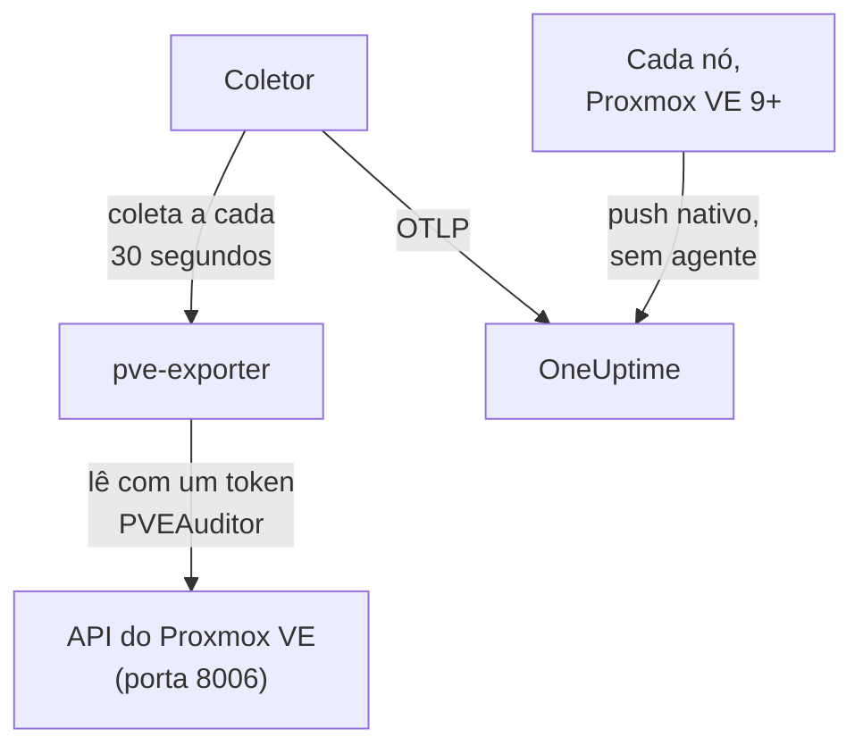

# Agente Proxmox

O agente Proxmox do OneUptime monitora um cluster Proxmox VE: os nós, as VMs QEMU, os contêineres LXC, o armazenamento, o estado de HA, a cobertura de backups e a replicação. Ele lê o cluster pela API do Proxmox VE com um token somente leitura e envia o que encontra ao OneUptime, onde o cluster aparece com os nós, os convidados e o armazenamento dele. No Proxmox VE 9 e posteriores, os nós também podem enviar as próprias métricas, sem nada para instalar. Os [monitores de Proxmox](/docs/monitor/proxmox-monitor) alertam com base no que chega.

:::cards
- [Escolha como se conectar](#escolha-como-se-conectar): O agente, ou o push do próprio Proxmox VE 9.
- [Instale o agente](#instale-o-agente): Um token de API, depois o script de instalação ou o Docker Compose.
- [Push nativo](#alternativa-sem-instalação-push-nativo-de-opentelemetry-do-proxmox-ve-9): O Proxmox VE 9 envia as métricas sozinho.
- [Solução de problemas](#solução-de-problemas): Um script de diagnóstico, e os problemas mais comuns.
:::

## Como funciona

O agente é um conjunto de contêineres que você executa com o Docker Compose em uma máquina: o [prometheus-pve-exporter](https://github.com/prometheus-pve/prometheus-pve-exporter) lê a API do Proxmox VE na porta 8006, um OpenTelemetry Collector coleta o exportador a cada 30 segundos e marca cada métrica com o nome do seu cluster, e o agente de IA do Proxmox permite que a OneUptime AI leia o cluster enquanto investiga. O push nativo do Proxmox VE 9 envia, em vez disso, as métricas de cada nó direto para o OneUptime.



O cluster se registra com os primeiros dados, com o nome que o agente marca em cada métrica como `proxmox.cluster.name`.

## Escolha como se conectar

| | O agente | Push nativo |
| --- | --- | --- |
| Proxmox VE | Qualquer versão compatível | 9.0 ou posterior |
| Para instalar | Docker Compose em uma máquina | Nada: um servidor de métricas na interface web do Proxmox |
| Nós, convidados e armazenamento | Sim | Sim |
| Estado de HA, início na inicialização, cobertura de backups e replicação | Sim | Não |
| Agente de IA do Proxmox | Sim | Não |

Os modelos **HA Resource in Error State**, **Guest Down**, **Guest Not Backed Up** e **Replication Failing** precisam do agente. Use um ou outro em um cluster: executar os dois informa cada recurso duas vezes.

## Antes de começar

- Docker Engine 20.10 ou posterior com o plugin Docker Compose v2, em uma máquina que consiga alcançar a API do Proxmox VE na porta 8006.
- Um shell root em qualquer nó do Proxmox VE, ou a interface web do Proxmox, para criar um token de API.
- Uma chave de ingestão. Crie uma em **Configurações do projeto → Telemetria e APM → Chaves de ingestão** e copie o valor.
- HTTPS de saída dessa máquina para a sua URL do OneUptime.

### Onde executar o agente

O agente consulta a API do Proxmox VE pela rede, então não precisa ficar em um nó do cluster, e não deveria: execute-o em uma máquina que sobreviva à falha de um nó (uma pequena VM de monitoramento em hardware separado, um host de gerenciamento), ou aponte `PVE_HOST` para um IP virtual ou um nome DNS round-robin em vez do endereço de um único nó. Se o alvo de API do agente for o nó que acabou de cair, o seu monitoramento cai junto. A única exceção é o pipeline opcional de logs do journald, que precisa ser executado em um nó do Proxmox VE (veja [Envie os logs de serviço do Proxmox](#opcional-envie-os-logs-de-serviço-do-proxmox)).

## Instale o agente

:::steps
### Crie um token de API somente leitura

O agente lê o cluster com um token de API que tem o papel **PVEAuditor**, que pode ler e nada mais.

:::tabs
@tab Shell
Como root em qualquer nó do Proxmox VE:

```bash
pveum user add monitoring@pam
pveum acl modify / --roles PVEAuditor --users monitoring@pam
pveum user token add monitoring@pam oneuptime --privsep 1
pveum acl modify / --roles PVEAuditor --tokens 'monitoring@pam!oneuptime'
```

O primeiro comando só falha, sem consequências, se `monitoring@pam` já existir: tokens de API carregam o próprio segredo, então o usuário não precisa de senha nem de conta de sistema. `pveum user token add` imprime o segredo do token uma vez; o ID do token é `monitoring@pam!oneuptime`.
@tab Proxmox web UI
1. Vá até *Datacenter → Permissions → API Tokens* e clique em **Add**.
2. Escolha (ou crie) um usuário, dê ao token um ID como `oneuptime` e deixe **Privilege Separation** marcado.
3. Copie o ID do token (`user@realm!tokenname`) e o segredo: o segredo só é mostrado uma vez.
4. Em *Datacenter → Permissions*, adicione o papel **PVEAuditor** no caminho `/` duas vezes: uma como **API Token Permission** para o token, outra como **User Permission** para o usuário dele.
:::

O papel vai no usuário e no token porque um token com separação de privilégios só recebe as permissões que o usuário dele também tem. Ele precisa ficar no caminho raiz `/`, porque o exportador lê todos os objetos de nó, de convidado e de armazenamento: um caminho mais restrito esconde o resto do cluster e falha com `401`/`403 Permission check failed (/, Sys.Audit)`.

### Instale e inicie o agente

:::tabs
@tab install.sh
Baixe o script de instalação e execute-o na máquina que vai hospedar o agente:

```bash
curl -sSL https://raw.githubusercontent.com/OneUptime/oneuptime/master/agents/ProxmoxAgent/install.sh -o install.sh
bash install.sh
```

O script pede a sua URL do OneUptime, a chave de ingestão, um nome para o cluster, o host da API do Proxmox VE, se deve executar o exportador incluído, e o ID e o segredo do token — e se o [agente de IA](#agente-de-ia) pode aplicar correções e, nesse caso, um token próprio para ele e os convidados que ele nunca pode alterar. Ele instala em `/opt/oneuptime-proxmox-agent`, grava um arquivo `.env` com permissão `0600` e inicia o agente com o Docker Compose. Executar o script de novo reutiliza tudo o que está nesse `.env` em vez de perguntar de novo, e é assim que você [atualiza o agente](#atualizando-o-agente).
@tab Docker Compose
Baixe `docker-compose.yml` e `otel-collector-config.yaml` do [diretório ProxmoxAgent](https://github.com/OneUptime/oneuptime/tree/master/agents/ProxmoxAgent) para uma pasta nova:

```bash
mkdir oneuptime-proxmox-agent && cd oneuptime-proxmox-agent
curl -fsSLO https://raw.githubusercontent.com/OneUptime/oneuptime/master/agents/ProxmoxAgent/docker-compose.yml
curl -fsSLO https://raw.githubusercontent.com/OneUptime/oneuptime/master/agents/ProxmoxAgent/otel-collector-config.yaml
```

Crie um arquivo `.env` ao lado deles. Ele contém o segredo do token, então mantenha-o privado com `chmod 600 .env`:

```bash title=".env"
ONEUPTIME_URL=YOUR_ONEUPTIME_URL
ONEUPTIME_TELEMETRY_INGESTION_KEY=YOUR_TELEMETRY_INGESTION_TOKEN
PROXMOX_CLUSTER_NAME=my-proxmox-cluster
PVE_HOST=192.168.1.10
PVE_API_TOKEN_ID=monitoring@pam!oneuptime
PVE_API_TOKEN_SECRET=your-token-secret
COMPOSE_PROFILES=pve-exporter
```

`COMPOSE_PROFILES=pve-exporter` também inicia o exportador incluído. Inicie o agente:

```bash
docker compose up -d
```
:::

Já usa o prometheus-pve-exporter? Responda **n** quando o script perguntar se deve executar o incluído, ou remova `COMPOSE_PROFILES` de `.env`, e aponte o agente para o seu (`host:port`, sem esquema, um endereço que o contêiner do agente consiga alcançar: `localhost` é o próprio contêiner). Mantenha `PVE_API_TOKEN_ID` e `PVE_API_TOKEN_SECRET` se você usa o [agente de IA](#agente-de-ia), que chama a API com esse token:

```bash
PVE_EXPORTER_URL=your-exporter-host:9221
```

### Verifique se o agente está em execução

```bash
docker compose ps
docker logs -f oneuptime-proxmox-agent
```

`docker compose ps` lista o coletor (`oneuptime-proxmox-agent`), o exportador incluído (`oneuptime-pve-exporter`, a menos que você use o seu) e o agente de IA (`oneuptime-proxmox-ai-agent`). Os logs do coletor devem mostrar esta linha assim que ele iniciar:

```text
Everything is ready. Begin running and processing data.
```

### Encontre o cluster no OneUptime

Abra **Produtos → Infraestrutura → Proxmox → Todos os clusters**. O cluster aparece com o `PROXMOX_CLUSTER_NAME` dele cerca de um minuto depois da primeira coleta, com os nós, os convidados e o armazenamento dele.
:::

## Variáveis de ambiente

O script de instalação grava estes valores em `/opt/oneuptime-proxmox-agent/.env`; uma instalação com o Docker Compose os lê do `.env` ao lado de `docker-compose.yml`. Depois de mudar um deles, execute `docker compose up -d` nessa pasta.

| Variável | Obrigatória | Descrição |
| --- | --- | --- |
| `ONEUPTIME_URL` | Sim | A sua URL do OneUptime, como `https://oneuptime.com` ou a sua instância auto-hospedada. Use `http://` e a porta dela se a instância for só HTTP. |
| `ONEUPTIME_TELEMETRY_INGESTION_KEY` | Sim | A chave de ingestão de **Configurações do projeto → Telemetria e APM → Chaves de ingestão**. |
| `PROXMOX_CLUSTER_NAME` | Sim | O nome do cluster no OneUptime, marcado em cada métrica como o atributo de recurso `proxmox.cluster.name`. Mantenha-o estável: mudá-lo depois registra um segundo cluster. O padrão é `proxmox-cluster`. |
| `PVE_HOST` | Sim | O host da API do Proxmox VE (qualquer nó do cluster) que o exportador e o agente de IA consultam, como `192.168.1.10`. |
| `PVE_EXPORTER_URL` | Não | O endereço (`host:port`, sem esquema) do prometheus-pve-exporter. O padrão é o exportador incluído, `pve-exporter:9221`. |
| `PVE_API_TOKEN_ID` | Exportador incluído ou agente de IA | O ID completo do token de API do Proxmox, como `monitoring@pam!oneuptime`. O agente de IA lê a API com ele, a menos que tenha um token próprio (`ONEUPTIME_AI_PVE_API_TOKEN_ID` / `ONEUPTIME_AI_PVE_API_TOKEN_SECRET`). |
| `PVE_API_TOKEN_SECRET` | Exportador incluído ou agente de IA | O segredo do token de API do Proxmox. |
| `PVE_VERIFY_SSL` | Não | Verifica o certificado TLS da API do Proxmox (o exportador e o agente de IA). O padrão é `false`, porque o Proxmox vem com certificados autoassinados. |
| `COMPOSE_PROFILES` | Não | Defina como `pve-exporter` para iniciar o contêiner do exportador incluído. |

## O que o agente coleta

O coletor coleta o exportador a cada 30 segundos com os coletores de cluster e de nó dele ativados, o que também cobre os coletores `backup-info` (nível de cluster) e `replication` (nível de nó) do exportador, ativados por padrão. Cada série carrega um rótulo `id` que identifica o recurso: `node/<name>`, `qemu/<vmid>`, `lxc/<vmid>` ou `storage/<node>/<storage>`.

| Categoria | Métricas |
| --- | --- |
| Disponibilidade | `pve_up`, `pve_uptime_seconds` |
| Nó | `pve_node_info`, `pve_cpu_usage_ratio`, `pve_cpu_usage_limit`, `pve_memory_usage_bytes`, `pve_memory_size_bytes` |
| Convidado (VM ou LXC) | `pve_guest_info`, e séries de CPU, memória e rede nos IDs `qemu/*` e `lxc/*` (`pve_network_receive_bytes`, `pve_network_transmit_bytes`) |
| Armazenamento | `pve_disk_usage_bytes`, `pve_disk_size_bytes`, `pve_storage_info` |
| HA | `pve_ha_state` |
| Cobertura de backups | `pve_not_backed_up_total` (os convidados que nenhum job de backup cobre; uma série de nível de cluster, sem rótulo `id`) e `pve_not_backed_up_info` (uma série por convidado não coberto, com o `id` dele). Coberto significa que pelo menos um job seleciona o convidado: se os backups foram executados recentemente ou tiveram sucesso não é exposto pelo exportador. |
| Replicação | `pve_replication_failed_syncs`, `pve_replication_duration_seconds`, `pve_replication_last_sync_timestamp_seconds`, `pve_replication_last_try_timestamp_seconds`, `pve_replication_next_sync_timestamp_seconds`, `pve_replication_info`, por job de replicação de armazenamento. O rótulo `id` delas é o ID do job (como `100-0`), não um recurso. |

Os critérios de monitores e os filtros de atributos comparam por igualdade, não por prefixo, então o processor `transform/pve-identity` do coletor também divide `id` em três atributos. Os modelos de alerta do Proxmox embutidos filtram por eles, então mantenha o processor se personalizar a configuração:

| Atributo | Valores | Para `qemu/100` |
| --- | --- | --- |
| `pve.scope` | `node`, `guest`, `storage`, `cluster` (`qemu` e `lxc` são ambos `guest`) | `guest` |
| `pve.type` | `node`, `qemu`, `lxc`, `storage` | `qemu` |
| `pve.id` | Tudo depois da primeira `/` de `id` (`pve1`, `100`, `pve1/local`) | `100` |

O rótulo `id` original é mantido como está.

## Opcional — Envie os logs de serviço do Proxmox

Por padrão, o agente envia só métricas, então a página **Registros** do cluster fica vazia. Os serviços do Proxmox VE gravam logs no journal do systemd em oito unidades: `pveproxy`, `pvedaemon`, `pve-firewall`, `pve-ha-crm`, `pve-ha-lrm`, `pvescheduler`, `pvestatd` e `qmeventd`. O `otel-collector-config.yaml` incluído tem um receiver `journald` comentado exatamente para essas unidades, ligado a um pipeline `logs` comentado que marca `proxmox.cluster.name`, para que os logs caiam no seu cluster.

:::steps
### Execute o agente em um nó

O journal é por host, então um agente remoto não consegue lê-lo. Esta é a única configuração que vai contra [Onde executar o agente](#onde-executar-o-agente): para manter o agente de métricas fora do cluster, execute em vez disso um segundo coletor, só de logs, no nó (copie a configuração e depois exclua o receiver `prometheus` e o pipeline `metrics`).

### Ative o receiver

Descomente o receiver `journald` e o pipeline `logs` em `otel-collector-config.yaml`, e os volumes do journal em `docker-compose.yml`, para que o contêiner consiga ler o journal do host:

```yaml
- /var/log/journal:/var/log/journal:ro
- /etc/machine-id:/etc/machine-id:ro
```

### Troque a imagem do coletor

A imagem padrão `otel/opentelemetry-collector-contrib` é construída `FROM scratch`: ela não tem `journalctl`, que o receiver do journald executa, e é executada como um usuário que não consegue ler o journal. Construa este wrapper e aponte `image:` em `docker-compose.yml` para ele:

```dockerfile title="Dockerfile"
FROM otel/opentelemetry-collector-contrib:0.161.0 AS otelcol
FROM debian:stable-slim
RUN apt-get update \
    && apt-get install -y --no-install-recommends systemd \
    && rm -rf /var/lib/apt/lists/*
COPY --from=otelcol /otelcol-contrib /otelcol-contrib
ENTRYPOINT ["/otelcol-contrib"]
CMD ["--config", "/etc/otelcol-contrib/config.yaml"]
```

O pacote `systemd` está ali só por causa do `journalctl`, e esta imagem é executada como root, que é quem consegue ler o journal. Ou dispense o Docker para os logs e execute o `.deb` da versão do `otelcol-contrib` no próprio nó, onde o `journalctl` já está.
:::

Cada nó envia só o próprio journal: para ter os logs de serviço de todos os nós, execute o coletor só de logs em cada nó.

### Alternativa sem imagem personalizada: filelog em /var/log/syslog

Para manter a imagem padrão, acompanhe o syslog em vez disso. Instale o rsyslog no nó (`apt install rsyslog`; o Debian 12 e o Proxmox VE 8 e posteriores não o trazem mais), monte o diretório `/var/log` no contêiner (`- /var/log:/var/log:ro`; o diretório, não o arquivo, para que a rotação de logs não prenda um arquivo velho) e use um receiver `filelog` no lugar do receiver do journald:

```yaml
receivers:
  filelog:
    include:
      - /var/log/syslog
    start_at: end
```

Você perde o filtro por unidade (o syslog carrega tudo, não só os oito serviços), e o usuário da imagem padrão precisa conseguir ler o arquivo. Ligue-o ao mesmo pipeline `logs` comentado (`receivers: [filelog]`).

## Alternativa sem instalação: push nativo de OpenTelemetry do Proxmox VE 9+

O Proxmox VE 9.0 e posteriores trazem um servidor de métricas OpenTelemetry que envia métricas de nós, convidados e armazenamento para qualquer endpoint OTLP/HTTP, sem agente nem exportador para instalar. Na interface web do Proxmox, vá até *Datacenter → Metric Server → Add → OpenTelemetry* e preencha:

| Campo | Valor |
| --- | --- |
| Server | O seu host do OneUptime, como `oneuptime.com`, ou o seu host auto-hospedado |
| Port | `443` |
| Protocol | `https` |
| Path | `/otlp/v1/metrics` |
| Headers | `{"x-oneuptime-token": "YOUR_TELEMETRY_INGESTION_TOKEN"}` |

Adicione-o uma vez: cada nó do cluster envia as próprias métricas. O OneUptime reconhece o push e o traduz nas mesmas séries `pve_*` que o agente envia, então:

- o cluster se registra com o nome do seu cluster Proxmox (um nó avulso, com o nome do nó), e um `proxmox.cluster.name` que você define em *Resource Attributes* continua sendo usado no lugar dele;
- as páginas Nós, Convidados e Armazenamento, os gráficos da visão geral, o catálogo de métricas e os modelos de alerta de CPU, memória e armazenamento funcionam como com o agente;
- as séries originais `proxmox_node_*`, `proxmox_vm_*` e `proxmox_storage_*` ficam no [Metrics Explorer](/docs/monitor/metrics-monitor) para tudo mais que o Proxmox VE informa (load average, swap, pressure stall, tráfego por placa de rede).

### Quando um nó para de reportar

Cada nó envia só o próprio status, então um nó que cai não consegue dizer isso sozinho. Os nós que continuam no ar reportam isso por ele:

- Cerca de 2 minutos depois do último relatório dele, o nó aparece como **Offline** na página Nós. **Visto pela última vez**, na página do próprio nó, mantém o horário do último relatório dele.
- Depois de cerca de 5 minutos, **Node Offline** dispara para ele. **Cluster Quorum at Risk** também o conta como offline; como esse modelo precisa de uma janela completa de 5 minutos de relatórios, ele dispara cerca de 7–9 minutos depois que o nó ficou em silêncio.
- Com o próximo relatório, ele volta a ficar **Online** e o alerta dele é resolvido.

Offline aqui significa que o nó parou de reportar, não necessariamente que ele caiu. Um nó que está no ar, mas cujo `pvestatd` travou ou foi encerrado, cujo sistema de arquivos do cluster (`pmxcfs`) caiu, ou cuja rede para o OneUptime foi cortada, é reportado da mesma forma.

O que isso não cobre:

- Um host avulso, ou um cluster inteiro que fica em silêncio de uma vez: não sobra ninguém para reportar, então nenhum alerta por nó dispara. Em vez disso, o cluster passa a **Desconectado**, como quando o agente para.
- Um nó em silêncio por mais de 7 dias deixa de ser reportado: o alerta dele é resolvido e ele sai da página Nós. Um OneUptime auto-hospedado muda os 7 dias com `PVE_SILENT_NODE_RETENTION_HOURS`.
- Um nó que você tira do cluster parece igual a um que caiu. Use **Remove Node** na página dele: ele some e o alerta dele é resolvido. Caso contrário, ele continua Offline por até 7 dias.
- Os convidados e o armazenamento do nó: só o próprio nó é mantido como Offline. As VMs, os contêineres e o armazenamento dele saem das páginas cerca de 15 minutos depois do último relatório dele, e os convidados que o HA reinicia em outro nó voltam a aparecer nesse nó.

Depois de uma queda da ingestão do OneUptime, um nó que acabou de ficar em silêncio só é reportado quando um dos outros volta a enviar por 2 minutos, então a própria queda nunca gera alertas para todos os nós. Um nó que já estava Offline continua Offline durante uma queda curta e mantém o alerta dele; depois de uma queda de mais de 5 minutos, ele é reportado de novo quando os outros enviarem por 2 minutos.

No [Metrics Explorer](/docs/monitor/metrics-monitor), esses relatórios são os pontos `pve_up` = 0 com o rótulo `oneuptime.proxmox.inferred` = `not-reporting`, então você sempre consegue diferenciá-los do que um nó disse sobre si mesmo.

### O que o push nativo não consegue fazer

O push nativo envia só o que cada nó sabe sobre si mesmo, então parte do que o agente coleta não tem equivalente nativo:

| Precisa do agente | Por quê |
| --- | --- |
| Estado de HA | Não é enviado: o modelo **HA Resource in Error State** precisa do agente. |
| Flag de início na inicialização | Não é enviada: **Guest Down**, que só alerta sobre convidados configurados para iniciar na inicialização, precisa do agente. |
| Cobertura de backups e replicação | Não são enviadas: **Guest Not Backed Up** e **Replication Failing** precisam do agente. |

Se você precisa disso, execute o agente em vez do push e remova o servidor de métricas: executar os dois informa cada recurso duas vezes.

## Execute como um serviço do systemd

Para iniciar o agente junto com a máquina e reiniciá-lo quando falhar, instale a unidade do systemd dele. Ela supõe que o agente fica em `/opt/oneuptime-proxmox-agent`, onde o script de instalação o coloca:

```bash
sudo cp systemd/oneuptime-proxmox-agent.service /etc/systemd/system/
sudo systemctl daemon-reload
sudo systemctl enable --now oneuptime-proxmox-agent
```

## Atualizando o agente

O agente informa como **Versão do agente** a versão do coletor que os arquivos dele fixam. Quando ela é mais antiga que a versão que esta versão do OneUptime fixa, um sinal de aviso aparece ao lado dela na **Visão geral** do cluster. Selecione-o para ver estes comandos. Um agente instalado antes de os arquivos dele informarem uma versão não mostra nenhuma até ser atualizado dessa forma.

A imagem do coletor está fixada em `docker-compose.yml`, e a configuração dele é um arquivo ao lado, então só baixar as imagens não faz o agente avançar. Execute `install.sh` de novo: ele reutiliza todos os valores do seu `.env` atual (nada é perguntado de novo), renova `docker-compose.yml` e `otel-collector-config.yaml` (um arquivo que você editou é guardado como `<file>.bak.<timestamp>`), baixa as imagens e recria o agente para que o coletor leia a nova configuração.

```bash
curl -sSL https://raw.githubusercontent.com/OneUptime/oneuptime/master/agents/ProxmoxAgent/install.sh -o install.sh
bash install.sh
```

Instalou com o Docker Compose? Na pasta do agente, baixe de novo os dois arquivos (e refaça qualquer alteração que você tenha feito neles), depois baixe as imagens e recrie o agente:

```bash
curl -fsSLO https://raw.githubusercontent.com/OneUptime/oneuptime/master/agents/ProxmoxAgent/docker-compose.yml
curl -fsSLO https://raw.githubusercontent.com/OneUptime/oneuptime/master/agents/ProxmoxAgent/otel-collector-config.yaml
docker compose pull
docker compose up -d --force-recreate
```

## Desinstalando o agente

```bash
cd /opt/oneuptime-proxmox-agent
docker compose down
```

Depois exclua o token de API em *Datacenter → Permissions → API Tokens* se não precisar mais dele.

## Agente de IA

O `docker-compose.yml` do agente também executa o **Agente de IA do Proxmox**, `oneuptime-proxmox-ai-agent` (imagem `oneuptime/resource-ai-agent:release`). Enquanto a OneUptime AI investiga um incidente ou alerta neste cluster, ela executa por meio dele comandos `pvesh` somente leitura — `pvesh get /cluster/status`, `pvesh get /nodes/pve1/qemu/101/status/current`, `pvesh get /nodes/pve1/tasks --errors 1 --limit 20` — e, só se você permitir, aplica correções como iniciar ou reiniciar um convidado. Não há binário `pvesh` nele: cada comando vira exatamente uma chamada à API do Proxmox VE em `PVE_HOST`, com um token do mesmo `.env`. Ele se registra como o cluster chamado `PROXMOX_CLUSTER_NAME`, como o coletor, e aparece na página **Agente de IA** do cluster no OneUptime.

- **As investigações de IA vêm ativadas por padrão.** Assim que o agente se conecta, a OneUptime AI investiga com ele os incidentes e alertas deste cluster, e a **Visão geral** do cluster mostra o status do agente. Para parar, defina `ONEUPTIME_AI_INVESTIGATION=false` onde o agente é executado (**Alterar**, em **O que a IA pode fazer** na página do agente de IA, mostra como), ou deixe o agente de fora.
- O token de API é o limite rígido. As investigações usam o token PVEAuditor do coletor (`PVE_API_TOKEN_ID` / `PVE_API_TOKEN_SECRET`), que pode ler e nada mais; se você executa o seu próprio exportador e não tem token em `.env`, adicione um. As correções precisam de um token próprio do agente de IA que possa ligar e desligar convidados (`VM.PowerMgmt`, por exemplo o papel `PVEVMUser` em `/vms` ou em um pool), definido como `ONEUPTIME_AI_PVE_API_TOKEN_ID` / `ONEUPTIME_AI_PVE_API_TOKEN_SECRET`.
- Ele é somente leitura, a menos que você defina `ONEUPTIME_AI_ALLOW_WRITES=true`; `ONEUPTIME_AI_WRITE_TARGETS` (VMIDs como `100,101`, e `<node>/<service>` para serviços de nó) limita o que uma correção pode tocar. Se o agente for executado em um convidado deste cluster, coloque o VMID desse convidado em `ONEUPTIME_AI_PROTECTED_TARGETS`. `ONEUPTIME_AI_FIXES`, no mesmo `.env`, diz como as correções são executadas — `ask-for-approval` (uma pessoa aprova cada uma), `automatic` ou `bypass-approval` — e a página do agente de IA mostra isso somente para leitura ([O que a IA pode fazer, definido pelo agente](/docs/ai/infrastructure-ai-agents#what-ai-may-do-set-by-the-agent)).
- Como o exportador, ele não verifica o certificado autoassinado da API, a menos que você defina `PVE_VERIFY_SSL=true` ou aponte `PVE_CA_FILE` para a CA do cluster (`/etc/pve/pve-root-ca.pem`, montada no contêiner).
- Ele é executado como UID 1000, sem capabilities e com um sistema de arquivos raiz somente leitura, e nunca lê `/access`, abre um console ou altera a configuração. Exclua o serviço `oneuptime-proxmox-ai-agent` do `docker-compose.yml` se você não usa a OneUptime AI.

O que ele pode executar, como as correções funcionam e como solucionar problemas: [Infrastructure AI Agents](/docs/ai/infrastructure-ai-agents#proxmox-clusters). O README do agente tem os comandos `pveum` exatos para um token de correções.

## Solução de problemas

:::details Execute primeiro o script de diagnóstico
O agente vem com um script, [`troubleshoot.sh`](https://github.com/OneUptime/oneuptime/blob/master/agents/ProxmoxAgent/troubleshoot.sh), que verifica a cadeia inteira: o runtime de contêineres, a coleta do exportador, o nome do cluster marcado em cada métrica, o formato do token, as métricas do próprio coletor e se o OneUptime aceita a chave de ingestão. Essa última verificação é a que mais importa. O OneUptime recusa uma chave inválida com `401` (`422` para uma chave desativada ou uma chave de navegador), e o coletor trata os dois como permanentes: ele descarta o lote e registra um único erro `Exporting failed`, fácil de passar despercebido enquanto o contêiner continua saudável. O script consulta `GET <url>/otlp/v1/validate` de dentro da rede do agente para obter direto um `200` (válida) ou `401` (inválida), e recorre a `POST /fluentd/v1/logs` em servidores mais antigos.

```bash
curl -sSL https://raw.githubusercontent.com/OneUptime/oneuptime/master/agents/ProxmoxAgent/troubleshoot.sh -o troubleshoot.sh
bash troubleshoot.sh    # add -d <dir> if you installed outside /opt/oneuptime-proxmox-agent
```

Ele termina com um veredito que cita a causa mais provável.
:::

:::details Nenhum cluster aparece no OneUptime
1. Leia os logs do coletor: `docker logs oneuptime-proxmox-agent`. Um `401` na exportação significa uma chave de ingestão inválida; conexão recusada significa uma `ONEUPTIME_URL` errada.
2. Verifique se o exportador responde. O exportador incluído não publica a porta dele no host, então pergunte de dentro da rede dele: `docker run --rm --network container:oneuptime-pve-exporter curlimages/curl -s "http://localhost:9221/pve?target=YOUR_PVE_HOST" | head` deve imprimir linhas `pve_*`. Para o seu próprio exportador, pergunte diretamente ao `host:9221` dele.
3. Verifique se `PROXMOX_CLUSTER_NAME` está definido: o cluster é encontrado pelo atributo de recurso `proxmox.cluster.name` dele.
:::

:::details O exportador retorna erros 401 ou 595
O token de API está errado ou não tem as permissões necessárias. Verifique o formato do ID do token (`user@realm!tokenname`), o segredo e se o papel **PVEAuditor** está no caminho `/` para o token e para o usuário dele. Os próprios logs do exportador mostram a resposta da API: `docker logs oneuptime-pve-exporter`.
:::

:::details Só métricas de nó, nenhuma métrica de convidado
As séries de convidados (IDs `qemu/*` e `lxc/*`) vêm do coletor de cluster do exportador, que a configuração incluída ativa com o parâmetro de coleta `cluster=1`. Se você personalizou `otel-collector-config.yaml`, coloque de volta o parâmetro `cluster: ["1"]`.
:::

:::details As métricas chegam ao cluster errado
O OneUptime registra um cluster Proxmox pelo `proxmox.cluster.name` dele, que o agente obtém de `PROXMOX_CLUSTER_NAME`. Mudá-lo depois dos primeiros dados cria um segundo cluster em vez de renomear o primeiro.
:::

:::details Com o push nativo, um nó aparece como Offline
Ele parou de reportar: um nó que caiu, um `pvestatd` travado, um `pmxcfs` parado ou uma rede cortada para o OneUptime parecem iguais. O próximo relatório dele o traz de volta. Se você tirou o nó do cluster, use **Remove Node** na página dele; caso contrário, ele continua Offline por até 7 dias. Veja [Quando um nó para de reportar](#quando-um-nó-para-de-reportar).
:::

:::details Com o push nativo, os alertas de Guest Down, HA ou backup nunca disparam
O push nativo não envia o estado de HA, o início na inicialização, a cobertura de backups nem a replicação. [Instale o agente](#instale-o-agente) para ter isso e remova o servidor de métricas: executar os dois informa cada recurso duas vezes.
:::

## Próximos passos

:::cards
- [Monitor de Proxmox](/docs/monitor/proxmox-monitor): Alerte sobre nós, convidados, armazenamento, HA, backups e replicação.
- [Agente Ceph](/docs/telemetry/ceph): Monitore o armazenamento Ceph por baixo do seu cluster Proxmox.
- [Infrastructure AI Agents](/docs/ai/infrastructure-ai-agents): O que o agente de IA do Proxmox pode executar e como as correções funcionam.
- [Coletor OpenTelemetry no host](/docs/telemetry/host-otel-collector): A visão no nível do sistema operacional de cada nó.
:::
