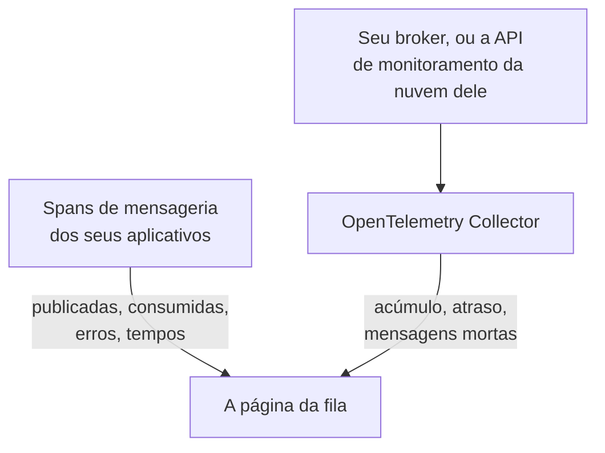

# Filas

**Queues** dá a cada fila de mensagens, tópico e assinatura que seus aplicativos usam uma página própria: quais serviços publicam nela e quais consomem dela, quantas mensagens passam, quantas falham e quanto tempo leva o processamento, seus traces e métricas e, assim que as métricas do próprio broker chegam ao OneUptime, seu acúmulo, o atraso dos consumidores, as mensagens mortas e a limitação. As filas têm rótulos, proprietários, regras de rótulos e de proprietários e arquivamento, como qualquer outro recurso. Abra-as em **Produtos → Recursos → Filas**.

:::cards
- [Instrumentar aplicativos](#instrumentar-aplicativos): Os spans de mensageria que sua instrumentação OpenTelemetry já envia.
- [Métricas de saúde do broker](#métricas-de-saúde-do-broker): Acúmulo, atraso e mensagens mortas do seu broker, sistema por sistema.
- [Alertas](#alertas): Modelos prontos para uso, e métricas atrasadas ou contadas.
- [Solução de problemas](#solução-de-problemas): Uma fila que não foi criada, ou uma saúde do broker que continua vazia.
:::

## Como funciona

Funciona da mesma forma para todo broker (Apache Kafka, RabbitMQ, Apache ActiveMQ e outros brokers JMS, Amazon SQS e SNS, Google Cloud Pub/Sub, Azure Service Bus, Event Hubs e Event Grid, Apache Pulsar, Apache RocketMQ, NATS e BullMQ; veja [Sistemas de mensageria compatíveis](#sistemas-de-mensageria-compatíveis)) e para qualquer outro broker que seus spans nomeiem em `messaging.system`. A maioria das filas aparece sozinha, a partir de duas fontes:

| Fonte | O que ela precisa de você | O que ela acrescenta à página da fila |
| --- | --- | --- |
| **Traces de aplicativos** | Aplicativos instrumentados (OpenTelemetry); veja [Instrumentar aplicativos](#instrumentar-aplicativos) | Mensagens publicadas e consumidas, erros e tempo de processamento, os serviços de cada lado e os próprios traces |
| **Métricas do broker** (um OpenTelemetry Collector) | O receptor do coletor ou a coleta para o seu broker; veja [Métricas de saúde do broker](#métricas-de-saúde-do-broker) | **Saúde do broker**: acúmulo, atraso dos consumidores, mensagens mortas, idade da mensagem mais antiga, limitação e as taxas de mensagens do próprio broker |



Os traces dizem ao OneUptime que uma fila existe e como os aplicativos a usam, mas não o quanto ela está cheia. Isso vem do próprio broker ou da API de monitoramento do provedor de nuvem dele ou, no caso do [BullMQ](#bullmq), que guarda seus jobs no Redis e não tem um broker a quem perguntar, de um medidor que o aplicativo informa.

Você também pode adicionar uma fila manualmente: **Queues → Criar: Queue**, com o sistema de mensageria e o nome do destino e, para Azure Service Bus e Event Hubs, o namespace. O formulário pede esses dados na primeira etapa, **Sistema de mensageria**, e depois um nome e uma descrição opcionais, com os rótulos em **Mais campos** (**Informações da fila**). Deixe o namespace vazio apenas para uma fila que seus aplicativos alcançam por um emulador ou por um nome de domínio personalizado: os spans deles não nomeiam nenhum namespace, e as métricas do Azure Monitor nunca chegam a essa fila (veja [Limitações](#limitações)).

## Primeiros passos

:::steps
### Envie os traces dos seus aplicativos

Instrumente os aplicativos que publicam e consomem, e envie os traces deles ao OneUptime (veja [Instrumentar aplicativos](#instrumentar-aplicativos)). Nada específico do OneUptime é necessário: os spans de mensageria que sua instrumentação já gera nomeiam as filas.

### Envie as métricas do seu broker

Encontre seu sistema de mensageria em [Métricas de saúde do broker](#métricas-de-saúde-do-broker) e execute a configuração do coletor dele com sua chave de ingestão. A guia **Documentação** de cada fila tem a configuração dessa fila, pronta para copiar.

### Abra a fila

Abra **Produtos → Recursos → Filas**. A descoberta é executada a cada 10 minutos: uma fila aparece assim que pelo menos 3 dos seus spans chegaram em 15 minutos, ou uma métrica do broker a nomeou.
:::

## Sistemas de mensageria compatíveis

O OneUptime conhece pelo nome os sistemas de mensageria abaixo. Ele normaliza o que as instrumentações colocam em `messaging.system` para o valor da segunda coluna (o valor conhecido do OpenTelemetry, quando existe) sem diferenciar maiúsculas de minúsculas, de modo que `AmazonSQS`, `aws.sqs` e `aws_sqs` são um só sistema. `nats` e `bullmq` não são valores conhecidos do OpenTelemetry: `nats` é o que a instrumentação NATS do agente Java informa, e `bullmq` é o valor a definir para o BullMQ (veja [BullMQ](#bullmq)).

Um sistema que o OneUptime não conhece funciona mesmo assim: um valor bem formado (`ibmmq`, `solace`, `mqtt`: letras minúsculas, dígitos, `.`, `_` e `-`, até 64 caracteres) é mantido como chegou, de modo que as filas desse broker são descobertas e exibidas com esse nome; só as métricas do próprio broker precisam de um sistema desta tabela. `spring_integration` é ignorado: os canais do Spring Integration são chamadas de método dentro de um processo, não um broker.

**Métricas do broker** indica de onde vêm as métricas de saúde de um sistema: um receptor do collector-contrib, um endpoint Prometheus (`:port/path`, coletado com o receptor `prometheus` do coletor), a API de monitoramento do provedor de nuvem ou um programa fora do coletor que as envia por OTLP. Cada sistema leva abaixo à sua configuração, e a guia **Documentação** de cada fila transforma isso em uma configuração para essa fila.

| Sistema | `messaging.system` | Também aceito | Métricas do broker |
| --- | --- | --- | --- |
| [Amazon SNS](#amazon-sns) | `aws.sns` | `aws_sns`, `amazonsns`, `sns` | receptor `aws_cloudwatch` ou `awsfirehose` (monitoramento de nuvem) |
| [Amazon SQS](#amazon-sqs) | `aws_sqs` | `aws.sqs`, `amazonsqs`, `sqs` | receptor `aws_cloudwatch` ou `awsfirehose` (monitoramento de nuvem) |
| [Apache ActiveMQ](#apache-activemq) | `activemq` | `artemis`, `activemq_artemis` | OpenTelemetry JMX Scraper (envia por OTLP) |
| [Apache Kafka](#apache-kafka) | `kafka` | — | receptor `kafka_metrics` |
| [Apache Pulsar](#apache-pulsar) | `pulsar` | `apache_pulsar` | Prometheus (broker do Pulsar), `:8080/metrics/` |
| [Apache RocketMQ](#apache-rocketmq) | `rocketmq` | — | Prometheus (broker do RocketMQ), `:5557/metrics` |
| [Azure Event Grid](#azure-event-grid) | `eventgrid` | `azure_eventgrid`, `azure.eventgrid`, `microsoft.eventgrid` | receptor `azure_monitor` (monitoramento de nuvem) |
| [Azure Event Hubs](#azure-event-hubs) | `eventhubs` | `azure_eventhubs`, `azure.eventhubs`, `microsoft.eventhub` | receptor `azure_monitor` (monitoramento de nuvem) |
| [Azure Service Bus](#azure-service-bus) | `servicebus` | `azure_servicebus`, `azure.servicebus`, `microsoft.servicebus` | receptor `azure_monitor` (monitoramento de nuvem) |
| [BullMQ](#bullmq) | `bullmq` | — | Nada integrado |
| [Google Cloud Pub/Sub](#google-cloud-pubsub) | `gcp_pubsub` | `gcp.pubsub`, `pubsub`, `google_pubsub` | receptor `googlecloudmonitoring` (monitoramento de nuvem) |
| [JMS](#jms) | `jms` | — | Nada integrado |
| [NATS](#nats) | `nats` | `jetstream` | Prometheus (prometheus-nats-exporter), `:7777/metrics` |
| [RabbitMQ](#rabbitmq) | `rabbitmq` | — | receptor `rabbitmq` |

Uma fila é um destino de um sistema. No **Azure Service Bus** e no **Azure Event Hubs**, o namespace também faz parte dela, já que dois namespaces podem conter, cada um, uma fila chamada `orders`. **JMS** e **Apache ActiveMQ** compartilham suas filas: os aplicativos Java chegam ao ActiveMQ pela API JMS, cujos spans dizem `jms` seja qual for o broker, enquanto as métricas do próprio broker só podem dizer `activemq`; por isso, ambos chegam a uma mesma fila (veja [O que faz de duas observações uma só fila](#o-que-faz-de-duas-observações-uma-só-fila)).

## Como as filas são descobertas

Cada fila registra se foram traces, métricas do broker ou uma pessoa que a criaram. Tudo o que nomeia depois a mesma fila é acrescentado a ela em vez de criar outra (veja [O que faz de duas observações uma só fila](#o-que-faz-de-duas-observações-uma-só-fila)).

### A partir de traces de aplicações

A cada 10 minutos, o OneUptime resume os spans que seus aplicativos enviaram nos últimos 15 minutos e que carregam alguma das chaves `messaging.system`, `messaging.destination.name`, `messaging.destination`, `message_bus.destination`, `az.namespace`, `azure.resource_provider.namespace`, `aws.sqs.queue.url`, `aws.queue_url` ou `aws.sns.topic.arn`. Todo span conta, exceto um span SERVER: spans PRODUCER, CONSUMER, CLIENT e INTERNAL, e spans aos quais o **Remapeador de tipo de span** de um pipeline de traces deu outro tipo (como Unspecified) ou nenhum; um span SERVER nunca nomeia uma fila.

Os spans do próprio broker também são spans SERVER. O rastreador eBPF do [agente Kubernetes](/docs/telemetry/kubernetes-agent#como-são-os-traces-de-ebpf) registra o lado de um broker Kafka, MQTT ou NATS em cada troca (uma mensagem que ele recebe, uma mensagem que ele entrega) e envia a maioria delas como PRODUCER ou CONSUMER; o OneUptime as armazena como SERVER, de modo que um broker não aparece entre os produtores ou consumidores dos tópicos que transporta. Um broker MQTT que repassa uma mensagem a um assinante escreve o mesmo PUBLISH que um cliente, e o rastreador informa os dois da mesma forma; por isso, nas publicações MQTT e NATS, o OneUptime se guia pela porta da outra ponta da conexão: a partir da porta 32768 (onde os sistemas operacionais escolhem a porta de um cliente que se conecta; o intervalo padrão do Linux começa ali; Windows e macOS usam 49152–65535) é a de um assinante, e o span é do broker. Um aplicativo que publica em um broker MQTT ou NATS que, por sua vez, escuta em uma porta a partir de 32768, como uma porta do Docker publicada aleatoriamente, não aparece, portanto, como produtor dos seus tópicos, e um tópico que só esses aplicativos usam pode nem ser descoberto a partir dos spans do rastreador. Um assinante que se conecta a um broker a partir de uma porta abaixo de 32768 (um intervalo de portas reduzido, ou uma porta reescrita por um NAT) continua vendo o broker listado como produtor dos tópicos entregues a ele.

Todo atributo de mensageria do OpenTelemetry ainda está marcado como em desenvolvimento, então os aplicativos de um mesmo projeto informam as mesmas coisas com até cinco gerações de nomes. O OneUptime lê todos, os mais novos primeiro, e nunca analisa os nomes dos spans, cujo formato mudou nas convenções semânticas 1.27 e que os fornecedores escolhem livremente:

- **O sistema**: `messaging.system`, normalizado como em [Sistemas de mensageria compatíveis](#sistemas-de-mensageria-compatíveis). Sem ele, `az.namespace` ou `azure.resource_provider.namespace` dos SDKs do Azure (`Microsoft.ServiceBus`, `Microsoft.EventHub`), a chave antiga `component` do SDK do Azure, um span do SDK da AWS (`rpc.system` = `aws-api`) que chama SQS ou SNS (os spans de SNS do agente Java não carregam `messaging.system`), ou uma chave com a URL de uma fila do SQS ou o ARN de um tópico do SNS.
- **O destino**: a primeira das chaves `messaging.destination.template`, `messaging.destination.name`, `messaging.source.template`, `messaging.source.name`, `messaging.destination` e `message_bus.destination` que o span carrega. Um span sem nenhuma delas recorre às chaves próprias do seu sistema: a URL da fila do SQS (`aws.sqs.queue.url`, `aws.queue_url` ou uma URL de fila em `messaging.url`, `server.address` ou `net.peer.name`), o ARN do tópico do SNS (`aws.sns.topic.arn`) e, no RabbitMQ, a chave de roteamento (`messaging.rabbitmq.destination.routing_key` ou `messaging.rabbitmq.routing_key`), que é o nome da fila quando uma mensagem passa pela exchange padrão.
- **A direção**: primeiro `messaging.operation.type`, depois o tipo do span (PRODUCER publica, CONSUMER consome), depois o antigo `messaging.operation`, depois `messaging.operation.name` e, no SQS e no SNS, a operação do SDK da AWS em `rpc.method` (`SendMessage`, `ReceiveMessage`, …). O tipo tem prioridade sobre as chaves antigas porque algumas instrumentações as preenchiam errado: o confluent-kafka para Python gravava `receive` em seus spans de produtor.

Uma fila é **criada** a partir de traces assim que seus spans na janela de 15 minutos que uma execução examina somam pelo menos 3 (`MESSAGE_QUEUE_MIN_SPANS`), para que um script avulso não crie uma, e somente enquanto o projeto estiver abaixo do seu [limite de criação automática](#o-orçamento-de-criação-automática). Os spans que não criam uma fila ainda contam para uma que já existe.

Cada span de mensageria também é marcado com sua fila ao ser ingerido, de modo que a guia **Traços** da fila mostra cada span que a nomeia, inclusive spans enviados antes de a fila ser criada.

### A partir das métricas do broker

Uma métrica do broker das listas em [Métricas de saúde do broker](#métricas-de-saúde-do-broker) nomeia sua fila no atributo próprio do broker (`topic` do Kafka, `rabbitmq.queue.name` do RabbitMQ, a dimensão `EntityName` do Azure Monitor, `QueueName` do CloudWatch), e o OneUptime a associa a essa fila ao ingeri-la. As métricas do broker não carregam `messaging.system`: cada uma é reconhecida pelo nome (`kafka.consumer_group.lag_sum`) e, quando dois sistemas compartilham um nome (o Azure Monitor dá o mesmo nome às métricas do Service Bus e às do Event Hubs), pelo tipo de recurso que o ponto de dados carrega.

A próxima execução da descoberta cria a fila se ela ainda não existir: basta uma métrica do broker, dentro do [limite de criação automática](#o-orçamento-de-criação-automática). Assim, uma fila que nenhum aplicativo instrumentado toca aparece mesmo assim quando o broker dela a informa.

As APIs de monitoramento de nuvem (CloudWatch, Azure Monitor e Cloud Monitoring) publicam cada valor minutos depois do momento que ele mede, e ele é armazenado com esse momento. Por isso, cada execução lê as métricas delas da última hora, em vez dos últimos 15 minutos dos quais lê os spans e as demais métricas: um ponto de dados que chega atrasado ainda observa sua fila, ou a cria.

### A partir das métricas dos clientes de mensageria

Os clientes instrumentados também podem informar métricas: as métricas de clientes de mensageria do OpenTelemetry `messaging.client.sent.messages`, `messaging.client.consumed.messages`, `messaging.client.operation.duration` e `messaging.process.duration`, seus nomes antigos `messaging.publish.duration`, `messaging.receive.duration`, `messaging.publish.messages`, `messaging.receive.messages`, `messaging.process.messages` e `messaging.client.published.messages`, e as do SDK do Azure para Java `messaging.servicebus.messages.sent`, `messaging.servicebus.receiver.lag`, `messaging.servicebus.settlement.request.duration` e `messaging.servicebus.settlement.sequence_number`. Cada ponto de dados nomeia seu sistema e seu destino como um span faz (as métricas do Service Bus do SDK do Azure não nomeiam nenhum sistema, então o nome delas faz esse papel) e é associado a essa fila ao ser ingerido, de modo que aparece na guia **Métricas** da fila. O mesmo vale para qualquer métrica sua que carregue `messaging.system` e `messaging.destination.name` em cada ponto de dados (não no recurso, onde eles não são lidos), como um medidor de profundidade da fila (veja [BullMQ](#bullmq)).

As métricas dos clientes de mensageria nunca criam uma fila: quem faz isso são os traces, as métricas do broker ou uma pessoa. Uma métrica de cliente que nomeia uma fila existente mantém atualizado o **Visto pela última vez** dela, como fazem seus spans. Uma métrica sua não faz nenhuma das duas coisas: só aparece na guia **Métricas** da fila.

### O que faz de duas observações uma só fila

A identidade de uma fila é seu **sistema** e seu **destino**, comparados sem diferenciar maiúsculas de minúsculas: `Orders` e `orders` são uma só fila, exibida com o nome como foi visto primeiro. No Azure Service Bus e no Event Hubs, a identidade também inclui o **namespace**:

- em um span, o primeiro rótulo DNS do host ao qual o SDK se conectou, tirado de `server.address`, `net.peer.name`, `peer.address` ou `network.peer.address`, nessa ordem, quando esse host é um host de namespace: `<namespace>.servicebus.windows.net`, ou `.servicebus.usgovcloudapi.net`, `.servicebus.chinacloudapi.cn` ou `.servicebus.cloudapi.de` de uma nuvem soberana. O Event Hubs compartilha o domínio do Service Bus;
- em uma métrica do Azure Monitor, o `name` do namespace sobre o qual ela informa.

Nada mais faz parte dela, então nada disto divide uma fila: o endereço do broker (os clientes Kafka raramente informam um, e um namespace do Azure responde em muitos), o grupo de consumidores ou a assinatura (os consumidores de um tópico não são filas separadas), a partição e uma subfila de mensagens mortas. Destes, uma fila guarda apenas o endereço do broker, para exibição.

**JMS e ActiveMQ são uma só família.** Todo span JMS diz `jms` seja qual for o broker por trás, e as métricas do próprio broker (o [OpenTelemetry JMX Scraper](#apache-activemq)) só podem dizer `activemq`, então o OneUptime identifica uma fila do ActiveMQ pela família JMS: os spans e as métricas do broker de `orders` chegam a uma só fila. Ela aparece como JMS até chegarem as métricas do broker, e como Apache ActiveMQ a partir daí, nunca o contrário. Uma fila que você cria manualmente como Apache ActiveMQ é essa mesma fila.

### Como os nomes de destino são lidos

As instrumentações nomeiam uma mesma fila de muitas formas, e o OneUptime reduz o que elas informam ao nome próprio da fila:

| Sistema | Informado como | Fila |
| --- | --- | --- |
| Amazon SQS | `https://sqs.us-east-1.amazonaws.com/123456789012/orders`, uma URL de fila (o `otelaws` do Go a coloca em `server.address`) | `orders` |
| Amazon SNS | `arn:aws:sns:us-east-1:123456789012:order-events`, um ARN de tópico | `order-events` |
| Google Cloud Pub/Sub | `projects/shop/topics/orders`, um nome de recurso | `orders` |
| Azure Service Bus | `orders/Subscriptions/billing`, o caminho da entidade da assinatura `billing` do tópico | `orders` |
| Azure Service Bus | `orders/$DeadLetterQueue`, o caminho da entidade da subfila de mensagens mortas da fila | `orders` |
| Azure Event Hubs | `telemetry/ConsumerGroups/$Default/Partitions/3`, o caminho da entidade de um receptor, para o grupo de consumidores `$Default` | `telemetry` |
| Apache Pulsar | `orders-partition-3`, uma partição de um tópico de nome curto | `persistent://public/default/orders` |
| Apache Pulsar | `acme/shop/orders`, um tópico sem o seu domínio | `persistent://acme/shop/orders` |
| JMS | `queue://orders`, com o prefixo do tipo de destino | `orders` |
| RabbitMQ | `shop:new-order:orders`, exchange, chave de roteamento e fila em um consumidor (convenções semânticas 1.30 e posteriores) | `orders` |
| RabbitMQ | `amq.default`, a exchange padrão, com a chave de roteamento `orders` | `orders` |
| RabbitMQ | `,orders`, o `{exchange},{routing key}` do aio-pika pela exchange padrão | `orders` |
| RabbitMQ | `shop,new-order`, o `{exchange},{routing key}` do aio-pika | `shop` |

Uma partição do Pulsar se incorpora ao seu tópico, e um nome sem domínio é completado como o próprio Pulsar o completa (um nome curto, no namespace `public/default`), de modo que os nomes do agente Java se juntam aos rótulos de métricas totalmente qualificados dos brokers. Um span do RabbitMQ geralmente nomeia a exchange pela qual uma mensagem passou, tanto no lado que publica quanto no que consome; a exchange padrão (`amq.default`, `<default>` ou um nome vazio) representa sua chave de roteamento, que é o nome da fila. As convenções semânticas 1.30 juntam exchange, chave de roteamento e fila com `:` (os nomes opcionais do agente Java), e o OneUptime pega a fila do nome unido de um consumidor e a exchange do de um publicador. O aio-pika junta exchange e chave de roteamento com uma vírgula no lado que publica, e o OneUptime os separa da mesma forma.

### O que é ignorado

O OneUptime prefere errar a favor de não criar uma fila: caso contrário, um nome inventado por requisição ou por consumidor criaria, para cada mensagem, uma fila que não pertence a ninguém. Estes nunca viram filas:

- **Spans SERVER**, e spans cujo `messaging.system` é `spring_integration`.
- **Destinos marcados como temporários ou anônimos**: `messaging.destination.temporary`, `messaging.destination.anonymous`, `messaging.source.temporary` ou `messaging.source.anonymous` definido como `true`. O antigo `messaging.temp_destination` não é confiável: as instrumentações pika e aio-pika para Python o definem em cada publicação.
- **Marcadores que as instrumentações informam no lugar de um nome**: `(temporary)`, `(anonymous)`, `<generated>`, `unknown` (um lote do Kafka que abrange vários tópicos), `aws:sqs` (os eventos de SQS do Lambda do agente Java), `-NamespaceOnlyMetric-` do Azure Monitor e um valor que a própria limpeza de dados do OneUptime substituiu por inteiro (`[REDACTED]`).
- **Destinos gerados e de resposta**: as filas nomeadas pelo servidor do RabbitMQ no estilo `amq.gen-JzTY20BRgKO-HjmUJj0wLg`, as filas `spring.gen-…` do Spring e as filas `<destination>.anonymous.<id>` do Spring Cloud Stream de consumidores sem grupo, e o direct reply-to (`amq.rabbitmq.reply-to…`); os destinos temporários do JMS (`temp-queue://…`, `temp-topic://…`) e `$TMP$…` da TIBCO; os tópicos de aviso do ActiveMQ (`ActiveMQ.Advisory.…`); as caixas de entrada do NATS (`_INBOX.…`) e os subjects de confirmação do JetStream (`$JS.ACK.…`); os tópicos de sistema do Pulsar (`__change_events`, `__transaction_…` e tudo abaixo de um segmento `/__`); e um destino que não passa de um UUID.
- **Mensagens de texto e push móvel do SNS**: um número de telefone (`+15555550123`, ou `phone_number:**` do botocore) ou um ARN de endpoint de plataforma (`arn:aws:sns:us-east-1:123456789012:endpoint/GCM/shop-app/1234`) é um dispositivo, não um tópico.
- **Nomes que não podem ser uma só fila**: uma lista de destinos de um lote (`["orders","payments"]`), um nome com um caractere de controle e um nome com mais de 255 caracteres.

**Os UUIDs viram modelo.** Cada UUID dentro de um destino é substituído por `{uuid}`, de modo que nomes por requisição como `reply-7f1c2a9e-4b1d-4c3e-9f1a-2b3c4d5e6f70` viram uma só fila, `reply-{uuid}`, em vez de uma fila cada.

### O orçamento de criação automática

Os traces e as métricas do broker só criam filas sozinhos enquanto o projeto tiver menos de 500 filas descobertas ativas e não arquivadas (`MESSAGE_QUEUE_AUTO_CREATE_BUDGET`; veja [Ajustes para instalações auto-hospedadas](#ajustes-para-instalações-auto-hospedadas)). As filas que você cria manualmente nunca contam e nunca são bloqueadas; as filas arquivadas não contam, então o [arquivamento automático](#ciclo-de-vida-e-arquivamento) libera limite; e as filas que já existem continuam sendo associadas e atualizadas.

### Ciclo de vida e arquivamento

- **Visto pela última vez** é quando a descoberta viu a fila pela última vez, em traces, métricas de clientes de mensageria ou métricas do broker.
- **Arquivar para descartar.** Excluir uma fila descoberta só a remove até ela ser vista de novo: a próxima observação a traz de volta como uma fila nova. Para descartar uma de vez, **arquive-a**. Uma fila arquivada mantém sua identidade, então tudo o que a nomeia continua associado à fila arquivada em vez de criar uma nova.
- **Arquivamento automático.** Uma fila descoberta que não foi vista por 7 dias (`MESSAGE_QUEUE_AUTO_ARCHIVE_DAYS`) é arquivada automaticamente, a menos que uma pessoa a tenha renomeado, descrito, rotulado ou lhe dado proprietários. Os rótulos e proprietários que as regras de rótulos ou de proprietários adicionaram sozinhas não contam.
- **Restauração.** Uma fila arquivada automaticamente é restaurada automaticamente quando é vista de novo. As filas que você criou manualmente, e as filas que uma pessoa arquivou, nunca são arquivadas nem restauradas pela descoberta. Uma fila que uma pessoa restaura continua restaurada por 30 dias (ou pela janela de arquivamento, se for maior) mesmo que nada a veja; a partir da próxima observação, a regra dos 7 dias volta a valer.

## Instrumentar aplicativos

As filas vêm dos spans de mensageria que sua instrumentação OpenTelemetry já gera; nada específico do OneUptime é necessário. Envie os traces ao OneUptime como descrito em [OpenTelemetry](/docs/telemetry/open-telemetry) e depois confira a lista da sua linguagem.

:::tabs
@tab Java
O agente Java do OpenTelemetry rastreia clientes Kafka, RabbitMQ, JMS (ActiveMQ, Artemis, IBM MQ e qualquer outro broker JMS), Amazon SQS e SNS, Pulsar, RocketMQ e NATS sem mudanças no código. O OneUptime lê tanto os nomes de atributos que ele emite por padrão quanto os mais novos que ele emite com `OTEL_SEMCONV_STABILITY_OPT_IN=messaging` (agente 2.31.0 e posteriores). Os spans JMS dizem `jms` seja qual for o broker por trás deles (veja [JMS](#jms)).

- **Azure Service Bus e Event Hubs**: o SDK do Azure para Java rastreia a si mesmo, e o agente Java conecta esse rastreamento ao OpenTelemetry.
- **Google Cloud Pub/Sub**: o cliente rastreia a si mesmo assim que seus builders `Publisher` e `Subscriber` recebem uma instância do OpenTelemetry e a chave de rastreamento: `setOpenTelemetry(GlobalOpenTelemetry.get())` e `setEnableOpenTelemetryTracing(true)`. Qualquer uma das chamadas sozinha não rastreia nada.
@tab .NET
- **Azure Service Bus e Event Hubs** (`Azure.Messaging.ServiceBus`, `Azure.Messaging.EventHubs`): os spans OpenTelemetry deles são experimentais no SDK do Azure. Ative-os com a variável de ambiente `AZURE_EXPERIMENTAL_ENABLE_ACTIVITY_SOURCE=true` (ou a chave `Azure.Experimental.EnableActivitySource` abaixo) e assine as fontes `Azure.*`.
- **RabbitMQ.Client** 7 rastreia a si mesmo: assine `RabbitMQ.Client.*`.
- **MassTransit** rastreia a si mesmo: assine `MassTransit` (veja em [Limitações](#limitações) o que os spans dele deixam de fora).
- **Confluent.Kafka**: o pacote `OpenTelemetry.Instrumentation.ConfluentKafka`.
- **Amazon SQS e SNS**: o pacote `OpenTelemetry.Instrumentation.AWS`, com `.AddAWSInstrumentation(opt => opt.SemanticConventionVersion = SemanticConventionVersion.Latest)`. Seu conjunto de atributos padrão (`V1_28_0`) nomeia uma fila do SQS apenas pela URL (`aws.queue_url`, que o OneUptime lê) e não nomeia um tópico do SNS.

```csharp
// Before any Azure client is created; or set AZURE_EXPERIMENTAL_ENABLE_ACTIVITY_SOURCE=true.
AppContext.SetSwitch("Azure.Experimental.EnableActivitySource", true);

builder.Services.AddOpenTelemetry()
    .WithTracing(tracing => tracing
        .AddSource("Azure.*")
        .AddSource("RabbitMQ.Client.*")
        .AddSource("MassTransit")
        .AddOtlpExporter());
```
@tab Node.js
- `@opentelemetry/auto-instrumentations-node` rastreia `amqplib` (RabbitMQ), `kafkajs` e o SDK da AWS (SQS e SNS).
- **Azure Service Bus e Event Hubs**: registre `createAzureSdkInstrumentation()` de `@azure/opentelemetry-instrumentation-azure-sdk`.
- **Google Cloud Pub/Sub**: `new PubSub({ enableOpenTelemetryTracing: true })`.
- **BullMQ**: veja [BullMQ](#bullmq); a telemetria própria dele precisa de dois atributos adicionados.
@tab Python
- Kafka: `opentelemetry-instrumentation-kafka-python`, `opentelemetry-instrumentation-confluent-kafka` ou `opentelemetry-instrumentation-aiokafka`. RabbitMQ: `opentelemetry-instrumentation-pika` ou `opentelemetry-instrumentation-aio-pika`. SQS e SNS: `opentelemetry-instrumentation-botocore`, ou `opentelemetry-instrumentation-boto3sqs` para SQS. `opentelemetry-bootstrap -a install` escolhe as que suas bibliotecas instaladas precisam.
- **Azure Service Bus e Event Hubs**: instale `azure-core-tracing-opentelemetry` e defina `settings.tracing_implementation = "opentelemetry"` (de `azure.core.settings`).
- **Google Cloud Pub/Sub**: `PublisherOptions(enable_open_telemetry_tracing=True)` e `SubscriberOptions(enable_open_telemetry_tracing=True)`.
- Os spans do Celery não carregam `messaging.system` nem nomeiam nenhum broker, então não criam filas.
@tab Go
- **Amazon SQS e SNS**: `otelaws` (`go.opentelemetry.io/contrib/instrumentation/github.com/aws/aws-sdk-go-v2/otelaws`), adicionado com `otelaws.AppendMiddlewares(&cfg.APIOptions)`. Seus spans de SQS carregam a URL da fila em `server.address`, que o OneUptime lê como a fila.
- **Google Cloud Pub/Sub**: `pubsub.ClientConfig{EnableOpenTelemetryTracing: true}`.
- **Kafka** com `segmentio/kafka-go`: a instrumentação automática do OpenTelemetry para Go (`go.opentelemetry.io/auto`, eBPF, no Linux) rastreia seus produtores e consumidores sem mudanças no código.
- As bibliotecas contrib de Go do OpenTelemetry não têm instrumentação para Kafka, RabbitMQ ou NATS. Para outros clientes, use o suporte ao OpenTelemetry da própria biblioteca cliente, ou defina `messaging.system`, `messaging.destination.name` e o tipo de span nos spans em torno dos seus envios e handlers.
:::

## Métricas de saúde do broker

Um broker sabe o que nenhum aplicativo consegue ver: quantas mensagens estão esperando, quão atrasado está cada grupo de consumidores, o que foi para uma fila de mensagens mortas. Cada seção abaixo tem a configuração do coletor para um sistema: uma configuração completa do OpenTelemetry Collector que termina no exportador OTLP que envia ao OneUptime. Coloque uma chave de ingestão de telemetria (**Configurações do projeto → Telemetria e APM → Chaves de ingestão**) em `x-oneuptime-token`, substitua `https://oneuptime.com` pelo seu próprio host se você hospeda por conta própria, e execute-a com `otel/opentelemetry-collector-contrib` 0.161.0 ou posterior (toda configuração aqui é validada com 0.161.0). Coletores recentes registram em log que `otlphttp` está obsoleto em favor de `otlp_http`; os dois nomes são o mesmo exportador. Para coletar vários sistemas, junte os receptores deles em um só coletor.

A seção **Saúde do broker** de cada fila mostra em gráficos as métricas listadas para o seu sistema (um medidor como seu valor, uma contagem por período somada por intervalo, um contador como taxa por segundo), combinando as séries de uma fila do jeito que cada métrica precisa (as mensagens prontas e não confirmadas de uma fila do RabbitMQ se somam; o grupo de consumidores mais atrasado é o atraso). Tudo o que o coletor envia também está no explorador **Métricas**. Enquanto nenhuma métrica listada tiver chegado para uma fila, a seção mostra de onde vêm as métricas daquele sistema, com um link para a seção dele aqui.

### Amazon SNS

Leia as métricas do CloudWatch dos tópicos com o receptor `aws_cloudwatch` do coletor, ou transmita-as por um CloudWatch Metric Stream e o Amazon Data Firehose para o receptor `awsfirehose` dele.

O receptor `aws_cloudwatch` consulta a API `GetMetricData` do CloudWatch, um namespace por receptor, então o SNS tem sua própria instância ao lado da do [Amazon SQS](#amazon-sqs). Ele usa as credenciais padrão do SDK da AWS (ambiente, perfil compartilhado ou função da instância), que precisam de `cloudwatch:ListMetrics` e `cloudwatch:GetMetricData`:

```yaml
receivers:
  aws_cloudwatch/sns:
    region: us-east-1
    metrics:
      collection_interval: 5m
      period: 1m
      delay: 10m
      discovery:
        filters:
          namespace: AWS/SNS
        limit: 500

processors:
  batch: {}

exporters:
  otlphttp:
    endpoint: https://oneuptime.com/otlp
    headers:
      x-oneuptime-token: YOUR_TELEMETRY_INGESTION_TOKEN

service:
  pipelines:
    metrics:
      receivers: [aws_cloudwatch/sns]
      processors: [batch]
      exporters: [otlphttp]
```

Deixe `stats` sem definir, como no [Amazon SQS](#amazon-sqs). Um Metric Stream leva SNS e SQS juntos: adicione `AWS/SNS` aos namespaces do stream na configuração do [Amazon SQS](#amazon-sqs).

Um tópico é nomeado da mesma forma dos dois lados: os spans informam o ARN ou o nome dele, e o OneUptime mantém o nome depois do último `:` do ARN.

| Métrica | Exibida como | Tipo |
| --- | --- | --- |
| `amazonaws.com/aws/sns/numberofmessagespublished` (fluxo JSON: `numberofmessagespublished`) | Messages published | Contagem por período |
| `amazonaws.com/aws/sns/numberofnotificationsdelivered` (fluxo JSON: `numberofnotificationsdelivered`) | Notifications delivered | Contagem por período |
| `amazonaws.com/aws/sns/numberofnotificationsfailed` (fluxo JSON: `numberofnotificationsfailed`) | Notifications failed | Contagem por período |
| `amazonaws.com/aws/sns/numberofnotificationsredriventodlq` (fluxo JSON: `numberofnotificationsredriventodlq`) | Redriven to dead-letter queue | Contagem por período |

### Amazon SQS

Leia as métricas do CloudWatch das filas com o receptor `aws_cloudwatch` do coletor, ou transmita-as por um CloudWatch Metric Stream e o Amazon Data Firehose para o receptor `awsfirehose` dele.

**Consultar o CloudWatch** não precisa de nada do lado da AWS além de credenciais. O receptor usa as credenciais padrão do SDK da AWS (ambiente, perfil compartilhado ou função da instância), que precisam de `cloudwatch:ListMetrics` e `cloudwatch:GetMetricData`:

```yaml
receivers:
  aws_cloudwatch/sqs:
    region: us-east-1
    metrics:
      collection_interval: 5m
      period: 1m
      delay: 10m
      discovery:
        filters:
          namespace: AWS/SQS
        # Metrics per scrape: about nine per queue. Must be set.
        limit: 500

processors:
  batch: {}

exporters:
  otlphttp:
    endpoint: https://oneuptime.com/otlp
    headers:
      x-oneuptime-token: YOUR_TELEMETRY_INGESTION_TOKEN

service:
  pipelines:
    metrics:
      receivers: [aws_cloudwatch/sqs]
      processors: [batch]
      exporters: [otlphttp]
```

- **Deixe `stats` sem definir.** Sem ele, cada métrica chega como um resumo por período, que é o que o OneUptime lê; com ele, cada estatística vira uma série própria e os gráficos as misturam.
- `discovery.limit` precisa ser definido, e limita as métricas lidas por coleta: cerca de nove por fila. Cada uma custa quatro subconsultas `GetMetricData` por coleta, que a AWS cobra.
- `delay` espera o CloudWatch publicar um período (isso leva alguns minutos), então, com esta configuração, as métricas do broker de uma fila chegam com 11 a 17 minutos de atraso: um monitor sobre elas precisa de uma janela maior (veja **Métricas atrasadas** em [Alertas](#alertas)).
- Um receptor lê uma região e um namespace: adicione uma instância por região.

**O streaming** envia as métricas à medida que o CloudWatch as publica. Crie um CloudWatch Metric Stream para os namespaces `AWS/SQS` (e `AWS/SNS`) com o formato de saída **OpenTelemetry 1.0**, entregando a um stream do Amazon Data Firehose cujo destino é um endpoint HTTP: seu coletor, com uma chave de acesso. O Firehose só entrega para `https://` na porta 443, então o coletor precisa de um certificado e de uma porta 443 pública (por exemplo, atrás de um balanceador de carga):

```yaml
extensions:
  awscloudwatchmetricstreams_encoding:
    format: opentelemetry1.0

receivers:
  awsfirehose:
    # Firehose delivers to HTTPS on port 443 only: expose this port as 443,
    # for example behind a load balancer.
    endpoint: 0.0.0.0:4433
    encoding: awscloudwatchmetricstreams_encoding
    access_key: ${env:FIREHOSE_ACCESS_KEY}
    tls:
      cert_file: /etc/otelcol/tls/server.crt
      key_file: /etc/otelcol/tls/server.key

processors:
  batch: {}

exporters:
  otlphttp:
    endpoint: https://oneuptime.com/otlp
    headers:
      x-oneuptime-token: YOUR_TELEMETRY_INGESTION_TOKEN

service:
  extensions: [awscloudwatchmetricstreams_encoding]
  pipelines:
    metrics:
      receivers: [awsfirehose]
      processors: [batch]
      exporters: [otlphttp]
```

Um stream no formato de saída **JSON** (`format: json`) também funciona: ele envia cada métrica com o nome puro, e o OneUptime distingue as do SQS das do SNS pelo `service.name` que o stream aplica (`SQS`, `SNS`).

Uma fila de mensagens mortas é uma fila comum do SQS com métricas próprias, então é uma fila à parte no OneUptime. As filas são nomeadas apenas pelo nome, não pela conta ou pela região (veja [Limitações](#limitações)).

| Métrica | Exibida como | Tipo |
| --- | --- | --- |
| `amazonaws.com/aws/sqs/approximatenumberofmessagesvisible` (fluxo JSON: `approximatenumberofmessagesvisible`) | Messages visible | Medidor |
| `amazonaws.com/aws/sqs/approximateageofoldestmessage` (fluxo JSON: `approximateageofoldestmessage`) | Oldest message age | Medidor |
| `amazonaws.com/aws/sqs/approximatenumberofmessagesnotvisible` (fluxo JSON: `approximatenumberofmessagesnotvisible`) | Messages in flight | Medidor |
| `amazonaws.com/aws/sqs/numberofmessagessent` (fluxo JSON: `numberofmessagessent`) | Messages sent | Contagem por período |
| `amazonaws.com/aws/sqs/numberofmessagesreceived` (fluxo JSON: `numberofmessagesreceived`) | Messages received | Contagem por período |
| `amazonaws.com/aws/sqs/numberofmessagesdeleted` (fluxo JSON: `numberofmessagesdeleted`) | Messages deleted | Contagem por período |

### Apache ActiveMQ

O coletor não tem receptor JMX, então execute o OpenTelemetry JMX Scraper com `OTEL_JMX_TARGET_SYSTEM=activemq` ao lado de um broker ActiveMQ Classic; ele envia as métricas de destino do broker por OTLP.

1. Faça o broker aceitar conexões JMX. Com a imagem `apache/activemq-classic` ou o script `bin/activemq`, defina `ACTIVEMQ_SUNJMX_START` antes de iniciá-lo. Este exemplo desativa a autenticação: mantenha a porta em uma rede privada, ou ative `jmxremote.authenticate` com um arquivo de senhas e dê ao scraper `OTEL_JMX_USERNAME` e `OTEL_JMX_PASSWORD`.

```bash
ACTIVEMQ_SUNJMX_START="-Dcom.sun.management.jmxremote.port=1099 -Dcom.sun.management.jmxremote.rmi.port=1099 -Dcom.sun.management.jmxremote.authenticate=false -Dcom.sun.management.jmxremote.ssl=false -Djava.rmi.server.hostname=activemq"
```

2. Execute o scraper onde ele consiga alcançar essa porta, com um runtime Java. Ele envia direto ao OneUptime; para fazê-lo passar pelo seu próprio coletor, aponte `OTEL_EXPORTER_OTLP_ENDPOINT` para o receptor OTLP do coletor.

```bash
curl -fsSLo opentelemetry-jmx-scraper.jar https://github.com/open-telemetry/opentelemetry-java-contrib/releases/latest/download/opentelemetry-jmx-scraper.jar

export OTEL_JMX_SERVICE_URL=service:jmx:rmi:///jndi/rmi://activemq:1099/jmxrmi
export OTEL_JMX_TARGET_SYSTEM=activemq
export OTEL_JMX_TARGET_SOURCE=instrumentation
export OTEL_METRIC_EXPORT_INTERVAL=30000
export OTEL_SERVICE_NAME=activemq-prod
export OTEL_EXPORTER_OTLP_PROTOCOL=http/protobuf
export OTEL_EXPORTER_OTLP_ENDPOINT=https://oneuptime.com/otlp
export OTEL_EXPORTER_OTLP_HEADERS=x-oneuptime-token=YOUR_TELEMETRY_INGESTION_TOKEN
java -jar opentelemetry-jmx-scraper.jar
```

`OTEL_JMX_TARGET_SOURCE=instrumentation` mantém os nomes de métricas que o scraper usa desde a 1.53.0-alpha (`activemq.message.queue.size`, com o destino em `messaging.destination.name`). O OneUptime também lê os nomes de scrapers mais antigos e de `OTEL_JMX_TARGET_SOURCE=legacy` (`activemq.message.current`, com o destino em `destination`).

As métricas do broker se juntam à fila que os spans dos clientes JMS dele criaram e, a partir daí, a fila aparece como Apache ActiveMQ (veja [O que faz de duas observações uma só fila](#o-que-faz-de-duas-observações-uma-só-fila)). O scraper informa cada destino: o OneUptime ignora os tópicos de aviso, enquanto as filas de mensagens mortas (`ActiveMQ.DLQ`, ou `DLQ.<destination>` com uma estratégia individual de mensagens mortas) são filas à parte. O ActiveMQ Artemis tem MBeans diferentes, que essas regras não leem: as filas do Artemis ainda vêm dos spans JMS delas, sem saúde do broker.

| Métrica | Exibida como | Tipo |
| --- | --- | --- |
| `activemq.message.queue.size` | Queue size | Medidor |
| `activemq.message.current` | Queue size (legacy names) | Medidor |
| `activemq.message.enqueued` | Enqueued | Contador, mostrado por segundo |
| `activemq.message.dequeued` | Dequeued | Contador, mostrado por segundo |
| `activemq.message.expired` | Expired | Contador, mostrado por segundo |
| `activemq.consumer.count` | Consumers | Medidor |
| `activemq.message.enqueue.average_duration` | Average time in queue | Medidor |
| `activemq.message.wait_time.avg` | Average time in queue (legacy names) | Medidor |

### Apache Kafka

O receptor `kafka_metrics` do coletor lê dos brokers o atraso dos grupos de consumidores e os offsets das partições; ative os scrapers `topics` e `consumers` dele.

```yaml
receivers:
  kafka_metrics:
    brokers: ["kafka-1:9092", "kafka-2:9092"]
    # topics: each partition's log-end offset; consumers: each group's
    # committed offsets and lag. brokers: the broker count.
    scrapers: [brokers, topics, consumers]
    collection_interval: 30s
    # auth:
    #   sasl:
    #     mechanism: SCRAM-SHA-512
    #     username: ${env:KAFKA_USERNAME}
    #     password: ${env:KAFKA_PASSWORD}
    # tls:
    #   ca_file: /etc/kafka/ca.pem

processors:
  batch: {}

exporters:
  otlphttp:
    endpoint: https://oneuptime.com/otlp
    headers:
      x-oneuptime-token: YOUR_TELEMETRY_INGESTION_TOKEN

service:
  pipelines:
    metrics:
      receivers: [kafka_metrics]
      processors: [batch]
      exporters: [otlphttp]
```

Para um cluster com SASL ou TLS, descomente `auth` e `tls`. O receptor nomeia cada tópico em `topic`, e é assim que as métricas encontram a fila do tópico. Ele informa o atraso e os offsets confirmados de um grupo de consumidores apenas nos tópicos em que o grupo confirmou um offset, e pula os tópicos cujo nome começa com `_`, os internos do Kafka (`topic_match` é `^[^_].*$` por padrão).

| Métrica | Exibida como | Tipo |
| --- | --- | --- |
| `kafka.consumer_group.lag_sum` | Consumer lag | Medidor |
| `kafka.consumer_group.lag` | Partition lag | Medidor |
| `kafka.consumer_group.offset_sum` | Consumed | Contador, mostrado por segundo |
| `kafka.partition.current_offset` | Produced | Contador, mostrado por segundo |

### Apache Pulsar

Cada broker expõe as métricas de tópicos e assinaturas na porta do seu serviço web; colete cada broker, porque um broker só informa os tópicos que possui naquele momento.

```yaml
receivers:
  prometheus:
    config:
      scrape_configs:
        - job_name: pulsar-broker
          scrape_interval: 30s
          metrics_path: /metrics/
          # Every broker: each one reports only the topics it owns.
          static_configs:
            - targets: ["pulsar-broker-0:8080", "pulsar-broker-1:8080"]
          # Keeps the families the queue page charts; remove it to keep all.
          metric_relabel_configs:
            - source_labels: [__name__]
              regex: "pulsar_(msg_backlog|subscription_back_log|storage_backlog_age_seconds|in_messages_total|out_messages_total)"
              action: keep

processors:
  batch: {}

exporters:
  otlphttp:
    endpoint: https://oneuptime.com/otlp
    headers:
      x-oneuptime-token: YOUR_TELEMETRY_INGESTION_TOKEN

service:
  pipelines:
    metrics:
      receivers: [prometheus]
      processors: [batch]
      exporters: [otlphttp]
```

- As séries de tópicos e assinaturas precisam de `exposeTopicLevelMetricsInPrometheus=true` em `broker.conf`, que é o padrão.
- O Pulsar rotula cada série com o nome completo do tópico (`persistent://public/default/orders`), e as de uma partição com o da partição (`persistent://public/default/orders-partition-3`): as partições se somam no seu tópico.
- O acúmulo é contado em entradas, e o Pulsar conta um lote de mensagens como uma entrada.
- O Pulsar repete `pulsar_out_messages_total` por consumidor quando `exposeConsumerLevelMetricsInPrometheus=true`; essas séries por consumidor ficam fora dos gráficos, então nenhuma mensagem é contada duas vezes.
- `pulsar_storage_backlog_age_seconds` marca `-1` enquanto o broker não sabe dizer.
- As métricas OpenTelemetry nativas do Pulsar 3.3 e posteriores (experimentais, desativadas por padrão) usam outros nomes, que não aparecem nos gráficos.

| Métrica | Exibida como | Tipo |
| --- | --- | --- |
| `pulsar_msg_backlog` | Backlog | Medidor |
| `pulsar_subscription_back_log` | Subscription backlog | Medidor |
| `pulsar_storage_backlog_age_seconds` | Backlog age | Medidor |
| `pulsar_in_messages_total` | Messages in | Contador, mostrado por segundo |
| `pulsar_out_messages_total` | Messages out | Contador, mostrado por segundo |

### Apache RocketMQ

Defina `metricsExporterType=PROM` no `broker.conf` do broker para que o broker exponha suas métricas de atraso e vazão.

```text
metricsExporterType=PROM
metricsPromExporterPort=5557
metricsPromExporterHost=0.0.0.0
```

Depois colete cada broker:

```yaml
receivers:
  prometheus:
    config:
      scrape_configs:
        - job_name: rocketmq-broker
          scrape_interval: 30s
          metrics_path: /metrics
          static_configs:
            - targets: ["rocketmq-broker-a:5557", "rocketmq-broker-b:5557"]

processors:
  batch: {}

exporters:
  otlphttp:
    endpoint: https://oneuptime.com/otlp
    headers:
      x-oneuptime-token: YOUR_TELEMETRY_INGESTION_TOKEN

service:
  pipelines:
    metrics:
      receivers: [prometheus]
      processors: [batch]
      exporters: [otlphttp]
```

Este é o exportador embutido do RocketMQ 5. O RocketMQ 4 não tem um; o `rocketmq-exporter` separado que ele usa informa outros nomes de métricas, que não aparecem nos gráficos. O tópico de mensagens mortas de um grupo de consumidores (`%DLQ%<group>`) é uma fila à parte.

| Métrica | Exibida como | Tipo |
| --- | --- | --- |
| `rocketmq_consumer_lag_messages` | Consumer lag | Medidor |
| `rocketmq_consumer_ready_messages` | Ready messages | Medidor |
| `rocketmq_send_to_dlq_messages_total` | Sent to dead-letter queue | Contador, mostrado por segundo |
| `rocketmq_messages_in_total` | Messages in | Contador, mostrado por segundo |

### Azure Event Grid

O Azure Monitor tem as métricas de entrega e de mensagens mortas dos tópicos, que o receptor `azure_monitor` do coletor lê; elas ainda não aparecem nos gráficos de uma página de fila, então explore-as em Métricas.

O receptor entra pela extensão `azure_auth`. Dê à entidade de serviço a função **Monitoring Reader** na assinatura:

```yaml
extensions:
  azure_auth:
    service_principal:
      tenant_id: ${env:AZURE_TENANT_ID}
      client_id: ${env:AZURE_CLIENT_ID}
      client_secret: ${env:AZURE_CLIENT_SECRET}

receivers:
  azure_monitor/eventgrid:
    subscription_ids: ["${env:AZURE_SUBSCRIPTION_ID}"]
    auth:
      authenticator: azure_auth
    collection_interval: 60s
    services:
      - Microsoft.EventGrid/topics
      - Microsoft.EventGrid/systemTopics
      - Microsoft.EventGrid/domains
    maximum_number_of_records_per_resource: 1000

processors:
  batch: {}

exporters:
  otlphttp:
    endpoint: https://oneuptime.com/otlp
    headers:
      x-oneuptime-token: YOUR_TELEMETRY_INGESTION_TOKEN

service:
  extensions: [azure_auth]
  pipelines:
    metrics:
      receivers: [azure_monitor/eventgrid]
      processors: [batch]
      exporters: [otlphttp]
```

O OneUptime não mostra as métricas do Event Grid na página de uma fila: o Azure Monitor as informa por recurso do Event Grid e por assinatura de eventos, não em uma forma que nomeie uma das suas filas. Elas chegam ao explorador **Métricas**: `azure_publishsuccesscount_total`, `azure_deliverysuccesscount_total`, `azure_deadletteredcount_total` e as demais. Para namespaces do Event Grid, adicione `Microsoft.EventGrid/namespaces` a `services`.

### Azure Event Hubs

Leia as métricas do namespace no Azure Monitor com o receptor `azure_monitor` do coletor, que as divide por event hub segundo a dimensão EntityName.

O receptor entra pela extensão `azure_auth`. Dê à entidade de serviço a função **Monitoring Reader** na assinatura:

```yaml
extensions:
  azure_auth:
    service_principal:
      tenant_id: ${env:AZURE_TENANT_ID}
      client_id: ${env:AZURE_CLIENT_ID}
      client_secret: ${env:AZURE_CLIENT_SECRET}

receivers:
  azure_monitor/eventhubs:
    subscription_ids: ["${env:AZURE_SUBSCRIPTION_ID}"]
    auth:
      authenticator: azure_auth
    collection_interval: 60s
    services: [Microsoft.EventHub/namespaces]
    maximum_number_of_records_per_resource: 1000
    metrics:
      "Microsoft.EventHub/namespaces":
        IncomingMessages: [Total]
        OutgoingMessages: [Total]
        ServerErrors: [Total]
        UserErrors: [Total]
        QuotaExceededErrors: [Total]
        ThrottledRequests: [Total]

processors:
  batch: {}

exporters:
  otlphttp:
    endpoint: https://oneuptime.com/otlp
    headers:
      x-oneuptime-token: YOUR_TELEMETRY_INGESTION_TOKEN

service:
  extensions: [azure_auth]
  pipelines:
    metrics:
      receivers: [azure_monitor/eventhubs]
      processors: [batch]
      exporters: [otlphttp]
```

As métricas encontram seu event hub pelo namespace (`name`) e pelo event hub (`EntityName`); o namespace que os spans informam como `<namespace>.servicebus.windows.net`. `maximum_number_of_records_per_resource` é quantas séries o Azure retorna por métrica e namespace, 10 a menos que você aumente: mantenha-o acima do seu número de event hubs, ou os demais não serão informados. Deixe `use_batch_api` desativado, como vem por padrão: a API em lote falha para namespaces do Event Hubs desde o coletor 0.155.0.

O Azure Monitor não tem métrica de atraso dos consumidores para o Event Hubs: o `ConsumerLag` dele só existe nos logs de métricas do aplicativo das camadas Premium e Dedicated, que este receptor não lê.

| Métrica | Exibida como | Tipo |
| --- | --- | --- |
| `azure_incomingmessages_total` | Incoming messages | Contagem por período |
| `azure_outgoingmessages_total` | Outgoing messages | Contagem por período |
| `azure_servererrors_total` | Server errors | Contagem por período |
| `azure_usererrors_total` | User errors | Contagem por período |
| `azure_quotaexceedederrors_total` | Quota exceeded errors | Contagem por período |
| `azure_throttledrequests_total` | Throttled requests | Contagem por período |

### Azure Service Bus

Leia as métricas do namespace no Azure Monitor com o receptor `azure_monitor` do coletor, que as divide por fila e tópico segundo a dimensão EntityName.

O receptor entra pela extensão `azure_auth`. Dê à entidade de serviço a função **Monitoring Reader** na assinatura:

```yaml
extensions:
  azure_auth:
    service_principal:
      tenant_id: ${env:AZURE_TENANT_ID}
      client_id: ${env:AZURE_CLIENT_ID}
      client_secret: ${env:AZURE_CLIENT_SECRET}

receivers:
  azure_monitor/servicebus:
    subscription_ids: ["${env:AZURE_SUBSCRIPTION_ID}"]
    auth:
      authenticator: azure_auth
    collection_interval: 60s
    services: [Microsoft.ServiceBus/namespaces]
    # Series Azure returns per metric and namespace (default 10): keep it
    # above your number of queues and topics.
    maximum_number_of_records_per_resource: 1000
    metrics:
      "Microsoft.ServiceBus/namespaces":
        ActiveMessages: [Average]
        DeadletteredMessages: [Average]
        IncomingMessages: [Total]
        OutgoingMessages: [Total]
        CompleteMessage: [Total]
        AbandonMessage: [Total]
        ServerErrors: [Total]
        UserErrors: [Total]
        ThrottledRequests: [Total]

processors:
  batch: {}

exporters:
  otlphttp:
    endpoint: https://oneuptime.com/otlp
    headers:
      x-oneuptime-token: YOUR_TELEMETRY_INGESTION_TOKEN

service:
  extensions: [azure_auth]
  pipelines:
    metrics:
      receivers: [azure_monitor/servicebus]
      processors: [batch]
      exporters: [otlphttp]
```

- As métricas encontram sua fila ou seu tópico pelo namespace (`name`) e pela entidade (`EntityName`); os spans dos SDKs nomeiam o mesmo namespace como `<namespace>.servicebus.windows.net`. Um span em `orders/Subscriptions/billing` ou `orders/$DeadLetterQueue` pertence a `orders`, como as métricas.
- `maximum_number_of_records_per_resource` é quantas séries o Azure retorna por métrica e namespace, 10 a menos que você aumente: mantenha-o acima do seu número de filas e tópicos (as métricas de erro dividem ainda cada entidade por resultado), ou os demais não serão informados.
- O Azure Monitor não divide por assinatura de tópico: as contagens de um tópico cobrem todas as assinaturas dele.
- A lista `metrics` coleta exatamente o que a página da fila mostra nos gráficos, cada uma com a única agregação que mostra; adicione uma métrica (`ScheduledMessages`, `Size`, …) para coletá-la também.
- O receptor lista seus namespaces uma vez por dia, então um namespace novo pode levar até 24 horas para aparecer.

| Métrica | Exibida como | Tipo |
| --- | --- | --- |
| `azure_activemessages_average` | Active messages | Medidor |
| `azure_deadletteredmessages_average` | Dead-lettered messages | Medidor |
| `azure_incomingmessages_total` | Incoming messages | Contagem por período |
| `azure_outgoingmessages_total` | Outgoing messages | Contagem por período |
| `azure_completemessage_total` | Completed messages | Contagem por período |
| `azure_abandonmessage_total` | Abandoned messages | Contagem por período |
| `azure_servererrors_total` | Server errors | Contagem por período |
| `azure_usererrors_total` | User errors | Contagem por período |
| `azure_throttledrequests_total` | Throttled requests | Contagem por período |

### BullMQ

O BullMQ guarda seus jobs no Redis e não tem um broker para coletar; informe a profundidade da fila a partir do aplicativo como uma métrica que carregue `messaging.system` e `messaging.destination.name`, como os próprios workers do OneUptime fazem com `queue.size`.

Com o [rastreador eBPF do agente Kubernetes](/docs/telemetry/kubernetes-agent#como-são-os-traces-de-ebpf), o OneUptime também lê filas do BullMQ (BullMQ 5 e posteriores) a partir dos comandos Redis que o BullMQ envia, sem nenhuma mudança no seu aplicativo: adicionar um job mostra o serviço como produtor da fila dele, e concluir um job, como consumidor. O agente descarta por padrão as chamadas de banco de dados feitas fora de uma requisição (`ebpf.dropUnlinkedDatabaseCalls`), e um worker que processa um job está fora de uma requisição; assim, de fábrica, uma fila encontrada dessa forma mostra principalmente os produtores dela. Defina `ebpf.dropUnlinkedDatabaseCalls=false` para ver também os consumidores.

A telemetria própria do BullMQ (a opção `telemetry` dele, que o pacote `bullmq-otel` implementa) nomeia a fila em `bullmq.queue.name` e não define nenhum `messaging.system`, então sozinha não cria nenhuma fila. Um processador `transform` no coletor para o qual seus aplicativos enviam acrescenta as duas chaves que o OneUptime lê, nos spans que adicionam e processam jobs e nas métricas do próprio BullMQ:

```yaml
receivers:
  otlp:
    protocols:
      grpc:
        endpoint: 0.0.0.0:4317
      http:
        endpoint: 0.0.0.0:4318

processors:
  # BullMQ names the queue in bullmq.queue.name and sets no
  # messaging.system: copy it into the keys OneUptime reads, on the spans
  # that publish (add) and process jobs, and on BullMQ's own metrics.
  transform/bullmq:
    error_mode: ignore
    trace_statements:
      - set(span.attributes["messaging.system"], "bullmq") where span.attributes["bullmq.queue.name"] != nil and span.attributes["messaging.system"] == nil and (span.kind == SPAN_KIND_PRODUCER or span.kind == SPAN_KIND_CONSUMER)
      - set(span.attributes["messaging.destination.name"], span.attributes["bullmq.queue.name"]) where span.attributes["messaging.system"] == "bullmq" and span.attributes["messaging.destination.name"] == nil
    metric_statements:
      - set(datapoint.attributes["messaging.system"], "bullmq") where datapoint.attributes["bullmq.queue.name"] != nil and datapoint.attributes["messaging.system"] == nil
      - set(datapoint.attributes["messaging.destination.name"], datapoint.attributes["bullmq.queue.name"]) where datapoint.attributes["messaging.system"] == "bullmq" and datapoint.attributes["messaging.destination.name"] == nil
  batch: {}

exporters:
  otlphttp:
    endpoint: https://oneuptime.com/otlp
    headers:
      x-oneuptime-token: YOUR_TELEMETRY_INGESTION_TOKEN

service:
  pipelines:
    traces:
      receivers: [otlp]
      processors: [transform/bullmq, batch]
      exporters: [otlphttp]
    metrics:
      receivers: [otlp]
      processors: [transform/bullmq, batch]
      exporters: [otlphttp]
```

Só os spans PRODUCER que adicionam jobs e os spans CONSUMER que os processam são marcados: os spans internos do BullMQ (buscar o próximo job, prolongar bloqueios) também nomeiam a fila, mas não são mensagens. Para a profundidade da fila, observe as contagens de jobs no aplicativo; um medidor que já carrega as duas chaves não precisa de transformação:

```ts
import { metrics } from "@opentelemetry/api";
import { Queue } from "bullmq";

const queue = new Queue("orders", { connection: { host: "redis" } });

metrics
  .getMeter("bullmq-queues")
  .createObservableGauge("queue.size", { unit: "{job}" })
  .addCallback(async (result) => {
    const counts = await queue.getJobCounts("waiting", "active", "delayed", "failed");
    for (const [state, count] of Object.entries(counts)) {
      result.observe(count, {
        "messaging.system": "bullmq",
        "messaging.destination.name": queue.name,
        state,
      });
    }
  });
```

Ela aparece na guia **Métricas** da fila. O OneUptime não tem métricas próprias do BullMQ para mostrar em **Saúde do broker**.

### Google Cloud Pub/Sub

Leia as métricas dos tópicos e das assinaturas no Cloud Monitoring com o receptor `googlecloudmonitoring` do coletor, listando cada tipo de métrica em `metrics_list`.

O receptor entra com as Application Default Credentials (`GOOGLE_APPLICATION_CREDENTIALS`, ou a conta de serviço com que o coletor é executado), que precisam da função **Monitoring Viewer** no projeto:

```yaml
receivers:
  googlecloudmonitoring:
    project_id: my-gcp-project
    collection_interval: 2m
    # Only the metric types listed here are read.
    metrics_list:
      - metric_name: pubsub.googleapis.com/subscription/num_undelivered_messages
      - metric_name: pubsub.googleapis.com/subscription/oldest_unacked_message_age
      - metric_name: pubsub.googleapis.com/subscription/dead_letter_message_count
      - metric_name: pubsub.googleapis.com/subscription/ack_message_count
      - metric_name: pubsub.googleapis.com/topic/send_request_count

processors:
  batch: {}

exporters:
  otlphttp:
    endpoint: https://oneuptime.com/otlp
    headers:
      x-oneuptime-token: YOUR_TELEMETRY_INGESTION_TOKEN

service:
  pipelines:
    metrics:
      receivers: [googlecloudmonitoring]
      processors: [batch]
      exporters: [otlphttp]
```

- Um tipo de métrica que falta em `metrics_list` nunca é lido, e a lista é lida quando o coletor inicia: reinicie-o depois de uma mudança.
- `collection_interval` é de pelo menos um minuto. O Cloud Monitoring publica as métricas do Pub/Sub com dois a quatro minutos de atraso.
- As métricas de assinatura se associam à fila da assinatura (`subscription_id`), e as de tópico à do tópico (`topic_id`), que é também como os spans das bibliotecas cliente as nomeiam (veja [Limitações](#limitações)).

| Métrica | Exibida como | Tipo |
| --- | --- | --- |
| `pubsub.googleapis.com/subscription/num_undelivered_messages` | Undelivered messages | Medidor |
| `pubsub.googleapis.com/subscription/oldest_unacked_message_age` | Oldest unacked message age | Medidor |
| `pubsub.googleapis.com/subscription/dead_letter_message_count` | Dead-lettered messages | Contagem por período |
| `pubsub.googleapis.com/subscription/ack_message_count` | Acknowledged messages | Contagem por período |
| `pubsub.googleapis.com/topic/send_request_count` | Publish requests | Contagem por período |

### JMS

O JMS é uma API, e os spans dele não nomeiam o broker por trás; quando o broker é o Apache ActiveMQ, execute o OpenTelemetry JMX Scraper contra ele e as métricas dele se juntam à mesma fila, que então aparece como uma fila do ActiveMQ, enquanto outros brokers JMS como o IBM MQ não têm um caminho de métricas pronto.

As filas dos aplicativos JMS aparecem a partir dos spans deles, seja qual for o broker: veja [Apache ActiveMQ](#apache-activemq) para o scraper. Para qualquer outro broker, envie as métricas dele com `messaging.system` definido como `jms` e `messaging.destination.name` definido como o nome da fila em cada ponto de dados: elas então se associam à mesma fila que os spans e aparecem na guia **Métricas** dela.

### NATS

Execute o prometheus-nats-exporter com `-jsz=all` contra a porta de monitoramento do servidor. As métricas JetStream dele são por stream e por consumidor, não por subject, então não se associam às filas no nível do subject.

Ative a porta de monitoramento do servidor com `-m 8222` (ou `http_port: 8222` na configuração dele) e depois execute o exportador:

```bash
prometheus-nats-exporter -varz -jsz=all http://nats:8222
```

E colete-o:

```yaml
receivers:
  prometheus:
    config:
      scrape_configs:
        - job_name: nats
          scrape_interval: 30s
          metrics_path: /metrics
          static_configs:
            - targets: ["nats-exporter:7777"]

processors:
  batch: {}

exporters:
  otlphttp:
    endpoint: https://oneuptime.com/otlp
    headers:
      x-oneuptime-token: YOUR_TELEMETRY_INGESTION_TOKEN

service:
  pipelines:
    metrics:
      receivers: [prometheus]
      processors: [batch]
      exporters: [otlphttp]
```

As filas do NATS são subjects (`orders.created`), nomeados pelos spans do agente Java, e os streams e consumidores do JetStream não correspondem a um único subject, então o OneUptime não mostra nenhum deles na página de uma fila. Eles chegam ao explorador **Métricas**: `jetstream_consumer_num_pending`, `jetstream_consumer_num_ack_pending`, `jetstream_stream_total_messages` e os demais.

### RabbitMQ

O receptor `rabbitmq` do coletor lê a profundidade, os consumidores e as taxas de mensagens de cada fila pela API HTTP do plugin de gerenciamento, como um usuário com a tag `monitoring` e acesso a cada host virtual.

Ative o plugin de gerenciamento e crie esse usuário. A tag `monitoring` sozinha não mostra nenhuma fila a ele: a API de gerenciamento só lista para um usuário as filas dos hosts virtuais aos quais ele tem acesso, então dê a ele acesso a cada host virtual a monitorar. Padrões vazios concedem esse acesso sem nenhum direito de configurar, publicar ou consumir:

```bash
rabbitmq-plugins enable rabbitmq_management
rabbitmqctl add_user otel 'a-strong-password'
rabbitmqctl set_user_tags otel monitoring
# Once per virtual host to monitor; "/" is the default one.
rabbitmqctl set_permissions -p / otel "" "" ""
```

```yaml
receivers:
  rabbitmq:
    endpoint: http://rabbitmq:15672
    username: ${env:RABBITMQ_USERNAME}
    password: ${env:RABBITMQ_PASSWORD}
    collection_interval: 30s

processors:
  batch: {}

exporters:
  otlphttp:
    endpoint: https://oneuptime.com/otlp
    headers:
      x-oneuptime-token: YOUR_TELEMETRY_INGESTION_TOKEN

service:
  pipelines:
    metrics:
      receivers: [rabbitmq]
      processors: [batch]
      exporters: [otlphttp]
```

- O receptor informa cada fila com o nome dela no RabbitMQ. Os spans da maioria das instrumentações nomeiam a exchange, tanto nos publicadores quanto nos consumidores, então chegam a uma fila à parte no OneUptime. Os spans nomeiam a própria fila nas mensagens enviadas pela exchange padrão, e nos consumidores que o agente Java rastreia com `OTEL_SEMCONV_STABILITY_OPT_IN=messaging` (veja [Limitações](#limitações)).
- Sem acesso a um host virtual, o receptor não vê nenhuma das filas dele: não envia nada sobre elas e não registra nenhum erro.
- Os contadores de publicadas, entregues, confirmadas e descartadas só aparecem depois que a fila teve essa atividade: até lá, o receptor não envia nada, nem 0.

| Métrica | Exibida como | Tipo |
| --- | --- | --- |
| `rabbitmq.message.current` | Queue depth | Medidor |
| `rabbitmq.message.published` | Published | Contador, mostrado por segundo |
| `rabbitmq.message.delivered` | Delivered | Contador, mostrado por segundo |
| `rabbitmq.message.acknowledged` | Acknowledged | Contador, mostrado por segundo |
| `rabbitmq.message.dropped` | Dropped | Contador, mostrado por segundo |
| `rabbitmq.consumer.count` | Consumers | Medidor |

## Alertas

As filas são vigiadas com monitores de **Métricas** sobre as métricas do broker delas (veja [Monitor de métricas](/docs/monitor/metrics-monitor)).

**Pela página da fila.** Cada medidor e cada contagem por período em **Saúde do broker** tem **Criar monitor**: abre um novo monitor de métricas sobre essa métrica, filtrado pelos valores exatos de atributo que nomeiam esta fila nela, com um limite inicial quando a métrica mede algo com uma direção ruim evidente: acúmulo, mensagens mortas, atraso dos consumidores, idade da mensagem mais antiga, limitação ou erros. Quatro delas começam sem limite, porque um limite fixo nelas engana: o atraso de partição do Kafka (`kafka.consumer_group.lag`), que o atraso do grupo de consumidores dele já cobre; o tempo médio na fila do ActiveMQ (`activemq.message.enqueue.average_duration`, `activemq.message.wait_time.avg`), uma média desde que o broker iniciou que continua alta muito depois de um travamento; e a idade do acúmulo do Pulsar (`pulsar_storage_backlog_age_seconds`), que marca `-1` enquanto o broker não sabe dizer. Os contadores não ganham monitor: o gráfico deles mostra uma taxa, e um monitor não tem função de taxa.

**Contadores.** Os contadores do RabbitMQ, do Apache ActiveMQ e do Apache RocketMQ chegam ao coletor como somas cumulativas, que um processador `cumulative_to_delta` (`cumulativetodelta` em coletores mais antigos) transforma em deltas sobre os quais um monitor pode alertar. Converta uma cópia com um nome próprio, nunca o próprio contador: a página da fila lê cada um desses contadores como um total acumulado e mostra a velocidade com que ele cresce, então um contador transformado em deltas gera gráficos sem sentido em **Saúde do broker** e na guia **Métricas**: um tráfego constante aparece como 0 mensagens por segundo. Os offsets do Apache Kafka (`kafka.consumer_group.offset_sum`, `kafka.partition.current_offset`) e `pulsar_in_messages_total` e `pulsar_out_messages_total` do Apache Pulsar chegam como medidores, que o `cumulative_to_delta` deixa como estão: nesses sistemas, alerte sobre os medidores de atraso e de acúmulo.

A configuração do [RabbitMQ](#rabbitmq) com uma cópia de `rabbitmq.message.published` sobre a qual alertar:

```yaml
receivers:
  rabbitmq:
    endpoint: http://rabbitmq:15672
    username: ${env:RABBITMQ_USERNAME}
    password: ${env:RABBITMQ_PASSWORD}
    collection_interval: 30s

processors:
  # A copy of each counter to alert on, under a name of its own: the queue
  # page keeps charting the original.
  transform/alerting:
    error_mode: ignore
    metric_statements:
      - copy_metric(name="rabbitmq.message.published.delta") where metric.name == "rabbitmq.message.published"
  # Turns only the copies into deltas. `drop` keeps back each copy's first
  # point after a start, which would otherwise be the counter's whole total.
  cumulative_to_delta/alerting:
    initial_value: drop
    include:
      metrics:
        - rabbitmq.message.published.delta
      match_type: strict
  batch: {}

exporters:
  otlphttp:
    endpoint: https://oneuptime.com/otlp
    headers:
      x-oneuptime-token: YOUR_TELEMETRY_INGESTION_TOKEN

service:
  pipelines:
    metrics:
      receivers: [rabbitmq]
      processors: [transform/alerting, cumulative_to_delta/alerting, batch]
      exporters: [otlphttp]
```

Cada ponto de `rabbitmq.message.published.delta` é o número de mensagens publicadas desde a coleta anterior, então um monitor de métricas sobre ela, filtrado por `resource.rabbitmq.queue.name` e somado na janela dele, conta o que foi publicado nessa janela: abaixo de 1 em 15 minutos, ninguém está publicando. Depois de cada início do coletor, o processador não tem nenhum valor anterior do qual subtrair o primeiro ponto de uma fila e, por padrão, envia esse ponto como está: todo o total acumulado do contador, como se cada mensagem que a fila já teve tivesse sido publicada em uma só coleta. `initial_value: drop` segura esse ponto, de modo que a cópia de uma fila começa com a segunda coleta que informa o contador dela. Copie outro contador da mesma forma, com uma instrução `copy_metric` e uma entrada `include` para cada um. O JMX Scraper do ActiveMQ precisa então enviar por um coletor assim, para um receptor `otlp` no lugar de `rabbitmq`; os contadores do RocketMQ usam os mesmos dois processadores no pipeline do receptor `prometheus` dele.

**Manualmente**, filtre pelo atributo que nomeia a fila nessa métrica; ele é o mesmo para todas as filas de um sistema:

| Alertar quando | Métrica | Filtro | Agregação |
| --- | --- | --- | --- |
| Um grupo de consumidores do Kafka fica para trás | `kafka.consumer_group.lag_sum` | `topic` = `orders` | Max |
| A mensagem mais antiga de uma fila do SQS envelhece | `amazonaws.com/aws/sqs/approximateageofoldestmessage` | `Dimensions.QueueName` = `orders` | Max |
| Mensagens chegam a uma fila de mensagens mortas do Service Bus | `azure_deadletteredmessages_average` | `name` = `shop-prod`, `metadata_entityname` = `orders` | Max |
| O acúmulo de uma assinatura do Pub/Sub cresce | `pubsub.googleapis.com/subscription/num_undelivered_messages` | `resource.subscription_id` = `orders-billing` | Max |
| Ninguém consome uma fila do RabbitMQ | `rabbitmq.consumer.count` | `resource.rabbitmq.queue.name` = `orders` | Min |

Para vigiar todas as filas de um sistema com um único monitor, agrupe por esse atributo em vez de filtrar por ele: cada fila passa a alertar por conta própria (veja [Alertas por série](/docs/monitor/metrics-monitor#alertas-por-série-group-by)). A profundidade de uma fila do RabbitMQ (`rabbitmq.message.current`) chega como duas séries, `state` = `ready` e `state` = `unacknowledged`. O monitor que o **Criar monitor** monta as soma do jeito que a página da fila faz: uma consulta por estado, `a_ready` e `a_unacknowledged`, e a fórmula `a_ready + a_unacknowledged`, a cujo alias `a` o limite inicial dele se aplica. Um monitor montado manualmente deve fazer o mesmo, com os critérios dele na fórmula.

**Métricas atrasadas.** As APIs de monitoramento de nuvem publicam seus valores minutos depois do fato: o ponto mais recente do receptor `aws_cloudwatch` tem de 11 a 17 minutos com a configuração desta página, e até 25 com o `period` padrão de cinco minutos do receptor; o do receptor `googlecloudmonitoring`, até 9. Por isso, um monitor sobre métricas do SQS, do SNS ou do Pub/Sub precisa de uma janela maior que isso, ou não vê dados e nunca dispara; o **Criar monitor** inicia esses monitores com 30 e 15 minutos.

## Limitações

- **Destinos com o mesmo nome em dois clusters ou contas são uma só fila.** Um tópico do Kafka, uma fila do RabbitMQ ou uma fila do SQS é identificado só pelo nome: os spans raramente nomeiam o cluster deles (o agente Java, o kafkajs e o cliente .NET da Confluent não informam nenhum endereço de broker), então um cluster na identidade dividiria, em vez disso, cada tópico por instrumentação. Dois clusters com um tópico chamado `orders`, ou duas contas ou regiões da AWS com uma fila chamada `orders`, compartilham uma só fila em um projeto. O Azure Service Bus e o Event Hubs são a exceção: o namespace deles faz parte da identidade.
- **Clientes Kafka no Event Hubs são Kafka.** Um cliente Kafka conectado ao endpoint Kafka do Event Hubs informa `kafka`, então o tópico dele é uma fila do Kafka, separada da fila do Azure Event Hubs do próprio event hub e das métricas do Azure Monitor dela.
- **Spans do Service Bus sem host de namespace são identificados à parte.** O namespace vem do host ao qual o SDK se conectou. Os spans enviados ao emulador do Service Bus ou por um nome de domínio personalizado não nomeiam nenhum namespace, então a fila deles é diferente da fila à qual as métricas do Azure Monitor se associam.
- **Os spans do RabbitMQ geralmente nomeiam exchanges; as métricas do broker nomeiam filas.** A maioria das instrumentações (o agente Java por padrão, o amqplib para Node.js, o pika e o aio-pika para Python, o RabbitMQ.Client para .NET) nomeia a exchange pela qual uma mensagem passou, tanto no lado que publica quanto no que consome. Os spans delas chegam a uma fila com o nome da exchange, e as métricas do receptor `rabbitmq` à própria fila. As duas se encontram nas mensagens enviadas pela exchange padrão, cuja chave de roteamento é o nome da fila, e nos consumidores rastreados pelo agente Java 2.31.0 ou posterior com `OTEL_SEMCONV_STABILITY_OPT_IN=messaging`, cujos spans nomeiam exchange, chave de roteamento e fila (`shop:new-order:orders`), de onde o OneUptime tira a fila. O MassTransit nomeia uma exchange por tipo de mensagem (`Namespace:Type`), mantida inteira, e os spans de recebimento dele não definem nenhum `messaging.system`, então não criam nenhuma fila nem aparecem como consumidores dela.
- **Os publicadores do Pub/Sub nomeiam tópicos; os assinantes nomeiam assinaturas.** Toda biblioteca cliente do Google informa o tópico no lado que publica e a assinatura no lado que consome, então um tópico e cada uma das assinaturas dele são filas separadas: spans de publicação e métricas de tópico em uma, spans de consumo e métricas de assinatura nas outras.
- **As séries por consumidor do Pulsar ficam fora dos gráficos**, então as mensagens entregues a uma assinatura não são contadas duas vezes.
- **O Azure Storage Queues não tem métricas por fila.** O Azure Monitor informa apenas a contagem de mensagens de uma conta de armazenamento inteira, uma vez por hora, então elas não têm saúde do broker.
- **Os tópicos de nova tentativa e de sistema do RocketMQ não são filtrados das métricas do broker.** As séries que o RocketMQ marca com `is_retry` ou `is_system` contam como qualquer outra.

## Ajustes para instalações auto-hospedadas

Instalações auto-hospedadas podem ajustar a descoberta com estas variáveis de ambiente no app do OneUptime:

| Variável | Padrão | O que controla |
| --- | --- | --- |
| `MESSAGE_QUEUE_MIN_SPANS` | `3` | Spans de que um destino precisa dentro da janela de 15 minutos que cada execução de 10 minutos examina antes que os traces criem uma fila para ele |
| `MESSAGE_QUEUE_AUTO_CREATE_BUDGET` | `500` | Filas descobertas ativas e não arquivadas que um projeto pode ter antes que os traces e as métricas do broker parem de criar novas. As filas criadas manualmente ficam isentas; `0` desativa a criação automática |
| `MESSAGE_QUEUE_AUTO_ARCHIVE_DAYS` | `7` | Dias sem ser vista antes que uma fila descoberta não alterada seja arquivada (mínimo 1) |

## Solução de problemas

### Uma fila que meus aplicativos usam não foi criada

- Os spans dela não nomeiam nenhum sistema de mensageria que o OneUptime consiga reconhecer: os spans do Celery, a telemetria própria do BullMQ (veja [BullMQ](#bullmq)) ou um cliente feito à mão. Adicione `messaging.system` e `messaging.destination.name`, e dê aos spans o tipo PRODUCER ou CONSUMER.
- O nome dela é um dos que o OneUptime ignora (veja [O que é ignorado](#o-que-é-ignorado)), ou só spans SERVER a nomeiam.
- Menos de 3 spans dela chegaram nos últimos 15 minutos, ou o projeto atingiu o [limite de criação automática](#o-orçamento-de-criação-automática).

Quando os spans dela a nomeiam de fato, crie-a manualmente com o mesmo sistema e destino (**Queues → Criar: Queue**): a guia **Traços** dela é preenchida com os spans já armazenados.

### A saúde do broker continua vazia

- Verifique o log do coletor. O OneUptime recusa uma chave de ingestão errada com `401` (`422` para uma chave desativada ou uma chave de navegador), e o coletor registra `Exporting failed` para cada lote que descarta.
- A métrica nomeia a fila de forma diferente dos spans. Os spans do RabbitMQ geralmente nomeiam a exchange, enquanto as métricas do broker descrevem filas; um tópico do Pub/Sub tem as métricas de tópico e as assinaturas dele as métricas de assinatura; os spans do Service Bus e do Event Hubs sem host de namespace ficam em uma fila diferente da das métricas do Azure Monitor (veja [Limitações](#limitações)).
- O receptor não a informa. O Kafka informa o atraso de um grupo de consumidores só depois que o grupo confirma um offset; o RabbitMQ informa apenas as filas dos hosts virtuais aos quais o usuário dele tem acesso, e não registra nenhum erro pelo resto (veja [RabbitMQ](#rabbitmq)); os contadores do RabbitMQ aparecem com a primeira atividade; o Azure Monitor retorna 10 filas por métrica e namespace a menos que `maximum_number_of_records_per_resource` seja aumentado; o Cloud Monitoring lê apenas os tipos em `metrics_list`.
- Está atrasada. O `aws_cloudwatch` espera `delay` (10 minutos) para o CloudWatch publicar, então os pontos dele chegam com 11 a 17 minutos de atraso, e as métricas do Pub/Sub chegam com minutos de atraso.
- O sistema não tem métricas nos gráficos: Azure Event Grid, NATS, brokers JMS que não sejam o ActiveMQ e BullMQ (veja as seções deles). As métricas deles estão no explorador **Métricas**.

### Duas filas para um só destino

- Dois sistemas o nomeiam: um cliente Kafka no endpoint Kafka do Event Hubs informa `kafka`, e o SDK do Event Hubs, `eventhubs`.
- Uma observação do Service Bus ou do Event Hubs não tem namespace: o emulador ou um domínio personalizado.
- Os spans do RabbitMQ geralmente nomeiam a exchange, e as métricas do broker a fila: duas filas no OneUptime, a menos que a exchange e a fila tenham o mesmo nome (veja [Limitações](#limitações)).

Arquive a que você não quer: uma fila arquivada continua arquivada, e o que a nomeia não cria mais uma nova.

### Uma fila nova para cada requisição

Um destino nomeado por requisição ou por consumidor que o OneUptime não reconhece (um sufixo numérico, um hash) gera uma fila por nome. Os UUIDs já são agrupados (veja [O que é ignorado](#o-que-é-ignorado)). Marque esses destinos com `messaging.destination.temporary=true` na sua instrumentação, ou dê a eles um nome estável, e depois arquive as filas já criadas.

## Próximos passos

:::cards
- [Monitor de métricas](/docs/monitor/metrics-monitor): Alerte sobre o acúmulo, o atraso ou as mensagens mortas de uma fila.
- [OpenTelemetry](/docs/telemetry/open-telemetry): Envie os traces dos seus aplicativos para que as filas deles apareçam.
- [Funções serverless](/docs/telemetry/serverless-functions#azure-functions): Azure Functions acionadas pelo Service Bus ou pelo Event Hubs.
:::
