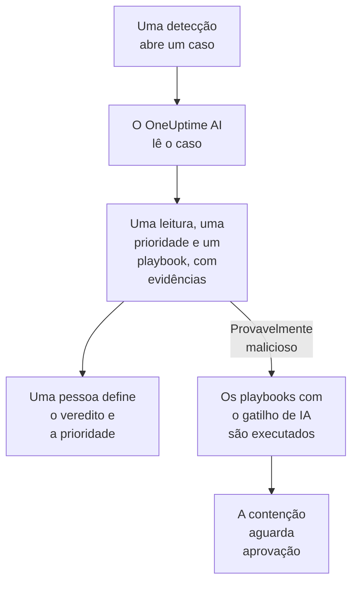

# OneUptime AI na segurança

O OneUptime AI lê cada caso de segurança como um analista faria: as detecções, os eventos, as entidades e a inteligência de ameaças do caso, e os hosts e as pessoas ao redor dele. Ele diz o que aconteceu e se parece real, sugere uma prioridade e um playbook, e cita as evidências por trás de cada afirmação. Ele não muda nada sozinho: uma pessoa define o veredito e a prioridade, e executa o playbook. Ele também escreve rascunhos de regras de detecção a partir de uma frase, e responde no Ask AI às suas perguntas sobre os seus dados de segurança.

:::cards
- [Classificar um caso](#classificar-um-caso): O que o OneUptime AI lê, o que conclui e o que nunca faz.
- [Classificar os casos novos automaticamente](#classificar-os-casos-novos-automaticamente): Cada caso que uma detecção abre, classificado assim que abre.
- [Executar um playbook após uma classificação](#executar-um-playbook-após-uma-classificação): Agir sobre um caso lido como Provavelmente malicioso.
- [Escrever o rascunho de uma regra de detecção](#escrever-o-rascunho-de-uma-regra-de-detecção): Descreva o que detectar e leia a regra Sigma.
- [Ask AI nas páginas de segurança](#ask-ai-nas-páginas-de-segurança): Perguntas sobre casos e eventos, em palavras simples.
:::

## Como funciona

Uma classificação só lê. Ela usa a IA do próprio projeto: **Habilitar IA**, o provedor de LLM, os créditos de IA e os limites diários de IA do projeto.

## Antes de começar

- **Habilitar IA** ligado, em **Configurações do projeto → IA → AI Features**. Desligado, a segurança não mostra nada do OneUptime AI e nada é executado.
- Um provedor de LLM que o OneUptime AI possa usar, em **Configurações do projeto → IA → Provedores LLM**. O OneUptime Cloud oferece um.
- Uma função que possa trabalhar os casos de segurança, para iniciar uma classificação: Project Owner, Project Admin, Security Admin ou Security Member. O Security Viewer lê todas as classificações, mas não pode iniciar nenhuma. Veja [Funções](/docs/permissions/reference#funções).

## Classificar um caso

Abra um caso: o cartão **OneUptime AI** fica no topo da página dele.

| O cartão diz | O que significa |
| --- | --- |
| **Ainda não classificado** | Nenhuma classificação foi feita. **Classificar com IA** inicia uma. |
| **Classificando este caso** | O OneUptime AI está lendo o caso. Cada verificação aparece enquanto é executada. |
| Uma leitura, como **Provavelmente malicioso** | A classificação terminou. **Classificar novamente** lê o caso de novo desde o início. |
| **A classificação não foi concluída** | A execução parou. **Tentar novamente** inicia outra. |

Um Security Viewer vê o mesmo cartão: **Classificar com IA** e **Tentar novamente** ficam esmaecidos ao lado de uma linha que diz quem pode iniciar uma classificação, e **Classificar novamente** e **Definir prioridade** não são oferecidos.

Uma classificação lê:

- o caso: título, prioridade, status, entidades e mapeamento do ATT&CK;
- as detecções do caso, a mais recente primeiro, com um evento de exemplo de cada uma;
- os eventos de segurança e a inteligência de ameaças sobre os usuários, hosts e endereços do caso;
- o risco dos usuários, hosts e endereços do caso, e o que o somou nesta semana;
- os hosts do OneUptime com os quais os hosts e endereços do caso coincidem, e quem é o responsável por eles;
- o incidente que o caso declarou, as notas, as entidades protegidas e os playbooks ativados.

Ela também pode ler o resto do OneUptime como a investigação de um incidente faz: logs, traces, métricas, hosts e as ferramentas somente leitura dos servidores MCP do projeto.

### O que ela conclui

| Leitura | Significa | Sugere fechar como |
| --- | --- | --- |
| Provavelmente malicioso | As evidências apontam para uma atividade maliciosa ou não autorizada | True Positive |
| Provavelmente benigno | A atividade parece real, mas esperada, como uma tarefa de administração ou uma varredura feita pela sua equipe | Benign Positive |
| Provável falso positivo | A detecção parece ter interpretado mal uma atividade normal | False Positive |
| Inconclusivo | Não havia evidências suficientes para decidir, e uma pessoa precisa olhar | Nada |

A leitura é do OneUptime AI, nunca o veredito do caso: **Close Case** começa no veredito que ela sugere, e uma pessoa escolhe. Abaixo da leitura, o cartão mostra:

- **Prioridade sugerida**, com **Definir prioridade** quando o caso está em outra prioridade.
- **Playbook sugerido**, com **Executar playbook**, que o executa em seu nome, com cada aprovação de que ele precisar. Enquanto esse playbook já está em execução no caso, o status da execução, como **Aguardando aprovação**, toma o lugar de **Executar playbook**: a execução está em **Playbooks** do caso, e uma segunda pediria a mesma aprovação de novo.
- O relatório: o que aconteceu, o quanto a leitura é segura e o que fazer em seguida, cada afirmação seguida de uma citação como C1.
- **Evidence checked**: cada consulta que a classificação executou. Uma citação abre a consulta dela, e expandir uma consulta a executa de novo com as suas permissões, sobre o período que a classificação leu.
- **Perguntar sobre este caso**, que abre o Ask AI no caso.

Toda lista de casos mostra a leitura ao lado do título de cada caso, e filtra por ela com **Avaliação da IA**.

### O que ela nunca faz

Uma classificação não muda nada no caso: nem o status, nem a prioridade, nem o responsável, nem o veredito, nem as notas. Ela não executa nenhum playbook e não contém ninguém. Um playbook que ela sugere é executado quando uma pessoa o executa, ou pelo gatilho descrito abaixo.

### Texto escrito para manipular uma IA

Eventos, alertas e valores de entidades vêm de fora do projeto, e um atacante pode escrevê-los. O OneUptime AI lê todos eles como dados, nunca como instruções. Quando parte dos dados de um caso parece conter instruções para uma IA, o cartão diz isso primeiro, uma leitura Provavelmente benigno ou Provável falso positivo passa a ser Inconclusivo, e essa classificação não inicia nenhum playbook.

## Classificar os casos novos automaticamente

Abra **Produtos → Security Events → IA → Configurações** e ligue **Classificar novos casos**: a partir daí, cada caso que uma detecção abre é classificado assim que abre. A chave salva assim que você a muda. Project Owner e Project Admin podem alterá-la.

Os projetos novos começam com a opção ligada; um projeto criado antes a mantém desligada até que alguém a ligue. Um caso aberto à mão, e o caso do ataque de teste de **Enviar um ataque de teste**, são classificados quando alguém clica em **Classificar com IA**.

## Executar um playbook após uma classificação

Um playbook cujo **Trigger** é **Classificado como provavelmente malicioso** é executado uma vez em um caso, quando uma classificação o lê como Provavelmente malicioso. **For Cases At Least**, **Only For Detections From** e **Only For These Detection Rules** o restringem como em qualquer gatilho, e as etapas de contenção dele aguardam aprovação como sempre. Ele não é executado:

- depois de uma classificação que encontrou texto escrito para manipular uma IA;
- uma segunda vez no mesmo caso, não importa quantas vezes o caso seja classificado;
- no caso do ataque de teste, a menos que todas as etapas do playbook fiquem dentro do OneUptime.

Esse gatilho só é oferecido a um playbook novo enquanto a IA do projeto está ligada.

## Escrever o rascunho de uma regra de detecção

Em **Detection Rules**, abaixo do campo **Sigma Rule (YAML)**, clique em **Draft with AI** e diga o que a regra deve detectar, por exemplo dez falhas de login a partir de um mesmo endereço IP em cinco minutos. **Escrever regra** coloca uma regra Sigma no campo, verificada como uma regra salva. Leia a regra, altere o que precisar e salve como de costume: nada é salvo até que você salve. Com uma regra já no campo, o botão passa a dizer **Reescrever com IA**, e o rascunho substitui essa regra.

Para escrever um rascunho, é preciso uma função que possa criar regras de detecção.

## Ask AI nas páginas de segurança

O **Ask AI** sabe em qual página de segurança você está. Em um caso, ele lê o caso primeiro e oferece perguntas como **É real?**. Nas outras páginas de eventos de segurança, uma pergunta em palavras simples pesquisa os seus eventos de segurança. Ele também pode verificar valores contra a sua inteligência de ameaças, ver o quanto um usuário, um host ou um endereço esteve ativo, e listar os playbooks adequados a um caso.

O Ask AI pode adicionar uma nota a um caso e executar um playbook nele, em seu nome, e pergunta antes de cada ação. Um playbook que ele executa aguarda aprovação como qualquer outro.

Quando um caso declara um incidente, a investigação com IA do incidente também lê o caso: o que foi detectado, sobre quem, e a classificação do OneUptime AI.

## Custos e limites

Uma classificação é trabalho do OneUptime AI, como a investigação de um incidente. No OneUptime Cloud, ela é paga com os créditos de IA do projeto e conta para os limites diários de IA do próprio projeto (**Limites diários**, em **Configurações do projeto → IA → AI Features**). Os limites diários de incidentes e alertas não se aplicam. Um caso tem uma classificação por vez, e os registros de IA (**Configurações do projeto → IA → Registros de IA**) listam as chamadas dela.

Quando o projeto fica sem créditos de IA ou atinge um limite diário de IA, os casos novos não são classificados: o cartão diz por quê, e **Classificar com IA** volta a funcionar assim que créditos forem adicionados ou o limite for redefinido.

## Solução de problemas

:::details Um caso novo não foi classificado
Verifique se **Habilitar IA** está ligado, e também **Classificar novos casos** em **Produtos → Security Events → IA → Configurações**. Um caso aberto à mão e o caso do ataque de teste só são classificados quando alguém pede. Abra o caso: quando algo impede uma classificação, o cartão diz o quê, e onde corrigir.
:::

:::details O cartão diz que o projeto ficou sem créditos de IA, ou que atingiu o limite diário de IA
Um proprietário do projeto ou alguém com Manage Billing pode adicionar créditos em **Configurações do projeto → IA → Créditos de IA**, ou aumentar ou remover o limite em **Configurações do projeto → IA → AI Features**. Depois, clique em **Classificar com IA** no caso.
:::

:::details O cartão diz que um texto do caso parece conter instruções para uma IA
Parte dos dados do caso, como a mensagem de um evento ou um nome de usuário, foi escrita para manipular uma IA. O OneUptime AI leu esse texto como dados e deixou a decisão para você: leia você mesmo as detecções e as evidências antes de fechar o caso.
:::

:::details Um playbook com o gatilho de IA não foi executado
Verifique se o playbook está habilitado, se a classificação leu o caso como Provavelmente malicioso, e se as configurações **For Cases At Least**, **Only For Detections From** e **Only For These Detection Rules** dele combinam com o caso. Ele é executado uma vez por caso, e não depois de uma classificação que encontrou texto escrito para manipular uma IA.
:::

## Próximos passos

:::cards
- [Casos de segurança e playbooks](/docs/telemetry/security-cases): Trabalhar os casos, fechá-los com um veredito e montar playbooks.
- [AI SRE](/docs/ai/ai-sre): Como o OneUptime AI investiga incidentes e alertas, e os limites dele.
- [Pergunte à IA](/docs/ai/ask-ai): Faça perguntas sobre o seu projeto em palavras simples.
- [Provedores de LLM](/docs/ai/llm-provider): Escolha o modelo que o OneUptime AI usa.
:::
