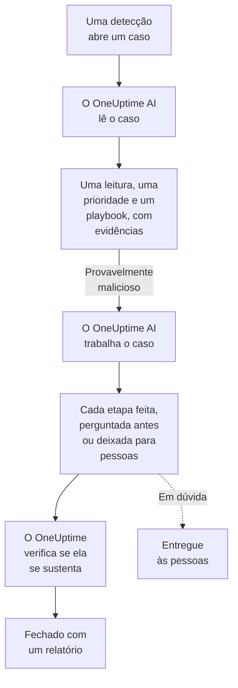

# OneUptime AI na segurança

O OneUptime AI lê cada caso de segurança como um analista faria: as detecções, os eventos, as entidades e a inteligência de ameaças do caso, e os hosts e as pessoas ao redor dele. Ele diz o que aconteceu e se parece real, sugere uma prioridade e um playbook, e cita as evidências por trás de cada afirmação. Quando você permite, ele então trabalha o caso de ponta a ponta: assume o caso, contém a ameaça, verifica se o que fez se sustenta, manda corrigir o código e fecha o caso com um relatório. Ele faz cada tipo de etapa por conta própria, pergunta antes a uma pessoa ou deixa a etapa para uma pessoa, como você definir, e realiza cada etapa pelo mesmo mecanismo de playbooks que as pessoas usam, então cada uma fica na linha do tempo do caso como sendo do OneUptime AI e pode ser desfeita. Ele também escreve rascunhos de regras de detecção a partir de uma frase, e responde no Ask AI às suas perguntas sobre os seus dados de segurança.

:::cards
- [Classificar um caso](#classificar-um-caso): O que o OneUptime AI lê, o que conclui e o que nunca faz.
- [Classificar os casos novos automaticamente](#classificar-os-casos-novos-automaticamente): Cada caso que uma detecção abre, classificado assim que abre.
- [Trabalhar um caso de ponta a ponta](#trabalhar-um-caso-de-ponta-a-ponta): Conter, verificar, corrigir e fechar, com uma pessoa aprovando o que você escolher.
- [O que o OneUptime AI pode fazer em um caso](#o-que-o-oneuptime-ai-pode-fazer-em-um-caso): Desativado, Perguntar antes ou Por conta própria, para cada tipo de etapa.
- [Quando ele entrega um caso às pessoas](#quando-ele-entrega-um-caso-às-pessoas): Por que ele para, e quem fica sabendo.
- [Executar um playbook após uma classificação](#executar-um-playbook-após-uma-classificação): Agir sobre um caso lido como Provavelmente malicioso.
- [Escrever o rascunho de uma regra de detecção](#escrever-o-rascunho-de-uma-regra-de-detecção): Descreva o que detectar e leia a regra Sigma.
- [Ask AI nas páginas de segurança](#ask-ai-nas-páginas-de-segurança): Perguntas sobre casos e eventos, em palavras simples.
:::

## Como funciona

Uma classificação só lê. O trabalho em um caso age, dentro do que você permite, e entrega o caso às pessoas assim que há dúvida. Os dois usam a IA do próprio projeto: **Habilitar IA**, o provedor de LLM, os créditos de IA e os limites diários de IA do projeto.

## Antes de começar

- **Habilitar IA** ligado, em **Configurações do projeto → IA → Recursos de IA**. Desligado, a segurança não mostra nada do OneUptime AI e nada é executado.
- Um provedor de LLM que o OneUptime AI possa usar, em **Configurações do projeto → IA → Provedores LLM**. O OneUptime Cloud oferece um.
- Uma função que possa trabalhar os casos de segurança, para iniciar uma classificação: Proprietário do projeto, Administrador do projeto, Administrador de segurança ou Membro de segurança. O Visualizador de segurança lê todas as classificações, mas não pode iniciar nenhuma. Veja [Funções](/docs/permissions/reference#funções).

## Classificar um caso

Abra um caso: o cartão **OneUptime AI** fica no topo da página dele.

| O cartão diz | O que significa |
| --- | --- |
| **Ainda não classificado** | Nenhuma classificação foi feita. **Classificar com IA** inicia uma. |
| **Classificando este caso** | O OneUptime AI está lendo o caso. Cada verificação aparece enquanto é executada. |
| Uma leitura, como **Provavelmente malicioso** | A classificação terminou. **Classificar novamente** lê o caso de novo desde o início. |
| **A classificação não foi concluída** | A execução parou. **Tentar novamente** inicia outra. |

Um Visualizador de segurança vê o mesmo cartão: **Classificar com IA** e **Tentar novamente** ficam esmaecidos ao lado de uma linha que diz quem pode iniciar uma classificação, e **Classificar novamente** e **Definir prioridade** não são oferecidos.

Uma classificação lê:

- o caso: título, prioridade, status, entidades e mapeamento do ATT&CK;
- as detecções do caso, a mais recente primeiro, com um evento de exemplo de cada uma;
- os eventos de segurança e a inteligência de ameaças sobre os usuários, hosts e endereços do caso;
- o risco dos usuários, hosts e endereços do caso, e o que o somou nesta semana;
- os hosts do OneUptime com os quais os hosts e endereços do caso coincidem, e quem é o responsável por eles;
- o incidente que o caso declarou, as notas, as entidades protegidas e os playbooks ativados.

Ela também pode ler o resto do OneUptime como a investigação de um incidente faz: logs, traces, métricas, hosts e as ferramentas somente leitura dos servidores MCP do projeto.

Todos que podem ver o caso leem a classificação dele, então uma classificação só lê o que todos eles podem ler. Uma equipe, função personalizada ou chave de API que lê um tipo de registro apenas pelo proprietário ou pelo rótulo só conta quando a chave de API, ou alguém da equipe, pode ler casos de segurança ou o registro de auditoria. Um tipo de registro que nenhum deles lê apenas pelo proprietário ou pelo rótulo é lido por inteiro; onde algum lê assim, um host, cluster, serviço ou outro registro que um proprietário ou um rótulo separa fica de fora e nunca é nomeado nem contado. Quem pode ler casos de segurança é definido a cada classificação, então uma classificação escrita antes de alguém receber esse acesso pode nomear registros separados dessa pessoa. O caso é sempre lido, e o incidente que ele declarou também, a menos que esse incidente seja privado. Incidentes e alertas privados nunca são lidos.

### O que ela conclui

| Leitura | Significa | Sugere fechar como |
| --- | --- | --- |
| Provavelmente malicioso | As evidências apontam para uma atividade maliciosa ou não autorizada | True Positive |
| Provavelmente benigno | A atividade parece real, mas esperada, como uma tarefa de administração ou uma varredura feita pela sua equipe | Benign Positive |
| Provável falso positivo | A detecção parece ter interpretado mal uma atividade normal | False Positive |
| Inconclusivo | Não havia evidências suficientes para decidir, e uma pessoa precisa olhar | Nada |

A leitura é do OneUptime AI, nunca o veredito do caso: **Fechar caso** começa no veredito que ela sugere, e uma pessoa escolhe. Abaixo da leitura, o cartão mostra:

- **Prioridade sugerida**, com **Definir prioridade** quando o caso está em outra prioridade.
- **Playbook sugerido**, com **Executar playbook**, que o executa em seu nome, com cada aprovação de que ele precisar. Enquanto esse playbook já está em execução no caso, o status da execução, como **Aguardando aprovação**, toma o lugar de **Executar playbook**: a execução está em **Playbooks** do caso, e uma segunda pediria a mesma aprovação de novo.
- O relatório: o que aconteceu, o quanto a leitura é segura e o que fazer em seguida, cada afirmação seguida de uma citação como C1.
- **Evidências verificadas**: cada consulta que a classificação executou. Uma citação abre a consulta dela, e expandir uma consulta a executa de novo com as suas permissões, sobre o período que a classificação leu.
- **Perguntar sobre este caso**, que abre o Ask AI no caso.

Toda lista de casos mostra a leitura ao lado do título de cada caso, e filtra por ela com **Avaliação da IA**.

### O que ela nunca faz

Uma classificação não muda nada no caso: nem o status, nem a prioridade, nem o responsável, nem o veredito, nem as notas. Ela não executa nenhum playbook e não contém ninguém. Um playbook que ela sugere é executado quando uma pessoa o executa, ou pelo gatilho descrito abaixo. Agir sobre o caso é o OneUptime AI trabalhando nele, o que tem uma configuração própria: veja [Trabalhar um caso de ponta a ponta](#trabalhar-um-caso-de-ponta-a-ponta).

### Texto escrito para manipular uma IA

Eventos, alertas e valores de entidades vêm de fora do projeto, e um atacante pode escrevê-los. O OneUptime AI lê todos eles como dados, nunca como instruções. Quando parte dos dados de um caso parece conter instruções para uma IA, o cartão diz isso primeiro, uma leitura Provavelmente benigno ou Provável falso positivo passa a ser Inconclusivo, essa classificação não inicia nenhum playbook, e o OneUptime AI não trabalha o caso: ele o entrega às pessoas.

## Classificar os casos novos automaticamente

Abra **Produtos → Eventos de segurança → IA → Configurações** e ligue **Classificar novos casos**: a partir daí, cada caso que uma detecção abre é classificado assim que abre. A chave salva assim que você a muda. Proprietário do projeto e Administrador do projeto podem alterá-la.

Os projetos novos começam com a opção ligada; um projeto criado antes a mantém desligada até que alguém a ligue. Um caso aberto à mão, e o caso do ataque de teste de **Enviar um ataque de teste**, são classificados quando alguém clica em **Classificar com IA**.

## Trabalhar um caso de ponta a ponta

Na mesma página, ligue **Trabalhar os casos de ponta a ponta**: a partir daí, o OneUptime AI assume cada caso que a classificação dele lê como Provavelmente malicioso e trabalha nele, dentro do que você permite em **O que o OneUptime AI pode fazer em um caso**. Os projetos novos começam com a opção ligada; um projeto criado antes a mantém desligada até que alguém a ligue. Proprietário do projeto e Administrador do projeto podem alterá-la.

Enquanto ela está ligada, uma pessoa também pode iniciá-lo em um caso: **Responder com IA**, no cartão **OneUptime AI** do caso, trabalha um caso que a classificação do OneUptime AI leu como Provavelmente malicioso, Provavelmente benigno ou Provável falso positivo. Ele não é oferecido em um caso cuja classificação foi Inconclusivo, cujos dados parecem conter instruções para uma IA, ou que está na sua maior prioridade: esses casos cabem a uma pessoa. É preciso uma função que possa trabalhar os casos de segurança.

### O que ele faz

O OneUptime AI trabalha o **Plano de resposta** do caso, o mais urgente primeiro: **Confirmar que é real**, **Conter a ameaça**, **Corrigir o que permitiu isso** e **Fechar o caso**. Cada etapa é feita, perguntada antes a uma pessoa ou deixada para uma pessoa, como diz a linha de **O que o OneUptime AI pode fazer em um caso** para o tipo dela.

| Etapa | O que o OneUptime AI faz |
| --- | --- |
| Assumir o caso | Assume o caso e aumenta a prioridade dele para a que a classificação sugeriu. Ele nunca diminui uma prioridade, e um caso que ele eleva à sua maior prioridade vai para as pessoas |
| Descartar um falso positivo | Marca a etapa como concluída só quando os próprios fatos do OneUptime não deixam dúvida: o endereço não é um dos seus e ninguém fez login a partir dele. Caso contrário, deixa a etapa para uma pessoa |
| Bloquear o endereço | Bloqueia o endereço por 24 horas pela sua [Lista de bloqueio](/docs/telemetry/security-cases#lista-de-bloqueio) e depois espera a verificação do OneUptime de que o bloqueio se sustenta. Se nada aplica sua lista de bloqueio, deixa a etapa para uma pessoa |
| Suspender o usuário, conter o host | Executa a etapa de um dos seus playbooks que faz isso, pelo seu provedor de identidade ou EDR. Sem um playbook assim, deixa a etapa para uma pessoa |
| Declarar um incidente | Sempre pergunta antes: um incidente aciona pessoas |
| Mover o caso para Contido | Assim que o OneUptime verifica cada etapa que contém a ameaça |
| Corrigir a rota que um ataque atingiu | Faz o "Corrigir com IA" abrir um pull request. Uma pessoa o mescla. Ele fecha o caso assim que o OneUptime verifica a correção em produção, pergunta a uma pessoa quando a correção só parece feita, e continua trabalhando no caso enquanto ela não se sustenta |
| Ativar a MFA, revisar as mudanças da conta | Fica para uma pessoa: nenhum produto informa ao OneUptime se essas medidas se sustentam |
| Fechar o caso | Assim que todas as outras etapas estão concluídas e a detecção do caso está há 24 horas sem atividade, como True Positive, com um [relatório de encerramento](#o-relatório-de-encerramento) |

Uma etapa que a regra de detecção do caso acrescenta por conta própria, e tudo o que o OneUptime não tem como fazer, como bloquear um domínio no seu filtro de DNS, fica para uma pessoa, com o motivo.

Cada etapa que o OneUptime AI realiza passa pelo mecanismo de playbooks, como uma execução de uma só etapa na página **Playbooks** do caso, com **OneUptime AI** como gatilho. Assim ela aguarda aprovação, deixa as entidades protegidas em paz, aparece na linha do tempo do caso, fica no log de auditoria e pode ser desfeita, como uma etapa que qualquer pessoa executa, e a linha do tempo diz que ela foi do OneUptime AI. Uma etapa sobre a qual ele pergunta aguarda a aprovação de uma pessoa, no caso, na página **Playbooks** dele, ou com um toque no Slack ou no Microsoft Teams.

### O registro dele no caso

Abaixo da classificação, o cartão **OneUptime AI** diz como o OneUptime AI está trabalhando no caso, em **Trabalho no caso**:

| O cartão diz | O que significa |
| --- | --- |
| **O OneUptime AI não está trabalhando neste caso** | **Responder com IA** o assume. |
| **Trabalhando neste caso** | O OneUptime AI está seguindo o plano. **Assumir** o interrompe, e o caso passa a ser seu. |
| **Aguardando uma pessoa** | Ele pediu a alguém que aprove uma etapa, e continua assim que alguém responder. |
| **Entregue às pessoas** | Ele parou, e diz por quê. |
| **O caso está fechado** | Ele fechou o caso, ou uma pessoa o fechou. O **Relatório de encerramento** dele fica acima das etapas. |

Abaixo, cada etapa que ele realizou, perguntou ou deixou, a mais recente primeiro, cada uma com o motivo: **Feito por conta própria: suas configurações permitem.**, **Suas configurações fazem isto aguardar a aprovação de uma pessoa.**, **O OneUptime não tem como realizar esta etapa, então uma pessoa a realiza.** Uma etapa sobre a qual ele perguntou tem **Aprovar** e **Recusar**; uma etapa que ele realizou leva à execução dela, onde ela pode ser desfeita. Uma etapa que o OneUptime verifica diz o que a verificação encontrou, e uma etapa que ele já realizou em casos da mesma regra diz com que frequência ela se sustentou: "Ela se sustentou em 14 de 15 casos semelhantes."

### Um caso que ele lê como benigno ou falso positivo

**Responder com IA** em um caso que a classificação leu como Provavelmente benigno ou Provável falso positivo o fecha como Benign Positive ou False Positive, como **Fechar o caso** permite. Depois que o caso é fechado, o OneUptime AI revoga os bloqueios que ele fez, como **Fechar o caso** também permite, e propõe à regra do caso uma exceção para o valor que a disparou. A exceção sempre aguarda uma pessoa: **Aprovar** a adiciona, em seu nome.

## O que o OneUptime AI pode fazer em um caso

Em **O que o OneUptime AI pode fazer em um caso**, em **Produtos → Eventos de segurança → IA → Configurações**, cada tipo de etapa tem a sua própria linha, que salva assim que você escolhe:

- **Desativado**: o OneUptime AI deixa isto para uma pessoa e informa isso no caso.
- **Perguntar antes**: ele pergunta a uma pessoa, com as evidências, e faz assim que alguém aprova.
- **Por conta própria**: ele faz sem perguntar e informa isso na linha do tempo do caso.

| Linha | Abrange | Os projetos novos começam em |
| --- | --- | --- |
| **Trabalhar o caso** | Assumir o caso, aumentar a prioridade dele, marcar etapas como concluídas com as evidências, movê-lo para Contido | Por conta própria |
| **Bloquear endereços** | Bloquear o endereço do caso na sua borda, por 24 horas | Perguntar antes |
| **Conter contas** | Suspender o usuário do caso ou encerrar as sessões dele | Perguntar antes |
| **Conter hosts** | Conter ou isolar o host do caso | Perguntar antes |
| **Corrigir o código** | Fazer o "Corrigir com IA" abrir um pull request para a rota que um ataque atingiu | Por conta própria |
| **Fechar o caso** | Fechar o caso com o relatório de encerramento, e revogar os bloqueios do caso depois que ele é fechado como inofensivo | Perguntar antes |

As configurações valem enquanto **Trabalhar os casos de ponta a ponta** está ligado, e o cartão avisa isso enquanto ele está desligado. Proprietário do projeto e Administrador do projeto podem alterá-las.

Colocar **Bloquear endereços**, **Conter contas** ou **Conter hosts** em **Por conta própria** exige a autoridade de um Administrador de segurança, que Proprietários do projeto e Administradores do projeto também têm, e o OneUptime guarda quem fez isso e quando, como faz para uma etapa de playbook cuja aprovação está desativada. **Bloquear endereços** pergunta antes: **Confirmar e ativar** é a confirmação de um Administrador de segurança, e a linha passa então a dizer quando ela foi dada. Até que um Administrador de segurança confirme, o OneUptime AI pergunta antes de bloquear.

Não importa o que as linhas digam, o OneUptime AI:

- nunca age sobre um usuário, host ou endereço protegido: ele entrega o caso às pessoas;
- realiza no máximo 10 ações por conta própria por hora, somando todos os seus casos, e depois entrega o próximo caso às pessoas;
- bloqueia por no máximo 24 horas;
- nunca mescla código: uma pessoa mescla cada pull request;
- sempre pergunta antes de declarar um incidente ou adicionar uma exceção de regra;
- trabalha um caso uma execução por vez, e um servidor que reinicia nunca perde uma execução que age.

## Quando ele entrega um caso às pessoas

O OneUptime AI nunca se retira em silêncio. Ele entrega o caso às pessoas, dizendo o motivo no cartão e na linha do tempo, quando:

- parte dos dados do caso parece conter instruções para uma IA;
- o caso está na sua maior prioridade;
- o alvo da próxima etapa dele está protegido;
- ele já agiu por conta própria tantas vezes quanto pode em uma hora;
- a IA está desativada para o projeto ou para os casos de segurança, não há provedor de LLM, ou o projeto ficou sem créditos de IA ou atingiu seu limite diário de IA;
- a classificação dele não conseguiu dizer se o caso é real;
- uma etapa que ele realizou não se sustenta, uma etapa que ele iniciou não terminou, ou uma pessoa recusou ou desfez uma etapa que ele realizou;
- ele não consegue determinar o que fazer em seguida, ou tudo o que resta no caso cabe a uma pessoa.

As pessoas no caso ficam sabendo na hora, ou, quando ninguém está no caso, as pessoas avisadas sobre os casos na prioridade dele: **O OneUptime AI entregou um caso de segurança às pessoas**, em **Configurações do usuário → Configurações de notificação**. Uma regra de notificação do espaço de trabalho para casos de segurança publica o aviso no canal do Slack ou do Microsoft Teams dela, em **Entregue às pessoas pelo OneUptime AI**. **Assumir** passa o caso adiante sem avisar ninguém, já que a pessoa que clicou fica com ele.

**Responder com IA** pede ao OneUptime AI que trabalhe no caso de novo, a partir de onde o caso está.

## O relatório de encerramento

Quando o OneUptime AI fecha um caso, ou pede a uma pessoa que o feche, ele escreve um relatório de encerramento a partir do que o caso contém, e não das palavras da classificação: o que aconteceu, o impacto, o que foi feito, o que foi corrigido e o que observar. O relatório é a nota de encerramento do caso, fica na linha do tempo, e o cartão o mostra em **Relatório de encerramento**. Com **Fechar o caso** em **Perguntar antes**, o caso aguarda que uma pessoa aprove o fechamento, com o relatório para ler antes.

## Como é medido

**Produtos → Eventos de segurança → Visão geral** mostra como o OneUptime AI trabalhou nos casos dos últimos 30 dias, assim que ele tiver trabalhado ou perguntado sobre um: **Resolvido pela OneUptime AI**, dos casos em que trabalhou; **Tempo até a contenção com IA** e **Tempo até o fechamento com IA**, cada um ao lado do tempo sem ele; e **Aprovações pedidas**, a rapidez com que as pessoas responderam e quantas das etapas dele as pessoas desfizeram.

## Executar um playbook após uma classificação

Um playbook cujo **Gatilho** é **Classificado como provavelmente malicioso** é executado uma vez em um caso, quando uma classificação o lê como Provavelmente malicioso. **Para casos de pelo menos**, **Somente para detecções de** e **Somente para estas regras de detecção** o restringem como em qualquer gatilho, e as etapas de contenção dele aguardam aprovação como sempre. Ele não é executado:

- depois de uma classificação que encontrou texto escrito para manipular uma IA;
- uma segunda vez no mesmo caso, não importa quantas vezes o caso seja classificado;
- no caso do ataque de teste, a menos que todas as etapas do playbook fiquem dentro do OneUptime.

Esse gatilho só é oferecido a um playbook novo enquanto a IA do projeto está ligada.

## Escrever o rascunho de uma regra de detecção

Em **Regras de detecção**, abaixo do campo **Regra Sigma (YAML)**, clique em **Rascunho com IA** e diga o que a regra deve detectar, por exemplo dez falhas de login a partir de um mesmo endereço IP em cinco minutos. **Escrever regra** coloca uma regra Sigma no campo, verificada como uma regra salva. Leia a regra, altere o que precisar e salve como de costume: nada é salvo até que você salve. Com uma regra já no campo, o botão passa a dizer **Reescrever com IA**, e o rascunho substitui essa regra.

Para escrever um rascunho, é preciso uma função que possa criar regras de detecção.

## Ask AI nas páginas de segurança

O **Pergunte à IA** sabe em qual página de segurança você está. Em um caso, ele lê o caso primeiro e oferece perguntas como **É real?**. Nas outras páginas de eventos de segurança, uma pergunta em palavras simples pesquisa os seus eventos de segurança. Ele também pode verificar valores contra a sua inteligência de ameaças, ver o quanto um usuário, um host ou um endereço esteve ativo, e listar os playbooks adequados a um caso.

O Ask AI pode adicionar uma nota a um caso e executar um playbook nele, em seu nome, e pergunta antes de cada ação. Um playbook que ele executa aguarda aprovação como qualquer outro.

Quando um caso declara um incidente, a investigação com IA do incidente também lê o caso: o que foi detectado, sobre quem, e a classificação do OneUptime AI.

## Custos e limites

Uma classificação é trabalho do OneUptime AI, como a investigação de um incidente. No OneUptime Cloud, ela é paga com os créditos de IA do projeto e conta para os limites diários de IA do próprio projeto (**Limites diários**, em **Configurações do projeto → IA → Recursos de IA**). Os limites diários de incidentes e alertas não se aplicam. Um caso tem uma classificação por vez, e os registros de IA (**Configurações do projeto → IA → Registros de IA**) listam as chamadas dela.

Quando o projeto fica sem créditos de IA ou atinge um limite diário de IA, os casos novos não são classificados: o cartão diz por quê, e **Classificar com IA** volta a funcionar assim que créditos forem adicionados ou o limite for redefinido. Ao trabalhar um caso, o OneUptime AI lê o plano e as verificações do próprio caso em vez de consultar o LLM, e para nos mesmos limites: ele entrega o caso às pessoas, dizendo por quê.

## Solução de problemas

:::details Um caso novo não foi classificado
Verifique se **Habilitar IA** está ligado, e também **Classificar novos casos** em **Produtos → Eventos de segurança → IA → Configurações**. Um caso aberto à mão e o caso do ataque de teste só são classificados quando alguém pede. Abra o caso: quando algo impede uma classificação, o cartão diz o quê, e onde corrigir.
:::

:::details O OneUptime AI não trabalhou em um caso
Verifique se **Trabalhar os casos de ponta a ponta** está ligado em **Produtos → Eventos de segurança → IA → Configurações**. Ele só assume um caso por conta própria quando a classificação o lê como Provavelmente malicioso. Abra o caso: em **Trabalho no caso**, o cartão diz por que ele não está trabalhando no caso, e **Responder com IA** pede que ele trabalhe.
:::

:::details Ele pergunta antes de bloquear, embora Bloquear endereços esteja em Por conta própria
**Por conta própria** para **Bloquear endereços** vale assim que um Administrador de segurança confirma: a linha diz quando, ou que ninguém confirmou ainda. Um endereço protegido, ou um dos seus, nunca é bloqueado: o OneUptime AI entrega o caso às pessoas. Enquanto nada aplica sua lista de bloqueio, ele deixa a etapa para uma pessoa.
:::

:::details O cartão diz que o projeto ficou sem créditos de IA, ou que atingiu o limite diário de IA
Um Proprietário do projeto ou alguém com Manage Billing pode adicionar créditos em **Configurações do projeto → IA → Créditos de IA**, ou aumentar ou remover o limite em **Configurações do projeto → IA → Recursos de IA**. Depois, clique em **Classificar com IA** no caso.
:::

:::details O cartão diz que um texto do caso parece conter instruções para uma IA
Parte dos dados do caso, como a mensagem de um evento ou um nome de usuário, foi escrita para manipular uma IA. O OneUptime AI leu esse texto como dados e deixou a decisão para você: leia você mesmo as detecções e as evidências antes de fechar o caso.
:::

:::details Um playbook com o gatilho de IA não foi executado
Verifique se o playbook está habilitado, se a classificação leu o caso como Provavelmente malicioso, e se as configurações **Para casos de pelo menos**, **Somente para detecções de** e **Somente para estas regras de detecção** dele combinam com o caso. Ele é executado uma vez por caso, e não depois de uma classificação que encontrou texto escrito para manipular uma IA.
:::

## Próximos passos

:::cards
- [Casos de segurança e playbooks](/docs/telemetry/security-cases): Trabalhar os casos, fechá-los com um veredito e montar playbooks.
- [AI SRE](/docs/ai/ai-sre): Como o OneUptime AI investiga incidentes e alertas, e os limites dele.
- [Pergunte à IA](/docs/ai/ask-ai): Faça perguntas sobre o seu projeto em palavras simples.
- [Provedores de LLM](/docs/ai/llm-provider): Escolha o modelo que o OneUptime AI usa.
:::
