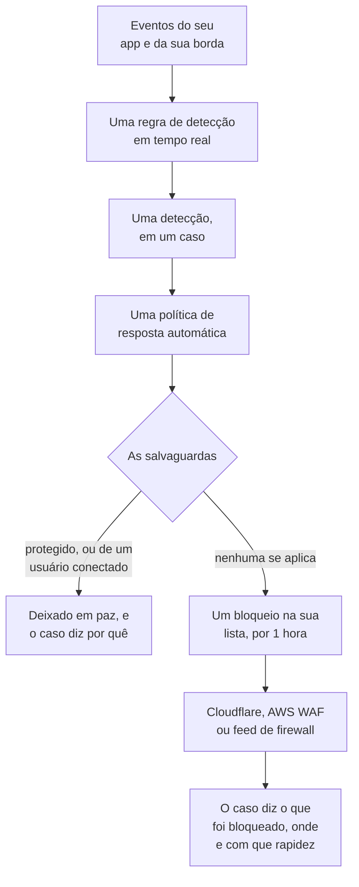

# Resposta automática

As políticas de resposta automática desafiam ou bloqueiam um endereço que ataca assim que a detecção é feita, antes que alguém faça a triagem do caso: scanners que sondam seu app e bots que tentam senha após senha são barrados poucos minutos depois da primeira solicitação. Todo projeto vem com três políticas prontas, cada uma desativada até você ativá-la, e cada uma começa com uma semana de período de teste que só registra o que teria feito. As salvaguardas tornam uma política segura para deixar ativada: ela nunca toca nos seus próprios endereços nem em um que seus usuários conectados usam, e para e avisa uma pessoa quando um ataque é maior do que ela deveria tratar sozinha.

:::cards
- [Ativar uma política](#ativar-uma-política): Primeiro uma semana de período de teste, depois um clique.
- [As salvaguardas](#as-salvaguardas): O que uma política nunca faz, e quando ela para.
- [Tempo até o bloqueio](#tempo-até-o-bloqueio): A rapidez com que cada política bloqueia, no cartão dela e no caso.
- [Sua própria política](#sua-própria-política): Aja sobre as técnicas, regras ou inteligência de ameaças que você escolher.
:::

## Como funciona

Uma política age sobre uma detecção assim que ela é registrada no caso, poucos segundos depois que a regra dispara. O bloqueio dela vai para a sua [lista de bloqueio](/docs/telemetry/security-cases#lista-de-bloqueio) do mesmo jeito que a etapa de playbook **Bloquear o endereço**, com o nome da política como autor: os destinos que aplicam sua lista de bloqueio o mantêm, ele aparece na linha do tempo do caso e no log de auditoria, e expira sozinho. Ele não precisa da aprovação de ninguém: quem ativou a política aprovou os bloqueios dela.

## Antes de começar

- Um destino que aplique sua lista de bloqueio: Cloudflare, AWS WAF, ou um firewall ou proxy que leia um [feed da lista de bloqueio](/docs/telemetry/blocklist-feeds). Enquanto nada a aplicar, a página avisa, e os bloqueios de uma política não valem em lugar nenhum.
- Os eventos que as regras de uma política leem: os logs de acesso ou os traces do seu app, ou os eventos da sua borda, como os eventos de firewall do Cloudflare, e os seus logins. Veja [Eventos de segurança](/docs/telemetry/security-events).
- Uma função que possa ativar uma política: Administrador de segurança, Administrador do projeto ou Proprietário do projeto. Membro de segurança e Visualizador de segurança veem as políticas e o que elas fizeram. Veja [Funções](/docs/permissions/reference#funções).

## As políticas prontas

| Política | Age sobre | Faz | Primeiro bloqueio |
| --- | --- | --- | --- |
| **Scanners** | Varreduras web e tentativas de exploração (ATT&CK T1595, T1190): tentativas de injeção de SQL, travessia de caminho e Log4Shell, e muitas correspondências de regras gerenciadas do Cloudflare a partir de um endereço, enquanto todas as solicitações do endereço foram recusadas | Desafio | 1 hora |
| **Adivinhação de senhas** | Força bruta e pulverização de senhas (ATT&CK T1110): logins com falha a partir de um endereço, e logins com falha seguidos de um sucesso a partir do mesmo endereço | Bloquear | 1 hora |
| **Endereços sabidamente maliciosos** | Qualquer detecção sobre um endereço que sua [inteligência de ameaças](/docs/telemetry/threat-intelligence) lista | Bloquear | 24 horas |

Pessoas passam em um desafio, scripts e bots, não. Scanners só desafia um endereço enquanto nenhuma solicitação dele tiver chegado ao seu app: um endereço cujas solicitações passaram é um caso para uma pessoa.

Ativar Scanners ou Adivinhação de senhas, no período de teste ou de vez, executa em tempo real as regras da **Biblioteca de regras** sobre as quais ela age, adicionando as que seu projeto não tem: uma regra em tempo real dispara segundos depois que os eventos chegam, enquanto uma agendada lê com minutos de atraso. Uma regra que alguém desativou continua desativada. Um projeto executa no máximo 50 regras em tempo real: além disso, uma regra fica no agendamento dela, e o cartão da política mostra **Em um agendamento** ao lado.

## Ativar uma política

:::steps
### Abra Resposta automática

Abra **Produtos → Eventos de segurança → Playbooks → Resposta automática**. Cada política tem seu cartão: o que ela faz, um selo que diz **Desativado**, **Período de teste**, **Teste concluído** ou **Ativado**, e seu interruptor.

### Inicie o período de teste

Mude o interruptor da política. Por 7 dias ela registra o que teria feito e não toca em nenhum tráfego: o caso diz "Trial run: the Scanners policy would have challenged 35.205.11.131 for 1 hour." O cartão conta os endereços até agora, e o que as salvaguardas dela deixaram em paz.

### Ative-a

Quando a semana termina, o cartão diz o que a política teria feito, por exemplo "Em 7 dias, ela teria desafiado 1.283 endereços. Nenhum tinha usuários conectados, e nenhum era seu. Ativá-la?", e seus responsáveis pela segurança recebem o mesmo por e-mail. Clique em **Ativar**: a partir daí, a política age.
:::

Para ativar uma política sem a semana de período de teste, abra **Mais configurações** no cartão dela e clique em **Ativar sem período de teste**. As salvaguardas dela continuam valendo. Mude o interruptor de novo para desativar uma política; ativada de novo depois de uma semana inteira de período de teste, ela age na hora.

## As salvaguardas

- **Nunca seus próprios endereços nem os protegidos.** As entradas de **Entidades protegidas**, e tudo o que o OneUptime protege sozinho: seus hosts, recursos de nuvem e sondas, os intervalos que não estão na internet, e a borda na frente do seu app. Veja [Lista de bloqueio](/docs/telemetry/security-cases#lista-de-bloqueio).
- **Nunca um endereço que um usuário conectado usou nos últimos 30 dias.** A rede de um escritório, o proxy de um cliente ou a casa de uma pessoa: o OneUptime procura o endereço nos logins do seu provedor de identidade e nas solicitações que seu app atendeu para um usuário conectado, as que têm um ID de usuário nos traces ou logs. Um endereço que ele não consegue verificar, porque esses eventos não puderam ser lidos ou porque suas regras de ocultação escondem os endereços de um jeito que ele não consegue comparar, fica para uma pessoa.
- **Bloqueios mais longos para um endereço que volta.** O primeiro bloqueio dura 1 hora, depois 24 horas, depois 7 dias para um endereço bloqueado de novo em até 30 dias. Endereços sabidamente maliciosos começa em 24 horas.
- **No máximo 50 bloqueios automáticos por hora.** Além disso, suas políticas param de bloquear e avisam seus responsáveis pela segurança: um ataque desse tamanho precisa de uma pessoa. A página avisa enquanto durar.
- **Desfazer na dúvida.** Quando um usuário conectado é visto a partir de um endereço que uma política bloqueou, a política suspende o bloqueio e avisa seus responsáveis pela segurança.

Seus responsáveis pela segurança são os Administradores de segurança do seu projeto ou, quando não há nenhum, os Proprietários do projeto. Cada endereço que uma salvaguarda deixou em paz aparece no caso dele, com o motivo.

## Onde um destino não consegue desafiar

O Cloudflare e o AWS WAF desafiam. Um firewall que lê um feed da lista de bloqueio não consegue, então lá o desafio de uma política é um bloqueio, pelo mesmo tempo, e o cartão da política e o caso avisam, por exemplo "FortiGate feed cannot challenge, so it blocks the address there for the same time." Um desafio que você mesmo faz nunca vira um bloqueio.

## Tempo até o bloqueio

O tempo até o bloqueio vai da primeira solicitação do endereço, o evento mais antigo da detecção, até o bloqueio valer na sua borda. O cartão de cada política mostra os percentis 50 e 95 dia a dia nos últimos 30 dias. Um caso que uma resposta automática bloqueou mostra isso em **Tempo até a contenção** na **Visão geral**, por exemplo "Bloqueado automaticamente 41s após a primeira solicitação", e a linha do tempo dele diz o que foi bloqueado, onde e com que rapidez: "OneUptime challenged 35.205.11.131 at Cloudflare for 1 hour (Scanners policy), 41 seconds after its first request." A etapa do endereço no **Plano de resposta** do caso fica concluída, com **Revogar** ao lado.

## Sua própria política

Clique em **Criar política** abaixo das políticas prontas. Uma política sua precisa de um **Nome** e daquilo sobre o que ela age:

| Campo | O que faz |
| --- | --- |
| **Técnicas do ATT&CK** | As técnicas que uma detecção precisa ter, separadas por vírgulas, como `T1110, T1190`. Uma técnica abrange suas subtécnicas. |
| **Ação** | Em **Mais campos**: **Bloquear** ou **Desafio**. |
| **O primeiro bloqueio dura** | Em **Mais campos**: 1 hora, 24 horas ou 7 dias. Um endereço que volta é bloqueado por mais tempo. |
| **Regras de detecção** | Em **Mais campos**: ou uma detecção feita por uma destas regras. |
| **Só endereços que sua inteligência de ameaças lista** | Em **Mais campos**: só age sobre endereços que sua inteligência de ameaças lista. Sozinha, age sobre qualquer detecção sobre um deles. |
| **Só enquanto todas as solicitações foram recusadas** | Em **Mais campos**: só age enquanto nenhuma solicitação do endereço tiver chegado ao seu app. |

Uma política sua começa desativada, passa uma semana em período de teste como uma pronta e tem as mesmas salvaguardas. **Editar política** e **Excluir política** ficam no cartão dela; excluí-la deixa os bloqueios dela na sua lista de bloqueio até expirarem.

## Solução de problemas

:::details Uma política está ativada, mas não bloqueou um endereço
Veja a linha do tempo do caso: uma política que deixou um endereço em paz diz por quê, por exemplo porque um usuário conectado o tinha usado. Verifique se um destino aplica sua lista de bloqueio, e se as regras da política mostram **Tempo real** no cartão dela.
:::

:::details A página diz que os bloqueios automáticos da hora acabaram
Suas políticas fizeram 50 bloqueios automáticos na última hora e avisaram seus responsáveis pela segurança. Elas voltam a agir à medida que os bloqueios dessa hora envelhecem. Veja os casos do ataque, e bloqueie um intervalo na **Lista de bloqueio** se ele vier de uma só rede.
:::

## Próximos passos

:::cards
- [Casos de segurança e playbooks](/docs/telemetry/security-cases): Trabalhe os casos sobre os quais suas políticas agem, e bloqueie à mão.
- [Feeds da lista de bloqueio](/docs/telemetry/blocklist-feeds): Aplique sua lista de bloqueio em um firewall ou proxy.
- [Inteligência de ameaças](/docs/telemetry/threat-intelligence): Os feeds sobre os quais Endereços sabidamente maliciosos age.
:::
