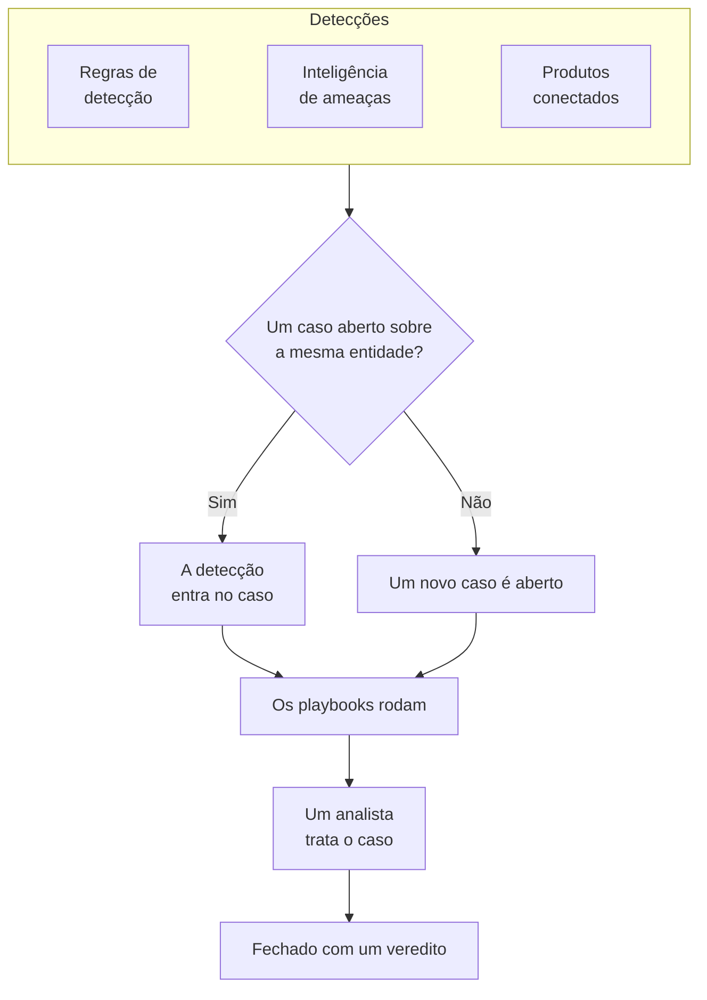

# Casos de segurança e playbooks (SOAR)

O Security Events transforma o que as suas regras de detecção, a inteligência de ameaças e os produtos de segurança conectados encontram em casos: um caso para cada coisa que vale a pena investigar, com todas as detecções sobre o mesmo usuário, host ou endereço agrupadas nele. Os analistas tratam os casos em uma fila, e os playbooks respondem a eles, sozinhos ou com um clique.

:::cards
- [De onde vêm os casos](#de-onde-vêm-os-casos): Regras de detecção, inteligência de ameaças, produtos conectados, risco de entidades e pessoas.
- [Tratar um caso](#tratar-um-caso): Atribua-o, investigue as entidades dele e feche-o com um veredito.
- [Prioridades e status dos casos](#prioridades-e-status-dos-casos): Renomeie, mude a cor e a ordem, e adicione os seus.
- [Notificações](#notificações): Quem fica sabendo de um novo caso, de uma atribuição e de uma etapa aguardando aprovação.
- [Playbooks](#playbooks): Etapas que rodam em um caso, com aprovação onde ela importa.
- [A visão geral](#a-visão-geral): O que precisa de alguém agora, e com que rapidez os casos são tratados.
:::

## Como funciona

Abra **Produtos → Security Events → Casos de segurança → Casos abertos** para a fila. **Atribuídos a mim**, **Não atribuído**, **Casos fechados** e **Todos os casos** são páginas próprias ao lado, cada uma listando os casos que o nome diz.

## Antes de começar

Os casos e os playbooks seguem os três papéis de segurança. Project Owner e Project Admin podem fazer tudo.

| Papel | O que pode fazer |
| --- | --- |
| Security Admin | Tudo, inclusive excluir casos e configurar playbooks |
| Security Member | Abrir, atribuir, alterar e fechar casos, escrever notas, executar playbooks e aprovar ou rejeitar as etapas deles |
| Security Viewer | Ler casos, detecções, notas, playbooks e as execuções deles |

Cada uma dessas ações também pode ser concedida separadamente, de criar um caso a aprovar as etapas de um playbook; veja [Referência de permissões](/docs/permissions/reference).

## De onde vêm os casos

| Origem | Abre um caso quando | Como desativar |
| --- | --- | --- |
| Regras de detecção | Uma regra corresponde | **Abrir um caso ao corresponder**, na etapa **Ao corresponder** da regra |
| Inteligência de ameaças | Um evento cita um indicador conhecido | **Abrir um caso ao corresponder**, na etapa **Ao corresponder** do feed |
| Produtos conectados | Um alerta do próprio produto é importado no limite da conexão ou acima dele | **Open Cases From** definido como **Nunca**, na etapa **Consulta periódica** da conexão |
| Risco de entidades | O risco de um usuário, host ou endereço atinge o limite do projeto | **Casos de risco**, em **Configurações → Pontuação de risco** |
| Pessoas | Alguém abre um em **Casos de segurança**, ou com **Abrir caso** no painel de um evento | Não há como |

Todas as origens abrem casos por padrão, exceto o risco de entidades em projetos criados antes de ele existir: neles, ative primeiro **Casos de risco** ([Risco de entidades](/docs/telemetry/security-entity-risk)). Uma conexão abre casos para **Alta e acima**, a menos que você escolha outro nível; os alertas abaixo dele continuam sendo importados como eventos.

### Como as detecções são agrupadas

Uma detecção é sobre uma entidade: o valor pelo qual a regra dela agrupa, como o endereço IP de uma regra de força bruta, ou o indicador que uma correspondência de inteligência de ameaças cita. Uma detecção sem entidade fica sozinha.

- Quando um caso aberto já é sobre essa entidade, a detecção entra nele. As entidades do caso e o mapeamento ATT&CK dele crescem, e a prioridade dele sobe até a da detecção, nunca desce.
- Quando nenhum caso aberto é sobre ela, um novo caso é aberto, com o nome e a prioridade da detecção.
- Uma detecção que dispara de novo aumenta a contagem na própria linha em vez de acrescentar outra.

A prioridade de um caso vem da gravidade da detecção, na prioridade predefinida do projeto para esse nível, qualquer que seja o nome que você deu a ela:

| Gravidade | Prioridade |
| --- | --- |
| Critical ou Fatal | Crítico |
| High | High |
| Medium, Unknown ou Other | Medium |
| Low | Low |
| Informational | Informativos |

## Tratar um caso

Os casos de um projeto novo passam por quatro status, que você pode renomear e completar com outros (veja [Prioridades e status dos casos](#prioridades-e-status-dos-casos)). Um caso pode pular um, como um falso positivo fechado direto de Novo, e pode ser reaberto.

| Status | Significado |
| --- | --- |
| Novo | Ninguém olhou para ele ainda |
| Investigando | Alguém está apurando o que aconteceu |
| Contained | A ameaça não pode mais causar danos; a limpeza ainda está por fazer |
| Fechado | Concluído, com um veredito sobre o que era |

Um caso tem um menu lateral próprio, como um incidente, e cada parte do caso é uma página própria:

| Seção do menu lateral | Páginas |
| --- | --- |
| **Visão geral** | **Visão geral**, **Linha do tempo** |
| **Investigação** | **Detecções**, **Entidades**, **Sinais conectados**, **Playbooks** |
| **Notas** | **Notas privadas** |
| **Avançado** | **Registros de auditoria**, **Excluir caso**, recolhidos até você clicar em **Avançado** |

Cada página mantém no topo o cabeçalho do caso: número, prioridade, status e título, **Atribuir a mim**, **Executar playbook**, **Declarar incidente** e **Fechar caso** e, no menu ⋯ ao lado, **Definir prioridade**, **Atribuir a outra pessoa**, **Alterar status**, **Editar caso** e **Excluir caso**. Assim o caso pode ser tratado de qualquer uma das suas páginas, e um link para o caso continua abrindo a **Visão geral** dele.

- **Visão geral**: a descrição, os rótulos e as etapas de status do caso, quem está com ele e o que o abriu, e os números dele: quantas detecções tem, há quanto tempo está aberto e quanto tempo levou para ser reconhecido e contido.
- **OneUptime AI**, na **Visão geral**: o que o OneUptime AI concluiu do caso, a prioridade e o playbook que ele sugere, e as evidências por trás. Veja [OneUptime AI na segurança](/docs/telemetry/security-ai).
- **MITRE ATT&CK**, na **Visão geral**: as táticas e técnicas às quais as detecções dele correspondem, cada uma com um link para a própria página em attack.mitre.org.
- **Linha do tempo**: tudo o que aconteceu com o caso, com quem fez.
- **Detecções**: o que disparou para abrir o caso ou entrar nele, com que frequência, e o último evento correspondente.
- **Entidades**: os usuários, hosts e endereços de que o caso trata, com a atividade deles em todos os seus eventos de segurança dos últimos 7 dias. Cada um abre em **Correlacionar**.
- **Sinais conectados**: os hosts, clusters, serviços e membros que o caso nomeia, como o OneUptime os conhece, e o que acontecia em cada um em torno das detecções dele: os seus registros, traços e métricas, o que está aberto neles e o que mudou. Veja [Sinais conectados](/docs/telemetry/security-connected-signals).
- **Playbooks**: o que cada playbook fez no caso, etapa por etapa, e as etapas aguardando aprovação. Enquanto houver execuções aguardando, o menu mostra quantas ao lado de **Playbooks**.
- **Notas privadas**: o que a equipe escreveu sobre o caso.
- **Registros de auditoria**: cada alteração feita no caso, e quem a fez. Veja [Registros de auditoria](/docs/configuration/audit-logs).
- **Excluir caso**: exclui o caso para sempre, com as detecções, notas, linha do tempo e execuções de playbooks dele. Para manter o registro, feche-o com um veredito.

### Tratar casos a partir da fila

Você não precisa abrir um caso para tratá-lo. Nas listas da fila, o menu ⋯ na linha de um caso tem **Atribuir a mim**, **Atribuir a outra pessoa**, **Alterar status** e **Alterar prioridade**. Para tratar vários casos de uma vez, selecione-os e use as mesmas ações em **Ações em massa**: elas dizem quais casos foram alterados, quais ficaram como estavam e por quê.

- Para passar um caso a outra pessoa, use **Atribuir a outra pessoa** e escolha uma pessoa ou uma equipe. O caso de uma equipe aguarda em **Não atribuído** até que alguém da equipe o assuma.
- Um status que fecha um caso pede um veredito e uma nota de fechamento, como **Fechar caso** faz.
- Um caso fechado não é atribuído a ninguém. Para tratá-lo de novo, reabra-o com **Alterar status**.

### Fechar um caso

**Fechar caso** pede um veredito e uma nota de fechamento opcional:

| Veredito | Significado |
| --- | --- |
| True Positive | Uma atividade maliciosa ou não autorizada realmente aconteceu |
| Benign Positive | A atividade era real, mas esperada, como um teste de intrusão ou uma tarefa administrativa |
| False Positive | A detecção estava errada: a regra ou os dados interpretaram mal uma atividade normal |
| Undetermined | Não havia informação suficiente para dizer |

Os vereditos são contados na visão geral. Uma regra cujos casos continuam sendo fechados como False Positive é uma regra a ajustar.

Um caso aberto a partir de alertas do Google SecOps também os fecha no Google SecOps, com o veredito e a nota de fechamento, quando a conexão dele tem **Fechar os alertas quando o caso deles for fechado** ativado: veja [Google SecOps](/docs/integrations/google-secops#fechar-os-alertas-quando-o-caso-deles-for-fechado).

### Declarar um incidente

**Declarar incidente** abre um incidente do OneUptime para o caso, com a severidade que você escolher, e liga os dois nos dois sentidos: a descrição do incidente cita o caso, e o cabeçalho do caso tem um link para o incidente. A partir daí, o plantão, as páginas de status e o postmortem assumem. É preciso um papel que possa tanto tratar casos quanto criar incidentes.

## Prioridades e status dos casos

Cada projeto tem suas próprias prioridades e status de caso, em **Produtos → Security Events → Configurações → Prioridades de casos** e **Status de casos**. Renomeie-os, mude a cor, arraste-os para outra ordem e adicione os seus, como um status "Triagem" ou uma prioridade "Emergência" acima de **Crítico**. Um nome novo aparece em todo lugar ao mesmo tempo: na fila, nas páginas dos casos e na visão geral, nas notificações, no Slack e no Microsoft Teams, e nas mensagens dos playbooks.

Alguns são predefinidos, porque o OneUptime lê o que eles significam. Eles podem ser renomeados e mudar de cor, mas não excluídos nem arquivados, e mantêm sua ordem:

| Predefinido | O que o OneUptime faz com ele |
| --- | --- |
| O status novo | Casos novos começam nele |
| O status reconhecido | Chegar a ele registra quando o caso foi reconhecido, e **Reabrir** devolve a ele um caso fechado |
| O status contido | Chegar a ele registra quando o caso foi contido |
| O status fechado | **Fechar caso** leva um caso para ele, com um veredito |
| As prioridades Crítico, High, Medium, Low e Informativos | Uma detecção abre seu caso na prioridade da sua gravidade, e um caso que alguém abre começa em Medium |

- A posição de um status decide como conta um caso que está nele, como mostra a coluna **Conta como**: do status reconhecido para baixo, reconhecido; do status contido para baixo, contido; do status fechado para baixo, fechado. Um status que você adiciona fica logo acima do status fechado, e mover um caso para um status que o fecha pede um veredito antes.
- A posição de uma prioridade é a sua urgência, a mais urgente primeiro: **Para casos de pelo menos**, as escolhas de notificação e as regras do Slack e do Microsoft Teams leem essa ordem. Uma prioridade que você adiciona vai para o fim, e a coluna **Gravidade da detecção** mostra quais detecções abrem seus casos em cada prioridade predefinida.

Para parar de usar um status ou uma prioridade seus, use **Arquivar** na linha dele. Ninguém pode escolhê-lo de novo, e a API, o Terraform e o MCP o recusam, mas os casos que o têm o mantêm, e você ainda pode filtrar por ele. Os valores arquivados ficam listados na seção recolhida **Status de caso arquivados** ou **Prioridades de caso arquivadas** abaixo da tabela, onde **Desarquivar** traz um de volta. **Excluir** é recusado enquanto houver casos com o valor ou um playbook que parta da prioridade.

## Notificações

O OneUptime avisa as pessoas sobre três coisas em um caso. Ninguém precisa configurar nada: um projeto que só clicou em **Ativar o recomendado** fica sabendo dos seus casos High e Crítico por e-mail e push.

| Notificação | Quem é avisado | Por padrão |
| --- | --- | --- |
| Novo caso de segurança | Todos que podem ver os casos do projeto, quando um caso abre ou sobe, na prioridade que escolheram ou acima dela | E-mail e push, para casos High e Crítico |
| Caso de segurança atribuído a mim | A pessoa a quem o caso está atribuído e os membros da equipe a que ele está atribuído | E-mail e push |
| Etapa de playbook aguardando minha aprovação | As pessoas do caso que podem aprovar a etapa: a pessoa a quem ele está atribuído e os membros da equipe dele. Quando nenhuma delas pode aprovar, todos no projeto que podem | E-mail e push |

- Só são avisadas sobre um caso as pessoas que podem vê-lo: Project Owners, Project Admins e os papéis Security Admin, Security Member e Security Viewer. Um papel limitado a alguns rótulos só é avisado sobre os casos com esses rótulos.
- Ninguém é avisado sobre o que fez: a pessoa que abre um caso manualmente, o atribui ou inicia uma execução não é notificada disso.
- Cada pessoa fica sabendo de um caso uma vez só. Um caso que abre como Medium e depois sobe para Crítico chega, quando sobe, às pessoas que escolheram High ou Crítico, e não de novo às que escolheram Medium, que já souberam dele quando ele abriu.
- O ataque de teste de **Enviar um ataque de teste** abre um caso que não notifica ninguém.
- Um caso Crítico e uma etapa aguardando aprovação são enviados na hora, nunca retidos em um [resumo de e-mails](/docs/emails/notification-rollup).
- A **Linha do tempo** do caso diz quem foi avisado, e quando.

### Escolha sobre o que você é avisado

Cada pessoa escolhe por si mesma, em **Configurações do usuário → Configurações de notificação → Segurança**: os canais de cada notificação (e-mail, SMS, chamada, push, Telegram, Slack, Microsoft Teams ou webhook) e, em **Novo caso de segurança**, a prioridade que a notifica:

| Opção | Notifica sobre casos de prioridade |
| --- | --- |
| Somente Crítica | Crítico |
| Alta e acima | Crítico e High (o padrão) |
| Média e acima | Crítico, High e Medium |
| Baixa e acima | Todas as prioridades, menos Informativos |
| Todos os casos | Todas as prioridades |

As escolhas seguem as prioridades de caso do projeto, com os próprios nomes: estas são as de um projeto novo.

Mensagens de WhatsApp não são enviadas para casos de segurança. Uma notificação push abre o caso no app OneUptime On-Call (1.7.0 ou posterior), onde você pode aprovar ou rejeitar uma etapa de playbook em espera, assumir o caso e fechá-lo. O link dela abre o caso no navegador.

### Publique em canais do Slack e do Microsoft Teams

Para publicar em um canal, adicione uma regra em **Produtos → Security Events → Espaço de trabalho → Slack** (ou **Microsoft Teams**). Sem nenhum dos dois conectado, a única entrada da seção é **Conectar Slack ou Teams**. Uma regra indica os canais em que publicar (e, no Microsoft Teams, os chats) e, se você quiser, os casos a que ela se aplica:

| Condição | Corresponde a |
| --- | --- |
| Prioridade do caso de segurança | Uma das prioridades de caso do projeto, como Crítico ou High |
| Título do caso de segurança, Descrição do caso de segurança | Um texto que o título ou a descrição do caso contém, com que começa ou com que termina |
| Status do caso de segurança | Um dos status de caso do projeto, como Novo ou Fechado |
| Origem do caso de segurança | Detection Rule, Threat Intel, Connected Product, Risco de entidades ou Manual |
| Rótulos do caso de segurança | Os rótulos do caso |

Cada uma das três notificações é publicada nos canais de todas as regras a que o caso corresponde naquele momento. Uma regra em que **Prioridade do caso de segurança** contém qualquer um de **Crítico** e **Alto** publica os casos High e Crítico assim que abrem, e um caso Medium quando ele sobe para High. Um caso de segurança nunca ganha um canal próprio.

## Playbooks

Um playbook é uma lista de etapas que rodam em um caso. Crie um em **Produtos → Security Events → Playbooks**, a partir de um modelo ou em branco, e adicione as etapas na página dele. Um projeto sem playbooks vê os modelos no lugar de uma lista vazia; assim que há playbooks, **Criar a partir de modelo** na lista os abre, com **Adicionado** nos que o projeto já tem.

### Quando um playbook roda

| Execuções | Quando |
| --- | --- |
| Case Opened | Uma vez, quando um caso é aberto |
| Detection Added | Cada vez que uma nova detecção entra em um caso aberto |
| Classificado como provavelmente malicioso | Uma vez, quando a classificação do OneUptime AI lê o caso como Provavelmente malicioso |
| Manual | Só quando alguém o executa a partir de um caso |

Qualquer playbook habilitado também pode ser executado manualmente, com **Executar playbook** em um caso. Um playbook que roda sozinho pode ser restringido:

- **Para casos de pelo menos**: só casos desta prioridade ou maior.
- **Somente para detecções de**: só quando a detecção por trás do caso veio desta origem.
- **Somente para estas regras de detecção**: só quando ela veio de uma destas regras.

Um playbook desabilitado não roda nem sozinho nem manualmente.

### Etapas

| Categoria | Etapa | O que faz |
| --- | --- | --- |
| Caso | Assign the case | Atribui o caso a uma pessoa, a uma equipe ou a ambas |
| Caso | Set the priority | Aumenta ou diminui a prioridade do caso |
| Caso | Set the status | Leva o caso para outro status do projeto, com o veredito que você escolher quando esse status o fecha |
| Caso | Add a note | Escreve uma nota no caso, como uma checklist para o analista |
| Caso | Add labels | Marca o caso com rótulos |
| Investigação | Check entities against threat intel | Procura cada entidade na sua inteligência de ameaças, e pode aumentar a prioridade quando encontra uma correspondência |
| Investigação | Look up entity activity | Conta os eventos de segurança de cada entidade em uma janela recente, e registra isso no caso |
| Investigação | Preserve the evidence | Guarda as gravações de sessão das requisições por trás do caso, e registra no caso seus traces e exceções |
| Notificação | Email people | Envia por e-mail a usuários e equipes um resumo do caso, com um link para ele |
| Notificação | Post to Slack | Publica um resumo do caso em um canal do Slack |
| Notificação | Post to Microsoft Teams | Publica um resumo do caso em um canal do Microsoft Teams |
| Notificação | Post a status page announcement | Publica um aviso que você escreveu nas páginas de status que escolher |
| Escalonamento | Page on-call | Executa uma política de plantão |
| Escalonamento | Declare an incident | Abre um incidente do OneUptime vinculado ao caso |
| Contenção | Suspend the user in Okta | Suspende no Okta o usuário de que o caso trata |
| Contenção | End the user's Okta sessions | Desconecta do Okta o usuário de que o caso trata e revoga os tokens dele |
| Contenção | Contain the host in CrowdStrike | Aplica a contenção de rede ao host de que o caso trata com o CrowdStrike Falcon |
| Contenção | Isolate the device in Microsoft Defender | Isola o host de que o caso trata com o Microsoft Defender for Endpoint |
| Contenção | Unsuspend the user in Okta | Cancela no Okta a suspensão do usuário de que o caso trata |
| Contenção | Lift containment in CrowdStrike | Retira do host de que o caso trata a contenção de rede do CrowdStrike Falcon |
| Contenção | Release the device in Microsoft Defender | Libera do isolamento no Microsoft Defender for Endpoint o host de que o caso trata |
| Automação | Send a webhook | Envia o caso como JSON para uma URL |
| Automação | Run a workflow | Inicia um fluxo de trabalho do OneUptime com o caso como entrada |
| Automação | Run a runbook | Inicia um dos seus runbooks do OneUptime com o caso como entrada |
| Automação | Fix the code with AI | Pede ao OneUptime AI um pull request que corrija as exceções lançadas pelas requisições do caso |

Um playbook tem no máximo 25 etapas. Elas rodam em ordem, cada uma depois que a anterior termina. Cada etapa também pode:

- **Requer aprovação**: parar a execução antes da etapa até que alguém a aprove no caso. As quatro etapas que cortam o acesso de alguém sempre param a execução, a menos que um Security Admin desative essa opção. **Run a runbook** e **Post a status page announcement** começam com a aprovação ativada, porque um executa comandos nos seus sistemas e o outro fala com os seus clientes; quem adiciona a etapa pode desativá-la.
- **Somente se houver correspondência de inteligência de ameaças**: pular a etapa, a menos que uma etapa **Verificar as entidades na inteligência de ameaças** anterior da mesma execução tenha encontrado um indicador conhecido.
- **Continuar se falhar**: rodar a próxima etapa mesmo que esta falhe. Desativado, uma etapa com falha interrompe a execução.

### Respondendo com o OneUptime

- **Run a runbook**: o runbook recebe o caso como entrada. `ONEUPTIME_INPUT_IP`, `ONEUPTIME_INPUT_USER` e `ONEUPTIME_INPUT_HOST` são o endereço, o usuário e o host de que o caso trata, vazios quando ele não trata de nenhum. Um usuário ou host protegido nunca é repassado.
- **Preserve the evidence**: guarda as gravações de sessão além da retenção delas e registra traces e exceções no caso. Logs e traces não podem ser guardados por mais tempo do que o projeto guarda a telemetria.
- **Post a status page announcement**: é publicado exatamente como você escreveu; nada do caso é adicionado. Os assinantes só são avisados quando **Notify Subscribers** está ativado.
- **Fix the code with AI**: precisa do OneUptime AI ativado, de um repositório conectado pelo GitHub App e de um runner. Sem eles, a etapa é ignorada e diz o que falta.

### Contenção

As etapas de contenção agem por meio de uma [conexão de eventos de segurança](/docs/telemetry/security-events#conecte-um-produto-de-segurança) com o produto, que precisa de mais do que acesso de leitura:

| Etapa | Conexão | Precisa de |
| --- | --- | --- |
| Suspend the user in Okta, End the user's Okta sessions, Unsuspend the user in Okta | Okta System Log | Um token de API com permissão para gerenciar usuários |
| Contain the host in CrowdStrike, Lift containment in CrowdStrike | CrowdStrike Falcon | Um cliente de API com o escopo Hosts de gravação |
| Isolate the device in Microsoft Defender, Release the device in Microsoft Defender | Microsoft Defender XDR | Um app com a permissão Machine.Isolate |

Uma etapa de contenção age só nos usuários ou hosts de que o caso trata, nunca em todos os que ele cita:

- O valor pelo qual uma detecção do caso é agrupada, como a conta pela qual uma regra de viagem impossível agrupa, ou o host que o alerta de um produto conectado cita.
- Um usuário ou host do caso que a sua inteligência de ameaças conhece como indicador.

Um caso agrupado por um endereço, como um ataque de força bruta contra a sua VPN, não trata de nenhum dos dois: as etapas de contenção dele são puladas, e a conta tentada e o gateway atingido ficam intactos. Uma etapa age em no máximo 10 usuários ou hosts. Ela encontra cada um no produto pelo nome, e informa na execução o que fez com cada um: feito, já feito, não encontrado, recusado ou protegido.

#### Entidades protegidas

**Entidades protegidas**, em **Playbooks** no menu, lista os usuários e hosts aos quais nenhum playbook aplica contenção, como contas de acesso de emergência, controladores de domínio e gateways de VPN. Um valor corresponde sem diferenciar maiúsculas de minúsculas, e `*` representa qualquer sequência de caracteres: `svc-*` protege todas as contas de serviço. Uma etapa informa um usuário ou host protegido como protegido e o deixa intacto. Os Security Admins mantêm a lista.

#### Aprovação

As quatro etapas que cortam o acesso de alguém aguardam aprovação. Só um Security Admin pode desativar **Requer aprovação** em uma delas, e o OneUptime registra quem fez isso. A aprovação lista em **Agir sobre** os usuários ou hosts em que a etapa agiria, todos marcados: desmarque os que ela deve deixar intactos. Os protegidos não são oferecidos. Quem iniciou uma execução não pode aprovar as etapas dela: outra pessoa faz isso, mas quem a iniciou ainda pode rejeitá-las.

#### Desfazer

As etapas de reversão agem nos usuários ou hosts de que o caso trata, como as etapas que elas revertem. Depois que a execução parar, um usuário ou host contido também tem um botão próprio na etapa dele: **Reativar**, **Suspender a contenção** ou **Liberar**. Uma sessão do Okta encerrada não pode ser desfeita. Cada reversão fica guardada na linha do tempo do caso e no registro de auditoria do projeto.

### Mensagens

Uma nota, um e-mail, uma publicação no Slack e uma publicação no Teams podem usar os valores do caso:

| Marcador | Vira |
| --- | --- |
| `{{case.number}}` | O número do caso, como CASE-42 |
| `{{case.title}}` | O título do caso |
| `{{case.priority}}` | A prioridade do caso, como o seu projeto a chama, por exemplo High |
| `{{case.status}}` | O status do caso, como o seu projeto o chama, por exemplo Investigating |
| `{{case.assignee}}` | A quem o caso está atribuído |
| `{{case.url}}` | Um link para o caso no OneUptime |
| `{{case.entities}}` | Os usuários, hosts e endereços de que o caso trata |
| `{{case.detections}}` | Quantas detecções o caso contém |

Um e-mail ou uma publicação sem mensagem própria envia um resumo do caso.

### Execuções e aprovações

Cada execução aparece no caso dela e em **Produtos → Security Events → Playbooks → Execuções**, etapa por etapa:

| Status da execução | Significado |
| --- | --- |
| Queued | Aguardando um worker |
| Em execução | Executando as etapas dela |
| Waiting for Approval | Parada antes de uma etapa que precisa de aprovação |
| Bem-sucedido | Todas as etapas rodaram, ou foram puladas |
| Falhou | Uma etapa falhou e a execução parou |
| Cancelado | Alguém a cancelou, ou rejeitou uma etapa |

Uma etapa aguardando aprovação mostra **Aprovar** e **Rejeitar** na execução, com um comentário opcional. Aprovar faz a execução seguir a partir dessa etapa; rejeitar a encerra. A decisão, quem a tomou e o comentário que deixou ficam guardados na etapa, na linha do tempo do caso e no registro de auditoria do projeto. A página **Aprovações**, em **Playbooks** no menu, lista as execuções que aguardam uma decisão e as conta; **Execuções** lista todas as execuções. Em **Execuções** e na página de um playbook, cada execução é uma linha que diz até onde chegou, ou a etapa em que parou; **Mostrar etapas** abre as etapas dela. Uma execução aguardando aprovação se abre sozinha.

Uma execução que deixa de receber sinais do worker dela, depois de uma reinicialização, por exemplo, é retomada: uma execução na fila volta para a fila depois de 2 minutos, e uma execução que não dá sinal por 30 minutos é marcada como falha.

## A visão geral

**Produtos → Security Events → Visão geral** é onde o produto abre:

- Os casos abertos atribuídos a você, os casos abertos que ninguém assumiu, e as etapas de playbooks aguardando aprovação, cada um abrindo a página que os lista.
- **Tempo médio para reconhecer**, **Tempo médio para conter** e **Tempo médio para fechar**, sobre os casos abertos nos últimos 30 dias: da abertura de um caso até alguém assumi-lo (atribuindo-o a uma pessoa, ou levando-o para um status que conta como reconhecido), até um status que conta como contido e até um que conta como fechado. Um caso que ainda está esperando não entra na média.
- Os casos abertos a cada dia, nos últimos 30 dias, por prioridade, e as detecções geradas a cada dia, nos últimos 14 dias, por origem.
- Os casos abertos por prioridade e por status, as entidades citadas pelo maior número de achados, as detecções que mais dispararam, as táticas ATT&CK por trás dos casos e os vereditos dos últimos 30 dias.

Acima, uma faixa mostra como a segurança está configurada: suas origens, detecções, casos e playbooks, cada um com seus números. Um projeto que ainda não a configurou vê ali **Ativar o recomendado** e **Enviar um ataque de teste**; consulte [Primeiros passos com a segurança](/docs/telemetry/security-getting-started). Quando nada precisa de ninguém, a página diz **Tudo tranquilo**, e os gráficos aparecem assim que há algo para mostrar.

## Encontrar ameaças

- **Entidades** classifica os usuários, hosts, endereços e hashes que os seus achados mais citam, no último dia, semana ou mês, e procura qualquer valor em 30 dias de eventos. Selecione uma entidade para abri-la em **Correlacionar**.
- **Biblioteca de regras** tem regras de detecção prontas, para ameaças de identidade, endpoint, nuvem, rede, web e Kubernetes. Cada uma é uma regra Sigma escrita para os campos para os quais toda origem conectada é normalizada. A linha de cada uma diz o que ela encontra, as táticas e técnicas do MITRE ATT&CK a que está associada, os eventos que ela lê e se algum chegou nos últimos 7 dias (**Recebidos** ou **Não recebidos**), e a sua gravidade. Filtre a lista por categoria, pelos dados que as regras leem e por já tê-las adicionado ou não, ou pesquise nela por nome, técnica do ATT&CK ou gravidade; o endereço da página guarda os filtros. Selecione uma regra para ver os detalhes: como começar a enviar os eventos que ela lê, como ela é executada e a sua regra Sigma. **Adicionar** a cria como uma regra de detecção sua, ativada e abrindo casos em vez de alertas; altere-a em **Regras de detecção** como qualquer outra. As regras marcadas como **Recomendados** encontram ameaças em dados que o OneUptime já tem, e um botão adiciona as que você ainda não tem.
- **Cobertura ATT&CK** lista as táticas do MITRE ATT&CK, cada uma com quantas das suas técnicas as suas regras habilitadas cobrem e para quantas mais a **Biblioteca de regras** tem regras. Abra uma tática para ver as técnicas dela, ou mude para **Matriz** para ver a matriz inteira. Selecione uma técnica para ver as regras da biblioteca que a cobrem e abrir a **Biblioteca de regras** nelas.

## Automatizar

- **Fluxos de trabalho**: criar, atualizar ou excluir um caso ou uma nota pode iniciar um fluxo de trabalho. Uma etapa **Executar um fluxo de trabalho** inicia um fluxo de trabalho cujo gatilho é um webhook.
- **API**: casos, notas, detecções, playbooks, execuções, entidades protegidas e as prioridades e status de caso têm a mesma API REST que o resto do OneUptime, em `/security-case`, `/security-case-note`, `/security-detection`, `/security-playbook`, `/security-playbook-run`, `/security-protected-entity`, `/security-case-priority` e `/security-case-status`. Veja [Referência da API](/docs/api-reference/api-reference).
- Agentes de IA: o servidor MCP tem ferramentas para casos, notas, detecções, playbooks e as prioridades e status de caso. Veja [Servidor MCP](/docs/ai/mcp-server).
- Terraform: os recursos `oneuptime_security_case_priority` e `oneuptime_security_case_status` mantêm como código as prioridades e os status de um projeto.

## Solução de problemas

:::details Uma regra corresponde, mas nenhum caso abre
Confira **Abrir um caso ao corresponder** na etapa **Ao corresponder** da regra. Uma detecção sobre uma entidade que já tem um caso aberto entra nesse caso em vez de abrir outro: procure-a em **Detecções** no caso aberto.
:::

:::details Ninguém foi avisado sobre um caso
Veja a **Linha do tempo** do caso, que diz quem foi notificado. Uma notificação **Novo caso de segurança** vai para as pessoas cuja prioridade escolhida o caso alcança, então um caso Medium não notifica ninguém que manteve o padrão, **Alta e acima**. Confira se as pessoas que deveriam ser avisadas podem ver casos de segurança (um papel de segurança, ou Project Owner ou Project Admin) e se a notificação está ativada para elas em **Configurações do usuário → Configurações de notificação → Segurança**.
:::

:::details Um playbook não rodou
Confira se ele está habilitado, se a configuração **Gatilho** dele é a certa (Case Opened roda uma vez, quando um caso abre) e se o caso atende às configurações **Para casos de pelo menos**, **Somente para detecções de** e **Somente para estas regras de detecção** dele. Um caso aberto manualmente não tem detecção, então um playbook limitado a uma origem ou a regras não roda nele.
:::

:::details Uma etapa de contenção falhou
Abra a execução no caso: a etapa diz, para cada usuário ou host, se o produto o recusou, não o encontrou ou não pôde ser alcançado. Confira se a credencial da conexão pode fazer a alteração, e use **Testar conexão** na linha dela.
:::

:::details Uma etapa de contenção foi pulada
O caso não trata de nenhum usuário ou host, só de um endereço, por exemplo, ou todos os usuários ou hosts de que ele trata estão protegidos. Abra a execução no caso: a etapa diz qual dos dois.
:::

:::details Um status ou uma prioridade não pode ser excluído nem arquivado
Um predefinido pode ser renomeado e mudar de cor, mas nunca ser excluído nem arquivado: o **Arquivar** dele fica bloqueado, com o motivo. Um seu não pode ser excluído enquanto houver casos com ele ou um playbook que parta dele: mova os casos para outro antes, ou arquive-o.
:::

## Próximos passos

:::cards
- [Eventos de segurança](/docs/telemetry/security-events): Envie eventos, escreva regras de detecção e conecte produtos de segurança.
- [Inteligência de ameaças](/docs/telemetry/threat-intelligence): Compare os seus eventos com feeds STIX/TAXII.
- [OneUptime AI na segurança](/docs/telemetry/security-ai): Classificar casos, escrever rascunhos de regras de detecção e perguntar sobre segurança, com IA.
- [Referência de permissões](/docs/permissions/reference): Os papéis de segurança, e o que cada um pode fazer.
:::
