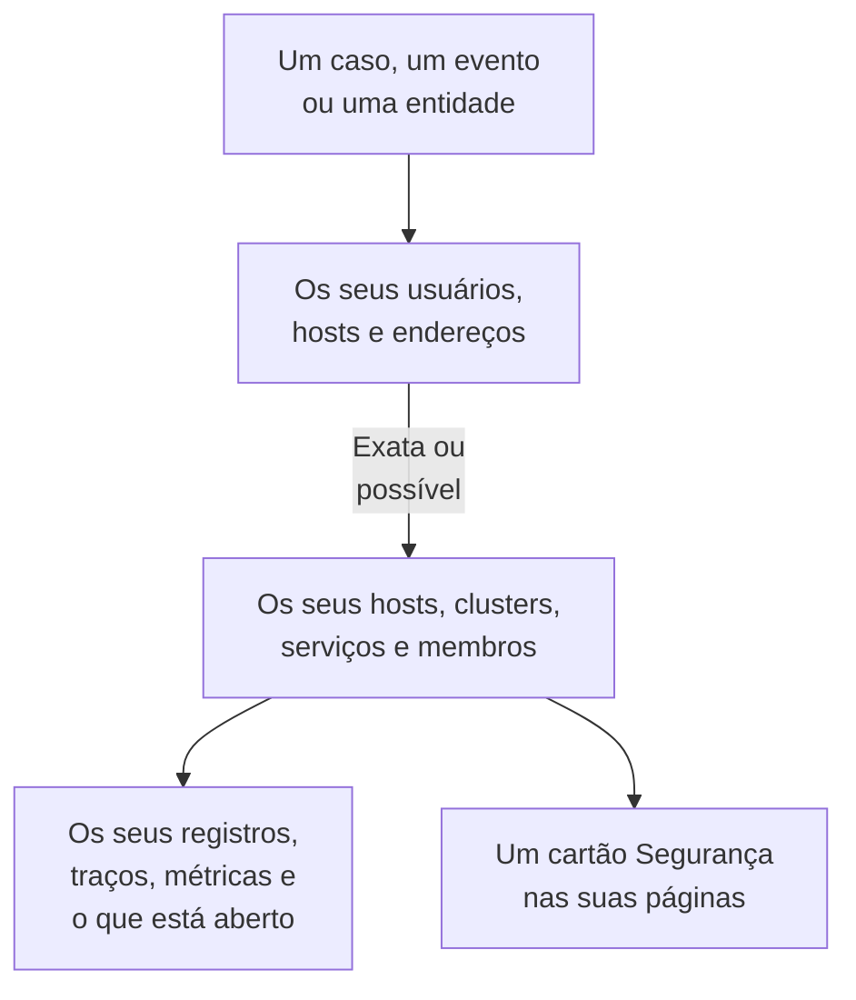

# Sinais conectados

Um caso de segurança diz a quais usuários, hosts e endereços se refere. Sinais conectados diz quais deles o OneUptime já conhece - os seus hosts, hosts de contêineres, clusters do Kubernetes, dispositivos de rede, recursos de nuvem, funções serverless, serviços, os monitores que os verificam e membros - e o que acontecia em cada um em torno do caso: os seus registros, traços e métricas, os incidentes e alertas abertos nele, os monitores que o vigiam e o que mudou nele. Ele também os procura nos seus próprios registros e traços: o endereço de um atacante no registro de acesso de um servidor web, um e-mail vazado no erro de uma aplicação. No sentido inverso, a página de um host, de um cluster, de um recurso de nuvem, de um serviço, de um monitor ou de um membro diz o que o Security Events encontrou sobre ele.

:::cards
- [Onde você vê](#onde-você-vê): A página de um caso, a aba de um evento, a página de uma entidade e as páginas do que eles nomeiam.
- [Como um valor é correspondido](#como-um-valor-é-correspondido): O que conta como o mesmo item e o que só possivelmente é.
- [O que cada item mostra](#o-que-cada-item-mostra): Os seus sinais em torno do caso e o que está aberto nele.
- [Nos seus registros e traços](#nos-seus-registros-e-traços): Onde um endereço, um domínio ou um e-mail que ele nomeia aparece nas suas linhas de registro e spans.
- [Quem vê o quê](#quem-vê-o-quê): Cada item é lido com a função de quem lê.
:::

## Como funciona

O OneUptime procura cada valor entre os itens do projeto, diz o quão certa é cada correspondência e mostra o que acontecia em cada item em torno do caso.

## Antes de começar

- Eventos de segurança chegando, e hosts, clusters do Kubernetes, recursos de nuvem, serviços, monitores ou membros do projeto que eles possam nomear. Veja [Primeiros passos com a segurança](/docs/telemetry/security-getting-started).
- Uma função que possa ler eventos de segurança, e os tipos de item que você quer ver.

## Onde você vê

- **Sinais conectados**, uma página de cada caso de segurança: abra um caso em **Produtos → Eventos de segurança → Casos de segurança → Casos abertos** e depois **Sinais conectados** após **Entidades** no menu dele.
- **Conectado**, uma aba de cada evento de segurança: abra um evento em **Produtos → Eventos de segurança → Eventos**. Ela lista o que o evento nomeia, na hora em torno dele.
- A página de uma entidade, em **Produtos → Eventos de segurança → Risco de entidades**: onde o OneUptime conhece o usuário, o host ou o endereço, em torno do seu último evento de segurança.
- Um cartão **Segurança** na página de cada host, host do Docker, host do Podman, cluster do Kubernetes, dispositivo de rede, recurso de nuvem, função serverless, serviço, monitor, membro e item de inventário: os casos de segurança abertos que o nomeiam, quantos eventos de segurança e descobertas o nomearam nos últimos 7 dias, o mais grave deles e o seu risco. **Abrir em Security Events** o abre lá. O cartão de um monitor trata dos hosts e endereços que ele verifica.
- Um cartão **Segurança** na página de um incidente, quando um caso de segurança declarou o incidente (**Declarado a partir de**) ou casos abertos nomeiam um host ou cluster que ele afeta (**Casos abertos que nomeiam o que ele afeta**).

## Como um valor é correspondido

Cada usuário, host e endereço que um caso ou um evento nomeia é procurado entre os itens do projeto:

| O que o caso ou o evento nomeia | Correspondido a | Certeza |
| --- | --- | --- |
| Um nome de host ou de domínio igual ao nome que um host, um host de contêineres, um cluster ou um dispositivo de rede informa, ou um nome em que um recurso de nuvem responde | Esse item | Exata |
| O mesmo nome, dado sem dizer que é um host | Esse item | Possível |
| Uma forma curta ou completa do nome de um item, como `web-1` e `web-1.acme.internal` | Esse item | Possível |
| Um endereço IP público que só um host ou dispositivo de rede tem, ou em que só um recurso de nuvem responde | Esse item | Exata |
| Um endereço IP privado, ou um que mais de um item tem | Cada item que o tem | Possível |
| O ID próprio de um recurso de nuvem: um ARN da AWS, um ID de recurso do Azure ou um nome de recurso do Google Cloud | Esse recurso de nuvem | Exata |
| Um host, um endereço IP público ou o host de uma URL que um monitor verifica | Esse monitor | Exata |
| Um endereço IP privado que um monitor verifica | Esse monitor | Possível |
| O e-mail de um membro | Esse membro | Exata |
| O item sob o qual uma linha de registro foi enviada, para os eventos lidos dos seus registros | Esse host, cluster, recurso de nuvem, função serverless ou serviço | Exata |
| Um simples nome de usuário, um hash de arquivo ou um processo | Nada: nenhum item é identificado por eles | - |

- Uma possível correspondência mostra **Possível correspondência** ao lado do nome e diz por quê. Ela nunca é contada na página do item, e um incidente que o caso declara nunca é vinculado a ela.
- O que foi procurado e não é um item do projeto é listado em **Nenhum item correspondente**. Um valor nunca é listado ali quando um tipo de item que ele poderia ser não pôde ser lido.
- São listados no máximo 10 itens para um caso, os exatos primeiro.

## O que cada item mostra

- Os seus sinais, cada um abrindo no item e no período do caso: **Registros**, **Traços** e **Métricas**, as **Exceções** de um serviço, os **Eventos do Kubernetes** de um cluster, a **Topologia** do item e o seu item de **Inventário** quando o inventário tem um.
- Os incidentes e alertas abertos nele agora e os monitores que o vigiam, cada um abrindo a sua página. Um monitor mostra o seu status ao lado do nome, e os seus **Registros** são o que ele viu em cada verificação.
- Os agendamentos de plantão de um membro, com **De plantão agora** ao lado daqueles em que ele está de plantão, e as equipes de que faz parte.
- O que mudou nele no período: as implantações de um serviço, os rollouts de um cluster e as correções de um host.

| Onde | Período |
| --- | --- |
| Um caso | De 30 minutos antes da sua primeira detecção até 30 minutos depois da última, no máximo as suas últimas 24 horas |
| Um evento | 30 minutos antes e depois |
| A página de uma entidade | 30 minutos antes e depois do seu último evento de segurança |
| O cartão **Segurança** de um item | Os últimos 7 dias |

## Nos seus registros e traços

Abaixo dos itens, Sinais conectados procura nos seus registros e traços, no mesmo intervalo, os valores que ele nomeia que só podem significar uma coisa: um endereço IP (exceto `127.0.0.1` e os outros que toda máquina tem), um nome completo de host ou de domínio, um e-mail, uma URL, o ID de um recurso de nuvem e um hash de arquivo. Um nome de host simples, o nome simples de um usuário e um processo nunca são procurados: uma linha de registro pode contê-los por qualquer motivo. São procurados no máximo 10 valores.

| Onde | Ele nomeia um valor quando |
| --- | --- |
| A mensagem de uma linha de registro | Ela contém o valor inteiro, em maiúsculas ou minúsculas: `10.0.0.1` em `from 10.0.0.1:52144`, nunca em `10.0.0.12` ou `110.0.0.1` |
| Um atributo de uma linha de registro ou de um span | O valor dele é exatamente o valor: como foi escrito, em minúsculas ou maiúsculas, ou um endereço IPv6 na forma curta |

- Cada valor encontrado mostra quantas linhas de registro e spans o nomeiam, onde ele estava neles - **Na mensagem** ou um atributo pela chave -, cada um abrindo **Registros** ou **Traços** nessas linhas ou spans e no intervalo, e os itens que os enviaram, os que mais enviaram primeiro.
- Um atributo de recurso, como `resource.host.name`, só diz qual item enviou uma linha, e nunca é contado.
- Os valores procurados que nenhum dos dois nomeia são listados em **Não está nos seus registros nem traços**.
- Eles são procurados com a sua própria função: os registros ou traços que a sua função não pode ler são indicados e não são procurados; os que não puderam ser procurados agora dizem isso, com **Tentar novamente**. Uma pesquisa que leva mais de 15 segundos é interrompida e diz isso.

## Quem vê o quê

- Sinais conectados e o cartão **Segurança** de um item exigem uma função que possa ler eventos de segurança: Security Admin, Security Member, Security Viewer, Project Owner ou Project Admin. Ninguém mais vê dados de segurança em nenhuma página. Veja [Funções](/docs/permissions/reference#funções).
- O cartão **Segurança** de um incidente exige uma função que possa ler casos de segurança.
- Cada item é lido com a sua própria função, e também o que há nele: uma função que não pode ler agendamentos de plantão não vê os de um membro. Um tipo de item que a sua função não pode ler é deixado de fora, e a página diz isso; um que não pôde ser lido agora também diz, com **Tentar novamente**.
- A página de um item mostra o seu cartão **Segurança** apenas num projeto que usa o Security Events: um que recebeu um evento de segurança nos últimos 7 dias.

## Incidentes que um caso declara

**Declarar incidente** num caso, ou a etapa de um playbook que declara um, vincula o incidente aos hosts, hosts do Docker e do Podman, clusters do Kubernetes, recursos de nuvem e serviços aos quais o caso está conectado de forma exata. O incidente aparece nas páginas deles e as regras dos seus proprietários se aplicam a ele, e o seu feed nomeia o caso e aquilo a que foi vinculado. Uma possível correspondência nunca é vinculada, nem um monitor: um incidente num monitor pode mudar o seu status e aparecer nas suas páginas de status.

## OneUptime AI

A triagem de um caso pelo OneUptime AI lê os seus sinais conectados: o que está aberto e o que mudou nos hosts, serviços, monitores e membros que o caso nomeia, os agendamentos de plantão e as equipes de um membro, e onde os seus valores aparecem nos seus registros e traços. A investigação de um incidente lê o caso de segurança que o declarou e os casos abertos que nomeiam o que ele afeta. Veja [OneUptime AI na segurança](/docs/telemetry/security-ai).

## Solução de problemas

:::details Um host que o caso nomeia não aparece
Verifique se o caso nomeia o host como o host nomeia a si mesmo, ou nomeia um endereço público que só esse host tem. Um nome curto, como `web-1` para `web-1.acme.internal`, aparece como possível correspondência, e um simples nome de usuário, um hash de arquivo ou um processo não é procurado de forma alguma. Uma URL só é procurada entre os monitores que verificam o seu host.
:::

:::details Um endereço que o caso nomeia não está nos seus registros e traços
Só o intervalo do caso é procurado, e só nos registros e traços que a sua função pode ler. Uma mensagem só nomeia um endereço inteiro: `10.0.0.12` é outro endereço, embora a pesquisa de mensagens do explorador de Registros também o encontre. Um atributo só o nomeia quando o valor dele é exatamente o endereço, e um atributo de recurso nunca.
:::

:::details O host certo aparece como possível correspondência
Uma possível correspondência nunca é contada nem vinculada, para que um nome que duas máquinas compartilham nunca lhe diga algo sobre a errada. Faça com que os seus registros e detecções nomeiem o host pelo nome que ele informa.
:::

:::details A página de um host não tem o cartão Segurança
O cartão é mostrado a uma função que pode ler eventos de segurança, num projeto que recebeu um evento de segurança nos últimos 7 dias. Um host que nada nomeou nesse período mostra uma linha que diz isso.
:::

:::details A página de um monitor não tem o cartão Segurança
O cartão aparece para um monitor que verifica um host, um endereço ou uma URL: um monitor de site, API, ping, porta, certificado SSL, DNS ou domínio. Um heartbeat, um script ou um monitor da sua telemetria não verifica nenhum host, então não tem um.
:::

:::details A página diz que a sua função não pode ver um tipo de item
Cada item é lido com a sua própria função. Peça a um Project Owner ou a um Project Admin uma função que possa ler esse tipo de item.
:::

## Próximos passos

:::cards
- [Casos de segurança e playbooks](/docs/telemetry/security-cases): Trabalhar um caso e declarar um incidente a partir dele.
- [Eventos de segurança (SIEM)](/docs/telemetry/security-events): Os eventos por trás de um caso e os registros de onde são lidos.
- [Risco de entidades (alertas baseados em risco)](/docs/telemetry/security-entity-risk): A página de uma entidade, o seu risco e onde o OneUptime a conhece.
- [OneUptime AI na segurança](/docs/telemetry/security-ai): Como uma triagem lê o que um caso nomeia.
:::
