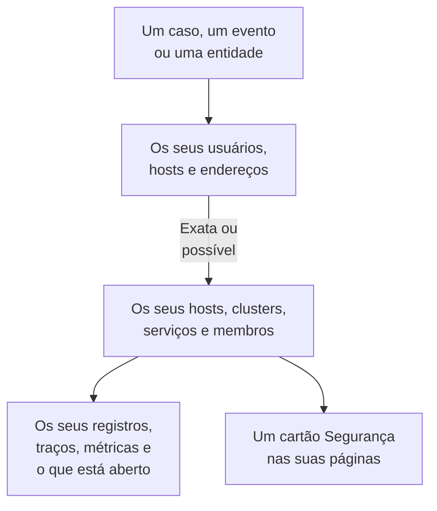

# Sinais conectados

Um caso de segurança diz a quais usuários, hosts e endereços se refere. Sinais conectados diz quais deles o OneUptime já conhece - os seus hosts, hosts de contêineres, clusters do Kubernetes, dispositivos de rede, serviços e membros - e o que acontecia em cada um em torno do caso: os seus registros, traços e métricas, os incidentes e alertas abertos nele, os monitores que o vigiam e o que mudou nele. No sentido inverso, a página de um host, de um cluster, de um serviço ou de um membro diz o que o Security Events encontrou sobre ele.

:::cards
- [Onde você vê](#onde-você-vê): A página de um caso, a aba de um evento, a página de uma entidade e as páginas do que eles nomeiam.
- [Como um valor é correspondido](#como-um-valor-é-correspondido): O que conta como o mesmo item e o que só possivelmente é.
- [O que cada item mostra](#o-que-cada-item-mostra): Os seus sinais em torno do caso e o que está aberto nele.
- [Quem vê o quê](#quem-vê-o-quê): Cada item é lido com a função de quem lê.
:::

## Como funciona

O OneUptime procura cada valor entre os itens do projeto, diz o quão certa é cada correspondência e mostra o que acontecia em cada item em torno do caso.

## Antes de começar

- Eventos de segurança chegando, e hosts, clusters do Kubernetes, serviços ou membros do projeto que eles possam nomear. Veja [Primeiros passos com a segurança](/docs/telemetry/security-getting-started).
- Uma função que possa ler eventos de segurança, e os tipos de item que você quer ver.

## Onde você vê

- **Sinais conectados**, uma página de cada caso de segurança: abra um caso em **Produtos → Security Events → Casos de segurança → Casos abertos** e depois **Sinais conectados** após **Entidades** no menu dele.
- **Conectado**, uma aba de cada evento de segurança: abra um evento em **Produtos → Security Events → Eventos**. Ela lista o que o evento nomeia, na hora em torno dele.
- A página de uma entidade, em **Produtos → Security Events → Risco de entidades**: onde o OneUptime conhece o usuário, o host ou o endereço, em torno do seu último evento de segurança.
- Um cartão **Segurança** na página de cada host, host do Docker, host do Podman, cluster do Kubernetes, dispositivo de rede, serviço, membro e item de inventário: os casos de segurança abertos que o nomeiam, quantos eventos de segurança e descobertas o nomearam nos últimos 7 dias, o mais grave deles e o seu risco. **Abrir em Security Events** o abre lá.
- Um cartão **Segurança** na página de um incidente, quando um caso de segurança declarou o incidente (**Declarado a partir de**) ou casos abertos nomeiam um host ou cluster que ele afeta (**Casos abertos que nomeiam o que ele afeta**).

## Como um valor é correspondido

Cada usuário, host e endereço que um caso ou um evento nomeia é procurado entre os itens do projeto:

| O que o caso ou o evento nomeia | Correspondido a | Certeza |
| --- | --- | --- |
| Um nome de host ou de domínio igual ao nome que um host, um host de contêineres, um cluster ou um dispositivo de rede informa | Esse item | Exata |
| O mesmo nome, dado sem dizer que é um host | Esse item | Possível |
| Uma forma curta ou completa do nome de um item, como `web-1` e `web-1.acme.internal` | Esse item | Possível |
| Um endereço IP público que só um item tem | Esse item | Exata |
| Um endereço IP privado, ou um que mais de um item tem | Cada item que o tem | Possível |
| O e-mail de um membro | Esse membro | Exata |
| O item sob o qual uma linha de registro foi enviada, para os eventos lidos dos seus registros | Esse host, cluster ou serviço | Exata |
| Um simples nome de usuário, uma URL, um hash de arquivo ou um processo | Nada: nenhum item é identificado por eles | - |

- Uma possível correspondência mostra **Possível correspondência** ao lado do nome e diz por quê. Ela nunca é contada na página do item, e um incidente que o caso declara nunca é vinculado a ela.
- O que foi procurado e não é um item do projeto é listado em **Não está no OneUptime**. Um valor nunca é listado ali quando um tipo de item que ele poderia ser não pôde ser lido.
- São listados no máximo 10 itens para um caso, os exatos primeiro.

## O que cada item mostra

- Os seus sinais, cada um abrindo no item e no período do caso: **Registros**, **Traços** e **Métricas**, as **Exceções** de um serviço, os **Eventos do Kubernetes** de um cluster, a **Topologia** do item e o seu item de **Inventory** quando o inventário tem um.
- Os incidentes e alertas abertos nele agora e os monitores que o vigiam, cada um abrindo a sua página.
- O que mudou nele no período: as implantações de um serviço, os rollouts de um cluster e as correções de um host.

| Onde | Período |
| --- | --- |
| Um caso | De 30 minutos antes da sua primeira detecção até 30 minutos depois da última, no máximo as suas últimas 24 horas |
| Um evento | 30 minutos antes e depois |
| A página de uma entidade | 30 minutos antes e depois do seu último evento de segurança |
| O cartão **Segurança** de um item | Os últimos 7 dias |

## Quem vê o quê

- Sinais conectados e o cartão **Segurança** de um item exigem uma função que possa ler eventos de segurança: Security Admin, Security Member, Security Viewer, Project Owner ou Project Admin. Ninguém mais vê dados de segurança em nenhuma página. Veja [Funções](/docs/permissions/reference#funções).
- O cartão **Segurança** de um incidente exige uma função que possa ler casos de segurança.
- Cada item é lido com a sua própria função. Um tipo de item que a sua função não pode ler é deixado de fora, e a página diz isso; um que não pôde ser lido agora também diz, com **Tentar novamente**.
- A página de um item mostra o seu cartão **Segurança** apenas num projeto que usa o Security Events: um que recebeu um evento de segurança nos últimos 7 dias.

## Incidentes que um caso declara

**Declarar incidente** num caso, ou a etapa de um playbook que declara um, vincula o incidente aos hosts, hosts do Docker e do Podman, clusters do Kubernetes e serviços aos quais o caso está conectado de forma exata. O incidente aparece nas páginas deles e as regras dos seus proprietários se aplicam a ele, e o seu feed nomeia o caso e aquilo a que foi vinculado. Uma possível correspondência nunca é vinculada.

## OneUptime AI

A triagem de um caso pelo OneUptime AI lê os seus sinais conectados: o que está aberto e o que mudou nos hosts, serviços e membros que o caso nomeia. A investigação de um incidente lê o caso de segurança que o declarou e os casos abertos que nomeiam o que ele afeta. Veja [OneUptime AI na segurança](/docs/telemetry/security-ai).

## Solução de problemas

:::details Um host que o caso nomeia não aparece
Verifique se o caso nomeia o host como o host nomeia a si mesmo, ou nomeia um endereço público que só esse host tem. Um nome curto, como `web-1` para `web-1.acme.internal`, aparece como possível correspondência, e um simples nome de usuário, uma URL, um hash de arquivo ou um processo não é procurado de forma alguma.
:::

:::details O host certo aparece como possível correspondência
Uma possível correspondência nunca é contada nem vinculada, para que um nome que duas máquinas compartilham nunca lhe diga algo sobre a errada. Faça com que os seus registros e detecções nomeiem o host pelo nome que ele informa.
:::

:::details A página de um host não tem o cartão Segurança
O cartão é mostrado a uma função que pode ler eventos de segurança, num projeto que recebeu um evento de segurança nos últimos 7 dias. Um host que nada nomeou nesse período mostra uma linha que diz isso.
:::

:::details A página diz que a sua função não pode ver um tipo de item
Cada item é lido com a sua própria função. Peça a um Project Owner ou a um Project Admin uma função que possa ler esse tipo de item.
:::

## Próximos passos

:::cards
- [Casos de segurança e playbooks](/docs/telemetry/security-cases): Trabalhar um caso e declarar um incidente a partir dele.
- [Eventos de segurança (SIEM)](/docs/telemetry/security-events): Os eventos por trás de um caso e os registros de onde são lidos.
- [Risco de entidades (alertas baseados em risco)](/docs/telemetry/security-entity-risk): A página de uma entidade, o seu risco e onde o OneUptime a conhece.
- [OneUptime AI na segurança](/docs/telemetry/security-ai): Como uma triagem lê o que um caso nomeia.
:::
