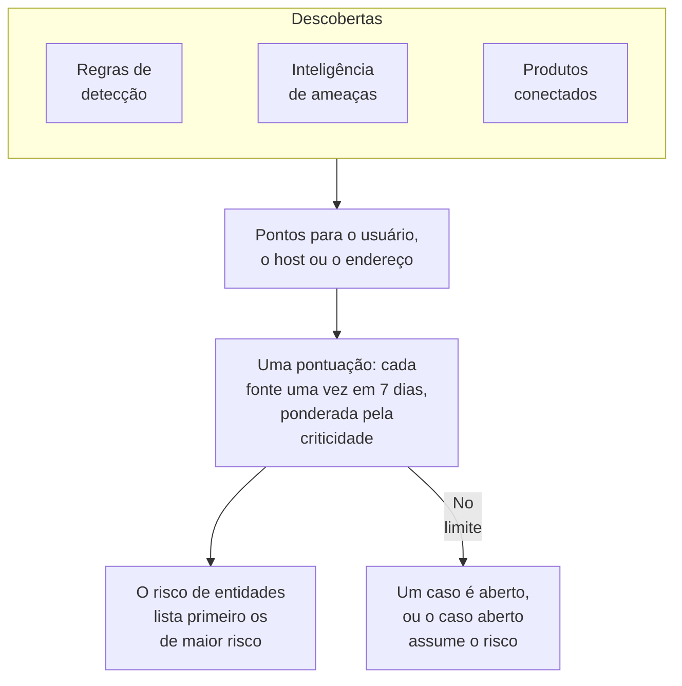

# Risco de entidades (alertas baseados em risco)

Uma descoberta isolada raramente diz muito. Uma rajada de logins com falha, um primeiro sudo num host e um login a partir de um país novo merecem, cada um, uma olhada; a mesma conta nos três numa semana merece um caso. O risco de entidades soma o que as suas regras de detecção, a sua inteligência de ameaças e os seus produtos conectados encontram sobre cada usuário, host e endereço IP, lista primeiro os de maior risco e abre um caso sobre aquele cujo risco atinge o limite do projeto.

:::cards
- [Como uma pontuação é contada](#como-uma-pontuação-é-contada): Pontos pela gravidade, e cada fonte uma vez por semana.
- [Níveis de risco e casos](#níveis-de-risco-e-casos): Como uma pontuação é lida, e quando um caso é aberto.
- [Criticidade de entidades](#criticidade-de-entidades): Contar mais o que importa mais, e menos o que importa menos.
- [A página de uma entidade](#a-página-de-uma-entidade): Por que ela é de risco, o seu mês e os casos sobre ela.
- [Pontos de risco numa regra de detecção](#pontos-de-risco-numa-regra-de-detecção): O peso próprio de uma regra na pontuação.
:::

## Como funciona

Abra **Produtos → Security Events → Risco de entidades**: cada usuário, host e endereço IP com risco agora, primeiro os de maior risco, com o seu nível, quanto importa, o que o encontrou e quando. Cada um abre numa página própria.

## Antes de começar

- Eventos de segurança chegando, e regras de detecção, inteligência de ameaças ou produtos conectados que encontram algo neles. Veja [Primeiros passos com a segurança](/docs/telemetry/security-getting-started).
- Regras de detecção que agrupam por um campo que nomeia alguém: **Group By Field**, como `principalUser`, `principalHost` ou `principalIp`, ou os campos pelos quais uma correlação agrupa. Uma regra que não agrupa por nada não soma risco.
- Para alterar **Pontuação de risco**: Project Owner ou Project Admin para o seu interruptor e o seu limite, e uma função que possa criar regras de detecção para a sua lista de entidades. Security Viewer lê tudo. Veja [Funções](/docs/permissions/reference#funções).

## Como uma pontuação é contada

Cada descoberta soma pontos de risco ao usuário, host ou endereço IP a que se refere:

| Uma descoberta de gravidade | Soma |
| --- | --- |
| Baixa | 10 pontos |
| Média | 25 pontos |
| Alta | 50 pontos |
| Crítica | 75 pontos |

- Uma descoberta informativa não soma nada, e uma descoberta de gravidade desconhecida conta como Média.
- Os pontos de uma regra de detecção vão para o valor pelo qual ela agrupa. Uma correspondência de inteligência de ameaças soma ao endereço IP que o indicador nomeia. O alerta de um produto conectado soma ao usuário e ao host que ele nomeia, ou senão ao seu endereço IP.
- Cada fonte conta uma vez. Uma regra de detecção, um feed de inteligência de ameaças ou a regra de um produto conectado conta uma vez em 7 dias, com o máximo que somou, por mais que dispare: uma regra barulhenta não pode fazer uma entidade parecer pior do que três regras diferentes.
- Uma fonte que não encontrou nada em 7 dias deixa de contar, e a pontuação cai. As pontuações são verificadas a cada 15 minutos, então uma pontuação cai na hora certa sem uma nova descoberta.

A pontuação de uma entidade é a soma das suas fontes, ponderada pela sua criticidade. O ataque de teste de **Enviar um ataque de teste**, e um caso que alguém abre à mão, não somam risco.

## Níveis de risco e casos

Cada pontuação é lida como um nível diante do limite do projeto, 100, a menos que você o altere:

| Pontuação de risco | É lida como | O que acontece |
| --- | --- | --- |
| 1 a 49 | Baixo | Listado em Risco de entidades |
| 50 a 99 | Médio | Listado em Risco de entidades |
| 100 a 199 | Alto | Um caso é aberto, em Alto |
| 200 ou mais | Crítico | Um caso é aberto, em Crítico |

Quando o risco de uma entidade atinge o limite, uma detecção da fonte Risco de entidades é gerada sobre ela. Ela entra no caso aberto sobre a entidade, ou abre um com o nome dela, como `High risk — k.morgan@acme-commerce.example`, e lista as fontes que mais somaram ao risco, até 10, com os seus pontos, quantas vezes cada uma disparou e quando foi a última.

Depois que um caso é aberto sobre o risco de uma entidade, o que estava por trás não é contado de novo: outro caso só é aberto quando fontes novas desde então voltam a somar o limite. Um caso fechado como resolvido não é reaberto pelas mesmas descobertas.

Altere o limite em **Produtos → Security Events → Configurações → Pontuação de risco → Limite de risco**: um número inteiro de 10 a 10000. Médio começa na metade dele e Crítico no dobro, em todas as páginas.

### Ativar ou desativar os casos de risco

**Casos de risco**, em **Configurações → Pontuação de risco**, decide se o risco abre casos, e é salvo assim que você o alterna. Os projetos novos começam com ele ativado. Um projeto criado antes do risco de entidades o mantém desativado até que alguém o ative, e **Risco de entidades** avisa acima da sua lista. O risco é pontuado e listado de qualquer forma.

## Criticidade de entidades

Algumas entidades importam mais do que outras: um controlador de domínio, a conta de um executivo, um servidor de pagamentos. Outras importam menos, como um scanner de vulnerabilidades cujas varreduras são esperadas. Liste-as em **Configurações → Pontuação de risco → Criticidade de entidades** com **Adicionar: Entidade**:

| Criticidade | Conta o seu risco |
| --- | --- |
| Baixa | ×0.5 |
| Não listada | ×1 |
| Alta | ×1.5 |
| Extrema | ×2 |

Uma entrada é um valor ou um padrão com `*`, sem diferenciar maiúsculas: `dc-*` nomeia cada controlador de domínio, e `*@contractors.example` cada terceirizado. **Tipo** a restringe a usuários, hosts ou endereços IP; vazio corresponde a todos. Quando várias entradas nomeiam uma entidade, conta a mais específica: um valor escrito por extenso antes de um padrão, e um padrão mais longo antes de um mais curto. Uma alteração chega à pontuação de cada entidade em minutos.

## A página de uma entidade

Clique em **Visualizar** numa linha de **Risco de entidades**, ou no risco ao lado de uma entidade na página **Entidades** de um caso:

| Parte | O que mostra |
| --- | --- |
| O cabeçalho | O seu tipo e criticidade, a sua pontuação e nível, e como a pontuação é calculada |
| **Atividade** | Os seus eventos de segurança e descobertas dos últimos 7 dias |
| **O que soma ao seu risco** | Cada fonte, a sua gravidade, os pontos que soma, quantas vezes disparou e quando foi a última |
| **Risco nos últimos 30 dias** | A sua pontuação no fim de cada dia, colorida pelo nível |
| **Casos sobre ela** | Os casos de segurança abertos sobre ela, os mais recentes primeiro |

**Abrir em Correlacionar** desenha um grafo dos seus eventos, e **Pesquisar seus eventos** abre **Eventos** na sua semana. **Redefinir risco** apaga a sua pontuação e as suas fontes, depois de um teste planejado, por exemplo: o que for encontrado depois conta do zero, e os seus casos não mudam. Redefinir exige uma função que possa excluir dados de segurança, e o [log de auditoria](/docs/configuration/audit-logs) o registra.

O OneUptime AI lê o risco das entidades de um caso quando faz a triagem do caso. Veja [OneUptime AI na segurança](/docs/telemetry/security-ai).

## Pontos de risco numa regra de detecção

Uma regra de detecção soma os pontos do seu nível, a partir do seu `level` do Sigma. Para lhe dar um peso próprio, abra o formulário da regra, vá para **Ao corresponder**, abra **Mais campos** e defina **Pontos de risco**, de 0, que não soma risco, a 100. Deixe vazio para os pontos do seu nível.

## Solução de problemas

:::details Uma entidade não aparece em Risco de entidades
Verifique se uma regra de detecção, um feed de inteligência de ameaças ou um produto conectado encontrou algo sobre ela nos últimos 7 dias, e se a regra agrupa por um campo que a nomeia. Descobertas informativas não somam nada, e uma fonte que não encontrou nada em 7 dias deixa de contar.
:::

:::details O risco de uma entidade atingiu o limite e nenhum caso foi aberto
Verifique se **Casos de risco** está ativado em **Configurações → Pontuação de risco**. Se um caso já foi aberto sobre o risco da entidade, só as fontes novas desde então contam para o próximo.
:::

:::details Uma regra dispara sem parar, e a pontuação da entidade não sobe
É assim que se conta: uma fonte conta uma vez em 7 dias, com o máximo que somou. Reduza os **Pontos de risco** de uma regra barulhenta, ou marque com criticidade baixa uma entidade cujas descobertas são esperadas.
:::

:::details Uma pontuação não é a soma das suas fontes
A sua criticidade a pondera. A página da entidade mostra a soma das suas fontes e o peso, como 100 das suas fontes × 2 = 200.
:::

## Próximos passos

:::cards
- [Casos de segurança e playbooks](/docs/telemetry/security-cases): Trabalhar os casos que o risco abre, e fechá-los com um veredito.
- [Eventos de segurança (SIEM)](/docs/telemetry/security-events): Regras de detecção, Correlacionar e os eventos por trás de cada descoberta.
- [Inteligência de ameaças (STIX/TAXII)](/docs/telemetry/threat-intelligence): As correspondências que somam ao risco de um endereço.
- [OneUptime AI na segurança](/docs/telemetry/security-ai): Como uma triagem lê o risco das entidades de um caso.
:::
