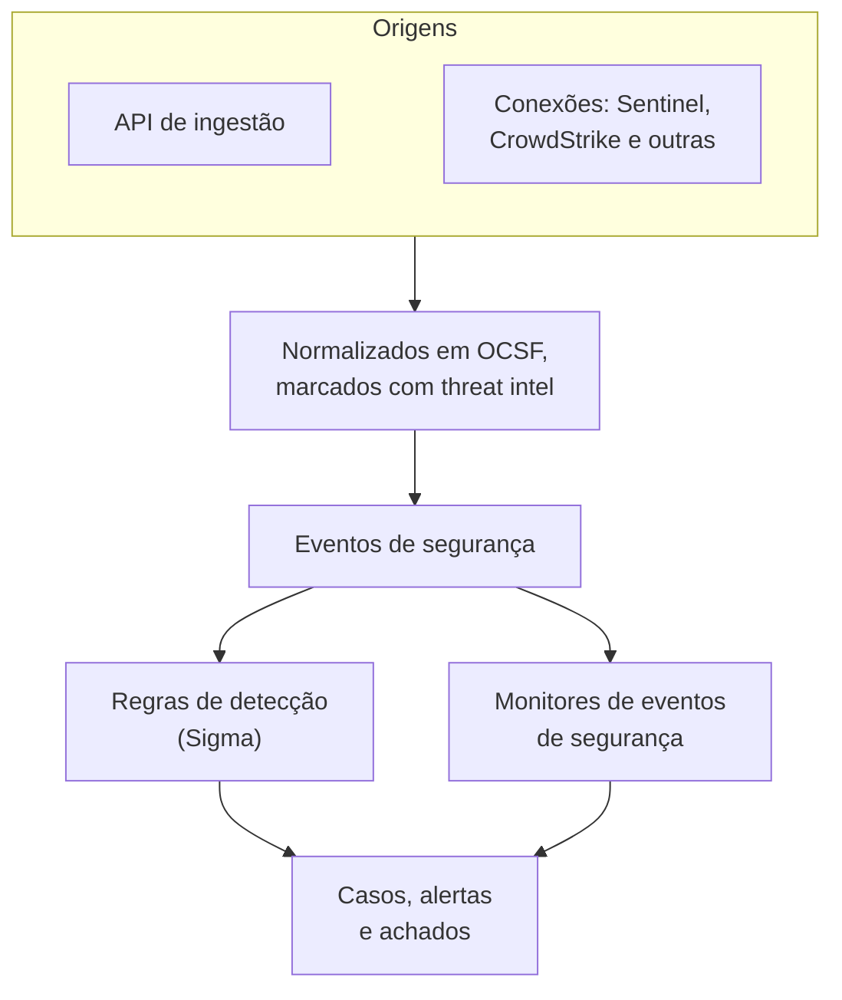
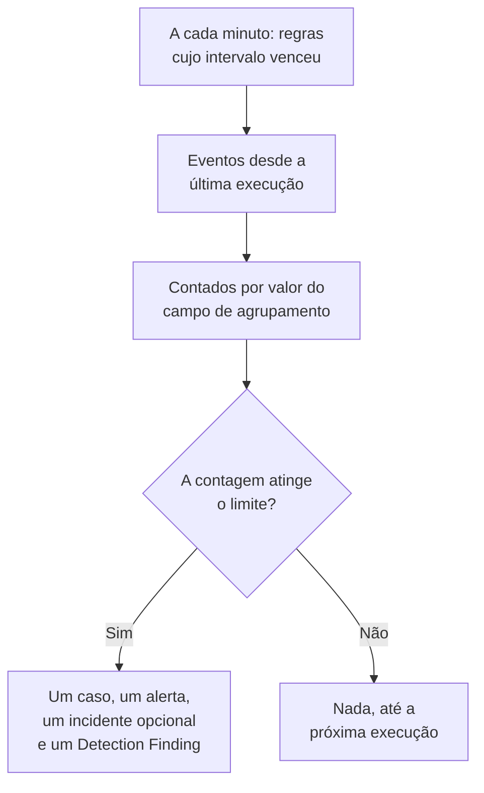

# Eventos de segurança (SIEM)

O OneUptime guarda os eventos de segurança ao lado dos seus logs, traces e métricas, e dá a cada um a mesma forma, [OCSF](https://schema.ocsf.io/) (o Open Cybersecurity Schema Framework), seja qual for o formato em que chegou. Envie eventos de qualquer origem, pesquise-os e encontre os que importam com regras de detecção Sigma, inteligência de ameaças e monitores. O que eles encontram vira [casos](/docs/telemetry/security-cases) a tratar, e os playbooks respondem a eles.

:::cards
- [Enviar eventos](#enviar-eventos-de-segurança): Um POST HTTPS, uma saída do Fluent Bit ou uma conexão com um produto de segurança.
- [Pesquisar e correlacionar](#explorar-os-eventos-de-segurança): O explorador de eventos e o grafo de correlação.
- [Regras de detecção](#regras-de-detecção): Regras Sigma que abrem casos e alertas.
- [Monitores](#monitores-de-eventos-de-segurança): Contagens em uma janela deslizante, com um status que se recupera.
:::

## Como funciona



Abra **Produtos → Security Events**, em **Observabilidade**. O menu dele tem uma seção para cada parte da segurança, e uma página própria para cada coisa nela:

| Página | Seção | Para que serve |
| --- | --- | --- |
| **Visão geral** | Visão geral | Como a segurança está configurada, o que precisa de alguém agora e com que rapidez os casos são tratados |
| **Casos abertos** | Casos de segurança | A fila: todo caso ainda não fechado, agrupado pelo assunto de cada um |
| **Atribuídos a mim** | Casos de segurança | Os casos abertos atribuídos a você |
| **Não atribuído** | Casos de segurança | Os casos abertos que ninguém assumiu |
| **Casos fechados** | Casos de segurança | Os casos fechados com um veredicto, os mais recentes primeiro |
| **Todos os casos** | Casos de segurança | Todo caso, aberto ou fechado |
| **Eventos** | Eventos | Pesquisar e filtrar todos os eventos, e abrir um para ver todos os campos dele |
| **Entidades** | Eventos | Os usuários, hosts e endereços que os seus achados mais citam |
| **Correlacionar** | Eventos | Um grafo dos eventos que compartilham um host, um usuário ou um endereço IP |
| **Detection Rules** | Detections | Regras Sigma que rodam em uma programação e abrem casos |
| **Rule Library** | Detections | Regras de detecção prontas para adicionar, cada uma com os eventos que lê e se eles chegam, com as recomendadas marcadas |
| **Threat Intel** | Detections | Feeds STIX/TAXII de indicadores maliciosos conhecidos |
| **ATT&CK Coverage** | Detections | As técnicas MITRE ATT&CK que as suas regras cobrem |
| **Playbooks** | Playbooks | Etapas que rodam nos casos, sozinhas ou manualmente |
| **Aguardando aprovação** | Playbooks | As etapas de playbook aguardando alguém aprovar ou rejeitar |
| **Execuções de playbooks** | Playbooks | O que cada playbook fez, etapa por etapa |
| **Protected Entities** | Playbooks | Os usuários e hosts aos quais nenhum playbook aplica contenção |
| **Configurações** | IA | Se o OneUptime AI classifica cada caso novo |
| **Connections** | Connections | Seus logs, os produtos de segurança que o OneUptime consulta e os SIEMs para os quais ele envia |
| **Guia de configuração** | Connections | Trechos para enviar eventos, preenchidos com a sua chave de ingestão |
| **Prioridades de casos** | Configurações | Quão urgente é um caso: as prioridades do próprio projeto, a mais urgente primeiro |
| **Status de casos** | Configurações | As etapas por que um caso passa, e como conta um caso em cada uma |

**Detections**, **IA**, **Connections** e **Configurações**, configuradas uma vez, ficam recolhidas até você abri-las. Novo na segurança? [Primeiros passos com a segurança](/docs/telemetry/security-getting-started) a configura em dois cliques.

## Antes de começar

Os dados de segurança só são lidos pelos papéis Project Owner e Project Admin e pelos três papéis de segurança; os outros papéis não veem nada em Security Events. Veja [Papéis](/docs/permissions/reference#funções).

| Papel | O que pode fazer |
| --- | --- |
| Security Admin | Tudo: eventos, casos, playbooks, regras de detecção, feeds de inteligência de ameaças e conexões |
| Security Member | Ler eventos e inteligência de ameaças, tratar casos, executar playbooks e aprovar as etapas deles, e criar, alterar e excluir regras de detecção e feeds. Não pode configurar playbooks nem conexões, nem excluir dados de segurança. |
| Security Viewer | Ler eventos, casos, playbooks, regras, feeds, indicadores e conexões |

## Enviar eventos de segurança

:::steps
### Crie uma chave de ingestão

Abra **Configurações do projeto → Telemetria e APM → Chaves de ingestão** e clique em **Criar chave de ingestão**. Os eventos de segurança usam as mesmas chaves que o resto da sua telemetria.

### Envie os seus eventos

Envie JSON para `/security-events/v1/ingest` com a chave em `x-oneuptime-token`:

:::tabs
@tab OCSF
```bash
curl -X POST "https://oneuptime.com/security-events/v1/ingest?format=ocsf" \
  -H "Content-Type: application/json" \
  -H "x-oneuptime-token: YOUR_INGESTION_TOKEN" \
  -H "x-oneuptime-service-name: my-security-source" \
  -d '{ "events": [ { "class_uid": 3002, "severity_id": 4, "status": "Failure", "message": "Failed logon for alice", "actor": { "user": { "name": "alice" } }, "src_endpoint": { "ip": "203.0.113.7", "hostname": "laptop-alice" } } ] }'
```
@tab Google UDM
```bash
curl -X POST "https://oneuptime.com/security-events/v1/ingest?format=udm" \
  -H "Content-Type: application/json" \
  -H "x-oneuptime-token: YOUR_INGESTION_TOKEN" \
  -d '{ "events": [ { "metadata": { "event_type": "USER_LOGIN" }, "principal": { "hostname": "laptop-alice", "user": { "userid": "alice" }, "ip": ["203.0.113.7"] }, "security_result": [{ "severity": "HIGH", "action": ["BLOCK"] }] } ] }'
```
@tab Generic JSON
```bash
curl -X POST "https://oneuptime.com/security-events/v1/ingest" \
  -H "Content-Type: application/json" \
  -H "x-oneuptime-token: YOUR_INGESTION_TOKEN" \
  -d '{ "events": [ { "severity": "high", "event_type": "ssh_brute_force", "message": "12 failed SSH logins in 60s", "username": "root", "hostname": "web-01", "src_ip": "203.0.113.7" } ] }'
```
:::

O endpoint responde `200` assim que os eventos entram na fila. Um evento enviado sem hora, como estes, é colocado no momento em que chega.

### Encontre-os em Eventos

Abra **Produtos → Security Events → Eventos**. Os eventos aparecem em poucos segundos, com gravidade, classe, usuário, host e endereços IP preenchidos.
:::

### Formatos

| `format` | O que ele lê | Também aceito |
| --- | --- | --- |
| `ocsf` | JSON de eventos OCSF (`class_uid`, `severity_id` e assim por diante) | Nenhum |
| `udm` | Eventos UDM do Google SecOps (Chronicle) (`metadata.event_type` e assim por diante) | `chronicle`, `google-secops` |
| `google-secops-alert` | Detecções e alertas do Google SecOps: webhooks de SOAR e o fluxo de detecções | `secops-alert`, `detection` |
| `generic` | Qualquer outro JSON, lido por nomes de campo comuns | Nenhum |

Informe o formato com `?format=`, com o cabeçalho `x-oneuptime-security-event-format` ou com um campo `"format"` de nível superior. Se você o omitir, o formato de cada evento é descoberto separadamente, então um mesmo webhook pode misturar detecções com eventos brutos.

- O corpo pode ser um evento, um array de eventos ou `{ "events": [...] }`.
- O cabeçalho `x-oneuptime-service-name` nomeia o serviço de telemetria ao qual os eventos pertencem. Sem ele, pertencem ao serviço com o nome do produto ou do fornecedor do primeiro evento, ou a `Security Events`.
- Nada é descartado por não ter sido mapeado: cada campo da origem chega aos atributos do evento.

### Campos de JSON genérico

Um evento genérico é lido por nomes de campo comuns:

| Campo do evento | Lido do primeiro de |
| --- | --- |
| `message` | `message`, `msg`, `summary`, `description`, `title` |
| `severityName` | `severity`, `severity_name`, `level`, `priority`, `risk_level` |
| `time` | `timestamp`, `time`, `@timestamp`, `event_time`, `created_at` |
| `principalUser` | `user`, `username`, `user_name`, `account`, `actor` |
| `principalHost` | `host`, `hostname`, `computer`, `device`, `machine` |
| `principalIp` | `source_ip`, `src_ip`, `client_ip`, `ip` |
| `targetIp` | `destination_ip`, `dest_ip`, `dst_ip`, `target_ip` |
| `className` | `event_type`, `category`, `type`, `action` |
| `ruleName` | `rule`, `rule_name`, `signature`, `detection` |
| `productName` | `product`, `product_name`, `source`, `log_source` |
| `processName` | `process_name`, `process.name`, `proc.name`, `comm` |
| `processPath` | `process_path`, `Image`, `NewProcessName`, `exe`, `process.executable` |
| `processCommandLine` | `command_line`, `CommandLine`, `cmdline`, `process.command_line`, `proc.cmdline`, `process` |
| `parentProcessName` | `parent_process_name`, `process.parent.name`, `proc.pname` |
| `parentProcessPath` | `parent_process_path`, `ParentImage`, `ParentProcessName`, `process.parent.executable` |
| `parentProcessCommandLine` | `parent_command_line`, `ParentCommandLine`, `process.parent.command_line`, `proc.pcmdline` |

Uma palavra de gravidade vira um nível OCSF: `info` é lido como Informational, `warning` como Low, `error` como Medium, `alert` como Critical e `emergency` como Fatal.

### Encaminhe com o Fluent Bit

Para enviar logs de segurança que você já coleta, como os do auditd, do syslog ou do Falco, adicione ao Fluent Bit uma saída `http`:

```ini title="fluent-bit.conf"
[OUTPUT]
    Name             http
    Match            security.*
    Host             oneuptime.com
    Port             443
    tls              On
    URI              /security-events/v1/ingest
    Format           json
    Json_date_key    timestamp
    Json_date_format iso8601
    Header           x-oneuptime-token YOUR_INGESTION_TOKEN
    Header           x-oneuptime-service-name my-security-source
    Retry_Limit      5
```

A página **Guia de configuração**, em **Connections**, tem esses trechos com o seu próprio host e a sua chave já preenchidos.

### Encontrar eventos de segurança nos seus logs

O cartão **Seus logs**, no topo de **Connections**, transforma em uma origem os logs que você já envia ao OneUptime. Com **Encontrar eventos de segurança nos seus logs** ativado, os logs novos do projeto são lidos a cada minuto, e cada login SSH, comando sudo, registro de auditoria do Kubernetes, mudança no AWS CloudTrail e ataque web que eles contêm é salvo como evento de segurança. Consulte [Primeiros passos com a segurança](/docs/telemetry/security-getting-started#encontrar-eventos-de-segurança-nos-seus-logs) para saber o que cada tipo cobre.

### Conecte um produto de segurança

**Connections** consulta um produto de segurança por você e importa os registros novos dele como eventos de segurança. Uma conexão guarda as configurações do produto e uma credencial criptografada; um worker a consulta no intervalo que você define e pula os registros que já importou.

| Produto | Importa | Guia de configuração |
| --- | --- | --- |
| Google SecOps (Chronicle) | Detecções de regras, detecções selecionadas e alertas, como Detection Findings | [Google SecOps](/docs/integrations/google-secops) |
| Microsoft Sentinel | Incidentes, como Incident Findings | [Microsoft Sentinel](/docs/integrations/microsoft-sentinel) |
| Microsoft Defender XDR | Alertas, como Detection Findings | [Microsoft Defender XDR](/docs/integrations/microsoft-defender-xdr) |
| CrowdStrike Falcon | Alertas, como Detection Findings | [CrowdStrike Falcon](/docs/integrations/crowdstrike-falcon) |
| Splunk Enterprise Security | Notable events, ou qualquer pesquisa, como Detection Findings | [Splunk Enterprise Security](/docs/integrations/splunk) |
| Elastic Security | Alertas de detecção, como Detection Findings | [Elastic Security](/docs/integrations/elastic-security) |
| AWS Security Hub | Findings, como Detection e Compliance Findings | [AWS Security Hub](/docs/integrations/aws-security-hub) |
| Okta System Log | Eventos de login, MFA, contas e políticas | [Okta System Log](/docs/integrations/okta) |

- Os alertas do próprio produto no nível de **Open Cases From** ou acima (**Alta e acima**, a menos que você escolha outro nível, ou **Nunca**) abrem [casos](/docs/telemetry/security-cases), agrupados pelo usuário, host ou endereço de que tratam.
- Uma conexão lê os registros pelo momento em que o produto os criou, não pelo momento da atividade que descrevem. Uma regra de SIEM que roda de hora em hora cria detecções muito depois dos eventos correspondentes, e mesmo assim elas são importadas.
- A primeira consulta olha 24 horas para trás, então uma conexão nova mostra registros recentes na hora.
- **Testar conexão**, na linha da conexão, verifica o acesso ao produto e se os workers do próprio OneUptime estão rodando, sem importar nada. **Run now** consulta na hora.

## O que um evento contém

Cada evento é salvo com campos tipados e o payload de origem:

| Grupo | Campos |
| --- | --- |
| Classificação | `categoryName`, `className`, `activityName`, `statusName`, com os IDs OCSF deles (`categoryUid`, `classUid`) |
| Gravidade | `severityName`, um de Unknown, Informational, Low, Medium, High, Critical, Fatal ou Other, e `severityId` |
| Quem fez | `principalUser`, `principalHost`, `principalIp`, `principalProcess` |
| O que foi afetado | `targetUser`, `targetHost`, `targetIp`, `targetPort`, `targetResource` |
| O processo | `processName`, `processPath` e `processCommandLine`: na inicialização de um processo, o processo que iniciou; nos demais casos, o processo que agiu. `parentProcessName`, `parentProcessPath` e `parentProcessCommandLine`: o processo que o iniciou |
| Origem | `productName`, `vendorName`, `ruleId`, `ruleName`, `eventUid` |
| Conteúdo | `message`, `mitreTactics`, `mitreTechniques` e `observables`: cada usuário, host, endereço IP, domínio e hash extraído do evento |
| Atributos | O payload de origem inteiro, achatado em chaves com pontos |

## Explorar os eventos de segurança

**Eventos** é um explorador de telemetria como os de logs e traces: um gráfico dos eventos da janela por gravidade, uma barra lateral de facetas, a lista e um painel com cada campo e atributo do evento que você abrir. A janela, os filtros e a pesquisa ficam todos na URL, então uma visualização filtrada pode ser compartilhada e sobrevive a um recarregamento.

### Pesquisa

A barra de pesquisa fala a mesma linguagem dos outros exploradores de telemetria (veja [Sintaxe de pesquisa](/docs/telemetry/search-syntax)):

| Sintaxe | Significa | Exemplo |
| --- | --- | --- |
| texto livre | A mensagem o contém | `failed logon` |
| `"quoted phrase"` | Manter as palavras juntas | `"brute force"` |
| `<field>:<value>` | Um campo tipado | `severity:Critical` |
| `@<attribute>:<value>` | Um atributo de origem | `@threat.matched:true` |
| `-<filter>` | Isto não | `-severity:Informational` |
| `<field>:(a OR b)` | Qualquer um destes valores | `severity:(High OR Critical)` |
| `<field>:a*` | `*` é qualquer texto, `?` um caractere | `host:web-*` |
| `@<attribute>:*` | O atributo está presente | `@threat.indicator_id:*` |
| `@<attribute>:~text` | O atributo contém o texto | `@finding_info.title:~ransom` |

Um campo é um nome curto (`severity`, `class`, `category`, `activity`, `status`, `vendor`, `product`, `rule`, `user`, `host`, `ip`, `targetuser`, `targethost`, `targetip`, `processname`, `commandline`, `parentprocessname`, `observable`, `tactic`, `technique`) ou o nome próprio do campo, como `severityName` ou `principalHost`. Qualquer outro nome é lido como atributo de origem. `observable:<value>` encontra cada evento que menciona um valor, de qualquer lado da atividade em que ele estivesse.

### Facetas

A barra lateral conta os eventos da janela por **Origem**, **Gravidade**, **Classe de evento**, **Category**, **Atividade**, **Status**, **Fornecedor**, **Produto**, **Detection Rule**, **Usuário de origem**, **Host de origem**, **Processo** e **Processo pai**. Clique em um valor para manter só os eventos dele, ou no sinal de menos ao lado para excluí-los. Clique de novo para desfazer. O gráfico e cada contagem descrevem exatamente os eventos da lista.

### Correlacionar

**Correlacionar** desenha os eventos em torno de um host, um usuário ou um endereço IP: as classes de evento deles em torno do que você pesquisou, marcadas pela pior gravidade, e os outros valores vistos nos mesmos eventos no anel externo. Clique em uma classe para listar os eventos dela, ou em um valor para correlacionar a partir dele. Cada observable no painel de um evento em **Eventos** abre **Correlacionar** sobre ele.

## Regras de detecção

Uma regra de detecção é uma regra [Sigma](https://sigmahq.io/), um formato YAML aberto para descrever atividade suspeita, que o OneUptime roda em uma programação sobre os seus eventos. Quando corresponde, ela abre um [caso](/docs/telemetry/security-cases) ou entra em um já aberto, abre um alerta, opcionalmente um incidente, e grava um Detection Finding de volta nos eventos. A **Rule Library** tem regras prontas para começar.



### Crie uma regra

:::steps
1. Abra **Produtos → Security Events → Detections → Detection Rules** e clique em **Criar: Detection Rule**.
2. Em **Sigma Rule**, cole o YAML da regra em **Sigma Rule (YAML)**. Ele é analisado ao salvar, então um erro aparece no formulário.
3. O **Nome** é preenchido com o `title` da regra: escreva por cima para chamá-la de outro jeito. Uma regra nova roda; **Habilitado** fica no formulário de edição dela.
4. Em **Ao corresponder**, deixe **Open a Case on Match** ativado para agrupar as correspondências dela em casos, pelo valor pelo qual a regra agrupa.
5. Em **Alertas e incidentes**, escolha o que mais uma correspondência gera: **Criar um alerta** (o padrão), **Declarar um incidente**, **Ambos** ou **Nenhum**, com uma **Severidade do alerta** ou uma **Severidade do incidente** opcionais.
6. **Mais campos** guarda a **Descrição**, **Write Detection Finding on Match** (ativado) e como as correspondências são contadas; veja [Configurações de avaliação](#configurações-de-avaliação).
:::

Uma primeira regra, que corresponde a logins com falha vindos de fora de `10.x.x.x`:

```yaml title="failed-logon-burst.yml"
title: Failed logon burst
description: Repeated authentication failures from one source.
level: high
tags:
  - attack.t1110
  - attack.ta0006
detection:
  selection:
    className: Authentication
    statusName: Failure
  filter_internal:
    principalIp|startswith: '10.'
  condition: selection and not filter_internal
```

### O que uma regra pode dizer

O OneUptime roda o núcleo booleano do Sigma:

- As seleções são mapas de campos (cada campo precisa corresponder; uma lista de valores corresponde a qualquer um deles) ou listas de palavras-chave, que correspondem em qualquer parte da mensagem.
- As condições combinam seleções com `and`, `or`, `not` e parênteses, ou com `1 of selection_*`, `all of selection_*`, `any of them` e `all of them`.
- Modificadores de campo: `contains`, `startswith`, `endswith`, `all`, `re`, `cased`, `gt`, `gte`, `lt`, `lte`, `cidr`, `exists` e `windash`. O texto é comparado sem diferenciar maiúsculas, a menos que você acrescente `cased`.
- Um campo é um campo tipado (`principalUser`), uma grafia Sigma comum de um deles (`CommandLine`, `src_ip`, `Hostname`) ou qualquer chave de atributo, escrita como está no evento (`threat.matched`).
- `Image` e `CommandLine` leem o processo de que o evento trata, o que foi iniciado na inicialização de um processo (`processPath`, `processCommandLine`), e `ParentImage` e `ParentCommandLine` o processo que o iniciou (`parentProcessPath`, `parentProcessCommandLine`). `principalProcess` é o processo que agiu, que em uma inicialização é o processo pai.
- `level` define a gravidade: `informational`, `low`, `medium`, `high` ou `critical`, e `medium` quando falta. Os IDs ATT&CK em `tags` (`attack.t1110`, `attack.ta0006`) preenchem os campos MITRE do achado.

Agregações como `| count() by principalIp > 5` são recusadas ao salvar: use uma [regra de correlação](#regras-de-correlação), ou **Group By Field** e **Match Count Threshold**. `logsource` é apenas informativo e não restringe nada: coloque esse filtro em uma seleção, como `className: Authentication`. Um `timeframe` é ignorado, porque o intervalo da regra define a janela dela.

### Regras de correlação

Uma [correlação do Sigma](https://sigmahq.io/docs/meta/correlations.html) dispara com vários eventos juntos, e não com um só. Cole-a em **Sigma Rule (YAML)** com as regras que ela lê, como documentos YAML separados por `---`, ou cite regras que o projeto já tem pelo `name` ou pelo `id` do Sigma. A **Rule Library** tem algumas prontas, como logins com falha seguidos de um bem-sucedido.

| Tipo | Dispara quando | Exibido como |
| --- | --- | --- |
| `event_count` | Um grupo atinge um número de eventos dentro do `timespan` | Contagem de eventos |
| `value_count` | Um grupo mostra um número de valores diferentes de um campo dentro do `timespan` | Valores distintos |
| `temporal` | Todas as regras correspondem para o mesmo grupo dentro do `timespan`, em qualquer ordem | Eventos juntos |
| `temporal_ordered` | As regras correspondem na ordem delas para o mesmo grupo dentro do `timespan` | Sequence |
| `new_value` | Um grupo mostra um valor de um campo que não mostrou dentro do `timespan` | First seen |

```yaml title="failed-then-success.yml"
title: Failed sign-ins, then a success from the same address
level: high
correlation:
  type: temporal_ordered
  rules:
    - failed_sign_ins
    - successful_sign_in
  group-by:
    - principalIp
  timespan: 10m
---
title: Five failed sign-ins
name: failed_sign_ins
correlation:
  type: event_count
  rules:
    - failed_sign_in
  group-by:
    - principalIp
  timespan: 10m
  condition:
    gte: 5
---
title: Failed sign-in
name: failed_sign_in
detection:
  selection:
    className: Authentication
    statusName: Failure
  condition: selection
---
title: Successful sign-in
name: successful_sign_in
detection:
  selection:
    className: Authentication
    statusName: Success
  condition: selection
```

- Um grupo é o valor dos campos de `group-by`, como um endereço. As contagens são móveis: uma rajada que duas execuções dividem ainda é contada inteira dentro do seu `timespan`, que é de no máximo 24 horas.
- `new_value` é um tipo próprio do OneUptime, já que o Sigma não tem uma correlação de "visto pela primeira vez": ele compara com até 30 dias de histórico. `value_sum`, `value_avg`, `value_percentile` e `value_median` são recusados ao salvar.
- A coluna **Tipo** de **Detection Rules** nomeia o tipo de cada regra, e o formulário diz em uma frase o que a regra procura.

### Configurações de avaliação

| Campo | O que faz |
| --- | --- |
| **Evaluation Interval (Minutes)** | Com que frequência a regra roda: minutos inteiros, de 1 a 1440. O formulário de uma regra nova começa em 5. |
| **Group By Field** | Opcional. As correspondências que compartilham o valor deste campo, como `principalHost`, são contadas, alertadas e deduplicadas juntas: um alerta por host em vez de centenas. |
| **Distinct Count Field** | Opcional. Conta os valores diferentes deste campo em vez dos eventos correspondentes. Valores vazios não contam. |
| **Match Count Threshold** | Um grupo só dispara quando a contagem dele atinge este número dentro de uma execução: de 1 a 1000000, e 1 dispara em qualquer correspondência. |

O agrupamento e a contagem distinta aceitam os mesmos nomes de campo que a regra. Com eles, o limite diz "tantos, da mesma coisa, em uma execução", sem um monitor por cima:

| Objetivo | Group By Field | Distinct Count Field | Limite |
| --- | --- | --- | --- |
| Alertar em qualquer correspondência | Vazio | Vazio | 1 |
| Um alerta por host | `principalHost` | Vazio | 1 |
| Força bruta: 5 logins com falha de um IP | `principalIp` | Vazio | 5 |
| Password spraying: um IP falhando em 5 contas diferentes | `principalIp` | `principalUser` | 5 |
| Varredura de portas: um IP alcançando 20 portas diferentes | `principalIp` | `targetPort` | 20 |

### Quando uma regra roda

O OneUptime verifica a cada minuto quais regras habilitadas já passaram do intervalo desde a última execução. Cada execução lê os eventos cujo horário do evento cai entre a execução anterior e dois minutos atrás, e depois avança. Os dois minutos dão tempo aos eventos que ainda estão a caminho, como uma linha de log lida um minuto depois de escrita:

- As janelas vêm uma depois da outra, não deslizam. Com um intervalo de 10 minutos, falhas às 09:58 e às 10:01 podem cair em execuções diferentes e são contadas separadamente, então deixe folga ao escolher um limite.
- Depois de uma lacuna, como uma queda do worker ou uma regra reativada, a próxima execução cobre a lacuna inteira, até as últimas 24 horas.
- Um evento que chega com mais de dois minutos de atraso, depois que uma execução já cobriu o seu horário, é salvo e pode ser pesquisado, mas essa regra nunca o lê.
- Cada grupo que atinge o limite vira um Detection Finding, até 10.000 por execução. Alertas, incidentes e casos abrem para os 100 com as contagens mais altas; o restante compartilha um caso sobre a regra, e o **Último erro** da regra diz quantos grupos corresponderam.

### Gravidade

O `level` de uma regra é a gravidade dos achados dela: `informational`, `low`, `medium`, `high` e `critical` viram Informational, Low, Medium, High e Critical. Os alertas e incidentes dela recebem uma das severidades do seu projeto, nesta ordem:

1. A **Severidade do alerta** (ou **Severidade do incidente**) da regra, quando definida.
2. A sua severidade com o nome do nível, como High, sem diferenciar maiúsculas.
3. Por posição: as regras `critical` e `high` recebem a sua severidade mais alta, as outras a mais baixa.

> [!TIP]
> Dê às suas severidades de alerta os nomes dos níveis do Sigma (Critical, High, Medium, Low, Informational), e cada regra cai na certa sem uma configuração por regra.

### Alertas e achados

Cada grupo que dispara abre um alerta com o título `[Detection] <rule name> — <group value>`, ou `[Detection] <rule name>` para uma regra sem campo de agrupamento. Enquanto ele está aberto, mais correspondências desse grupo não abrem outro. Uma regra só vê correspondências e não consegue saber que um ataque parou, então os alertas dela ficam abertos até alguém resolvê-los.

Um Detection Finding é um evento de segurança da classe `Detection Finding` (classe OCSF 2004) do produto `OneUptime Detections`, com as tags MITRE da regra, o valor do grupo em primeiro lugar em `observables` e estes atributos:

| Atributo | Valor |
| --- | --- |
| `oneuptime.detection.rule_id` | O ID da regra que disparou |
| `oneuptime.detection.rule_name` | O nome da regra |
| `oneuptime.detection.match_count` | Quantos eventos estão por trás do achado |
| `oneuptime.detection.distinct_count` | Quantos valores diferentes estão por trás dele, para uma regra com contagem distinta |
| `oneuptime.detection.group_value` | O valor do grupo, para uma regra com campo de agrupamento |
| `oneuptime.detection.sigma_id` | O `id` próprio da regra Sigma |

Os achados são eventos comuns: pesquise-os em **Eventos** e faça pivô sobre eles em **Correlacionar**. Para testar uma regra nova em silêncio, desative todas as ações menos o achado até confiar nela.

## Monitores de eventos de segurança

Um monitor de eventos de segurança conta os eventos que correspondem aos filtros dele em uma janela deslizante e aplica à contagem os critérios habituais de monitor: muda o status do monitor, abre alertas ou incidentes e aciona o plantão. Crie um em **Monitores → Criar monitor**, com **Security Events** como tipo; ele aparece lá junto com seus outros monitores.

O formulário dele mostra **Monitor events that include this text**, **Monitor Security Events for (time)**, **Event Severity** e **Classe de evento**. **Filtrar por serviço de telemetria** e **Filtrar por atributos** ficam em **Mais campos**, cujo cabeçalho mostra os que um monitor usa. Os critérios dele verificam **Security Event Count**.

| | Regra de detecção | Monitor de eventos de segurança |
| --- | --- | --- |
| Corresponde a | Uma regra Sigma | Filtros de gravidade, classe, mensagem, serviço e atributos |
| Janela | Uma depois da outra, uma por execução | Deslizante: dos últimos 5 segundos às últimas 24 horas |
| Conta por grupo | Sim, com **Group By Field** | Não: uma única contagem para tudo o que corresponde |
| Abre | Alertas, incidentes e achados | Um status, alertas e incidentes |
| Se recupera | Não: os alertas ficam abertos até serem resolvidos | Sim: o status volta quando a contagem volta |

Escreva a detecção em si como uma regra, com o limite dela. Use um monitor quando quiser uma janela deslizante, um status que se recupera sozinho, uma página de status ou políticas de plantão diferentes por critério.

### Vigie as suas detecções

Os achados são eventos, então um monitor pode vigiar as próprias regras:

- Tempestades: um monitor sobre a classe `Detection Finding`, contando cada achado. Vinte regras diferentes disparando em uma hora são um sinal que nenhuma regra sozinha consegue ver.
- Mudanças de ritmo: filtre pelo `oneuptime.detection.rule_id` de uma regra. Uma regra que dispara toda semana e de repente cinquenta vezes por hora pede outra resposta.
- Silêncio: achados que caem a zero, quando você normalmente vê alguns, costumam significar que uma origem parou de enviar. Use um critério que verifique uma contagem abaixo de um número.

A ação **Criar monitor** na linha de uma regra abre um monitor novo já configurado assim: a classe `Detection Finding`, o ID da regra (nunca o nome dela, que uma renomeação mudaria) e a última hora. Um monitor assim conta achados, um por grupo por execução, não os eventos por trás deles. Para exigir um número de eventos antes que qualquer coisa dispare, use o **Match Count Threshold** da regra.

## Inteligência de ameaças

**Threat Intel** assina feeds STIX/TAXII de endereços IP, domínios, URLs, endereços de e-mail e hashes de arquivos maliciosos conhecidos. Os eventos que mencionam um deles são marcados na chegada com atributos `threat.*`, pelos quais regras e monitores podem filtrar, e a cada minuto os eventos recentes são comparados com os feeds, abrindo alertas e achados como uma regra faz. Veja [Inteligência de ameaças](/docs/telemetry/threat-intelligence).

## Retenção e cobrança

Os eventos de segurança são cobrados por GB ingerido, como o resto da sua telemetria, e mantidos pela sua retenção de telemetria: a **Retenção Padrão (Dias)** do projeto, em **Configurações do projeto → Telemetria e APM → Retenção de dados**, ou uma retenção definida no serviço de telemetria ao qual pertencem. Quando a retenção de um evento termina, ele é excluído.

## Solução de problemas

:::details Os eventos não aparecem
Confira a chave em `x-oneuptime-token` e o caminho, `/security-events/v1/ingest`. Depois confira a janela em **Eventos**, o último dia a menos que você a mude: um evento é colocado no próprio horário, então um com um timestamp mais antigo fica de fora.
:::

:::details Uma regra nunca corresponde
Confira o **Status** dela: com **Desabilitado** a regra não é executada, e com **Falha na execução**, **Ver erro** na linha dela mostra o motivo. Abra um evento com o qual você esperava que ela correspondesse e compare-o com a regra, campo a campo: um valor simples precisa ser igual ao campo inteiro, então use `contains` ou `*` para uma parte. Um atributo é nomeado como está no evento (`threat.matched`, não `attributes.threat.matched`). Com um limite acima de 1, as correspondências precisam cair em uma única execução.
:::

:::details Uma regra correspondeu, mas nenhum alerta abriu
**Alertas e incidentes** está em **Declarar um incidente** ou **Nenhum**, ou ainda há um alerta aberto para a mesma regra e o mesmo valor de grupo, e as correspondências seguintes entram nele. Um projeto precisa de pelo menos uma severidade de alerta para que as regras abram alertas.
:::

:::details Uma regra abre alertas demais
Cada valor do **Group By Field** recebe o próprio alerta: agrupe por algo mais amplo, aumente o limite ou acrescente uma contagem distinta. Se o que importa é o ritmo e não cada correspondência, escolha **Nenhum** em **Alertas e incidentes** e coloque um monitor sobre os achados da regra.
:::

## Próximos passos

:::cards
- [Inteligência de ameaças](/docs/telemetry/threat-intelligence): Compare os seus eventos com feeds STIX/TAXII.
- [Casos de segurança e playbooks](/docs/telemetry/security-cases): Trate o que as suas regras encontram, e responda com playbooks.
- [Google SecOps](/docs/integrations/google-secops): Traga as detecções e os eventos do Chronicle.
- [Sintaxe de pesquisa](/docs/telemetry/search-syntax): Tudo o que a barra de pesquisa entende.
- [Referência de permissões](/docs/permissions/reference): Os papéis de segurança, e o que cada um pode fazer.
:::
