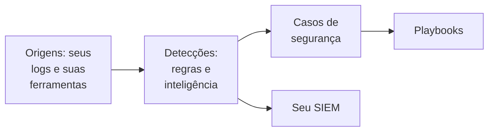

# Primeiros passos com a segurança

O OneUptime encontra ameaças em dados que você já tem - seus logs, as ferramentas de segurança que você usa e tudo o que você envia a ele -, agrupa o que encontra em casos e responde com playbooks. Dois cliques deixam tudo configurado, e não há nada para instalar.

:::cards
- [Configurar](#configurar): Ative o que a maioria das equipes precisa e veja um ataque de teste abrir um caso.
- [Como funciona](#como-funciona): Origens, detecções, casos e playbooks, e o que cada um faz.
- [Seus logs](#encontrar-eventos-de-segurança-nos-seus-logs): Os eventos de segurança que já estão nos logs que você envia ao OneUptime.
- [Seu SIEM](#enviar-ao-seu-siem-o-que-o-oneuptime-encontra): Envie ao Google SecOps o que o OneUptime encontra.
:::

## Antes de começar

Configurar a segurança exige a função Project Owner, Project Admin ou Security Admin. As funções Security Member e Security Viewer leem o que é encontrado; consulte [Funções](/docs/permissions/reference#funções).

## Configurar

:::steps
### Ativar o que a maioria das equipes precisa

Abra **Produtos → Security Events**. Em **Visão geral**, clique em **Ativar o recomendado**. Três coisas são ativadas de uma vez: **Encontrar eventos de segurança nos seus logs**, as regras de detecção recomendadas e **Enriquecer novos casos**, um playbook que compara cada caso novo com a inteligência de ameaças e deixa nele uma lista de verificação para a triagem.

### Enviar um ataque de teste

Clique em **Enviar um ataque de teste**. Uma dúzia de logins com falha a partir de um endereço de documentação passa pelo processamento real: eles são armazenados, a regra de força bruta os detecta e um caso é aberto. Ninguém é acionado, e nenhum SIEM os recebe.

### Abrir o caso

Clique em **Abrir o caso**. É assim que uma descoberta real se parece: os eventos que a sustentam, o endereço a que se refere e o que o **Enriquecer novos casos** encontrou. Feche-o como teste quando terminar.
:::

A partir daí, **Visão geral** abre no que precisa de alguém, em **Requer atenção**: os seus casos abertos, os que ninguém assumiu e as etapas de playbook aguardando uma aprovação. Quando não há nenhum, mostra **Tudo tranquilo**.

## Como funciona

| Parte | Onde | O que faz |
| --- | --- | --- |
| **Fontes** | **Conexões** | Seus logs, os produtos de segurança que o OneUptime consulta e tudo o que você envia |
| **Detecções** | **Detecções** | Regras Sigma e feeds de inteligência de ameaças que procuram ameaças em cada evento |
| **Casos de segurança** | **Casos de segurança** | O que foi encontrado, agrupado pelo usuário, host ou endereço a que se refere |
| **Playbooks** | **Playbooks** | Etapas que rodam nos casos novos: enriquecê-los, notificar, abrir um incidente ou conter |

No topo da **Visão geral**, abaixo do que precisa de alguém, cada parte mostra seus números: as origens e seus eventos das últimas 24 horas, as regras ativas, os casos abertos e os playbooks que respondem. Uma parte que não está configurada diz isso e abre a página onde configurá-la.

## Encontrar eventos de segurança nos seus logs

O cartão **Seus logs**, no topo de **Conexões**, não precisa de instalação. Com **Encontrar eventos de segurança nos seus logs** ativado, o OneUptime lê a cada minuto os logs novos do projeto e transforma em eventos de segurança as linhas que reconhece:

| Logs | O que vira um evento de segurança |
| --- | --- |
| Logins SSH | Logins SSH com falha e bem-sucedidos do log de autenticação, do journal ou do syslog de um servidor |
| sudo | Comandos executados como outro usuário, senhas de sudo erradas e pessoas que não podem usar o sudo |
| Logs de auditoria do Kubernetes | Mudanças no cluster, shells abertos em pods, secrets lidos e requisições recusadas |
| AWS CloudTrail | Logins no console, mudanças feitas nas suas contas da AWS e chamadas que a AWS recusou |
| Ataques web | Requisições no log de acesso de um servidor web que tentam injeção de SQL, path traversal ou Log4Shell |

Seus logs continuam como estão. Só as linhas que importam para a segurança viram eventos: nunca cada página que um servidor web serviu, nem cada leitura de uma API.

## Enviar ao seu SIEM o que o OneUptime encontra

Se a sua equipe já trabalha em um SIEM, o OneUptime também envia para lá o que encontra. Em **Conexões → Enviar para o seu SIEM**, clique em **Adicionar destino**, preencha a região, a instância e a chave da conta de serviço do seu Google SecOps e clique em **Enviar um evento de teste** antes de salvar. Consulte [Enviar eventos de segurança ao Google SecOps](/docs/integrations/google-secops#enviar-eventos-de-segurança-ao-google-secops).

## Solução de problemas

:::details Turn on recommended está desativado
A sua função não pode adicionar regras de detecção, playbooks nem a origem de logs. Peça a um Project Owner, um Project Admin ou um Security Admin, ou peça que lhe deem a função Security Admin.
:::

:::details Turn on recommended não conseguiu ativar tudo
O cartão indica cada item que não conseguiu ativar e o motivo: a sua função, o seu plano ou um erro do lado do OneUptime. Todo o resto está ativo. Corrija o que ele indica e clique em **Tentar novamente**: só é ativado o que ainda falta, e nada é adicionado duas vezes.
:::

:::details O ataque de teste não abriu nenhum caso
Normalmente o caso abre antes de o botão responder; quando a regra ainda está se atualizando, ele avisa, e o caso abre em até um minuto. Confira de novo **Casos de segurança** e verifique em **Detecções** se a regra de força bruta está ativada.
:::

:::details Nenhum evento de segurança vem dos meus logs
Verifique se **Encontrar eventos de segurança nos seus logs** está ativado e se o cartão **Seus logs** mostra quando foi a última verificação. Só os tipos de linha da tabela acima viram eventos: um servidor que não envia logs de SSH, sudo, auditoria, CloudTrail ou de acesso não tem nada a encontrar.
:::

:::details A Visão geral diz que o último evento de segurança chegou há dias
Nada chegou ao Security desde então. Abra **Conexões** e verifique se **Seus logs** e cada conexão continuam ativados, e quando cada um verificou pela última vez.
:::

:::details O cartão que ativa o Security sumiu
Alguém o fechou com **Dispensar**. Enquanto nada estiver sendo vigiado contra ameaças, a **Visão geral** oferece **Configurar o Security**, que o traz de volta.
:::

## Próximos passos

:::cards
- [Eventos de segurança (SIEM)](/docs/telemetry/security-events): Enviar eventos, pesquisá-los e escrever regras de detecção.
- [Casos de segurança e playbooks (SOAR)](/docs/telemetry/security-cases): Tratar os casos e responder com playbooks.
- [Inteligência de ameaças (STIX/TAXII)](/docs/telemetry/threat-intelligence): Comparar seus eventos com indicadores maliciosos conhecidos.
- [Google SecOps](/docs/integrations/google-secops): Trazer as detecções do Google SecOps e enviar para lá o que o OneUptime encontra.
:::
