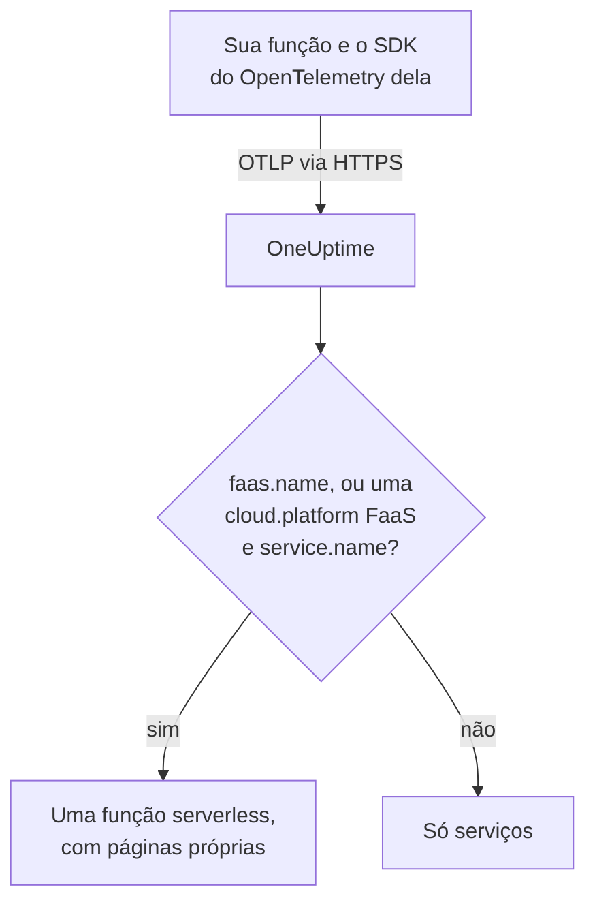

# Funções serverless

O OneUptime reconhece uma função serverless no momento em que recebe dados do OpenTelemetry dela, e a lista em **Funções serverless** com seus traces, logs e métricas. Funciona para AWS Lambda, Google Cloud Functions, Azure Functions, Cloudflare Workers e qualquer outro runtime FaaS que consiga enviar OpenTelemetry. Não há nada para criar à mão: instrumente a função com o SDK do OpenTelemetry do runtime dela e aponte o exportador OTLP dela para o OneUptime.

:::cards
- [Como o OneUptime identifica uma função](#como-o-oneuptime-identifica-uma-função): `faas.name`, ou uma `cloud.platform` FaaS com um `service.name`.
- [Enviar a telemetria de uma função](#enviar-a-telemetria-de-uma-função): As configurações do exportador e a camada do Lambda.
- [Azure Functions](#azure-functions): Uma função por Function App, a partir do host do Functions.
- [Solução de problemas](#solução-de-problemas): Uma função que não aparece, ou cujas páginas estão vazias.
:::

## Como funciona

O OneUptime lê os atributos de recurso de cada lote assim que ele chega. Um recurso com um `faas.name`, ou com uma `cloud.platform` FaaS como `aws_lambda` ou `azure_functions` junto com um `service.name`, é uma função serverless: o OneUptime a cria com os primeiros dados e arquiva a telemetria sob ela.



## Antes de começar

- Uma chave de ingestão. Crie uma em **Configurações do projeto → Telemetria e APM → Chaves de ingestão** e copie o valor.
- O SDK do OpenTelemetry, ou uma camada de autoinstrumentação, para a linguagem da sua função.

## Como o OneUptime identifica uma função

O OneUptime identifica cada função pelo atributo de recurso `faas.name`. Os detectores de recursos de algumas plataformas nunca o definem ([Azure Functions](#azure-functions) é o caso comum), então, quando um recurso não tem `faas.name` mas a `cloud.platform` dele é uma plataforma FaaS, o OneUptime usa o `service.name` dele como identidade da função e preenche `faas.name` com esse valor em cada span, log, métrica e perfil que armazena, para que as páginas da função encontrem toda a telemetria dela:

| Atributo | Obrigatório | Finalidade |
| --- | --- | --- |
| `faas.name` | **sim**, a menos que os dois seguintes estejam definidos | Identidade da função (por exemplo `checkout-handler`) |
| `cloud.platform` | com `service.name`, quando não há `faas.name` | `aws_lambda`, `gcp_cloud_functions`, `azure_functions`, `tencent_cloud_scf` ou `alibaba_cloud_fc` |
| `service.name` | em uma `cloud.platform` FaaS sem `faas.name` | Identidade da função, gravada na telemetria como `faas.name` |
| `faas.version` | não | Exibido na visão geral |
| `faas.instance` | não | Acompanhado por instância na página **Instâncias** |
| `cloud.provider` / `cloud.region` / `cloud.account.id` | não | Exibido na visão geral |
| `process.runtime.name` / `process.runtime.version` | não | Exibido como o runtime na visão geral |

Um `faas.name` que você define nunca é substituído. O valor de `cloud.platform` deve ser escrito como na lista (o `azure.functions` com ponto que alguns detectores do Azure enviam também é aceito), e `service.name` deve ser um atributo de recurso: o cabeçalho `x-oneuptime-service-name` dá nome a um serviço, não a uma função.

> [!NOTE]
> Uma função que também define `service.name` continua aparecendo também em **Serviços**. **Funções serverless** é a visualização feita para funções, delimitada por `faas.name`.

## Enviar a telemetria de uma função

:::steps
### Defina as variáveis de ambiente do exportador OTLP

A maioria das autoinstrumentações das linguagens lê as variáveis de ambiente padrão do OpenTelemetry:

```bash
OTEL_EXPORTER_OTLP_ENDPOINT="https://oneuptime.com/otlp"
OTEL_EXPORTER_OTLP_HEADERS="x-oneuptime-token=YOUR_TELEMETRY_INGESTION_TOKEN"
OTEL_RESOURCE_ATTRIBUTES="faas.name=checkout-handler,faas.version=1.4.2"
```

Se você hospeda o OneUptime por conta própria, substitua o endpoint por `https://YOUR-ONEUPTIME-HOST/otlp`. No Azure Functions, deixe `faas.name` fora de `OTEL_RESOURCE_ATTRIBUTES`; veja [Azure Functions](#azure-functions).

> [!WARNING]
> A chave de ingestão é um segredo. Use uma chave de ingestão do tipo **Servidor**, definida como variável de ambiente da função. Uma chave que chega a um navegador pode ser lida por qualquer pessoa que veja o código-fonte da página.

### Adicione a camada do Lambda do OpenTelemetry (AWS Lambda)

No AWS Lambda, o caminho mais simples é a [camada do Lambda do OpenTelemetry](https://opentelemetry.io/docs/faas/lambda-auto/). Anexe a camada para o runtime da sua função e defina:

```bash
AWS_LAMBDA_EXEC_WRAPPER=/opt/otel-handler
OTEL_EXPORTER_OTLP_ENDPOINT=https://oneuptime.com/otlp
OTEL_EXPORTER_OTLP_HEADERS=x-oneuptime-token=YOUR_TELEMETRY_INGESTION_TOKEN
```

A camada define `faas.name` a partir do nome da função, e o detector de recursos dela preenche `cloud.platform`, `cloud.region` e `cloud.account.id`. Em outra plataforma, pule esta etapa.

### Invoque a função e verifique se ela chega

Verifique se o OneUptime aceita a chave:

```bash
curl -i https://oneuptime.com/otlp/v1/validate \
  -H "x-oneuptime-token: YOUR_TELEMETRY_INGESTION_TOKEN"
```

`200` com `"valid": true` significa que o OneUptime aceita a chave; `401` significa que ela é desconhecida, foi revogada, está desativada ou expirou. Depois, invoque a função. Assim que ela envia um span, um log ou uma métrica, aparece em **Produtos → Infraestrutura → Serverless → Todas as funções**.
:::

## Azure Functions

O host do Azure Functions consegue enviar OpenTelemetry por conta própria, então uma Function App relata as invocações dela (traces, logs e métricas) sem mudanças no código, seja qual for a linguagem em que foi escrita. O guia da Microsoft é [Use OpenTelemetry with Azure Functions](https://learn.microsoft.com/en-us/azure/azure-functions/opentelemetry-howto).

### Como uma Function App aparece

Os detectores de recursos do Azure (o do próprio host do Functions, o do worker isolado do .NET em `Microsoft.Azure.Functions.Worker.OpenTelemetry` e o do Node.js em `@opentelemetry/resource-detector-azure`) descrevem a **Function App**, não uma única função, e nenhum deles define `faas.name`:

| Atributo | Valor |
| --- | --- |
| `service.name` | O nome da Function App, a partir de `WEBSITE_SITE_NAME` |
| `cloud.provider` | `azure` |
| `cloud.platform` | `azure_functions`; o detector do Node.js grava `azure.functions`, que o OneUptime reescreve |
| `cloud.region` | A região da app, a partir de `REGION_NAME` |
| `cloud.resource_id` | `/subscriptions/<subscription>/resourceGroups/<group>/providers/Microsoft.Web/sites/<app>` |
| `faas.instance` | A instância, a partir de `WEBSITE_INSTANCE_ID`: só o detector do Node.js |

Assim, o OneUptime identifica a função por `service.name`, preenche `faas.name` com o nome da Function App e mostra **uma função serverless por Function App**. O recurso descreve a app, não uma das funções dela: cada instância relata os mesmos atributos de nível de app, seja qual for a função da app que ela executa, e no plano Flex Consumption algumas funções chegam a escalar em instâncias próprias. As funções individuais estão na própria telemetria:

- O host inicia um span para cada invocação, com o nome da função que executou: pesquise esse nome na página **Traços** da função.
- O host registra `faas.invoke_duration`, um histograma em segundos, com o nome da função no atributo de ponto de dados `faas.name`: agrupe a métrica por ele na página **Métricas** ou em um dashboard para ver a latência de cada função.

Não adicione `faas.name` a `OTEL_RESOURCE_ATTRIBUTES` em uma Function App, como faz o exemplo genérico do [primeiro passo](#defina-as-variáveis-de-ambiente-do-exportador-otlp). As configurações de aplicativo chegam a todos os processos da app, então a telemetria de todas as funções dela levaria esse único nome, e o OneUptime nunca substitui um `faas.name` que recebe. O guia da Microsoft diz o mesmo: não coloque valores específicos de uma função no recurso. Deixe-o sem definir, e a função recebe o nome da app.

O host e o worker isolado do .NET usam `OTEL_SERVICE_NAME` em vez do nome da app quando ele está definido. Mantenha todos os processos de uma app no mesmo `service.name`: o host e o worker da linguagem enviam telemetria, e um worker que relata um segundo nome cria uma segunda função serverless. Um worker cujo recurso não tem uma `cloud.platform` FaaS não entra em nenhuma função serverless; veja [Instrumente o código da sua função](#instrumente-o-código-da-sua-função-opcional).

:::steps
### Ative o OpenTelemetry no host do Functions

Adicione `"telemetryMode": "OpenTelemetry"` à raiz do `host.json` da app:

```json title="host.json"
{
  "version": "2.0",
  "telemetryMode": "OpenTelemetry"
}
```

O host então envia, seja qual for a linguagem da app, os próprios traces (um span por invocação, além dos spans de processador do Service Bus e do Event Hubs por trás das funções acionadas), os próprios logs e métricas, incluindo `faas.invoke_duration`.

### Aponte o host para o OneUptime

Defina o exportador como configurações de aplicativo:

```bash
az functionapp config appsettings set \
  --name my-function-app \
  --resource-group my-rg \
  --settings \
    OTEL_EXPORTER_OTLP_ENDPOINT=https://oneuptime.com/otlp \
    OTEL_EXPORTER_OTLP_PROTOCOL=http/protobuf \
    "OTEL_EXPORTER_OTLP_HEADERS=x-oneuptime-token=YOUR_TELEMETRY_INGESTION_TOKEN"
```

Se você hospeda o OneUptime por conta própria, substitua o endpoint por `https://YOUR-ONEUPTIME-HOST/otlp`. `OTEL_EXPORTER_OTLP_PROTOCOL=http/protobuf` é importante: o exportador .NET do host usa gRPC por padrão, e com `http/protobuf` ele envia para `/otlp/v1/traces`, `/otlp/v1/metrics` e `/otlp/v1/logs` sob o endpoint. O host só envia OTLP enquanto `OTEL_EXPORTER_OTLP_ENDPOINT` estiver definido.

> [!WARNING]
> Este token é um segredo: use uma chave de ingestão do tipo **Servidor**. As configurações de aplicativo são criptografadas em repouso; para guardar o token no Key Vault, defina `OTEL_EXPORTER_OTLP_HEADERS` como uma referência do Key Vault, como `@Microsoft.KeyVault(SecretUri=https://my-vault.vault.azure.net/secrets/oneuptime-otlp-headers/)`, e conceda à identidade gerenciada da app a função **Key Vault Secrets User** no cofre. A referência resolve para o valor do segredo como está armazenado, então armazene o cabeçalho inteiro, `x-oneuptime-token=YOUR_TELEMETRY_INGESTION_TOKEN`, e não só o token.

Mantenha `APPLICATIONINSIGHTS_CONNECTION_STRING` se ainda quiser o Application Insights: com os dois definidos, o host envia os mesmos dados do OpenTelemetry ao Application Insights e ao OneUptime. Remova-o para enviar só ao OneUptime.

### Instrumente o código da sua função (opcional)

O host já rastreia cada invocação. Para adicionar spans e logs do seu próprio código, ligados aos do host, ative o OpenTelemetry também no worker da linguagem. Ele envia com as mesmas configurações `OTEL_EXPORTER_OTLP_*`:

- **C# (isolated worker)**: adicione os pacotes NuGet `Microsoft.Azure.Functions.Worker.OpenTelemetry`, `OpenTelemetry.Extensions.Hosting` e `OpenTelemetry.Exporter.OpenTelemetryProtocol` e, depois, em `Program.cs`: `builder.Services.AddOpenTelemetry().UseFunctionsWorkerDefaults().UseOtlpExporter();`
- **JavaScript / TypeScript**: `npm install @azure/functions-opentelemetry-instrumentation` junto com o SDK do OpenTelemetry para Node.js e os exportadores OTLP dele, e registre `AzureFunctionsInstrumentation` em um arquivo que o campo `main` de `package.json` inclua.
- **Java**: adicione a dependência do Maven `com.microsoft.azure.functions:azure-functions-java-opentelemetry`.
- **Python**: defina a configuração de aplicativo `PYTHON_ENABLE_OPENTELEMETRY=true`, adicione os pacotes do OpenTelemetry que a Microsoft lista (entre eles `opentelemetry-sdk` e `opentelemetry-exporter-otlp`) a `requirements.txt` e configure os exportadores em `function_app.py`.
- **PowerShell**: defina a configuração de aplicativo `OTEL_FUNCTIONS_WORKER_ENABLED=True` e carregue o módulo `AzureFunctions.PowerShell.OpenTelemetry.SDK` a partir de `profile.ps1`.

O guia da Microsoft tem o código completo de cada linguagem. O worker do .NET (por meio de `UseFunctionsWorkerDefaults()`) e o worker do Python (por meio de `PYTHON_ENABLE_OPENTELEMETRY`) dizem ao host para deixar os logs deles com eles, então esses logs não são enviados duas vezes.

Os spans e logs de um worker só chegam às páginas da função quando o recurso dele descreve a app como o do host: o mesmo `service.name` e uma `cloud.platform` FaaS. O worker isolado do .NET (por meio de `UseFunctionsWorkerDefaults()`) e o exemplo de Node.js da Microsoft (por meio dos detectores do Azure que `getResourceDetectors()` inclui) relatam os dois. O exemplo de Python da Microsoft monta o recurso sem um detector do Azure, então, de fábrica, não relata nenhum dos dois e a telemetria dele nunca chega à função. Para Python, ou qualquer worker configurado sem um detector de recursos do Azure Functions, adicione mais duas configurações de aplicativo. Todos os processos da app as leem, inclusive o host, então todos relatam a mesma identidade:

```bash
az functionapp config appsettings set \
  --name my-function-app \
  --resource-group my-rg \
  --settings \
    OTEL_SERVICE_NAME=my-function-app \
    "OTEL_RESOURCE_ATTRIBUTES=cloud.provider=azure,cloud.platform=azure_functions"
```

Defina `OTEL_SERVICE_NAME` com o nome da própria Function App. É o nome que o host e o detector do Node.js relatam sem ela, então a função mantém a identidade que já tem.
:::

### Limitações

- **Apps C# em processo** não podem usar OpenTelemetry: migre-as primeiro para o modelo de worker isolado.
- O **streaming de logs** no portal do Azure não funciona enquanto o host está no modo OpenTelemetry, e a lista _Recent function invocations_ do portal precisa da telemetria no Application Insights. Use em vez disso as páginas **Registros** e **Traços** da função no OneUptime.
- A seção `logging.applicationInsights` de `host.json` deixa de valer assim que `telemetryMode` é `OpenTelemetry`.
- **Instâncias** lista os valores de `faas.instance`. Dos detectores acima, só o do Node.js o define, então a página fica vazia para a telemetria do host e do worker do .NET.

## O que você recebe

Assim que a função envia um span, um log ou uma métrica, ela aparece em **Funções serverless**. A **Visão geral** dela mostra:

- **Invocações**, **taxa de erros** e **duração p95**, calculadas a partir dos seus traces em um intervalo de tempo que você escolhe, com gráficos de tendência.
- **Instâncias**: uma lista ao vivo dos valores de `faas.instance` que a função relata.
- Páginas completas de **Registros**, **Traços** e **Métricas** limitadas a esta função.

## Rotule funções e atribua proprietários

Um atributo de recurso que começa com `oneuptime.label.` se torna um rótulo do projeto na função: `oneuptime.label.team=payments` adiciona o rótulo `team:payments`. Adicione os atributos a `OTEL_RESOURCE_ATTRIBUTES`:

```bash
OTEL_RESOURCE_ATTRIBUTES="faas.name=checkout-handler,oneuptime.label.team=payments,oneuptime.label.env=production"
```

Para rotular funções ou atribuir proprietários pelos nomes delas, abra **Produtos → Infraestrutura → Serverless** e use **Regras de Rótulos** e **Regras de proprietário** no menu lateral. As regras são executadas quando uma função é criada, inclusive as descobertas automaticamente. Para aplicar uma regra às funções que você já tem, use o **Run Now** dela (veja [Executar regras em recursos existentes](/docs/configuration/run-rules-now)).

## Solução de problemas

:::details A função não aparece em Funções serverless
Verifique, nesta ordem:

1. A função foi invocada desde que você definiu as variáveis: ela só envia telemetria enquanto é executada.
2. No AWS Lambda, a camada está anexada para o runtime da função e `AWS_LAMBDA_EXEC_WRAPPER` é `/opt/otel-handler`: sem o wrapper, a instrumentação da camada nunca começa.
3. Em outros lugares, o código da função carrega o SDK do OpenTelemetry ou a autoinstrumentação: as variáveis sozinhas não enviam nada.
4. O recurso traz `faas.name`, ou uma `cloud.platform` FaaS e um `service.name`. Sem eles, a telemetria é arquivada em **Serviços**, como um serviço.
5. A função consegue chegar à sua URL do OneUptime. Uma função em uma rede privada precisa de uma rota de saída até ela, como um gateway NAT.
:::

:::details A função está listada, mas as páginas dela estão vazias
**Visão geral**, **Registros**, **Traços** e **Métricas** da função mostram a telemetria cujo `faas.name` é exatamente igual ao nome da função, inclusive maiúsculas e minúsculas. Uma função nomeada por uma `cloud.platform` FaaS e pelo `service.name` dela não precisa de um `faas.name` próprio: o OneUptime grava o `service.name` na telemetria como `faas.name` à medida que ela chega. A telemetria armazenada antes de o OneUptime começar a preencher `faas.name` não é atualizada e fica fora das páginas: invoque a função para enviar telemetria nova. Verifique também o intervalo de tempo no topo da página.
:::

:::details A função aparece como desconectada
Uma função passa a desconectada quando o OneUptime não recebe nada dela por 15 minutos; o OneUptime verifica a cada 5 minutos, e o tempo em que ele mesmo não estava recebendo dados não conta. Uma função que só é executada de vez em quando fica desconectada entre as execuções: ela volta a conectada com a telemetria seguinte.
:::

## Próximos passos

:::cards
- [OpenTelemetry](/docs/telemetry/open-telemetry): Envie traces, logs e métricas de qualquer aplicação.
- [Filas](/docs/telemetry/queues): As filas e os tópicos em que suas funções publicam e dos quais consomem.
- [Monitor de traces](/docs/monitor/traces-monitor): Receba alertas sobre invocações com falha ou lentas de uma função.
:::
