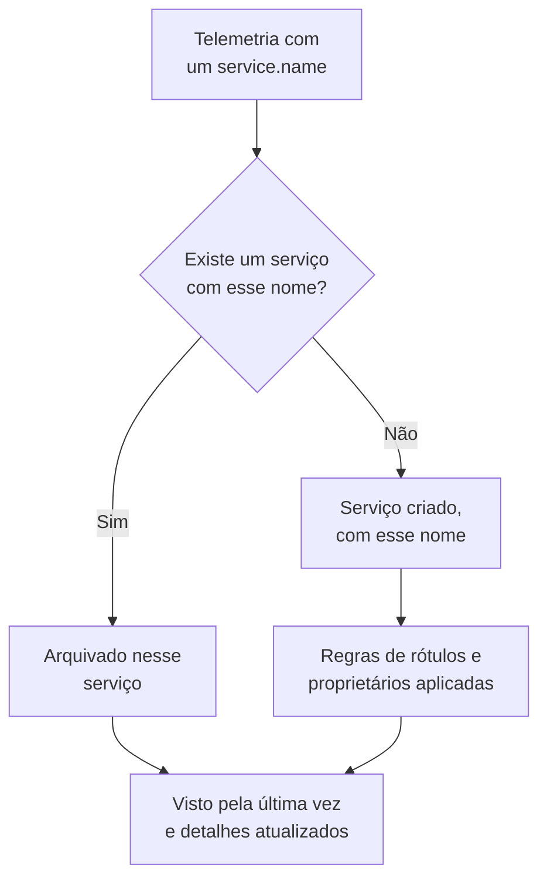

# Catálogo de serviços

O catálogo de serviços lista as aplicações e os microsserviços que você executa. O OneUptime adiciona um serviço na primeira vez que a telemetria dele chega e, em seguida, reúne os registros, traços, métricas, exceções, incidentes e proprietários dele em uma única página, para que qualquer pessoa saiba o que um serviço faz, de quem ele é e como ele está.

:::cards
- [Como um serviço entra no catálogo](#como-um-serviço-entra-no-catálogo): Seu `service.name`, na primeira telemetria.
- [Encontrar um serviço](#encontrar-um-serviço): A lista, seus filtros e suas colunas.
- [As páginas de um serviço](#as-páginas-de-um-serviço): Tudo sobre um serviço.
- [Arquivar ou excluir um serviço](#arquivar-ou-excluir-um-serviço): Manter o histórico ou removê-lo.
:::

## Como um serviço entra no catálogo

Você não precisa criar serviços. Cada lote de telemetria nomeia o serviço que o enviou no atributo de recurso `service.name`. O OneUptime arquiva o lote sob o serviço com esse nome e cria o serviço quando o projeto ainda não tem nenhum.

- **O nome é a identidade do serviço.** A comparação ignora maiúsculas e minúsculas, então `Checkout-API` e `checkout-api` são um único serviço. Um novo `service.name` inicia um novo serviço.
- **Os contêineres se nomeiam sozinhos.** A telemetria dos agentes Docker e Podman nomeia um serviço com o nome do contêiner quando ela não tem `service.name`.
- **Uma chave de ingestão pode fixar o serviço.** Os dados do OpenTelemetry enviados com uma chave que tem um **Nome do serviço fixado** são arquivados sob esse nome, seja qual for o seu `service.name`. Veja [Chaves de ingestão](/docs/telemetry/ingestion-keys#proteger-uma-chave-de-navegador).
- **Navegadores e celulares não são serviços.** A telemetria de um navegador ou de um aplicativo móvel pertence a uma [aplicação RUM](/docs/rum/applications).
- **Os rótulos podem vir com a telemetria.** Um atributo de recurso chamado `oneuptime.label.<name>` adiciona o rótulo `<name>:<value>` ao serviço, como `oneuptime.label.team=payments` para `team:payments`.

Cada vez que a telemetria chega, o **Visto pela última vez** do serviço avança, e os detalhes dele são atualizados a partir dos atributos de recurso que vêm junto:

| Detalhe | A partir do atributo |
| --- | --- |
| Versão do serviço | `service.version` |
| Ambiente de implantação | `deployment.environment.name`, ou `deployment.environment` |
| Namespace do serviço | `service.namespace` |
| Runtime | `process.runtime.name` e `process.runtime.version` |
| Tecnologia | `telemetry.sdk.language`, ou o runtime |
| Nuvem | `cloud.provider`, `cloud.platform`, `cloud.region` e `cloud.account.id` |

## Antes de começar

- **Telemetria chegando** com um `service.name`. Veja [OpenTelemetry](/docs/telemetry/open-telemetry): `OTEL_SERVICE_NAME` define esse valor.
- **Uma função que possa ler serviços.** Project Owner, Project Admin, Project Member, Viewer, Settings Admin, Settings Member ou Settings Viewer, ou uma função personalizada com a permissão Read Service. Criar, alterar e excluir serviços exige Project Owner, Project Admin, Project Member, Settings Admin ou Settings Member, ou as permissões de serviço correspondentes.

## Encontrar um serviço

Acesse **Produtos → Recursos → Serviços**. **Todos os serviços** lista cada serviço com **Nome**, **Descrição**, **Technology**, **Visto pela última vez**, **Rótulos** e **Proprietários**.

- Pesquise por nome ou descrição, e filtre por proprietário ou rótulo com a barra acima da lista.
- Selecione vários serviços para adicionar rótulos ou proprietários a todos de uma vez, ou para arquivá-los.
- Clique em um serviço para abrir as páginas dele.

Para adicionar um serviço antes de a telemetria dele chegar, por exemplo para definir primeiro os proprietários, clique em **Criar: Serviço** e informe o **Nome** exatamente como será o `service.name` dele. As regras de rótulos e de proprietários se aplicam a ele como a um serviço descoberto. Depois de salvo, o guia de configuração do OpenTelemetry se abre com esse nome em todos os trechos, e a última etapa dele, **Aguardar a conexão**, avisa quando chegam os primeiros dados do serviço.

## As páginas de um serviço

O menu lateral de um serviço tem cinco seções:

| Seção | Páginas |
| --- | --- |
| **Básico** | **Visão geral**: requisições, taxa de erros e latência p95 dos spans dele, gráficos e detalhes. **Recomendações**: monitores prontos para o serviço, escolhidos de acordo com a linguagem dele. **Proprietários**: as pessoas e as equipes responsáveis por ele. **Feed**: tudo o que aconteceu com ele, desde como foi criado até cada mudança desde então. |
| **Telemetria** | Os **Registros**, **Traços**, **Métricas**, **Perfis de desempenho**, **Exceções** e **Source Maps** dele, já filtrados para este serviço. |
| **Atividade** | Os **Incidentes**, os **Alertas** e os eventos de **Manutenção programada** que o afetam. |
| **Desenvolvedores** | **Terraform**, **API** e **Assistentes de IA**: o serviço gerenciado por código. Começa recolhida. |
| **Avançado** | **Configurações**, **Registros de auditoria** e **Excluir serviço**. **Avançado** começa recolhido: expanda-o primeiro. |

Os proprietários importam além da página: uma função cujo escopo é Owned lê a telemetria dos serviços que pertencem a você ou às suas equipes. Veja [Telemetria](/docs/permissions/index#telemetria).

## Alterar um serviço

:::steps
### Abrir as configurações dele

Abra o serviço, expanda **Avançado** no menu lateral e clique em **Configurações**.

### Renomeá-lo ou descrevê-lo

Em **Detalhes do serviço**, clique em **Editar detalhes** para mudar o **Nome**, a **Descrição** ou os **Rótulos**. O nome precisa continuar igual ao `service.name` que a telemetria dele informa: altere-o também na sua configuração do OpenTelemetry, senão a próxima telemetria cria um novo serviço.

### Escolher a cor e o stack de tecnologia

Em **Configurações do serviço**, clique em **Editar definições**. A **Cor do serviço** marca o serviço em gráficos e listas; um serviço novo recebe uma cor própria. **Stack de Tecnologia** é opcional: deixe em branco para mostrar a linguagem detectada na telemetria dele.
:::

A mesma página traz a retenção do serviço, recolhida em **Mais configurações**. Os cartões **Retenção de Dados de Telemetria** e **Retenção por tipo de telemetria** guardam a telemetria dele por mais ou menos tempo que a retenção padrão do projeto. Eles fazem parte da [Enterprise Edition](/docs/self-hosted/enterprise), e do plano Scale no OneUptime Cloud; sem eles, a página mostra o que eles acrescentam, e o serviço mantém a retenção do projeto.

## Definir rótulos e proprietários automaticamente

As regras dão aos serviços novos seus rótulos e proprietários quando eles são criados, inclusive os descobertos. Encontre-as em **Serviços → Configurações → Regras de proprietário** e **Serviços → Configurações → Regras de Rótulos**; **Configurações** começa recolhido no menu lateral. Veja [Regras de rótulos e proprietários](/docs/configuration/label-and-owner-rules).

## Arquivar ou excluir um serviço

Arquive um serviço que você não acompanha mais, mas cujo histórico quer manter. Um serviço arquivado fica oculto em **Todos os serviços**, mas continua recebendo telemetria. Arquive-o pela página **Configurações** dele, ou selecione vários na lista. Para trazer um de volta, abra **Serviços → Avançado → Arquivado**.

> [!WARNING]
> Excluir um serviço também exclui os source maps dele, e as regras de pipeline de métricas e os orçamentos de custo de LLM definidos para ele. Se o OneUptime ainda receber a telemetria dele, o serviço é criado de novo, sem os rótulos, os proprietários e as configurações que você deu a ele. Para tirá-lo da lista e manter tudo, arquive-o em vez disso.

## Solução de problemas

:::details Um serviço aparece duas vezes
Dois valores de `service.name` chegaram ao OneUptime, por exemplo de duas versões da sua configuração, ou depois de uma renomeação feita só de um lado. A telemetria é associada pelo nome: faça cada instância informar o mesmo `service.name` e, depois, arquive ou exclua o serviço de que não precisa mais.
:::

:::details Meu serviço não está no catálogo
Verifique se a telemetria dele traz um `service.name`. A telemetria de um navegador ou de um aplicativo móvel vai para o Real User Monitoring, e um host ou cluster sem nome de serviço é arquivado sob esse host ou cluster.
:::

:::details Visto pela última vez está atrasado
**Visto pela última vez** é atualizado cerca de uma vez por minuto, não a cada lote, então pode ficar cerca de um minuto atrás da telemetria em tempo real.
:::

## Próximos passos

:::cards
- [Explorador de registros](/docs/telemetry/logs-explorer): Pesquisar os registros de um serviço.
- [Explorador de traços](/docs/telemetry/traces-explorer): Acompanhar as requisições dele.
- [Rastreamento de exceções](/docs/telemetry/exceptions): Fazer a triagem dos erros que ele lança.
- [Regras de rótulos e proprietários](/docs/configuration/label-and-owner-rules): Dar rótulos e proprietários aos serviços novos.
:::
