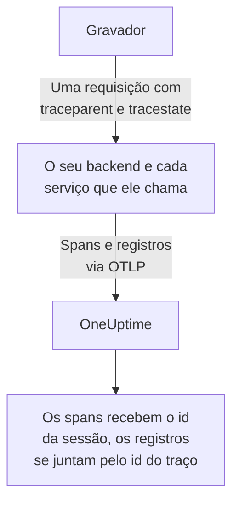
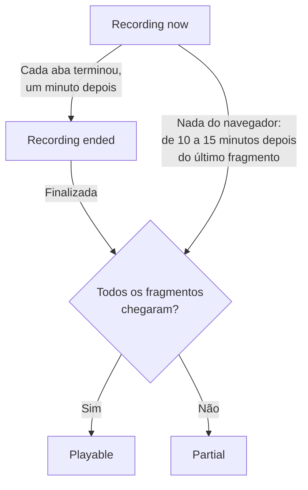
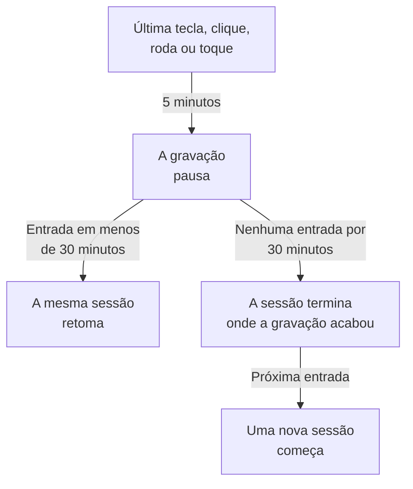

# Reprodução de sessões

A reprodução de sessões grava o que os usuários reais viram no seu aplicativo web ou React Native e reproduz isso ao lado dos erros, traços e registros da mesma sessão. Você adiciona uma tag script, escolhe o que é mascarado e assiste a qualquer sessão a partir da aplicação RUM dela.

:::cards
- [Como funciona](#como-funciona): Um carregador, uma política e um gravador que envia enquanto grava.
- [Instalação](#instalação): Uma tag script em cada página, ou o SDK do React Native.
- [Privacidade](#privacidade): O que é mascarado, o consentimento e quem pode enviar gravações.
- [Correlacionar com o resto da sua telemetria](#correlacionar-com-o-resto-da-sua-telemetria): Traços, registros e erros do backend, vinculados sem código.
- [Assistir a uma sessão](#assistir-a-uma-sessão): A lista de sessões, a página Usuários, os fluxos de usuários e o reprodutor.
- [Saúde da gravação](#saúde-da-gravação): Por que nada chega, e alertas antes de um orçamento se esgotar.
:::

## Como funciona

O script na sua página é um pequeno carregador. Ele verifica os sinais de privacidade do navegador, busca no OneUptime a política da aplicação e só então carrega o gravador, que mascara a página enquanto a grava e a envia em fragmentos enquanto o usuário está ativo.

```mermaid title="Do carregamento de uma página a uma gravação para assistir"
flowchart TB
    page["A sua página carrega<br/>a tag script"] --> dnt{"Sinal Do Not Track<br/>ou GPC?"}
    dnt -->|"Sim"| none["Nada é<br/>gravado"]
    dnt -->|"Não"| policy["O carregador busca<br/>a política"]
    policy --> recorder["O gravador mascara<br/>e grava a página"]
    recorder -->|"Fragmentos enquanto<br/>o usuário está ativo"| ingest["OneUptime"]
    ingest --> player["Lista de sessões<br/>e reprodutor"]
```

Por padrão, toda sessão é gravada e enviada enquanto acontece, não só as que deram errado. As sessões em que nada deu errado são onde você encontra o checkout que ninguém concluiu, o formulário que todos abandonaram e a página que, segundo um cliente, «parecia estranha».

Para armazenar menos, duas configurações da política da aplicação trabalham juntas:

| Configuração | Padrão | O que muda |
| --- | --- | --- |
| **Porcentagem de amostragem** | 100 | Quantas sessões são elegíveis. Corte pela metade e você corta pela metade tanto os bytes armazenados quanto os dados de usuários finais em repouso. A decisão é tomada uma vez por sessão a partir de um hash do id da sessão, então uma sessão nunca é gravada pela metade. |
| **Quando enviar uma gravação** | _Always_ | Com _On error or frustration_, o gravador mantém um buffer circular em memória e só envia quando algo dá errado. Existe então uma gravação de quase toda sessão com falha, a um custo cerca de 15 vezes menor do que gravar todo mundo, mas você não consegue assistir a uma sessão que não deu errado. |

## Antes de começar

- Uma aplicação RUM. Crie uma em **Produtos → Recursos → Monitoramento de Usuários Reais**, ou deixe a sua telemetria criá-la: consulte [Gerenciar aplicações](/docs/rum/applications).
- Uma chave de ingestão **Navegador**, em **Configurações do projeto → Telemetria e APM → Chaves de ingestão**. Uma chave Browser só funciona a partir das origens que você lista nela: consulte [Defina as suas origens permitidas em produção](#defina-as-suas-origens-permitidas-em-produção).

A reprodução de sessões vem ativada por padrão. As configurações dela ficam em três lugares:

| Onde | O que há lá |
| --- | --- |
| A página **Replay Policy** da aplicação | A política (gravação, mascaramento, consentimento, rastreamento e limites), um resumo de **Saúde da gravação**, o cartão **O que uma gravação contém**, o painel **Test your installation** e **Record a specific user's next session**. |
| A página **Integridade** da aplicação | Se as gravações estão chegando, e por que não quando não estão. Consulte [Saúde da gravação](#saúde-da-gravação). |
| **Monitoramento de Usuários Reais → Configurações → Reprodução de sessões** | A chave do projeto inteiro que para todas as aplicações de uma vez, e uma lista somente leitura da política de cada aplicação. |

## Instalação

Adicione uma tag script a cada página que você quer gravar.

:::steps
### Criar uma chave Browser

Em **Configurações do projeto → Telemetria e APM → Chaves de ingestão**, clique em **Criar chave de ingestão**, escolha **Navegador** como **Tipo de chave** e liste as origens do seu site em **Origens permitidas**. Depois copie a **Chave secreta** da chave. [Configuração para navegadores](/docs/rum/browser-setup#configurar) mostra cada tela.

### Adicionar a tag script

Coloque a tag em cada página, com a sua chave e o identificador da sua aplicação:

```html
<script
  src="https://oneuptime.com/telemetry/session-replay/v1/recorder.js"
  data-oneuptime-token="YOUR_TELEMETRY_INGESTION_KEY"
  data-oneuptime-app-identifier="storefront-web"
  crossorigin="anonymous"
  async
></script>
```

`data-oneuptime-app-identifier` precisa corresponder ao identificador da aplicação RUM, o mesmo valor que você usa para `service.name`. A página **Documentação** da aplicação, na seção **Reprodução de sessões** do menu lateral dela, mostra este snippet com os dois valores já preenchidos, junto com as versões dele para Next.js / React e Google Tag Manager.

### Verificar se as gravações chegam

Abra uma das suas páginas e clique em alguns lugares por alguns segundos. Em cerca de um minuto, a sessão aparece na página **Reprodução de sessões** da aplicação, marcada como **Gravando agora**. Se não aparecer, a página **Integridade** da aplicação diz por quê: consulte [Saúde da gravação](#saúde-da-gravação).
:::

O script em `/v1/recorder.js` é um pequeno carregador. Ele verifica o Do Not Track, busca a política da sua aplicação e só então carrega `/latest/recorder.js`. A política e o gravador são servidos com `no-store`, então uma mudança em qualquer um dos dois chega no próximo carregamento de página sem esperar um cache do navegador expirar.

### Atributos da tag script

| Atributo | Obrigatório | O que faz |
| --- | --- | --- |
| `data-oneuptime-token` | Sim | O seu token de ingestão de telemetria. |
| `data-oneuptime-app-identifier` | Sim | O identificador da aplicação RUM. |
| `data-oneuptime-host` | Não | A origem do OneUptime. Se omitido, é deduzido do próprio `src` do script, então você só precisa dele quando serve o script pelo seu próprio domínio. |
| `data-oneuptime-user-ref` | Não | A referência do usuário final conhecida no carregamento da página (um id de usuário, nunca um e-mail que você não queira armazenar). O mesmo que `identify()` define depois; é a única forma que funciona para [Gravar a próxima sessão de um usuário específico](#gravar-a-próxima-sessão-de-um-usuário-específico). |
| `data-oneuptime-respect-do-not-track` | Não | Por padrão, respeita o Do Not Track e o Global Privacy Control. Defina como `"false"` para gravar independentemente do sinal; consulte [Do Not Track](#do-not-track). |
| `data-oneuptime-debug` | Não | `"true"` imprime as decisões do gravador no console. Consulte [Solução de problemas de reprodução de sessões](/docs/rum/session-replay-troubleshooting). |
| `data-oneuptime-offline-storage` | Não | Defina como `"false"` para manter só em memória os fragmentos gravados enquanto o visitante está offline, em vez de salvá-los também no IndexedDB do navegador. Consulte [Modo offline](#modo-offline). |

As mesmas opções podem ser passadas em um global em vez da tag, que é o que os gerenciadores de tags e as instalações empacotadas usam:

```js
window.__ONEUPTIME_SESSION_REPLAY__ = {
  host: "https://oneuptime.com",
  token: "YOUR_TELEMETRY_INGESTION_KEY",
  appIdentifier: "storefront-web",
  userRef: "user-123", // optional
  respectDoNotTrack: true, // optional
  debug: false, // optional
  offlineStorage: true, // optional; false keeps offline chunks in memory only
};
```

### Como é uma instalação saudável

Abra DevTools → Network e filtre por `session-replay`. Uma página funcionando produz:

1. **Um `GET .../session-replay/v1/config`** por carregamento de página — a busca da política.
2. **Um `POST .../session-replay/v1/chunk` a cada 15 segundos, mais ou menos, enquanto o usuário faz alguma coisa**, ou antes quando 256 KB de eventos se acumulam. Uma aba ociosa não produz eventos e, portanto, nenhum POST: mova o mouse ou clique antes de julgar uma instalação pela aba Network.
3. Quando a aba é ocultada, e de novo quando a página sai, um `POST` enviado com `keepalive`. A saída da página — a aba fechada, recarregada ou levada a outra página, ou a página colocada no cache back/forward do navegador (cada `pagehide`) — o marca como final, o que diz ao OneUptime que a gravação dessa aba terminou; uma página que o usuário traz de volta do cache back/forward continua gravando como uma nova aba da mesma sessão. Uma aba que só é ocultada continua aberta, então a gravação continua quando o usuário volta a ela. O corpo inteiro fica abaixo de 56 KB — a parte do gravador na cota keepalive de 64 KB por origem do navegador — e pode levar vários fragmentos como frames dessa única requisição: o fragmento de encerramento, os pedaços em que um fragmento de encerramento grande foi dividido (no máximo 48 KB de eventos cada, para que o cabeçalho do frame ainda caiba) e qualquer fragmento que ainda esperava uma nova tentativa. Um fragmento que já é maior que esse orçamento quando a aba é só ocultada sai pelo caminho comum, enquanto a página ainda está viva para enviá-lo.

Com o gatilho _On error or frustration_, o passo 2 não acontece até um gatilho disparar — consulte [Solução de problemas](#solução-de-problemas).

## Instalação no React Native

O SDK do React Native grava a hierarquia de views nativas como eventos sintéticos compatíveis com o rrweb, então as gravações móveis abrem na mesma lista de sessões e no mesmo reprodutor que as gravações web. Ele não tira capturas de tela. O reprodutor marca cada gravação como um aplicativo React Native, e a aba **Fidelity** dele explica as superfícies nativas que não puderam ser representadas.

:::steps
### Instalar o SDK

O SDK oferece suporte a aplicativos React Native para iOS e Android. Instale-o com a dependência peer da sua caixa de saída persistente:

```bash
npm install @oneuptime/react-native-replay @react-native-async-storage/async-storage
```

Em um projeto iOS sem Expo, rode a sua instalação habitual do CocoaPods depois de adicionar os pacotes; as versões atuais do React Native vinculam o Android automaticamente, sem registro manual. O gravador tem o seu próprio módulo nativo de árvore de views além do Async Storage, então projetos Expo precisam usar um build personalizado de desenvolvimento ou de produção (por exemplo EAS Build ou um prebuild). O Expo Go não consegue rodar este SDK porque nenhum dos dois módulos nativos pode ser adicionado ao binário fixo do Expo Go.

### Iniciar o gravador e envolver o seu app

Inicie o singleton uma vez e coloque o provider acima da parte do app que você quer gravar:

```tsx
import {
  OneUptimeReplay,
  OneUptimeReplayProvider,
} from "@oneuptime/react-native-replay";

OneUptimeReplay.start({
  host: "https://oneuptime.com",
  token: "YOUR_TELEMETRY_INGESTION_KEY",
  appIdentifier: "storefront-mobile",
  mobileAppIdentifier: "com.example.storefront",
  appName: "Storefront", // optional, shown in session details
  appVersion: "4.2.0", // optional, shown in session details
});

export default function App() {
  return (
    <OneUptimeReplayProvider>
      <Navigation />
    </OneUptimeReplayProvider>
  );
}
```

`appIdentifier` é o identificador da aplicação RUM. `mobileAppIdentifier` é o application id do Android ou o bundle identifier do iOS distribuído no binário, não um nome de exibição. Use o mesmo valor nas [listas de origens permitidas `app://`](#defina-as-suas-origens-permitidas-em-produção). O SDK busca em `host` a política de reprodução da aplicação; amostragem, gatilho, consentimento, retenção e orçamentos de envio continuam controlados pelo servidor.
:::

O provider tem uma raiz nativa não colapsável e grava a árvore de views dele e os eventos de início, movimento e fim dos toques. Se você já constrói as instâncias do gravador por conta própria, passe uma com `<OneUptimeReplayProvider recorder={recorder}>`. `MobileReplayRecorder` também é exportado para integrações isoladas ou com vários clientes; a maioria dos apps deve usar o singleton.

### API do React Native

Importe `OneUptimeReplay` diretamente, ou chame `useOneUptimeReplay()` abaixo do provider. O singleton expõe:

| Método | O que faz |
| --- | --- |
| `start(options)` | Busca a política e inicia a captura. As opções obrigatórias são `host`, `token`, `appIdentifier` e `mobileAppIdentifier`; `appName` e `appVersion` são metadados de exibição opcionais, e `connectivity` é uma fonte opcional do estado da rede para o [modo offline](#modo-offline). |
| `stop()` | Descarrega o que pode ser enviado, para a captura e desconecta os handlers de ciclo de vida. |
| `identify(userRef, traits?)` | Associa o usuário logado e atributos opcionais, sujeito a **Capturar a identidade do usuário final**. |
| `setTags(tags)` / `addTag(key, value)` | Substitui todas as tags pesquisáveis da sessão, ou adiciona uma tag sem substituir as outras. |
| `track(name, properties?)` | Coloca um evento do app na linha do tempo da reprodução. |
| `setRoute(route)` | Grava uma tela ou rota lógica sanitizada depois de uma navegação. Chame-o a partir do callback de mudança de rota do seu navegador de telas. |
| `captureSession(reason?)` | Com _On error or frustration_, envia o buffer circular por um motivo definido pelo app, como um usuário tocando em «Relatar um problema». |
| `captureError(error)` | Grava um erro de JavaScript tratado e aciona a captura disparada por erros. |
| `grantConsent()` / `revokeConsent()` | Permite os envios, ou apaga na hora o buffer em memória, a caixa de saída armazenada, a sessão e o id de visitante. Um consentimento posterior começa com identificadores novos. |
| `getSessionId()` / `onSessionChange(listener)` | Lê o id da sessão de reprodução atual com consentimento, ou se inscreve nele, para correlacionar traços e registros. O ouvinte também recebe `null` quando a captura ou o consentimento terminam. |
| `getDiagnostics()` | Retorna o estado do gravador e as decisões recentes dele, sem retornar o conteúdo das views capturadas. |

O SDK escuta o `AppState` do React Native: ir para segundo plano fecha e descarrega os eventos com consentimento, enquanto a gravação anterior ao consentimento fica só em memória. Antes de a captura em primeiro plano retomar, o SDK atualiza a política sem usar uma resposta em cache. Ele também atualiza a política periodicamente enquanto está ativo, para que desativação, consentimento, amostragem, segmentação e mudanças de identidade tenham efeito em um app que fica aberto por muito tempo. Chame `stop()` quando a sua integração for desmontada de vez; a navegação normal entre telas deve usar `setRoute()` em vez de parar e reiniciar o gravador.

**Quando uma sessão móvel termina por inatividade.** Cinco minutos sem entrada já pausam a captura (consulte [Tempo ocioso](#tempo-ocioso)). Trinta minutos sem nenhum toque e sem nenhuma chamada do SDK gravada (`track()`, `setTags()`, `identify()` e similares, feitas enquanto a captura estava rodando) encerram a sessão. Ela termina nessa última atividade, ou, para uma sessão pausada, na pausa, onde a gravação dela terminou — não quando o app volta ou o gravador percebe —, então o tempo passado em segundo plano ou pausado nunca é somado ao fim de uma sessão. Um app deixado aberto em primeiro plano não inicia uma nova sessão a cada meia hora. A próxima sessão começa quando o usuário volta: o primeiro toque dele, o teclado virtual aparecendo ou sumindo, o app voltando ao primeiro plano, ou uma chamada a `captureSession()`. Ela abre com um snapshot novo da tela. Até lá, `getSessionId()` retorna `null` e `onSessionChange()` é chamado com `null`. Erros, navegação e chamadas a `track()` nesse meio-tempo não são gravados.

Para correlacionar a telemetria móvel com uma reprodução, inscreva-se com `onSessionChange()` e defina o valor retornado como o atributo `session.id` na sua instrumentação do OpenTelemetry. Substitua esse atributo sempre que o callback disparar, limpando-o também quando o valor for `null`. O SDK de reprodução não modifica a rede nativa nem altera sozinho um provider do OpenTelemetry.

### Privacidade e mascaramento no React Native

A captura móvel é de propósito mais rígida que os modos de mascaramento web. O texto da interface nativa, os valores de acessibilidade, os valores de entrada e os pixels de imagens nunca são serializados; o servidor recebe uma estrutura em wireframe mesmo quando o modo de mascaramento web da aplicação permitiria texto legível. Os metadados fornecidos por quem chama, como referências de usuário, nomes de eventos, rotas e tags pesquisáveis, seguem o contrato da API, então não coloque segredos nesses campos. Envolva uma subárvore especialmente sensível em `<ReplayMask>` para substituir essa área por um marcador de privacidade mantendo o layout ao redor.

O consentimento não é deduzido de uma permissão do sistema operacional nem do seu banner de consentimento. Com _Require explicit_, chame `grantConsent()` só quando o seu app tiver o consentimento necessário. Chamar `revokeConsent()` descarta tanto os dados não enviados na fila e persistidos quanto os identificadores que poderiam ligar uma sessão posterior à revogada.

O gravador móvel captura os limites e os tipos das views, as posições dos toques, as rotas lógicas, os eventos personalizados e os erros de JavaScript. Estes limites são sempre informados na aba Fidelity do reprodutor:

- Os pixels de `Image` nativa são opacos; só o quadro é representado.
- O conteúdo de `WebView` está fora da árvore do React Native. Instale o gravador web dentro da página hospedada se ela precisar da própria gravação.
- Canvas, Skia, OpenGL, mapas, pré-visualizações de câmera, vídeo e outras superfícies desenhadas sob medida são opacos.
- Os caminhos de toque dentro de `ReplayMask` ou de uma superfície opaca não são gravados. A ponte nativa verifica o destino real do toque e os ancestrais dele, e suprime o gesto se essa verificação de privacidade não puder ser concluída.
- As animações do Reanimated, do native-driver e da thread de UI são amostradas nos snapshots da árvore de views, não reproduzidas quadro a quadro.
- Crashes nativos que encerram o JavaScript antes de ele conseguir descarregar precisam de um SDK nativo de crashes; `captureError()` cobre erros de JavaScript tratados, não dumps de crash no nível do processo.

## Identificar os seus usuários

Toda sessão é anônima até a sua página dizer a quem ela pertence. Sem isso, a lista ainda pode agrupar as sessões de um navegador sob um id de visitante anônimo (consulte [Visitantes anônimos](#visitantes-anônimos) abaixo), mas nada indica a pessoa nem liga o segundo navegador dela ao primeiro. Chame `identify()` assim que souber, ou coloque na fila antes de o script carregar — nos dois casos ele é aplicado antes do envio do primeiro fragmento, então a sessão pode ser buscada por usuário desde o momento em que aparece:

```js
// After the script has loaded:
OneUptimeReplay.identify("user-123", { plan: "pro", tenant: "acme" });

// Or at any time, whether or not the script has loaded yet:
(window.OneUptimeReplayQueue = window.OneUptimeReplayQueue || []).push([
  "identify",
  "user-123",
  { plan: "pro", tenant: "acme" },
]);
```

- A referência é o que a lista de sessões mostra e com o que as buscas `user:` correspondem. Os atributos aparecem no cabeçalho do reprodutor e no painel de detalhes da sessão.
- **A identidade pertence à sessão, não só à página.** Uma sessão abrange cada carregamento de página e cada aba da visita, e assim que qualquer uma das páginas dela chama `identify()`, a sessão inteira é desse usuário — incluindo as páginas anteriores ao login, já que são a mesma visita. Cada página e aba posterior da sessão também indica o usuário, mesmo uma que nunca chama `identify()` sozinha: a página de destino do redirecionamento do login, um link aberto em uma nova aba. Enquanto **Capturar a identidade do usuário final** está ativado, o gravador lembra de quem é a sessão atual no `localStorage` em `oneuptime.replay.user` — o id da sessão e a referência, nada mais, e com o consentimento _Require explicit_ só depois de o consentimento ser dado — e só para essa sessão: a próxima sessão (depois de 30 minutos ocioso ou do limite de 4 horas) começa anônima até uma página identificá-la, a menos que a página que a iniciou tenha identificado o usuário ela mesma. Então chame `identify()` em cada carregamento de página em que o seu aplicativo conhece o usuário, não só logo depois do login.
- **Outro usuário recebe a própria sessão.** Quando `identify()` indica alguém diferente do usuário a quem a sessão já pertence — uma pessoa saiu e outra entrou no mesmo navegador, nesta aba ou em outra —, a sessão atual termina, ainda arquivada sob o primeiro usuário, e uma nova sessão começa para o segundo. Os ouvintes de `onSessionChange` são avisados, e o reprodutor mostra a troca como o fim de uma gravação e o começo da próxima. Identificar de novo o mesmo usuário não muda nada; as referências são comparadas depois de remover os espaços das pontas e diferenciando maiúsculas de minúsculas, exatamente como o servidor as compara.
- O que `identify()` passa ao gravador só é enviado com a gravação enquanto **Capturar a identidade do usuário final** está ativado para a aplicação (o padrão). Se estiver desativado, o gravador deixa a referência e os atributos fora do fragmento, e o servidor não armazena **absolutamente nada** sobre a pessoa — nem a referência, nem um hash com chave dela, nem atributos. Essas sessões são realmente pseudônimas, e o preço é que não podem ser apagadas _por usuário_: uma solicitação de apagamento não tem nada com que corresponder, então use `BySessionId`, `ByDateRange` ou `ByRumApplication` em vez disso (consulte [Apagar sessões](#apagar-sessões)). Se atender a uma solicitação de exclusão por usuário importa mais para você do que não armazenar nenhum identificador, deixe a chave ativada — a chave armazenada é um hash com chave de mão única, que pode ser comparado mas não lido, e só o rótulo separado carrega a própria referência.
- Uma referência sai do navegador qualquer que seja essa chave, por design: a que a sua página fornece **no carregamento** por `data-oneuptime-user-ref` ou `userRef` no global de inicialização viaja como cabeçalho de requisição na busca da política de cada carregamento de página, porque é assim que [Gravar a próxima sessão de um usuário específico](#gravar-a-próxima-sessão-de-um-usuário-específico) reconhece um visitante antes de existir qualquer gravador. O servidor a compara com o alvo armado e a descarta; ela não é gravada na sessão a menos que a captura de identidade esteja ativada e o gravador a envie de novo com a gravação. Uma referência passada a `identify()` nunca é enviada desse jeito.
- Os atributos são limitados a 20 chaves, 40 caracteres por chave e 200 por valor, são convertidos em strings e passam pelo modo de mascaramento da aplicação: com _Mask all text_ eles são mascarados antes do envio.
- Ler a identidade de volta no painel exige a mesma permissão que assistir à gravação (consulte [Quem pode assistir a uma gravação](#quem-pode-assistir-a-uma-gravação)); as outras funções veem «Identity hidden».

### Visitantes anônimos

Uma página que nunca chama `identify()` ainda precisa que as suas sessões possam ser agrupadas, senão uma lista de quarenta linhas _Anonymous_ não diz se uma pessoa teve o mesmo erro quarenta vezes ou se quarenta pessoas o tiveram uma vez. Por isso o gravador cria um id de visitante aleatório por perfil de navegador e por origem — 32 caracteres hexadecimais minúsculos, guardados no `localStorage` em `oneuptime.replay.visitor`, ao lado do registro da sessão, de modo que um site servido por dois nomes de host ou portas aparece como dois visitantes e só `identify()` os une — e o envia como `meta.visitorId` em cada fragmento que carrega metadados: o primeiro fragmento, o fragmento de encerramento e o fragmento depois de uma chamada a `identify()` ou `setTags()`. O servidor verifica o formato dele e o armazena na sessão com as mesmas regras de acesso que o resto do cabeçalho da sessão. Ele sobrevive ao id da sessão de propósito: a troca depois de 30 minutos ocioso e o limite de 4 horas iniciam uma nova sessão, e a nova sessão carrega o mesmo id de visitante, então duas visitas do mesmo navegador com uma semana de diferença aparecem juntas na [página Usuários](#a-página-usuários) e no menu de outras sessões do reprodutor (consulte [O reprodutor](#o-reprodutor)).

Seja preciso sobre o que ele não é:

- **Não é uma identidade.** É aleatório, criado no navegador e não derivado de nada que a sua página forneceu nem de nada do dispositivo. Dois navegadores no mesmo notebook, ou a mesma pessoa em um celular e em um computador, são dois visitantes; só `identify()` os une. Uma janela anônima recebe um id novo que some com a janela, e onde nada pode ser gravado no armazenamento (modo privado do Safari, dados do site bloqueados) o id dura um carregamento de página.
- **Não depende de Capture end-user identity.** Essa chave decide se a referência e os atributos saem do navegador; o id de visitante é enviado de qualquer forma, porque não indica ninguém. Se você não quer que nenhum id seja criado, a resposta é não ter gravador: desative a reprodução de sessões para a aplicação, ou deixe o [Do Not Track](#do-not-track) ser respeitado.
- **Segue as regras de consentimento do id da sessão.** `revokeConsent()` o remove do armazenamento junto com a sessão, nada é gravado enquanto o consentimento está retirado, e um `grantConsent()` posterior cria um novo — então um usuário que retira o consentimento e volta não é religado às sessões que pediu para você esquecer. Com Do Not Track ou Global Privacy Control nenhum gravador roda, então nenhum id é criado.
- **Nunca viaja nas suas próprias requisições.** O contexto de traço que o gravador adiciona às requisições da sua página para a origem dela indica a sessão, nunca o visitante (consulte [O que as suas próprias requisições carregam](#o-que-as-suas-próprias-requisições-carregam)); o id de visitante só vai para o OneUptime, com a gravação.
- **Não pode ser o alvo de uma solicitação de apagamento.** Os tipos de solicitação não mudaram (consulte [Apagar sessões](#apagar-sessões)); uma busca `visitor:` reduz a lista às sessões de um navegador, de onde você tira os ids de sessão para apagar.

`OneUptimeReplay.getVisitorId()` retorna o id atual, ou uma string vazia antes de o gravador iniciar, depois de `stop()` e entre um `revokeConsent()` e o próximo `grantConsent()`. Gravadores gerados antes de isso existir não enviavam nenhum, então as sessões que eles gravaram têm um `visitorId` vazio: a lista as mostra como _Anonymous_ e a página Usuários as arquiva em **Unlinked sessions**. Um gravador que cria um lista `visitor-id` entre as suas `capabilities` em `getDiagnostics()` e na página **Integridade**.

## API JavaScript

O gravador publica `window.OneUptimeReplay`. Como ele carrega de forma assíncrona, qualquer coisa que a sua página chame antes de ele chegar precisa passar pela fila de comandos — `window.OneUptimeReplayQueue` é um array simples de entradas `[command, ...arguments]` que o gravador esvazia assim que inicia, e aceita pelo nome todos os comandos abaixo:

```js
(window.OneUptimeReplayQueue = window.OneUptimeReplayQueue || []).push(
  ["grantConsent"],
  ["identify", "user-123", { plan: "pro" }],
  ["setTags", { build: "1.4.2" }],
  ["onSessionChange", (sessionId, tabId) => console.log(sessionId)],
);
```

`grantConsent`, `revokeConsent`, `stop`, `identify`, `setTags` e `addTag` são aplicados antes de o gravador iniciar, então uma decisão de consentimento na fila decide se algo é enviado, e uma identidade na fila já viaja no primeiro fragmento. `track`, `captureSession` e `onSessionChange` rodam logo depois de ele iniciar.

| Método | O que faz |
| --- | --- |
| `identify(userRef, traits?)` | Associa o usuário final à sessão — a cada página e aba dela, desde o início (consulte [Identificar os seus usuários](#identificar-os-seus-usuários)). `traits` é um objeto de valores string, número ou booleano (≤ 20 chaves, chave ≤ 40 caracteres, valor ≤ 200 caracteres), mascarado com _Mask all text_ e enviado só quando **Capturar a identidade do usuário final** está ativado. Chamá-lo de novo para o mesmo usuário reenvia a identidade (e quaisquer atributos novos) no próximo fragmento; indicar outro usuário encerra a sessão e inicia uma nova para ele. |
| `track(name, properties?)` | Grava um evento de negócio (`"checkout_failed"`) na linha do tempo. `name` ≤ 64 caracteres, ≤ 20 chaves de propriedades com os mesmos limites de valor dos atributos. Até 50 por fragmento de 15 segundos; acima disso, o fragmento carrega um único marcador «events dropped» com a contagem. |
| `setTags(tags)` / `addTag(key, value)` | Tags por sessão (`{ build: "1.4.2", experiment: "new-checkout" }`), ≤ 20 tags, chave ≤ 32 caracteres, valor ≤ 128. Pesquisáveis na lista de sessões com `tag:key=value` e mostradas nos detalhes da sessão. `setTags` **substitui** o mapa inteiro, então um segundo `setTags({ experiment })` apaga uma tag `build` definida pelo primeiro; `addTag` define uma chave e mantém as outras. Monte o mapa em uma única chamada a `setTags`, ou use `addTag` à medida que conhece cada valor. |
| `captureSession(reason?)` | Com _On error or frustration_, força esta sessão a enviar a partir do seu buffer circular em diante; com _Always_ não muda nada no envio, mas a `reason` (≤ 80 caracteres) é marcada na linha do tempo mesmo assim. Use-o a partir do seu próprio botão «relatar um problema». |
| `onSessionChange(listener)` | `listener(sessionId, tabId)` é chamado na hora se existir uma sessão e de novo sempre que o id mudar — quando o usuário volta depois de 30 minutos ocioso, no limite de 4 horas, quando `identify()` indica outro usuário, ou quando outra aba do mesmo visitante trocou de sessão antes. Retorna uma função para cancelar a inscrição. **Opcional**: as requisições para a sua própria origem vinculam os spans, registros e exceções do seu backend à gravação sem ele (consulte [Correlacionar com o resto da sua telemetria](#correlacionar-com-o-resto-da-sua-telemetria)). Use-o para colocar `session.id` na telemetria que a própria página produz, como os spans do SDK do OpenTelemetry para navegador; consulte [A telemetria de navegador da sua própria página](#a-telemetria-de-navegador-da-sua-própria-página). |
| `grantConsent()` | Com o modo de consentimento _Require explicit_, permite os envios. Antes disso nada é enviado. |
| `revokeConsent()` | Descarta tudo o que está no buffer e para os envios. O gravador continua rodando só em memória, então um `grantConsent()` posterior continua com um novo id de sessão. |
| `getSessionId()` | O id da sessão atual, ou `null` quando nada está sendo gravado. Prefira `onSessionChange()`, que também acompanha as trocas de sessão. |
| `getVisitorId()` | O [id de visitante anônimo](#visitantes-anônimos) — 32 caracteres hexadecimais, um por perfil de navegador, o mesmo em todas as trocas de sessão — ou `""` antes de o gravador iniciar, depois de `stop()` e enquanto o consentimento está retirado. Aleatório e não uma identidade; não depende de **Capturar a identidade do usuário final**. |
| `stop()` | Envia o último fragmento, sela a sessão e para pelo resto da vida da página. |
| `setDebug(enabled)` | Imprime as decisões do gravador no console daqui em diante. |
| `getDiagnostics()` | Tudo o que o gravador decidiu, com o diagnóstico ativado ou não. Consulte abaixo. |

### `getDiagnostics()`

É a primeira coisa a colar em um ticket de suporte. Por construção, não contém nenhum conteúdo da página (consulte [O que o diagnóstico nunca contém](/docs/rum/session-replay-troubleshooting#o-que-o-diagnóstico-nunca-contém)).

```js
copy(JSON.stringify(OneUptimeReplay.getDiagnostics(), null, 2));
```

| Campo | Significado |
| --- | --- |
| `state` | `none` (nenhum gravador foi construído), `not-started`, `recording` (só em memória), `uploading`, `paused` (ninguém tocou na página por cinco minutos, então nada é capturado até a próxima entrada — consulte [Tempo ocioso](#tempo-ocioso)), `not-sampled` ou `stopped`. |
| `stopReason` | Por que ele parou, se parou: `api` (o seu `stop()`), `server-directive`, `transport-failure` ou `chunk-cap`. |
| `bootstrapDecision` | Por que o artefato construiu ou não um gravador: `started`, `privacy-signal`, `directive-stop`, `already-started`, `cancelled-before-start` (um `revokeConsent`/`stop` na fila) ou `not-started`. |
| `decisions` | A resposta de cada barreira: `isSampled`, `captureTrigger`, `consentMode`, `consentState`, `uploadsAllowed`, `uploadBlockedBy` (`consent`, `transport` ou `null`), `lastDirective` e o motivo dela, e `startDecision` (`recording-and-uploading`, `recording-into-memory`, `not-sampled`, `not-started`). |
| `capabilities` | O que este build do gravador captura: `click-events`, `web-vitals`, `custom-events`, `traits`, `tags`, `visibility`, `visitor-id`. A página **Integridade** do painel mostra a mesma lista para a sessão mais recente, então é fácil identificar uma gravação de uma página antiga aberta há muito tempo. |
| `tags`, `hasTraits`, `triggerReason`, `isRecording`, `isUploading`, `sessionId`, `tabId`, `visitorId`, `version` | O estado atual da sessão. `isRecording` só é true enquanto o gravador está realmente gravando. `visitorId` é `null` até existir um gravador e `""` enquanto o consentimento está retirado. |
| `records` | As últimas 250 decisões com códigos estáveis — incluindo as do carregador, de antes de o artefato existir. Cada código é explicado em [Solução de problemas de reprodução de sessões](/docs/rum/session-replay-troubleshooting#códigos). |

## Privacidade

**O mascaramento acontece na captura, no dispositivo do usuário final, antes de qualquer coisa ser enviada.** O servidor nunca recebe o que foi mascarado, então uma decisão de mascaramento não pode ser desfeita depois, nem aplicada retroativamente. Na web, o que é mascarado depende do modo; o React Native sempre envia a estrutura em wireframe mais rígida descrita em [Privacidade e mascaramento no React Native](#privacidade-e-mascaramento-no-react-native). O cartão **O que uma gravação contém** na página **Replay Policy** da aplicação reformula essas decisões em frases simples para o que você configurou.

As configurações de privacidade da política, com o nome que **Editar política** dá a elas:

| Configuração | Padrão | O que faz |
| --- | --- | --- |
| **Gravar sessões desta aplicação** | Ativado | A chave da própria aplicação. Desative-a para parar de gravar esta aplicação. |
| **Modo de mascaramento** | _Mask sensitive inputs only_ | Senhas, campos de cartão e campos de código de uso único são mascarados. O resto da página, o texto estático e os valores de entrada comuns, é gravado como aparecia. Consulte [Escolha um modo de mascaramento com cuidado](#escolha-um-modo-de-mascaramento-com-cuidado). |
| **Consentimento** | _Not required_ | Os envios começam na hora. Escolha _Require explicit_ se você precisa de uma troca de consentimento para cada sessão, como a maioria dos deployments na UE vai precisar. |
| **Quando enviar uma gravação** | _Always_ | Cada sessão amostrada é enviada desde o primeiro evento. Escolha _On error or frustration_ para enviar só quando algo dá errado. |
| **Porcentagem de amostragem** | 100% | A parcela das sessões elegíveis para gravação, e o controle do custo. 0% junto com _Always_ não grava nada, e a página da política avisa quando você define isso. |
| **Origens permitidas** | Vazio: qualquer origem | Liste os seus domínios para restringir quem pode enviar gravações. Consulte [Defina as suas origens permitidas em produção](#defina-as-suas-origens-permitidas-em-produção). |
| **Capturar a identidade do usuário final** | Ativado | A referência e os atributos do usuário final fornecidos pela sua página são armazenados, para que você possa encontrar a sessão de um cliente identificado. Desative para manter as gravações pseudônimas: desativado, nada sobre a pessoa é armazenado, nem mesmo a chave com que uma solicitação de apagamento por usuário teria de corresponder ([Identificar os seus usuários](#identificar-os-seus-usuários)). Não afeta o [id de visitante anônimo](#visitantes-anônimos), que é aleatório, não indica ninguém e é enviado de qualquer forma. |
| **Propagação de traços da mesma origem** | Ativado | Enquanto uma sessão envia, as requisições da sua página para a origem dela carregam um `traceparent` W3C e um `tracestate` que indica a sessão, então a telemetria do seu backend se vincula à gravação sem código. O OpenTelemetry do seu backend encaminha os dois para cada serviço que chama. Consulte [O que as suas próprias requisições carregam](#o-que-as-suas-próprias-requisições-carregam). |
| **Capturar o país** | Ativado | Só o país, nunca um endereço IP. |
| **Gravar o conteúdo de canvas** | Desativado | Canvas e WebGL não são gravados. |
| **Retenção** | 7 dias | Mais curta que a do resto da telemetria, de propósito. Também há 1, 14, 30 e 90 dias. |
| **Orçamento mensal (GB)** | Vazio | Um limite opcional de bytes enviados por mês civil para esta aplicação. Vazio ou 0 significa sem limite. |

### Escolha um modo de mascaramento com cuidado

> [!WARNING]
> O padrão grava uma página legível, porque um wireframe raramente basta para depurar. Tudo o que aparece na sua página está na gravação: um número de pedido, um endereço de e-mail em um cabeçalho, um banner de erro que cita dados do usuário. E também tudo o que é digitado em um campo que o seu markup não declara como sensível. O mascaramento acontece no navegador antes do envio, então tornar o modo mais rígido depois não limpa as gravações já feitas.

Os três modos, do menos ao mais privado:

| Modo | Texto estático da página | Valores de entrada comuns | Campos de senha, cartão e OTP |
| --- | --- | --- | --- |
| Mask sensitive inputs only *(padrão)* | gravado | gravados | mascarados |
| Mask inputs only | gravado | mascarados | mascarados |
| Mask all text | mascarado | mascarados | mascarados |

Com _Mask all text_ a reprodução é um wireframe: os nós de texto, os rótulos que o gravador associa aos cliques, os atributos de `identify()` e as propriedades de `track()` são mascarados antes do envio, e o reprodutor não carrega nenhuma das imagens nem das fontes web da página a partir dos endereços delas. A gravação ainda guarda esses endereços, e uma sessão gravada nesse modo toca sem eles, com uma exceção: uma imagem que a página tinha como URL `data:` faz parte da própria gravação, e continua aparecendo. Bloqueie os elementos que possam mostrar uma imagem pessoal desse jeito, como a pré-visualização de um documento que o usuário envia. As folhas de estilos continuam carregando, então o layout mantém a forma (consulte [Imagens, estilos e fontes durante a reprodução](#imagens-estilos-e-fontes-durante-a-reprodução)).

Se as suas páginas mostram dados pessoais, suba um modo ou adicione seletores de mascaramento ou de bloqueio para os elementos específicos: consulte [Marcar o seu próprio conteúdo](#marcar-o-seu-próprio-conteúdo). Os seletores são a ferramenta certa quando só poucas áreas são sensíveis; um modo mais rígido é a ferramenta certa quando você não consegue enumerá-las.

### Defina as suas origens permitidas em produção

A reprodução de sessões funciona de imediato com uma lista de origens permitidas vazia, que aceita gravações de qualquer origem. É conveniente para começar e errado para produção.

O seu token de ingestão é entregue ao cliente — no JavaScript da página ou no binário móvel — então há duas barreiras, e elas se combinam:

- **Na chave.** Crie a chave de ingestão com **Navegador** como **Tipo de chave**. Para a web, liste os **Origens permitidas** dela (`https://app.example.com`, ou `https://*.example.com` para um nível de subdomínio). Para o React Native, adicione a identidade exata do app como `app://com.example.storefront`. Dê também à chave um **Expira em**: assim um token copiado para de funcionar em uma data que você escolhe em vez de nunca.
- **Na aplicação.** **Replay Policy → Origens permitidas** restringe quem pode gravar gravações nesta aplicação, seja qual for a chave apresentada. Adicione aqui as mesmas origens web e as identidades móveis `app://` exatas.

Uma entrada `app://` é o prefixo literal mais o application id do Android ou o bundle identifier do iOS normalizado fornecido como `mobileAppIdentifier`. A comparação não diferencia maiúsculas de minúsculas, depois de remover espaços e passar para minúsculas um identificador reverse-DNS válido. As identidades móveis **não** aceitam curingas: `app://*.example.com` é inválido. O SDK móvel não envia nenhum `Origin` de navegador; ele envia o tipo de gravador e a identidade do app em cabeçalhos dedicados. Se uma requisição carregar um `Origin` real, essa origem sempre prevalece — os cabeçalhos móveis nunca podem ser usados para contornar a verificação de origem do navegador.

Essa identidade móvel é um metadado HTTP autodeclarado, não uma atestação de plataforma da Apple/Google nem uma prova de que a requisição veio do seu binário assinado. Quem extrair o token do cliente pode enviar uma requisição que não é de navegador com o mesmo cabeçalho de identidade do app. As entradas `app://` exatas ainda evitam o uso acidental entre apps e separam as identidades móveis que você quer aceitar, mas não as chame de fronteira de autenticidade. Defina uma expiração, rotacione as chaves expostas e mantenha os orçamentos de frequência e de bytes ativados para limitar o abuso; nunca coloque um segredo de servidor no app tratando-o como proteção, porque ele pode ser extraído.

Uma requisição precisa passar pelas duas listas de origens permitidas. Nas requisições web, a verificação do `Origin`, controlada pelo navegador, impede que um site reutilize a chave de outro site; nas requisições nativas, os controles acima limitam e compartimentalizam uma identidade autodeclarada. Defina as duas listas antes de direcionar tráfego real a qualquer um dos gravadores; os envios recusados aparecem na página **Integridade** como `origin-not-allowed`.

### Sempre mascarado

Sempre mascarado em qualquer modo, e não configurável:

- **Senhas**, mesmo depois de um botão «mostrar senha». Um campo que já foi um campo de senha continua mascarado, e a própria troca de tipo é suprimida.
- **Campos de cartão**, detectados por `autocomplete` (`cc-number`, `cc-csc`, `cc-exp`), porque as entradas de cartão são `type="text"` e, de outra forma, seriam invisíveis para o mascaramento baseado em tipo.
- **Códigos de uso único** (`autocomplete="one-time-code"`).
- **Valores de campos de arquivo** — o navegador expõe o nome real do arquivo, e nomes de arquivo costumam ser pessoais.
- **Query strings e fragmentos**: removidos das URLs de página que a gravação guarda e da URL de cada requisição de rede, e os segmentos de caminho com formato de identificador (UUIDs, e-mails, longas sequências de dígitos, tokens opacos longos) são substituídos. É o único canal que o mascaramento de texto não cobre: caso contrário, um link de redefinição de senha iria parar na lista de sessões. Os endereços dentro da página são outra coisa. O destino de um link só é limpo desse jeito com _Mask all text_; nos outros dois modos ele é gravado como o resto da página. Os endereços de imagens, folhas de estilos e fontes são mantidos como a página os escreveu em todos os modos, query string incluída, porque a reprodução os carrega de lá (com _Mask all text_, só as folhas de estilos; consulte [Imagens, estilos e fontes durante a reprodução](#imagens-estilos-e-fontes-durante-a-reprodução)). Bloqueie um elemento cujo endereço de imagem carregue algo sensível, como um token assinado.
- **Eventos da área de transferência**: nunca gravados.
- **O ritmo de digitação** é quantizado, porque os intervalos entre as teclas revelam o conteúdo digitado mesmo quando o valor está mascarado.
- **Corpos e cabeçalhos de requisições e respostas**: nunca gravados. Uma linha de rede do reprodutor carrega o método, a URL, o status, os tempos, as contagens de bytes e o id do traço — nada mais. (O gravador _adiciona_ contexto de traço às requisições para a sua própria origem; consulte [O que as suas próprias requisições carregam](#o-que-as-suas-próprias-requisições-carregam).)
- **Rótulos de cliques**: vêm do `aria-label` ou do texto visível de um elemento, nunca do valor de um controle de formulário, e são descartados por completo dentro das áreas mascaradas.

Os valores mascarados não preservam o comprimento. Um campo mascarado é um marcador de largura fixa, então não pode ser usado para deduzir o comprimento de uma senha ou de um número de cartão.

### Marcar o seu próprio conteúdo

```html
<!-- Not recorded at all: the element and its subtree are omitted. -->
<div class="oneuptime-block">...</div>

<!-- Recorded, but all text inside is masked. -->
<div class="oneuptime-mask">...</div>

<!-- Recorded, but input events inside are dropped. -->
<div class="oneuptime-ignore">...</div>
```

Você também pode adicionar **Seletores de mascaramento adicionais** e **Seletores de bloqueio** na página **Replay Policy** da sua aplicação, sem mudar o seu markup. Com o modo de mascaramento padrão, eles são a principal ferramenta para proteger conteúdo que o seu markup não declara como sensível.

### O que as suas próprias requisições carregam

O gravador nunca grava os cabeçalhos nem o corpo de uma requisição, mas **adiciona** contexto de traço a algumas das requisições da sua própria página, e isso vai para o seu backend em vez de para o OneUptime. É o que vincula a telemetria do backend a uma gravação (consulte [Correlacionar com o resto da sua telemetria](#correlacionar-com-o-resto-da-sua-telemetria)):

```text
traceparent: 00-<32 hex trace id>-<16 hex parent id>-01
tracestate:  oneuptime=sid:<32 hex session id>;p:<16 hex parent id>
```

- **Quais requisições.** As chamadas `fetch` e `XMLHttpRequest` para a **própria origem** da página, feitas enquanto a sessão está **enviando**, exceto as exportações do OpenTelemetry da própria página (requisições `POST` para caminhos que terminam em `/v1/traces`, `/v1/logs` ou `/v1/metrics`). Nada é adicionado antes do consentimento com _Require explicit_, depois de `revokeConsent()`, com _On error or frustration_ até um gatilho disparar, em uma sessão não amostrada, enquanto a gravação está [pausada porque não há ninguém na página](#tempo-ocioso), nem depois de `stop()`. Um `traceparent` ou `tracestate` que a requisição já carrega nunca é substituído: ele mantém o seu, e o gravador só adiciona o que falta. `;p:` só aparece quando o gravador criou o `traceparent` ele mesmo. As requisições para outras origens não recebem nada a menos que você liste a origem em **Origens de propagação de traços**, e então só um `traceparent`, que não carrega nenhum id de sessão.
- **O que é o id da sessão.** O mesmo id aleatório de 32 caracteres hexadecimais sob o qual a gravação é arquivada. Não diz nada sobre a pessoa e fica igual durante toda a visita, até que 30 minutos ocioso ou o limite de 4 horas encerrem a sessão, `identify()` indique outro usuário, ou um `revokeConsent()` seguido de `grantConsent()` crie um novo. Uma sessão que terminou por inatividade não envia nenhum id até o usuário voltar, o que inicia a próxima sessão. O [id de visitante anônimo](#visitantes-anônimos), a referência do usuário e os atributos nunca viajam desse jeito.
- **Para onde vai.** O OpenTelemetry do seu backend mantém o `tracestate` com o traço e o encaminha em cada chamada que faz, para os seus outros serviços e para qualquer API de terceiros que ele chama com contexto de traço, exatamente como o id do traço. O OneUptime lê o membro em cada span na ingestão, guarda o id da sessão na coluna de id de sessão do span e remove o membro do trace state que armazena.
- **O que ele vincula.** Um span, um registro ou uma exceção do backend que indica o usuário (um atributo `enduser.id`, um e-mail em uma linha de log) fica agora a um clique da gravação, mesmo com **Capturar a identidade do usuário final** desativado: essa chave decide o que a gravação guarda, não o que o seu backend registra. Se as gravações não puderem ser ligadas a quem era o usuário, desative também **Propagação de traços da mesma origem**.
- **Quem pode declará-lo.** Como qualquer contexto de traço, o membro é escrito pelo cliente. Alguém que conhecesse um id de sessão poderia enviá-lo à sua API e fazer os spans das próprias requisições serem arquivados sob essa sessão. Os ids de sessão são valores aleatórios de 128 bits, então primeiro essa pessoa precisaria do id. O mesmo vale para o traço que um cliente indica: uma requisição que envia um `traceparent` de um traço que ela conhece, junto com o membro da própria sessão, traz as linhas de backend desse traço para o painel da sessão dela e para o alcance do apagamento dessa sessão. O apagamento só remove um traço inteiro quando ele pertence apenas às sessões apagadas; de um traço compartilhado com outras sessões, ele só remove as linhas marcadas com os ids apagados (consulte [Apagar sessões](#apagar-sessões)).

Desative-o por aplicação com **Propagação de traços da mesma origem** na página **Replay Policy**; consulte [Desativar a vinculação automática](#desativar-a-vinculação-automática).

### Consentimento

```js
// After the user accepts. Nothing is uploaded before this.
window.OneUptimeReplay.grantConsent();

// Drops everything buffered and stops uploading. A later grantConsent()
// continues on a fresh session.
window.OneUptimeReplay.revokeConsent();
```

O seu banner costuma ser resolvido antes de o script do gravador carregar, então coloque a decisão na fila em vez de esperar pelo global:

```js
(window.OneUptimeReplayQueue = window.OneUptimeReplayQueue || []).push(["grantConsent"]);
```

Com _Require explicit_ o gravador grava em memória desde o primeiro evento e envia o buffer inteiro assim que o consentimento chega, então os segundos anteriores à aceitação do banner não se perdem. Até ele chegar, a página **Integridade** diz «waiting for consent», que é uma resposta da política e não uma falha.

`revokeConsent()` esquece três coisas, e um `grantConsent()` posterior recria as duas primeiras:

- O id da sessão, para que um usuário que retira o consentimento e volta não seja religado à mesma sessão.
- O [id de visitante anônimo](#visitantes-anônimos), removido do armazenamento junto com a sessão. Nada é gravado enquanto o consentimento está retirado, e `getVisitorId()` responde `""` até o próximo consentimento — então as sessões gravadas depois de um novo consentimento se agrupam entre si, nunca com as que o usuário pediu para você esquecer.
- De quem era a sessão (`oneuptime.replay.user`), removido do armazenamento junto com a sessão. Uma página que chamou `identify()` mantém a referência em memória, e a sessão que um consentimento posterior inicia volta a pertencer a esse usuário; não sobra nada do usuário da sessão revogada para uma página posterior pegar.

A mesma barreira rege o [contexto de traço que o gravador adiciona às suas próprias requisições](#o-que-as-suas-próprias-requisições-carregam): nenhum id de sessão é enviado antes de `grantConsent()` nem depois de `revokeConsent()`, e depois de um novo consentimento as requisições carregam o id da nova sessão, nunca o revogado.

### Do Not Track

`navigator.doNotTrack` e `navigator.globalPrivacyControl` são respeitados antes de a requisição de configuração ser feita: uma página que não diz nada na sua tag script se retira para um usuário que envia qualquer um dos dois sinais, sem que nenhuma requisição seja feita sobre ele só para descobrir se ele teria sido gravado. O carregador registra `privacy-signal` e nada mais acontece.

A regra tem uma única exceção. Defina `data-oneuptime-respect-do-not-track="false"` (ou `respectDoNotTrack: false` no global de inicialização) para gravar independentemente do sinal, se a sua base legal realmente não depender dele. Só o markup da própria página pode dizer isso: nada na política do painel o afrouxa, e uma página que não diz nada respeita o sinal.

## Content Security Policy

> [!IMPORTANT]
> Se o seu site envia uma Content Security Policy, o gravador falha em silêncio até você permiti-lo. Nenhum erro chega ao OneUptime a partir dos navegadores dos seus usuários, então é a primeira coisa a verificar quando nenhuma gravação aparece.

Adicione a origem do OneUptime às diretivas que você já tem. Não as substitua, senão você deixa os seus próprios scripts fora da sua página:

```text
script-src  'self' https://oneuptime.com;
connect-src 'self' https://oneuptime.com;
```

Se você hospeda o OneUptime por conta própria, use o seu próprio host em vez disso.

Mais um detalhe ligado à CSP, sobre folhas de estilos e não sobre a sua política: o gravador só consegue guardar uma folha de estilos que consegue ler. Uma folha de estilos de outra origem só pode ser lida quando o servidor dela envia um cabeçalho `Access-Control-Allow-Origin` que permite o seu site **e** o seu `<link>` carrega `crossorigin="anonymous"`. Caso contrário, a gravação guarda só o endereço dela, e a reprodução a carrega de lá no navegador de quem assiste; consulte [Imagens, estilos e fontes durante a reprodução](#imagens-estilos-e-fontes-durante-a-reprodução). Adicione o atributo só quando o cabeçalho estiver no lugar: `crossorigin` sem o cabeçalho faz a sua própria página recusar a folha de estilos.

Use o painel **Test your installation** na página **Replay Policy** da aplicação para confirmar, do lado do servidor, o token, as chaves da política e as listas de origens permitidas. Ele não consegue verificar a sua CSP: uma CSP é um cabeçalho que o seu próprio site envia aos seus próprios visitantes, e nada do lado do servidor jamais o vê. Um bloqueio da CSP só aparece ali de forma indireta: `script-src` bloqueia o gravador, então a linha _Recorder loaded on your site_ do painel continua esperando; `connect-src` bloqueia o envio, então essa linha passa enquanto a linha da gravação recebida, abaixo dela, continua esperando. Nos dois casos, o console do navegador na página bloqueada registra a recusa, e essa é a única prova positiva.

## Correlacionar com o resto da sua telemetria

Instalar o gravador basta para vincular uma gravação aos traços, registros e exceções do seu backend. Não há código para adicionar à página nem aos seus serviços.



Enquanto uma sessão envia, cada `fetch` e `XMLHttpRequest` que a sua página faz **para a própria origem** carrega o contexto de traço W3C da sessão:

- um `traceparent`, criado pelo gravador, a menos que a requisição já tenha um ou que outro agente de rastreamento da página esteja configurado para rastreá-la, caso em que o gravador o deixa para o agente;
- um membro de `tracestate`, `oneuptime=sid:<session id>`, a menos que a requisição já carregue um `tracestate`.

O gravador só deixa o `traceparent` para outro agente quando esse agente está configurado para rastrear a requisição: a instrumentação de fetch ou XMLHttpRequest do SDK do OpenTelemetry para navegador; o Datadog RUM, depois de iniciado e rastreando a sessão, quando a primeira entrada do seu `allowedTracingUrls` que corresponde à URL da requisição usa o propagador `tracecontext` (uma entrada sem `propagatorTypes` o usa); um agente RUM do Elastic APM ativo com o rastreamento distribuído ativado e o nome de cabeçalho `traceparent` padrão (`distributedTracingHeaderName`); ou o New Relic com o rastreamento distribuído ativado. Ele ainda adiciona o seu membro de `tracestate`. Com os três primeiros, a requisição só é vinculada se esse agente realmente enviar um `traceparent` W3C com ela, e o Datadog só envia um em uma sessão do Datadog rastreada e amostrada para traços. O New Relic envia o seu próprio `tracestate` com o seu `traceparent`, e ele ocupa o lugar do membro, então as requisições do New Relic nunca são marcadas com a sessão e só são vinculadas pelo id do traço (consulte [O que não é vinculado automaticamente](#o-que-não-é-vinculado-automaticamente)). Um agente que está apenas carregado não impede o gravador de criar um: o Datadog RUM sem uma entrada `allowedTracingUrls` para a sua origem, antes de ter iniciado ou de o seu `trackingConsent` ser concedido, ou em uma sessão que ele não rastreia.

As requisições de mesma origem não fazem preflight CORS, então esses cabeçalhos não acionam as regras de CORS da sua API; a única exceção é um [redirecionamento para outra origem](#redirecionamentos-para-outra-origem).

O SDK do OpenTelemetry do seu backend extrai os dois cabeçalhos, cada span que ele registra para a requisição herda o trace state, e cada chamada que ele faz a outro serviço o encaminha. Assim, na ingestão, o OneUptime marca com o id da sessão os spans de **cada serviço que continua o contexto de traço W3C**, e as exceções registradas nesses spans. Os registros de log OTLP não carregam trace state, então os registros do backend, e as exceções informadas por registros, se juntam à gravação **pelo id do traço** quando você a abre. Quando o gravador criou o `traceparent`, o membro também carrega o id pai dele (`;p:<parent id>`): esse span do navegador nunca é exportado, e a ingestão usa o id para manter o span de entrada do seu backend como span raiz em vez de um sem pai. Um span que carrega tanto o membro quanto um atributo `session.id` é arquivado sob o id do membro, porque `session.id` também é a chave de conversa de vários SDKs de LLM.

As abas **Registros**, **Traços** e **Erros** do reprodutor mostram então essas linhas no relógio da gravação, e a linha de cada requisição na aba **Rede** leva ao traço de backend dela. O que esses cabeçalhos significam para a privacidade está em [O que as suas próprias requisições carregam](#o-que-as-suas-próprias-requisições-carregam).

### APIs em outra origem

Uma requisição para outra origem não recebe nada por padrão: adicionar qualquer cabeçalho transforma uma requisição cross-origin simples em uma com preflight, e uma API que não permite o cabeçalho começaria a falhar porque você instalou um gravador. Para vincular uma, adicione a origem dela a **Origens de propagação de traços** na página **Replay Policy**, na etapa **Desempenho e rastreamento** de **Editar política**. Liste só uma origem cuja API permita `traceparent` em `Access-Control-Allow-Headers`; esse é todo o motivo de ser uma lista explícita.

As requisições para uma origem listada recebem só um `traceparent`, sem `tracestate` e, portanto, sem id de sessão, e a telemetria do backend delas é associada à gravação **pelo id do traço**, por meio dos ids de traço que a gravação observou. As requisições que já carregam um `traceparent`, e as chamadas `fetch` feitas com um objeto `Request` em vez de uma URL, não são tocadas nesse caminho.

### Amostragem dos traços iniciados no navegador

O gravador cria o seu `traceparent` com a flag de amostragem ativada (`-01`), porque um backend que segue a decisão do pai descartaria, de outra forma, todos os spans da requisição. A contrapartida é que os amostradores `ParentBased` padrão mantêm cada traço que o gravador inicia, mesmo que o seu backend amostre os próprios traços raiz em, digamos, 10%: as requisições de mesma origem de cada sessão que envia, e as requisições para as origens de **Origens de propagação de traços** de cada sessão em que o gravador roda, gravada ou não. O volume de traços e o custo de ingestão podem subir quando as suas páginas rodam o gravador. `OTEL_TRACES_SAMPLER=parentbased_traceidratio` se comporta do mesmo jeito: a proporção dele só se aplica aos spans raiz.

Para manter a amostragem por proporção nos traços iniciados no navegador, dê um amostrador por proporção para pais remotos amostrados **só ao serviço ou aos serviços que as suas páginas chamam diretamente**. Deixe o amostrador `ParentBased` padrão em cada serviço que eles chamam, para que sigam a decisão do primeiro salto:

:::tabs
@tab Node.js
```js
import {
  ParentBasedSampler,
  TraceIdRatioBasedSampler,
} from "@opentelemetry/sdk-trace-base";

const sampler = new ParentBasedSampler({
  root: new TraceIdRatioBasedSampler(0.1),
  remoteParentSampled: new TraceIdRatioBasedSampler(0.1),
});
```
@tab Java
```java
Sampler sampler = Sampler.parentBasedBuilder(Sampler.traceIdRatioBased(0.1))
    .setRemoteParentSampled(Sampler.traceIdRatioBased(0.1))
    .build();
```
@tab Python
```python
from opentelemetry.sdk.trace.sampling import ParentBased, TraceIdRatioBased

sampler = ParentBased(
    root=TraceIdRatioBased(0.1),
    remote_parent_sampled=TraceIdRatioBased(0.1),
)
```
@tab Go
```go
sampler := sdktrace.ParentBased(
    sdktrace.TraceIDRatioBased(0.1),
    sdktrace.WithRemoteParentSampled(sdktrace.TraceIDRatioBased(0.1)),
)
```
:::

Não coloque esse delegado nos serviços mais abaixo. `TraceIdRatioBased` calcula o hash do id do traço de um jeito diferente no SDK de cada linguagem: o JavaScript faz um XOR das suas palavras de 32 bits, Go e Python usam os seus 64 bits inferiores, e o Java usa o valor absoluto dos 64 bits inferiores com sinal. Um serviço mais abaixo em outra linguagem descartaria spans de traços que o primeiro salto manteve, e também amostraria de novo os traços que começam no seu backend. A especificação do OpenTelemetry recomenda esse amostrador só para spans raiz. Para uma taxa de amostragem consistente entre serviços, use tail sampling em um OpenTelemetry Collector em vez disso.

Um traço que o seu backend descarta nunca chega ao OneUptime, então também não é vinculado. Ou desative a [vinculação automática](#desativar-a-vinculação-automática). Um `traceparent` definido pela própria instrumentação da página carrega a decisão dessa instrumentação, não a do gravador.

### Desativar a vinculação automática

**Propagação de traços da mesma origem**, na página **Replay Policy** ao lado de **Origens de propagação de traços**, vem ativado por padrão em toda aplicação. Desativado, o gravador não adiciona nada às requisições de mesma origem a partir do próximo carregamento de página, e **Origens de propagação de traços** continua funcionando como antes, para cada origem que contém. Então, se você colocou a sua própria origem lá (as versões anteriores desta página diziam para fazer isso), remova-a também, senão as suas próprias requisições continuam recebendo um `traceparent`. Com o diagnóstico ativado, o gravador diz qual vale quando inicia: `same-origin-propagation`, com `enabled` e uma `reason` (consulte [Solução de problemas de reprodução de sessões](/docs/rum/session-replay-troubleshooting#códigos)).

### Redirecionamentos para outra origem

Uma requisição de mesma origem que o seu servidor redireciona para outra origem (um download redirecionado para uma URL pré-assinada do S3, do GCS ou do Azure Blob, um avatar servido por uma CDN) leva junto os cabeçalhos adicionados, e o navegador então precisa pedir permissão a essa origem primeiro, com um preflight CORS. Se essa origem não permite `traceparent` e `tracestate`, a requisição falha.

O gravador percebe. Quando uma requisição à qual ele adicionou cabeçalhos falha no nível da rede, ele para de adicioná-los pelo resto do carregamento de página e registra `same-origin-propagation-tripped`. Um `fetch` `GET` ou `HEAD` sem corpo é repetido uma vez, exatamente como a sua página o fez, e a sua página recebe o resultado da nova tentativa. Nada mais é repetido: um `XMLHttpRequest` não pode ser repetido, nem um `fetch` com qualquer outro método ou com corpo, então essa requisição falha. Para corrigir de vez, permita `traceparent` e `tracestate` na configuração de CORS da outra origem (os `AllowedHeaders` do bucket no S3), ou desative **Propagação de traços da mesma origem** e remova a sua própria origem de **Origens de propagação de traços** se você a colocou lá.

### O que não é vinculado automaticamente

- **Requisições que o gravador não vê:** navegações de documento e envios de formulário, a renderização de uma página no servidor, WebSocket e server-sent events, `navigator.sendBeacon`, e as requisições feitas por Web Workers ou Service Workers.
- **Requisições feitas antes de o gravador iniciar** em cada carregamento de página. O gravador carrega de forma assíncrona, muitas vezes depois de as primeiras requisições da página já terem saído.
- **Requisições feitas enquanto a sessão não está enviando:** antes do consentimento com _Require explicit_, depois de `revokeConsent()`, antes de um gatilho com _On error or frustration_ (os segundos do buffer anteriores ao gatilho só são vinculados por um `traceparent` que a sua própria página definiu), e em uma sessão não amostrada.
- **Requisições que já carregam um `tracestate`**, do Datadog RUM, do Elastic RUM ou da sua própria instrumentação, e cada requisição que o New Relic rastreia. O gravador não escreve no cabeçalho de outro fornecedor. Essas requisições ainda são vinculadas pelo id do traço quando a gravação observou o `traceparent` delas. O New Relic, com o rastreamento distribuído ativado, envia o seu próprio `tracestate` com cada `traceparent` que adiciona, no lugar do membro, então nenhuma das requisições dele é marcada com a sessão. As chamadas `XMLHttpRequest` dele e as chamadas `fetch` feitas com um objeto `Request` ainda são vinculadas pelo id do traço. Um `fetch` chamado com uma URL não é vinculado de forma alguma quando o New Relic carrega primeiro (o snippet dele fica no `<head>` da página), porque o New Relic então adiciona os seus cabeçalhos a uma cópia das opções da requisição que o gravador nunca vê.
- **Requisições sem `traceparent`.** O trace state só viaja com um traço, então uma requisição que a sua própria instrumentação deixa de propósito sem rastrear (uma URL no `ignoreUrls` dela) não é vinculada.
- **Requisições que outro agente de rastreamento deveria rastrear mas enviou sem um `traceparent` W3C.** Quando o Datadog RUM rastreia a sessão e inclui a URL em `allowedTracingUrls`, ou um agente RUM do Elastic APM está ativo com o rastreamento distribuído ativado, o gravador deixa o `traceparent` para esse agente e só adiciona o seu membro de `tracestate`. Se o agente então não enviar nenhum `traceparent`, o seu backend descarta o `tracestate` solitário e nada é vinculado. O Datadog só envia um nas sessões que amostra para traços: com um `traceSampleRate` abaixo de 100 e o `traceContextInjection: "sampled"` padrão, as requisições das outras sessões dele não são vinculadas. `traceSampleRate: 100` vincula cada sessão que o Datadog rastreia. `traceContextInjection: "all"` faz o Datadog enviar um `traceparent` também nessas outras sessões, mas marcado como não amostrado, então elas só são vinculadas se o seu backend mantiver esses traços (o amostrador `ParentBased` padrão os descarta). Com o diagnóstico ativado, `same-origin-propagation` com `reason: "agent-stand-down"` indica o agente na primeira vez que o gravador se retira em um carregamento de página. Se o agente pulou a requisição por outro motivo (no Elastic, `fetch` ou `xmlhttprequest` no seu `disableInstrumentations`), configure-o para enviar um `traceparent` W3C para a sua própria origem.
- **As exportações do OpenTelemetry da sua própria página.** Um `POST` de mesma origem cujo caminho termina em `/v1/traces`, `/v1/logs` ou `/v1/metrics` (o exportador do navegador enviando por um proxy na sua própria origem) não recebe nada do caminho de mesma origem do gravador, então exportar a telemetria do seu navegador não adiciona um traço de backend por lote à gravação. As outras requisições para esses caminhos, como um `GET /api/v1/logs` na sua própria API, são vinculadas como sempre. Se a sua própria origem também está em **Origens de propagação de traços** (as versões anteriores desta página diziam para colocá-la lá), essas exportações ainda recebem o `traceparent` dessa lista, então remova a sua origem da lista.
- **Backends que não continuam o contexto de traço W3C:** um serviço cujos propagadores omitem o `tracecontext` W3C (o SDK do OpenTelemetry para Go não propaga nada até você chamar `otel.SetTextMapPropagator(propagation.TraceContext{})`; configurações só B3 ou só X-Ray), e proxies ou CDNs que removem `traceparent` e `tracestate` antes de o seu backend vê-los.
- **APIs em outra origem** que você não listou em [Trace propagation origins](#apis-em-outra-origem).
- **Páginas sem uma origem própria real:** iframes em sandbox, `about:blank`, `srcdoc` e páginas `file:`.
- **React Native.** O SDK não instrumenta a rede, então vincule você mesmo a telemetria móvel com `onSessionChange()` (consulte [API do React Native](#api-do-react-native)).

### A telemetria de navegador da sua própria página

A telemetria do backend não precisa de nada disto. Se a página também roda o [SDK do OpenTelemetry para navegador](/docs/rum/browser-setup), os spans dele (carregamentos de documento, mudanças de rota, os erros que você relata) são uma telemetria separada que os cabeçalhos não tocam. Para arquivá-los também sob a gravação, marque cada span com `session.id` quando ele começa, usando `onSessionChange`, que dispara na hora quando existe uma sessão e de novo a cada troca de sessão:

```js
let replaySessionId = null;

(window.OneUptimeReplayQueue = window.OneUptimeReplayQueue || []).push([
  "onSessionChange",
  (sessionId) => {
    replaySessionId = sessionId;
  },
]);

// Add to the spanProcessors of your WebTracerProvider.
const replaySessionSpanProcessor = {
  onStart: (span) => {
    if (replaySessionId) {
      span.setAttribute("session.id", replaySessionId);
    }
  },
  onEnd: () => {},
  forceFlush: () => Promise.resolve(),
  shutdown: () => Promise.resolve(),
};
```

Um processador de spans marca cada span com o id que estava valendo quando ele começou. Escrever o id em `resource.attributes` em vez disso rotularia de novo os spans ainda esperando no lote de exportação quando a sessão muda. Ao contrário dos cabeçalhos automáticos, o ouvinte recebe o id assim que o gravador inicia, antes do consentimento ou de um gatilho, então condicione a marcação ao seu próprio estado de consentimento se isso importar. [Configuração para navegadores](/docs/rum/browser-setup#unir-os-traços-à-reprodução-de-sessões) mostra onde isso entra em uma configuração completa.

### Onde estão os links

Uma exceção no painel mostra um cartão **Watch what the user saw** quando existe uma gravação de uma sessão que teve esse erro, e abre o reprodutor dez segundos antes da exceção com a aba Errors selecionada. Os detalhes de um span oferecem **Watch session at this span**; os detalhes de uma linha de log oferecem **View session replay** no momento da linha quando o próprio log carrega o id da sessão, e um log vinculado pelo id do traço chega à gravação pelo traço dele. Na outra direção, cada linha de rede, registro, traço e erro do reprodutor leva à visão do traço, ao explorador de registros limitado à sessão naquele momento, ou ao grupo de exceções.

## Assistir a uma sessão

### A lista de sessões

A página **Reprodução de sessões** da aplicação lista as sessões do intervalo de tempo selecionado (as últimas 24 horas por padrão), da mais recente para a mais antiga. Se as gravações estão chegando agora, e por que não quando não estão, fica na página **Integridade** da aplicação (consulte [Saúde da gravação](#saúde-da-gravação)); quando a lista está vazia, o estado vazio dela indica a mesma causa.

Cada linha mostra:

| Coluna | O que mostra |
| --- | --- |
| **Sessão** | O caminho de entrada e, abaixo dele, até três das páginas visitadas depois («→ /cart → /checkout → /pay +2»), depois quando ela começou e, onde houver espaço, o id curto da sessão. Um ponto pulsante marca uma sessão que ainda está gravando. |
| **User & device** | Um avatar e um nome: a referência do usuário identificado; _Visitor a1b2c3_ (os seis primeiros caracteres do [id de visitante anônimo](#visitantes-anônimos)) para uma sessão não identificada de um gravador atual; _Anonymous_ quando a sessão não carrega nenhum dos dois; ou _Hidden_ quando a sua função não pode ver a identidade. Depois o navegador, o sistema operacional, o tipo de dispositivo e o país. Clique no nome para reduzir a lista a essa pessoa: um token `user:` para um usuário identificado (aparece na caixa de busca), um token `visitor:` para um visitante, e um filtro por chave pseudônima quando o rótulo está oculto para você. |
| **Duração** | Duração, páginas, cliques e a parcela ociosa («idle 40%»). As contagens só aparecem depois de medidas; uma sessão ainda não finalizada diz «counting». |
| **Sinais** | Erros, cliques de raiva / mortos / de erro, recargas de raiva, traços, grupos de exceções e _Slow_ (um orçamento de desempenho disparou). Cada selo abre o reprodutor na aba correspondente do painel de eventos. Uma sessão finalizada sem nada a relatar diz _Clean_; uma ainda não finalizada, _Not counted yet_. |
| **Gravação** | Um selo que diz honestamente se há gravação para assistir, mais o motivo do gatilho («Always-on», «Sampled (25%)», «Error», «Frustration», «Slow page», «Manual»). |
| **Ações** | **Watch** é o botão da linha. O seu menu **⋯** tem **Mostrar ID**, o ID completo da sessão para copiar, e, quando a sessão teve um erro, **Watch from first error**, que abre o reprodutor no primeiro erro com a aba Errors selecionada. **Watch** só é oferecido onde existe gravação; caso contrário, a linha diz _Signals only_. Clique em qualquer parte de uma linha para abri-la; Cmd/Ctrl-clique abre uma nova aba. |

Os estados do selo Gravação:

| Selo | Significado |
| --- | --- |
| **Gravando agora** | A sessão pode ainda estar gravando; a gravação toca à medida que chega e o reprodutor se atualiza a cada 30 segundos. Passa para _Recording ended_ cerca de um minuto depois de cada aba da sessão terminar. Duração, páginas e sinais são contados quando a sessão é finalizada (veja abaixo). |
| **Gravação encerrada** — finalizing | Todas as abas da sessão terminaram, então nada mais está sendo gravado. A gravação já toca; duração, páginas e sinais são contados pouco depois, quando a sessão é finalizada e a linha passa para _Playable_ ou _Partial_. |
| **Reproduzíveis** — expires in 6d | A gravação está armazenada, com a data em que ela sai da retenção. |
| **Parcial** — about 45s missing | Alguns fragmentos nunca chegaram. O reprodutor pula as lacunas e as marca na linha do tempo. |
| **Somente metadados** | Só os metadados da sessão restam — os sinais, o dispositivo e a lista de páginas — e a gravação não está mais armazenada. |
| **Gravação perdida** | Uma sessão foi aberta, mas a gravação dela nunca chegou, ou expirou antes de poder ser processada. Os sinais e as contagens continuam corretos; não há nada para tocar. |



**Quando uma sessão termina por inatividade.** Trinta minutos sem tecla, clique, movimento do mouse, roda ou toque em qualquer aba da sessão a encerram — onde a gravação dela terminou, não quando o gravador percebeu —, então uma página deixada aberta em um desktop aparece na lista com o tempo que alguém realmente passou nela, e a duração dela corresponde à gravação que você pode tocar. A gravação já estava [pausada](#tempo-ocioso) durante 25 desses minutos, então nada deles foi capturado nem armazenado. Depois disso, a aba não grava nada até o usuário voltar; o primeiro clique, rolagem ou tecla dele inicia uma nova sessão sobre um snapshot novo, com o mesmo id de visitante. Uma aba deixada aberta a noite toda produz, portanto, uma sessão, não uma a cada meia hora.

**Quando uma sessão é finalizada.** A duração, as páginas e os sinais de uma sessão são contados, e o selo dela se define como _Playable_ ou _Partial_, assim que nada mais vai chegar para ela. Uma aba terminou quando a página dela saiu — fechada, recarregada, trocada por outra página ou colocada no cache back/forward — ou quando atingiu o limite de fragmentos (480 fragmentos, cerca de duas horas de gravação contínua), a partir do qual o OneUptime não aceita mais nada dela. Quando todas as abas de uma sessão terminaram, o OneUptime espera cerca de um minuto caso a próxima página do mesmo aplicativo retome a sessão; se nenhuma retomar, a linha diz **Gravação encerrada**, e a sessão costuma ser finalizada em cerca de mais um minuto. Quando o navegador nunca diz que a aba terminou — um navegador móvel descartado com um gesto, um navegador que travou ou descartou uma aba em segundo plano —, a sessão é finalizada entre 10 e 15 minutos depois do último fragmento dela, e até lá diz **Gravando agora**. O mesmo vale para uma página que ainda roda um gravador mais antigo que o publicado por esta versão do OneUptime quando ela entra no cache back/forward: os gravadores antigos não marcavam isso como um fim.

Enquanto a página da lista em que você está mostra uma sessão não finalizada, a lista se atualiza sozinha a cada 30 segundos, mantendo os seus filtros e a sua página — só enquanto a aba do navegador dela está visível, e até 10 minutos depois da última vez que você carregou a lista ou voltou à aba dela; depois disso, **Atualizar** no menu **⋯** a lê de novo e reinicia os 10 minutos. Uma atualização espera enquanto o seu ponteiro está sobre a lista ou uma linha tem o foco, para que a linha que você está prestes a abrir não mude sob a sua mão.

Uma fileira de chips acima da lista a restringe, cada um por um campo. **Sinal** mantém um tipo de sessão: Errors, Frustration, Identified (a página chamou `identify()`), Playable, Slow (gatilho de desempenho), Live (ainda não finalizada: ainda gravando, ou terminada e ainda sendo contada) ou Traced (carrega pelo menos um id de traço do backend). **Navegador**, **Sistema operacional**, **Dispositivo**, **País**, **Gatilho** e **Duração** mantêm um valor cada; **Limpar tudo** no fim da fileira esvazia todos. A seção **Ordenar** do menu **⋯** ao lado da caixa de busca ordena a lista por Mais recentes, A mais longa, Mais erros ou Mais frustração. O tamanho da página é 20, 50 ou 100.

**Busca.** A caixa de busca é o campo **Pesquisar…** no cabeçalho da lista; `/` a abre de qualquer lugar da página e, enquanto está vazia, lista os tokens que aceita. Ela aceita texto livre e tokens, que se combinam:

| Token | Corresponde a |
| --- | --- |
| `user:jane@acme.com` | A referência do usuário identificado. Nunca é gravada na URL. |
| `visitor:<id>` | Todas as sessões de um navegador, pelo [id de visitante anônimo](#visitantes-anônimos) completo. Clicar em um nome _Visitor_, ou em **Sessões** em uma linha da página Usuários, define isso para você; é gravado na URL como `visitor`. |
| `url:/checkout` ou `page:/checkout` | As sessões cuja URL de entrada ou qualquer rota visitada começa com esse caminho (uma URL `https://` completa também funciona). |
| `tag:build=1.4.2` | Uma tag definida com `setTags()` / `addTag()`. Repita o token para várias tags. |
| `browser:Chrome` `os:macOS` `device:mobile` `country:DE` | Dados do dispositivo. `device:` é `desktop`, `mobile` ou `tablet`. |
| `trigger:error` | O motivo do gatilho: `error`, `frustration` (ou `rage`), `slow` (ou `performance`), `sampled` (ou `always`), `manual`. |
| `min:2m` | Duração mínima: `90`, `90s`, `2m`, `1h30m` ou `1:30`. |
| `id:<sessionId>` | Reduz a lista aos ids com esse prefixo; pressionar `Enter` abre a sessão diretamente. |

O texto sem token é interpretado pela forma: o que começa com `/` ou `http` é um prefixo de URL, o que contém `@` é uma referência de usuário, e todo o resto é uma busca de texto livre no prefixo do id da sessão, nas URLs de entrada e de saída, nas rotas visitadas, nos ids de traço exatos e — quando a sua função pode lê-lo — no rótulo do usuário. O texto livre é limitado a 200 caracteres e a uma janela de 30 dias; um intervalo maior responde «narrow the range» em vez de uma lista vazia. Coloque entre aspas um valor que contenha espaços. A caixa mantém o que você busca e os chips mostram o resto: um token `browser:`, `os:`, `device:`, `country:`, `trigger:` ou `min:` restringe a lista enquanto você digita, e `Enter` o move para o seu chip. **Filtro** no menu **⋯** abre os mesmos campos como formulário, mais um filtro de rota exata que a caixa não cobre.

A URL da lista carrega todo o estado — `signal`, `browser`, `os`, `device`, `country`, `route`, `urlPrefix`, `tag` (repetível), `minDuration`, `trigger`, `sort`, `q`, `visitor`, `userKey`, `range` ou um par absoluto `startTime`/`endTime`, e `page` —, então uma visão filtrada pode ser vinculada a partir de um incidente. A referência do usuário é o único filtro que nunca é gravado na URL. Os dois filtros de pessoa que são gravados não indicam ninguém por si só: `visitor` é o id aleatório do gravador, e `userKey` é a chave pseudônima sob a qual o servidor armazena um usuário identificado — o filtro que a lista aplica quando você clica em um nome que a sua função vê como _Hidden_. A chave bruta nunca é mostrada; o rótulo do filtro dela diz «pseudonymous key».

Se a sua função não pode ver a identidade do usuário final, o servidor descarta um filtro `user:` e a lista mostra um aviso **User filter ignored** em vez de responder em silêncio para todo mundo. Os filtros `visitor:` e por chave pseudônima não têm essa barreira, porque nenhum desses tokens diz quem é a pessoa.

**Quando todas as sessões são anônimas.** Se todas as linhas da página não estão identificadas, uma nota discreta acima da lista diz isso — _No session here is linked to a signed-in user_ — e explica que chamar `OneUptimeReplay.identify()` quando a sua página sabe quem está logado agrupa as sessões por pessoa aqui e no reprodutor, e que até lá as sessões de um mesmo navegador são agrupadas pelo id de visitante. Ela leva ao guia de configuração e à página Usuários, e fechá-la a silencia para essa aba. Ela precisa de pelo menos três linhas para aparecer, e não aparece quando a identidade de alguma linha está apenas oculta para a sua função, já que essa linha pode muito bem ser uma pessoa identificada.

### A página Usuários

A página Usuários é uma página própria ao lado da lista de sessões: **Replay Users** na seção **Reprodução de sessões** do menu lateral da aplicação, em `.../session-replay-users`, e acessível pelo banner de `identify()` acima da lista de sessões. Ela mostra o mesmo intervalo de tempo agrupado por pessoa. Onde a lista de sessões responde «o que aconteceu», a página Usuários responde «quem teve problemas, e com que frequência»: uma linha por usuário identificado, uma por [visitante anônimo](#visitantes-anônimos), e no máximo uma linha **Unlinked sessions** para as gravações feitas por um gravador que não enviava id de visitante. As linhas são ordenadas pela última vez em que a pessoa foi vista. A página não tem controles de busca, ordenação nem filtro porque o agrupamento não oferece suporte a nenhum; só o intervalo de tempo se aplica, e ele é a única coisa que as duas páginas compartilham — a URL o carrega com as mesmas chaves `range` ou `startTime`/`endTime`, então um link para qualquer uma das duas páginas abre a outra na mesma janela.

Uma linha de visitante conta só as sessões em que ninguém foi identificado; abrir as sessões dela mostra todas as sessões desse navegador, incluindo as gravadas depois de a pessoa fazer login, então a lista pode ter mais linhas do que a contagem.

| Coluna | O que mostra |
| --- | --- |
| **Usuário** | O avatar e o nome com as mesmas regras da lista de sessões — a referência, _Visitor a1b2c3_ ou _Hidden_ —, com o navegador, o sistema operacional e o país da sessão mais recente da pessoa e, para um usuário identificado, quantos atributos ele carregava. |
| **Sessões** | Quantas sessões há no intervalo, e quantas ainda estão gravando («2 live») ou, quando não há nenhuma, quando a pessoa foi vista pela primeira vez. |
| **Visto pela última vez** | Quando a sessão mais recente dela começou. |
| **Hora** | O tempo gravado somado nas sessões dela, e o número total de páginas. |
| **Sinais** | Os totais de erros e de frustração nas sessões dela (o selo de erros diz em quantas sessões eles aconteceram); _Clean_ quando não há nenhum. |
| **Ações** | **Sessões** abre a lista de sessões filtrada para essa pessoa, com o mesmo intervalo — para um usuário identificado a lista mostra `user:<reference>` na caixa de busca, para um visitante `visitor:`, e a chave pseudônima quando o rótulo está oculto para você. A própria referência nunca viaja na URL: o link carrega só a chave pseudônima, e a lista busca o nome a partir da sua própria aba do navegador. **Watch latest** abre a sessão mais recente dela no reprodutor — pelo menu **⋯** da linha quando **Sessões** é oferecido, ou como o próprio link da linha quando não é. |

Os usuários identificados são agrupados pela chave pseudônima sob a qual o servidor armazena a referência, então o agrupamento funciona para funções que não podem ver a identidade; o rótulo e os atributos só são enviados às funções que podem, e caso contrário a linha diz _Hidden_. Os visitantes são agrupados pelo id de visitante. Esse também é o limite honesto da página: uma pessoa que navegou de forma anônima e depois fez login no mesmo navegador é contada na linha de visitante dela para as sessões anteriores a `identify()` e na linha de usuário dela depois. O menu de outras sessões do reprodutor junta as duas; o agrupamento não. A linha **Unlinked sessions** não oferece o filtro **Sessões** — nada nessas sessões permite selecioná-las como grupo —, embora **Watch latest** ainda abra a mais nova.

O agrupamento é calculado no servidor (`POST /telemetry/rum/session-replay/users`, com as mesmas permissões da lista) em vez de agrupar a lista de sessões no navegador, porque a lista é paginada por keyset: uma página de 20 sessões diria «3 sessions» de uma pessoa que teve 30, com as outras 27 em páginas que você não tinha buscado. O servidor agrupa o intervalo inteiro e pagina as pessoas em vez disso.

### Fluxos de usuários

**User Flows** fica na seção **Reprodução de sessões** do menu lateral da aplicação, em `.../user-flows`. Ela desenha como as pessoas se movem pelo seu aplicativo de página em página, a partir das gravações do intervalo de tempo selecionado (uma semana por padrão): onde chegam, para qual página vão em seguida, onde saem e onde andam em círculos.

O mapa de fluxos tem uma coluna por etapa. Uma página é uma caixa cuja altura é o número de sessões naquela etapa, e uma faixa entre duas caixas é tão grossa quanto o número de sessões que fizeram aquele movimento. Um toco vermelho saindo de uma caixa são as sessões que deixaram o aplicativo ali; um esmaecimento cinza significa que o caminho continua além da última coluna. Uma faixa desenhada em âmbar é uma em que a maioria das sessões voltava a uma página que já tinha visto. Um ponto vermelho em uma caixa significa que algumas sessões tiveram um erro naquela página. Passe o ponteiro sobre uma caixa ou uma faixa para seguir o tráfego dela pelo mapa; clique para ver o painel de detalhes.

| Controle | O que faz |
| --- | --- |
| **From session start** | A etapa 1 é a página de entrada de cada sessão. |
| **After a page** | Ancora o mapa em uma página e segue as sessões a partir da primeira vez que chegaram a ela — «para onde as pessoas vão depois de `/pricing`?» |
| **Before a page** | Segue as sessões para trás a partir da primeira vez que chegaram a uma página — «como as pessoas chegam a `/checkout`?» A âncora é desenhada à direita. |
| **Etapas** / **Pages per step** | Quantas colunas desenhar e quantas páginas uma coluna nomeia antes de o resto ser agrupado em **Other pages** (clique nele para ver o que contém). |
| **Sessões** | Todas as sessões, só as sessões com erros, ou só as sessões com sinais de frustração (cliques de raiva, cliques mortos, cliques de erro, recargas de raiva). |
| **Dispositivo** | Só sessões de desktop, celular ou tablet. |
| **Group IDs in URLs** | Ativado por padrão: `/orders/1042` e `/orders/1043` são uma só página, `/orders/:id`. Números, ids hexadecimais e tokens longos de letras e dígitos são agrupados, assim como cada segmento que o gravador já substituiu por `[redacted]`. |
| **Hide this page** | No painel de detalhes de uma página. Tira a página de todos os caminhos, para que uma página intermediária de login ou de consentimento pare de dividir os caminhos em dois; as páginas ocultas são listadas acima do mapa e podem ser mostradas de novo. |

O painel de detalhes de uma página mostra quantas sessões chegaram a ela naquela etapa, quantas saíram dali, quantas tiveram um erro ali, de onde os visitantes vinham e para onde foram em seguida em todo o intervalo, até cinco sessões para assistir, e um link para a lista de sessões filtrada para cada sessão que visitou a página. Para uma faixa, ele mostra a parcela de cada lado e as sessões que fizeram exatamente aquele movimento.

Acima do mapa, algumas descobertas indicam as páginas para olhar primeiro: a página em que a maior parcela de visitantes teve um erro, a página em que terminam mais caminhos que iam para algum lugar (páginas das quais quase ninguém continua, como uma confirmação de pedido, são tratadas como fins naturais e nunca indicadas), a página com mais frustração, e o par de páginas entre as quais as pessoas vão e voltam (A → B → A). Cada descoberta precisa de pelo menos três sessões. Clique em uma para apontar o mapa para essa página. Abaixo do mapa, **Top paths** lista os caminhos completos pelo número de sessões que os fizeram, **Pages** traz as entradas, saídas, taxa de saída, erros e frustração de cada página, e **Back and forth** lista os ciclos.

Cada controle fica na URL, então um mapa é um link que você pode compartilhar.

Do que o mapa é feito: cada fragmento de gravação carrega, em ordem, as páginas visitadas enquanto estava aberto, e os fragmentos são ordenados no tempo entre as abas (o gravador inicia uma nova aba a cada carregamento completo de página). Uma página repetida em sequência — uma recarga, ou dois fragmentos na mesma página — conta uma vez, e duas visitas à mesma página dentro de um único fragmento também contam uma vez, então o mapa mostra caminhos em vez de contagens exatas de visualizações de página. Erros e frustração são atribuídos à página a partir da qual um fragmento foi descarregado. A página lê as 5000 sessões gravadas mais recentes do intervalo, e diz isso quando o intervalo tinha mais; só as sessões gravadas aparecem, então a amostragem e os gatilhos de captura a moldam do mesmo jeito que moldam a lista de sessões. A página é servida por `POST /telemetry/rum/session-replay/user-flow` com as mesmas permissões e o mesmo plano da lista de sessões.

### O reprodutor

O reprodutor abre em modo largo por padrão — o menu lateral do RUM sai do caminho para que o palco e o painel de eventos fiquem com a largura; pressione `W` ou use **Wide** no cabeçalho para trazê-lo de volta. O cabeçalho é uma barra compacta em vez de um cartão de resumo, porque cada linha que ele não ocupa é uma linha que vai para a gravação. A primeira linha dele traz **All recordings** (volta para a lista com os seus filtros intactos), o usuário (ou _Visitor a1b2c3_ para uma sessão anônima que carrega um [id de visitante](#visitantes-anônimos), _Anonymous_ quando não carrega, _Identity hidden_ quando a sua função não pode ver a identidade), as outras sessões dessa pessoa, e os botões **Copiar link**, **Detalhes da sessão**, **Wide** e **Theater**. A segunda linha traz o navegador, o sistema operacional, o viewport e o país, quando a sessão foi gravada, o id curto da sessão e a agulha como deslocamento e como hora real, para você cruzar os painéis de relance.

A partir de 1280px de largura, o reprodutor se ajusta à janela: o palco ocupa cada pixel que o cabeçalho, a linha do tempo e os controles não ocupam, então a gravação é desenhada tão grande quanto a tela permite em vez de dentro de uma caixa fixa. Ele nunca tem menos de 720px de altura, então em uma janela de notebook baixa a página rola um pouco em vez de espremer a gravação na faixa que sobra depois da moldura — ocultar as faixas de sinais da linha do tempo pelo menu de controles devolve cerca de 90px a mais para a imagem. Abaixo dessa largura, a página volta a um fluxo comum — o palco mantém a proporção da gravação, limitada a 70% da altura da janela, e o painel de eventos vai para baixo dele.

**As outras sessões desta pessoa.** Ao lado da identidade, o cabeçalho diz quantas sessões existem, por exemplo _3 sessions_: todas as sessões da mesma pessoa nos 30 dias anteriores a esta, até agora — associadas pela chave de usuário pseudônima para um usuário identificado, senão pelo id de visitante, e pelos dois quando a sessão carrega os dois, então as sessões que um usuário gravou antes de fazer login no mesmo navegador estão incluídas. Trinta dias é uma janela fixa que mantém a busca barata; a retenção pode chegar a 90 dias, e as sessões mais antigas continuam acessíveis pelos filtros `user:` e `visitor:` da lista. A contagem abre um menu suspenso que as lista da mais nova para a mais antiga — quando, a página de entrada, o navegador e o dispositivo, a duração, uma contagem de erros, um ponto vermelho para a que ainda está gravando e _Watching_ na que está na tela —, e os botões **Older** / **Newer** ao lado as percorrem; `{` e `}` fazem o mesmo pelo teclado e estão na folha de atalhos `?`. Uma sessão sem outras na janela diz _Only session in 30 days_. Uma sessão que não carrega nem chave de usuário nem id de visitante — gravada por um gravador antigo para uma página que nunca identificou ninguém — diz _Not linked to other sessions_, porque não há nada pelo que buscar as outras sessões dela. Quando uma gravação termina de tocar e a mesma pessoa tem uma sessão mais nova, o cartão de fim sobre o palco oferece **Next session by this user** ao lado de **Watch again**, que abre a mesma gravação que `}` abriria.

Acima do palco, uma barra de URL mostra a página em que o usuário estava na posição da agulha, com botões para copiar e abrir, e um rótulo mostra o viewport gravado e a escala em que é desenhado. Ao lado, o ajuste do palco tem três opções: **Fit** ajusta a página inteira ao palco, **Largura** preenche a largura do palco e rola a gravação na vertical — que é como você lê uma página alta em detalhe em vez de em miniatura — e **1:1** a desenha em pixels gravados e a rola nas duas direções (o rótulo omite a porcentagem ali, já que 1:1 é 100% por definição). `Z` alterna entre as três, e a escolha é lembrada para a próxima gravação que você abrir. As gravações móveis são desenhadas em uma moldura em formato de celular.

Use **Select text** nessa barra para pausar a reprodução e copiar o texto visível da página gravada para um relatório de bug, uma busca ou um terminal. A página continua somente leitura: os links não navegam, os controles e as mídias não funcionam, e edição, colar, recortar, arrastar e envio de formulários ficam bloqueados. Qualquer rolagem feita durante a inspeção é restaurada na saída; iniciar a reprodução, pular no tempo ou trocar de aba gravada sai primeiro do modo de seleção. Copiar não pode revelar conteúdo que foi mascarado ou bloqueado na captura; gravações com _Mask all text_ continuam contendo marcadores em vez das palavras originais.

Enquanto a reprodução está pausada, um dock de captura de tela no canto inferior direito do palco oferece **Copy image** e **Baixar**. Os dois pegam o quadro do palco como PNG — no tamanho do viewport gravado, ou até o dobro em uma tela de alta densidade, com o ponteiro onde o palco o desenha — e uma miniatura confirma o que foi pego. **Copy image** o coloca na área de transferência, pronto para colar em uma issue ou em um chat; **Baixar** o salva como `session-replay-<session>-<offset>.png`, com o nome da sessão e da agulha (e da aba, quando a sessão tem mais de uma). A imagem é redesenhada no seu navegador a partir da própria reprodução e nada é buscado para fazê-la, então ela pode ser mais simples que o palco: a maioria das imagens que o palco carregou de outros sites é desenhada como caixas cinza do mesmo tamanho, porque o navegador não deixa uma página ler os pixels delas; as imagens de fundo CSS e as fontes web são omitidas, então o texto é desenhado em uma fonte de reserva; e as regras de uma folha de estilos de outro site que o navegador não deixa a página ler são omitidas, exceto que o que ela esconde com `display: none` ou `visibility` continua escondido. Por isso, o texto só para leitores de tela, e qualquer outra coisa que essa folha de estilos recorte, transforme ou tire da tela, pode aparecer na imagem mesmo que o palco não o mostre. Uma imagem que o palco não conseguiu carregar é desenhada quebrada; uma que ainda está carregando fica em branco, incluindo uma cujo endereço acabou de mudar enquanto o palco ainda mostra a imagem anterior; e o conteúdo mascarado ou bloqueado na captura continua mascarado. Os navegadores só deixam uma página segura (`https`) copiar imagens; em uma instalação em http simples, **Copy image** diz isso e oferece **Baixar** no lugar. O dock sai do caminho enquanto **Select text** está ativado.

Os controles abaixo do palco ficam em uma linha: reproduzir/pausar, o tempo atual e a duração, −10s / +10s, um menu de velocidade (de 0,25× a 8×), **Skip idle**, erro anterior / próximo, próxima frustração, um botão **?** que lista todos os atalhos de teclado, e um menu para o rastro do mouse, o acompanhamento do painel de eventos, as faixas de sinais da linha do tempo e se a reprodução continua entre abas.

**A linha do tempo** mostra qual gravação existe e o que aconteceu nela:

- A trilha é colorida pelo que está carregado e pelo que ainda está no servidor. Os **Gaps** — trechos que o gravador nunca entregou — são hachurados em âmbar e rotulados («18s missing»); a reprodução os pula com um aviso de dois segundos em vez de reproduzir mutações sobre um buraco. Os trechos **Ocioso** (cinco segundos ou mais sem mouse, rolagem, entrada ou clique) são hachurados em cinza e rotulados; **Skip idle** os pula, e um rótulo sobre o palco oferece o mesmo salto sempre que a agulha está em um deles. Um trecho de aba em segundo plano (o usuário trocou de aba) é desenhado pontilhado. Um trecho **Recording paused**, em que o gravador parou porque ninguém tocou na página (consulte [Tempo ocioso](#tempo-ocioso)), é desenhado com barras verticais e uma borda tracejada. A reprodução sempre o pula, com um aviso como _Skipped 23m: recording paused while the page was idle_, porque nada foi gravado ali, e o painel de eventos marca onde a gravação pausou e onde retomou.
- A faixa de atividade mostra quanto acontecia em cada segmento. Três faixas de marcadores mostram Errors (erros do cliente, exceções do servidor e registros de erro), Network / Traces (requisições 4xx, 5xx e com falha, requisições lentas, spans com erro) e Navigation / Frustration (mudanças de rota, cliques de raiva, mortos e de erro, recargas de raiva). Os marcadores que se sobrepõem são agrupados em uma pílula com contagem. Os marcadores desenhados vazados são aproximados — o segmento a que pertencem ainda não foi decodificado — e se preenchem quando ele carrega. **Hide signal lanes** no menu de controles remove as três faixas e a legenda e devolve essa altura à gravação; a trilha mantém as cores e os marcadores que avisam que um trecho não pode ser reproduzido, e a escolha é lembrada.
- Passe o ponteiro para ver uma prévia do tempo, a rota mais próxima e os sinais em um raio de dois segundos; clique em um marcador para pular para um segundo antes dele e selecioná-lo no painel de eventos; arraste para percorrer; use a roda para avançar um segundo de cada vez.

**Abas.** Uma sessão tem uma gravação por aba, e o gravador inicia um novo id de aba a cada carregamento de página — então um visitante que passou por quatro páginas chega como quatro «abas» de uma sessão, e um visitante com duas janelas abertas adiciona mais. O seletor no cabeçalho lista primeiro as abas ainda abertas, cada uma com um ponto verde indicando que ainda está gravando, e depois as fechadas; cada pílula indica a página em que estava e quanto durou («Tab 3 · /checkout · 30s»), e uma linha acima as conta («3 tabs · 1 open · 2 closed»). Trocar de aba mantém a agulha onde está no relógio da sessão. As pílulas quebram em linhas extras em vez de rolar na horizontal, e uma aba sem gravação armazenada fica desativada e diz isso.

Acima de seis abas, a faixa para de crescer: ela mostra as abas abertas e a que você está assistindo, e _All 11 tabs_ abre um seletor que lista todas. O seletor as agrupa em abertas, fechadas ou sem gravação, com uma contagem em cada título, filtra enquanto você digita uma página ou um número de aba, e dá a cada linha a página, quando a aba foi aberta, quanto durou, os erros e sinais de frustração dela, uma barra que posiciona a aba no relógio da sessão para que «a que estava aberta quando quebrou» seja encontrada pela posição, e **Watching** na aba que está na tela. Quando uma sessão terminou, nada mais está aberto, então os títulos se reduzem a uma só lista.

**Tocar uma visita inteira.** Como cada carregamento de página é outra aba, a reprodução pararia, de outra forma, em cada página de uma visita. Ela não para: quando a aba que você está assistindo termina e outra tem gravação depois, o reprodutor passa para essa aba e continua tocando, dizendo para qual foi. Assim, uma visita de quatro páginas toca do início ao fim com um único clique em Reproduzir. O percurso segue o relógio da sessão, entra em cada aba no máximo uma vez e para quando não há nada depois — onde o cartão de fim oferece **Watch again** e, quando a mesma pessoa tem uma, **Next session by this user**.

Ele nunca se impõe a você. Uma aba que você pausou no fim continua pausada, e escolher você mesmo uma aba no seletor devolve a você o controle do percurso para aquele trecho. Para assistir a um carregamento de página por vez, desative-o com **Stop at the end of each tab** no menu suspenso dos controles; a escolha é lembrada, e o rótulo _Continue in Tab 2_ no cabeçalho e no cartão de fim passa a ser o jeito de seguir em frente — um único clique troca de aba e retoma. Esse rótulo também é o que você recebe sempre que o percurso se recusa a mover você — a parada em pausa acima, e uma aba em que ele já entrou uma vez. Uma página à qual o usuário voltou pelo cache back/forward do navegador aparece como uma aba própria.

**Sessões ao vivo.** Enquanto uma sessão ainda está gravando, o cabeçalho mostra uma pílula vermelha **Ao vivo** e o reprodutor busca gravação nova a cada 30 segundos sem escrever entradas extras no registro de acesso. A pílula se apaga cerca de um minuto depois de cada aba da sessão terminar; o reprodutor continua verificando a cada 30 segundos até a sessão ser finalizada, então as contagens dela aparecem sem recarregar.

**Modo teatro e links.** `F` ou **Theater** vai para tela cheia com o painel de eventos ao lado; `Esc` sai. **Copiar link** (ou `C`) copia uma URL do momento atual, incluindo a linha e a aba do painel de eventos selecionadas, para que um colega abra exatamente o que você está vendo. Os parâmetros da URL são `t` (segundos desde o início), `at` (uma hora absoluta em milissegundos Unix — o que os links a partir de registros e exceções usam; tem prioridade sobre `t`), `tab`, `rail`, `signal` e `q` (uma busca no painel de eventos).

**Detalhes da sessão** (`I`) abre um painel lateral com três abas: **Sessão** (os dados, os ids de traço e os grupos de exceções observados, as tags e os atributos da sessão), **Privacidade** (o modo de mascaramento, o estado do consentimento e a versão do gravador com que a sessão foi capturada) e **Fidelity** (cada aviso sobre o que a gravação não conseguiu capturar — uma folha de estilos de outra origem, um canvas, um iframe, um snapshot grande demais para armazenar, erros do gravador —, com o que cada um significa para a reprodução, e em **Missing assets** as imagens e folhas de estilos que não carregaram no seu navegador enquanto você assistia).

### O painel de eventos

Ao lado do palco, o painel lista tudo o que aconteceu, no relógio da gravação, com um separador «now» fixo que acompanha a agulha. Clique em uma linha para pular para um segundo antes; expanda-a para ver o detalhe. Cada aba mostra uma contagem assim que foi buscada — nunca um zero presumido. `R` oculta e mostra de novo o painel, em qualquer largura; oculto, ele deixa na borda uma faixa estreita **Eventos** que o reabre. (O botão de recolher no cabeçalho do próprio painel é uma opção de desktop, então em uma tela estreita se usa `R`.)

| Aba | O que lista |
| --- | --- |
| **Todos** | Tudo o que está abaixo, combinado. |
| **Console** | A saída de `console.error` e `console.warn`, com argumentos serializados de forma rasa e mascarados. |
| **Rede** | Cada `fetch` e XHR: método, URL, status, duração, bytes de requisição e de resposta, iniciador. Quando existe um traço de backend para a requisição, a linha o mostra em linha: span raiz, serviço, duração, status, número de spans e qualquer registro de erro desse traço. O gravador captura no máximo 500 requisições por sessão. |
| **Nav** | Mudanças de rota, carregamentos completos de página e restaurações do cache back/forward, com o LCP da página quando foi medido. |
| **Interações** | Cliques com o seletor e o rótulo do elemento, mais cliques de raiva, mortos e de erro, e recargas de raiva. As gravações feitas antes de existirem os rótulos de clique mostram só coordenadas. |
| **Desemp.** | Web vitals (LCP, CLS, INP, FCP, TTFB com as suas avaliações) e os eventos de orçamento de desempenho que dispararam. |
| **Erros** | Os erros do lado do cliente da gravação combinados com as exceções do lado do servidor vinculadas à sessão, marcadas com o id dela ou em um dos traços dela; um erro do cliente e uma exceção do servidor com a mesma mensagem a menos de dois segundos um do outro são relacionados, nunca mesclados. |
| **Registros** | Os registros do seu backend nos traços desta sessão, juntados pelo id do traço, mais qualquer registro que carregue ele mesmo o id da sessão, a partir do explorador de registros. Consulte [Correlacionar com o resto da sua telemetria](#correlacionar-com-o-resto-da-sua-telemetria). |
| **Traços** | Os traços do seu backend vinculados a esta sessão: os spans marcados com o id dela na ingestão, e os traços que as requisições dela carregavam. Uma linha por traço com uma pequena cascata no detalhe. |

Logs, Traces e a metade do servidor de Errors são lidos com as mesmas permissões das páginas Logs, Traces e Exceptions; uma função sem elas vê uma aba bloqueada que indica a permissão. As linhas marcadas pelo servidor são posicionadas no relógio da gravação ancorando-as nos traços que a própria gravação observou; o painel diz se essa ancoragem funcionou («server times anchored via 6 traces») ou se a hora da linha é aproximada.

A caixa de busca do painel (`/`) aceita texto livre e tokens: `status:500`, `status:>=400`, `status:5xx`, `status:failed`, `level:error`, `kind:network`, `trace:<id>`, `method:post`, `url:/api/orders`, `service:payment`. Um seletor de alcance limita qualquer aba a ±30 segundos em torno da agulha. O painel acompanha a agulha até você rolá-lo; um rótulo **Resume following** (ou `M`) reativa o acompanhamento.

### Atalhos de teclado

Pressione `?` no reprodutor para ver esta lista. Os atalhos nunca disparam enquanto você digita em um campo.

| Teclas | Ação |
| --- | --- |
| `Space`, `K` | Reproduzir ou pausar |
| `J` / `L` | Voltar / avançar 10 segundos |
| `ArrowLeft` / `ArrowRight` | Voltar / avançar 5 segundos |
| `Shift + ArrowLeft` / `Shift + ArrowRight` | Voltar / avançar 30 segundos |
| `,` / `.` | Voltar / avançar 1 segundo |
| `0` … `9` | Pular para 0% a 90% da sessão |
| `Home` / `End` | Pular para o início / o fim |
| `<` / `>` | Mais devagar / mais rápido |
| `S` | Pular o trecho ocioso atual |
| `Shift + S` | Ativar ou desativar o salto dos tempos ociosos |
| `E` / `Shift + E` | Próximo / anterior erro |
| `N` | Próxima frustração |
| `[` / `]` | Linha anterior / próxima na aba atual do painel |
| `{` / `}` | Sessão anterior / mais nova deste usuário |
| `J` / `K` (painel com foco) | Próxima / anterior linha do painel |
| `Enter` (painel com foco) | Pular para a linha selecionada do painel |
| `Escape` | Limpar a seleção, ou fechar uma janela modal |
| `F` | Modo teatro |
| `W` | Layout largo |
| `M` | Acompanhar a agulha no painel |
| `R` | Mostrar ou ocultar o painel de eventos |
| `Z` | Alternar o ajuste do palco (Fit, Width, 1:1) |
| `/` | Buscar no painel |
| `C` | Copiar um link para este momento |
| `I` | Detalhes da sessão |
| `?` | Folha de atalhos |

## Saúde da gravação

A página **Integridade** da aplicação, na seção **Reprodução de sessões** do menu lateral dela, responde pelo lado do servidor a «algo está sendo gravado e, se não, por quê?», e a página **Replay Policy** repete o diagnóstico de uma linha dela acima da política. O diagnóstico indica uma causa, a quantifica e oferece uma ação; ele nunca diz «disconnected» sem um motivo. Os estados, na ordem em que são verificados:

| Estado | O que significa | O que fazer |
| --- | --- | --- |
| `disabled-project` | A chave geral do projeto inteiro está desligada. | Ligue-a em **Monitoramento de Usuários Reais → Configurações → Reprodução de sessões**. |
| `disabled-app` | A reprodução de sessões está desativada para esta aplicação. | Ative-a em **Replay Policy**. |
| `budget-paused` | O orçamento mensal da aplicação ou o limite diário de bytes do deployment se esgotou; os gravadores ativos receberam ordem de parar. | Aumente o orçamento, ou espere o próximo dia / mês. Configure [alertas de orçamento de armazenamento](#alertas-de-orçamento-de-armazenamento) para saber disso antes de acontecer. |
| `refusing` | Envios estão chegando e sendo recusados — o diagnóstico diz o principal motivo e a contagem nas últimas 24 horas, por exemplo `origin-not-allowed` (212 envios de uma origem que não está nas suas origens permitidas) ou `not-sampled`. | Siga o motivo: edite as origens permitidas, aumente a porcentagem de amostragem e assim por diante. |
| `never-loaded` | Nenhum navegador jamais buscou a política desta aplicação. A tag script não está na página, ou o identificador não corresponde. | O guia de configuração na página **Documentação** da aplicação, na seção **Reprodução de sessões** dela, mostra o passo a passo. |
| `loaded-never-uploaded` | O gravador buscou a política dele recentemente, mas nenhum fragmento jamais chegou. O detalhe explica pela política: a amostragem está em 0%, o modo de consentimento é _Require explicit_ e a página não o concedeu, o gatilho é _On error or frustration_ e nada disparou — ou, com uma política saudável, uma CSP ou um bloqueador de anúncios está recusando a URL de ingestão. | A ação corresponde à causa. |
| `stale` | Os gravadores continuam buscando a política, mas nenhum fragmento chega há mais de seis horas. | As mesmas causas de cima, em uma página que funcionava: verifique o que mudou. |
| `healthy-quiet` | Nenhum fragmento há mais de seis horas **e** nenhuma página buscou a política nas últimas 24 horas também, sem nada desligado, fora do orçamento ou sendo recusado. Nenhum gravador está rodando nesta aplicação agora — um aplicativo de pouco tráfego ou de staging, ou um snippet que não está mais na página. A página quantifica os dois silêncios. | Se as suas páginas estão sendo servidas, verifique se a tag script ainda está nelas; caso contrário, nada. |
| `healthy` | Fragmentos estão chegando: o diagnóstico mostra a idade do último fragmento, as sessões de hoje e a porcentagem de amostragem. | Nada. |
| `unknown` | O endpoint de status não pôde ser lido. | Tente de novo; verifique o erro de permissão que a página mostra. |

Abaixo do diagnóstico, a página apresenta uma gravação em quatro etapas — **Recorder loaded**, **Recording allowed**, **Chunks received** e **Sessions in 24h** —, cada uma marcada em verde, âmbar ou vermelho conforme o que o servidor sabe dela, então a primeira etapa âmbar ou vermelha é onde as gravações param. Abaixo disso, ela lista por motivo os envios recusados na barreira e os fragmentos descartados depois de aceitos, os bytes usados hoje e neste mês em relação aos limites, a política como o gravador a recebe, o rótulo do artefato do gravador publicado e as capacidades do gravador mais novo que se reportou. Os contadores que vêm do Valkey mostram **desconhecido** — nunca 0 — quando o Valkey está inacessível. No fim, **Ask the browser** recebe a saída de `getDiagnostics()` e explica cada código dela.

### Alertas de orçamento de armazenamento

Os dois orçamentos de armazenamento — o limite diário de envio do projeto e o **Orçamento mensal (GB)** opcional de uma aplicação — são aplicados sem alarde: assim que um se esgota, os gravadores recebem ordem de parar e as gravações simplesmente param de chegar. Para que alguém fique sabendo, de preferência antes de acontecer, o OneUptime grava a cada 5 minutos, como métricas, quanto de cada um foi usado, e [monitores de métricas](/docs/monitor/metrics-monitor) comuns alertam sobre elas.

**Configurá-los.** Quatro alertas prontos vigiam esses orçamentos, na aba **Recomendações** da aplicação, em **Reprodução de sessões**:

| Recomendação | Severidade | Alerta quando |
| --- | --- | --- |
| **Session Replay Daily Budget Nearly Spent** | Aviso | O projeto usou 80% do limite de hoje. |
| **Session Replay Daily Budget Spent** | Crítico | O limite diário do projeto se esgotou: todos os gravadores do projeto receberam ordem de parar até 00:00 UTC. |
| **Session Replay Monthly Budget Nearly Spent** | Aviso | A aplicação usou 80% do orçamento mensal dela. |
| **Session Replay Monthly Budget Spent** | Crítico | O orçamento mensal da aplicação se esgotou: os gravadores dela receberam ordem de parar até o dia 1 do mês seguinte (UTC) ou até o orçamento ser aumentado. |

Enquanto a reprodução de sessões está ativada para a aplicação, o par diário é oferecido assim que ela grava uma reprodução, e o par mensal assim que ela também tem um **Orçamento mensal (GB)** na página **Replay Policy** dela; se faltar um em uma aplicação em que você usa a reprodução de sessões, a aba diz por quê. Assim que o par diário é oferecido, **Configurar alertas** no painel **Storage budget** da página **Integridade** abre a aba filtrada nos alertas de orçamento, incluindo os que você já criou. Cada um que você cria é um monitor de métricas comum na aplicação, e o incidente e o alerta que ele abre dizem o que fazer. Para fazer um orçamento durar, diminua a **Porcentagem de amostragem**, envie só _On error or frustration_ ou restrinja os **Origens permitidas** em **Replay Policy** — cada um interrompe um envio antes de ele ser contado — ou aumente o **Orçamento mensal (GB)**. O limite diário não pode ser aumentado pelo painel; em uma instalação auto-hospedada, ele é `SESSION_REPLAY_MAX_BYTES_PER_PROJECT_PER_DAY` (consulte [Notas para instalações auto-hospedadas](#notas-para-instalações-auto-hospedadas)).

**Um único monitor diário cobre o projeto.** O limite diário pertence ao projeto, não a uma aplicação: todas as aplicações dele o consomem juntas, e cada aplicação que grava carrega o número do projeto, então o par diário é oferecido em cada uma delas, e um monitor diário em qualquer uma cobre todas. Crie o par diário em uma única aplicação, uma que mantenha a reprodução de sessões ativada (o monitor dela só vê os pontos gravados para essa aplicação), e dispense os cartões diários das outras; caso contrário, um dia esgotado gera um alerta por aplicação. O par mensal é próprio de cada aplicação: crie-o onde você definir um orçamento.

**As métricas.**

| Métrica | Unidade | Agregação | O que contém |
| --- | --- | --- | --- |
| `oneuptime.rum.session.replay.budget.project.daily.used.bytes` | `By` | Max | Os bytes de envio da reprodução de sessões contados no limite diário do projeto desde 00:00 UTC, todas as aplicações dele juntas, como os gravadores os enviaram (normalmente comprimidos). |
| `oneuptime.rum.session.replay.budget.project.daily.used.percent` | `%` | Max | O mesmo, como porcentagem do limite diário. Em 100 ou mais, todos os gravadores do projeto recebem ordem de parar até 00:00 UTC. |
| `oneuptime.rum.session.replay.budget.application.monthly.used.bytes` | `By` | Max | Os bytes de envio da reprodução de sessões contados no orçamento mensal da aplicação desde o dia 1 do mês (UTC). |
| `oneuptime.rum.session.replay.budget.application.monthly.used.percent` | `%` | Max | O mesmo, como porcentagem do **Orçamento mensal (GB)** dela. Em 100 ou mais, os gravadores dela recebem ordem de parar até o dia 1 do mês seguinte (UTC) ou até o orçamento ser aumentado. |

As porcentagens são arredondadas para baixo em 0,01, então 100 ou mais significa exatamente o que a barreira de envio entende por esgotado. Elas não têm teto: o envio que ultrapassa um limite é recusado, mas continua contado, então um orçamento esgotado pode marcar um pouco mais de 100, e um orçamento mensal reduzido abaixo do que já foi usado marca bem mais.

Cada ponto é arquivado sob a aplicação RUM para a qual foi gravado, e é assim que um monitor criado a partir de uma recomendação vigia só a própria aplicação. O número diário do projeto é, portanto, gravado uma vez para cada aplicação que grava, com o mesmo valor em cada uma: agregue-o com Max, nunca o some.

| Atributo | Em | Valor |
| --- | --- | --- |
| `projectId` | Todas as quatro | ID do projeto. |
| `rumApplicationId` | O par mensal | ID da aplicação. Filtre por este: ele nunca muda. |
| `rumApplicationName` | O par mensal | Nome da aplicação quando o ponto foi gravado; omitido quando está em branco. |

O par diário carrega só `projectId`: o número dele é o do projeto, e nada em um ponto diário diz qual aplicação o consumiu.

**Quando nenhum ponto é gravado.** Um ponto faltando é uma lacuna no gráfico, nunca um 0:

- Nenhum envio foi contado ainda hoje, ou neste mês para o par mensal — por exemplo entre 00:00 UTC e o primeiro envio do dia.
- Os contadores de uso não podem ser lidos do Valkey. Um número desconhecido nunca é gravado como 0, assim como a página Health mostra **desconhecido** em vez de 0. Os alertas abertos se resolvem assim que a janela deles não contém nenhum ponto, e abrem de novo, notificando de novo, quando os contadores podem ser lidos e o orçamento ainda está acima do limite.
- A reprodução de sessões está desativada para a aplicação (**Replay Policy**) ou para o projeto inteiro (**Monitoramento de Usuários Reais → Configurações → Reprodução de sessões**).
- A aplicação nunca gravou uma reprodução.
- A aplicação não tem orçamento mensal: nada é contado em um orçamento que não está definido, então não há nenhum par mensal. Remover o orçamento silencia os monitores mensais dele, e o número mensal conta só os envios feitos enquanto há um orçamento definido: um definido pela primeira vez no meio do mês conta a partir desse momento, não do dia 1, enquanto um removido e definido de novo no mesmo mês retoma a contagem anterior desse mês.

**Criar o seu próprio monitor.** Um [monitor de métricas](/docs/monitor/metrics-monitor) que você mesmo cria precisa das mesmas configurações que as recomendações usam:

- Encontre as métricas no explorador de métricas do projeto (**Métricas** na navegação principal), e no seletor de métricas de um monitor, depois que o primeiro ponto delas for gravado. Elas não aparecem na aba **Métricas** da própria aplicação.
- Defina a [janela de tempo móvel](/docs/monitor/metrics-monitor#janela-de-tempo-móvel) como 15 minutos ou mais. Um ponto chega a cada 5 minutos, então uma janela mais curta pode conter um ponto ou nenhum, e uma janela vazia resolve o alerta: uma única varredura atrasada o faria oscilar.
- Defina a agregação da consulta como **Máx.** e a do critério como **Maximum Value**. **Soma** soma as leituras — as cópias do número diário, uma por aplicação que grava, e, no critério, cada leitura da janela — e **Contagem** conta as leituras em vez de usar os valores delas.
- Filtre o par mensal por `rumApplicationId` para vigiar uma aplicação, ou [agrupe por](/docs/monitor/metrics-monitor#alertas-por-série-group-by) ele para ter um alerta por aplicação. O par diário não precisa de filtro: um único monitor cobre o projeto.
- Deixe **Se não houver dados** (em **Mais campos** do critério) em **Ignore**. As lacunas são normais aqui — nada é gravado antes do primeiro envio do dia ou do mês, nem enquanto os contadores não podem ser lidos — e **Gatilho** geraria um alerta em cada uma delas.
- Alerte pela porcentagem, não pelos bytes. Os limites são contados em unidades binárias — o «GB» da página Health são 1024³ bytes — enquanto os gráficos escalam os bytes em unidades decimais, então um dia que esgota o limite padrão de 1 GB aparece no gráfico como cerca de 1,07 GB.

**Quando os alertas abrem e se resolvem.** Uma ultrapassagem é gravada na próxima varredura de 5 minutos, então um alerta abre em cerca de 6 minutos. Ele se resolve de 10 a 15 minutos depois de o valor voltar a ficar abaixo do limite, quando a última leitura igual ou acima dele sai da janela de 15 minutos: os alertas diários sozinhos por volta de 00:10–00:15 UTC, os mensais no mesmo horário no dia 1 do mês, ou de 10 a 15 minutos depois de o orçamento ser aumentado. Um limite diário esgotado nos últimos minutos antes de 00:00 UTC pode nem gerar alerta: o dia termina antes de a próxima varredura conseguir gravá-lo.

**Retenção e uso.** Essas séries são mantidas por tanto tempo quanto as métricas de monitores: **30 dias** por padrão, definido em uma instalação auto-hospedada por **Retenção de Métricas do Monitor (Dias)** nas configurações de **Retenção de dados** do Admin Dashboard. Elas não contam como uso de telemetria. Os nomes de métricas que começam com `oneuptime.rum.session.replay.`, em qualquer combinação de maiúsculas e minúsculas, são reservados para elas: as métricas que as suas próprias aplicações enviam com um nome assim, ou renomeiam para um assim com uma regra de pipeline de métricas, são descartadas na ingestão, e uma regra de gravação não pode ser salva com um nome assim como saída.

## Gatilhos de captura por desempenho

Com o gatilho _Always_ padrão, toda sessão amostrada é enviada, então esses orçamentos não mudam nada do que é gravado — eles só marcam, na linha do tempo e na aba **Desemp.**, os eventos que os ultrapassaram. Quando o gatilho é _On error or frustration_, eles estendem os gatilhos às sessões que foram apenas *lentas*. Defina-os na página **Replay Policy**, na etapa **Desempenho e rastreamento** de **Editar política**:

| Orçamento | Dispara quando | Ponto de partida sugerido |
| --- | --- | --- |
| **Orçamento de Largest Contentful Paint (ms)** | O LCP da página passa do orçamento | 4000 — o limite de um LCP «poor» |
| **Orçamento de tarefas longas (ms)** | Uma única tarefa da thread principal bloqueia por pelo menos o orçamento | 200+ — os navegadores só relatam tarefas acima de 50 ms |
| **Orçamento de solicitações lentas (ms)** | Um `fetch`/XHR dá certo, mas leva pelo menos o orçamento | As expectativas de tempo limite da sua API |

Cada orçamento fica desligado em `0` (o padrão). As sessões capturadas desse jeito aparecem com o motivo de gatilho `performance` (_Slow_ na lista). Requisições com falha e canceladas não são contadas aqui — um 5xx ou uma falha de rede já dispara pelo caminho dos erros.

Independentemente dos orçamentos, o gravador relata os Core Web Vitals de cada página — LCP, CLS, INP, FCP e TTFB com a avaliação good / needs-improvement / poor — como linhas **Desemp.**. Os vitals nunca disparam um envio sozinhos. CLS e INP cobrem toda a vida da página: se algum deles crescer depois de o visitante voltar à aba, é relatado de novo como uma nova linha, e os detalhes de cada uma das duas linhas apontam para a outra.

O gravador mede cada vital do jeito que a biblioteca `web-vitals` do Google faz, então uma gravação mostra os mesmos números que a sua própria telemetria de web-vitals para a mesma visita. Três tipos de carregamento de página são medidos de forma diferente de um comum:

- Uma página que o navegador pré-renderizou antes de o visitante abri-la, como o Chrome faz com uma página que espera que seja aberta pela barra de endereços, é medida a partir do momento em que foi aberta: seus FCP, LCP e TTFB deixam de fora o tempo em que ela esperou sem ser vista, e o orçamento de LCP também. Cada um dos seus vitals diz isso nos seus detalhes.
- Uma página aberta em uma aba em segundo plano não relata FCP, LCP nem CLS. O navegador só desenha uma página oculta quando ela é exibida, então esses números mediriam a aba, não a página.
- Uma página restaurada do cache back/forward relata um conjunto próprio: TTFB 0, FCP e LCP até o seu primeiro quadro de volta à tela, e depois CLS e INP dessa visita. Cada um deles diz isso nos seus detalhes.

O INP é relatado por visualização, não por carregamento de página. Em um aplicativo de página única, cada mudança de rota (`pushState`, `replaceState`, voltar/avançar, ou uma rota de hash `#/`) fecha a visualização atual e inicia uma nova, então uma visita por cinco rotas recebe até cinco linhas INP, cada uma rotulada com a sua rota. Uma interação pertence à visualização em que começou: o clique que navegou de `/products` para `/cart` conta para `/products`, que é a página que demorou a responder. Cada linha INP também diz qual foi a interação lenta — ponteiro ou teclado, o elemento (um seletor estrutural como `div#checkout > button.pay`, construído como o de um clique e que nunca contém texto nem valores de atributos), e como o tempo dela se dividiu entre atraso de entrada, processamento e apresentação. Uma visualização é relatada cerca de um segundo depois de o usuário sair dela, ou quando a aba é ocultada.

Os erros podem ser um gatilho barulhento demais: um script de terceiros que lança uma exceção em toda página enviaria toda sessão. Liste as mensagens deles em **Padrões de erros ignorados**, na etapa **Gravação** de **Editar política**, que só o mostra com _On error or frustration_, o único gatilho em que ele atua: um array JSON de até 20 expressões regulares, de até 200 caracteres cada, comparadas com a mensagem e a URL de origem de um erro não capturado, por exemplo `["ResizeObserver loop"]`. Um erro correspondente ainda é gravado na sessão; ele só não inicia mais um envio. O ruído `Script error.` sem pilha de outras origens é ignorado automaticamente.

## Gravar a próxima sessão de um usuário específico

Quando um cliente identificado relata um problema que você não consegue reproduzir, arme um alvo de uso único em vez de esperar por um erro.

:::steps
### Abrir a política

Abra a página **Replay Policy** da aplicação e encontre **Record a specific user's next session**.

### Armar o alvo

Informe a mesma referência de usuário final que a sua página fornece, e clique em **Record next session**.

### Esperar a visita

A próxima visita desse usuário é gravada desde o primeiro evento, com o motivo de gatilho `manual`.
:::

Os limites dele, para que «armado» não seja lido como «garantido»:

- A sua página precisa fornecer a referência **no carregamento** — o atributo `data-oneuptime-user-ref` ou `userRef` no global de inicialização —, porque o alvo é comparado quando a política é buscada, antes de o artefato do gravador existir. Uma referência definida depois por `identify()` chega tarde demais para esse carregamento de página, embora ainda torne a sessão pesquisável por `user:`.
- O consentimento continua valendo. Uma sessão-alvo no modo _Require explicit_ não envia nada até a sua página conceder o consentimento.
- O alvo expira depois de 24 horas, é consumido pelo primeiro carregamento de página correspondente, e só um hash com chave da referência é armazenado no servidor.

## Tempo ocioso

Uma aba que ninguém está usando deixa de custar qualquer coisa depois de cinco minutos.



- **O que conta como alguém estar lá.** Uma tecla pressionada, um botão do mouse, o mouse se movendo, a roda ou um toque na página. O que a página faz sozinha não conta, por mais que mude a página: um painel que se redesenha a cada consulta, um relógio que avança, um carrossel que rola sozinho, um framework que escreve em um campo, uma animação, um vídeo tocando.
- **Os primeiros cinco minutos são gravados como sempre.** Ninguém consegue saber que um usuário saiu até ele ter saído há algum tempo, então até lá a página é gravada como em qualquer outro momento. Uma página que não muda não envia nada nesse tempo, porque o gravador só envia o que mudou; uma que muda sozinha envia essas mudanças.
- **Depois de cinco minutos sem entrada, a gravação pausa.** O gravador coloca um marcador _Recording paused_ no fim da gravação, envia o que estava guardando e para de observar a página: nenhuma mudança do DOM, nenhum snapshot, nenhuma captura de console, de rede ou de erros, nenhum envio, nada armazenado e nenhum trabalho na sua página. As requisições que a sua página faz para a própria origem não carregam nenhum id de sessão enquanto está pausada. Um erro ou um 5xx em segundo plano não conta para a sessão nem, com _On error or frustration_, inicia um envio, e uma chamada a `track()` é descartada. Antes de pausar, o gravador relata os web vitals da página como faria quando a aba é ocultada, então uma aba fechada depois por alguém que tinha saído ainda os tem.
- **A próxima entrada retoma a mesma sessão.** Em até 30 minutos depois da última entrada, a próxima tecla, clique, rolagem ou toque do usuário retoma a gravação na mesma sessão e na mesma aba, sobre um snapshot novo da página como ela está naquele momento, seguido de um marcador _Recording resumed_. Depois de 30 minutos a sessão terminou, no fim da gravação dela, e essa entrada inicia uma nova sessão com o mesmo id de visitante. Nos dois casos, o primeiro snapshot depois da pausa mostra a página como o usuário a encontrou quando voltou. O que mudou enquanto ninguém estava lá não é gravado.
- **A duração conta a gravação, não a ausência.** Uma sessão que termina enquanto está pausada termina no seu marcador _Recording paused_, seja porque a aba foi fechada, `stop()` foi chamado ou os 30 minutos acabaram, então uma aba deixada aberta durante o almoço não aparece na lista como tendo uma hora. Uma sessão que retoma aparece da primeira à última gravação dela, com o trecho pausado dentro, e a parcela ociosa da lista conta esse trecho como ocioso.
- **A reprodução pula o trecho pausado.** O reprodutor o desenha na linha do tempo como _Recording paused_ e passa por ele sozinho, com um aviso, qualquer que seja a configuração de **Skip idle**, porque não há nada gravado para assistir. Os trechos ociosos comuns, que são gravação em que nada aconteceu, seguem **Skip idle** como antes.
- **Armazenamento e custo.** Nada é enviado enquanto está pausada, então o tempo ocioso além dos primeiros cinco minutos não acrescenta nada aos bytes armazenados, aos seus orçamentos diário e mensal nem aos dados que os navegadores dos seus usuários enviam. A retenção conta a partir do início da sessão e não depende do tempo ocioso.
- **Não é uma configuração.** Os cinco minutos e os 30 minutos são fixos. Cinco minutos é bem mais do que o tempo mais longo que alguém passa lendo uma tela sem rolar nem mover o mouse, e o que uma página faz depois disso, sem ninguém olhando, não é para o que serve uma reprodução. Para gravar um momento enquanto não há ninguém na página, chame `OneUptimeReplay.captureSession()`. Ela retoma a gravação na hora, e a gravação pausa de novo na verificação seguinte se ainda não houver ninguém.
- **O React Native** pausa do mesmo jeito. Depois de cinco minutos sem um toque, a amostragem da árvore de views para (`getDiagnostics().status` mostra `paused`) até que o próximo toque, o teclado virtual aparecendo ou sumindo, ou a volta do app ao primeiro plano a retome na mesma sessão. Ela nunca pausa enquanto o teclado virtual está aberto, porque digitar nele não chega a nenhuma view que o SDK consiga ver.

As páginas passam a seguir isso no próximo carregamento. Uma aba aberta desde antes de o seu OneUptime ser atualizado continua gravando o tempo ocioso até ser recarregada.

## Modo offline

Os dois gravadores continuam gravando quando o dispositivo perde a conexão, e enviam tudo o que gravaram, em ordem e na mesma sessão, quando ela volta. Não há nada para configurar.

- **Uma interrupção não é uma falha.** Uma requisição que nunca chega ao OneUptime não conta para o disjuntor do gravador nem para o fragmento, por mais que a interrupção dure. As limitações do servidor também são aguardadas do mesmo jeito. (O gravador do navegador ainda conta uma falha antes do seu primeiro envio bem-sucedido, porque é assim também que aparece um bloqueador de anúncios recusando a URL de envio.)
- **Ele envia assim que pode.** O gravador do navegador não envia nada enquanto o navegador se declara offline e descarrega o acúmulo no evento `online` do navegador; o SDK do React Native tenta de novo com um recuo gradual suave, de novo quando o app volta ao primeiro plano, e na hora se você passar uma fonte `connectivity` como o NetInfo: `connectivity: { subscribe: (listener) => NetInfo.addEventListener((state) => listener(state.isConnected)) }`.
- **Uma aba fechada ou um app encerrado não perde nada.** O gravador do navegador também grava o que tem na fila no IndexedDB do navegador (banco de dados `oneuptime-session-replay`), incluindo os últimos segundos de uma aba fechada enquanto estava offline, e a próxima página do seu aplicativo que carregar com conexão os envia. O SDK do React Native guarda a fila dele no AsyncStorage, comprimida, e a envia na próxima inicialização. Um app iniciado sem conexão grava com a última política que recebeu (de no máximo três dias) e busca uma nova quando pode.
- **As gravações mantêm a hora real.** Uma sessão gravada durante um voo e enviada no pouso aparece na lista de sessões na hora em que aconteceu, não na hora em que chegou.
- **Limitado e privado.** A fila do navegador guarda até 240 fragmentos ou 4 MB, e a caixa de saída móvel 240 fragmentos ou 3 MB comprimidos; além disso, os fragmentos mais antigos são descartados e o reprodutor mostra a lacuna. O que é armazenado é o mesmo conteúdo mascarado que teria sido enviado, é excluído depois de três dias se nunca foi enviado, e é excluído na hora por `revokeConsent()`. Uma página que não recebeu consentimento não envia nada do que uma página anterior armazenou. Defina `data-oneuptime-offline-storage="false"` para manter os fragmentos na fila só em memória.

Uma página web _carregada_ enquanto está offline não grava: o gravador precisa buscar a política da sua aplicação no OneUptime antes de começar.

## O que não é gravado

A maioria destes itens é indicada na aba **Fidelity** do reprodutor em vez de ficar em branco sem aviso, e a lista **Missing assets** da mesma aba indica as imagens e folhas de estilos que não carregaram enquanto você assistia:

| Não capturado | Por quê |
| --- | --- |
| Canvas / WebGL | Desativado por padrão. Ativável por aplicação; é caro e pode capturar dados de usuário desenhados. |
| Iframes de outras origens | Iframes de pagamento continuam caixas-pretas. Isso é intencional. |
| Shadow roots fechados | Não podem ser percorridos, então não são gravados em vez de gravados sem mascaramento. |
| Imagens | Guardadas como endereços em vez de arquivos, e carregadas do site original enquanto você assiste — nunca com _Mask all text_. Uma imagem incorporada como URL `data:` faz parte da gravação, e aparece em todos os modos. Consulte [Imagens, estilos e fontes durante a reprodução](#imagens-estilos-e-fontes-durante-a-reprodução). |
| Fontes web | Grandes demais para gravar. A reprodução as carrega dos endereços originais quando o servidor da fonte permite — nunca com _Mask all text_ — e recorre a uma fonte do sistema quando não permite. Consulte [Imagens, estilos e fontes durante a reprodução](#imagens-estilos-e-fontes-durante-a-reprodução). |
| `<video>` / `<audio>` | Eles não tocam na reprodução: as fontes deles costumam ser URLs assinadas que expiram, e a posição de reprodução não pode ser sincronizada. Uma imagem de pôster aparece onde a página definiu uma (não com _Mask all text_); um endereço de pôster que a página escreveu de forma relativa é resolvido primeiro em relação ao endereço da página gravada, então é pedido ao seu site, nunca ao OneUptime. |
| Folhas de estilos de outras origens | Não gravadas, a menos que sejam servidas com `Access-Control-Allow-Origin` e vinculadas com `crossorigin`. A reprodução as carrega dos endereços originais em vez disso, e um aviso diz isso. Consulte [Gravar uma folha de estilos de outra origem](#gravar-uma-folha-de-estilos-de-outra-origem). |
| Um snapshot do DOM muito grande | Um snapshot que o gravador não conseguiu armazenar é informado, e a reprodução começa no seguinte. |
| Sinais além de um limite | A saída do console, as requisições de rede e os cliques têm limite por sessão ou por fragmento; o painel de eventos marca onde a captura parou. |
| Uma página pré-renderizada antes de ser aberta | O Chrome pode carregar e executar uma página que espera que seja aberta em seguida antes que alguém a abra, e as speculation rules de um site também podem. A gravação começa quando o visitante abre a página, a partir do que ele vê nesse momento, e uma página que nunca é aberta não grava nada. |
| Pixels de imagens do React Native | O quadro da imagem é preservado como um marcador opaco; fotos de usuários e pixels baixados não são copiados. |
| WebViews do React Native | Fora da árvore de views nativa. Grave a página hospedada separadamente com o gravador web, se necessário. |
| Canvas e desenho personalizado do React Native | Skia, OpenGL, mapas, pré-visualizações de câmera/vídeo e superfícies semelhantes são marcadores opacos. |
| Quadros de animação do React Native | O movimento nativo e da thread de UI é amostrado nos snapshots em vez de reproduzido quadro a quadro. |

## Imagens, estilos e fontes durante a reprodução

Uma gravação guarda a estrutura, o texto e os estilos da página, mas não os arquivos que a página carregou. De uma imagem, ela guarda o endereço — `src`, `srcset`, o `poster` de um vídeo, um `url()` no CSS da página — e nunca a imagem em si. Uma folha de estilos que o gravador consegue ler é copiada inteira para a gravação; uma que ele não consegue ler, uma folha de estilos de outra origem que não é compartilhada com a sua página por CORS, é guardada só como endereço. As fontes web são guardadas como os endereços que as regras `@font-face` delas indicam. O gravador nunca baixa uma imagem ou uma fonte para armazená-la (uma imagem que a sua página incorpora como URL `data:` faz parte do markup, e é gravada com ele).

**A reprodução carrega esses arquivos dos endereços originais, no seu navegador, enquanto você assiste.** As imagens (incluindo candidatos de `srcset`, pôsteres de vídeo e imagens de fundo CSS), as folhas de estilos que o gravador não conseguiu ler e as fontes web são pedidas aos sites de onde a sua página as carregou, do mesmo jeito que o navegador do seu usuário as pediu, exceto que a requisição vem do seu navegador e da origem do OneUptime. Um pôster de vídeo cujo endereço a sua página escreveu de forma relativa (`poster="/media/hero.jpg"`) é gravado assim, então antes da reprodução o reprodutor o resolve em relação ao endereço da página gravada, como a gravação o guarda (origem e caminho): ele também vai para o seu site, nunca para o OneUptime, e onde o reprodutor não tem um endereço de página para resolvê-lo, o pôster é omitido. Isso funciona para as gravações que você já tem, incluindo as feitas antes de o OneUptime carregar esses arquivos durante a reprodução: nada em uma gravação precisa mudar, porque é o reprodutor que os carrega.

Todo o resto continua bloqueado dentro da reprodução: scripts, conexões `fetch`, XHR e WebSocket, o carregamento de uma página em um frame, `<object>` e `<embed>`, vídeo e áudio, e o envio de formulários. Uma página gravada não consegue rodar código, abrir uma conexão, incorporar outra página nem enviar um formulário enquanto você a assiste.

Com _Mask all text_, o reprodutor não carrega nem imagens nem fontes web dos endereços delas. A gravação guarda esses endereços, mas a reprodução continua sendo o wireframe que esse modo promete, e uma nota de captura abaixo do reprodutor diz _Images and web fonts are not loaded_. As folhas de estilos continuam carregando, para que o layout mantenha a forma, e o seu navegador ainda contata os sites de onde elas vêm (consulte [O que assistir a uma reprodução revela](#o-que-assistir-a-uma-reprodução-revela)). Uma imagem que a sua página tinha como URL `data:` é a exceção: ela faz parte da gravação em vez de ser um endereço, então continua aparecendo, neste modo como nos outros. Bloqueie um elemento que possa mostrar uma imagem pessoal desse jeito, como a pré-visualização de um documento que o usuário envia (consulte [Marcar o seu próprio conteúdo](#marcar-o-seu-próprio-conteúdo)).

Uma sessão cujo modo de mascaramento não foi informado, ou não é um que este painel reconhece, também toca sem as imagens e as fontes web dela, por segurança; o texto dela toca como foi gravado. O reprodutor segue o modo de mascaramento que a sessão informa, que é o modo do carregamento de página mais recente dela: uma sessão cuja política foi afrouxada enquanto ela gravava toca no modo afrouxado, e carrega as imagens.

### O que um arquivo precisa para aparecer na reprodução

Como a requisição vem do seu navegador em vez do navegador do seu usuário, e da origem do OneUptime em vez da do seu site, um arquivo só aparece quando:

- **Não exige login.** O seu navegador não tem nada da sessão do seu usuário, então um arquivo que só um usuário logado consegue buscar — um avatar privado, um anexo, uma imagem atrás de um login — não carrega.
- **Não exige um `Referer` do seu site.** As requisições de imagens e de folhas de estilos da reprodução não carregam nenhum `Referer`, e as requisições feitas pelo CSS da página (imagens de fundo, fontes) carregam a sua origem do OneUptime no Chrome e no Edge, então uma proteção contra hotlinking que só aceita o endereço do seu próprio site as recusa. Faça-a aceitar requisições sem `Referer` e requisições cujo `Referer` seja a sua origem do OneUptime.
- **O servidor dele permite que outros sites o usem.** `Cross-Origin-Resource-Policy: same-origin` ou `same-site` recusa qualquer outro site, inclusive a reprodução; envie `cross-origin` nos arquivos estáticos, ou nenhum cabeçalho desse tipo. Fontes web, e imagens que a sua página carrega com um atributo `crossorigin`, também precisam de `Access-Control-Allow-Origin` definido como `*` ou como a sua origem do OneUptime.
- **Ainda existe.** A reprodução pede o arquivo como ele está agora. Um deploy que renomeou os arquivos com hash, uma imagem excluída ou um link assinado expirado deixa uma lacuna onde o seu usuário viu o arquivo. Manter online os arquivos do deploy anterior por tanto tempo quanto você mantém as gravações evita isso.
- **O seu navegador consegue chegar a ele.** Arquivos em uma intranet, atrás de uma VPN ou atrás de uma lista de IPs permitidos só carregam em uma rede que consiga chegar a eles.
- **É servido por `https` quando o painel é.** Em um painel `https`, o navegador bloqueia como conteúdo misto folhas de estilos, fontes, candidatos de `srcset` e imagens dentro de `<picture>` em `http://`, e promove as outras imagens `http://` (um `` simples, um pôster de vídeo, um fundo CSS) para `https://`, o que falha onde o host não responde em `https`.
- **Nada no seu próprio navegador o recusa.** Um bloqueador de anúncios ou de rastreadores, ou outra extensão, recusa os arquivos dos hosts das listas dele em uma reprodução como em qualquer outro lugar, mesmo onde o seu usuário os viu.

Ícones desenhados a partir de um arquivo de sprite SVG (`<use href="/icons.svg#close">`) nunca aparecem. Os navegadores só deixam `<use>` apontar para um arquivo da própria origem da página, e a origem da reprodução é a do OneUptime, então um sprite no seu próprio domínio também fica fora de alcance. Um sprite inline na página (`<use href="#close">`) funciona.

**Auto-hospedado:** se um proxy reverso na frente do OneUptime adiciona um cabeçalho `Content-Security-Policy` ao painel, essa política também vale dentro da reprodução. Os `img-src`, `style-src` e `font-src` dela precisam permitir os sites de onde as suas páginas gravadas carregam arquivos (`https:` cobre todos), senão esses arquivos não aparecem.

### Gravar uma folha de estilos de outra origem

Uma folha de estilos que o gravador conseguiu ler faz parte da gravação, então as regras dela tocam independentemente do que o navegador de quem assiste consegue alcançar (as imagens e fontes que ela indica ainda carregam dos endereços delas). Para que uma de outra origem seja gravada, sirva-a com um cabeçalho `Access-Control-Allow-Origin` que permita o seu site (`*`, ou a origem do seu site) **e** adicione `crossorigin="anonymous"` ao `<link>` dela:

```html
<link rel="stylesheet" href="https://cdn.example.com/app.css" crossorigin="anonymous" />
```

Configure o cabeçalho primeiro, e nunca adicione o atributo sozinho: com `crossorigin` e sem o cabeçalho, a sua própria página recusa a folha de estilos, para os seus usuários e também na reprodução.

### O que assistir a uma reprodução revela

Carregar esses arquivos faz o seu navegador contatar os sites que a página gravada usava:

- Esses sites veem o seu endereço IP e o seu user agent, e quando você assistiu.
- As requisições de imagens e de folhas de estilos não carregam nenhum `Referer`. O reprodutor também tira da gravação, antes de tocá-la, as configurações de referrer da própria página gravada — um atributo `referrerpolicy`, uma tag `<meta name="referrer">` —, para que nada na página consiga colocar um de volta. As requisições feitas pelo CSS da página gravada — as imagens de fundo e as fontes dela — carregam a sua origem do OneUptime (`https://oneuptime.com/`, ou o seu próprio host) no Chrome e no Edge, e as requisições que uma folha de estilos carregada do próprio endereço faz carregam no máximo o endereço dessa folha de estilos, como no seu site. Nenhuma requisição para outro site carrega a URL da reprodução nem o id da sessão. Uma requisição que o CSS da página faz de volta para o próprio host do OneUptime é a exceção: o Chrome e o Edge a enviam com o endereço completo do reprodutor.
- Um `` cujos atributos `width` e `height` valem ambos 1 ou menos, como costumam ser os pixels de rastreamento e de conversão, nunca é pedido durante a reprodução. Qualquer outra imagem que a sua página use como rastreador (uma dimensionada ou escondida com CSS, por exemplo) é pedida de novo, a partir do seu navegador, cada vez que a reprodução é assistida, e pode contar outra visualização de página, conversão ou venda nesse serviço, enviada com os cookies que o seu navegador guarda para ele. Mantenha esses elementos fora da gravação com **Seletores de bloqueio** ou `.oneuptime-block`.
- Os endereços são carregados como a página os escreveu, query string incluída, então um link assinado que ainda é válido funciona. Para manter por completo os endereços de um elemento fora da gravação, bloqueie-o com `.oneuptime-block` ou com uma entrada de **Seletores de bloqueio** (consulte [Marcar o seu próprio conteúdo](#marcar-o-seu-próprio-conteúdo)): um elemento bloqueado não é gravado de forma alguma. O bloqueio não alcança um endereço escrito em uma folha de estilos: ele faz parte da folha de estilos, não do elemento.

### Quando um arquivo não carrega

O reprodutor avisa você. Quando imagens ou folhas de estilos não carregam no seu navegador, a primeira nota de captura abaixo do reprodutor diz isso — _2 images didn't load in this replay_, com os sites de onde vieram e o que pode impedir um arquivo, do login do seu usuário a um bloqueador de anúncios ou de rastreadores no seu próprio navegador — e **Detalhes da sessão** (`I`) → **Fidelity** → **Missing assets** lista cada endereço. Os dois cobrem todas as abas que o reprodutor tocou desde que você abriu a sessão, não só a página no palco. A lista guarda os 200 primeiros endereços: além disso, a nota diz isso, por exemplo _At least 200 images didn't load in this replay_, e a lista termina com _More failed than this; only the first 200 are listed._ Os dois levam a [Faltam imagens, ícones ou estilos na reprodução](/docs/rum/session-replay-troubleshooting#faltam-imagens-ícones-ou-estilos-na-reprodução), que percorre as causas e o que mudar. A lista cobre imagens `` e folhas de estilos `<link>`. Uma imagem de fundo CSS ou uma fonte que falha não é listada, nem nada dentro de um shadow root ou de um frame, então procure esses itens nas ferramentas de desenvolvedor do seu navegador. Uma imagem que a sua página criou no navegador (um endereço `blob:`, como costumam ser as pré-visualizações de upload e as imagens buscadas com um token) nunca carrega em uma reprodução, porque o endereço só significa algo dentro da aba do seu usuário, e também não é listada.

## Retenção e exclusão

As gravações são mantidas por 7 dias por padrão; 1, 14, 30 e 90 dias também estão disponíveis por aplicação. A expiração é calculada a partir do início da sessão, não de quando cada fragmento chegou, então uma sessão expira inteira em vez de perder primeiro os últimos minutos. A lista de sessões mostra a expiração em cada linha («expires in 6d»).

Saiba que a linha da sessão expira com a gravação dela: as contagens de erros, os sinais de frustração, os dados do dispositivo e o resto dos metadados compartilham a retenção da gravação e somem junto com ela. Os spans e as exceções marcados com o id da sessão seguem, em vez disso, a retenção de telemetria da aplicação e continuam pesquisáveis pelo id da sessão nos seus próprios exploradores; os registros do backend vinculados pelo id do traço continuam pesquisáveis por esse id de traço. A remoção roda em segundo plano, então por um curto período depois da expiração uma sessão ainda pode aparecer na lista enquanto o reprodutor explica que a gravação dela expirou; quando a linha some, um link salvo responde «expired on ⟨date⟩ under the application's N-day retention».

### Apagar sessões

Para atender a uma solicitação de exclusão, registre uma solicitação de apagamento pela API do OneUptime — o recurso `/rum-session-erasure-request`; ainda não há um formulário no painel para isso. Uma solicitação exige `CreateRumSessionErasureRequest` (ou um proprietário / administrador do projeto) e recebe:

| Campo | Valores |
| --- | --- |
| `requestType` | `BySessionId`, `ByIdentifiedUserKey`, `ByDateRange` ou `ByRumApplication`. |
| `targetValue` | O id da sessão, a chave do usuário final como armazenada na sessão (a derivação de mão única da referência — a referência bruta nunca é aceita, por design), ou o id da aplicação. Não usado para um intervalo de datas. |
| `startDate` / `endDate` | A janela para `ByDateRange`. |
| `rumApplicationId` | A aplicação à qual a solicitação se aplica. |

Dois limites honestos de `ByIdentifiedUserKey`. A chave não aparece em lugar nenhum do painel: ela volta como `identifiedUserKey` em cada linha da API da lista de sessões (`POST /telemetry/rum/session-replay/list`), então hoje um apagamento por usuário começa com uma busca `user:` ali e uma cópia desse campo. E uma sessão gravada enquanto **Capturar a identidade do usuário final** estava desativado não tem chave nenhuma — nada sobre a pessoa foi armazenado —, então ela só pode ser alcançada pelo id da sessão, por intervalo de datas ou pela aplicação.

Cada solicitação registra o seu `status` (`Pending`, `InProgress`, `Completed`, `Failed`), as contagens `sessionsDeleted` e `chunksDeleted` e qualquer `failureReason`; `ReadRumSessionErasureRequest` permite que alguém as revise. O apagamento remove a gravação e a telemetria vinculada a essas sessões, e qualquer gravação ainda em trânsito quando a solicitação termina é descartada em vez de gravada. Um link para uma sessão apagada responde «erased» em vez de «not found». A telemetria vinculada é:

- cada span e cada exceção marcados com o id da sessão, incluindo os spans do backend marcados [automaticamente](#correlacionar-com-o-resto-da-sua-telemetria) em cada serviço que encaminhou o contexto de traço, e qualquer registro que carregue o próprio id;
- os registros, as exceções e os spans de cada traço que pertence só às sessões apagadas: cada span marcado no traço carrega um dos ids delas, e nada no traço começou mais de dez minutos antes do primeiro ou depois do último desses spans. Isso cobre os registros do backend das requisições que as suas páginas fizeram para a própria origem, que compartilham um id de traço com esses spans marcados.

O apagamento não segue um id de traço além disso, então ele deixa no lugar:

- a telemetria que o reprodutor associou à gravação só por um id de traço que a gravação observou, porque nada nesse traço carrega o id da sessão: requisições para APIs em outra origem listadas em [Trace propagation origins](#apis-em-outra-origem), requisições que já carregavam um `tracestate`, e outros ids de traço que a sua página definiu em requisições que não carregavam nenhum id de sessão;
- o resto de um traço compartilhado com outras sessões, ou de um que começou mais de dez minutos antes do primeiro span marcado dele ou continuou mais de dez minutos depois do último (um id de traço que a sua página reutiliza entre visitantes, um traço de longa duração ao qual a requisição se juntou): só as linhas dele marcadas com um id apagado são removidas, porque as outras podem pertencer a outras pessoas;
- o resto de um traço compartilhado só por sessões apagadas que o apagamento processa em lotes diferentes. O apagamento julga a posse por lote de até 1000 sessões, então em um apagamento que cobre mais sessões que isso (por aplicação ou por intervalo de datas, normalmente), um traço que duas delas compartilham pode contar como compartilhado em cada lote, e só as linhas dele marcadas com um id apagado são removidas.

Exclua você mesmo essa telemetria pelo id do traço, ou deixe a retenção de telemetria removê-la. O apagamento só remove linhas deste projeto. E uma aba que ainda está aberta quando a sessão dela é apagada continua enviando o id apagado nas requisições dela até essa sessão terminar (30 minutos ocioso, ou o limite de 4 horas), então os spans do backend marcados depois do apagamento não são removidos; a retenção de telemetria os remove.

Como a marcação alcança cada serviço por onde uma requisição do navegador passou, um apagamento por aplicação ou por intervalo de datas também remove os spans, registros e exceções do backend desse tráfego do navegador, dentro dos limites acima, o que em uma aplicação movimentada são muitas linhas. O apagamento por chave de usuário, intervalo de datas ou aplicação encontra as sessões dele pela lista de sessões, que expira com a gravação (veja acima); depois que uma gravação expira, apague a telemetria dela com `BySessionId`, já que o id está nos spans marcados, ou deixe a retenção de telemetria removê-la.

## Quem pode assistir a uma gravação

Assistir a uma gravação é uma permissão separada de listar sessões, e nenhuma das duas é concedida pela função Viewer do projeto inteiro. Os proprietários e administradores do projeto têm todas elas.

| Permissão | Libera |
| --- | --- |
| `ReadRumSessionReplay` (_List Session Replays_) | A lista de sessões, a página Usuários e os metadados de cada sessão: contagens, sinais, dispositivo, o id de visitante — mas não a gravação, nem quem era o usuário. Um engenheiro de suporte pode fazer a triagem de quais sessões tiveram erros sem reproduzir a tela de ninguém. |
| `ReadRumSessionReplayPayload` (_Watch Session Replays_) | Reproduzir uma gravação, e ler a referência e os atributos do usuário identificado na lista, no reprodutor e no filtro `user:`. |
| `ReadRumSessionReplayAudit` (_Read Session Replay Audit_) | O **Registro de acesso aos replays** — quem assistiu a quê. |
| `DeleteRumSessionReplay` (_Delete Session Replays_) | Excluir gravações. |
| `CreateRumSessionErasureRequest` / `ReadRumSessionErasureRequest` | Registrar e revisar solicitações de apagamento. |

O acesso por rótulos se aplica: um membro restrito a um conjunto de rótulos só alcança as aplicações que têm um deles, e a barreira de identidade respeita o mesmo escopo. Um membro cuja concessão está limitada a **Owned** alcança as aplicações das quais ele ou uma das equipes dele é proprietário, e um bloqueio com rótulos em uma dessas permissões tira as aplicações que têm esses rótulos, seja o que for que o membro tenha além disso. Consulte [Telemetria](/docs/permissions/index) em Usuários, equipes e permissões.

Cada reprodução é registrada em uma trilha de auditoria na página **Registro de acesso aos replays** da aplicação: quem assistiu a qual sessão, quando, de qual endereço IP e user agent, por quanto tempo (informado em blocos de 15 segundos enquanto o reprodutor está realmente tocando, então «< 15s» significa que ele foi aberto e fechado), e o motivo — o incidente ou a exceção de onde a pessoa veio, quando houve um. Atualizar uma sessão ao vivo não adiciona entradas; cada abertura do reprodutor adiciona uma.

## Solução de problemas

Com o gatilho _Always_ padrão, uma página funcionando envia um fragmento a cada 15 segundos, mais ou menos, enquanto o usuário faz alguma coisa; uma página ociosa não envia nada, então interaja com ela antes de decidir que a instalação está quebrada. Com _On error or frustration_, uma página saudável faz exatamente uma requisição ao OneUptime por carregamento de página, a busca da configuração, e não envia mais nada até acontecer um erro, um 5xx, um sinal de frustração ou o estouro de um orçamento de desempenho. Pela aba Rede, isso parece exatamente uma instalação que não funciona.

Duas coisas dizem qual das duas você tem na frente:

- **Pelo lado do servidor**, a página **Integridade** da aplicação (consulte [Saúde da gravação](#saúde-da-gravação)) e o painel **Test your installation** de **Replay Policy**.
- **Pelo lado do navegador**, o próprio diagnóstico do gravador. Ative-o e recarregue:

  ```js
  localStorage.setItem("oneuptime.sessionReplay.debug", "true");
  // then reload the page
  ```

  Cada decisão que o gravador toma passa a ser impressa com um código estável, e `OneUptimeReplay.getDiagnostics()` retorna as últimas 250 com o `state`, as `decisions` e as `capabilities` do gravador, com o diagnóstico ativado ou não quando elas aconteceram. Ele não carrega nenhum conteúdo da página, então pode ser colado com segurança em um ticket de suporte, e a página **Integridade** tem uma caixa que o explica para você.

[Solução de problemas de reprodução de sessões](/docs/rum/session-replay-troubleshooting) explica cada código e o que fazer. Se as gravações chegam e tocam, mas faltam imagens, ícones ou estilos nelas, consulte [Faltam imagens, ícones ou estilos na reprodução](/docs/rum/session-replay-troubleshooting#faltam-imagens-ícones-ou-estilos-na-reprodução).

## Notas para instalações auto-hospedadas

- A reprodução de sessões vem ativada no nível do deployment por padrão. Defina `SESSION_REPLAY_ENABLED_BY_DEFAULT=false` para desativá-la para a instância inteira — os gravadores que já rodam nas páginas dos clientes param então de gravar, não só de enviar.
- Defina `SESSION_REPLAY_MAX_BYTES_PER_PROJECT_PER_DAY` para limitar o uso de disco. A reprodução é a maior tabela do sistema, e uma configuração sem limite pode levar o ClickHouse a uma poda por capacidade. Quando o limite se esgota, a página **Integridade** diz «Uploads paused for today». O app aplica o limite, e o worker em segundo plano calcula as porcentagens por trás dos [alertas de orçamento de armazenamento](#alertas-de-orçamento-de-armazenamento) a partir da própria cópia da variável, então os dois precisam do mesmo valor. No Docker Compose, defina-a em `config.env`: um único contêiner `app` roda os dois. No Helm, defina-a no `extraEnv` global do chart, e também em `app.extraEnv` ou `worker.extraEnv` se você definir algum deles, porque um componente que define o próprio `extraEnv` substitui a lista global do chart em vez de se somar a ela. Os contadores de uso ficam no Valkey, que roda sem persistência por padrão, então uma reinicialização do Valkey os zera: o uso do dia, e o mês de cada aplicação, começam de novo do 0.
- As gravações são armazenadas no ClickHouse. Nenhum armazenamento de objetos é necessário.
- Um cabeçalho `Content-Security-Policy` que um proxy reverso adiciona ao painel do OneUptime também vale dentro da reprodução, então os `img-src`, `style-src` e `font-src` dele precisam permitir os sites de onde as suas páginas gravadas carregam imagens, folhas de estilos e fontes. Consulte [Imagens, estilos e fontes durante a reprodução](#imagens-estilos-e-fontes-durante-a-reprodução).
- `SESSION_REPLAY_DEBUG=true` faz cada gravador que este deployment serve imprimir as decisões dele no console do navegador. É a única chave de diagnóstico que não precisa de ninguém na frente do navegador com o problema, então é útil quando um cliente relata «nada acontece» em uma página em que você não consegue abrir um console. Ela não muda nenhuma política — nem a amostragem, nem o mascaramento, nem o consentimento —, mas registra em cada página em que roda um gravador, então ative-a, colete uma recarga e desative-a.

## Próximos passos

:::cards
- [Solução de problemas de reprodução de sessões](/docs/rum/session-replay-troubleshooting): Cada código do gravador, e o que fazer.
- [Configuração para navegadores](/docs/rum/browser-setup): Adicione traços, registros e Core Web Vitals do OpenTelemetry às mesmas páginas.
- [Gerenciar aplicações](/docs/rum/applications): Retenção, rótulos e quem pode assistir às gravações.
- [Monitor de métricas](/docs/monitor/metrics-monitor): Alerte sobre as métricas do orçamento de armazenamento, ou sobre qualquer outra coisa que o seu aplicativo envie.
:::
