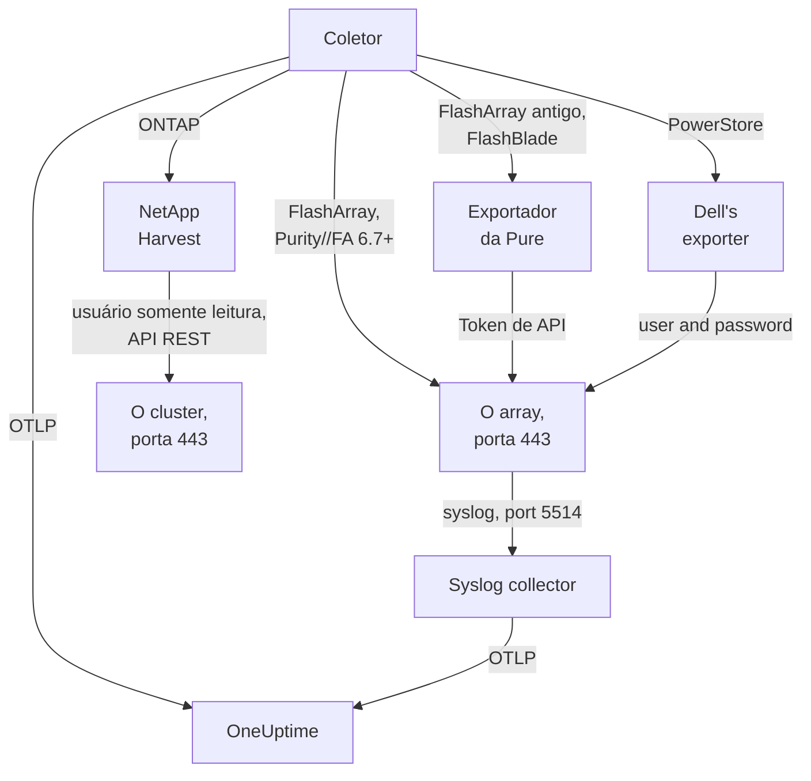

# Agente de arrays de armazenamento

O agente Array de armazenamento do OneUptime monitora arrays de armazenamento: capacidade e redução de dados, latência, IOPS e largura de banda, volumes, hosts, pods e replicação, saúde do hardware, sistemas de arquivos e buckets, e, no NetApp ONTAP, os agregados, SVMs, LUNs e relacionamentos SnapMirror. É um OpenTelemetry Collector padrão que coleta os endpoints OpenMetrics do array com o token de API de um usuário somente leitura (ou, no ONTAP, o exportador Harvest da própria NetApp ao lado dele), marca cada métrica com a identidade do seu array e a envia ao OneUptime. Os [monitores de arrays de armazenamento](/docs/monitor/storage-array-monitor) alertam sobre o que chega.

:::cards
- [Instalar o agente](#instale-o-agente): Um usuário somente leitura e depois o script de instalação ou o Docker Compose.
- [Dell PowerScale](#dell-powerscale): SNMP no cluster, cada nó consultado, e o que as páginas dele mostram.
- [O que o agente coleta](#o-que-o-agente-coleta): Cada endpoint e as páginas construídas a partir dele.
- [Monitorar vários arrays](#monitorar-vários-arrays): Um agente por array, em uma só máquina.
- [Dell PowerMax](#dell-powermax): Sem agente: uma sonda lê todos os arrays por trás do Unisphere.
- [Solução de problemas](#solução-de-problemas): Um script de diagnóstico, e os problemas mais comuns.
:::

## Como funciona

Storage Arrays é um produto que funciona do mesmo jeito para todo fabricante. Ele é compatível com:

| Array | `storage.system` | Como o agente o lê | Configuração do coletor |
| --- | --- | --- | --- |
| **Pure Storage FlashArray**, Purity//FA 6.7 e posteriores | `purestorage.flasharray` | O próprio endpoint OpenMetrics do array (`https://<array>/metrics/...?namespace=purefa`): nada roda ao lado do coletor | `otel-collector-config.yaml` (a padrão) |
| **Pure Storage FlashArray**, Purity//FA mais antigo | `purestorage.flasharray` | O exportador OpenMetrics de FlashArray da Pure, que o mesmo arquivo do Compose executa como o serviço `pure-fa-exporter` | `otel-collector-config.flasharray-exporter.yaml` |
| **Pure Storage FlashBlade** | `purestorage.flashblade` | O exportador OpenMetrics de FlashBlade da Pure, que o mesmo arquivo do Compose executa como o serviço `pure-fb-exporter` | `otel-collector-config.flashblade.yaml` |
| **Dell PowerStore** | `dell.powerstore` | O PowerStore Metrics Exporter da Dell, que o mesmo arquivo Compose constrói e executa como o serviço `powerstore-exporter`; os alertas do cluster chegam por syslog ao seu serviço `powerstore-syslog` | `otel-collector-config.powerstore.yaml` |
| **NetApp ONTAP** 9.12.1 e posteriores (AFF, FAS, ASA, ONTAP Select, Cloud Volumes ONTAP), e **Amazon FSx for NetApp ONTAP** | `netapp.ontap` | O [NetApp Harvest](https://github.com/NetApp/harvest) 26.11, que o mesmo arquivo do Compose executa como o serviço `netapp-harvest`: ele faz login na API REST do cluster com um usuário somente leitura e uma senha | `otel-collector-config.netapp-ontap.yaml` |
| **Dell PowerScale** (Isilon), OneFS 8.0 e posteriores | `dell.powerscale` | Cada nó via SNMP (a ISILON-MIB da Dell), com o próprio receptor SNMP do coletor: nada roda ao lado do coletor | `otel-collector-config.powerscale.yaml` |

O ONTAP não tem um endpoint de métricas próprio, então o agente executa o exportador de código aberto da NetApp, o Harvest, ao lado do coletor. O Harvest lê a API REST do cluster e serve o que leu na rede do Compose, cada série com o nome `netapp_<object>_<counter>`; o coletor o consulta e envia os dados adiante. O Harvest nunca grava no cluster, e o relatório AutoSupport dele para a NetApp fica desativado.

**Dell PowerMax** (`dell.powermax`) não precisa de agente: uma sonda do OneUptime lê, com uma conta somente leitura, todos os arrays que um Unisphere for PowerMax gerencia. Veja [Dell PowerMax](#dell-powermax).

A Pure Storage passou a se chamar **Everpure** em fevereiro de 2026. FlashArray, FlashBlade e Purity mantiveram os nomes, assim como as métricas `purefa_*` e `purefb_*`, então tudo nesta página vale para arrays vendidos com qualquer um dos dois nomes.

Um cluster **Dell PowerScale** é lido de outro jeito: o agente consulta cada um dos seus nós via SNMP, com uma community somente leitura ou um usuário SNMPv3 e sem token de API. [Dell PowerScale](#dell-powerscale) cobre desde a ativação do SNMP até o que as páginas dele mostram; os passos de instalação abaixo são os da Pure Storage.



Um agente monitora um array: execute um agente por array (veja [Monitorar vários arrays](#monitorar-vários-arrays)). O array se registra com os primeiros dados, com o nome que o agente marca em cada métrica como `storage.array.name`.

## Antes de começar

- Docker Engine 20.10 ou mais recente com o plugin Docker Compose v2, em uma máquina que alcance a interface de gerenciamento do array por HTTPS (TCP 443).
- Uma conta de administrador no array, para criar um usuário com a função integrada **readonly** e um token de API para ele. No ONTAP, um administrador do cluster (no Amazon FSx for NetApp ONTAP, `fsxadmin`), para criar um usuário REST somente leitura com senha.
- Para um Dell PowerStore, uma máquina x86-64 (a Dell só compila o seu exportador para x86-64) e um usuário do PowerStore para o agente: veja [Dell PowerStore](#dell-powerstore).
- Uma chave de ingestão. Crie uma em **Configurações do projeto → Telemetria e APM → Chaves de ingestão** e copie o valor.

### Onde executar o agente

O agente fala com a interface de gerenciamento do array por HTTPS, então pode rodar em qualquer máquina com Docker e uma rota para a rede de gerenciamento na TCP 443: um host de monitoramento ou uma pequena VM de gerenciamento. Prefira uma máquina cujo próprio armazenamento não fique no array que ela observa: se o array cair, o seu monitoramento não deve cair junto. O listener de syslog opcional também precisa que o array alcance o agente na porta de syslog (veja [Enviar o syslog do array](#opcional-enviar-o-syslog-do-array)).

## Instale o agente

:::steps
### Criar o usuário somente leitura e o token de API

O agente só lê. Dê a ele um usuário próprio com a função integrada **readonly**, nunca um administrador, e um token de API para esse usuário. Crie o token **sem data de expiração**, ou o agente para no dia em que o token expirar.

:::tabs
@tab Purity CLI
Conecte-se por SSH ao FlashArray como administrador. O primeiro comando pede a senha do novo usuário; o segundo imprime o token de API dele, um UUID:

```bash
pureadmin create --role readonly oneuptime
pureadmin create --api-token oneuptime
```
@tab FlashArray GUI
1. Abra _Settings → Users and Policies_ (_Settings → Access_ em versões mais antigas).
2. No menu ⋮ do painel **Users**, escolha **Create User…**, nomeie o usuário como `oneuptime` e dê a ele a função readonly.
3. No menu ⋮ do novo usuário, escolha **Create API Token…**, deixe **Expires In** vazio e copie o token.
@tab FlashBlade
Crie do mesmo jeito um usuário com a função **readonly** e um token de API para ele: nas configurações de usuário da GUI do FlashBlade ou com `pureadmin` na CLI do Purity//FB. Em uma versão sem usuários locais, use uma conta de um serviço de diretório (LDAP ou Active Directory) cujo grupo esteja mapeado para a função readonly. Os tokens de API do FlashBlade começam com `T-`.
@tab ONTAP CLI
Conecte-se por SSH ao endereço de gerenciamento do cluster como administrador. O primeiro comando cria uma função REST que pode ler todas as APIs e nada mais; o segundo cria um usuário HTTP que tem essa função e pede a senha dele:

```bash
security login rest-role create -role oneuptime-readonly -api /api -access readonly
security login create -user-or-group-name oneuptime -application http -authentication-method password -role oneuptime-readonly
```

O agente faz login com esse usuário e essa senha. Nenhum token de API é usado.
@tab ONTAP System Manager
1. Abra _Cluster → Settings → Users and Roles_.
2. Em **Roles**, escolha **Add**, nomeie a função como `oneuptime-readonly`, informe `/api` como **REST API path** e escolha o acesso **Read-Only**.
3. Em **Users**, escolha **Add**, nomeie o usuário como `oneuptime`, dê a ele a nova função, adicione o método de login **HTTP** com **Password** e defina a senha.
@tab Amazon FSx for NetApp ONTAP
Conecte-se por SSH ao endpoint de gerenciamento do sistema de arquivos (o nome DNS ou o IP dele, no console do FSx) como `fsxadmin` e crie o usuário com a função somente leitura predefinida do FSx. O comando pede a senha dele:

```bash
security login create -user-or-group-name oneuptime -application http -authentication-method password -role fsxadmin-readonly
```

A AWS opera o hardware do sistema de arquivos, então o FSx não responde a ninguém sobre discos, gavetas ou sensores: a página **Hardware** do array lista os nós e as portas dele e explica isso.
:::

### Verificar se o FlashArray serve as próprias métricas

A Pure documenta o endpoint OpenMetrics nativo para **Purity//FA 6.7.0 e posteriores** (o aviso de descontinuação do exportador de FlashArray da Pure diz 6.6.11 e posteriores). O jeito mais rápido de saber é perguntar ao array, a partir da máquina em que o agente vai rodar:

```bash
curl -k 'https://<array>/metrics/array?namespace=purefa' --header 'Authorization: Bearer <api-token>' | grep purefa_info
```

Uma linha `purefa_info{...} 1` significa que o array serve as métricas de forma nativa: use a configuração padrão. Um `404` significa que não: use a configuração com exportador, que roda o exportador da Pure ao lado do coletor. A Pure descontinuou esse exportador, então passe para a configuração nativa assim que o array for atualizado. Um FlashBlade sempre passa pelo exportador de FlashBlade da Pure, e um cluster ONTAP pelo NetApp Harvest, então pule esta etapa nesses casos.

### Instale e inicie o agente

Cada instância do OneUptime fornece o script de instalação e os arquivos do agente da própria versão: os comandos abaixo os baixam de `https://oneuptime.com`, então em uma instância auto-hospedada substitua esse endereço pela sua URL. O script de instalação é salvo primeiro como `install.sh`, para que você possa lê-lo antes de executá-lo.

:::tabs
@tab install.sh
Baixe o script de instalação e execute-o na máquina que vai hospedar o agente:

```bash
curl -fsSL https://oneuptime.com/install/storage-array-agent -o install.sh
bash install.sh
```

O script pergunta qual é o array (um FlashArray que serve métricas nativas, um FlashArray com Purity//FA mais antigo, um FlashBlade ou um cluster NetApp ONTAP) e depois pede a sua URL do OneUptime, a chave de ingestão, um nome para o array, o endereço de gerenciamento do array e o token de API do usuário somente leitura, ou, no ONTAP, o nome e a senha do usuário somente leitura (lidos sem eco). Ele instala em `/opt/oneuptime-storage-array-agent`, baixa o arquivo do Compose, todas as configurações do coletor e os quatro arquivos do Harvest, grava um arquivo com permissão `0600` chamado `.env` com a configuração e o perfil do Compose correspondentes, e inicia o agente com o Docker Compose. Ele coloca cada valor entre aspas para o Docker Compose exatamente como você digitou. Executá-lo de novo reutiliza tudo o que está em um `.env` existente em vez de perguntar de novo, e guarda um arquivo que você editou como `<file>.bak.<timestamp>` antes de substituí-lo.
@tab Docker Compose
Baixe `docker-compose.yml` e os três arquivos `otel-collector-config*.yaml` do seu OneUptime para uma pasta nova:

```bash
curl -fsSLO https://oneuptime.com/install/storage-array-agent/docker-compose.yml
curl -fsSLO https://oneuptime.com/install/storage-array-agent/otel-collector-config.yaml
curl -fsSLO https://oneuptime.com/install/storage-array-agent/otel-collector-config.flasharray-exporter.yaml
curl -fsSLO https://oneuptime.com/install/storage-array-agent/otel-collector-config.flashblade.yaml
```

Crie um arquivo `.env` ao lado deles. Ele guarda o token de API, então mantenha-o privado com `chmod 600 .env`. Para um FlashArray que serve métricas nativas:

```bash title=".env"
ONEUPTIME_URL=YOUR_ONEUPTIME_URL
ONEUPTIME_TELEMETRY_INGESTION_KEY=YOUR_TELEMETRY_INGESTION_TOKEN
STORAGE_ARRAY_NAME=my-storage-array
STORAGE_SYSTEM=purestorage.flasharray
STORAGE_ARRAY_COLLECTOR_CONFIG=otel-collector-config.yaml
COMPOSE_PROFILES=
PURE_FA_ENDPOINT=fa-prod-01.example.com
PURE_FA_API_TOKEN=YOUR_READ_ONLY_API_TOKEN
PURE_FB_ENDPOINT=
PURE_FB_API_TOKEN=
POWERSCALE_ENDPOINT=
POWERSCALE_SNMP_COMMUNITY=
STORAGE_ARRAY_INSECURE_SKIP_VERIFY=true
POWERSTORE_ENDPOINT=
POWERSTORE_PASSWORD=
POWERSTORE_USERNAME=
POWERSTORE_BULK_METRICS=
POWERSTORE_API_VERSION=
POWERSTORE_REQUEST_LIMIT=
POWERSTORE_SYSLOG_PORT=
STORAGE_ARRAY_AGENT_CONTAINER_NAME=oneuptime-storage-array-agent
```

Para um Dell PowerStore, baixe também `otel-collector-config.powerstore.yaml`, `powerstore-exporter.Dockerfile` e `powerstore-syslog.yaml`, defina `STORAGE_SYSTEM=dell.powerstore`, `STORAGE_ARRAY_COLLECTOR_CONFIG=otel-collector-config.powerstore.yaml` e `COMPOSE_PROFILES=powerstore`, e preencha `POWERSTORE_ENDPOINT`, `POWERSTORE_USERNAME` e `POWERSTORE_PASSWORD`, a senha entre aspas simples.

Para um FlashArray com Purity//FA mais antigo, defina `STORAGE_ARRAY_COLLECTOR_CONFIG=otel-collector-config.flasharray-exporter.yaml` e `COMPOSE_PROFILES=flasharray-exporter`. Para um FlashBlade, defina `STORAGE_SYSTEM=purestorage.flashblade`, `STORAGE_ARRAY_COLLECTOR_CONFIG=otel-collector-config.flashblade.yaml` e `COMPOSE_PROFILES=flashblade`, e preencha `PURE_FB_ENDPOINT` e `PURE_FB_API_TOKEN` em vez do par `PURE_FA_*`.

Para um cluster NetApp ONTAP ou o Amazon FSx for NetApp ONTAP, baixe também a configuração do ONTAP e os quatro arquivos do Harvest:

```bash
curl -fsSLO https://oneuptime.com/install/storage-array-agent/otel-collector-config.netapp-ontap.yaml
curl -fsSLO https://oneuptime.com/install/storage-array-agent/netapp-harvest.yml
curl -fsSLO https://oneuptime.com/install/storage-array-agent/netapp-harvest-rest.yaml
curl -fsSLO https://oneuptime.com/install/storage-array-agent/netapp-harvest-keyperf.yaml
curl -fsSLO https://oneuptime.com/install/storage-array-agent/netapp-harvest-restperf.yaml
```

e use este `.env`. Mantenha a senha entre aspas simples, como aqui: assim o Docker Compose a lê exatamente como está escrita, seja qual for o conteúdo. Uma senha que contém `'` vai entre aspas duplas, com `\"`, `\\` e `$$` para `"`, `\` e `$`:

```bash title=".env"
ONEUPTIME_URL=YOUR_ONEUPTIME_URL
ONEUPTIME_TELEMETRY_INGESTION_KEY=YOUR_TELEMETRY_INGESTION_TOKEN
STORAGE_ARRAY_NAME=ontap-prod-01
STORAGE_SYSTEM=netapp.ontap
STORAGE_ARRAY_COLLECTOR_CONFIG=otel-collector-config.netapp-ontap.yaml
COMPOSE_PROFILES=netapp-ontap
NETAPP_ONTAP_ENDPOINT=ontap-prod-01.example.com
NETAPP_ONTAP_USERNAME=oneuptime
NETAPP_ONTAP_PASSWORD='YOUR_READ_ONLY_USER_PASSWORD'
STORAGE_ARRAY_INSECURE_SKIP_VERIFY=true
STORAGE_ARRAY_AGENT_CONTAINER_NAME=oneuptime-storage-array-agent
```

Inicie o agente:

```bash
docker compose up -d
```
:::

### Verifique se o agente está em execução

```bash
docker compose ps
docker logs -f oneuptime-storage-array-agent
```

`docker compose ps` lista o coletor (`oneuptime-storage-array-agent`) e, com uma configuração com exportador, o exportador (`pure-fa-exporter`, `pure-fb-exporter` ou `netapp-harvest`). Depois que o coletor iniciar, os logs dele devem mostrar esta linha:

```text
Everything is ready. Begin running and processing data.
```

### Encontrar o array no OneUptime

Abra **Produtos → Infraestrutura → Arrays de armazenamento → Todos os arrays de armazenamento**. Depois da primeira coleta (cerca de um minuto), o array está lá com a capacidade, o desempenho, os alertas abertos e o hardware dele. Volumes, hosts e pods vêm em até 2 minutos, os sistemas de arquivos e buckets de um FlashBlade em até 5, e os diretórios do FlashArray em até 30. Um cluster ONTAP aparece assim que o Harvest o lê, e o inventário inteiro dele em cerca de 3 minutos, o intervalo em que o Harvest consulta a configuração dele. A página **Topologia** do array desenha os seus hosts, volumes, sistemas de arquivos e hardware em um único mapa: veja [Topologia](/docs/telemetry/topology#abrir-o-mapa-próprio-de-um-recurso).
:::

## Dell PowerStore

O agente lê um cluster PowerStore pelo PowerStore Metrics Exporter da Dell, versão `powerstore-metrics-exporter_v1.0.3`. A Dell o publica como binário, não como imagem, então o serviço `powerstore-exporter` constrói na primeira inicialização a imagem que a Dell documenta a partir de `powerstore-exporter.Dockerfile`, verificando o SHA-256 do binário; essa construção precisa de `quay.io` e `github.com` uma vez.

O exportador da Dell entra com um nome de usuário e uma senha, já que o PowerStore não tem tokens de API. No PowerStore Manager, adicione em _Settings → Users_ um usuário local só para o agente, com o papel **Storage Operator**: o exportador lê o desempenho do arquivo de métricas em massa de cinco minutos do PowerStore, que ele mesmo ativa e que o PowerStoreOS 4.1 e posteriores exigem, e o README da Dell diz que o papel Operator não consegue ativá-lo. Num PowerStoreOS mais antigo, basta o papel somente leitura **Operator** com `POWERSTORE_BULK_METRICS=false`. Só o exportador lê a senha, a partir do `.env`.

O exportador da Dell não lê alertas, então o cluster envia os seus: o serviço `powerstore-syslog` recebe o seu syslog remoto na porta 5514, por TCP e UDP, e guarda cada linha na página **Registros** do array com o registro do PowerStore em atributos (`powerstore.alert.id`, `powerstore.alert.state`, `powerstore.event.code`) e uma severidade tirada dos códigos de evento da Dell (`powerstore.alert.severity`). No PowerStore Manager, abra _Settings → Security → Remote Logging_, adicione esta máquina na porta 5514 e abra a porta no seu firewall. O syslog sobre TLS na porta 6514 está descrito em `powerstore-syslog.yaml`.

O exportador da Dell não informa hosts nem sessões de replicação, então esta versão não os tem.

## Variáveis de ambiente

O script de instalação grava estes valores em `/opt/oneuptime-storage-array-agent/.env`; uma instalação com o Docker Compose os lê do `.env` ao lado de `docker-compose.yml`. Depois de mudar um deles, execute `docker compose up -d` nessa pasta.

| Variável | Obrigatória | Descrição |
| --- | --- | --- |
| `ONEUPTIME_URL` | Sim | A sua URL do OneUptime, como `https://oneuptime.com` ou a sua instância auto-hospedada. Use `http://` e a porta dela se a instância for só HTTP. |
| `ONEUPTIME_TELEMETRY_INGESTION_KEY` | Sim | A chave de ingestão de **Configurações do projeto → Telemetria e APM → Chaves de ingestão**. |
| `STORAGE_ARRAY_NAME` | Sim | O nome com que o array se registra no OneUptime, marcado em cada métrica como o atributo de recurso `storage.array.name`. Mantenha-o estável: mudá-lo depois registra um segundo array. O coletor se recusa a iniciar sem ele. |
| `STORAGE_SYSTEM` | Não | A plataforma, marcada como o atributo de recurso `storage.system`: `purestorage.flasharray`, `purestorage.flashblade` ou `netapp.ontap`. O padrão é `purestorage.flasharray`. |
| `STORAGE_ARRAY_COLLECTOR_CONFIG` | Não | Qual configuração do coletor incluída roda: `otel-collector-config.yaml` (FlashArray, nativa: a padrão), `otel-collector-config.flasharray-exporter.yaml` (FlashArray mais antigo), `otel-collector-config.flashblade.yaml` (FlashBlade) ou `otel-collector-config.netapp-ontap.yaml` (ONTAP). |
| `COMPOSE_PROFILES` | Não | Inicia o exportador que a configuração escolhida coleta: vazio para a configuração nativa do FlashArray, `flasharray-exporter`, `flashblade` ou `netapp-ontap` para as outras. |
| `PURE_FA_ENDPOINT` | FlashArray | O endereço de gerenciamento do FlashArray: um nome de host ou IP, sem `https://`. |
| `PURE_FA_API_TOKEN` | FlashArray | O token de API do usuário do FlashArray com a função readonly. |
| `PURE_FB_ENDPOINT` | FlashBlade | O endereço de gerenciamento do FlashBlade: um nome de host ou IP, sem `https://`. |
| `PURE_FB_API_TOKEN` | FlashBlade | O token de API do usuário do FlashBlade com a função readonly. |
| `POWERSTORE_ENDPOINT` | PowerStore | O endereço de gerenciamento do cluster PowerStore: um nome de host ou um IP, sem `https://`. |
| `POWERSTORE_USERNAME` | PowerStore | O usuário do PowerStore com o qual o exportador da Dell entra. |
| `POWERSTORE_PASSWORD` | PowerStore | A senha desse usuário. Só o exportador a lê. |
| `POWERSTORE_BULK_METRICS` | Não | `true` lê o desempenho do arquivo de métricas em massa do PowerStore; `false` lê cada objeto um a um. O padrão é `true`. |
| `POWERSTORE_API_VERSION` | Não | `v3` para o PowerStoreOS 3.6 e posteriores, ou `v1`. O padrão é `v3`. |
| `POWERSTORE_REQUEST_LIMIT` | Não | Quantas requisições o exportador envia ao cluster de uma vez. O padrão é `16`. |
| `POWERSTORE_SYSLOG_PORT` | Não | A porta em que esta máquina recebe o syslog do cluster, por TCP e UDP. O padrão é `5514`. |
| `NETAPP_ONTAP_ENDPOINT` | ONTAP | O endereço de gerenciamento do cluster (no FSx, o endpoint de gerenciamento do sistema de arquivos): um nome de host ou IP, sem `https://`. |
| `NETAPP_ONTAP_USERNAME` | ONTAP | O usuário REST somente leitura, como `oneuptime`. |
| `NETAPP_ONTAP_PASSWORD` | ONTAP | A senha dele. Só o Harvest a lê, exatamente como está escrita. |
| `POWERSCALE_NODES` | PowerScale | Os endereços de todos os nós, separados por vírgulas, nunca o nome da zona SmartConnect. O script de instalação grava a partir deles as consultas abaixo. |
| `POWERSCALE_ENDPOINT` | PowerScale | O nó através do qual se leem a saúde, a capacidade e as cotas do próprio cluster: o primeiro de `POWERSCALE_NODES`. |
| `POWERSCALE_SNMP_RECEIVERS` | PowerScale | As consultas que o coletor executa: `snmp/cluster`, `snmp/quotas` e depois `snmp/node-1` em diante, uma por nó. |
| `POWERSCALE_NODE_<n>` | PowerScale | O endereço do nó `<n>`, de `1` a `252`. Um endereço IPv6 vai entre colchetes, como `[fd00::11]`. |
| `POWERSCALE_SNMP_VERSION` | Não | `v2c` ou `v3`. O padrão é `v2c`. |
| `POWERSCALE_SNMP_COMMUNITY` | SNMP v2c | A community somente leitura do cluster. |
| `POWERSCALE_SNMP_USER` | SNMPv3 | O usuário SNMPv3 somente leitura do cluster. |
| `POWERSCALE_SNMP_SECURITY_LEVEL` | Não | `auth_priv`, `auth_no_priv` ou `no_auth_no_priv`. O padrão é `auth_priv`. |
| `POWERSCALE_SNMP_AUTH_PROTOCOL` | Não | `MD5`, `SHA`, `SHA224`, `SHA256`, `SHA384` ou `SHA512`, como `isi snmp settings view` o mostra. O padrão é `SHA`. |
| `POWERSCALE_SNMP_AUTH_PASSWORD` | SNMPv3 | A senha de autenticação do usuário SNMPv3. |
| `POWERSCALE_SNMP_PRIVACY_PROTOCOL` | Não | `DES`, `AES`, `AES192`, `AES256`, `AES192C` ou `AES256C`. O padrão é `AES`. |
| `POWERSCALE_SNMP_PRIVACY_PASSWORD` | SNMPv3 | A senha de privacidade do usuário SNMPv3, no nível `auth_priv`. |
| `STORAGE_ARRAY_INSECURE_SKIP_VERIFY` | Não | `true` aceita o certificado autoassinado do array no endpoint nativo e no Harvest; `false` o verifica. O padrão é `true`. Os exportadores da Pure nunca verificam o certificado do array, então isso não se aplica a eles. |
| `STORAGE_ARRAY_AGENT_CONTAINER_NAME` | Não | O nome do contêiner do agente. O padrão é `oneuptime-storage-array-agent`. O agente de um segundo array na mesma máquina precisa de um próprio: veja [Monitorar vários arrays](#monitorar-vários-arrays). O script de instalação dá a um novo agente o nome da pasta dele, a menos que você o defina, e o mantém quando você executa o script de novo. |

## Como o agente coleta

- **Um job de coleta por endpoint, cada um lido com a frequência que vale a pena.** FlashArray: `/metrics/array` a cada 60 segundos; `/metrics/volumes`, `/metrics/hosts` e `/metrics/pods` a cada 2 minutos; `/metrics/directories` a cada 30 minutos, que é o que a própria Pure recomenda, já que calcular o espaço dos diretórios é caro para o array. FlashBlade: `/metrics/array` a cada 60 segundos; `/metrics/filesystems` e `/metrics/objectstore` a cada 5 minutos, de novo seguindo o conselho da Pure de ler os endpoints de sistemas de arquivos e do armazenamento de objetos com menos frequência que o array.
- **Cada job rotula as séries com `scrape_endpoint: <endpoint>`.** Cada endpoint também exporta `purefa_info` ou `purefb_info`, então o OneUptime sabe de quais famílias um lote é a lista completa: é assim que um volume, host, pod, sistema de arquivos ou bucket excluído sai do inventário em vez de ficar parado lá. Mantenha os rótulos como vêm.
- **A latência por volume e por host mantém três dimensões.** Cada volume e cada host exporta a latência em até dezesseis `dimension`. Uma regra `metric_relabel_configs` mantém `usec_per_read_op`, `usec_per_write_op` e `usec_per_mirrored_write_op` e descarta o detalhamento por limite de taxa de QoS, fila, SAN e tempo de serviço, que multiplica as séries de um array grande. O detalhamento do array inteiro em `purefa_array_performance_latency_usec` é mantido. Exclua a regra para manter também o detalhamento por volume.
- **O token de API é um token Bearer.** A configuração nativa o envia ao próprio array; as configurações com exportador o enviam ao exportador só pela rede do Compose, e as portas dos exportadores nunca são publicadas.
- **Um PowerStore a cada 5 minutos.** O exportador da Dell serve cada parte do cluster em `/metrics/<cluster>/<part>`: a configuração lê `cluster` a cada 60 segundos, o seu heartbeat, e `appliance`, `capacity`, `hardware`, `port`, `volume`, `volumeGroup`, `nas` e `file` a cada 5 minutos, porque o PowerStore os calcula em amostras de cinco minutos.
- **Sem `send_batch_max_size`.** O OneUptime reconstrói o inventário a partir de uma coleta inteira por requisição, então o processador `batch` incluído nunca divide uma coleta entre exportações. Mantenha as configurações de batch como vêm.
- **ONTAP: o Harvest consulta o cluster, o coletor coleta o Harvest.** O Harvest lê a configuração e o estado do cluster a cada 3 minutos, o desempenho a cada minuto (latências em microssegundos por operação, operações e bytes por segundo) e os eventos EMS a cada 3 minutos, e serve o mais recente de tudo em `netapp-harvest:12990`, que o coletor coleta a cada 60 segundos com o rótulo `scrape_endpoint: harvest`. Os três arquivos `netapp-harvest-*.yaml` limitam o Harvest ao que o OneUptime lê. As séries `netapp_metadata_*` do próprio Harvest dizem quais objetos ele listou por completo, então um volume excluído sai do inventário, enquanto um objeto que o Harvest não conseguiu ler mantém a última contagem. O coletor descarta as medições que o Harvest faz de si mesmo e as séries de desempenho por disco, e transforma o agendamento de cada relacionamento SnapMirror em `netapp_snapmirror_schedule_seconds` (um agendamento horário é 3600), com o qual o SnapMirror Behind Schedule compara o atraso.

## O que o agente coleta

As convenções semânticas da Pure são comuns ao endpoint nativo do FlashArray e aos dois exportadores; as do ONTAP são as do Harvest, descritas depois da tabela. Cada valor é um gauge que o próprio array calcula (latências em microssegundos por operação, vazão por segundo), então não há taxas a calcular, e os objetos são nomeados por **rótulos de ponto de dados**: `name` para volumes, pods, diretórios, sistemas de arquivos e buckets, `host` para hosts, `component_name` para o hardware do FlashArray. O agente acrescenta os atributos de recurso `storage.array.name` e `storage.system`, então o OneUptime arquiva tudo sob o seu array:

| Endpoint | Famílias de métricas | O que o OneUptime constrói com elas |
| --- | --- | --- |
| FlashArray `/metrics/array` | `purefa_info`, `purefa_alerts_open`, `purefa_array_space_*`, `purefa_array_performance_*`, `purefa_hw_component_status`, `purefa_hw_component_temperature_celsius`, `purefa_hw_controller_info`, `purefa_drive_capacity_bytes`, `purefa_network_interface_*` | O nome, a versão do Purity e o ID de sistema do array; capacidade, espaço usado e redução de dados; contagem de alertas abertos; a saúde do array; a página **Hardware** (componentes, unidades, controladoras, interfaces de rede) |
| FlashArray `/metrics/volumes` | `purefa_volume_performance_*`, `purefa_volume_space_*`, `purefa_volume_qos_*` | A página **Volumes**: tamanho provisionado e físico, redução de dados, latência de leitura e gravação, IOPS e largura de banda por volume |
| FlashArray `/metrics/hosts` | `purefa_host_connectivity_info`, `purefa_host_connections_info`, `purefa_host_performance_*`, `purefa_host_space_*` | A página **Hosts**: conectividade (caminhos redundantes ou não), volumes conectados, latência, IOPS e largura de banda por host |
| FlashArray `/metrics/pods` | `purefa_pod_performance_*`, `purefa_pod_space_*`, `purefa_pod_replica_links_*`, `purefa_pod_mediator_status` | A página **Replicação**: pods ActiveCluster e ActiveDR, status e atraso dos links de réplica |
| FlashArray `/metrics/directories` | `purefa_directory_performance_*`, `purefa_directory_space_*` | A página **Diretórios** (FlashArray File Services) |
| FlashBlade `/metrics/array` | `purefb_info`, `purefb_alerts_open`, `purefb_array_space_*`, `purefb_array_performance_*`, `purefb_hardware_health` | O nome, a versão do Purity e o ID de sistema do FlashBlade; capacidade e redução de dados; contagem de alertas abertos; a saúde do array; a página **Hardware** |
| FlashBlade `/metrics/filesystems` | `purefb_file_systems_space_*`, `purefb_file_systems_performance_*` | A página **Sistemas de arquivos**: espaço provisionado e usado, redução de dados, latência, IOPS e largura de banda por sistema de arquivos |
| FlashBlade `/metrics/objectstore` | `purefb_buckets_space_*`, `purefb_buckets_quota_space_bytes`, `purefb_buckets_object_count`, `purefb_buckets_performance_*`, `purefb_object_store_accounts_*` | A página **Buckets**: espaço, cota, contagem de objetos e desempenho por bucket, agrupados por conta |
| PowerStore `cluster`, `appliance`, `capacity` | `powerstore_cluster`, `powerstore_metro_*`, `powerstore_appliance`, `powerstore_perf_*`, `powerstore_cap_*` | O nome e o estado do cluster; a página **Appliances**: capacidade, redução de dados, latência, IOPS e largura de banda de cada appliance |
| PowerStore `hardware`, `port` | `powerstore_hardware_*`, `powerstore_wear_metrics_by_drive`, `powerstore_fc_port_*`, `powerstore_eth_port_*`, `powerstore_metricFcPort_*`, `powerstore_metricEthPort_*` | A página **Hardware**: nós, ventiladores, fontes de alimentação, baterias, unidades e portas front-end, cada um com o seu appliance |
| PowerStore `volume`, `volumeGroup`, `nas`, `file` | `powerstore_volume_*`, `powerstore_metricVolume_*`, `powerstore_volumegroup_*`, `powerstore_metricVg_*`, `powerstore_nas_server_operational_status`, `powerstore_metricNas_*`, `powerstore_filesystem_*`, `powerstore_metricFilesystem_*` | As páginas **Volumes**, **Grupos de volumes**, **Servidores NAS** e **Sistemas de arquivos** |
| ONTAP, pelo Harvest | `netapp_cluster_*`, `netapp_node_*`, `netapp_aggr_*`, `netapp_svm_*`, `netapp_volume_*`, `netapp_lun_*`, `netapp_snapmirror_*` | O nome, a versão e o UUID do cluster; a capacidade dele (a soma dos agregados de dados) e a redução de dados; a página **Volumes**; as páginas **Agregados**, **SVMs**, **LUNs** e **SnapMirror**, uma página por objeto |
| Hardware do ONTAP, pelo Harvest | `netapp_disk_*`, `netapp_shelf_*`, `netapp_environment_sensor_*`, `netapp_net_port_*`, `netapp_nic_*`, `netapp_fcp_*` | A página **Hardware**: nós, discos, gavetas e as fontes de alimentação, ventiladores, módulos e sensores delas, os sensores dos nós e as portas Ethernet e Fibre Channel |
| Problemas abertos e eventos do ONTAP | `netapp_health_*`, `netapp_ems_events` | As contagens de alertas abertos e o cartão **Alertas ativos** (discos quebrados, falhas de gaveta, takeover de HA, portas inoperantes, alertas de integridade do sistema), e os modelos EMS |
| PowerScale `snmp/cluster` | `powerscale_cluster_*`, `powerscale_ifs_*` | O nome, a versão do OneFS, a saúde e as contagens de nós do cluster; a capacidade do `/ifs`; a taxa de transferência, a rede e a CPU em todo o cluster |
| PowerScale `snmp/quotas` | `powerscale_quota_*` | A página **Cotas**: o uso de cada cota, os seus limites e quão perto ela está deles |
| PowerScale `snmp/node-<n>` | `powerscale_node_*`, `powerscale_protocol_*`, `powerscale_drive_*`, `powerscale_fan_*`, `powerscale_temperature_*`, `powerscale_power_sensor_*`, `powerscale_interface_*`, `powerscale_chassis_*` | A página **Nós**: a saúde, a CPU, a taxa de transferência e o desempenho dos protocolos de cada nó; a página **Hardware**: as suas unidades, sensores e portas |

No ONTAP, toda série é do Harvest: um objeto é nomeado pelos rótulos dele (`volume` dentro do seu `svm`, `aggr`, `lun`, `node`, `disk`, `shelf`, `destination_location` para um relacionamento SnapMirror), um estado é um `netapp_*_new_status` de 1 ou 0 ou uma série `netapp_*_labels` cujos rótulos o dizem, e cada problema aberto é uma série `netapp_health_*_alerts` que existe enquanto ele durar.

A coluna **Integridade** de **Todos os arrays de armazenamento** lê os alertas e o hardware do próprio array em seus dados mais recentes: **Crítico** enquanto ele informa um alerta crítico aberto, ou um componente de hardware, unidade ou controladora crítico, com falha, ausente ou não íntegro; **Aviso** enquanto informa um alerta de aviso aberto, ou um componente degradado ou desconhecido; **OK** nos demais casos; e **Desconhecido** enquanto o agente está desconectado. A **Visão geral** do array julga mais, como diz a próxima seção. Nos critérios de monitor, os atributos do array levam um prefixo `resource.` (`resource.storage.array.name`, `resource.storage.system`), enquanto os rótulos de ponto de dados ficam sem prefixo (`name`, `host`, `dimension`, `space`).

A saúde de um PowerStore é a do seu hardware, já que os seus alertas chegam como registros. O agente calcula sozinho `powerstore_cap_physical_used_percent` e `powerstore_filesystem_logical_used_percent`, e lê o estado de um nó como 1 enquanto ele está Healthy.

## O que as páginas do array mostram

A **Visão geral** do array diz sua integridade, **Íntegro**, **Degradado** ou **Não íntegro**, pelo que precisa de atenção, e lista isso em **Requer atenção**, o mais urgente primeiro, cada item a um passo de onde olhar:

- **O próprio array.** Um alerta aberto que o array gerou com severidade crítica é crítico, e um com severidade de aviso precisa de uma olhada. Acima de 80% da capacidade utilizável ele precisa de uma olhada, e acima de 90% é crítico, onde disparam os alertas Capacity Above 80% e Capacity Above 90%. Um FlashArray cuja latência média de leitura ou gravação passa de 5 ms, ou um FlashBlade cujas leituras levam mais de 10 ms, precisa de uma olhada.
- **Hardware.** Um componente, unidade, controladora ou interface de rede que o array informa como crítico, com falha, ausente ou não íntegro é crítico: a redundância acabou até que a peça seja trocada. Um que ele informa como degradado, desconhecido, não reconhecido ou não pronto precisa de uma olhada. Peças não instaladas, desligadas ou sem uso nunca são listadas.
- **Hosts.** Um host que não alcança mais o array pelas duas controladoras precisa de uma olhada, com o motivo: por uma só controladora, por caminhos desiguais ou sem nenhum caminho.
- **Pods.** Um pod cujo link de réplica o array informa como não íntegro é crítico, e um com mais de um minuto de atraso precisa de uma olhada.
- **Sistemas de arquivos.** Um sistema de arquivos do FlashBlade com menos de 10% do tamanho provisionado livre precisa de uma olhada.
- **Os objetos próprios de um cluster ONTAP.** Um volume, agregado ou LUN que o ONTAP informa como offline, um disco quebrado, uma peça de gaveta com erro, um sensor de nó além do limite crítico e uma porta inoperante são críticos; um SVM parado, um nó com um ventilador ou uma fonte de alimentação com falha e um sensor além do limite de aviso precisam de uma olhada, com as próprias palavras do ONTAP para o motivo. Um relacionamento SnapMirror que o ONTAP informa como não íntegro é crítico, e um com mais de um intervalo e meio do agendamento de atraso precisa de uma olhada.

As listas **Hosts**, **Replicação** e **Sistemas de arquivos** dizem o estado de cada parte pelas mesmas regras, com o motivo abaixo, e o mesmo fazem as listas **Volumes**, **Agregados**, **SVMs**, **LUNs** e **SnapMirror** de um cluster ONTAP, em que cada linha abre uma página própria: o estado, o que precisa de atenção, o que está aberto nela, os alertas do cluster que a observam, o que o ONTAP reporta sobre ela e os gráficos. As páginas de cada plataforma falam a língua dela: um volume do ONTAP lista o SVM, o agregado e quão cheio está, e a página dele mostra em gráficos as séries do ONTAP. No Amazon FSx for NetApp ONTAP, a página **Hardware** lista os nós e as portas e explica por que não há discos nem gavetas. A página de um host e a de um sistema de arquivos dizem o que precisa de atenção e quais alertas do array o vigiam, com um passo para ativar os demais, e a página de cada parte, também a de um volume e a de um bucket, diz o que está aberto nela. Enquanto o agente está desconectado, a integridade mostra **Integridade desconhecida**: o último relatório do array não é mais a verdade. Cada limite acima é aquele em que dispara seu modelo de alerta, como lista o [monitor de arrays de armazenamento](/docs/monitor/storage-array-monitor).

Num PowerStore, as abas **Appliances**, **Grupos de volumes** e **Servidores NAS** listam as partes que só um PowerStore tem, e a página **Hardware** nomeia o appliance de cada parte, já que cada appliance dá os mesmos nomes às suas partes.

## Opcional — Enviar o syslog do array

O coletor de syslog de um PowerStore funciona como é entregue (veja [Dell PowerStore](#dell-powerstore)): esta seção é para os arrays da Pure.

Por padrão, o agente envia só métricas, então a página **Registros** do array fica vazia. Os arrays encaminham seus alertas e eventos de auditoria como syslog, e cada configuração do coletor incluída tem um par de receivers `syslog` comentado (TCP e UDP na porta 5514, RFC 3164), ligado a um pipeline `logs` comentado que marca `storage.array.name` para os logs chegarem ao seu array.

:::steps
### Ativar os receivers

Descomente os dois receivers `syslog/*` e o pipeline `logs` na configuração do coletor que você usa. Os timestamps do RFC 3164 não trazem fuso horário: defina `location` com o fuso horário do array, a menos que o relógio dele esteja em UTC.

### Abrir a porta

Descomente o bloco `ports:` em `docker-compose.yml` para a máquina publicar `5514/tcp` e `5514/udp`, e depois execute `docker compose up -d`. Abra a porta no firewall da máquina para a rede de gerenciamento do array.

### Apontar o array para o agente

Faça isso como administrador, não como o usuário de monitoramento somente leitura. Em um FlashArray, abra _Settings → System → Syslog Servers_, adicione `udp://<agent-host>:5514` (ou `tcp://<agent-host>:5514`) e envie uma mensagem de teste. Em um FlashBlade, adicione um servidor de syslog com a mesma URI nas configurações de syslog dele. Os dois arrays aceitam a forma `PROTOCOL://HOST:PORT`, também pelas APIs REST deles (`syslog-servers`).
:::

Um receiver de syslog escuta em um só transporte, e é por isso que TCP e UDP são dois receivers: deixe um comentado se você só precisa do outro. A imagem padrão do coletor lê o syslog como ele vem: nenhuma imagem personalizada é necessária.

## Marcar o array com rótulos do projeto

Um atributo de recurso que começa com `oneuptime.label.` vira um rótulo do projeto no array de armazenamento: `oneuptime.label.<dimension>=<value>` é o rótulo `<dimension>:<value>`. Adicione os atributos ao processador `resource` na configuração do coletor que você usa, ao lado de `storage.array.name`:

```yaml
processors:
  resource:
    attributes:
      # ...existing attributes...
      - key: oneuptime.label.team
        value: storage
        action: upsert
      - key: oneuptime.label.env
        value: production
        action: upsert
```

O coletor só lê a configuração quando inicia: execute `docker compose restart oneuptime-storage-array-agent`. O array passa então a mostrar os rótulos `team:storage` e `env:production`. Os rótulos são comparados sem diferenciar maiúsculas e minúsculas, então um rótulo `Production` existente é reutilizado em vez de duplicado, e o agente nunca remove um rótulo que alguém adicionou no OneUptime.

## Monitorar vários arrays

Um agente lê um array. Para monitorar vários a partir da mesma máquina, instale cada um na própria pasta com o próprio `.env` e o próprio nome de contêiner, já que dois contêineres não podem compartilhar um nome: `INSTALL_DIR=/opt/oneuptime-storage-array-agent-fa02 STORAGE_ARRAY_AGENT_CONTAINER_NAME=oneuptime-storage-array-agent-fa02 bash install.sh`. Sem `STORAGE_ARRAY_AGENT_CONTAINER_NAME`, o script dá ao contêiner o nome da pasta, que aqui é o mesmo nome. Ele guarda o nome no `.env` desse agente, então executar o script de novo para atualizar o agente também o mantém, e um agente cujo `container_name` você já editou no `docker-compose.yml` mantém esse nome. Com o Docker Compose, defina `STORAGE_ARRAY_AGENT_CONTAINER_NAME` no `.env` de cada agente em vez disso. Passe a pasta ao script de diagnóstico com `-d`.

Um segundo agente PowerStore também precisa da sua própria porta de syslog: defina `POWERSTORE_SYSLOG_PORT`, por exemplo `5515`, no seu `.env`.

## Execute como um serviço do systemd

Para iniciar o agente junto com a máquina e reiniciá-lo quando falhar, instale a unidade do systemd dele. Ela supõe que o agente fica em `/opt/oneuptime-storage-array-agent`, onde o script de instalação o coloca:

```bash
sudo curl -fsSL https://oneuptime.com/install/storage-array-agent/systemd/oneuptime-storage-array-agent.service -o /etc/systemd/system/oneuptime-storage-array-agent.service
sudo systemctl daemon-reload
sudo systemctl enable --now oneuptime-storage-array-agent
```

## Atualizando o agente

O agente informa como **Versão do agente** a versão do coletor que os arquivos dele fixam. Quando ela é mais antiga que a versão que esta versão do OneUptime fixa, um sinal de aviso aparece ao lado dela na página **Visão geral** do array. Selecione-o para ver estes comandos. Um agente instalado antes de os arquivos dele informarem uma versão não mostra nenhuma até ser atualizado dessa forma.

A imagem do coletor está fixada em `docker-compose.yml`, e as configurações dele são arquivos ao lado, então só baixar as imagens não faz o agente avançar. Execute `install.sh` de novo: ele reutiliza todos os valores do seu `.env` atual (nada é perguntado de novo), renova `docker-compose.yml`, todas as configurações do coletor e os arquivos do Harvest (um arquivo que você editou é guardado como `<file>.bak.<timestamp>`) e recria o agente para que o coletor leia a nova configuração. Um agente instalado fora de `/opt/oneuptime-storage-array-agent` precisa da pasta dele: `INSTALL_DIR=<folder> bash install.sh`. Ele mantém o nome do contêiner.

```bash
curl -fsSL https://oneuptime.com/install/storage-array-agent -o install.sh
bash install.sh
```

Instalou com o Docker Compose? Na pasta do agente, baixe de novo o arquivo do Compose e as configurações do coletor (no ONTAP, também a configuração do ONTAP e os quatro arquivos do Harvest, e refaça qualquer alteração que você tenha feito neles), depois baixe as imagens e recrie o agente:

```bash
curl -fsSLO https://oneuptime.com/install/storage-array-agent/docker-compose.yml
curl -fsSLO https://oneuptime.com/install/storage-array-agent/otel-collector-config.yaml
curl -fsSLO https://oneuptime.com/install/storage-array-agent/otel-collector-config.flasharray-exporter.yaml
curl -fsSLO https://oneuptime.com/install/storage-array-agent/otel-collector-config.flashblade.yaml
curl -fsSLO https://oneuptime.com/install/storage-array-agent/otel-collector-config.powerscale.yaml
docker compose pull
docker compose up -d --force-recreate
```

Um agente PowerStore também baixa de novo `otel-collector-config.powerstore.yaml`, `powerstore-exporter.Dockerfile` e `powerstore-syslog.yaml`; o `docker compose up` reconstrói a imagem do exportador quando uma nova versão move a sua tag.

## Desinstalando o agente

```bash
cd /opt/oneuptime-storage-array-agent
docker compose down
```

Depois exclua o usuário somente leitura e o token de API dele no array, se não precisar mais deles. No ONTAP, execute `security login delete -user-or-group-name oneuptime -application http -authentication-method password` e depois `security login rest-role delete -role oneuptime-readonly -api /api`.

Num PowerStore, execute `docker compose --profile powerstore down`, para que o exportador e o coletor de syslog também parem.

## Dell PowerMax

Um Dell PowerMax não precisa de agente. Uma sonda do OneUptime faz login na REST API do Unisphere for PowerMax com uma conta somente leitura a cada 5 minutos e lê todos os arrays que esse Unisphere gerencia. Cada array aparece em **Arrays de armazenamento** com o seu Symmetrix ID, como `000220200269`, e você pode renomeá-lo. A senha é armazenada criptografada, nunca mais é mostrada e só é enviada à sonda que você escolher.

- **Unisphere for PowerMax 10.1 ou posterior**, gerenciando arrays com PowerMaxOS 10 ou 5978. A partir do Unisphere 10.3, uma conta somente leitura também vê as portas e os grupos SRDF.
- **Uma sonda que alcance o Unisphere pela porta TCP 8443**, normalmente uma [sonda personalizada](/docs/probe/custom-probe) na rede do Unisphere. No OneUptime Cloud, uma sonda compartilhada nunca recebe uma senha de armazenamento, então escolha uma sonda do seu próprio projeto.
- **Um usuário do Unisphere com a função Monitor** em cada array que ele deve ler, e a função **PerfMonitor** para o desempenho. Ele não precisa de mais nada: o OneUptime nunca altera o array.

:::steps
### Criar o usuário somente leitura

No Unisphere for PowerMax, em **Settings → Users and Groups**, crie um usuário local ou escolha um usuário de diretório. Autorize-o com a função **Monitor** em cada array, e **PerfMonitor** para o desempenho.

### Verificar se o Unisphere coleta o desempenho

Em **Settings → Performance → System Registrations**, verifique se a coleta **Diagnostic** está ativada para cada array: sem ela, o OneUptime lista o inventário e os alertas do array, mas não exibe gráficos de desempenho. Para ver um grupo de armazenamento a cada 5 segundos, registre-o também para **Real Time** ali, até 100 por array.

### Conectar o Unisphere

Vá em **Produtos → Infraestrutura → Arrays de armazenamento → Conexões** e clique em **Conectar o Unisphere**. Informe o endereço em que você abre o Unisphere, como `https://unisphere.example.com:8443`, o nome de usuário e a senha, e escolha a sonda.

### Testar a conexão

**Testar conexão** faz a sonda entrar e ler o que a conta consegue ver: cada array, os seus grupos de armazenamento e volumes, e se o Unisphere coleta o desempenho dele. Por padrão, o Unisphere assina o próprio certificado: o teste o mostra, e **Confiar neste certificado** coloca a impressão digital SHA-256 dele no formulário. Compare antes a impressão digital com a do próprio Unisphere, por exemplo com `openssl s_client -connect unisphere.example.com:8443` a partir da máquina da sonda.

### Dar um nome e conectar

Dê um nome à conexão, ou mantenha o nome do host, e clique em **Conectar**. A página dela mostra a primeira coleta em poucos minutos e todos os arrays encontrados, cada um com um link para a sua página em **Arrays de armazenamento**.
:::

A sonda lê os endpoints REST documentados do Unisphere: o clássico `/univmax/restapi` para os arrays, a capacidade, a saúde, os alertas e os pools, e o de consultas em lote `/univmax/rest/v1` para os grupos de armazenamento, volumes, diretores, portas, grupos SRDF e o desempenho. Toda chamada é uma leitura. Ela envia o que lê como estas séries, com os milissegundos do Unisphere como microssegundos e os seus MB por segundo como bytes por segundo:

| Séries | O que contêm |
| --- | --- |
| `powermax_array_*` | O array: modelo e microcódigo, capacidade utilizável, usada e subscrita, redução de dados, pontuações de integridade, se o Unisphere coleta o desempenho dele, e os seus números de 5 minutos de tempo de resposta, IOPS, vazão, cache e ocupação |
| `powermax_alert_open` | Uma série por alerta que o Unisphere mantém aberto para o array, de Minor para cima, até que alguém o confirme ou limpe |
| `powermax_storage_group_*` | Cada grupo de armazenamento: capacidade e volumes, tempos de resposta, IOPS e vazão de 5 minutos, e os números de 5 segundos quando está registrado para tempo real |
| `powermax_volume_*` | Cada volume de um grupo de armazenamento: a sua capacidade, e os seus números quando o grupo de armazenamento dele está registrado para tempo real |
| `powermax_srp_*` | Cada pool de recursos de armazenamento: capacidade e tempo de resposta |
| `powermax_director_*` | Cada diretor: função, status e ocupação, e `powermax_director_offline` enquanto ele não está online |
| `powermax_port_*` | Cada porta: protocolo, velocidade, níveis de luz e ocupação, e `powermax_port_offline` enquanto uma porta da qual alguém depende está fora do ar |
| `powermax_srdf_group_*` | Cada grupo SRDF: array remoto e modos, atraso e vazão, e `powermax_srdf_group_not_healthy` enquanto ele está suspenso ou offline |

- **A cada 5 minutos**, ou a cada 10 para aliviar um Unisphere sobrecarregado (**Mais campos** no formulário da conexão): o Unisphere calcula o desempenho a cada 5 minutos.
- **Só os arrays que o próprio Unisphere gerencia.** Os arrays remotos que ele vê pelo SRDF aparecem na página da conexão e são lidos pelo Unisphere do próprio site deles: conecte esse também.
- **Até 5,000 grupos de armazenamento e 10,000 volumes por array**, e 200 alertas novos por coleta (o restante chega nas próximas). Uma lista cortada é indicada como tal na página da conexão.
- **Unisphere 10.1 e 10.2** não listam portas nem grupos SRDF para uma conta somente leitura: a sonda lê os diretores um a um, obtém os grupos SRDF a partir dos grupos de armazenamento e avisa disso.

## Dell PowerScale

O agente lê um cluster Dell PowerScale (Isilon) via SNMP, a partir da ISILON-MIB da Dell, com o próprio receptor SNMP do coletor: sem token de API, e nada roda ao lado do coletor. Um cluster é um array de armazenamento, e os seus nós, cotas, unidades, sensores e portas são o seu inventário.

- **Cada nó é consultado no seu próprio endereço.** Um nó só responde a SNMP pelas suas próprias unidades, sensores e portas, então o agente consulta cada nó pelo endereço dele na rede que o agente alcança, nunca pelo nome da zona SmartConnect, que passa cada consulta ao nó que escolher. Um cluster tem até 252 nós.
- **Os objetos do próprio cluster são lidos uma única vez, através do primeiro nó:** a sua saúde, capacidade, taxa de transferência, CPU e contagens de nós a cada 60 segundos (`snmp/cluster`), e as suas SmartQuotas a cada 5 minutos (`snmp/quotas`). A saúde, a CPU, o desempenho dos protocolos (NFS, SMB, S3, HDFS e os demais), as unidades, os sensores e as portas de cada nó são lidos no próprio nó a cada 60 segundos (`snmp/node-<n>`).
- **As leituras que o OneFS dá como texto ou em outras unidades de medida** (leituras de sensores, CPU em décimos de ponto percentual, taxa de transferência em bits) são convertidas em números pelo coletor antes do envio, então cada gráfico e cada modelo lê um gauge simples.

### Ative o SNMP no cluster

Conecte-se por SSH a qualquer nó como administrador: o OneFS aplica as configurações de SNMP ao cluster inteiro. Se o cluster já responde a SNMP para outra ferramenta, dê ao agente a mesma community somente leitura ou o mesmo usuário SNMPv3 e pule esta etapa. Caso contrário, ative o serviço SNMP e o SNMP v2c com uma community somente leitura própria, não a padrão do OneFS, `I$ilonpublic`:

```bash
isi snmp settings modify --service yes
isi snmp settings modify --snmp-v1-v2c-access yes -c '<read-only-community>'
```

Ou ative o SNMPv3, que autentica e criptografa cada consulta. O OneFS tem um único usuário SNMPv3 somente leitura, `general` até que você o renomeie: dê a ele senhas de pelo menos oito caracteres, sem espaços:

```bash
isi snmp settings modify --service yes
isi snmp settings modify --snmp-v3-access yes -u '<read-only-user>' --snmp-v3-password '<authentication-password>' --snmp-v3-priv-password '<privacy-password>'
```

`isi snmp settings view` mostra as configurações, com os protocolos de autenticação e de privacidade do usuário. Libere a porta UDP 161 da máquina do agente para cada nó e liste os endereços dos nós com `isi network interfaces list`.

### Instale o agente em um cluster PowerScale

Execute o script de instalação com a configuração do PowerScale:

```bash
curl -fsSL https://oneuptime.com/install/storage-array-agent -o install.sh
STORAGE_ARRAY_COLLECTOR_CONFIG=otel-collector-config.powerscale.yaml bash install.sh
```

O script pede a sua URL do OneUptime, a chave de ingestão e um nome para o cluster, depois os endereços de todos os nós, separados por vírgulas, e a versão do SNMP, e depois a community somente leitura, ou o usuário SNMPv3 e as suas duas senhas, cada uma lida sem eco. Um usuário cujos protocolos não são SHA e AES precisa de `POWERSCALE_SNMP_AUTH_PROTOCOL` e `POWERSCALE_SNMP_PRIVACY_PROTOCOL` antes de `bash install.sh`, e um usuário sem privacidade, de `POWERSCALE_SNMP_SECURITY_LEVEL=auth_no_priv`. O script grava uma consulta por nó no `.env`:

```bash title=".env"
STORAGE_SYSTEM=dell.powerscale
STORAGE_ARRAY_COLLECTOR_CONFIG=otel-collector-config.powerscale.yaml
POWERSCALE_ENDPOINT='10.20.0.11'
POWERSCALE_SNMP_COMMUNITY='YOUR_READ_ONLY_COMMUNITY'
POWERSCALE_SNMP_VERSION='v2c'
POWERSCALE_NODES='10.20.0.11,10.20.0.12,10.20.0.13'
POWERSCALE_SNMP_RECEIVERS='[snmp/cluster, snmp/quotas, snmp/node-1, snmp/node-2, snmp/node-3]'
POWERSCALE_NODE_1='10.20.0.11'
POWERSCALE_NODE_2='10.20.0.12'
POWERSCALE_NODE_3='10.20.0.13'
```

Quando o cluster ganhar um nó, adicione o endereço dele a `POWERSCALE_NODES` no `.env` e execute `install.sh` de novo: ele grava a consulta do nó e recria o agente. Com o Docker Compose, baixe `docker-compose.yml` e `otel-collector-config.powerscale.yaml`, e coloque estas linhas no `.env` do início rápido no lugar das linhas `STORAGE_SYSTEM`, `STORAGE_ARRAY_COLLECTOR_CONFIG` e `POWERSCALE_*` dele. O `troubleshoot.sh` pergunta a cada nó o nome do cluster com `snmpget` quando a máquina o tem.

### O que as páginas de um PowerScale mostram

A **Visão geral** do cluster pega a sua saúde daquela que o próprio OneFS informa, conta os seus nós e cotas, e desenha a latência e a carga de cada protocolo, a taxa de transferência, os nós mais ocupados e a capacidade usada. **Nós** lista cada nó com a sua saúde, modelo, versão do OneFS, CPU e taxa de transferência; **Cotas** lista cada cota com quanto do seu limite ela usa, da maior para a menor; **Hardware** lista as unidades de cada nó, as suas ventoinhas e os seus sensores de temperatura e de energia com as suas leituras, e as suas portas. A capacidade é a do `/ifs`, e o espaço que o OneFS reserva para os virtual hot spares conta como usado: ele não está disponível para gravações.

### O que o agente ainda não lê

- **Os eventos do OneFS e os seus pools de armazenamento.** O SNMP não transporta nenhum dos dois: eles vêm da API do OneFS, que uma sonda do OneUptime vai ler ([#11249](https://github.com/OneUptime/oneuptime/issues/11249)). Até lá, envie os eventos como traps SNMP a uma [sonda personalizada](/docs/probe/custom-probe) e adicione a ela os nós do cluster como [dispositivos de rede](/docs/monitor/network-device-monitor): os traps chegam pela porta UDP 162, e os critérios **Trap SNMP recebido (OID do trap)** alertam sobre eles. Para traps SNMPv3, dê aos dispositivos de rede o usuário SNMPv3 do cluster ([Traps e informs SNMPv3](/docs/monitor/network-device-monitor#traps-e-informs-snmpv3)). No cluster, crie o canal e envie um alerta para ele:

```bash
isi event channels create oneuptime snmp --host <probe-address> --community '<trap-community>' --use-snmp-trap true
isi event alerts modify <alert> --channel oneuptime
```

- **Redução de dados**, que o OneFS só informa pela sua API, vem com a mesma sonda.

## Solução de problemas

:::details Execute primeiro o script de diagnóstico
O agente vem com um script, [`troubleshoot.sh`](https://oneuptime.com/install/storage-array-agent/troubleshoot.sh), que verifica a cadeia inteira: o runtime de contêineres; o endpoint do array exatamente como o coletor o alcança (o endpoint nativo ou o exportador da Pure: DNS, TLS, se um FlashArray tem mesmo o endpoint nativo e se o array aceita o token de API, que o script entrega ao curl pelo stdin); o nome do array marcado em cada métrica; o formato do token; as métricas do próprio coletor; e se o OneUptime aceita a chave de ingestão. Essa última verificação é a que mais importa. O OneUptime recusa uma chave inválida com `401` (`422` para uma chave desativada ou uma chave de navegador), e o coletor trata os dois como permanentes: ele descarta o lote e registra um único erro `Exporting failed`, fácil de passar despercebido enquanto o contêiner continua saudável. O script consulta `GET <url>/otlp/v1/validate` de dentro da rede do agente para obter direto um `200` (válida) ou `401` (inválida), e recorre a `POST /fluentd/v1/logs` em servidores mais antigos.

```bash
curl -fsSL https://oneuptime.com/install/storage-array-agent/troubleshoot.sh -o troubleshoot.sh
bash troubleshoot.sh    # add -d <dir> if you installed outside /opt/oneuptime-storage-array-agent
```

Ele termina com um veredito que cita a causa mais provável.
:::

:::details Nenhum array aparece no OneUptime
1. Leia os logs do coletor: `docker logs oneuptime-storage-array-agent`. `server returned HTTP status 401` significa que o array recusou o token de API, `404` que o FlashArray não tem endpoint nativo, `x509` que a verificação TLS está ativada diante do certificado autoassinado do array, `no such host` ou `connection refused` um `PURE_FA_ENDPOINT` ou `PURE_FB_ENDPOINT` errado, e um `401` na exportação uma chave de ingestão inválida.
2. Pergunte ao array a partir da rede do agente. A imagem do coletor não tem shell nem curl, então pergunte a partir de um contêiner na rede dele: `docker run --rm --network container:oneuptime-storage-array-agent curlimages/curl -sk -H 'Authorization: Bearer <api-token>' 'https://<array>/metrics/array?namespace=purefa'` deve imprimir linhas `purefa_*`.
3. Verifique se `STORAGE_ARRAY_NAME` está definido: o array é encontrado pelo atributo de recurso `storage.array.name` dele, e o coletor se recusa a iniciar sem ele.
:::

:::details O array aparece como desconectado
Um array passa a desconectado quando o OneUptime não recebe nada dele por 15 minutos; o OneUptime verifica a cada 5 minutos, e o tempo em que ele mesmo não estava recebendo dados não conta. Verifique se o coletor está rodando (`docker compose ps`), se os logs dele não mostram erros de coleta ou de exportação e se a máquina ainda alcança o array e a sua URL do OneUptime. O array volta a ficar conectado com os próximos dados.
:::

:::details O FlashArray responde 404
O Purity//FA dele não tem endpoint OpenMetrics nativo. Execute `install.sh` de novo e escolha a opção de Purity mais antigo, ou defina `STORAGE_ARRAY_COLLECTOR_CONFIG=otel-collector-config.flasharray-exporter.yaml` e `COMPOSE_PROFILES=flasharray-exporter` em `.env` e execute `docker compose up -d`. Depois de atualizar o array para o Purity//FA 6.7 ou mais recente, volte à configuração nativa e remova o perfil.
:::

:::details O array recusa o token de API
Verifique se você colou o token de API, e não a senha do usuário; se o usuário ainda existe e tem a função readonly; e se o token não expirou. Crie um token novo (`pureadmin create --api-token oneuptime` em um FlashArray), coloque-o em `.env` e execute `docker compose up -d`. Pelos exportadores da Pure, um token recusado aparece no log do coletor como um HTTP `400` do exportador, cujo corpo diz `failed to login`.
:::

:::details Erros de x509 ou TLS
Por padrão, os arrays apresentam um certificado autoassinado, em que nenhuma imagem Docker confia. Ou defina `STORAGE_ARRAY_INSECURE_SKIP_VERIFY=true` (a escolha prática em uma rede de gerenciamento privada), ou instale no array um certificado de uma CA em que a imagem do coletor confie.
:::

:::details pure-fa-exporter, pure-fb-exporter ou netapp-harvest não resolve
O exportador não está rodando: `COMPOSE_PROFILES` precisa corresponder a `STORAGE_ARRAY_COLLECTOR_CONFIG` (`flasharray-exporter` para a configuração com o exportador de FlashArray, `flashblade` para a configuração de FlashBlade, `netapp-ontap` para a configuração do ONTAP). Corrija `.env` e execute `docker compose up -d`; `docker compose ps` passa então a listar o exportador.
:::

:::details ONTAP: o Harvest não consegue fazer login, ou falta um objeto
Leia o log do Harvest: `docker compose logs netapp-harvest`. Um `401` ou `Unauthorized` significa que o cluster recusou o usuário ou a senha dele: verifique se o usuário tem o método de login **http** e a função REST somente leitura (`security login show -user-or-group-name oneuptime`), corrija `.env` e execute `docker compose up -d`. Um `403` ou `not authorized` em um objeto significa que a função não alcança aquela API; a função acima alcança toda a `/api`. No Amazon FSx for NetApp ONTAP, o FSx responde assim para discos, gavetas e sensores, seja quem for que pergunte: isso é esperado, e a página **Hardware** explica isso. `connection refused` ou `no such host` significa um `NETAPP_ONTAP_ENDPOINT` errado: ele é o endereço de gerenciamento do cluster (no FSx, o endpoint de gerenciamento), não o de um nó nem o de um SVM. O script de diagnóstico também verifica tudo isso.
:::

:::details Um PowerStore não envia nada
Leia o log do exportador com `docker compose logs powerstore-exporter`: um `401` significa um nome de usuário ou uma senha errados, e um `403` em `latest_five_min_metrics` significa que o papel do usuário não consegue ativar o arquivo de métricas em massa (dê-lhe **Storage Operator**, ou defina `POWERSTORE_BULK_METRICS=false` num PowerStoreOS anterior ao 4.1). O exportador precisa de um minuto depois de iniciar antes de responder. Sem alertas na página **Registros**: confira as configurações de _Remote Logging_ do cluster, o firewall na porta 5514 e `docker compose logs powerstore-syslog`.
:::

:::details Um cluster ou nó PowerScale não envia nada
`Error scraping metrics` com `request timeout` no log do coletor aponta um nó que não responde a SNMP a partir da máquina do agente: o SNMP está desativado para a versão que o agente usa, a community ou o usuário SNMPv3 não são os do cluster, ou a porta UDP 161 está bloqueada. `bash troubleshoot.sh` consulta cada nó com `snmpget`. Um nó que responde mas falta em **Nós** não está em `POWERSCALE_NODES`: adicione-o e execute `install.sh` de novo.
:::

:::details Volumes ou hosts excluídos continuam no inventário
O OneUptime remove um objeto quando uma coleta completa do endpoint dele não o contém mais, o que ele reconhece pelo rótulo `scrape_endpoint`. Se você substituiu a configuração do coletor incluída pela sua, mantenha os rótulos `scrape_endpoint` nos jobs de coleta dela; senão, os objetos só saem do inventário quando ficam desatualizados.
:::

:::details As métricas caem no array errado
O OneUptime registra um array de armazenamento pelo `storage.array.name` dele, que o agente tira de `STORAGE_ARRAY_NAME`. Mudá-lo depois dos primeiros dados cria um segundo array em vez de renomear o primeiro.
:::

:::details Enviar métricas sem o agente
O agente é uma única configuração padrão do coletor, então os coletores que você já roda podem fazer o mesmo trabalho: copie os jobs de coleta e o processador `resource` da configuração incluída para a sua. O atributo de recurso `storage.array.name` é o que registra o array no OneUptime, e as remoções de `service.name` / `service.instance.id` evitam que os dados sejam arquivados sob um serviço: mantenha os dois, e mantenha os rótulos `scrape_endpoint`.
:::

:::details O teste de conexão diz que o certificado do Unisphere não é confiável
O Unisphere for PowerMax assina o próprio certificado, a menos que alguém tenha instalado um de uma autoridade certificadora. Compare a impressão digital que o teste mostra com a do próprio Unisphere, depois clique em **Confiar neste certificado** e teste de novo. Quando o certificado do Unisphere é renovado, a coleta para com **O certificado do servidor mudou** até que você confie no novo: nada é enviado a ele antes disso.
:::

:::details O teste de conexão diz que a conta não pode ler os arrays
O Unisphere responde `403` para uma conta sem função no array. Autorize o usuário com a função **Monitor** em cada array em **Settings → Users and Groups**, e **PerfMonitor** para o desempenho. Um array em que a conta não tem função aparece na página da conexão com o motivo, e os demais são lidos.
:::

:::details Um PowerMax não mostra tempos de resposta nem IOPS
O Unisphere não coleta desempenho para o array, ou a conta não tem **PerfMonitor**: a página da conexão diz qual dos dois. Ative a coleta **Diagnostic** em **Settings → Performance → System Registrations**. Os números de um volume, e os de um grupo de armazenamento a cada 5 segundos, exigem que o grupo de armazenamento esteja registrado também para **Real Time** ali.
:::

## Próximos passos

:::cards
- [Monitor de arrays de armazenamento](/docs/monitor/storage-array-monitor): Alertas sobre alertas, capacidade, latência, hardware, caminhos de host, replicação e sistemas de arquivos.
- [Agente VMware](/docs/telemetry/vmware): Roda VMware no array? Veja também os datastores e as VMs dele.
- [Coletor OpenTelemetry no host](/docs/telemetry/host-otel-collector): A visão do sistema operacional das máquinas que usam o array.
:::
