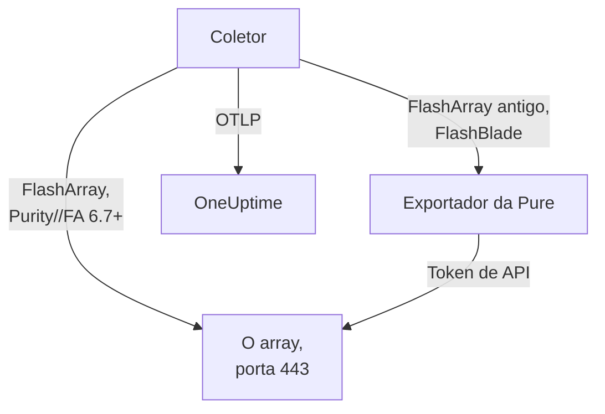

# Agente de arrays de armazenamento

O agente Storage Array do OneUptime monitora arrays de armazenamento: capacidade e redução de dados, latência, IOPS e largura de banda, volumes, hosts, pods e replicação, saúde do hardware, sistemas de arquivos e buckets. É um OpenTelemetry Collector padrão que coleta os endpoints OpenMetrics do array com o token de API de um usuário somente leitura, marca cada métrica com a identidade do seu array e a envia ao OneUptime. Os [monitores de arrays de armazenamento](/docs/monitor/storage-array-monitor) alertam sobre o que chega.

:::cards
- [Instalar o agente](#instale-o-agente): Um usuário somente leitura e depois o script de instalação ou o Docker Compose.
- [O que o agente coleta](#o-que-o-agente-coleta): Cada endpoint e as páginas construídas a partir dele.
- [Monitorar vários arrays](#monitorar-vários-arrays): Um agente por array, em uma só máquina.
- [Solução de problemas](#solução-de-problemas): Um script de diagnóstico, e os problemas mais comuns.
:::

## Como funciona

Storage Arrays é um produto que funciona do mesmo jeito para todo fabricante. Ele é compatível com:

| Array | Como o agente o lê | Configuração do coletor |
| --- | --- | --- |
| **Pure Storage FlashArray**, Purity//FA 6.7 e posteriores | O próprio endpoint OpenMetrics do array (`https://<array>/metrics/...?namespace=purefa`): nada roda ao lado do coletor | `otel-collector-config.yaml` (a padrão) |
| **Pure Storage FlashArray**, Purity//FA mais antigo | O exportador OpenMetrics de FlashArray da Pure, que o mesmo arquivo do Compose executa como o serviço `pure-fa-exporter` | `otel-collector-config.flasharray-exporter.yaml` |
| **Pure Storage FlashBlade** | O exportador OpenMetrics de FlashBlade da Pure, que o mesmo arquivo do Compose executa como o serviço `pure-fb-exporter` | `otel-collector-config.flashblade.yaml` |

A Pure Storage passou a se chamar **Everpure** em fevereiro de 2026. FlashArray, FlashBlade e Purity mantiveram os nomes, assim como as métricas `purefa_*` e `purefb_*`, então tudo nesta página vale para arrays vendidos com qualquer um dos dois nomes.



Um agente monitora um array: execute um agente por array (veja [Monitorar vários arrays](#monitorar-vários-arrays)). O array se registra com os primeiros dados, com o nome que o agente marca em cada métrica como `storage.array.name`.

## Antes de começar

- Docker Engine 20.10 ou mais recente com o plugin Docker Compose v2, em uma máquina que alcance a interface de gerenciamento do array por HTTPS (TCP 443).
- Uma conta de administrador no array, para criar um usuário com a função integrada **readonly** e um token de API para ele.
- Uma chave de ingestão. Crie uma em **Configurações do projeto → Telemetria e APM → Chaves de ingestão** e copie o valor.

### Onde executar o agente

O agente fala com a interface de gerenciamento do array por HTTPS, então pode rodar em qualquer máquina com Docker e uma rota para a rede de gerenciamento na TCP 443: um host de monitoramento ou uma pequena VM de gerenciamento. Prefira uma máquina cujo próprio armazenamento não fique no array que ela observa: se o array cair, o seu monitoramento não deve cair junto. O listener de syslog opcional também precisa que o array alcance o agente na porta de syslog (veja [Enviar o syslog do array](#opcional-enviar-o-syslog-do-array)).

## Instale o agente

:::steps
### Criar o usuário somente leitura e o token de API

O agente só lê. Dê a ele um usuário próprio com a função integrada **readonly**, nunca um administrador, e um token de API para esse usuário. Crie o token **sem data de expiração**, ou o agente para no dia em que o token expirar.

:::tabs
@tab Purity CLI
Conecte-se por SSH ao FlashArray como administrador. O primeiro comando pede a senha do novo usuário; o segundo imprime o token de API dele, um UUID:

```bash
pureadmin create --role readonly oneuptime
pureadmin create --api-token oneuptime
```
@tab FlashArray GUI
1. Abra _Settings → Users and Policies_ (_Settings → Access_ em versões mais antigas).
2. No menu ⋮ do painel **Users**, escolha **Create User…**, nomeie o usuário como `oneuptime` e dê a ele a função readonly.
3. No menu ⋮ do novo usuário, escolha **Create API Token…**, deixe **Expires In** vazio e copie o token.
@tab FlashBlade
Crie do mesmo jeito um usuário com a função **readonly** e um token de API para ele: nas configurações de usuário da GUI do FlashBlade ou com `pureadmin` na CLI do Purity//FB. Em uma versão sem usuários locais, use uma conta de um serviço de diretório (LDAP ou Active Directory) cujo grupo esteja mapeado para a função readonly. Os tokens de API do FlashBlade começam com `T-`.
:::

### Verificar se o FlashArray serve as próprias métricas

A Pure documenta o endpoint OpenMetrics nativo para **Purity//FA 6.7.0 e posteriores** (o aviso de descontinuação do exportador de FlashArray da Pure diz 6.6.11 e posteriores). O jeito mais rápido de saber é perguntar ao array, a partir da máquina em que o agente vai rodar:

```bash
curl -k 'https://<array>/metrics/array?namespace=purefa' --header 'Authorization: Bearer <api-token>' | grep purefa_info
```

Uma linha `purefa_info{...} 1` significa que o array serve as métricas de forma nativa: use a configuração padrão. Um `404` significa que não: use a configuração com exportador, que roda o exportador da Pure ao lado do coletor. A Pure descontinuou esse exportador, então passe para a configuração nativa assim que o array for atualizado. Um FlashBlade sempre passa pelo exportador de FlashBlade da Pure, então pule esta etapa nesse caso.

### Instale e inicie o agente

:::tabs
@tab install.sh
Baixe o script de instalação e execute-o na máquina que vai hospedar o agente:

```bash
curl -sSL https://raw.githubusercontent.com/OneUptime/oneuptime/master/agents/StorageArrayAgent/install.sh -o install.sh
bash install.sh
```

O script pergunta qual é o array (um FlashArray que serve métricas nativas, um FlashArray com Purity//FA mais antigo ou um FlashBlade) e depois pede a sua URL do OneUptime, a chave de ingestão, um nome para o array, o endereço de gerenciamento do array e o token de API do usuário somente leitura (lido sem eco). Ele instala em `/opt/oneuptime-storage-array-agent`, baixa o arquivo do Compose e as três configurações do coletor, grava um arquivo com permissão `0600` chamado `.env` com a configuração e o perfil do Compose correspondentes, e inicia o agente com o Docker Compose. Ele coloca cada valor entre aspas para o Docker Compose exatamente como você digitou. Executá-lo de novo reutiliza tudo o que está em um `.env` existente em vez de perguntar de novo, e guarda um arquivo que você editou como `<file>.bak.<timestamp>` antes de substituí-lo.
@tab Docker Compose
Baixe `docker-compose.yml` e os três arquivos `otel-collector-config*.yaml` do [diretório StorageArrayAgent](https://github.com/OneUptime/oneuptime/tree/master/agents/StorageArrayAgent) para uma pasta nova:

```bash
curl -fsSLO https://raw.githubusercontent.com/OneUptime/oneuptime/master/agents/StorageArrayAgent/docker-compose.yml
curl -fsSLO https://raw.githubusercontent.com/OneUptime/oneuptime/master/agents/StorageArrayAgent/otel-collector-config.yaml
curl -fsSLO https://raw.githubusercontent.com/OneUptime/oneuptime/master/agents/StorageArrayAgent/otel-collector-config.flasharray-exporter.yaml
curl -fsSLO https://raw.githubusercontent.com/OneUptime/oneuptime/master/agents/StorageArrayAgent/otel-collector-config.flashblade.yaml
```

Crie um arquivo `.env` ao lado deles. Ele guarda o token de API, então mantenha-o privado com `chmod 600 .env`. Para um FlashArray que serve métricas nativas:

```bash title=".env"
ONEUPTIME_URL=YOUR_ONEUPTIME_URL
ONEUPTIME_TELEMETRY_INGESTION_KEY=YOUR_TELEMETRY_INGESTION_TOKEN
STORAGE_ARRAY_NAME=my-storage-array
STORAGE_SYSTEM=purestorage.flasharray
STORAGE_ARRAY_COLLECTOR_CONFIG=otel-collector-config.yaml
COMPOSE_PROFILES=
PURE_FA_ENDPOINT=fa-prod-01.example.com
PURE_FA_API_TOKEN=YOUR_READ_ONLY_API_TOKEN
PURE_FB_ENDPOINT=
PURE_FB_API_TOKEN=
STORAGE_ARRAY_INSECURE_SKIP_VERIFY=true
```

Para um FlashArray com Purity//FA mais antigo, defina `STORAGE_ARRAY_COLLECTOR_CONFIG=otel-collector-config.flasharray-exporter.yaml` e `COMPOSE_PROFILES=flasharray-exporter`. Para um FlashBlade, defina `STORAGE_SYSTEM=purestorage.flashblade`, `STORAGE_ARRAY_COLLECTOR_CONFIG=otel-collector-config.flashblade.yaml` e `COMPOSE_PROFILES=flashblade`, e preencha `PURE_FB_ENDPOINT` e `PURE_FB_API_TOKEN` em vez do par `PURE_FA_*`. Inicie o agente:

```bash
docker compose up -d
```
:::

### Verifique se o agente está em execução

```bash
docker compose ps
docker logs -f oneuptime-storage-array-agent
```

`docker compose ps` lista o coletor (`oneuptime-storage-array-agent`) e, com uma configuração com exportador, o exportador (`pure-fa-exporter` ou `pure-fb-exporter`). Depois que o coletor iniciar, os logs dele devem mostrar esta linha:

```text
Everything is ready. Begin running and processing data.
```

### Encontrar o array no OneUptime

Abra **Produtos → Infraestrutura → Storage Arrays → All Storage Arrays**. Depois da primeira coleta (cerca de um minuto), o array está lá com a capacidade, o desempenho, os alertas abertos e o hardware dele. Volumes, hosts e pods vêm em até 2 minutos, os sistemas de arquivos e buckets de um FlashBlade em até 5, e os diretórios do FlashArray em até 30.
:::

## Variáveis de ambiente

O script de instalação grava estes valores em `/opt/oneuptime-storage-array-agent/.env`; uma instalação com o Docker Compose os lê do `.env` ao lado de `docker-compose.yml`. Depois de mudar um deles, execute `docker compose up -d` nessa pasta.

| Variável | Obrigatória | Descrição |
| --- | --- | --- |
| `ONEUPTIME_URL` | Sim | A sua URL do OneUptime, como `https://oneuptime.com` ou a sua instância auto-hospedada. Use `http://` e a porta dela se a instância for só HTTP. |
| `ONEUPTIME_TELEMETRY_INGESTION_KEY` | Sim | A chave de ingestão de **Configurações do projeto → Telemetria e APM → Chaves de ingestão**. |
| `STORAGE_ARRAY_NAME` | Sim | O nome com que o array se registra no OneUptime, marcado em cada métrica como o atributo de recurso `storage.array.name`. Mantenha-o estável: mudá-lo depois registra um segundo array. O coletor se recusa a iniciar sem ele. |
| `STORAGE_SYSTEM` | Não | A plataforma, marcada como o atributo de recurso `storage.system`: `purestorage.flasharray` ou `purestorage.flashblade`. O padrão é `purestorage.flasharray`. |
| `STORAGE_ARRAY_COLLECTOR_CONFIG` | Não | Qual configuração do coletor incluída roda: `otel-collector-config.yaml` (FlashArray, nativa: a padrão), `otel-collector-config.flasharray-exporter.yaml` (FlashArray mais antigo) ou `otel-collector-config.flashblade.yaml` (FlashBlade). |
| `COMPOSE_PROFILES` | Não | Inicia o exportador que a configuração escolhida coleta: vazio para a configuração nativa do FlashArray, `flasharray-exporter` ou `flashblade` para as outras duas. |
| `PURE_FA_ENDPOINT` | FlashArray | O endereço de gerenciamento do FlashArray: um nome de host ou IP, sem `https://`. |
| `PURE_FA_API_TOKEN` | FlashArray | O token de API do usuário do FlashArray com a função readonly. |
| `PURE_FB_ENDPOINT` | FlashBlade | O endereço de gerenciamento do FlashBlade: um nome de host ou IP, sem `https://`. |
| `PURE_FB_API_TOKEN` | FlashBlade | O token de API do usuário do FlashBlade com a função readonly. |
| `STORAGE_ARRAY_INSECURE_SKIP_VERIFY` | Não | `true` aceita o certificado autoassinado do array no endpoint nativo; `false` o verifica. O padrão é `true`. Os exportadores da Pure nunca verificam o certificado do array, então isso não se aplica a eles. |

## Como o agente coleta

- **Um job de coleta por endpoint, cada um lido com a frequência que vale a pena.** FlashArray: `/metrics/array` a cada 60 segundos; `/metrics/volumes`, `/metrics/hosts` e `/metrics/pods` a cada 2 minutos; `/metrics/directories` a cada 30 minutos, que é o que a própria Pure recomenda, já que calcular o espaço dos diretórios é caro para o array. FlashBlade: `/metrics/array` a cada 60 segundos; `/metrics/filesystems` e `/metrics/objectstore` a cada 5 minutos, de novo seguindo o conselho da Pure de ler os endpoints de sistemas de arquivos e do armazenamento de objetos com menos frequência que o array.
- **Cada job rotula as séries com `scrape_endpoint: <endpoint>`.** Cada endpoint também exporta `purefa_info` ou `purefb_info`, então o OneUptime sabe de quais famílias um lote é a lista completa: é assim que um volume, host, pod, sistema de arquivos ou bucket excluído sai do inventário em vez de ficar parado lá. Mantenha os rótulos como vêm.
- **A latência por volume e por host mantém três dimensões.** Cada volume e cada host exporta a latência em até dezesseis `dimension`. Uma regra `metric_relabel_configs` mantém `usec_per_read_op`, `usec_per_write_op` e `usec_per_mirrored_write_op` e descarta o detalhamento por limite de taxa de QoS, fila, SAN e tempo de serviço, que multiplica as séries de um array grande. O detalhamento do array inteiro em `purefa_array_performance_latency_usec` é mantido. Exclua a regra para manter também o detalhamento por volume.
- **O token de API é um token Bearer.** A configuração nativa o envia ao próprio array; as configurações com exportador o enviam ao exportador só pela rede do Compose, e as portas dos exportadores nunca são publicadas.
- **Sem `send_batch_max_size`.** O OneUptime reconstrói o inventário a partir de uma coleta inteira por requisição, então o processador `batch` incluído nunca divide uma coleta entre exportações. Mantenha as configurações de batch como vêm.

## O que o agente coleta

As convenções semânticas da Pure são comuns ao endpoint nativo do FlashArray e aos dois exportadores. Cada valor é um gauge que o próprio array calcula (latências em microssegundos por operação, vazão por segundo), então não há taxas a calcular, e os objetos são nomeados por **rótulos de ponto de dados**: `name` para volumes, pods, diretórios, sistemas de arquivos e buckets, `host` para hosts, `component_name` para o hardware do FlashArray. O agente acrescenta os atributos de recurso `storage.array.name` e `storage.system`, então o OneUptime arquiva tudo sob o seu array:

| Endpoint | Famílias de métricas | O que o OneUptime constrói com elas |
| --- | --- | --- |
| FlashArray `/metrics/array` | `purefa_info`, `purefa_alerts_open`, `purefa_array_space_*`, `purefa_array_performance_*`, `purefa_hw_component_status`, `purefa_hw_component_temperature_celsius`, `purefa_hw_controller_info`, `purefa_drive_capacity_bytes`, `purefa_network_interface_*` | O nome, a versão do Purity e o ID de sistema do array; capacidade, espaço usado e redução de dados; contagem de alertas abertos; a saúde do array; a página **Hardware** (componentes, unidades, controladoras, interfaces de rede) |
| FlashArray `/metrics/volumes` | `purefa_volume_performance_*`, `purefa_volume_space_*`, `purefa_volume_qos_*` | A página **Volumes**: tamanho provisionado e físico, redução de dados, latência de leitura e gravação, IOPS e largura de banda por volume |
| FlashArray `/metrics/hosts` | `purefa_host_connectivity_info`, `purefa_host_connections_info`, `purefa_host_performance_*`, `purefa_host_space_*` | A página **Hosts**: conectividade (caminhos redundantes ou não), volumes conectados, latência, IOPS e largura de banda por host |
| FlashArray `/metrics/pods` | `purefa_pod_performance_*`, `purefa_pod_space_*`, `purefa_pod_replica_links_*`, `purefa_pod_mediator_status` | A página **Replication**: pods ActiveCluster e ActiveDR, status e atraso dos links de réplica |
| FlashArray `/metrics/directories` | `purefa_directory_performance_*`, `purefa_directory_space_*` | A página **Directories** (FlashArray File Services) |
| FlashBlade `/metrics/array` | `purefb_info`, `purefb_alerts_open`, `purefb_array_space_*`, `purefb_array_performance_*`, `purefb_hardware_health` | O nome, a versão do Purity e o ID de sistema do FlashBlade; capacidade e redução de dados; contagem de alertas abertos; a saúde do array; a página **Hardware** |
| FlashBlade `/metrics/filesystems` | `purefb_file_systems_space_*`, `purefb_file_systems_performance_*` | A página **File Systems**: espaço provisionado e usado, redução de dados, latência, IOPS e largura de banda por sistema de arquivos |
| FlashBlade `/metrics/objectstore` | `purefb_buckets_space_*`, `purefb_buckets_quota_space_bytes`, `purefb_buckets_object_count`, `purefb_buckets_performance_*`, `purefb_object_store_accounts_*` | A página **Buckets**: espaço, cota, contagem de objetos e desempenho por bucket, agrupados por conta |

A saúde do array na página **Visão geral** dele é **Crítico** enquanto ele informa um alerta crítico aberto, ou um componente de hardware, unidade ou controladora crítico, com falha, ausente ou não íntegro; **Warning** enquanto informa um alerta de aviso aberto, ou um componente degradado ou desconhecido; e **OK** nos demais casos. Nos critérios de monitor, os atributos do array levam um prefixo `resource.` (`resource.storage.array.name`, `resource.storage.system`), enquanto os rótulos de ponto de dados ficam sem prefixo (`name`, `host`, `dimension`, `space`).

## Opcional — Enviar o syslog do array

Por padrão, o agente envia só métricas, então a página **Registros** do array fica vazia. Os arrays encaminham seus alertas e eventos de auditoria como syslog, e cada configuração do coletor incluída tem um par de receivers `syslog` comentado (TCP e UDP na porta 5514, RFC 3164), ligado a um pipeline `logs` comentado que marca `storage.array.name` para os logs chegarem ao seu array.

:::steps
### Ativar os receivers

Descomente os dois receivers `syslog/*` e o pipeline `logs` na configuração do coletor que você usa. Os timestamps do RFC 3164 não trazem fuso horário: defina `location` com o fuso horário do array, a menos que o relógio dele esteja em UTC.

### Abrir a porta

Descomente o bloco `ports:` em `docker-compose.yml` para a máquina publicar `5514/tcp` e `5514/udp`, e depois execute `docker compose up -d`. Abra a porta no firewall da máquina para a rede de gerenciamento do array.

### Apontar o array para o agente

Faça isso como administrador, não como o usuário de monitoramento somente leitura. Em um FlashArray, abra _Settings → System → Syslog Servers_, adicione `udp://<agent-host>:5514` (ou `tcp://<agent-host>:5514`) e envie uma mensagem de teste. Em um FlashBlade, adicione um servidor de syslog com a mesma URI nas configurações de syslog dele. Os dois arrays aceitam a forma `PROTOCOL://HOST:PORT`, também pelas APIs REST deles (`syslog-servers`).
:::

Um receiver de syslog escuta em um só transporte, e é por isso que TCP e UDP são dois receivers: deixe um comentado se você só precisa do outro. A imagem padrão do coletor lê o syslog como ele vem: nenhuma imagem personalizada é necessária.

## Marcar o array com rótulos do projeto

Um atributo de recurso que começa com `oneuptime.label.` vira um rótulo do projeto no array de armazenamento: `oneuptime.label.<dimension>=<value>` é o rótulo `<dimension>:<value>`. Adicione os atributos ao processador `resource` na configuração do coletor que você usa, ao lado de `storage.array.name`:

```yaml
processors:
  resource:
    attributes:
      # ...existing attributes...
      - key: oneuptime.label.team
        value: storage
        action: upsert
      - key: oneuptime.label.env
        value: production
        action: upsert
```

O coletor só lê a configuração quando inicia: execute `docker compose restart oneuptime-storage-array-agent`. O array passa então a mostrar os rótulos `team:storage` e `env:production`. Os rótulos são comparados sem diferenciar maiúsculas e minúsculas, então um rótulo `Production` existente é reutilizado em vez de duplicado, e o agente nunca remove um rótulo que alguém adicionou no OneUptime.

## Monitorar vários arrays

Um agente lê um array. Para monitorar vários a partir da mesma máquina, instale cada um na própria pasta com o próprio `.env`, como `INSTALL_DIR=/opt/oneuptime-storage-array-agent-fa02 bash install.sh`, e dê a cada um o próprio `container_name` no `docker-compose.yml` dele (como `oneuptime-storage-array-agent-fa02`): dois contêineres não podem compartilhar um nome. Passe a pasta ao script de diagnóstico com `-d`.

## Execute como um serviço do systemd

Para iniciar o agente junto com a máquina e reiniciá-lo quando falhar, instale a unidade do systemd dele. Ela supõe que o agente fica em `/opt/oneuptime-storage-array-agent`, onde o script de instalação o coloca:

```bash
sudo curl -fsSL https://raw.githubusercontent.com/OneUptime/oneuptime/master/agents/StorageArrayAgent/systemd/oneuptime-storage-array-agent.service -o /etc/systemd/system/oneuptime-storage-array-agent.service
sudo systemctl daemon-reload
sudo systemctl enable --now oneuptime-storage-array-agent
```

## Atualizando o agente

O agente informa como **Versão do agente** a versão do coletor que os arquivos dele fixam. Quando ela é mais antiga que a versão que esta versão do OneUptime fixa, um sinal de aviso aparece ao lado dela na página **Visão geral** do array. Selecione-o para ver estes comandos. Um agente instalado antes de os arquivos dele informarem uma versão não mostra nenhuma até ser atualizado dessa forma.

A imagem do coletor está fixada em `docker-compose.yml`, e as configurações dele são arquivos ao lado, então só baixar as imagens não faz o agente avançar. Execute `install.sh` de novo: ele reutiliza todos os valores do seu `.env` atual (nada é perguntado de novo), renova `docker-compose.yml` e as três configurações do coletor (um arquivo que você editou é guardado como `<file>.bak.<timestamp>`) e recria o agente para que o coletor leia a nova configuração. Um agente instalado fora de `/opt/oneuptime-storage-array-agent` precisa da pasta dele: `INSTALL_DIR=<folder> bash install.sh`.

```bash
curl -sSL https://raw.githubusercontent.com/OneUptime/oneuptime/master/agents/StorageArrayAgent/install.sh -o install.sh
bash install.sh
```

Instalou com o Docker Compose? Na pasta do agente, baixe de novo o arquivo do Compose e as três configurações do coletor (e refaça qualquer alteração que você tenha feito neles), depois baixe as imagens e recrie o agente:

```bash
curl -fsSLO https://raw.githubusercontent.com/OneUptime/oneuptime/master/agents/StorageArrayAgent/docker-compose.yml
curl -fsSLO https://raw.githubusercontent.com/OneUptime/oneuptime/master/agents/StorageArrayAgent/otel-collector-config.yaml
curl -fsSLO https://raw.githubusercontent.com/OneUptime/oneuptime/master/agents/StorageArrayAgent/otel-collector-config.flasharray-exporter.yaml
curl -fsSLO https://raw.githubusercontent.com/OneUptime/oneuptime/master/agents/StorageArrayAgent/otel-collector-config.flashblade.yaml
docker compose pull
docker compose up -d --force-recreate
```

## Desinstalando o agente

```bash
cd /opt/oneuptime-storage-array-agent
docker compose down
```

Depois exclua o usuário somente leitura e o token de API dele no array, se não precisar mais deles.

## Solução de problemas

:::details Execute primeiro o script de diagnóstico
O agente vem com um script, [`troubleshoot.sh`](https://github.com/OneUptime/oneuptime/blob/master/agents/StorageArrayAgent/troubleshoot.sh), que verifica a cadeia inteira: o runtime de contêineres; o endpoint do array exatamente como o coletor o alcança (o endpoint nativo ou o exportador da Pure: DNS, TLS, se um FlashArray tem mesmo o endpoint nativo e se o array aceita o token de API, que o script entrega ao curl pelo stdin); o nome do array marcado em cada métrica; o formato do token; as métricas do próprio coletor; e se o OneUptime aceita a chave de ingestão. Essa última verificação é a que mais importa. O OneUptime recusa uma chave inválida com `401` (`422` para uma chave desativada ou uma chave de navegador), e o coletor trata os dois como permanentes: ele descarta o lote e registra um único erro `Exporting failed`, fácil de passar despercebido enquanto o contêiner continua saudável. O script consulta `GET <url>/otlp/v1/validate` de dentro da rede do agente para obter direto um `200` (válida) ou `401` (inválida), e recorre a `POST /fluentd/v1/logs` em servidores mais antigos.

```bash
curl -sSL https://raw.githubusercontent.com/OneUptime/oneuptime/master/agents/StorageArrayAgent/troubleshoot.sh -o troubleshoot.sh
bash troubleshoot.sh    # add -d <dir> if you installed outside /opt/oneuptime-storage-array-agent
```

Ele termina com um veredito que cita a causa mais provável.
:::

:::details Nenhum array aparece no OneUptime
1. Leia os logs do coletor: `docker logs oneuptime-storage-array-agent`. `server returned HTTP status 401` significa que o array recusou o token de API, `404` que o FlashArray não tem endpoint nativo, `x509` que a verificação TLS está ativada diante do certificado autoassinado do array, `no such host` ou `connection refused` um `PURE_FA_ENDPOINT` ou `PURE_FB_ENDPOINT` errado, e um `401` na exportação uma chave de ingestão inválida.
2. Pergunte ao array a partir da rede do agente. A imagem do coletor não tem shell nem curl, então pergunte a partir de um contêiner na rede dele: `docker run --rm --network container:oneuptime-storage-array-agent curlimages/curl -sk -H 'Authorization: Bearer <api-token>' 'https://<array>/metrics/array?namespace=purefa'` deve imprimir linhas `purefa_*`.
3. Verifique se `STORAGE_ARRAY_NAME` está definido: o array é encontrado pelo atributo de recurso `storage.array.name` dele, e o coletor se recusa a iniciar sem ele.
:::

:::details O array aparece como desconectado
Um array passa a desconectado quando o OneUptime não recebe nada dele por 15 minutos; o OneUptime verifica a cada 5 minutos, e o tempo em que ele mesmo não estava recebendo dados não conta. Verifique se o coletor está rodando (`docker compose ps`), se os logs dele não mostram erros de coleta ou de exportação e se a máquina ainda alcança o array e a sua URL do OneUptime. O array volta a ficar conectado com os próximos dados.
:::

:::details O FlashArray responde 404
O Purity//FA dele não tem endpoint OpenMetrics nativo. Execute `install.sh` de novo e escolha a opção de Purity mais antigo, ou defina `STORAGE_ARRAY_COLLECTOR_CONFIG=otel-collector-config.flasharray-exporter.yaml` e `COMPOSE_PROFILES=flasharray-exporter` em `.env` e execute `docker compose up -d`. Depois de atualizar o array para o Purity//FA 6.7 ou mais recente, volte à configuração nativa e remova o perfil.
:::

:::details O array recusa o token de API
Verifique se você colou o token de API, e não a senha do usuário; se o usuário ainda existe e tem a função readonly; e se o token não expirou. Crie um token novo (`pureadmin create --api-token oneuptime` em um FlashArray), coloque-o em `.env` e execute `docker compose up -d`. Pelos exportadores da Pure, um token recusado aparece no log do coletor como um HTTP `400` do exportador, cujo corpo diz `failed to login`.
:::

:::details Erros de x509 ou TLS
Por padrão, os arrays apresentam um certificado autoassinado, em que nenhuma imagem Docker confia. Ou defina `STORAGE_ARRAY_INSECURE_SKIP_VERIFY=true` (a escolha prática em uma rede de gerenciamento privada), ou instale no array um certificado de uma CA em que a imagem do coletor confie.
:::

:::details pure-fa-exporter ou pure-fb-exporter não resolve
O exportador não está rodando: `COMPOSE_PROFILES` precisa corresponder a `STORAGE_ARRAY_COLLECTOR_CONFIG` (`flasharray-exporter` para a configuração com o exportador de FlashArray, `flashblade` para a configuração de FlashBlade). Corrija `.env` e execute `docker compose up -d`; `docker compose ps` passa então a listar o exportador.
:::

:::details Volumes ou hosts excluídos continuam no inventário
O OneUptime remove um objeto quando uma coleta completa do endpoint dele não o contém mais, o que ele reconhece pelo rótulo `scrape_endpoint`. Se você substituiu a configuração do coletor incluída pela sua, mantenha os rótulos `scrape_endpoint` nos jobs de coleta dela; senão, os objetos só saem do inventário quando ficam desatualizados.
:::

:::details As métricas caem no array errado
O OneUptime registra um array de armazenamento pelo `storage.array.name` dele, que o agente tira de `STORAGE_ARRAY_NAME`. Mudá-lo depois dos primeiros dados cria um segundo array em vez de renomear o primeiro.
:::

:::details Enviar métricas sem o agente
O agente é uma única configuração padrão do coletor, então os coletores que você já roda podem fazer o mesmo trabalho: copie os jobs de coleta e o processador `resource` da configuração incluída para a sua. O atributo de recurso `storage.array.name` é o que registra o array no OneUptime, e as remoções de `service.name` / `service.instance.id` evitam que os dados sejam arquivados sob um serviço: mantenha os dois, e mantenha os rótulos `scrape_endpoint`.
:::

## Próximos passos

:::cards
- [Monitor de arrays de armazenamento](/docs/monitor/storage-array-monitor): Alertas sobre alertas, capacidade, latência, hardware, caminhos de host, replicação e sistemas de arquivos.
- [Agente VMware](/docs/telemetry/vmware): Roda VMware no array? Veja também os datastores e as VMs dele.
- [Coletor OpenTelemetry no host](/docs/telemetry/host-otel-collector): A visão do sistema operacional das máquinas que usam o array.
:::
