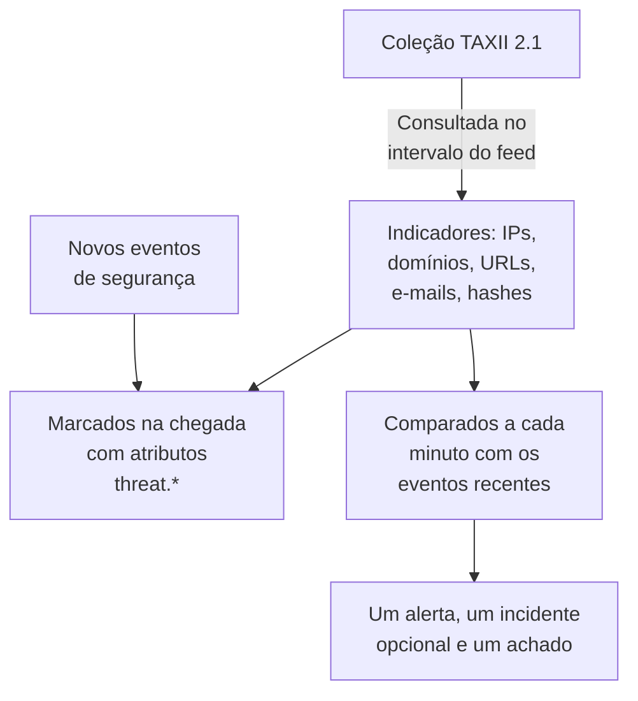

# Inteligência de ameaças (STIX/TAXII)

Um feed de inteligência de ameaças traz para o OneUptime endereços IP, domínios, URLs, endereços de e-mail e hashes de arquivos maliciosos conhecidos, e avisa você quando os seus [eventos de segurança](/docs/telemetry/security-events) mencionam um deles. Cada feed assina uma coleção TAXII 2.1 de indicadores STIX 2.1: o seu próprio servidor MISP, OpenCTI ou OpenTAXII, ou a coleção de um fornecedor. O OneUptime não traz conteúdo de feeds próprio: você traz as coleções, assim como traz as regras Sigma.

:::cards
- [Assine um feed](#assine-um-feed): Um servidor TAXII, uma coleção e a forma de fazer login.
- [O que é ingerido](#o-que-é-ingerido): Os padrões de indicador que o OneUptime guarda, e por quanto tempo.
- [Como as correspondências são encontradas](#como-as-correspondências-são-encontradas): Marcadas na chegada dos eventos e comparadas a cada minuto.
- [Níveis de ameaça](#níveis-de-ameaça): Como a confiança de um indicador vira uma gravidade.
:::

## Como funciona



## Antes de começar

- Um servidor TAXII 2.1 que publique objetos STIX 2.1 do tipo `indicator`, e o ID da coleção a consultar. Um feed faz login de forma anônima, com um token bearer ou com autenticação HTTP básica.
- Servidores que exigem um certificado de cliente TLS (TLS mútuo), como o CISA AIS, não são suportados. O servidor ATT&CK público da MITRE publica técnicas e grupos em vez de indicadores, então um feed apontado para ele fica vazio.
- Um papel que possa criar feeds: Project Owner, Project Admin, Security Admin ou Security Member. Security Viewer pode ler feeds e indicadores. Veja [Papéis](/docs/permissions/reference#funções).

## Assine um feed

:::steps
### Abra Threat Intel

Abra **Produtos → Security Events → Threat Intel**.

### Crie o feed

Clique em **Criar: Threat Intel Feed** e preencha as quatro etapas dele: **Informações básicas**, **TAXII Server**, **Autenticação** e **Ao corresponder**. Os campos estão na tabela abaixo.

### Confira a primeira consulta

Em um ou dois minutos, a linha do feed mostra **Last Polled**, e **Last Poll Summary** diz o que a consulta trouxe. Os indicadores aparecem na tabela **Indicators**, abaixo dos feeds.
:::

| Campo | O que informar |
| --- | --- |
| **TAXII API Root URL** | A raiz da API TAXII 2.1 do servidor, como `https://taxii.example.com/api1/`. As coleções ficam endereçadas abaixo dela. |
| **Collection ID** | A coleção que publica os indicadores. |
| **Poll Interval (Minutes)** | Com que frequência buscar objetos novos: de 1 a 1440 minutos, 60 por padrão. |
| **Minimum Confidence** | Os indicadores com uma `confidence` STIX menor são ignorados: de 0 a 100, e 0 guarda tudo. Indicadores sem confiança sempre passam. |
| **API Token** | Um token bearer, para uma coleção que peça um. |
| **Basic Auth Username** e **Basic Auth Password** | Para uma coleção que use autenticação HTTP básica. Deixe os dois e o token vazios para uma coleção pública. |
| **Create Alert on Match** | Ativado por padrão: cada indicador correspondente abre um alerta. |
| **Severidade do alerta** | A severidade de cada alerta que este feed abre. Deixe vazio para usar o nível de ameaça de cada indicador. |
| **Create Incident on Match** | Desativado por padrão. Os incidentes acionam o escalonamento de plantão, os SLAs e as páginas de status, e para correspondências de indicadores os alertas costumam bastar. |
| **Severidade do incidente** | Como **Severidade do alerta**, para incidentes. |
| **Write Detection Finding on Match** | Ativado por padrão: cada correspondência grava um achado no fluxo de eventos. |

Tokens e senhas são criptografados e nunca mais são exibidos depois de salvos. Para trocá-los, escolha **Update Credentials** na linha do feed e depois **API Token (Bearer)**, **Basic Auth** ou **Anonymous (clear stored credentials)**: a sua escolha substitui o login do feed, então salvar um token apaga uma senha salva, e vice-versa.

### Como um feed é consultado

Cada consulta pede os objetos adicionados desde a anterior, pelo cursor TAXII `added_after`, e lê até 10 páginas de 500 objetos. Uma coleção grande, portanto, sincroniza ao longo de várias consultas: **Last Poll Summary** diz quando ainda há páginas. Para terminar mais cedo uma grande primeira sincronização, diminua o **Poll Interval (Minutes)**, até 1, até ela se atualizar.

As consultas se identificam com o user agent `OneUptime/<version> (+https://oneuptime.com)`. Se o firewall do fornecedor responder `403`, peça a ele que o permita: muitos firewalls bloqueiam requisições que parecem um script sem nome.

Um feed desativado não é consultado nem comparado. Os indicadores que ele já tem continuam marcando eventos novos até expirarem.

## O que é ingerido

O OneUptime guarda os objetos STIX do tipo `indicator` cujo padrão é uma igualdade simples sobre um destes tipos:

| Tipo | Padrão de exemplo |
| --- | --- |
| Endereço IPv4 (`ipv4-addr`) | `[ipv4-addr:value = '198.51.100.7']` |
| Endereço IPv6 (`ipv6-addr`) | `[ipv6-addr:value = '2001:db8::7']` |
| Nome de domínio (`domain-name`) | `[domain-name:value = 'evil.example']` |
| URL (`url`) | `[url:value = 'http://evil.example/payload']` |
| Endereço de e-mail (`email-addr`) | `[email-addr:value = 'billing@evil.example']` |
| Hash de arquivo, SHA-256 (`file-hash-sha256`) | `[file:hashes.'SHA-256' = 'e3b0…b855']` |
| Hash de arquivo, SHA-1 (`file-hash-sha1`) | `[file:hashes.'SHA-1' = 'da39…0709']` |
| Hash de arquivo, MD5 (`file-hash-md5`) | `[file:hashes.MD5 = 'd41d…427e']` |

Comparações unidas com `OR`, dentro de um `[...]` ou entre vários, servem, e cada valor vira um indicador próprio:

```text
[domain-name:value = 'evil.example' OR domain-name:value = 'evil2.example']
[ipv4-addr:value = '198.51.100.7'] OR [url:value = 'http://evil.example/x']
```

Qualquer outro padrão, com `AND`, `FOLLOWEDBY`, `NOT`, `LIKE`, `MATCHES`, um qualificador de tempo como `WITHIN` ou outro tipo de objeto, é ignorado por inteiro e contado como não suportado em **Last Poll Summary**. Traduzir só uma parte de um padrão `AND` corresponderia a muito mais do que o autor do feed pretendia.

### Por quanto tempo um indicador fica ativo

- Um indicador corresponde do seu `valid_from` até o seu `valid_until`. Sem `valid_until`, ele fica ativo por 365 dias a partir de `valid_from`, e consultá-lo de novo não estende isso.
- Um indicador revogado, ou atualizado com um `valid_until` no passado, deixa de corresponder assim que a atualização é consultada. O mesmo vale para um valor que o fornecedor tira de um padrão atualizado.
- Os valores são guardados em minúsculas e comparados sem diferenciar maiúsculas.

A tabela **Indicators** lista os indicadores como estão guardados, com um **Status** de **Ativo**, **Expirado** ou **Revoked**. Um indicador consultado de novo pode aparecer duas vezes por um tempo, e uma linha expirada ou revogada continua listada até a limpeza do armazenamento removê-la, até cerca de um mês depois de expirar. A comparação sempre verifica validade e revogação, então uma linha assim nunca corresponde.

## Como as correspondências são encontradas

### Marcados na chegada

Cada evento de segurança que chega, pela API de ingestão ou por uma conexão, é comparado com os seus indicadores ativos antes de ser salvo. Quando um dos observables dele (os IPs, hosts, domínios, hashes e usuários extraídos do evento) é igual ao valor de um indicador, o evento recebe estes atributos:

| Atributo | Valor |
| --- | --- |
| `threat.matched` | Sempre `"true"` em um evento marcado |
| `threat.indicator_id` | O ID do indicador STIX |
| `threat.indicator_type` | O tipo do indicador, como `ipv4-addr` ou `file-hash-sha256` |
| `threat.indicator_value` | O valor correspondente, em minúsculas |
| `threat.feed` / `threat.feed_id` | O feed de onde veio o indicador |
| `threat.confidence` | A confiança STIX do indicador |
| `threat.match_count` | Quantos observables do evento corresponderam a um indicador |

Quando vários indicadores correspondem a um evento, o de maior confiança preenche esses valores. Eles são atributos comuns, então você pode pesquisá-los em **Eventos**, filtrar com eles os monitores de eventos de segurança e usá-los em regras de detecção:

```yaml title="threat-intel-logon.yml"
title: High-confidence indicator in a successful logon
level: critical
detection:
  selection:
    threat.matched: 'true'
    threat.confidence|gte: 80
    className: Authentication
    statusName: Success
  condition: selection
```

A marcação só conhece os indicadores que existem quando um evento chega: os eventos nunca são marcados de novo depois.

### Comparados a cada minuto

A cada minuto, os indicadores ativos de cada feed habilitado são comparados com os eventos cujo horário do evento cai desde a verificação anterior do feed. Isso pega a inteligência que chegou depois que um evento foi marcado.

- A primeira verificação cobre os últimos 15 minutos. Depois de uma queda, a próxima verificação recupera no máximo as últimas 24 horas.
- Cada janela é verificada uma vez. A inteligência que chega depois que a janela dela foi verificada só vale para eventos posteriores.
- Um evento que chega atrasado, com um horário anterior à verificação anterior, ainda é marcado na chegada, mas não é comparado.
- Cada verificação compara no máximo 100 valores de indicador por feed: os vistos no maior número de eventos.

### O que uma correspondência faz

- Um alerta, com o título `[Threat Intel] <feed name> — <indicator value>`, um por feed e valor enquanto estiver aberto. Depois de resolvido, a próxima correspondência abre um novo. Os alertas não são resolvidos automaticamente.
- Um incidente, só com **Create Incident on Match**, deduplicado da mesma forma.
- Um achado de inteligência de ameaças, com **Write Detection Finding on Match**: um evento `Detection Finding` (classe OCSF 2004) do produto `OneUptime Threat Intel`, com o nível de ameaça do indicador como gravidade e estes atributos:

| Atributo | Valor |
| --- | --- |
| `oneuptime.threat.feed_id` / `oneuptime.threat.feed_name` | O feed |
| `oneuptime.threat.indicator_id` | O ID do indicador STIX |
| `oneuptime.threat.indicator_type` / `oneuptime.threat.indicator_value` | O que correspondeu |
| `oneuptime.threat.confidence` | A confiança do indicador |
| `oneuptime.threat.match_count` | Quantos eventos estão por trás deste achado |

Os próprios achados nunca são comparados, então uma correspondência não pode disparar outra.

## Níveis de ameaça

Os indicadores não têm nível Sigma: a `confidence` STIX deles define um nível de ameaça.

| Confiança do indicador | Nível de ameaça |
| --- | --- |
| De 90 a 100 | Critical |
| De 70 a 89 | High |
| De 40 a 69 | Medium |
| De 1 a 39 | Low |
| Sem pontuação (0 ou ausente) | Medium |

Um indicador sem pontuação conta como Medium: alguém ainda assim escolheu colocá-lo em um feed. O nível de ameaça é a gravidade do achado, e escolhe a severidade do alerta entre as severidades do seu projeto, nesta ordem:

1. A **Severidade do alerta** (ou **Severidade do incidente**) do feed, quando definida: ela vale para cada correspondência do feed.
2. A sua severidade com o nome do nível de ameaça, como High, sem diferenciar maiúsculas.
3. Por posição: Critical e High recebem a sua severidade mais alta, Medium e Low a mais baixa.

O nível de ameaça pertence a cada indicador, não ao feed, então um mesmo feed pode abrir um alerta Critical e um Low no mesmo minuto. **Minimum Confidence** filtra pelo mesmo número: um mínimo de 70 guarda só os indicadores High e Critical, mais os sem pontuação, que sempre passam.

## Vigie as correspondências de um feed

A ação **Criar monitor** na linha de um feed abre um novo monitor de eventos de segurança que conta os achados do feed: classe de evento `Detection Finding`, filtrada pelo ID do feed em `oneuptime.threat.feed_id` (nunca pelo nome dele, que uma renomeação mudaria), na última hora. Use-o para uma rajada repentina de correspondências, ou para um feed normalmente movimentado que fica em silêncio.

## Retenção e cobrança

Os indicadores são configuração, não telemetria, e não são cobrados como dados ingeridos. Os achados que uma correspondência grava são eventos de segurança comuns, cobrados e mantidos como o resto: veja [Eventos de segurança](/docs/telemetry/security-events#retenção-e-cobrança).

## Solução de problemas

:::details Last Error aparece preenchido depois de uma consulta
`401` ou `403`: as credenciais estão erradas ou faltando; substitua-as com **Update Credentials**. Um `403` também pode ser o firewall do fornecedor bloqueando o user agent. `404`: confira a **TAXII API Root URL**, que costuma terminar em um caminho como `/api1/`, e o **Collection ID**. O erro some na próxima consulta bem-sucedida.
:::

:::details O feed é consultado, mas nenhum indicador aparece
Leia **Last Poll Summary**. Nenhum objeto trazido: a coleção está vazia ou não publica indicadores. Padrões não suportados: o fornecedor usa recursos de padrão que esta página lista como ignorados. Abaixo da confiança mínima: diminua a **Minimum Confidence**. Já inativos: o fornecedor enviou indicadores que já estavam revogados ou expirados.
:::

:::details Há indicadores, mas nada corresponde
A comparação confronta o valor de um indicador com os observables de um evento, não com cada campo: abra em **Eventos** um evento que você esperava que correspondesse e confira se os observables dele contêm o valor. Só correspondem os indicadores com o status **Ativo**. Confira **Last Match Error** no feed.
:::

:::details Uma correspondência não abriu um alerta
**Create Alert on Match** está desativado, ou ainda há um alerta aberto para o mesmo feed e valor, e as correspondências seguintes entram nele. Um projeto precisa de pelo menos uma severidade de alerta para que um feed abra alertas.
:::

## Próximos passos

:::cards
- [Eventos de segurança](/docs/telemetry/security-events): Envie eventos, pesquise-os e escreva regras de detecção.
- [Google SecOps](/docs/integrations/google-secops): Traga as detecções e os eventos do Chronicle.
- [Referência de permissões](/docs/permissions/reference): Os papéis de segurança, e o que cada um pode fazer.
:::
