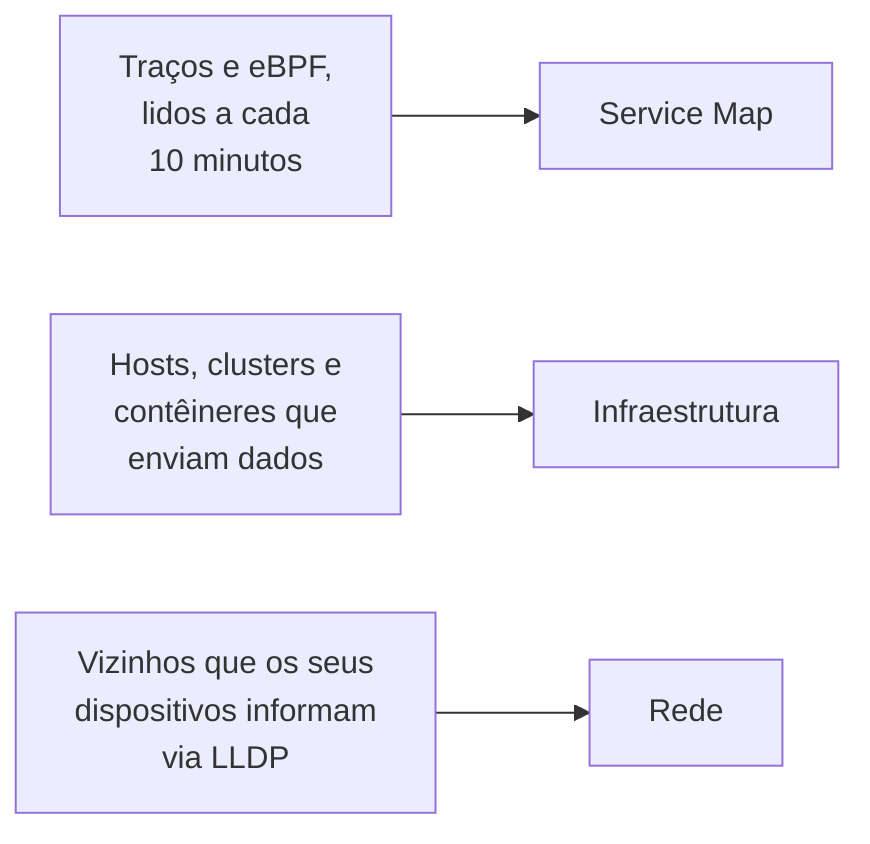

# Topologia

A topologia desenha como os seus sistemas se conectam: quais serviços chamam quais, o que roda onde e como os seus dispositivos de rede estão cabeados. O OneUptime a constrói a partir da telemetria que você já envia, então não há nada para desenhar à mão, e ela mostra de relance onde estão os erros e os incidentes.

:::cards
- [Abrir a topologia](#abrir-a-topologia): Três visões de uma mesma página.
- [Ler o mapa de serviços](#ler-o-mapa-de-serviços): Quem chama quem, e quão saudáveis são as chamadas.
- [Explorar a sua infraestrutura](#explorar-a-sua-infraestrutura): Onde cada serviço roda.
- [Abrir o mapa próprio de um recurso](#abrir-o-mapa-próprio-de-um-recurso): Um vCenter, cluster ou host em detalhe.
- [Ver a sua rede](#ver-a-sua-rede): Os dispositivos e os seus enlaces, ao vivo.
:::

## Como o mapa é construído

Cada visão da topologia é construída a partir de um tipo diferente de telemetria:

- **Só o que esteve ativo é desenhado.** Uma visão mostra os serviços e os recursos que enviaram dados no intervalo de tempo, e as conexões vistas nele. Ative **Mostrar inativos** para desenhar também os que ficaram em silêncio.
- **As chamadas são contadas em uma janela recente.** O OneUptime procura chamadas entre serviços a cada 10 minutos, e os números de tráfego cobrem os últimos 15 minutos, não o intervalo de tempo inteiro.
- **A visão de rede é ao vivo.** Ela mostra os seus dispositivos como estão conectados agora, então não tem intervalo de tempo.

## Antes de começar

- **Telemetria chegando.** O mapa de serviços precisa de traços: veja [OpenTelemetry](/docs/telemetry/open-telemetry). A visão de infraestrutura precisa de um host ou de um cluster que envie dados: veja o [agente Kubernetes](/docs/telemetry/kubernetes-agent). A visão de rede precisa de dispositivos de rede: veja [Monitor de dispositivos de rede](/docs/monitor/network-device-monitor).
- **Uma função que leia a telemetria.** Project Owner, Project Admin, Project Member, Viewer, Telemetry Admin, Telemetry Member ou Telemetry Viewer, ou uma função personalizada com a permissão Read Telemetry Service.

## Abrir a topologia

Acesse **Produtos → Observabilidade → Topologia**. **Inventário → Topology Map** abre a mesma página. Ela abre no **Service Map**, para o período **Último dia**.

| Visão | A pergunta que ela responde |
| --- | --- |
| **Service Map** | Quais serviços dependem uns dos outros? |
| **Infraestrutura** | O que roda onde na sua infraestrutura? |
| **Rede** | Como os seus dispositivos de rede estão conectados? |

Ao lado do seletor de tempo, **Mostrar inativos** acrescenta o que não enviou dados no intervalo, e o botão de atualizar carrega a visão de novo. **O que é exibido · Sobre estes dados** explica o que a visão desenha e com que frequência ela é calculada. A barra de endereço guarda a visão em que você está, então um link que você compartilha abre a mesma visão.

## Ler o mapa de serviços

O **Service Map** desenha cada serviço que enviou dados, e os bancos de dados, as APIs e os brokers de mensagens que eles chamam, mesmo quando estes não enviam telemetria própria. As setas vão de quem chama para quem é chamado, e as linhas mais grossas levam mais requisições. As contagens acima dele dizem quantos serviços, dependências e conexões ele desenha, e quantos requerem atenção.

Cada serviço mostra o seu estado, calculado a partir das chamadas que recebeu nos últimos 15 minutos:

| Estado | Quando |
| --- | --- |
| **Íntegro** | No máximo 1% das chamadas recebidas falhou. |
| **Some errors** | Mais de 1% e menos de 5% falharam. |
| **High error rate** | 5% ou mais falharam. |
| **Entry point** | Não recebeu chamadas, mas fez algumas: um frontend web ou uma tarefa agendada. |
| **No calls observed** | Não fez nem recebeu nenhuma chamada. |

Um serviço com um incidente ou um alerta ativo mostra quantos tem, e, como um serviço com **Some errors** ou com **High error rate**, conta como um que requer atenção.

:::steps
### Encontrar os serviços que requerem atenção

Clique em **Requer atenção** para manter só esses serviços e as conexões diretas deles, ou pesquise pelo nome na caixa acima do mapa.

### Abrir um serviço

Clique em um serviço para ver as requisições, os erros e a latência média dele nos últimos 15 minutos, os seus **Incidentes ativos** e **Alertas ativos**, e links para **Traços deste serviço** e para os seus **Detalhes do inventário**.

### Abrir uma conexão

Clique em uma seta para ver a taxa de requisições, a taxa de erro e a latência média dela. Entre dois serviços que você instrumenta, ela também tem um **History** de chamadas, erros e latência.
:::

**Rótulos das conexões** escreve um número em cada seta: **Taxa de requisições**, **Taxa de erro** ou **Latência média**, ou nenhum até você passar o mouse por cima. **Tabela** lista os mesmos serviços com as suas **Requisições**, **Taxa de erro**, **Latência média** e **Conexões**, e **Mostrar no mapa** desenha um deles.

## Explorar a sua infraestrutura

**Infraestrutura** mostra onde os seus serviços rodam: clusters, hosts, pods, contêineres e os outros recursos que enviam dados. As réplicas de uma mesma carga de trabalho são agrupadas em uma só entrada, e você pode abrir qualquer coisa para ver o que há dentro.

- **Navegue do seu jeito.** Mostre-a como **Lista** ou como **Mapa**, de toda a sua infraestrutura até um único pod. As contagens acima dela dizem quantos recursos e cargas de trabalho ela desenha, quantos serviços consegue posicionar e quantos recursos silenciosos deixa de fora.
- **Encontre um recurso.** Pesquise-o pelo nome e clique em **Ver detalhes** para abrir a página dele.
- **Passe de uma visão a outra.** Um serviço listado em um recurso abre no **Service Map**, e os recursos em que um serviço roda abrem em **Infraestrutura**.

## Abrir o mapa próprio de um recurso

Um vCenter, um cluster Kubernetes, um host, um host Docker ou Podman, um cluster Docker Swarm, Proxmox ou Ceph e um storage array têm, cada um, a sua própria página **Topologia**. Ela desenha esse recurso em detalhe, a partir do seu próprio inventário: o que está dentro do quê, cada parte colorida conforme o seu estado, e cada incidente e alerta aberto na parte a que se refere.

- **Leia como uma árvore.** O recurso fica no topo, e as partes de cada parte são desenhadas à sua direita, ligadas a ela por uma linha que fica vermelha ou âmbar onde algo requer atenção. As partes com problemas dentro se abrem sozinhas, o botão redondo de uma parte a abre ou fecha, e as teclas de seta percorrem o mapa.
- **Encontre o que requer atenção.** **Requer atenção** mantém só as partes com problemas e o caminho até cada uma, e a pesquisa encontra uma parte em qualquer lugar do recurso.
- **Olhe mais de perto.** Clique em uma parte para ver o que ela é e um link para a sua própria página, e em **Focar nisto** para desenhar só essa parte, o que há dentro dela e aquilo com que se relaciona.
- **Vá nos dois sentidos.** **Abrir na Topologia** abre o recurso em **Infraestrutura**, e o seu botão **Abrir a topologia do vCenter**, **Abrir a topologia do cluster**, **Abrir a topologia do host** ou **Abrir a topologia do storage array** leva de volta.

## Ver a sua rede

**Rede** é o mapa ao vivo dos seus dispositivos de rede, construído a partir dos vizinhos que eles informam via LLDP, e via CDP nos dispositivos Cisco. Ela não tem seletor de tempo: as conexões se atualizam sozinhas.

Se você agrupa dispositivos em sites, a visão abre nos seus sites: escolha um ou mude para **All devices**. **Map options** organiza o mapa e escolhe o que ele inclui, e **Exportar PDF** salva o mapa que você vê. As páginas dos dispositivos de rede desenham o mesmo mapa: veja [Topologia de rede](/docs/monitor/network-device-monitor#topologia-da-rede).

## Solução de problemas

:::details O mapa de serviços mostra serviços, mas nenhuma conexão
O OneUptime procura chamadas entre serviços nos seus traços a cada 10 minutos. Ele vê uma quando uma requisição leva o contexto de traço, o cabeçalho `traceparent`, de um serviço instrumentado para o próximo, como fazem as instrumentações HTTP e gRPC do OpenTelemetry; quando um serviço informa spans de cliente para os bancos de dados e as APIs que chama; ou quando o agente Kubernetes roda com eBPF.
:::

:::details Um serviço que eu removi continua no mapa
Ele enviou dados dentro do intervalo de tempo. Escolha um intervalo mais curto, ou espere até que a última telemetria dele saia do intervalo. Com **Mostrar inativos** ativado, o mapa também desenha o que parou de enviar dados.
:::

:::details O mapa diz que só uma parte dele é mostrada
Um projeto muito grande atinge os limites do mapa, e um aviso diz quantos recursos ou conexões ele mostra. Pesquise um serviço, ou use **Mostrar no mapa** na tabela, para desenhar uma parte legível dele.
:::

## Próximos passos

:::cards
- [Catálogo de serviços](/docs/telemetry/services): Tudo sobre um serviço.
- [Explorador de traços](/docs/telemetry/traces-explorer): As requisições por trás de cada seta.
- [Visão geral do inventário](/docs/inventory/overview): Cada recurso que o mapa desenha.
- [Monitor de dispositivos de rede](/docs/monitor/network-device-monitor): Coloque a sua rede no mapa.
:::
