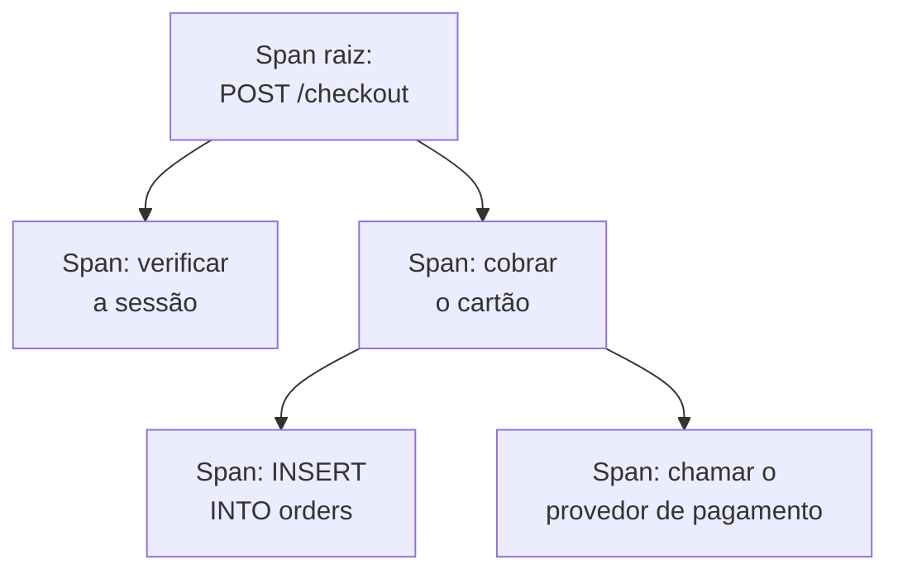

# Explorador de traços

O explorador de traços encontra as requisições que passaram pelos seus serviços: as lentas, as que falharam, as que tocaram a conta de um cliente específico. Pesquise e filtre os spans que seus serviços enviam e, depois, abra um traço para ver cada etapa da requisição como cascata, gráfico de chama ou mapa de serviços.

:::cards
- [Encontrar uma requisição](#encontrar-uma-requisição): Pesquisar spans e depois filtrar por serviço, status ou tipo.
- [Ler um traço](#ler-um-traço): Para onde foi o tempo e qual etapa falhou.
- [Transformar seus spans em gráficos](#transformar-seus-spans-em-gráficos): Contagens de requisições e tempos de resposta, agrupados do seu jeito.
- [Insights de traços](#insights-de-traços): Taxas de erro, latência e as requisições mais lentas.
:::

## Traços e spans

Um traço é uma requisição em seu caminho pelo seu sistema. Cada etapa que ela percorre, como um handler HTTP, uma consulta ao banco de dados ou uma chamada a outro serviço, é um span, e os spans ficam aninhados dentro dos spans que os iniciaram. O primeiro span de um traço, sem pai, é o span raiz: o ponto de entrada da requisição.

Cada linha do explorador é um span, então um serviço movimentado enche a lista com suas consultas ao banco e chamadas internas. Para listar uma linha por requisição, escolha **Root spans** em **Categoria de span** na barra lateral.

O explorador tem quatro abas:

| Aba | Para que serve |
| --- | --- |
| **Visualizador** | Pesquisar e filtrar spans, e abrir os traços deles. Abre na última hora, os mais recentes primeiro, 50 spans por página. |
| **Insights** | Taxas de requisições, taxas de erro e latência por serviço, e as requisições que merecem uma olhada. |
| **Guia de configuração** | Como enviar traços com OpenTelemetry, usando uma das suas [chaves de ingestão](/docs/telemetry/ingestion-keys). |
| **Configurações** | O que acontece com os spans quando chegam: **Pipelines**, **Filtros de descarte**, **Regras de mascaramento** e **Regras de gravação**. |

## Antes de começar

- **Traços chegando.** Instrumente seus serviços com [OpenTelemetry](/docs/telemetry/open-telemetry). A aba **Guia de configuração** mostra o código para a sua linguagem.
- **Uma função que possa ler telemetria.** Project Owner, Project Admin, Project Member, Viewer, Telemetry Admin, Telemetry Member ou Telemetry Viewer, ou uma função personalizada com a permissão Read Telemetry Service Traces. O escopo dela decide de quem são os spans que você vê: veja [Telemetria](/docs/permissions/index#telemetria).

## Encontrar uma requisição

:::steps
### Abrir o Visualizador

Acesse **Produtos → Observabilidade → Traços**. O **Visualizador** lista os spans da última hora, os mais recentes primeiro, cada um com status, serviço, nome e duração.

### Escolher o intervalo de tempo

Escolha um intervalo no seletor de tempo, ou arraste sobre o gráfico acima da lista para dar zoom em um pico. Clique duas vezes no gráfico para voltar. Veja [Aplicar zoom em um intervalo de tempo](/docs/telemetry/charts-and-time-ranges).

### Pesquisar

Digite uma consulta e pressione Enter, por exemplo `service:checkout status:error duration:>500`. Palavras soltas pesquisam os nomes dos spans, e `@key:value` pesquisa um atributo como `@http.route:/orders`. Veja [Sintaxe de pesquisa](/docs/telemetry/search-syntax#traces).

### Refinar com filtros

Clique em um valor da barra lateral **Filtros** para adicioná-lo como chip. A barra lateral filtra por **Serviço**, pelo host, cluster ou outro recurso que enviou o span, por **Status**, **Categoria de span**, **Tem exceção**, **Tipo de span**, **Nome do span**, **Service Instance** e **Nome do Host**.

### Abrir um span

Clique em uma linha para expandi-la: os atributos dela, e os registros e exceções que ela gravou. Clique em **See full trace** para abrir o traço inteiro.
:::

Sua pesquisa, seus chips e o intervalo de tempo ficam no endereço da página, então uma atualização, um favorito ou um link compartilhado abre os mesmos spans.

## Ler um traço

A página de um traço começa com os números da requisição:

| Número | O que é |
| --- | --- |
| Duração | Quanto tempo a requisição inteira levou. |
| Spans | Quantos spans o traço tem. |
| Serviços | Por quantos serviços a requisição passou. |
| Erros | Quantos spans terminaram com status de erro. Clique para mostrar só esses. |
| Profundidade | A cadeia mais longa de spans aninhados. |

Abaixo deles, escolha uma das quatro visualizações:

| Visualização | O que mostra |
| --- | --- |
| **Waterfall** | Cada span em uma linha do tempo, aninhado sob o span que o iniciou. Ative **Critical path** para destacar a cadeia de spans que determinou quanto tempo a requisição levou. |
| **Gráfico de chama** | A mesma árvore em barras empilhadas, em que as barras mais largas levaram mais tempo. |
| **Service map** | Os serviços por onde a requisição passou e as chamadas entre eles. |
| **Operations** | Uma linha por serviço e nome de span, com chamadas, erros, tempo próprio e tempo total. Uma operação chamada 10 ou mais vezes a partir de um mesmo span pai é marcada: muitas vezes uma consulta N+1 ou um laço que poderia ser agrupado. |

Clique em um span em qualquer visualização para abrir o painel dele, com abas para atributos, eventos, registros, exceções e links, além do perfil ou da chamada de LLM quando ele tiver. Pesquise os spans do traço por nome, ID ou serviço com a caixa de pesquisa ao lado das visualizações (pressione `/`), e ative **Errors only** para manter só os spans que falharam.

Um traço grande carrega 500 spans por vez. Clique no botão no fim do traço para carregar mais, ou todos.

> [!TIP]
> **Acelerar com IA** só aparece em um traço que vale a pena corrigir: um com uma consulta N+1, chamadas feitas uma após a outra que poderiam rodar em paralelo, ou uma chamada que ocupa a maior parte da requisição, quando isso custa tempo real (100 ms ou mais para as chamadas juntas, 500 ms ou mais para uma única chamada, e pelo menos um décimo da requisição). Ele diz o que encontrou, por exemplo "A mesma consulta ao banco de dados foi executada 40 vezes em ReportService.build", e inicia uma tarefa de IA que abre um pull request para corrigi-lo. Veja [Código](/docs/ai/ai-agent).

## Transformar seus spans em gráficos

O gráfico acima da lista mostra o número de spans ao longo do tempo, dividido por status. Escolha outra medida no cabeçalho do gráfico para mostrar o tempo de resposta médio, mediano (P50) ou P95 deles.

Para ir além, mude a lista de **Spans** para **Analytics**. Escolha uma série temporal, uma lista dos principais ou uma tabela; meça contagens de requisições, contagens de erros ou tempos de resposta (média, P50, P90, P95, P99, mínimo ou máximo); e agrupe por nome de span, serviço, status, tipo de span ou qualquer atributo, e depois por um segundo campo. Uma lista dos principais ou uma tabela mostra de 5 a 100 grupos.

## Acompanhar, salvar e compartilhar

- Clique em **Pausado** acima da lista para ativar as atualizações ao vivo. O botão passa a mostrar **Live**, e a lista procura spans novos a cada 10 segundos. Clique de novo para pausar.
- **Saved Views** guarda uma pesquisa, seus filtros e o intervalo de tempo com um nome, para todos no projeto. As visualizações salvas funcionam como no [Explorador de registros](/docs/telemetry/logs-explorer#salvar-uma-visualização).
- Os botões **Registros** e **Métricas** abrem esses exploradores na mesma janela de tempo, com tanto da sua filtragem quanto eles puderem usar. Aponte para um botão para ver o que ele não consegue levar junto.

## Insights de traços

A aba **Insights** resume as requisições de um intervalo de tempo:

- o número de requisições, a taxa de erros e a latência P50, P95 e P99;
- uma tabela de saúde dos seus serviços, ordenada pela taxa de erros, para que os serviços que precisam de atenção venham primeiro;
- as requisições com falha mais recentes, e as mais lentas.

Limite-a a alguns serviços com a lista suspensa ao lado do seletor de tempo.

## O que acontece com os spans quando chegam

A aba **Configurações** reúne as regras que o OneUptime aplica aos spans quando eles chegam, como faz com os registros. Elas agem sobre os spans que chegam depois, não sobre os já armazenados. Por quanto tempo cada span é mantido também é decidido quando ele chega: veja [Retenção de dados](/docs/telemetry/data-retention).

| Regra | O que faz |
| --- | --- |
| **Filtros de descarte** | Descartar os spans que você não quer guardar, ou guardar só uma amostra deles. Veja [Descartar ou amostrar entradas](/docs/telemetry/drop-filters-and-scrub-rules#descartar-ou-amostrar-entradas). |
| **Regras de mascaramento** | Mascarar dados sensíveis nos atributos dos spans. Veja [Mascarar dados sensíveis](/docs/telemetry/drop-filters-and-scrub-rules#mascarar-dados-sensíveis). |
| **Pipelines** | Alterar e enriquecer spans: cada pipeline seleciona spans com um filtro e depois executa os processadores dele em ordem. |
| **Regras de gravação** | Transformar a cada minuto contagens de spans, contagens de erros e durações em novas métricas. Veja [Regras de gravação de registros](/docs/telemetry/log-recording-rules). |

## Solução de problemas

:::details Um traço diz que nenhum span foi encontrado
Os spans costumam chegar até um minuto depois de a requisição terminar. Clique em **Atualizar** na página do traço para verificar de novo.
:::

:::details Alguns spans ficam no nível mais alto da cascata
Eles indicam um span pai que o OneUptime não recebeu, muitas vezes porque o serviço que escreveu o pai ainda não envia traços ao OneUptime. Instrumente esse serviço também.
:::

:::details A lista mostra muito mais linhas do que requisições
Cada linha é um span, não uma requisição. Escolha **Root spans** em **Categoria de span** na barra lateral para listar uma linha por requisição.
:::

## Próximos passos

:::cards
- [Sintaxe de pesquisa](/docs/telemetry/search-syntax): Todos os filtros que a caixa de pesquisa entende.
- [Monitor de traces](/docs/monitor/traces-monitor): Receber alertas de requisições com falha ou lentas.
- [Rastreamento de exceções](/docs/telemetry/exceptions): Fazer a triagem dos erros que seus spans gravam.
- [Explorador de registros](/docs/telemetry/logs-explorer): Ler as linhas de registro que uma requisição escreveu.
:::
