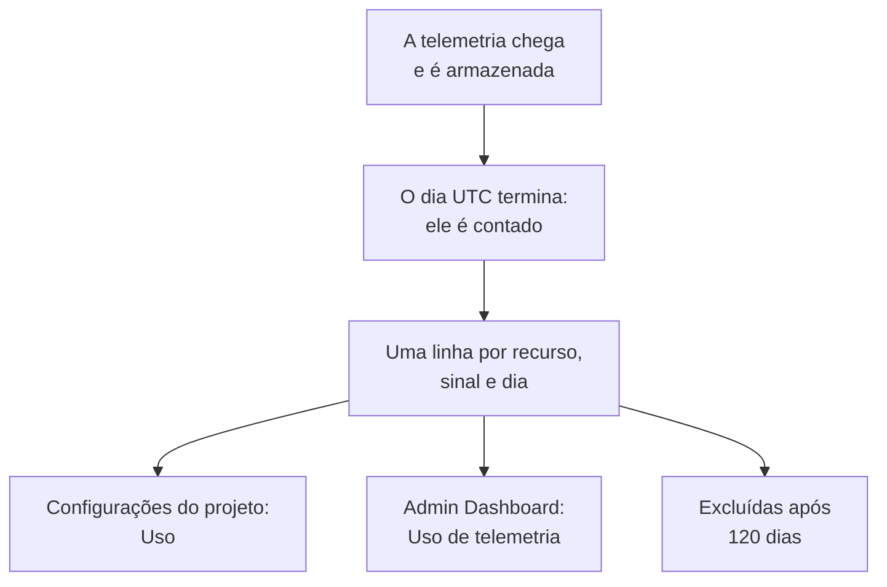

# Uso de telemetria

Veja quanta telemetria cada projeto, e cada serviço ou recurso dele, envia: registros, métricas, traços, exceções, perfis, reproduções de sessão e eventos de segurança. O uso é contado em toda instalação do OneUptime, com cobrança ou sem ela, para que você encontre o que enche o seu armazenamento sem consultar o ClickHouse.

:::cards
- [Como o uso é contado](#como-o-uso-é-contado): Uma vez por dia, para cada recurso e sinal.
- [Ver o uso de um projeto](#ver-o-uso-de-um-projeto): Configurações do projeto → Telemetria e APM → Uso.
- [Ver o uso de todos os projetos](#ver-o-uso-de-todos-os-projetos): O Admin Dashboard, para o administrador da instância.
- [Por quanto tempo o uso é mantido](#por-quanto-tempo-o-uso-é-mantido): 120 dias, a menos que você mude isso.
:::

## Como o uso é contado

Uma vez por dia, depois que um dia termina em UTC, o OneUptime conta o que cada recurso de cada projeto enviou naquele dia, para cada sinal, e guarda a contagem como uma linha por recurso, sinal e dia.



- **Um dia é contado quando termina.** Cada dia é contado até por volta das 08:00 UTC do dia seguinte, então o uso de hoje aparece amanhã. Um dia que não pôde ser contado é tentado de novo durante uma semana.
- **O tamanho é o tamanho armazenado.** Cada sinal é contado pelo tamanho das linhas em que é armazenado, antes da compressão. As reproduções de sessão são contadas pelos bytes que os gravadores enviaram.
- **As exceções são mostradas à parte.** As exceções que vêm de spans e registros têm um total, uma coluna e uma parte do gráfico próprios, e os **Traços** contam os spans. Elas não têm uma linha própria: cada linha de traços diz quanto dela corresponde a exceções. Um dia contado antes de as exceções serem mostradas à parte continua com elas dentro dos **Traços**, como estava.
- **Os perfis incluem as suas amostras.**
- **A telemetria do próprio OneUptime não é contada.** As leituras de monitores, alertas, incidentes e SLOs, as leituras da Observabilidade de dados e as métricas de orçamento das reproduções de sessão são gravadas pelo próprio OneUptime.
- **No OneUptime Cloud, a telemetria é cobrada com base nessas linhas.** Em uma instalação sem cobrança, o uso é contado sem custo, e nada é cobrado por ele, mesmo que a cobrança seja ativada depois.
- **As exceções são cobradas como parte dos Traços.** No OneUptime Cloud, os traços são cobrados pelos seus spans e pelas suas exceções juntos, ao preço dos traços, como sempre foram. Mostrar as exceções à parte não muda em nada a sua cobrança, e elas nunca são cobradas duas vezes.
- **Um orçamento é contado à parte do uso.** Um [orçamento de ingestão](/docs/telemetry/ingestion-budgets) conta a telemetria à medida que chega, descomprimida, então pode parar a telemetria de um dia no mesmo dia. Enquanto houver um definido, esta página abre com os orçamentos de hoje. As exceções não têm orçamento próprio: são contadas no orçamento dos traços ou dos registros em que chegam.

## Antes de começar

- **Uma função que leia a telemetria do projeto.** Proprietário do projeto, Administrador do projeto, Membro do projeto, Visualizador, Administrador de telemetria, Membro de telemetria ou Visualizador de telemetria, ou uma das funções de cobrança. A função precisa alcançar o projeto inteiro: uma função limitada a alguns rótulos não mostra o uso.
- **Telemetria no projeto.** O uso é contado para a telemetria que as [chaves de ingestão](/docs/telemetry/ingestion-keys) do projeto enviam.

## Ver o uso de um projeto

:::steps
### Abrir Uso

Acesse **Configurações do projeto → Telemetria e APM → Uso**. **Telemetria e APM** começa recolhido no menu lateral: clique nele para abri-lo.

### Escolher um período

A página abre em **Últimos 30 dias**. Escolha **Últimos 7 dias** ou **Últimos 90 dias** na caixa no canto superior direito do cartão **Uso de telemetria**. Um período termina ontem, o dia mais recente que já foi contado.

### Encontrar o que cresceu

O cartão **Uso por recurso** lista cada serviço e recurso que enviou algo no período, do maior para o menor volume. Clique no título de uma coluna para ordenar por ela, e no nome de um recurso para abrir a página dele.
:::

A página tem três cartões:

| Cartão | O que mostra |
| --- | --- |
| **Uso de telemetria** | O **Total** do período, um total para cada sinal e um gráfico de cada dia, com os sinais empilhados. |
| **Uso por recurso** | Cada **Recurso** com o seu tipo, uma coluna para cada sinal, o **Total** e a **Retenção** da telemetria dele. |
| **Histórico de uso de telemetria** | Uma linha por produto, recurso e dia, com filtros para **Produto**, **Dia** e **Serviço**. Uma linha de **Traços** reúne os seus spans e as suas exceções, assim como os traços são cobrados, e indica em **Dados Ingeridos (em GB)** quanto dela corresponde a exceções. |

A telemetria que não indicou um serviço aparece como **Serviço desconhecido**. Um recurso que foi excluído desde então, ou cujo tipo a sua função não lê, aparece pelo tipo e pelo início do ID.

## Quem vê o quê

| Função | Vê |
| --- | --- |
| Proprietário do projeto, Administrador do projeto, Administrador de cobrança, Membro de cobrança, Visualizador de cobrança, Manage Billing | Quanto cada recurso enviou e por quanto tempo isso é mantido e, no OneUptime Cloud, quanto custou |
| Membro do projeto, Visualizador, Administrador de telemetria, Membro de telemetria, Visualizador de telemetria | Quanto cada recurso enviou e por quanto tempo isso é mantido |

O custo do uso só aparece no OneUptime Cloud: uma instalação sem cobrança não cobra nada por ele. Veja [Cobrança e uso](/docs/configuration/billing#histórico-de-uso) para os preços.

## Ver o uso de todos os projetos

Em uma instalação de hospedagem própria, o administrador da instância vê o uso de todos os projetos no Admin Dashboard:

:::steps
### Abrir Uso de telemetria

No Admin Dashboard, abra o menu e clique em **Uso de telemetria**. A lista mostra cada projeto que enviou algo no período, do maior para o menor volume, com uma coluna para cada sinal e o **Total**.

### Encontrar os projetos que mais enviam

Escolha um período no canto superior direito do cartão e clique no título de uma coluna para ordenar por ela: **Total**, um sinal, ou **Projeto** para o nome.

### Abrir um projeto

Clique no nome de um projeto. A página **Uso de telemetria** dele, em **Projetos** no Admin Dashboard, mostra o uso por dia, sinal e recurso, como os membros dele o veem.
:::

## Por quanto tempo o uso é mantido

O uso é mantido por 120 dias, a menos que você mude isso, com a cobrança ativada ou desativada. Esse é o tempo pelo qual as contagens de uso são mantidas, não a própria telemetria: para isso, veja [Retenção de dados](/docs/telemetry/data-retention).

:::steps
### Abrir Retenção de dados

No Admin Dashboard, acesse **Configurações → Retenção de dados**.

### Definir o número de dias

No cartão **Retenção do uso de telemetria**, clique em **Editar retenção do uso de telemetria**, informe **Retenção do Uso de Telemetria (Dias)** de 30 a 1095 e clique em **Salvar alterações**. Deixe vazio para 120 dias.
:::

O uso mais antigo que isso é excluído uma vez por dia. A retenção nunca é menor que 30 dias: um dia já contado nunca é excluído para depois ser contado de novo.

## Ler o uso com a API

`GET /api/telemetry-usage/project` responde com o uso de um projeto em um período de dias UTC, como a página o mostra. Chame-o com uma [chave de API](/docs/permissions/index#chaves-de-api) que tenha uma das funções acima:

```bash
curl 'https://oneuptime.com/api/telemetry-usage/project?startDay=2026-10-01&endDay=2026-10-31' \
  -H "ApiKey: $ONEUPTIME_API_KEY"
```

`startDay` e `endDay` são dias escritos `YYYY-MM-DD`, ambos incluídos, e um período pode ter até 1095 dias. A resposta traz os totais, cada dia por sinal e cada recurso por sinal, em GB, com o custo apenas onde a cobrança está ativada e a chave lê a cobrança. As exceções ficam em `Exceptions`, separadas de `Traces`, e um dia contado antes de as exceções serem mostradas à parte as traz dentro de `Traces`.

## Solução de problemas

:::details A página Uso mostra Ainda não há uso de telemetria
Um dia é contado quando termina em UTC, até por volta das 08:00 UTC do dia seguinte: um projeto que começou a enviar hoje mostra o seu primeiro dia amanhã. Verifique se o projeto recebe telemetria nos exploradores.
:::

:::details Os números são maiores que o meu disco do ClickHouse
O uso é o tamanho das linhas antes da compressão. O ClickHouse comprime o que armazena, então o disco que ele usa é várias vezes menor.
:::

:::details Um recurso aparece pelo tipo e por um ID
O recurso foi excluído depois de enviar a telemetria, ou a sua função não lê esse tipo de recurso. O uso dele continua sendo contado.
:::

:::details Os Traços caíram no dia em que as Exceções apareceram
As exceções eram contadas dentro dos **Traços**. A partir do primeiro dia contado com as exceções à parte, os **Traços** contam os spans e as **Exceções** contam as exceções. Juntos, eles são o que os **Traços** eram, e é por eles que os traços são cobrados.
:::

## Próximos passos

:::cards
- [Filtros de descarte e regras de mascaramento](/docs/telemetry/drop-filters-and-scrub-rules): Pare de armazenar a telemetria de que você não precisa.
- [Retenção de dados](/docs/telemetry/data-retention): Mantenha a telemetria pelo tempo necessário, e não mais.
- [Cobrança e uso](/docs/configuration/billing): O que a telemetria custa no OneUptime Cloud.
- [Chaves de ingestão](/docs/telemetry/ingestion-keys): Envie telemetria para o seu projeto.
- [Orçamentos de ingestão](/docs/telemetry/ingestion-budgets): Limite quanto de cada sinal um projeto envia em um dia.
:::
