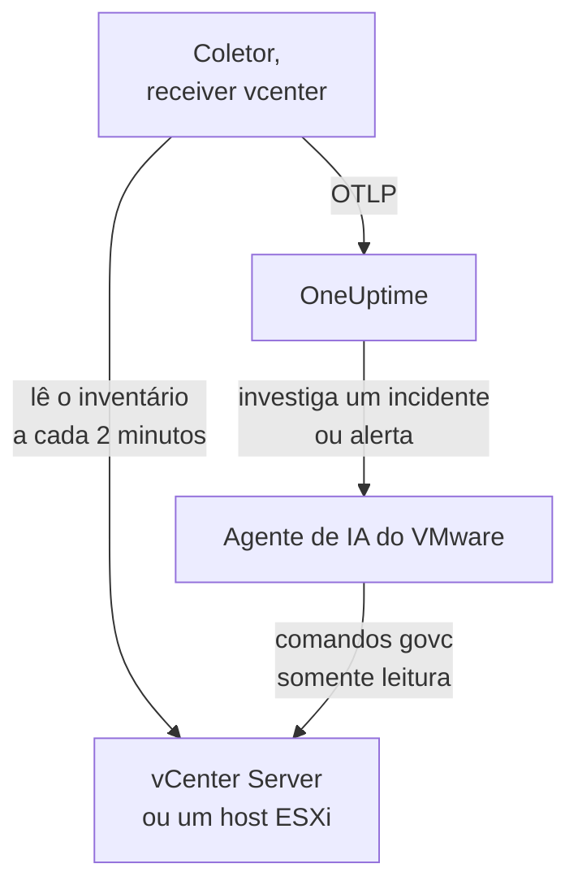

# Agente VMware

O agente VMware do OneUptime monitora o VMware vSphere: vCenter Server, hosts ESXi, máquinas virtuais, datastores, clusters, pools de recursos e vSAN. É um OpenTelemetry Collector padrão cujo [receiver `vcenter`](https://github.com/open-telemetry/opentelemetry-collector-contrib/tree/main/receiver/vcenterreceiver) lê a API do vSphere com um usuário somente leitura, marca cada métrica com o nome do seu vCenter e a envia ao OneUptime: nenhum plugin no vCenter e nada dentro das VMs. Os [monitores VMware](/docs/monitor/vmware-monitor) alertam sobre o que chega.

:::cards
- [Instalar o agente](#instale-o-agente): Um usuário somente leitura e depois o script de instalação, o Docker Compose ou o systemd.
- [O que o agente coleta](#o-que-o-agente-coleta): Cada objeto do vSphere, a identidade dele e as métricas dele.
- [Agente de IA](#agente-de-ia): Deixe a OneUptime AI ler o vCenter enquanto investiga.
- [Solução de problemas](#solução-de-problemas): Um script de diagnóstico, e os problemas mais comuns.
:::

## Como funciona

Um agente monitora um endpoint do vSphere: um **vCenter Server**, que cobre cada datacenter, cluster e host que ele gerencia, ou um **host ESXi autônomo** que nenhum vCenter gerencia. Execute um agente por vCenter. O coletor percorre o inventário inteiro uma vez por coleta (a cada 2 minutos por padrão) e envia um recurso por objeto. O mesmo arquivo do Compose executa ao lado dele o agente de IA do VMware, para a OneUptime AI. Prefere não usar Docker? O mesmo coletor, com a mesma configuração, também roda como serviço do systemd em qualquer máquina Linux.



O vCenter se registra com os primeiros dados, com o nome que o agente marca em cada métrica como `vmware.vcenter.name`. Para monitorar um vCenter sem rodar o agente, veja [VMware sem agente](/docs/telemetry/vmware-agentless): uma das suas probes coleta os mesmos dados com uma conta somente leitura.

## Antes de começar

- Docker Engine 20.10 ou mais recente com o plugin Docker Compose v2 ou, para instalar sem Docker, uma máquina Linux (x86_64 ou arm64) com systemd 235 ou mais recente. Em qualquer caso, a máquina precisa alcançar o vCenter por HTTPS (TCP 443).
- vCenter Server ou ESXi 7.0 ou mais recente: o receiver é compatível com o vSphere 7 e 8.
- Uma conta que possa criar um usuário do vSphere e atribuir a ele uma função no objeto vCenter de nível superior.
- Uma chave de ingestão. Crie uma em **Configurações do projeto → Telemetria e APM → Chaves de ingestão** e copie o valor.

### Onde executar o agente

O agente fala com o vCenter por HTTPS, então não precisa rodar perto dele e, de preferência, não deve rodar nem no vCenter Server Appliance nem em uma VM do cluster que ele observa: se esse cluster cair, o seu monitoramento cai junto. Uma pequena VM de gerenciamento em hardware separado, um host de monitoramento ou qualquer máquina que rode Docker (ou, sem Docker, qualquer máquina Linux com systemd) e alcance o vCenter na TCP 443 é o lugar certo. O listener de syslog opcional também precisa que os hosts ESXi alcancem o agente na porta de syslog (veja [Enviar o syslog do ESXi](#opcional-enviar-o-syslog-do-esxi)).

## Instale o agente

:::steps
### Criar o usuário somente leitura do vSphere

O agente só lê: o inventário, os contadores de desempenho e as estatísticas do vSAN. Dê a ele uma conta própria com a função integrada **Read-Only**, nunca um administrador.

:::tabs
@tab vSphere Client
1. Crie a conta: abra _Menu → Administration → Single Sign On → Users and Groups_, escolha o domínio `vsphere.local` (ou a sua fonte de identidade), clique em **Add**, nomeie o usuário como `oneuptime` e defina uma senha. O usuário fica então `oneuptime@vsphere.local`.
2. Atribua a função: selecione o objeto **vCenter Server** de nível superior no inventário _Hosts and Clusters_, abra a aba **Permissions**, clique em **Add**, escolha o usuário, defina a função como **Read-Only** e marque **Propagate to children**.
@tab govc
De uma máquina com credenciais de administrador:

```bash
govc sso.user.create -p 'a-strong-password' -R ReadOnly oneuptime
govc permissions.set -principal oneuptime@vsphere.local -role ReadOnly -propagate=true /
```
@tab PowerCLI
De uma sessão conectada ao vCenter como administrador:

```powershell
New-SsoPersonUser -UserName oneuptime -Password 'a-strong-password'
New-VIPermission -Entity (Get-Folder -NoRecursion) -Principal 'VSPHERE.LOCAL\oneuptime' -Role ReadOnly -Propagate:$true
```
@tab ESXi Host Client
Para um host ESXi autônomo (sem vCenter), crie o usuário em _Host → Manage → Security & Users → Users_ e dê a ele a função Read-Only em _Host → Manage → Security & Users → Permissions_. Ou, no shell do host, execute `esxcli system account add` e depois `esxcli system permission set --id oneuptime --role ReadOnly`.
:::

> [!IMPORTANT]
> A propagação é a parte que as pessoas esquecem. O receiver percorre datacenters, clusters, hosts, VMs, datastores e pools de recursos, e todo objeto que o usuário não consegue ver é deixado de fora sem aviso. Uma função Read-Only atribuída no objeto vCenter _sem_ propagação gera um inventário vazio e um painel cheio de zeros.

### Instale e inicie o agente

:::tabs
@tab install.sh
Baixe o script de instalação e execute-o na máquina que vai hospedar o agente:

```bash
curl -sSL https://raw.githubusercontent.com/OneUptime/oneuptime/master/agents/VMwareAgent/install.sh -o install.sh
bash install.sh
```

O script pede a sua URL do OneUptime, a chave de ingestão, um nome para o vCenter, o endpoint do vCenter e as credenciais somente leitura (ele lê a senha sem exibi-la), e se o agente de IA pode aplicar correções (se sim, um usuário do vSphere só dele e as VMs que ele nunca deve alterar). Ele instala em `/opt/oneuptime-vmware-agent`, grava um arquivo com permissão `0600` chamado `.env` e inicia o agente com o Docker Compose. Ele coloca cada valor entre aspas para o Docker Compose exatamente como você digitou, então uma senha com `$`, `#`, espaços ou aspas funciona como digitada. Executar o script de novo reutiliza tudo o que está em um `.env` existente em vez de perguntar de novo, e é assim que você [atualiza o agente](#atualizando-o-agente).
@tab Docker Compose
Baixe `docker-compose.yml` e `otel-collector-config.yaml` do [diretório VMwareAgent](https://github.com/OneUptime/oneuptime/tree/master/agents/VMwareAgent) para uma pasta nova e depois crie um arquivo `.env` ao lado deles. Ele guarda uma senha, então mantenha-o privado com `chmod 600 .env`:

```bash title=".env"
ONEUPTIME_URL=YOUR_ONEUPTIME_URL
ONEUPTIME_TELEMETRY_INGESTION_KEY=YOUR_TELEMETRY_INGESTION_TOKEN
VMWARE_VCENTER_NAME=my-vcenter
VCENTER_ENDPOINT=https://vcsa.example.com
VCENTER_USERNAME=oneuptime@vsphere.local
VCENTER_PASSWORD=a-strong-password
VCENTER_INSECURE_SKIP_VERIFY=true
VCENTER_COLLECTION_INTERVAL=2m
```

Uma senha com `$`, `#`, espaços ou aspas vai entre aspas simples (veja [O vCenter recusa o login](#solução-de-problemas)). Inicie o agente:

```bash
docker compose up -d
```
@tab systemd
O agente não precisa de Docker: ele é um binário do OpenTelemetry Collector e um arquivo de configuração. Em uma máquina Linux (x86_64 ou arm64) com systemd 235 ou mais recente (Ubuntu 18.04, Debian 10, RHEL 8 ou mais novos), rode a versão do `otelcol-contrib` que o agente fixa, com o mesmo `otel-collector-config.yaml`, como serviço do systemd. A unidade que o agente traz para isso, [`oneuptime-vmware-agent-native.service`](https://github.com/OneUptime/oneuptime/blob/master/agents/VMwareAgent/systemd/oneuptime-vmware-agent-native.service), roda o coletor como um usuário descartável sem privilégios, sem capabilities e sem nada em que possa gravar.

Baixe o coletor, a configuração e a unidade, e instale-os em `/opt/oneuptime-vmware-agent`:

```bash
cd "$(mktemp -d)"
VERSION=0.161.0   # the collector release the agent pins
ARCH=$(uname -m | sed 's/x86_64/amd64/;s/aarch64/arm64/')
curl -fL -o otelcol-contrib.tar.gz \
  https://github.com/open-telemetry/opentelemetry-collector-releases/releases/download/v${VERSION}/otelcol-contrib_${VERSION}_linux_${ARCH}.tar.gz
curl -fsSLO https://raw.githubusercontent.com/OneUptime/oneuptime/master/agents/VMwareAgent/otel-collector-config.yaml
curl -fsSL -o oneuptime-vmware-agent.service \
  https://raw.githubusercontent.com/OneUptime/oneuptime/master/agents/VMwareAgent/systemd/oneuptime-vmware-agent-native.service

sudo install -d -m 0755 /opt/oneuptime-vmware-agent
sudo tar --no-same-owner --preserve-permissions -xzf otelcol-contrib.tar.gz -C /opt/oneuptime-vmware-agent otelcol-contrib
sudo install -m 0644 otel-collector-config.yaml /opt/oneuptime-vmware-agent/otel-collector-config.yaml
sudo install -m 0644 oneuptime-vmware-agent.service /etc/systemd/system/oneuptime-vmware-agent.service
```

As configurações vão em `/opt/oneuptime-vmware-agent/.env`: as mesmas variáveis do `.env` da instalação com Docker. Ele guarda uma senha, então deixe-o legível só pelo root antes de abri-lo:

```bash
sudo touch /opt/oneuptime-vmware-agent/.env
sudo chmod 600 /opt/oneuptime-vmware-agent/.env
sudoedit /opt/oneuptime-vmware-agent/.env
```

Coloque isto nele:

```bash
ONEUPTIME_URL=YOUR_ONEUPTIME_URL
ONEUPTIME_TELEMETRY_INGESTION_KEY=YOUR_TELEMETRY_INGESTION_TOKEN
VMWARE_VCENTER_NAME=my-vcenter
VCENTER_ENDPOINT=https://vcsa.example.com
VCENTER_USERNAME="oneuptime@vsphere.local"
VCENTER_PASSWORD="a-strong-password"
VCENTER_INSECURE_SKIP_VERIFY=true
VCENTER_COLLECTION_INTERVAL=2m
```

O systemd lê este arquivo, não um shell: mantenha o nome de usuário e a senha entre aspas duplas, escrevendo cada `\` como `\\` e cada `"` como `\"` — `DOMAIN\user` vira `"DOMAIN\\user"` —, enquanto `$`, `#`, `'` e espaços entram como estão. Essa é a forma que todas as versões do systemd leem do mesmo jeito; as mais antigas (a do RHEL 8, por exemplo) descartam uma barra invertida mesmo dentro de aspas simples. Depois inicie o agente e faça-o iniciar a cada boot:

```bash
sudo systemctl daemon-reload
sudo systemctl enable oneuptime-vmware-agent
sudo systemctl restart oneuptime-vmware-agent
```

Esta instalação roda só o coletor: o [agente de IA](#agente-de-ia) só é distribuído como imagem de contêiner. Execute um agente por vCenter: se você estiver saindo da instalação com Docker, execute `docker compose down` lá primeiro, senão cada métrica chega duas vezes.
:::

### Verificar a instalação

Verifique se o agente está rodando e leia os logs do coletor:

```bash
docker compose ps
docker logs -f oneuptime-vmware-agent
```

Instalou com o systemd? Verifique o serviço e o journal dele em vez disso:

```bash
systemctl status oneuptime-vmware-agent --no-pager
sudo journalctl -u oneuptime-vmware-agent -f
```

Depois que o coletor iniciar, os logs dele devem mostrar esta linha:

```text
Everything is ready. Begin running and processing data.
```

### Encontrar o vCenter no OneUptime

Nada é enviado até a primeira passagem completa pelo inventário terminar, então aguarde um intervalo de coleta (2 minutos por padrão). Depois abra **Produtos → Infraestrutura → VMware → Todos os vCenters**: o vCenter está lá, com seus datacenters, clusters, hosts ESXi, máquinas virtuais, datastores e pools de recursos.
:::

## Variáveis de ambiente

O Docker Compose os lê do `.env` ao lado de `docker-compose.yml`; a instalação com systemd os lê de `/opt/oneuptime-vmware-agent/.env`, e a unidade dela dá os mesmos padrões.

| Variável | Obrigatória | Descrição |
| --- | --- | --- |
| `ONEUPTIME_URL` | Sim | A sua URL do OneUptime, como `https://oneuptime.com` ou a sua instância auto-hospedada. Use `http://` e a porta dela se a instância for só HTTP. |
| `ONEUPTIME_TELEMETRY_INGESTION_KEY` | Sim | A chave de ingestão de **Configurações do projeto → Telemetria e APM → Chaves de ingestão**. |
| `VMWARE_VCENTER_NAME` | Sim | O nome do vCenter no OneUptime, marcado em cada métrica como o atributo de recurso `vmware.vcenter.name`. Mantenha-o estável: mudá-lo depois registra um segundo vCenter. O padrão é `vmware-vcenter`. |
| `VCENTER_ENDPOINT` | Sim | O esquema e o host do vCenter Server ou de um host ESXi autônomo, **sem** `/sdk`, como `https://vcsa.example.com`. |
| `VCENTER_USERNAME` | Sim | O usuário do vSphere com a função Read-Only, como `oneuptime@vsphere.local` (ou `DOMAIN\user` para uma fonte de identidade do Active Directory). |
| `VCENTER_PASSWORD` | Sim | A senha desse usuário. Se ela contiver `$`, `#`, espaços ou aspas, coloque-a entre aspas simples no `.env` da instalação com Docker (o `install.sh` faz isso por você), e entre aspas duplas no da instalação com systemd (veja [Solução de problemas](#solução-de-problemas)). |
| `VCENTER_INSECURE_SKIP_VERIFY` | Não | `true` aceita o certificado autoassinado (VMCA) padrão do vCenter; `false` mantém a verificação TLS ativada. O padrão é `false`. |
| `VCENTER_COLLECTION_INTERVAL` | Não | Com que frequência o inventário inteiro é lido. Aumente para `5m` ou `10m` em vCenters muito grandes. O padrão é `2m`. |

As configurações próprias do agente de IA estão em [Agente de IA](#agente-de-ia).

## O que o agente coleta

A cada `VCENTER_COLLECTION_INTERVAL`, o receiver percorre o inventário inteiro do vSphere e envia um recurso do OpenTelemetry por objeto. A identidade de cada objeto fica nos **atributos de recurso** dele — `vcenter.datacenter.name`, `vcenter.cluster.name`, `vcenter.host.name`, `vcenter.vm.name` / `vcenter.vm.id`, `vcenter.datastore.name`, `vcenter.resource_pool.name` / `vcenter.resource_pool.inventory_path` — e o agente acrescenta `vmware.vcenter.name`, então o OneUptime arquiva tudo sob o seu vCenter:

| Objeto do vSphere | Identidade (atributos de recurso) | Métricas |
| --- | --- | --- |
| Datacenter | `vcenter.datacenter.name` | `vcenter.datacenter.cluster.count`, `vcenter.datacenter.host.count`, `vcenter.datacenter.vm.count`, `vcenter.datacenter.datastore.count`, `vcenter.datacenter.disk.space`, `vcenter.datacenter.cpu.limit`, `vcenter.datacenter.memory.limit` |
| Cluster | + `vcenter.cluster.name` | `vcenter.cluster.cpu.effective`, `vcenter.cluster.cpu.limit`, `vcenter.cluster.memory.effective`, `vcenter.cluster.memory.limit`, `vcenter.cluster.host.count`, `vcenter.cluster.vm.count`, `vcenter.cluster.vm_template.count`, `vcenter.cluster.vsan.*` (vazão, operações, latência, congestionamentos) |
| Host ESXi | + `vcenter.host.name` (e `vcenter.cluster.name` quando o host está em um cluster) | `vcenter.host.cpu.usage` / `.capacity` / `.utilization` / `.reserved`, `vcenter.host.memory.usage` / `.utilization` / `.capacity`, `vcenter.host.disk.latency.avg` / `.latency.max` / `.throughput`, `vcenter.host.network.usage` / `.throughput` / `.packet.rate` / `.packet.drop.rate` / `.packet.error.rate`, `vcenter.host.vsan.*` |
| Máquina virtual | + `vcenter.host.name`, `vcenter.vm.name`, `vcenter.vm.id` (UUID da instância); `vcenter.resource_pool.*` ou `vcenter.virtual_app.*` | `vcenter.vm.disk.usage`, `vcenter.vm.disk.utilization`, `vcenter.vm.memory.usage` / `.utilization` / `.ballooned` / `.swapped` / `.swapped_ssd`; só VMs ligadas: `vcenter.vm.cpu.usage`, `vcenter.vm.cpu.readiness`, `vcenter.vm.cpu.utilization`, `vcenter.vm.disk.latency.avg` / `.latency.max` / `.throughput`, `vcenter.vm.network.*`, `vcenter.vm.vsan.*` |
| Modelo de VM | `vcenter.vm_template.name`, `vcenter.vm_template.id` | só `vcenter.vm.disk.usage` |
| Datastore | + `vcenter.datastore.name` | `vcenter.datastore.disk.usage`, `vcenter.datastore.disk.utilization` |
| Pool de recursos | + `vcenter.resource_pool.name`, `vcenter.resource_pool.inventory_path` | `vcenter.resource_pool.cpu.usage` / `.cpu.shares`, `vcenter.resource_pool.memory.usage` / `.memory.shares` / `.memory.ballooned` / `.memory.swapped` / `.memory.granted` |

As métricas de contagem e de capacidade se desdobram por **atributos de ponto de dados**, que são exatamente o que você filtra e agrupa nos critérios de monitor:

| Atributo | Valores | Presente em |
| --- | --- | --- |
| `direction` | `read` / `write` para disco, `transmitted` / `received` para rede | Latência e vazão de disco, vazão de rede e taxas de pacotes |
| `disk_state` | `available` / `used` | `vcenter.datastore.disk.usage`, `vcenter.vm.disk.usage`, `vcenter.datacenter.disk.space` |
| `status` | `red` / `yellow` / `green` / `gray` (o status geral do objeto no vSphere) | `vcenter.datacenter.cluster.count` / `.host.count` / `.vm.count` |
| `power_state` | Hosts: `on` / `off` / `standby` / `unknown`; VMs: `on` / `off` / `suspended` / `unknown` | `vcenter.datacenter.host.count` / `.vm.count`, `vcenter.cluster.vm.count` |
| `effective` | `true` / `false` (armazenados como strings) | `vcenter.cluster.host.count` |
| `object` | A instância de NIC, disco ou vCPU (como `vmnic0`) | Séries de disco e rede por dispositivo de hosts e VMs |
| `cpu_reservation_type` | `total` / `used` | `vcenter.host.cpu.reserved` |
| `type` | Memória: `guest` / `host` / `overhead`, `private` / `shared`; vSAN: `read` / `write` / `unmap` | Séries de memória de pools de recursos, latência e operações do vSAN |

As unidades são as unidades OTLP do próprio receiver, que o OneUptime escala para exibição: `MHz` para uso e capacidade de CPU, `%` para utilização e CPU ready, `MiBy` para a memória de hosts, VMs e pools de recursos, `By` para a memória de clusters e datacenters e todo o espaço em disco, `ms` para a latência de disco de hosts e VMs, e `us` (microssegundos) para a latência do vSAN. Nos critérios de monitor, os atributos de identidade levam um prefixo `resource.` (`resource.vcenter.host.name`, `resource.vmware.vcenter.name`), enquanto os atributos de ponto de dados ficam sem prefixo (`disk_state`, `power_state`, `status`).

`vcenter.host.memory.capacity` vem desativada por padrão no upstream; a configuração incluída a ativa, porque o OneUptime divide por ela para a utilização de memória dos hosts. Um comentário em `otel-collector-config.yaml` lista as outras métricas opcionais (`vcenter.vm.cpu.time`, `vcenter.vm.memory.granted`, `vcenter.host.memory.active`, `vcenter.host.memory.ballooned`, `vcenter.host.memory.granted`, `vcenter.vm.network.broadcast.packet.rate`, `vcenter.vm.network.multicast.packet.rate`): ative qualquer uma delas do mesmo jeito.

### Estado de energia das VMs

O receiver não envia nenhuma métrica de estado de energia de uma VM. Ele envia `vcenter.vm.cpu.*` **só para VMs ligadas**, então o OneUptime deduz o estado a partir do que chegou em cada coleta: uma VM que informou métricas de CPU está **Powered on**; uma que informou só uso de memória e disco está **Powered off** (ou suspensa: aqui o vSphere não diferencia as duas). Modelos de VM não têm estado de energia. Isso lê **uma coleta inteira de cada vez**, e é por isso que o processador `batch` incluído tem um `send_batch_size` grande e, de propósito, nenhum `send_batch_max_size`: uma coleta dividida entre duas exportações zeraria as contagens do inventário e "desligaria" VMs. Mantenha as configurações de batch como vêm.

## O vCenter no OneUptime


A página **Visão geral** responde primeiro "este vCenter está saudável?": os hosts efetivos, a CPU e a memória dos hosts ponderadas pela capacidade, o datastore mais cheio e o pior tempo de CPU ready de uma VM. Quando algo está degradado, ela nomeia o objeto responsável, para você não precisar procurar.

### Hosts ESXi


### Máquinas virtuais


Máquinas virtuais desligadas e modelos também aparecem na lista. O vCenter só informa contadores de CPU de VMs ligadas, então as colunas de CPU delas mostram N/A em vez de um zero enganoso.

### Datastores


## Opcional — Enviar o syslog do ESXi

Por padrão, o agente envia só métricas, então a página **Registros** do vCenter fica vazia. Os hosts ESXi (e o próprio vCenter) podem encaminhar o syslog deles para qualquer listener, e o `otel-collector-config.yaml` incluído tem um par de receivers `syslog` comentado (TCP e UDP na porta 5514, RFC 3164: o formato próprio do ESXi), ligado a um pipeline `logs` comentado que marca `vmware.vcenter.name` para os logs chegarem ao seu vCenter.

:::steps
### Ativar os receivers

Descomente os dois receivers `syslog/*` e o pipeline `logs` em `otel-collector-config.yaml`.

### Abrir a porta

Descomente o bloco `ports:` em `docker-compose.yml` para a máquina publicar `5514/tcp` e `5514/udp`, e depois execute `docker compose up -d`. Com o systemd não há porta a publicar, já que o coletor escuta na própria máquina: execute `sudo systemctl restart oneuptime-vmware-agent` em vez disso. Abra a porta no firewall da máquina para a rede de gerenciamento do ESXi.

### Apontar cada host ESXi para o agente

No vSphere Client, selecione o host, abra _Configure → System → Advanced System Settings_, edite `Syslog.global.logHost` e defina-o como `udp://<agent-host>:5514` (ou `tcp://<agent-host>:5514`; separe vários destinos com vírgulas). Depois permita o tráfego de saída em _Configure → System → Firewall → Edit → syslog_. Ou, em cada host, com `esxcli`:

```bash
esxcli system syslog config set --loghost='udp://<agent-host>:5514'
esxcli system syslog reload
esxcli network firewall ruleset set --ruleset-id=syslog --enabled=true
```

Com o PowerCLI, em um cluster inteiro: `Get-VMHost | Get-AdvancedSetting -Name Syslog.global.logHost | Set-AdvancedSetting -Value 'udp://<agent-host>:5514' -Confirm:$false`.
:::

Um receiver de syslog escuta em um só transporte, e é por isso que TCP e UDP são dois receivers: deixe um comentado se você só precisa do outro. Para syslog com TLS (`ssl://`), termine o TLS na frente do agente; o próprio receiver fala TCP e UDP simples. A imagem padrão do coletor lê o syslog como ele vem: nenhuma imagem personalizada é necessária.

## Marcar o vCenter com rótulos do projeto

Um atributo de recurso que começa com `oneuptime.label.` vira um rótulo do projeto no vCenter: `oneuptime.label.<dimension>=<value>` é o rótulo `<dimension>:<value>`. Adicione os atributos ao processador `resource` em `otel-collector-config.yaml`, ao lado de `vmware.vcenter.name`:

```yaml
processors:
  resource:
    attributes:
      # ...existing attributes...
      - key: oneuptime.label.team
        value: platform
        action: upsert
      - key: oneuptime.label.env
        value: production
        action: upsert
```

O coletor só lê a configuração quando inicia: execute `docker compose restart oneuptime-vmware-agent`, ou `sudo systemctl restart oneuptime-vmware-agent` com o systemd. O vCenter passa então a mostrar os rótulos `team:platform` e `env:production`. Os rótulos são comparados sem diferenciar maiúsculas e minúsculas, então um rótulo `Production` existente é reutilizado em vez de duplicado, e o agente nunca remove um rótulo que alguém adicionou no OneUptime.

## Execute como um serviço do systemd

A instalação com Docker também pode rodar sob o systemd, para iniciar junto com a máquina e reiniciar quando falhar. A unidade dela envolve o Docker Compose e supõe que o agente fica em `/opt/oneuptime-vmware-agent`, onde o script de instalação o coloca:

```bash
sudo curl -fsSL https://raw.githubusercontent.com/OneUptime/oneuptime/master/agents/VMwareAgent/systemd/oneuptime-vmware-agent.service -o /etc/systemd/system/oneuptime-vmware-agent.service
sudo systemctl daemon-reload
sudo systemctl enable --now oneuptime-vmware-agent
```

A instalação sem Docker já é um serviço do systemd, com uma unidade própria.

## Atualizando o agente

O agente informa como **Versão do agente** a versão do coletor que os arquivos dele fixam. Quando ela é mais antiga que a versão que esta versão do OneUptime fixa, um sinal de aviso aparece ao lado dela, na página **Visão geral** do vCenter e na lista **Todos os vCenters**. Selecione-o para ver estes comandos. Um agente instalado antes de os arquivos dele informarem uma versão não mostra nenhuma até ser atualizado dessa forma.

O coletor está fixado em `docker-compose.yml` (ou, sem Docker, pela versão que você baixou), e a configuração dele é um arquivo ao lado, então só baixar as imagens não faz o agente avançar:

:::tabs
@tab install.sh
Execute `install.sh` de novo: ele reutiliza todos os valores do seu `.env` atual (nada é perguntado de novo), renova `docker-compose.yml` e `otel-collector-config.yaml` e recria o agente para que o coletor leia a nova configuração.

```bash
curl -sSL https://raw.githubusercontent.com/OneUptime/oneuptime/master/agents/VMwareAgent/install.sh -o install.sh
bash install.sh
```
@tab Docker Compose
Na pasta do agente, baixe de novo os dois arquivos (e refaça qualquer alteração que você tenha feito neles), depois baixe as imagens e recrie o agente:

```bash
curl -fsSLO https://raw.githubusercontent.com/OneUptime/oneuptime/master/agents/VMwareAgent/docker-compose.yml
curl -fsSLO https://raw.githubusercontent.com/OneUptime/oneuptime/master/agents/VMwareAgent/otel-collector-config.yaml
docker compose pull
docker compose up -d --force-recreate
```
@tab systemd
Execute os comandos de instalação de novo: eles baixam a versão que este OneUptime fixa com o `otel-collector-config.yaml` e a unidade mais recentes, e deixam o seu `.env` como está (refaça qualquer alteração que você tenha feito na configuração). Depois reinicie o serviço:

```bash
cd "$(mktemp -d)"
VERSION=0.161.0   # the collector release the agent pins
ARCH=$(uname -m | sed 's/x86_64/amd64/;s/aarch64/arm64/')
curl -fL -o otelcol-contrib.tar.gz \
  https://github.com/open-telemetry/opentelemetry-collector-releases/releases/download/v${VERSION}/otelcol-contrib_${VERSION}_linux_${ARCH}.tar.gz
curl -fsSLO https://raw.githubusercontent.com/OneUptime/oneuptime/master/agents/VMwareAgent/otel-collector-config.yaml
curl -fsSL -o oneuptime-vmware-agent.service \
  https://raw.githubusercontent.com/OneUptime/oneuptime/master/agents/VMwareAgent/systemd/oneuptime-vmware-agent-native.service

sudo install -d -m 0755 /opt/oneuptime-vmware-agent
sudo tar --no-same-owner --preserve-permissions -xzf otelcol-contrib.tar.gz -C /opt/oneuptime-vmware-agent otelcol-contrib
sudo install -m 0644 otel-collector-config.yaml /opt/oneuptime-vmware-agent/otel-collector-config.yaml
sudo install -m 0644 oneuptime-vmware-agent.service /etc/systemd/system/oneuptime-vmware-agent.service
sudo systemctl daemon-reload
sudo systemctl restart oneuptime-vmware-agent
```
:::

## Desinstalando o agente

:::tabs
@tab Docker Compose
```bash
cd /opt/oneuptime-vmware-agent
docker compose down
```
@tab systemd
```bash
sudo systemctl disable --now oneuptime-vmware-agent
sudo rm /etc/systemd/system/oneuptime-vmware-agent.service
sudo systemctl daemon-reload
sudo rm -r /opt/oneuptime-vmware-agent
```
:::

Depois remova a permissão do usuário `oneuptime` no vCenter se não precisar mais dela, e o usuário próprio do agente de IA, se você criou um.

## Agente de IA

O `docker-compose.yml` do agente também executa o **Agente de IA do VMware**, `oneuptime-vmware-ai-agent` (imagem `oneuptime/resource-ai-agent:release`). Enquanto a OneUptime AI investiga um incidente ou alerta neste vCenter, ela executa por meio dele comandos `govc` somente leitura — `govc vm.info web-01`, `govc events -n 50 /DC/vm/web-01`, `govc metric.sample -n 12 /DC/vm/web-01 cpu.usage.average` — e, só se você permitir, aplica correções como ligar uma VM de novo. Ele se registra como o vCenter chamado `VMWARE_VCENTER_NAME`, como o coletor, e aparece na página **IA → Agente de IA** do vCenter no OneUptime.

- **As investigações de IA vêm ativadas por padrão.** Assim que o agente se conecta, a OneUptime AI investiga com ele os incidentes e alertas deste vCenter, e a página **Visão geral** do vCenter mostra o status do agente. Para parar, defina `ONEUPTIME_AI_INVESTIGATION=false` onde o agente é executado (**Alterar**, em **O que a IA pode fazer** na página do agente de IA, mostra como), ou deixe o agente de fora.
- **A função do vSphere é o limite rígido.** As investigações entram como o usuário **Read-Only** do coletor (`VCENTER_USERNAME` / `VCENTER_PASSWORD`), que pode ler e nada mais. As correções precisam de um usuário próprio do agente de IA cuja função possa ligar, desligar e reiniciar VMs (`VirtualMachine.Interact.PowerOn`, `PowerOff` e `Reset`), atribuída só nas pastas que a IA pode corrigir e definida como `ONEUPTIME_AI_VCENTER_USERNAME` / `ONEUPTIME_AI_VCENTER_PASSWORD`.
- Ele é **somente leitura**, a menos que você defina `ONEUPTIME_AI_ALLOW_WRITES=true`; `ONEUPTIME_AI_WRITE_TARGETS` (nomes de VMs e hosts ou caminhos do inventário) limita o que uma correção pode tocar. Ele nunca altera a VM com o nome do host em `VCENTER_ENDPOINT` — normalmente o appliance do vCenter — e só reconhece o appliance por esse nome: quando `VCENTER_ENDPOINT` é um endereço IP, ou a VM do appliance tem outro nome, coloque essa VM em `ONEUPTIME_AI_PROTECTED_TARGETS`, junto com a VM em que o agente roda. `ONEUPTIME_AI_FIXES`, no mesmo `.env`, diz como as correções rodam — `ask-for-approval` (uma pessoa aprova cada uma), `automatic` ou `bypass-approval` — e a página do agente de IA mostra isso somente leitura ([O que a IA pode fazer, definido pelo agente](/docs/ai/infrastructure-ai-agents#what-ai-may-do-set-by-the-agent)).
- Para verificar o certificado do vCenter em vez de pular a verificação, monte a CA dele no contêiner e defina `VCENTER_CA_FILE`; em um vCenter com vários datacenters, defina `GOVC_DATACENTER`.
- Ele roda como UID 1000 sem capabilities e nunca executa operações no convidado, snapshots, `esxcli` nem nada que crie ou destrua uma VM. Exclua o serviço `oneuptime-vmware-ai-agent` do `docker-compose.yml` se você não usa a OneUptime AI.
- A instalação sem Docker não tem agente de IA: ele só é distribuído como imagem de contêiner. Para adicionar um, rode-o com Docker em qualquer máquina que alcance o vCenter — baixe `docker-compose.yml`, grave ao lado um `.env` com as configurações de `/opt/oneuptime-vmware-agent/.env`, entre aspas simples como o Docker Compose exige, e inicie só o agente de IA com `docker compose up -d oneuptime-vmware-ai-agent` (não o coletor, que já está rodando).

O que ele pode executar, como as correções funcionam e como solucionar problemas: [Infrastructure AI Agents](/docs/ai/infrastructure-ai-agents#vmware-vcenter). O README do agente tem os comandos exatos para a função de correções.

## Solução de problemas

:::details Execute primeiro o script de diagnóstico
O agente vem com um script, [`troubleshoot.sh`](https://github.com/OneUptime/oneuptime/blob/master/agents/VMwareAgent/troubleshoot.sh), que verifica a cadeia inteira: o runtime de contêineres, se o vCenter responde e aceita as credenciais, o nome do vCenter marcado em cada métrica, o formato do token, as métricas do próprio coletor e se o OneUptime aceita a chave de ingestão. Essa última verificação é a que mais importa. O OneUptime recusa uma chave inválida com `401` (`422` para uma chave desativada ou uma chave de navegador), e o coletor trata os dois como permanentes: ele descarta o lote e registra um único erro `Exporting failed`, fácil de passar despercebido enquanto o contêiner continua saudável. O script consulta `GET <url>/otlp/v1/validate` de dentro da rede do agente para obter direto um `200` (válida) ou `401` (inválida), recorre a `POST /fluentd/v1/logs` em servidores mais antigos, e consulta `<VCENTER_ENDPOINT>/sdk/vimServiceVersions.xml` do mesmo jeito, então falhas de DNS, firewall e TLS aparecem exatamente como o coletor as encontra.

```bash
curl -sSL https://raw.githubusercontent.com/OneUptime/oneuptime/master/agents/VMwareAgent/troubleshoot.sh -o troubleshoot.sh
bash troubleshoot.sh    # add -d <dir> if you installed outside /opt/oneuptime-vmware-agent
```

Ele termina com um veredito que cita a causa mais provável.
:::

:::details Instalado sem Docker
O script de diagnóstico precisa de Docker. Sem ele, o coletor roda na própria máquina, então verifique a mesma cadeia diretamente: o serviço e o log dele, a API do vCenter no caminho de rede do próprio coletor, se o OneUptime aceita a chave de ingestão (`"valid":true` com `"keyType":"Server"`) e os contadores do próprio coletor, que ele serve em `127.0.0.1:8890` em vez de `8888` para poder rodar ao lado de outro coletor:

```bash
systemctl status oneuptime-vmware-agent --no-pager
sudo journalctl -u oneuptime-vmware-agent -n 100 --no-pager
curl -sk https://<vcenter-host>/sdk/vimServiceVersions.xml
curl -s -H "x-oneuptime-token: <key>" https://<oneuptime-host>/otlp/v1/validate
curl -s http://127.0.0.1:8890/metrics | grep -E 'otelcol_(receiver_accepted|exporter_sent|exporter_send_failed)_metric_points'
```

O log se lê como o do contêiner, então as entradas abaixo se aplicam. Um serviço que fica reiniciando registra o porquê: `Failed with result 'resources'` significa que o systemd não consegue ler `/opt/oneuptime-vmware-agent/.env`, e `cannot unmarshal the configuration` ou `requires positive value` significa que um valor nele não é um que o coletor aceita. O systemd lê `.env` com regras próprias, e as versões mais antigas (a do RHEL 8, por exemplo) descartam uma barra invertida mesmo dentro de aspas simples: mantenha o nome de usuário e a senha entre aspas duplas, escrevendo cada `\` como `\\` e cada `"` como `\"`, a única forma que todas as versões leem como foi escrita. Como o coletor confia no repositório de CAs da máquina, você pode manter a verificação TLS ativada: adicione o certificado raiz do vCenter (os arquivos `.0` em `certs/lin/` dentro de `https://<vcenter>/certs/download.zip`) a `/usr/local/share/ca-certificates/` com um nome `.crt` e execute `update-ca-certificates` no Debian e no Ubuntu, ou a `/etc/pki/ca-trust/source/anchors/` e execute `update-ca-trust` no RHEL; depois reinicie o serviço.
:::

:::details Nenhum vCenter aparece no OneUptime
1. Leia os logs do coletor: `docker logs oneuptime-vmware-agent`. Um erro de login (`incorrect user name or password`, `InvalidLogin`) significa credenciais erradas, `x509: certificate signed by unknown authority` significa que a verificação TLS está ativada diante de um certificado autoassinado, `connection refused` ou `no such host` significa um `VCENTER_ENDPOINT` errado, e um `401` na exportação significa uma chave de ingestão inválida.
2. Verifique se o vCenter responde a partir da rede do agente. A imagem do coletor não tem shell nem curl, então pergunte a partir de um contêiner na rede dele: `docker run --rm --network container:oneuptime-vmware-agent curlimages/curl -sk https://<vcenter-host>/sdk/vimServiceVersions.xml` deve imprimir um documento XML que cite `urn:vim25`.
3. Verifique se `VMWARE_VCENTER_NAME` está definido: o vCenter é encontrado pelo atributo de recurso `vmware.vcenter.name` dele.
4. Aguarde um intervalo de coleta: nada é enviado até a primeira passagem completa pelo inventário terminar.
:::

:::details O vCenter aparece como desconectado
Um vCenter passa a desconectado quando o OneUptime não recebe nada dele por 15 minutos; o OneUptime verifica a cada 5 minutos, e o tempo em que ele mesmo não estava recebendo dados não conta. Verifique se o coletor está rodando, se os logs dele não mostram erros de exportação e se uma coleta termina dentro de `VCENTER_COLLECTION_INTERVAL` (veja a entrada sobre inventários grandes abaixo). O vCenter volta a ficar conectado com os próximos dados.
:::

:::details Erros de x509 ou TLS
Appliances do vCenter apresentam um certificado emitido pela própria VMCA, em que nenhuma imagem Docker confia. Ou defina `VCENTER_INSECURE_SKIP_VERIFY=true` (a escolha prática em uma rede de gerenciamento privada), ou substitua o certificado de máquina do vCenter por um de uma CA em que a imagem do coletor confie. **Não** aponte o endpoint para uma URL `http://`: o vCenter serve a API dele só por HTTPS.
:::

:::details O vCenter recusa o login (401 ou InvalidLogin)
Use o principal completo — `oneuptime@vsphere.local`, ou `DOMAIN\user` / `user@domain.example` para uma fonte de identidade do Active Directory — e verifique como a senha está escrita em `.env`. O Docker Compose v2 expande referências `$VAR` em valores sem aspas e entre aspas duplas, e lê um espaço seguido de `#` como o início de um comentário, então uma senha que contenha `$`, `#`, espaços ou aspas precisa ficar entre aspas simples — `VCENTER_PASSWORD='p@ss$word'` —, que é o que o `install.sh` grava. Uma senha que contém ela mesma uma aspa simples vai entre aspas duplas, com cada `$` escrito como `$$` e `"` / `\` escapados com uma barra invertida. Uma conta bloqueada (tentativas demais com falha) também recusa uma senha correta: verifique _Administration → Single Sign On → Users and Groups_.
:::

:::details Os hosts aparecem, mas nenhuma VM, datastore ou cluster (NoPermission)
A função Read-Only foi atribuída no objeto vCenter sem **Propagate to children**, ou em um objeto mais restrito que a raiz do vCenter. Objetos que o usuário não consegue ver são deixados de fora sem aviso. Corrija a permissão no objeto vCenter de nível superior com a propagação ativada; a próxima coleta preenche o inventário.
:::

:::details Todas as VMs aparecem como desligadas
O estado de energia de uma VM é deduzido dos pontos de dados `vcenter.vm.cpu.*` que chegam na mesma coleta que os pontos de dados de memória e disco dela (veja [Estado de energia das VMs](#estado-de-energia-das-vms)). Se você mudou o processador `batch` e acrescentou um `send_batch_max_size`, um inventário grande é dividido entre várias exportações e os pontos de dados de CPU chegam em outra requisição que o restante: volte às configurações de batch incluídas.
:::

:::details Inventários grandes: coletas lentas, erros de vpxd.stats.maxQueryMetrics
Cada coleta percorre o inventário inteiro e faz uma consulta de desempenho por lote de objetos. Para vCenters com milhares de VMs:

- Aumente `VCENTER_COLLECTION_INTERVAL` para `5m` ou `10m`. Uma coleta que demora mais que o intervalo é pulada, não sobreposta, então um intervalo curto demais só deixa lacunas.
- O receiver pede até `max_query_metrics: 256` entidades por consulta de desempenho. O vCenter limita isso com `vpxd.stats.maxQueryMetrics` (256 por padrão no vCenter 7 e 8). Se um administrador o reduziu, o coletor registra `The maximum number of performance metrics per query exceeded`: reduza `max_query_metrics` em `otel-collector-config.yaml` para igualar, ou aumente a configuração do vCenter em _vCenter → Configure → Advanced Settings_.
- Fique de olho na memória do coletor: o `memory_limiter` incluído permite 512 MiB. Se o log disser que o limitador está descartando dados, aumente `limit_mib` (e dê mais memória ao contêiner).
:::

:::details Monitorar um host ESXi autônomo (sem vCenter)
Aponte `VCENTER_ENDPOINT` para o próprio host (`https://esxi01.example.com`), com um usuário local do ESXi que tenha a função Read-Only. Tudo o que um host sabe é coletado: o host, as VMs, os datastores e os pools de recursos dele. Um host autônomo não tem objeto de datacenter nem de cluster, então essas páginas ficam vazias, e não tem a API REST do vCenter, então o script de diagnóstico informa a verificação de credenciais como inconclusiva (ali a resposta está no log do coletor).
:::

:::details As métricas caem no vCenter errado
O OneUptime registra um vCenter pelo `vmware.vcenter.name` dele, que o agente tira de `VMWARE_VCENTER_NAME`. Mudá-lo depois dos primeiros dados cria um segundo vCenter em vez de renomear o primeiro.
:::

:::details Enviar métricas sem o agente
O vSphere não tem push próprio de OpenTelemetry, então o agente (ou qualquer OpenTelemetry Collector com o receiver `vcenter`) é o caminho de entrada. Se você já roda coletores, adicione o receiver `vcenter` a um deles em vez de rodar este agente: copie o receiver `vcenter` e o processador `resource` do `otel-collector-config.yaml` incluído para a sua própria configuração. O atributo de recurso `vmware.vcenter.name` é o que registra o vCenter no OneUptime, e as remoções de `service.name` / `service.instance.id` evitam que os dados sejam arquivados sob um serviço: mantenha os dois.
:::

## Próximos passos

:::cards
- [Monitor de VMware](/docs/monitor/vmware-monitor): Alertas sobre hosts, VMs, datastores, clusters, datacenters e vSAN.
- [VMware sem agente](/docs/telemetry/vmware-agentless): Deixe uma probe coletar o vCenter em vez disso.
- [Infrastructure AI Agents](/docs/ai/infrastructure-ai-agents): O que o agente de IA do VMware pode executar e como as correções funcionam.
- [Coletor OpenTelemetry no host](/docs/telemetry/host-otel-collector): A visão do sistema operacional dentro das VMs, ou da máquina do agente.
:::
