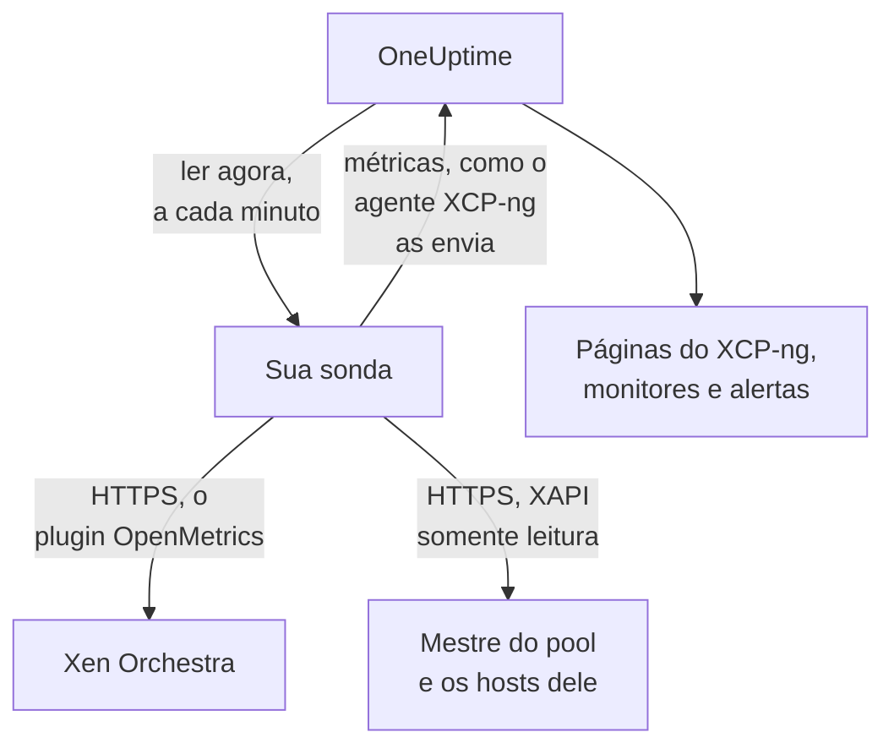

# XCP-ng sem agente

Monitore pools do XCP-ng sem instalar nada: uma sonda do OneUptime os lê, seja pelo Xen Orchestra que os gerencia, seja, para um pool sem Xen Orchestra, diretamente da XAPI no mestre do pool. Cada pool ganha as mesmas páginas, [monitores de XCP-ng](/docs/monitor/xcp-ng-monitor) e modelos de um pool enviado pelo [agente XCP-ng](/docs/telemetry/xcp-ng). Não há agente para instalar, atualizar nem manter em execução.

:::cards
- [Antes de começar](#antes-de-começar): uma sonda que alcance o Xen Orchestra ou o pool, e acesso somente leitura.
- [Conectar o Xen Orchestra](#conectar-o-xen-orchestra): todos os pools que ele gerencia, por meio de uma só conexão.
- [Conectar um pool sem Xen Orchestra](#conectar-um-pool-sem-xen-orchestra): um só pool, lido do mestre dele.
- [Alarmes, HA e backups](#alarmes-ha-e-backups): o que uma sonda lê além das métricas, e os alertas que ela oferece.
- [Solução de problemas](#solução-de-problemas): o que cada mensagem significa e o que a resolve.
:::

## Como funciona

A cada minuto, a sonda lê cada conexão e envia o que leu ao OneUptime:

- **Xen Orchestra**: a sonda lê o plugin OpenMetrics do Xen Orchestra com o segredo do plugin, exatamente como o agente XCP-ng, então cada pool que o Xen Orchestra gerencia chega com as mesmas séries. Com um token de API, ela também lê os alarmes, o HA e os backups de cada pool pela API REST do Xen Orchestra.
- **A XAPI de um pool**: a sonda entra no mestre do pool e faz as leituras que o próprio plugin do Xen Orchestra faz: os registros do pool e as métricas de cada host em execução, lidas nesse host. Ela as transforma nas mesmas séries que o plugin serve, então o pool é lido exatamente como seria pelo Xen Orchestra. Ela também publica no feed do pool as mensagens da XAPI do pool, como uma VM que travou ou um host que o HA perdeu.

Cada pool se registra pelo UUID dele na primeira leitura, como os pools do agente, e aparece em **XCP-ng → Todos os pools**.

## Qual forma de conectar usar

| | Xen Orchestra, de uma sonda | A XAPI de um pool, de uma sonda | O agente XCP-ng |
|---|---|---|---|
| O que você executa | Uma sonda que você já executa, ou uma nova | Uma sonda que você já executa, ou uma nova | O agente, em uma máquina própria |
| O que ele lê | Todos os pools que o Xen Orchestra gerencia | Um só pool | Todos os pools que o Xen Orchestra gerencia |
| Do que precisa | O segredo do plugin OpenMetrics e, opcionalmente, um token de API somente leitura | Uma conta do pool: root, ou um usuário do Active Directory com a função read-only | O segredo do plugin OpenMetrics |
| Onde os segredos ficam | Criptografados no OneUptime, enviados só para a sonda | Criptografados no OneUptime, enviados só para a sonda | No arquivo `.env` do agente |
| Alarmes, HA e backups | Os três, e os patches ausentes, com um token de API | Alarmes e HA, sem backups | Não incluídos |

Os três enviam as mesmas séries. Um pool é lido por um deles de cada vez, para que o histórico dele continue sendo uma só linha, seja quem for que o leia.

## Antes de começar

- **Uma sonda que alcance o endereço pela TCP 443.** Normalmente é uma [sonda personalizada](/docs/probe/custom-probe) na mesma rede. No OneUptime Cloud, as sondas compartilhadas nunca recebem segredos do XCP-ng, então adicione uma sonda sua. Em uma instância auto-hospedada, as sondas da própria instância também podem ler.
- **Para o Xen Orchestra:** Xen Orchestra 6.9 ou posterior com o plugin OpenMetrics ativado: siga [Ativar o plugin OpenMetrics](/docs/telemetry/xcp-ng#ative-o-plugin-openmetrics) e copie o segredo dele. Opcionalmente, um token de API de um usuário do Xen Orchestra com a função interna **Read only**: o OneUptime verifica que ele só lê e avisa você antes de ele expirar.
- **Para um pool sem Xen Orchestra:** XCP-ng 8.2 ou posterior, e o endereço do mestre dele. As funções da XAPI valem só para usuários do Active Directory, então a única conta local dele, `root`, pode alterar tudo no pool. Para acesso somente leitura, ingresse o pool no Active Directory e dê a um usuário a função `read-only`.

> [!IMPORTANT]
> Conecte um pool pelo Xen Orchestra ou pela XAPI dele, não pelos dois: a segunda conexão que lê um pool o deixa para a primeira.

## Conectar o Xen Orchestra

:::steps
### Abrir as conexões
No OneUptime, abra **XCP-ng → Conexões** e clique em **Conectar XCP-ng**.

### Escolher o Xen Orchestra
Em **O que ler**, escolha **Xen Orchestra**. Informe o **Endereço do Xen Orchestra**, aquele em que você o abre no navegador, como `https://xo.example.com`, e escolha a sonda que o alcança.

### Informar o segredo do plugin
Cole o **Segredo do OpenMetrics**. Adicione um **Token de API** do usuário somente leitura, se tiver um.

### Testar a conexão e confiar no certificado
Clique em **Testar conexão**. O Xen Orchestra assina o próprio certificado, então o teste o mostra: verifique a impressão digital dele e clique em **Confiar neste certificado**. O resultado lista os pools que o Xen Orchestra serve, com os hosts, as VMs e os repositórios de armazenamento deles.

### Dar um nome e conectar
O nome padrão é o nome de host do Xen Orchestra, e cada pool que ele lê o mostra. Clique em **Conectar XCP-ng**, e a página da conexão se abre.
:::

## Conectar um pool sem Xen Orchestra

:::steps
### Começar pelas conexões
No OneUptime, abra **XCP-ng → Conexões** e clique em **Conectar XCP-ng**.

### Escolher o pool
Em **O que ler**, escolha **Um pool sem Xen Orchestra**. Informe o **Endereço do mestre do pool**, como `https://10.0.0.10`, e escolha a sonda que o alcança.

### Informar a conta
Informe o **Nome de usuário** e a **Senha**: `root`, ou um usuário do Active Directory com a função read-only, escrito com o domínio, como `EXAMPLE\oneuptime`.

### Testar a conexão e confiar no certificado do mestre
Clique em **Testar conexão**. Cada host do XCP-ng assina o próprio certificado, então o teste mostra o do mestre: verifique a impressão digital dele e clique em **Confiar neste certificado**. O resultado diz qual versão do XCP-ng o mestre executa e o que a conta consegue ler, e avisa você quando a conta pode alterar o pool.

### Dar um nome ao pool e conectar
Clique em **Conectar XCP-ng**, e a página da conexão se abre.
:::

A página da conexão mostra como está a leitura dela. Ela mostra **Verificando** até a primeira leitura, que começa em até um minuto, depois **Coletando**, e os pools que ela lê aparecem em **Pools que ela lê**.

Se nenhuma sonda vier para a conexão por 20 minutos, porque está offline ou é antiga demais, a página mostra **Sem coleta** e diz isso. Quando nenhuma sonda pode ler a conexão, ela mostra **Sem coleta** na hora e diz o que mudar: falta um segredo, um nome de usuário ou uma senha, nenhuma sonda está definida para lê-la, a sonda dela não pode lê-la (uma sonda compartilhada no OneUptime Cloud, ou a de outro projeto), ou a sonda dela está desconectada.

## Pools que o agente já envia

Um pool que o agente XCP-ng registrou passa para a primeira conexão que o lê: o histórico dele continua como uma só linha, e o feed do pool diz que o agente pode ser parado.

> [!WARNING]
> Pare o agente XCP-ng assim que uma sonda ler os pools dele. Enquanto os dois estiverem em execução, cada métrica chega duas vezes.

Para voltar, abra a página **Configurações** do pool. O cartão **Coleta de dados** dela oferece **Usar o agente XCP-ng** para um pool que uma sonda lê, e **Coletar com uma sonda** para um pool que o agente envia. Um pool que volta para o agente fica com ele, seja o que for que a conexão leia.

## Certificados

A sonda nunca pula a verificação de certificados. Cada conexão conclui um handshake TLS completo, e então:

- sem certificado confiável, o certificado precisa vir de uma autoridade em que a máquina da sonda confia, para o endereço informado;
- com um certificado confiável, o endereço precisa apresentar exatamente esse certificado, identificado pela impressão digital SHA-256 dele, seja qual for o nome que ele traga. O certificado próprio do Xen Orchestra não nomeia endereço algum, e é confiado dessa forma.

Para verificar uma impressão digital, execute `openssl s_client -connect xo.example.com:443 </dev/null | openssl x509 -noout -fingerprint -sha256` na máquina da sonda e compare-a com o próprio certificado: em um mestre de pool, `openssl x509 -noout -fingerprint -sha256 -in /etc/xensource/xapi-ssl.pem`.

Em um pool, você confia no certificado do mestre. O próprio pool lista o certificado que cada um dos hosts dele serve, e a sonda lê cada um dos outros hosts fixado nesse certificado. Quando outro host se torna mestre, a sonda só o acompanha até um host que o pool garantiu na última leitura. Quando um certificado muda, a leitura para com **O certificado mudou** e o novo certificado é mostrado: nada é enviado até você confiar nele, na página da conexão.

## Os segredos salvos

O segredo, o token e a senha são criptografados e só de gravação: ninguém consegue lê-los de volta, e a API nunca os retorna. Eles são enviados só para a sonda que lê a conexão, que os mantém na memória.

Um segredo salvo só é enviado para o endereço, pela sonda e para o certificado para os quais foi informado. Alterar o endereço, a sonda ou o certificado confiável em **Editar conexão** pede que ele seja informado de novo, então ninguém que possa editar a conexão consegue enviá-lo para outro lugar, e um token de API salvo que não for informado de novo é esquecido. Confiar no certificado que a sonda encontrou no endereço salvo os mantém. **Remover o token de API** exclui o token do OneUptime: revogue-o também no Xen Orchestra.

## O token de API

Um token de API é opcional: as métricas chegam pelo segredo do plugin, e o token lê os alarmes, o HA e os backups de cada pool. Com um token, cada leitura o verifica no máximo uma vez por hora:

- **Ele só lê.** Um token cujo usuário é administrador, ou cuja função pode alterar algo, falha no teste e aparece como um problema na página da conexão. O OneUptime guarda apenas tokens somente leitura.
- **Ele lê o que o OneUptime precisa.** O Xen Orchestra responde com uma lista vazia a uma lista que um usuário não pode ler, então o token precisa ler alarmes, mensagens e logs de backup. A função interna **Read only** lê os três.
- **Quando ele expira.** O Xen Orchestra esquece um token no momento em que ele expira. Duas semanas antes, a página da conexão e o feed de cada pool que ela lê avisam. Crie um novo token para o mesmo usuário e informe-o em **Editar conexão**.

## Alarmes, HA e backups

Além das métricas, uma sonda lê o que o XCP-ng e o Xen Orchestra informam sobre cada pool. O que ela lê depende da conexão:

| | Xen Orchestra, com um token de API | A XAPI de um pool |
|---|---|---|
| Mensagens e alarmes da XAPI | Lidos | Lidos |
| O HA e o mestre do pool | Lidos | Lidos, com o próprio plano do HA |
| Jobs de backup e suas execuções | Lidos | Não lidos: os backups são do Xen Orchestra |
| Patches ausentes | Lidos a cada seis horas, se a assinatura do Xen Orchestra os incluir | Não lidos: quem os calcula é o Xen Orchestra |

Uma conexão do Xen Orchestra sem token de API lê só as métricas, como o agente XCP-ng.

- **Nas páginas do pool.** A **Visão geral** do pool mostra o estado do HA e as últimas execuções de cada job de backup; a página de um host, os patches ausentes dele; e a página de uma VM, o último backup dela. Mensagens de prioridade 1 a 4, uma troca de mestre, o HA ligado, desligado ou que não consegue mais tolerar a falha de um host, e execuções de backup com falha vão para o **Feed** do pool, e cada mensagem e cada execução de backup é uma entrada na página **Registros** do pool.
- **Como alertas.** As **Recomendações** do pool oferecem, em **Alarmes do XCP-ng** e **Backups**, um modelo para cada um: VM Crashed, HA Host Failed, HA State File Lost, HA Protected VM Restart Failed, Storage Failed to Plug, Storage GC Out of Space, XAPI Alarm, Pool Master Changed e Backup Job Failed. O [monitor de XCP-ng](/docs/monitor/xcp-ng-monitor) acrescenta HA Cannot Tolerate a Host Failure e VM Not Backed Up.
- **Desde a primeira leitura.** O que a XAPI disse antes da primeira leitura de um pool não é sinalizado, e cada mensagem é sinalizada uma só vez. A primeira leitura dos logs de backup olha uma semana e um dia para trás, então as últimas execuções de cada job aparecem na hora.

## Referência

| Configuração | Padrão | Observações |
|---|---|---|
| Ler a cada | 1 minuto | De 1 a 60 minutos. A cada minuto corresponde ao agente XCP-ng; leia um Xen Orchestra grande com menos frequência para poupá-lo. |
| Leituras ao mesmo tempo | 4 por sonda | Uma leitura mais lenta que o intervalo dela é pulada, nunca empilhada. |
| Maior leitura | Cerca de 48 MiB | Xen Orchestras maiores precisam do agente XCP-ng. |
| Mensagens da XAPI | 200 por leitura | Desde o momento em que o pool é conectado, cada uma entregue uma vez, a mais antiga primeiro. |
| Execuções de backup | 20 por leitura | A primeira leitura olha uma semana e um dia para trás. Uma execução que o Xen Orchestra ainda dá como pendente depois de três dias deixa de ser aguardada. |
| Patches ausentes | A cada 6 horas | Pelo Xen Orchestra, para até 100 hosts por verificação. |
| Teste de conexão | 90 segundos para começar | Um teste que nenhuma sonda pega a tempo, ou que dura mais de 150 segundos, é dado como falho. |

## Solução de problemas

:::details O certificado não é confiável
O Xen Orchestra e os hosts do XCP-ng assinam os próprios certificados por padrão. Compare a impressão digital mostrada com o certificado e clique em **Confiar neste certificado**.
:::

:::details O certificado mudou
Nada é enviado até você confiar no novo certificado. Se você o renovou, verifique a nova impressão digital, confie nele e informe os segredos de novo em **Editar conexão**.
:::

:::details O Xen Orchestra recusou o segredo
Copie o segredo de novo em **Settings → Plugins → openmetrics** no Xen Orchestra e informe-o em **Editar conexão**.
:::

:::details O plugin OpenMetrics não responde
Carregue **openmetrics** em **Settings → Plugins** no Xen Orchestra e ative **Auto-load** para que ele volte depois de uma reinicialização.
:::

:::details Este Xen Orchestra não tem o plugin OpenMetrics
O plugin precisa do Xen Orchestra 6.9 ou posterior e, em um Xen Orchestra Appliance, de uma licença Premium. Sem ela, conecte cada pool pela XAPI dele.
:::

:::details Nenhum pool está conectado
O Xen Orchestra não informa nenhum pool conectado. Adicione ou reconecte seus pools no Xen Orchestra e teste de novo.
:::

:::details O token de API pode alterar o Xen Orchestra
O OneUptime guarda apenas tokens somente leitura. Crie um para um usuário com uma cópia da função interna **Read only**, e nenhuma outra função.
:::

:::details O token de API não consegue ler alarmes, mensagens ou backups
Dê ao usuário do token uma cópia da função interna **Read only** do Xen Orchestra, que lê os três.
:::

:::details O token de API expirou
Crie um novo token para o usuário somente leitura no Xen Orchestra e informe-o em **Editar conexão**. Enquanto isso, as métricas continuam chegando.
:::

:::details A XAPI recusou o login
Verifique o nome de usuário e a senha. Um usuário do Active Directory é escrito com o domínio, como `EXAMPLE\oneuptime`.
:::

:::details Este host não é o mestre do pool
Um membro do pool responde com o endereço do mestre dele, que a mensagem informa. Informe esse endereço e teste de novo.
:::

:::details A conta não consegue ler o pool
Dê ao usuário do Active Directory a função read-only no pool, ou use uma conta que a tenha.
:::

:::details A sonda não recebe resposta
A rede da sonda não consegue alcançar o endereço pela TCP 443. Permita isso no firewall, ou escolha uma sonda na mesma rede.
:::

:::details A sonda não pegou isto
A sonda está offline, ou executa uma versão do OneUptime anterior à leitura do XCP-ng. Verifique se ela está conectada na tabela **Sondas personalizadas** e atualize-a.
:::

:::details Esta conexão é grande demais para ser lida por uma sonda
As métricas dela são maiores do que um envio da sonda pode ser. Use o [agente XCP-ng](/docs/telemetry/xcp-ng) para ela.
:::

## Próximos passos

:::cards
- [Monitor de XCP-ng](/docs/monitor/xcp-ng-monitor): alerte sobre pools, hosts, VMs e repositórios de armazenamento.
- [Sonda personalizada](/docs/probe/custom-probe): execute uma sonda na rede dos pools.
- [Agente XCP-ng](/docs/telemetry/xcp-ng): leia o Xen Orchestra com o agente.
:::
