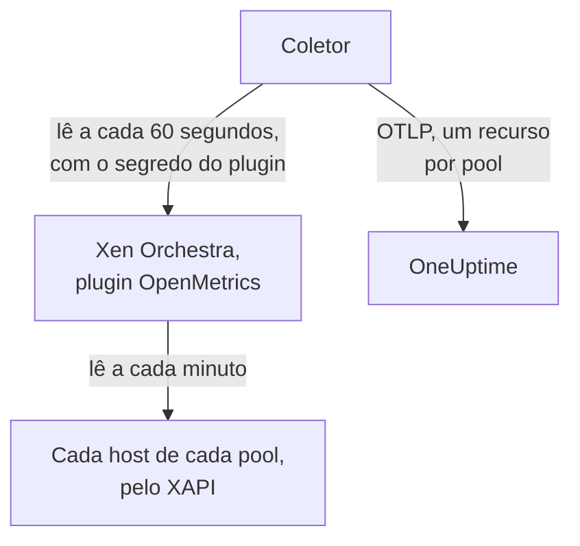

# Agente XCP-ng

O agente XCP-ng do OneUptime monitora os pools do XCP-ng que um Xen Orchestra gerencia: seus hosts, VMs, repositórios de armazenamento e discos virtuais. É um OpenTelemetry Collector padrão que lê o próprio plugin OpenMetrics do Xen Orchestra com o segredo do plugin e envia o que lê ao OneUptime, onde cada pool aparece com o seu inventário. Nenhuma senha de um pool ou do Xen Orchestra chega ao agente. Os [monitores do XCP-ng](/docs/monitor/xcp-ng-monitor) alertam sobre o que chega. Para ler os mesmos pools sem instalar nada, a partir de uma sonda do OneUptime, consulte [XCP-ng sem agente](/docs/telemetry/xcp-ng-agentless).

:::cards
- [Instale o agente](#instale-o-agente): Ative o plugin e depois use o script de instalação ou o Docker Compose.
- [O certificado do Xen Orchestra](#o-certificado-do-xen-orchestra): Como o agente confia no Xen Orchestra, nunca pulando a verificação.
- [O que o agente coleta](#o-que-o-agente-coleta): Cada série do plugin, e os contadores que na verdade são taxas.
- [Solução de problemas](#solução-de-problemas): Um script de diagnóstico, e os problemas mais comuns.
:::

## O que você ganha

- **Cada pool por si.** Cada pool que o Xen Orchestra gerencia vira um pool do XCP-ng no OneUptime, reconhecido pelo seu UUID do XAPI e com o nome que o Xen Orchestra lhe dá. Dois pools atrás de um mesmo Xen Orchestra são dois pools, e renomear um pool no OneUptime é seguro: a telemetria é associada pelo seu UUID.
- **O seu inventário.** Os hosts, as VMs, os repositórios de armazenamento e os discos virtuais do pool, com o estado e as métricas de cada um. Os domínios de controle (dom0) aparecem como VMs, e as páginas do pool os ocultam, a menos que você peça para vê-los.
- **Um agente por Xen Orchestra.** O plugin fornece cada pool ao qual o seu Xen Orchestra está conectado, então um só agente lê todos eles, e um pool conectado depois aparece na leitura seguinte.

## Como funciona

O agente é um contêiner que você executa com o Docker Compose em uma máquina: um OpenTelemetry Collector padrão, sem uma imagem própria do OneUptime. A cada 60 segundos, ele pede `/openmetrics/metrics` ao Xen Orchestra, com o segredo do plugin como token Bearer, no próprio endereço e com o próprio certificado do Xen Orchestra. O plugin lê as métricas de cada host pelo XAPI com resolução de 60 segundos. O coletor mantém as séries dos pools, agrupa-as por pool e as envia ao OneUptime por OTLP.



Cada pool se registra com seus primeiros dados, sob o UUID que o agente carimba nas suas séries como `xcp_ng.pool.id`, e com o nome que o Xen Orchestra lhe dá, `xcp_ng.pool.name`. Um pool sem nome no Xen Orchestra se chama "Pool" seguido do início do seu UUID até que você o renomeie.

## Antes de começar

- Xen Orchestra 6.9 ou posterior, conectado aos pools que você quer monitorar, com o seu plugin OpenMetrics. Em um Xen Orchestra Appliance (XOA), o plugin precisa de uma licença Premium; um Xen Orchestra compilado a partir do código-fonte já o inclui.
- Docker Engine 20.10 ou posterior com o plugin Docker Compose v2, `curl` e `openssl`, em uma máquina que alcance o Xen Orchestra por HTTPS.
- Um certificado no Xen Orchestra que nomeie o endereço ao qual o agente se conecta. O certificado autoassinado que o Xen Orchestra cria para si mesmo não nomeia nenhum, então nenhum cliente TLS atual consegue verificá-lo, e um Xen Orchestra compilado a partir do código-fonte serve HTTP simples até que você lhe dê um: veja [O certificado do Xen Orchestra](#o-certificado-do-xen-orchestra).
- Uma chave de ingestão. Crie uma em **Configurações do projeto → Telemetria e APM → Chaves de ingestão** e copie o valor.
- HTTPS de saída dessa máquina para a sua URL do OneUptime.

### Versões compatíveis

| | Compatível | Por quê |
| --- | --- | --- |
| Xen Orchestra | 6.9 ou posterior, com o plugin OpenMetrics `xo-server-openmetrics` 1.9 | O seu plugin mantém o segredo quando o Xen Orchestra reinicia, traz as correções dos vazamentos de memória da leitura e fornece todas as séries que as páginas do pool leem: o estado dos hosts e das VMs, os repositórios de armazenamento e os discos virtuais. Um plugin mais antigo podia criar um segredo novo em uma reinicialização, o que deixava o agente de fora até que alguém o copiasse de novo. |
| XCP-ng | 8.3 LTS | Com suporte da Vates até 30 de novembro de 2028. O XCP-ng 8.2 chegou ao fim da vida útil em 16 de setembro de 2025. |
| XenServer | Ainda não testado | O Xen Orchestra informa um pool XenServer que gerencia com as mesmas séries, então deve funcionar, mas ninguém testou um com o OneUptime ainda. |

### Onde executar o agente

O agente fala com o Xen Orchestra por HTTPS, então pode rodar em qualquer máquina com Docker e uma rota até ele: a própria máquina do Xen Orchestra, um host de monitoramento ou uma pequena VM de gerenciamento. Prefira uma máquina cuja VM não rode nos pools que ela observa: se um pool cair, o seu monitoramento não deve cair junto. Um agente lê um Xen Orchestra; para vários, veja [Ler vários Xen Orchestra](#ler-vários-xen-orchestra).

## Ative o plugin OpenMetrics

O agente lê cada pool pelo plugin OpenMetrics do Xen Orchestra, com o segredo do plugin.

:::steps
### Ative o plugin

No Xen Orchestra, abra *Settings → Plugins*, encontre **openmetrics** e ative-o. Na primeira vez que inicia, ele cria um segredo, e o Xen Orchestra o mantém entre reinicializações.

### Copie o seu segredo

Abra as configurações do plugin e copie o seu **Prometheus secret**: você o entrega ao agente no próximo passo. Você também pode digitar ali um segredo próprio e salvá-lo. Mantenha-o em sigilo: quem o tiver pode ler as métricas de cada pool.

### Verifique se ele responde

O plugin responde no próprio endereço e com o próprio certificado do Xen Orchestra, em `/openmetrics/metrics`, e só a uma requisição que leve o seu segredo. A sua verificação de saúde não precisa de nenhum, então esta única requisição pode pular a verificação do certificado com `-k`; o agente nunca faz isso:

```bash
curl -k https://xo.example.com/openmetrics/health
```

Ele responde `{"status":"ok"}` enquanto o plugin está em execução. Um `404` significa que o plugin não está ativado.
:::

## Instale o agente

:::steps
### Instale e inicie o agente

Cada instância do OneUptime fornece o script de instalação e os arquivos do agente da própria versão: os comandos abaixo os baixam de `https://oneuptime.com`, então em uma instância auto-hospedada substitua esse endereço pela sua URL. O script de instalação é salvo primeiro como `install.sh`, para que você possa lê-lo antes de executá-lo.

:::tabs
@tab install.sh
Baixe o script de instalação e execute-o na máquina que vai hospedar o agente:

```bash
curl -fsSL https://oneuptime.com/install/xcp-ng-agent -o install.sh
bash install.sh
```

O script pede a sua URL do OneUptime, a chave de ingestão, o endereço do Xen Orchestra como você o abre no navegador (como `https://xo.example.com` ou `https://10.0.0.5:8443`), o segredo do plugin (não exibido enquanto você digita) e como chamar este Xen Orchestra no OneUptime. Depois lê o certificado do Xen Orchestra: um certificado em que esta máquina já confia é verificado com o seu pacote de CA; qualquer outro é exibido com a sua impressão digital SHA-256, e você responde **y** para confiar nesse certificado e em nada mais, depois de comparar a impressão digital com a da máquina do Xen Orchestra. Ele nunca desativa a verificação. Por fim, pede ao plugin as suas métricas com o segredo e informa quais pools o Xen Orchestra relata, antes de instalar qualquer coisa. Instala-se em `/opt/oneuptime-xcp-ng-agent`, grava com permissões `0600` um arquivo `.env` e `xo-ca.pem`, os certificados em que o agente confia para o Xen Orchestra, e inicia o agente com o Docker Compose. Executar o script de novo reutiliza tudo o que está nesse `.env` em vez de perguntar de novo, e é assim que você [atualiza o agente](#atualizando-o-agente).
@tab Docker Compose
Baixe `docker-compose.yml` e `otel-collector-config.yaml` do seu OneUptime para uma pasta nova:

```bash
mkdir oneuptime-xcp-ng-agent && cd oneuptime-xcp-ng-agent
curl -fsSLO https://oneuptime.com/install/xcp-ng-agent/docker-compose.yml
curl -fsSLO https://oneuptime.com/install/xcp-ng-agent/otel-collector-config.yaml
```

Crie um arquivo `.env` ao lado deles. Ele guarda o segredo do plugin, então mantenha-o privado com `chmod 600 .env`:

```bash title=".env"
ONEUPTIME_URL=YOUR_ONEUPTIME_URL
ONEUPTIME_TELEMETRY_INGESTION_KEY=YOUR_TELEMETRY_INGESTION_TOKEN
XO_SCHEME=https
XO_ADDRESS=xo.example.com
XO_OPENMETRICS_SECRET='your-plugin-secret'
XO_NAME='Xen Orchestra'
XO_TLS_SERVER_NAME=
```

`XO_ADDRESS` é o `host` ou o `host:port` do Xen Orchestra, sem `https://`. Coloque o segredo do plugin entre aspas simples e escreva cada `$` dele como `$$`: o coletor lê o valor mais uma vez e tomaria um `$` pelo início de uma variável. Um segredo com um `'` não pode ficar entre aspas simples: deixe o script de instalação gravá-lo, ou escolha outro segredo no Xen Orchestra.

Depois salve o certificado do Xen Orchestra como `xo-ca.pem` ao lado de `docker-compose.yml`: o agente verifica o Xen Orchestra com esse arquivo e nada mais. Para confiar no próprio certificado do Xen Orchestra, leia-o e compare a sua impressão digital com a da máquina do Xen Orchestra antes de usá-lo:

```bash
openssl s_client -connect xo.example.com:443 -servername xo.example.com </dev/null 2>/dev/null \
  | openssl x509 -out xo-ca.pem
openssl x509 -in xo-ca.pem -noout -fingerprint -sha256
```

Se uma CA sua emitiu o certificado, copie em vez disso o certificado dessa CA para `xo-ca.pem`; se uma CA pública o emitiu, copie o pacote de CA desta máquina (`cp /etc/ssl/certs/ca-certificates.crt xo-ca.pem`). Inicie o agente:

```bash
docker compose up -d
```
:::

### Verifique se o agente está em execução

```bash
docker compose ps
docker logs -f oneuptime-xcp-ng-agent
```

`docker compose ps` lista o coletor, `oneuptime-xcp-ng-agent`. Os seus logs devem mostrar esta linha assim que ele iniciar:

```text
Everything is ready. Begin running and processing data.
```

### Encontre os pools no OneUptime

Abra **Produtos → Infraestrutura → XCP-ng → Todos os pools**. Cada pool que o Xen Orchestra relata aparece cerca de um minuto depois da primeira leitura, com o nome que o Xen Orchestra lhe dá, com os seus hosts, VMs e armazenamento. A sua página **Topologia** desenha todos em um único mapa: veja [Topologia](/docs/telemetry/topology#abrir-o-mapa-próprio-de-um-recurso).
:::

## O certificado do Xen Orchestra

O agente verifica o certificado do Xen Orchestra a cada leitura, com `xo-ca.pem` e nada mais, e nunca pula a verificação: o segredo do plugin viaja em cada requisição. `xo-ca.pem` contém uma de três coisas:

- **O próprio certificado do Xen Orchestra**, fixado pela sua impressão digital SHA-256 (`XO_TLS_FINGERPRINT`): o agente confia nesse certificado e em nenhum outro.
- **A CA que o emitiu** (`XO_CA_FILE`), para um certificado de uma CA sua.
- **O pacote de CA desta máquina**, para um certificado em que esta máquina já confia, como um de uma CA pública.

Em qualquer caso, o certificado precisa nomear o endereço ao qual o agente se conecta. O agente verifica os nomes para os quais um certificado foi emitido, os seus nomes alternativos do sujeito (subject alternative names), como faz todo cliente TLS atual, e nunca o seu sujeito. O certificado autoassinado que o Xen Orchestra cria para si mesmo não nomeia nenhum, então o agente não pode confiar nele, fixado ou não, e falha com `x509: certificate is not valid for any names`; o script de instalação para diante de um certificado assim e explica o motivo.

### Dar ao Xen Orchestra um certificado que nomeie o seu endereço

Use um certificado da sua própria CA ou de uma pública, ou crie um autoassinado que nomeie o endereço do Xen Orchestra, na máquina do Xen Orchestra, com o seu nome e o seu endereço nos seus nomes alternativos do sujeito:

```bash
sudo mkdir -p /etc/ssl/xo
sudo openssl req -x509 -newkey rsa:2048 -nodes -days 825 \
  -subj "/CN=xo.example.com" \
  -addext "subjectAltName=DNS:xo.example.com,IP:10.0.0.5" \
  -keyout /etc/ssl/xo/key.pem -out /etc/ssl/xo/cert.pem
```

Aponte o listener HTTPS do xo-server para os dois arquivos, que o usuário com que o xo-server é executado (root por padrão) precisa conseguir ler, em um arquivo de configuração próprio: `/etc/xo-server/config.httpscert.toml` em um XOA, ou ao lado do `config.toml` do xo-server em um Xen Orchestra compilado a partir do código-fonte. Os listeners do Xen Orchestra são numerados, e o segundo, `http.listen.1`, é o de HTTPS:

```toml
[http.listen.1]
port = 443
cert = '/etc/ssl/xo/cert.pem'
key = '/etc/ssl/xo/key.pem'
```

Depois reinicie o xo-server com `systemctl restart xo-server` e instale o agente, ou execute de novo o script de instalação: ele lê o novo certificado e mostra a sua impressão digital para conferir. Ou deixe o Xen Orchestra pedir ele mesmo um certificado Let's Encrypt, como um XOA consegue (veja a documentação do Xen Orchestra): ele é confiável publicamente, então o agente não precisa de nenhuma configuração. Com um certificado que nomeia o Xen Orchestra por um nome diferente do endereço em `XO_ADDRESS`, defina `XO_TLS_SERVER_NAME` com esse nome; o script de instalação o preenche a partir do certificado quando pode.

Quando um certificado fixado é renovado, o agente para de ler o Xen Orchestra até confiar no novo. Execute de novo o script de instalação: ele mostra a nova impressão digital e para, sem mudar nada. Confira essa impressão digital na máquina do Xen Orchestra e execute o script mais uma vez com ela: `XO_TLS_FINGERPRINT=<new fingerprint> bash install.sh`. Se instalou com o Docker Compose, grave `xo-ca.pem` de novo e execute `docker compose up -d --force-recreate`.

## Variáveis de ambiente

O script de instalação as grava em `/opt/oneuptime-xcp-ng-agent/.env`; uma instalação com o Docker Compose as lê do `.env` ao lado de `docker-compose.yml`. Depois de alterar uma, execute `docker compose up -d` nessa pasta.

| Variável | Obrigatória | Descrição |
| --- | --- | --- |
| `ONEUPTIME_URL` | Sim | A sua URL do OneUptime, como `https://oneuptime.com` ou a sua instância auto-hospedada. Use `http://` e a porta dela se a instância for só HTTP. |
| `ONEUPTIME_TELEMETRY_INGESTION_KEY` | Sim | A chave de ingestão de **Configurações do projeto → Telemetria e APM → Chaves de ingestão**. |
| `XO_URL` | Script de instalação | O endereço do Xen Orchestra como você o abre no navegador, como `https://xo.example.com` ou `https://10.0.0.5:8443`. O script de instalação deduz dele `XO_SCHEME` e `XO_ADDRESS`. |
| `XO_SCHEME` | Não | `https`, o padrão. `http` só em laboratório: o segredo atravessa então a rede sem criptografia. |
| `XO_ADDRESS` | Sim | O `host` ou o `host:port` do Xen Orchestra, sem esquema. |
| `XO_OPENMETRICS_SECRET` | Sim | O segredo do plugin OpenMetrics, enviado como token Bearer. Cada `$` dele é escrito como `$$`. |
| `XO_NAME` | Não | Como chamar este Xen Orchestra no OneUptime, carimbado como `xen_orchestra.name` em cada pool que ele lê e mostrado nas **Configurações** de cada pool. O padrão é o endereço do Xen Orchestra. |
| `XO_TLS_FINGERPRINT` | Script de instalação | A impressão digital SHA-256 do próprio certificado do Xen Orchestra, como `openssl x509 -fingerprint -sha256` a imprime, com os dois-pontos opcionais, quando o agente confia nesse certificado e em nada mais. O script de instalação recusa um certificado que não corresponda a ela. |
| `XO_CA_FILE` | Script de instalação | Um pacote de CA que emitiu o certificado do Xen Orchestra; o script de instalação verifica o certificado com ele e o copia para `xo-ca.pem`. |
| `XO_TLS_SERVER_NAME` | Não | O nome com que o certificado do Xen Orchestra é verificado, quando `XO_ADDRESS` é um endereço que o certificado não lista. Vazio: o host de `XO_ADDRESS`. |
| `ONEUPTIME_AI_XO_READ_TOKEN` | Não | Um token de um usuário do Xen Orchestra que tem uma cópia do papel integrado **Read only** e nada mais: o [agente de IA](#agente-de-ia) roda quando ele está definido e lê com ele. |
| `ONEUPTIME_AI_XO_WRITE_TOKEN` | Não | Só para correções: um token de outro usuário, cujo papel as permite. Sem ele, o agente de IA não altera nada. |
| `XCP_NG_POOL_ID` | Não | O UUID do XAPI do pool que o agente de IA atende. Vazio: o único pool que o token de leitura dele consegue ver. |
| `ONEUPTIME_AI_AGENT_RESOURCE_NAME` | Não | Substitui `XCP_NG_POOL_ID` como o pool com que o agente de IA se registra. |
| `ONEUPTIME_AI_INVESTIGATION` | Não | `true` ou `false`: se a OneUptime AI pode executar os comandos somente leitura do agente de IA enquanto investiga. Vazio: ativado. |
| `ONEUPTIME_AI_FIXES` | Não | `off`, `ask-for-approval`, `automatic` ou `bypass-approval`: como a OneUptime AI pode aplicar uma correção. Vazio: `ask-for-approval` quando as gravações são permitidas e, caso contrário, `off`. |
| `ONEUPTIME_AI_ALLOW_WRITES` | Não | `true` permite que o agente de IA aplique correções, com o token para alterações. Qualquer outro valor o mantém somente leitura. |
| `ONEUPTIME_AI_WRITE_TARGETS` | Não | Os `vm/<uuid>`, `host/<uuid>`, `pbd/<uuid>` ou `schedule/<uuid>` que uma correção pode tocar, separados por vírgulas, `*` para qualquer sequência de caracteres. Vazio: todos. |
| `ONEUPTIME_AI_PROTECTED_TARGETS` | Não | O mesmo, para o que a OneUptime AI nunca deve alterar, seja quem for que aprove: a VM em que o agente de IA roda, e a do próprio Xen Orchestra. |
| `LOG_LEVEL` | Não | O nível de log do agente de IA: `debug`, `info` (o padrão), `warn` ou `error`. |
| `COMPOSE_PROFILES` | Não | `xcp-ng-ai-agent` inicia o agente de IA. O script de instalação o grava quando o token de leitura está definido, e o remove quando não está. |

## O que o agente coleta

A cada minuto o agente lê o plugin, que lê pelo XAPI os bancos de dados round-robin de cada host com resolução de 60 segundos. Ele mantém as séries `xcp_*` e leva o pool de cada série para o recurso em que as envia, como `xcp_ng.pool.id` (o UUID do pool, que nunca muda) e `xcp_ng.pool.name`:

| Categoria | Séries |
| --- | --- |
| Pool | `xcp_pool_connected`, presente enquanto o Xen Orchestra está conectado ao pool |
| Hosts | `xcp_host_status` (o seu estado de energia e se está habilitado), `xcp_host_uptime_seconds`, `xcp_host_cpu_average`, `xcp_host_cpu_core_usage`, `xcp_host_load`, `xcp_host_load_average`, `xcp_host_memory_*`, `xcp_host_running_vcpus`, `xcp_host_network_*` por interface física, `xcp_host_disk_*` por repositório de armazenamento, `xcp_host_power_consumption_watts` |
| VMs | `xcp_vm_status`, `xcp_vm_uptime_seconds`, `xcp_vm_cpu_usage`, `xcp_vm_cpu_core_usage`, `xcp_vm_runstate_*` (contenção de CPU), `xcp_vm_memory_*`, `xcp_vm_network_*` por interface, `xcp_vm_disk_*` por disco, `xcp_vm_power_consumption_watts` |
| Armazenamento | `xcp_sr_physical_size_bytes`, `xcp_sr_physical_usage_bytes`, `xcp_sr_virtual_size_bytes`, `xcp_vdi_virtual_size_bytes`, `xcp_vdi_physical_usage_bytes` |
| XOSTOR | `xcp_xostor_*`, nos pools que executam o XOSTOR |

Os domínios de controle aparecem como VMs com `is_control_domain="true"`. Cada série do Xen Orchestra mantém o seu nome e os seus rótulos, como `uuid`, `host_name`, `vm_name`, `sr_name` e `tags`; o [Monitor de XCP-ng](/docs/monitor/xcp-ng-monitor#métricas-coletadas) lista todas elas.

### Os contadores que são taxas

O Xen Orchestra tipifica oito séries de vazão como contadores e as chama de `_total`, embora cada uma contenha a taxa por segundo do XAPI: `xcp_host_network_receive_bytes_total`, `xcp_host_network_transmit_bytes_total`, `xcp_vm_network_receive_bytes_total`, `xcp_vm_network_transmit_bytes_total`, `xcp_vm_network_receive_errors_total`, `xcp_vm_network_transmit_errors_total`, `xcp_vm_disk_read_bytes_total` e `xcp_vm_disk_write_bytes_total`. Lidas como contadores, todos os gráficos de vazão de rede e de disco estariam errados: uma taxa que cai seria lida como uma reinicialização do contador. O processador `transform/xcp-ng-rates` do agente as transforma em gauges com os nomes e os valores intactos, então o OneUptime as armazena como as taxas que são, em bytes ou erros por segundo. O OneUptime também converte as que ainda chegarem como contadores, de um coletor que você mesmo configurou.

### O que o OneUptime acrescenta

O OneUptime deriva para cada pool quatro séries 0/1 à medida que os dados chegam, que os modelos de alerta leem:

| Série | 1 enquanto |
| --- | --- |
| `xcp_ng.host.running` | o Xen Orchestra relata o host como Running; 0 enquanto ele está Halted, ou o seu estado é Unknown |
| `xcp_ng.host.enabled` | o host está habilitado; 0 em modo de manutenção ou enquanto é evacuado, quando o XAPI não inicia nenhuma VM nele |
| `xcp_ng.vm.running` | a VM está Running; 0 enquanto está Halted, Paused ou Suspended |
| `xcp_ng.vm.stopped_after_running` | uma VM que rodou nas últimas 24 horas está Halted ou Paused |

Com uma sonda conectada ao Xen Orchestra ou ao XAPI do pool, o OneUptime também deriva estas do que a sonda lê além das métricas; o agente não lê nada disso:

| Série | Valor |
| --- | --- |
| `xcp_ng.pool.ha.enabled` | 1 enquanto a HA do pool está ativada; caso contrário, 0 |
| `xcp_ng.pool.ha.can_tolerate_host_failure` | 1 enquanto a HA ainda pode sobreviver à falha de um host; caso contrário, 0: o próprio plano da HA pelo XAPI, um host ativo e habilitado além do que falha pelo Xen Orchestra |
| `xcp_ng.pool.ha.host_failures_to_tolerate` | quantas falhas de host a HA deve tolerar (somente pelo XAPI) |
| `xcp_ng.pool.ha.plan_exists_for` | quantas falhas de host seu plano atual cobre (somente pelo XAPI) |
| `xcp_ng.vm.backup_overdue` | 1 enquanto uma VM incluída em um job de backup agendado não tiver um backup bem-sucedido dentro do seu intervalo mais um quarto, pelo menos uma hora (somente pelo Xen Orchestra) |
| `xcp_ng.host.missing_patches` | quantos patches faltam em um host, verificados a cada seis horas (somente pelo Xen Orchestra) |

Ele também carimba em cada ponto `xcp_ng.scope` (`pool`, `host`, `vm`, `sr`, `vdi` ou `xostor`) e `xcp_ng.id` (o UUID desse objeto), pelos quais os monitores e os painéis filtram: veja [Identidade dos recursos](/docs/monitor/xcp-ng-monitor#identidade-dos-recursos).

### O que o agente não mantém

- As próprias séries de processo do Xen Orchestra (`xo_*`), que não pertencem a nenhum pool, e as próprias séries de leitura do coletor.
- A potência de um host que o Xen Orchestra lê por IPMI: o plugin envia essa leitura sem o seu pool, então ela também não pertence a nenhum pool. A parte estimada de cada VM, `xcp_vm_power_consumption_watts`, é mantida.

## O que as páginas de um pool mostram

Abra um pool em **Produtos → Infraestrutura → XCP-ng → Todos os pools**. O seu menu tem:

| Página | O que mostra |
| --- | --- |
| **Visão geral** | A integridade do pool e o que requer atenção, os seus hosts, VMs e armazenamento, as VMs e os hosts mais carregados, e o Xen Orchestra de onde ele é lido, com a versão do agente. |
| **Hosts**, **VMs**, **Armazenamento** | Cada host, VM e repositório de armazenamento, cada um com uma página própria e os seus gráficos. **VMs** oculta os domínios de controle, a menos que você peça para vê-los, e a página de um repositório de armazenamento lista os seus discos virtuais. |
| **Topologia** | O pool, os seus hosts, as VMs de cada um e os repositórios de armazenamento que elas usam, em um único mapa. |
| **Uso de recursos** | Gráficos dos hosts, das VMs, do armazenamento, dos discos e da rede do pool ao longo do tempo, uma linha por host, VM ou repositório de armazenamento. |
| **Recomendações** | Os [modelos de alerta](/docs/monitor/xcp-ng-monitor#modelos-de-alerta-prontos) a ativar, um monitor cada. |
| **Métricas**, **Registros** | Cada série do pool nos exploradores, limitada a ele. O agente envia só métricas, então **Registros** lista só os logs que você enviar com o `xcp_ng.pool.id` do pool. |
| **Incidentes**, **Alertas**, **Manutenção programada** | Os que citam o pool. |
| **Feed** | O que aconteceu com o pool no OneUptime: quando ele foi adicionado, alterado, arquivado ou restaurado, quem são os seus proprietários e as regras de proprietário e de rótulo que rodaram nele. |
| **Proprietários** | Quem é avisado sobre ele, à mão ou por regras de proprietário. |
| **Configurações** | O seu nome, o Xen Orchestra de onde ele é lido, o seu nome lá e a versão do agente, com por quanto tempo a sua telemetria é mantida. |
| **Documentação** | Esta configuração, com a sua URL e a sua chave já preenchidas. |

A **Visão geral** do pool informa a sua integridade, **Íntegro**, **Degradado** ou **Não íntegro**, a partir do que requer atenção, e lista isso em **Requer atenção**, o mais urgente primeiro:

- **Crítico:** um host Halted, ou em um estado que o Xen Orchestra não consegue determinar (Unknown); um repositório de armazenamento com mais de 95% ocupados, onde as VMs param de gravar.
- **Merece atenção:** um host desabilitado, em modo de manutenção ou sendo evacuado; uma VM Halted ou Paused que rodou nas últimas 24 horas; um repositório de armazenamento com mais de 90% ocupados, onde o alerta Storage Repository Near Full dispara, ou alocado além do seu tamanho pelo thin provisioning.

Uma VM suspensa (Suspended) foi suspensa de propósito e nunca conta, nem uma VM que ninguém viu rodar em um dia, nem um domínio de controle. Bibliotecas ISO e mídias removíveis não guardam discos de VM, então os números de armazenamento do pool as deixam de fora.

Quando o Xen Orchestra para de relatar um pool por 15 minutos, o pool passa a **Desconectado**, e as suas páginas mantêm o que ele relatou por último. Um host, uma VM, um repositório de armazenamento ou um disco virtual que não aparece mais nos relatos do Xen Orchestra sai do inventário 15 minutos depois; parar uma VM nunca a remove.

## Rotule os pools com rótulos de projeto

Um atributo de recurso que começa com `oneuptime.label.` vira um rótulo de projeto em cada pool que o agente lê: `oneuptime.label.<dimension>=<value>` é o rótulo `<dimension>:<value>`. Adicione os atributos ao processador `resource` em `otel-collector-config.yaml`, ao lado de `oneuptime.agent.version`:

```yaml
processors:
  resource:
    attributes:
      # ...existing attributes...
      - key: oneuptime.label.team
        value: platform
        action: upsert
      - key: oneuptime.label.env
        value: production
        action: upsert
```

O coletor só lê a sua configuração ao iniciar: execute `docker compose restart oneuptime-xcp-ng-agent`. Os pools passam então a mostrar os rótulos `team:platform` e `env:production`. Os rótulos são comparados sem diferenciar maiúsculas e minúsculas, então um rótulo `Production` existente é reutilizado em vez de duplicado, e o agente nunca remove um rótulo que alguém adicionou no OneUptime. Executar de novo o script de instalação substitui um `otel-collector-config.yaml` editado e guarda o seu ao lado como `otel-collector-config.yaml.bak.<timestamp>`.

## Ler vários Xen Orchestra

Um agente lê um Xen Orchestra e cada pool que ele gerencia. Para ler um segundo Xen Orchestra a partir da mesma máquina, instale um segundo agente na sua própria pasta com o seu próprio `.env`, como `INSTALL_DIR=/opt/oneuptime-xcp-ng-agent-lab bash install.sh`, e dê a ele o seu próprio `container_name` no seu `docker-compose.yml` (como `oneuptime-xcp-ng-agent-lab`): dois contêineres não podem compartilhar um nome. Dê a cada um o seu próprio `XO_NAME`, para que as **Configurações** de cada pool digam qual Xen Orchestra o lê, e passe a pasta ao script de diagnóstico com `-d`.

Nunca deixe dois agentes lerem o mesmo pool, por meio de dois Xen Orchestra que o gerenciem: ele é um só pool no OneUptime, pelo seu UUID, e seria relatado duas vezes.

## Agente de IA

O `docker-compose.yml` do agente também tem o **Agente de IA do XCP-ng**, `oneuptime-xcp-ng-ai-agent` (imagem `oneuptime/resource-ai-agent:release`), no perfil `xcp-ng-ai-agent`. Enquanto a OneUptime AI investiga um incidente ou alerta em um pool, ela executa por meio dele comandos REST do `xo-cli` somente leitura, como `xo-cli rest get vms fields=name_label,power_state filter=power_state:Halted` ou `xo-cli rest get pbds fields=attached,host,SR filter=!attached?`, e, só se você permitir, aplica correções como iniciar uma VM ou conectar o PBD de um repositório de armazenamento. Não há binário `xo-cli` nele: cada comando vira exatamente uma chamada à API REST do Xen Orchestra, no endereço e com o `xo-ca.pem` que o coletor usa. Ele aparece na página **Agente de IA** do pool no OneUptime.

- **Ele precisa de um token próprio, somente leitura.** O segredo do OpenMetrics só lê métricas, então o agente de IA lê a API REST do Xen Orchestra (Xen Orchestra 6.9 ou posterior) com `ONEUPTIME_AI_XO_READ_TOKEN`, um token de um usuário do Xen Orchestra que tem uma cópia do papel integrado **Read only** e nada mais. Execute o `install.sh` com ele definido, ou digite-o quando uma primeira instalação pedir: o script pergunta ao Xen Orchestra se ele conhece o token, guarda-o no `.env` com modo 600 e inicia o agente de IA. Antes de o agente executar qualquer coisa, e a cada 5 minutos, ele verifica que o token só pode ler: o token de um administrador, ou um cujos papéis permitem uma alteração, não executa nada.
- **Um pool por agente de IA.** `XCP_NG_POOL_ID` é o pool que ele atende, o UUID do XAPI dele como as **Configurações** do pool o mostram. Se ficar vazio, ele atende o único pool que o token dele consegue ver. Para um Xen Orchestra com vários pools, o README do agente mostra como executar mais um por pool. Um pool lido por uma sonda não precisa do agente XCP-ng: o README também mostra como executar só o agente de IA para ele, a partir do mesmo `docker-compose.yml`.
- **As investigações de IA vêm ativadas por padrão.** Assim que o agente se conecta, a OneUptime AI investiga com ele os incidentes e alertas do pool, e a **Visão geral** do pool mostra o status do agente. Para parar, defina `ONEUPTIME_AI_INVESTIGATION=false` onde o agente é executado (**Alterar**, em **O que a IA pode fazer** na página do agente de IA, mostra como), ou deixe o token de fora.
- **As correções exigem um segundo token.** O agente é somente leitura, a menos que você defina `ONEUPTIME_AI_ALLOW_WRITES=true` e `ONEUPTIME_AI_XO_WRITE_TOKEN`, um token de outro usuário cujo papel permite as correções (uma cópia do papel **VMs power state manager**, acrescida dos privilégios que o README do agente lista). Ele é usado para a própria alteração e para mais nada. `ONEUPTIME_AI_WRITE_TARGETS` (`vm/<uuid>`, `host/<uuid>`, `pbd/<uuid>`, `schedule/<uuid>`) limita o que uma correção pode tocar; coloque os UUIDs da VM em que o agente roda, e da própria VM do Xen Orchestra, em `ONEUPTIME_AI_PROTECTED_TARGETS`. `ONEUPTIME_AI_FIXES`, no mesmo `.env`, diz como as correções são executadas — `ask-for-approval` (uma pessoa aprova cada uma), `automatic` ou `bypass-approval` — e a página do agente de IA mostra isso somente para leitura ([O que a IA pode fazer, definido pelo agente](/docs/ai/infrastructure-ai-agents#o-que-a-ia-pode-fazer-definido-pelo-agente)).
- **Ele verifica o certificado do Xen Orchestra como o coletor faz**, pelo subjectAltName dele e apenas contra o `xo-ca.pem`, então o certificado que o Xen Orchestra cria para si mesmo também é recusado aqui ([O certificado do Xen Orchestra](#o-certificado-do-xen-orchestra)). Ele nunca lê o Xen Orchestra por `http://`: os tokens dele atravessariam a rede sem criptografia.
- Ele é executado como UID 1000, sem capabilities e com um sistema de arquivos raiz somente leitura, e nunca lê os usuários, papéis, servidores, plugins ou remotes do Xen Orchestra, nunca filtra por uma propriedade que guarde segredos e nunca edita, exclui, reverte ou clona nada.

O que ele pode executar, como as correções funcionam e como solucionar problemas: [Infrastructure AI Agents](/docs/ai/infrastructure-ai-agents#pools-do-xcp-ng). O README do agente tem os papéis e privilégios para os dois tokens.

## Execute como um serviço do systemd

Para iniciar o agente junto com a máquina e reiniciá-lo quando falhar, instale a sua unidade do systemd. Ela supõe que o agente fica em `/opt/oneuptime-xcp-ng-agent`, onde o script de instalação o coloca:

```bash
sudo curl -fsSL https://oneuptime.com/install/xcp-ng-agent/systemd/oneuptime-xcp-ng-agent.service -o /etc/systemd/system/oneuptime-xcp-ng-agent.service
sudo systemctl daemon-reload
sudo systemctl enable --now oneuptime-xcp-ng-agent
```

## Atualizando o agente

O agente informa como a sua **Versão do agente** a versão do coletor que os seus arquivos fixam, na **Visão geral** e nas **Configurações** de cada pool. Quando ela é mais antiga do que a versão que esta versão do OneUptime fixa, um sinal de aviso aparece ao lado. Selecione-o para ver estes comandos.

A imagem do coletor está fixada em `docker-compose.yml` e a sua configuração é um arquivo ao lado, então só baixar a imagem não faz o agente avançar. Execute `install.sh` de novo: ele reutiliza cada valor do seu `.env` existente (nada é perguntado de novo), verifica o certificado do Xen Orchestra da mesma forma, atualiza `docker-compose.yml` e `otel-collector-config.yaml` (um arquivo que você editou é mantido como `<file>.bak.<timestamp>`), baixa a imagem e recria o agente para que o coletor leia a sua nova configuração. Um agente instalado fora de `/opt/oneuptime-xcp-ng-agent` precisa da sua pasta: `INSTALL_DIR=<folder> bash install.sh`.

```bash
curl -fsSL https://oneuptime.com/install/xcp-ng-agent -o install.sh
bash install.sh
```

Instalou com o Docker Compose? Na pasta do agente, baixe os dois arquivos de novo (e refaça qualquer alteração que tenha feito neles), depois baixe a imagem e recrie o agente. O seu `.env` e `xo-ca.pem` continuam:

```bash
curl -fsSLO https://oneuptime.com/install/xcp-ng-agent/docker-compose.yml
curl -fsSLO https://oneuptime.com/install/xcp-ng-agent/otel-collector-config.yaml
docker compose pull
docker compose up -d --force-recreate
```

## Desinstalando o agente

```bash
cd /opt/oneuptime-xcp-ng-agent
docker compose down
```

Depois desative o plugin OpenMetrics no Xen Orchestra se mais nada o lê.

## Solução de problemas

:::details Execute primeiro o script de diagnóstico
O agente vem com um script, [`troubleshoot.sh`](https://oneuptime.com/install/xcp-ng-agent/troubleshoot.sh), que verifica toda a cadeia na ordem em que os dados viajam: o contêiner; o endereço do Xen Orchestra a partir da própria rede do agente; a verificação de saúde do plugin; o certificado do Xen Orchestra com `xo-ca.pem`, e se um fixado ainda é o que ele apresenta; o segredo do plugin; os pools que o Xen Orchestra relata; o formato da chave de ingestão; as próprias métricas do coletor; e se o OneUptime aceita a chave de ingestão. Essa última verificação é a mais importante. O OneUptime recusa uma chave errada com `401` (`422` para uma chave desativada ou uma chave de navegador), e o coletor trata os dois como permanentes: ele descarta o lote e registra um único erro `Exporting failed`, fácil de passar despercebido enquanto o contêiner continua saudável. O script consulta `GET <url>/otlp/v1/validate` de dentro da rede do agente para obter diretamente `200` (válida) ou `401` (inválida), e recorre a `POST /fluentd/v1/logs` em servidores mais antigos. Ele nunca imprime o segredo nem a chave.

```bash
curl -fsSL https://oneuptime.com/install/xcp-ng-agent/troubleshoot.sh -o troubleshoot.sh
bash troubleshoot.sh    # add -d <dir> if you installed outside /opt/oneuptime-xcp-ng-agent
```

Ele termina com um veredito que cita a causa mais provável.
:::

:::details O Xen Orchestra recusa o segredo (401)
O coletor registra `server returned HTTP status 401 Unauthorized`. Copie o segredo de novo de *Settings → Plugins → openmetrics*, defina `XO_OPENMETRICS_SECRET` com ele em `.env`, entre aspas simples e com cada `$` escrito como `$$`, e execute `docker compose up -d` na pasta do agente. Antes da 6.8, o Xen Orchestra podia criar um segredo novo ao reiniciar: atualize-o.
:::

:::details O plugin não responde (404, 500, 502 ou 503)
O Xen Orchestra responde, mas o seu plugin OpenMetrics não. Ative o plugin em *Settings → Plugins → openmetrics* e verifique se o Xen Orchestra está na 6.9 ou posterior. Um XOA precisa de uma licença Premium para o plugin. `/openmetrics/health` responde `{"status":"ok"}` sem segredo enquanto o plugin está em execução.
:::

:::details Erros de certificado
- `x509: certificate is not valid for any names`: o certificado não nomeia nenhum endereço, como o próprio certificado autoassinado do Xen Orchestra. [Dê ao Xen Orchestra um certificado que nomeie o seu endereço](#dar-ao-xen-orchestra-um-certificado-que-nomeie-o-seu-endereço).
- `x509: certificate is valid for <names>, not <address>`: conecte-se a um desses nomes, ou defina `XO_TLS_SERVER_NAME` com um deles.
- `x509: cannot validate certificate for <IP> because it doesn't contain any IP SANs`: `XO_ADDRESS` é um endereço IP que o certificado não lista. Defina `XO_TLS_SERVER_NAME` com um nome que ele lista, ou execute de novo o script de instalação, que faz isso.
- `x509: certificate signed by unknown authority`: `xo-ca.pem` não contém nem este certificado nem a CA que o emitiu. O certificado foi renovado, ou o arquivo contém outro: confira a nova impressão digital na máquina do Xen Orchestra e execute o script de instalação com ela, `XO_TLS_FINGERPRINT=<new fingerprint> bash install.sh`, ou grave o arquivo de novo.
- `unable to read CA cert`: `xo-ca.pem` está faltando ou não pode ser lido. Execute de novo o script de instalação.
:::

:::details A leitura estoura o tempo (context deadline exceeded)
O Xen Orchestra levou mais de 50 segundos, o limite do agente, para reunir as métricas, então essa leitura não envia nada: em geral, um host de um dos seus pools não lhe responde. Verifique os hosts dos pools no Xen Orchestra; o agente lê de novo um minuto depois.
:::

:::details Um pool aparece como Desconectado
O OneUptime marca um pool como Desconectado quando nada foi lido para ele por 15 minutos; o OneUptime verifica a cada 5 minutos, e o tempo em que ele mesmo não recebia dados não conta.

1. Se todos os pools deste Xen Orchestra estão desconectados, verifique o agente: `docker compose ps` e `docker logs oneuptime-xcp-ng-agent`, na pasta do agente.
2. Se só um está, o Xen Orchestra parou de relatá-lo: em *Settings → Servers* no Xen Orchestra, o servidor do pool precisa estar conectado. Os hosts, as VMs e o armazenamento do pool ficam como o Xen Orchestra os relatou por último.
:::

:::details Falta um pool
O Xen Orchestra só relata os pools aos quais está conectado, e o agente só lê esse Xen Orchestra. Conecte o servidor do pool em *Settings → Servers* no Xen Orchestra; o pool aparece no OneUptime na leitura seguinte. Um pool que outro Xen Orchestra gerencia precisa de um agente próprio, ao lado desse Xen Orchestra.
:::

:::details Os gráficos de vazão parecem errados
As oito séries `_total` que contêm taxas precisam chegar ao OneUptime como gauges. Se você substituiu o `otel-collector-config.yaml` fornecido pelo seu, mantenha o seu processador `transform/xcp-ng-rates`. Leia-as como são, em bytes ou erros por segundo: uma taxa por segundo delas seria uma taxa de uma taxa.
:::

:::details Enviar métricas sem o agente
O agente é uma só configuração padrão do coletor, então um coletor que você já executa pode fazer o mesmo trabalho: copie o job de leitura e os processadores da configuração fornecida para a sua. O atributo de recurso `xcp_ng.pool.id` é o que registra cada pool no OneUptime, o processador `groupbyattrs` faz de cada pool um recurso, e as exclusões de `service.name` e `service.instance.id` impedem que os dados sejam arquivados sob um serviço: mantenha os três, e `transform/xcp-ng-rates`.
:::

## O que o plugin ainda não cobre

O plugin OpenMetrics do Xen Orchestra fornece métricas, então parte do que você observa em um pool do XCP-ng ainda não está nele:

- Os **alarmes**, exceto os do XOSTOR, o **estado de HA**, o **mestre do pool**, os **patches pendentes** e os **backups**: uma sonda do OneUptime os lê da API REST do Xen Orchestra ou do XAPI do pool ([#10997](https://github.com/OneUptime/oneuptime/issues/10997)), veja [XCP-ng sem agente](/docs/telemetry/xcp-ng-agentless).
- Os **snapshots** de cada VM e o **estado do link** das interfaces físicas de um host (PIFs), que nenhuma sonda lê ainda ([#11328](https://github.com/OneUptime/oneuptime/issues/11328)).
- Os **pools sem Xen Orchestra**, ou atrás de um XOA sem a licença Premium de que o plugin precisa: uma sonda do OneUptime os lê diretamente pela XAPI ([#10999](https://github.com/OneUptime/oneuptime/issues/10999)), consulte [XCP-ng sem agente](/docs/telemetry/xcp-ng-agentless).
- **Conectar sem agente**: uma sonda do OneUptime lê ela mesma o plugin do Xen Orchestra, como já é possível com o VMware ([#10996](https://github.com/OneUptime/oneuptime/issues/10996)), na mesma página.

## Próximos passos

:::cards
- [Monitor de XCP-ng](/docs/monitor/xcp-ng-monitor): Alerte sobre pools, hosts, VMs e repositórios de armazenamento.
- [Agente Proxmox](/docs/telemetry/proxmox): Monitore clusters do Proxmox VE da mesma forma.
- [Coletor OpenTelemetry no host](/docs/telemetry/host-otel-collector): A visão do sistema operacional dentro das suas VMs.
:::
