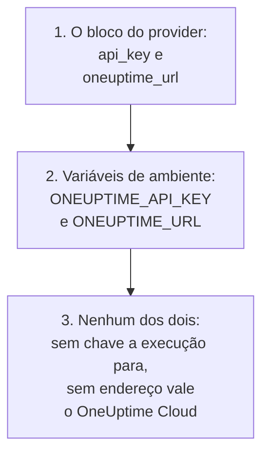

# Guia completo

Este guia trata do que vem depois do seu primeiro apply: como o provider encontra a chave de API, como organizar uma configuração para um projeto ou vários, como os recursos se referem uns aos outros, como ler registros que você não gerencia, como manter o estado seguro e como atualizar. É novo no provider? Comece pelo [Início rápido](/docs/terraform/quick-start).

:::cards
- [Configurar o provider](#configurar-o-provider): A chave de API e o endereço, e onde o provider os lê.
- [Organizar uma configuração](#organizar-uma-configuração): Arquivos, projetos e muitos recursos a partir de um bloco.
- [Ler o que já existe](#ler-o-que-já-existe): Fontes de dados, e como uma busca encontra a correspondência.
- [Manter o estado seguro](#manter-o-estado-seguro): Um backend remoto, e o que nunca fazer commit.
:::

## Configurar o provider

O provider recebe duas configurações. Cada uma vem do bloco do provider ou, se não estiver nele, de uma variável de ambiente:

| Configuração | Variável de ambiente | Quando nenhuma das duas está definida |
| --- | --- | --- |
| `api_key` | `ONEUPTIME_API_KEY` | O provider para antes de planejar qualquer coisa: `Missing API Key` |
| `oneuptime_url` | `ONEUPTIME_URL` | `https://oneuptime.com`, que é o OneUptime Cloud |



`oneuptime_url` é o endereço do seu OneUptime, sem `/api`: o provider adiciona `https://` quando o endereço não tem esquema, e `/api` no fim. `api_key` é sensível, então o Terraform nunca o imprime.

A chave precisa ser uma chave de API do projeto que você gerencia, com permissão para criar, ler, alterar e excluir cada tipo de registro que a sua configuração tem: veja [Criar uma chave de API do projeto](/docs/terraform/quick-start#criar-uma-chave-de-api-do-projeto). A chave de API mestra de um OneUptime auto-hospedado não pertence a nenhum projeto, então uma criação feita com ela falha com `ProjectId required`.

### Dar ao provider a sua chave

:::tabs
@tab Variável de ambiente
```bash
export ONEUPTIME_API_KEY="<your-api-key>"
# Only on a self-hosted OneUptime:
export ONEUPTIME_URL="https://oneuptime.example.com"
```

```hcl title="main.tf"
provider "oneuptime" {}
```
@tab Variável do Terraform
```hcl title="variables.tf"
variable "oneuptime_api_key" {
  description = "API key of the OneUptime project"
  type        = string
  sensitive   = true
}

provider "oneuptime" {
  api_key = var.oneuptime_api_key
}
```

```hcl title="terraform.tfvars"
oneuptime_api_key = "<your-api-key>"
```
:::

Uma variável de ambiente mantém a chave fora de qualquer arquivo. Um arquivo de variáveis é prático na sua própria máquina: adicione `terraform.tfvars` ao `.gitignore`. Em um pipeline, defina `TF_VAR_oneuptime_api_key` em vez de escrever o arquivo.

### Executar em CI/CD

Dê a chave ao job como um segredo, na variável de ambiente `ONEUPTIME_API_KEY`:

:::tabs
@tab GitHub Actions
```yaml title=".github/workflows/oneuptime.yml"
name: OneUptime
on:
  push:
    branches: [main]

jobs:
  apply:
    runs-on: ubuntu-latest
    env:
      ONEUPTIME_API_KEY: ${{ secrets.ONEUPTIME_API_KEY }}
    steps:
      - uses: actions/checkout@v4
      - uses: hashicorp/setup-terraform@v3
      - run: terraform init -input=false
      - run: terraform plan -input=false -out=tfplan
      - run: terraform apply -input=false tfplan
```
@tab GitLab CI
```yaml title=".gitlab-ci.yml"
apply:
  image:
    name: hashicorp/terraform:latest
    entrypoint: [""]
  rules:
    - if: $CI_COMMIT_BRANCH == $CI_DEFAULT_BRANCH
  script:
    - terraform init -input=false
    - terraform plan -input=false -out=tfplan
    - terraform apply -input=false tfplan
```
:::

No GitHub, adicione o segredo em **Settings → Secrets and variables → Actions**; no GitLab, adicione uma variável de CI/CD mascarada com o mesmo nome. Mantenha o estado em um [backend remoto](#manter-o-estado-seguro), para que cada execução comece do estado que a anterior deixou.

## Organizar uma configuração

Uma organização que funciona bem:

```text
oneuptime/
├── main.tf          # the terraform and provider blocks
├── variables.tf     # input variables
├── outputs.tf       # the IDs other configurations need
├── shared.tf        # labels, teams and monitor statuses
├── monitors.tf      # monitors and monitor groups
├── status-pages.tf  # status pages and their domains
└── on-call.tf       # on-call policies and escalation rules
```

- **Uma configuração para cada projeto.** Uma chave de API pertence a um projeto, então uma configuração naturalmente gerencia um.
- **Registros compartilhados uma única vez.** Defina rótulos, equipes e status de monitor em um arquivo, e refira-se a eles pelo endereço em todos os outros lugares.

### Gerenciar vários projetos

Para gerenciar mais de um projeto a partir de uma configuração, dê ao provider um alias para cada um, cada um com a chave daquele projeto. Um recurso indica o alias que usa com `provider`:

```hcl
provider "oneuptime" {
  alias   = "production"
  api_key = var.production_api_key
}

provider "oneuptime" {
  alias   = "staging"
  api_key = var.staging_api_key
}

resource "oneuptime_label" "staging_critical" {
  provider = oneuptime.staging

  name  = "critical"
  color = "#FF5733"
}
```

Declare `production_api_key` e `staging_api_key` como variáveis marcadas como `sensitive`, como acima.

### Muitos recursos a partir de um bloco

O `for_each` cria um recurso para cada entrada de um map. Estes monitores compartilham os critérios e diferem só no nome e no endereço:

```hcl
variable "websites" {
  type = map(string)
  default = {
    homepage = "https://example.com"
    docs     = "https://docs.example.com"
  }
}

resource "oneuptime_monitor" "website" {
  for_each = var.websites

  name                = "Website: ${each.key}"
  monitor_type        = "Website"
  monitoring_interval = "*/5 * * * *"

  monitor_steps = [{
    monitor_destination      = each.value
    monitor_destination_type = "URL"

    criteria = [
      {
        name                  = "Offline"
        filter_condition      = "Any"
        change_monitor_status = true
        monitor_status_id     = data.oneuptime_monitor_status.offline.id

        filters = [
          {
            check_on    = "Is Online"
            filter_type = "False"
          }
        ]
      }
    ]
  }]
}
```

Adicione um site ao map, e o apply seguinte cria o monitor dele. Remova um, e ele o exclui.

## Referir-se a outros recursos

Um recurso que cita um atributo de outro depende dele, e o Terraform ordena o trabalho por essas referências. Aqui o rótulo é criado primeiro e excluído por último, porque o monitor e a página de status o citam:

```mermaid title="O Terraform cria primeiro aquilo a que um recurso se refere"
flowchart TB
    L["oneuptime_label<br/>payments"] --> M["oneuptime_monitor<br/>checkout_api"]
    L --> SP["oneuptime_status_page<br/>payments"]
    M --> R["oneuptime_status_page_resource<br/>checkout_api"]
    SP --> R
```

```hcl
resource "oneuptime_label" "payments" {
  name        = "payments"
  description = "Payment infrastructure"
  color       = "#2ECC71"
}

resource "oneuptime_monitor" "checkout_api" {
  name         = "Checkout API"
  description  = "Availability of the checkout API"
  monitor_type = "Manual"
  labels       = [oneuptime_label.payments.id]
}

resource "oneuptime_status_page" "payments" {
  name                  = "Payments Status"
  page_title            = "Payments Status"
  is_public_status_page = true
  labels                = [oneuptime_label.payments.id]
}

resource "oneuptime_status_page_resource" "checkout_api" {
  status_page_id = oneuptime_status_page.payments.id
  monitor_id     = oneuptime_monitor.checkout_api.id
  display_name   = "Checkout API"
}
```

Raramente você precisa de `depends_on`: adicione-o só para uma ordem que o Terraform não consegue ver pelos atributos. Listas de IDs como `labels` são conjuntos, então reordená-las não muda nada.

## Ler o que já existe

Cada recurso tem uma fonte de dados com o mesmo nome. Uma fonte de dados lê um registro que esta configuração não gerencia, criado no painel ou por outra configuração, para que você possa se referir a ele sem assumir o controle dele.

```hcl
data "oneuptime_label" "critical" {
  name = "critical"
}

data "oneuptime_monitor_status" "offline" {
  is_offline_state = true
}

data "oneuptime_status_page" "main" {
  id = "5f8a1b2c-3d4e-4f6a-8b9c-0d1e2f3a4b5c"
}

resource "oneuptime_monitor" "database" {
  name         = "Database Health"
  monitor_type = "Manual"
  labels       = [data.oneuptime_label.critical.id]
}
```

Como uma busca encontra a correspondência:

| Você define | Ela encontra | Erros |
| --- | --- | --- |
| `id` | O registro com esse ID | `Not Found` quando nenhum registro o tem |
| Quaisquer outros argumentos simples, um ou mais | O único registro que corresponde a todos eles | `Not Found` quando nenhum corresponde, `Ambiguous Match` quando mais de um corresponde |
| `id` e outro argumento, ou nada | Nada | `Invalid Lookup` |

Argumentos simples são texto, números e verdadeiro ou falso: um nome, uma prioridade, um indicador como `is_offline_state`. Não é possível buscar por listas, valores JSON, carimbos de data e hora nem segredos. Para assumir o controle de um registro em vez de só lê-lo, [importe-o](/docs/terraform/importing-resources).

## Manter o estado seguro

O estado do Terraform contém os IDs e os atributos de tudo o que ele gerencia, inclusive segredos. Mantenha-o em um backend remoto que o bloqueia, para que uma equipe compartilhe um único estado e duas execuções nunca o escrevam ao mesmo tempo. Qualquer backend padrão funciona, por exemplo um bucket S3:

```hcl
terraform {
  backend "s3" {
    bucket       = "my-terraform-state"
    key          = "oneuptime/production.tfstate"
    region       = "us-east-1"
    encrypt      = true
    use_lockfile = true
  }
}
```

`use_lockfile` precisa do Terraform 1.10 ou do OpenTofu 1.10, ou posterior. Antes deles, o backend S3 bloqueia com uma tabela do DynamoDB (`dynamodb_table`).

- **Nunca edite o estado à mão.** Use `terraform state mv` e `terraform state rm`.
- **Nunca faça commit de `terraform.tfstate`, nem de um arquivo `.tfvars` que contenha um segredo.**

## Desvio, e o que não o causa

O `terraform plan` compara o OneUptime com a sua configuração e lista o que difere. Algumas diferenças nunca são mostradas:

- **Os horários são comparados como instantes.** `2030-06-01T02:00:00Z` e a forma como o servidor escreve o mesmo instante são iguais.
- **Os valores padrão que o servidor adiciona** às etapas de um monitor, ou a um valor JSON, não são uma diferença em relação ao que você escreveu.
- **O que o servidor mantém atualizado**, como o status atual de um monitor, também não é uma diferença.

Já um valor que você calcula a cada execução é: `timestamp()` dá um horário novo a cada execução, então um plano sempre o mostra. Escreva horários fixos em vez disso:

```hcl
resource "oneuptime_scheduled_maintenance_event" "database_upgrade" {
  title       = "Database upgrade"
  description = "Planned PostgreSQL upgrade"
  starts_at   = "2030-06-01T02:00:00Z"
  ends_at     = "2030-06-01T04:00:00Z"
}
```

## Atualizar o provider

:::steps
### Ler as notas de versão

O [Terraform Registry](https://registry.terraform.io/providers/oneuptime/oneuptime) e as [versões do provider no GitHub](https://github.com/OneUptime/terraform-provider-oneuptime/releases) listam o que mudou.

### Subir a restrição de versão

`{{TERRAFORM_PROVIDER_VERSION}}` já pega cada versão {{TERRAFORM_PROVIDER_MAJOR}}.x. Uma nova versão major precisa de uma nova restrição.

### Baixar a nova versão

```bash
terraform init -upgrade
```

### Planejar antes de aplicar

Execute `terraform plan`, e aplique só quando ele estiver vazio ou mostrar as mudanças que você espera.
:::

Em um OneUptime auto-hospedado, atualize primeiro o OneUptime e depois o provider: o provider não pode ser mais novo que o seu OneUptime. Veja a [Configuração auto-hospedada](/docs/terraform/self-hosted).

## Próximos passos

:::cards
- [Etapas do monitor](/docs/terraform/monitor-steps): Decida o que um monitor verifica e o que cada resultado significa.
- [Exemplos](/docs/terraform/examples): Configurações prontas para uso para os recursos mais comuns.
- [Importar recursos](/docs/terraform/importing-resources): Traga para o Terraform o que você criou no painel.
- [Solução de problemas](/docs/terraform/troubleshooting): Os erros comuns e como corrigi-los.
:::
