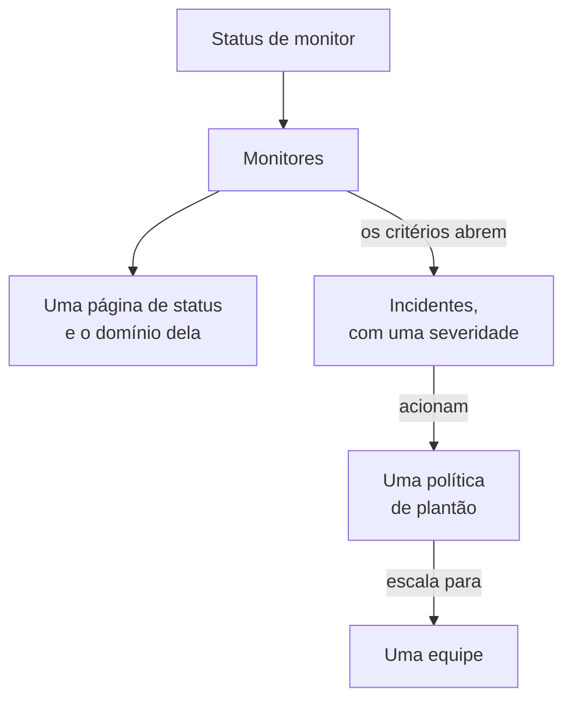

# Exemplos

Configurações prontas para uso para os recursos com que a maioria dos projetos começa. Cada bloco se aplica como está sobre a configuração do provider abaixo, e a maioria vem dos testes de ponta a ponta do provider, que os aplicam a um OneUptime real a cada mudança.

:::cards
- [Monitores](#monitores): Monitores de site, API, ping, porta, certificado SSL, heartbeat e manuais.
- [Páginas de status](#páginas-de-status): Uma página de status com um grupo e um monitor, e um domínio próprio.
- [Equipes e plantão](#equipes-e-plantão): Uma equipe, e uma política de plantão que a aciona.
- [Incidentes e manutenção](#incidentes-e-manutenção): Severidades, estados, um incidente declarado e uma janela de manutenção.
:::



## Configuração do provider

Todos os exemplos pressupõem esta configuração, com a chave de API na variável de ambiente `ONEUPTIME_API_KEY`:

```hcl title="main.tf"
terraform {
  required_providers {
    oneuptime = {
      source  = "oneuptime/oneuptime"
      version = "{{TERRAFORM_PROVIDER_VERSION}}"
    }
  }
}

provider "oneuptime" {
  # On a self-hosted OneUptime, add your OneUptime's address:
  # oneuptime_url = "https://oneuptime.example.com"
}
```

## Rótulos

Os rótulos ordenam e filtram registros. A maioria dos recursos aceita um conjunto de IDs de rótulos em `labels`:

```hcl
resource "oneuptime_label" "production" {
  name        = "production"
  description = "Production infrastructure"
  color       = "#FF5733"
}
```

## Monitores

Os monitores abaixo definem o seu status com três dos status com que todo projeto começa, lidos com fontes de dados:

```hcl
data "oneuptime_monitor_status" "operational" {
  name = "Operational"
}

data "oneuptime_monitor_status" "degraded" {
  name = "Degraded"
}

data "oneuptime_monitor_status" "offline" {
  name = "Offline"
}
```

As `monitor_steps` de cada monitor dizem o que ele verifica e como cada resultado é julgado: [Etapas do monitor](/docs/terraform/monitor-steps) explica cada atributo.

### Monitor de site

Offline quando o site não responde, online quando responde com 200. O teste de ponta a ponta `35-monitor-with-steps` aplica um monitor com estas verificações:

```hcl
resource "oneuptime_monitor" "website" {
  name                = "Website"
  description         = "Homepage availability and status code"
  monitor_type        = "Website"
  monitoring_interval = "*/5 * * * *"
  labels              = [oneuptime_label.production.id]

  monitor_steps = [{
    monitor_destination      = "https://example.com"
    monitor_destination_type = "URL"
    request_type             = "GET"

    criteria = [
      {
        name                  = "Offline"
        description           = "The website does not respond"
        filter_condition      = "Any"
        change_monitor_status = true
        monitor_status_id     = data.oneuptime_monitor_status.offline.id

        filters = [
          {
            check_on    = "Is Online"
            filter_type = "False"
          }
        ]
      },
      {
        name                  = "Online"
        description           = "The website responds with 200"
        filter_condition      = "All"
        change_monitor_status = true
        monitor_status_id     = data.oneuptime_monitor_status.operational.id

        filters = [
          {
            check_on    = "Is Online"
            filter_type = "True"
          },
          {
            check_on    = "Response Status Code"
            filter_type = "Equal To"
            value       = "200"
          }
        ]
      }
    ]
  }]
}
```

### Monitor de API

Um `POST` com cabeçalhos e um corpo JSON, degradado quando a resposta é lenta. O teste de ponta a ponta `35-monitor-with-steps` aplica um monitor de API parecido:

```hcl
resource "oneuptime_monitor" "orders_api" {
  name         = "Orders API"
  description  = "Health check of the orders API"
  monitor_type = "API"

  monitor_steps = [{
    monitor_destination      = "https://api.example.com/v1/health"
    monitor_destination_type = "URL"
    request_type             = "POST"
    request_headers = {
      "Content-Type" = "application/json"
      "Accept"       = "application/json"
    }
    request_body = jsonencode({ check = "health" })

    criteria = [
      {
        name                  = "Offline"
        description           = "The API does not answer, or answers with an error"
        filter_condition      = "Any"
        change_monitor_status = true
        monitor_status_id     = data.oneuptime_monitor_status.offline.id

        filters = [
          {
            check_on    = "Is Online"
            filter_type = "False"
          },
          {
            check_on    = "Response Status Code"
            filter_type = "Greater Than Or Equal To"
            value       = "500"
          }
        ]
      },
      {
        name                  = "Slow"
        description           = "The API takes more than two seconds"
        filter_condition      = "All"
        change_monitor_status = true
        monitor_status_id     = data.oneuptime_monitor_status.degraded.id

        filters = [
          {
            check_on    = "Response Time (in ms)"
            filter_type = "Greater Than"
            value       = "2000"
          }
        ]
      },
      {
        name                  = "Online"
        description           = "The API answers in time"
        filter_condition      = "All"
        change_monitor_status = true
        monitor_status_id     = data.oneuptime_monitor_status.operational.id

        filters = [
          {
            check_on    = "Is Online"
            filter_type = "True"
          }
        ]
      }
    ]
  }]
}
```

### Monitor Ping

Um monitor Ping recebe um nome de host ou um endereço IP em vez de uma URL:

```hcl
resource "oneuptime_monitor" "gateway" {
  name         = "Gateway"
  description  = "The gateway answers ping"
  monitor_type = "Ping"

  monitor_steps = [{
    monitor_destination      = "gateway.example.com"
    monitor_destination_type = "Hostname"

    criteria = [
      {
        name                  = "Unreachable"
        filter_condition      = "Any"
        change_monitor_status = true
        monitor_status_id     = data.oneuptime_monitor_status.offline.id

        filters = [
          {
            check_on    = "Is Online"
            filter_type = "False"
          }
        ]
      },
      {
        name                  = "Reachable"
        filter_condition      = "All"
        change_monitor_status = true
        monitor_status_id     = data.oneuptime_monitor_status.operational.id

        filters = [
          {
            check_on    = "Is Online"
            filter_type = "True"
          }
        ]
      }
    ]
  }]
}
```

### Monitor de porta

Um monitor de porta adiciona a `port` a verificar, como número:

```hcl
resource "oneuptime_monitor" "database_port" {
  name         = "Database port"
  description  = "PostgreSQL accepts connections"
  monitor_type = "Port"

  monitor_steps = [{
    monitor_destination      = "db.example.com"
    monitor_destination_type = "Hostname"
    port                     = 5432

    criteria = [
      {
        name                  = "Closed"
        filter_condition      = "Any"
        change_monitor_status = true
        monitor_status_id     = data.oneuptime_monitor_status.offline.id

        filters = [
          {
            check_on    = "Is Online"
            filter_type = "False"
          }
        ]
      },
      {
        name                  = "Open"
        filter_condition      = "All"
        change_monitor_status = true
        monitor_status_id     = data.oneuptime_monitor_status.operational.id

        filters = [
          {
            check_on    = "Is Online"
            filter_type = "True"
          }
        ]
      }
    ]
  }]
}
```

### Monitor de certificado SSL

Offline quando o certificado não é válido, degradado quando expira em 14 dias ou menos, como um novo monitor de certificado SSL fica no painel:

```hcl
resource "oneuptime_monitor" "certificate" {
  name         = "example.com certificate"
  description  = "The TLS certificate of example.com"
  monitor_type = "SSL Certificate"

  monitor_steps = [{
    monitor_destination      = "https://example.com"
    monitor_destination_type = "URL"

    criteria = [
      {
        name                  = "Not valid"
        description           = "Expired, self-signed, untrusted or not reachable"
        filter_condition      = "Any"
        change_monitor_status = true
        monitor_status_id     = data.oneuptime_monitor_status.offline.id

        filters = [
          {
            check_on    = "Is Not A Valid Certificate"
            filter_type = "True"
          }
        ]
      },
      {
        name                  = "Expires soon"
        description           = "Valid, and expires in 14 days or less"
        filter_condition      = "All"
        change_monitor_status = true
        monitor_status_id     = data.oneuptime_monitor_status.degraded.id

        filters = [
          {
            check_on    = "Is Valid Certificate"
            filter_type = "True"
          },
          {
            check_on    = "Expires In Days"
            filter_type = "Less Than Or Equal To"
            value       = "14"
          }
        ]
      },
      {
        name                  = "Valid"
        filter_condition      = "All"
        change_monitor_status = true
        monitor_status_id     = data.oneuptime_monitor_status.operational.id

        filters = [
          {
            check_on    = "Is Valid Certificate"
            filter_type = "True"
          }
        ]
      }
    ]
  }]
}
```

### Monitor manual

Um monitor manual não verifica nada: você mesmo define o status dele. Ele não precisa de `monitor_steps`:

```hcl
resource "oneuptime_monitor" "payment_provider" {
  name         = "Payment provider"
  description  = "Set by hand during the provider's incidents"
  monitor_type = "Manual"
}
```

### Monitor de heartbeat

Um monitor de requisições recebidas espera requisições em vez de enviá-las: aqui, um job de backup que dá sinal de vida toda noite. Ele fica offline quando nenhuma requisição chega por 25 horas:

```hcl
resource "oneuptime_monitor" "nightly_backup" {
  name         = "Nightly backup"
  description  = "The backup job sends a heartbeat when it finishes"
  monitor_type = "Incoming Request"

  monitor_steps = [{
    criteria = [
      {
        name                  = "No heartbeat"
        filter_condition      = "Any"
        change_monitor_status = true
        monitor_status_id     = data.oneuptime_monitor_status.offline.id

        filters = [
          {
            check_on    = "Incoming Request"
            filter_type = "Not Recieved In Minutes"
            value       = "1500"
          }
        ]
      },
      {
        name                  = "Heartbeat received"
        filter_condition      = "All"
        change_monitor_status = true
        monitor_status_id     = data.oneuptime_monitor_status.operational.id

        filters = [
          {
            check_on    = "Incoming Request"
            filter_type = "Recieved In Minutes"
            value       = "1500"
          }
        ]
      }
    ]
  }]
}

output "nightly_backup_heartbeat_key" {
  value     = oneuptime_monitor.nightly_backup.incoming_request_secret_key
  sensitive = true
}
```

O job envia a sua requisição para `https://oneuptime.com/heartbeat/YOUR_SECRET_KEY`, com a chave que `terraform output -raw nightly_backup_heartbeat_key` imprime: veja [Monitor de requisições recebidas](/docs/monitor/incoming-request-monitor). O agente de um monitor de servidor se identifica do mesmo jeito, com `server_monitor_secret_key`.

### Grupo de monitores

Um grupo de monitores mostra um conjunto de monitores com um único status:

```hcl
resource "oneuptime_monitor_group" "storefront" {
  name        = "Storefront"
  description = "Everything the shop needs"
}

resource "oneuptime_monitor_group_resource" "website" {
  monitor_group_id = oneuptime_monitor_group.storefront.id
  monitor_id       = oneuptime_monitor.website.id
}

resource "oneuptime_monitor_group_resource" "orders_api" {
  monitor_group_id = oneuptime_monitor_group.storefront.id
  monitor_id       = oneuptime_monitor.orders_api.id
}
```

## Páginas de status

### Uma página de status com um grupo e um monitor

Uma página de status mostra recursos, e pode organizá-los em grupos. O teste de ponta a ponta `42-status-page-resources` aplica esta configuração:

```hcl
resource "oneuptime_status_page" "public" {
  name                  = "Public Status"
  description           = "Customer-facing status page"
  page_title            = "System Status"
  page_description      = "Check our system status and incident history"
  is_public_status_page = true
}

resource "oneuptime_status_page_group" "services" {
  status_page_id = oneuptime_status_page.public.id
  name           = "Services"
}

resource "oneuptime_status_page_resource" "website" {
  status_page_id       = oneuptime_status_page.public.id
  status_page_group_id = oneuptime_status_page_group.services.id
  monitor_id           = oneuptime_monitor.website.id
  display_name         = "Website"
}
```

### Um domínio próprio

Três recursos trabalham juntos: um domínio do seu projeto, a página de status e o domínio da página de status, que une os dois. O servidor preenche `full_domain` e o token de verificação CNAME: não os defina. Os testes de ponta a ponta `12-status-page-domain` e `25-status-page-with-domain` aplicam esta configuração:

```hcl
resource "oneuptime_domain" "company" {
  domain = "example.com"
}

resource "oneuptime_status_page_domain" "status" {
  domain_id      = oneuptime_domain.company.id
  status_page_id = oneuptime_status_page.public.id
  subdomain      = "status"
}

output "status_page_address" {
  # The subdomain and the domain, such as status.example.com.
  value = oneuptime_status_page_domain.status.full_domain
}
```

Um domínio novo precisa passar pela verificação de DNS antes que a página de status responda nele.

## Equipes e plantão

### Uma equipe e os seus membros

```hcl
resource "oneuptime_team" "sre" {
  name        = "SRE"
  description = "Site reliability engineering"
}

variable "alice_user_id" {
  description = "Alice's user ID, the last part of the address of her page under Users"
  type        = string
}

resource "oneuptime_team_member" "alice" {
  team_id = oneuptime_team.sre.id
  user_id = var.alice_user_id
}
```

Uma pessoa que já está no projeto entra na equipe na hora. Qualquer outra pessoa recebe um convite, e passa a estar na equipe assim que o aceita. O teste de ponta a ponta `33-team-crud` aplica a equipe.

### Uma política de plantão que aciona uma equipe

A primeira regra da política aciona a equipe, e a política recomeça, até duas vezes, quando ninguém confirma:

```hcl
resource "oneuptime_on_call_policy" "primary" {
  name                                             = "Primary on-call"
  description                                      = "First line for production incidents"
  repeat_policy_if_no_one_acknowledges             = true
  repeat_policy_if_no_one_acknowledges_no_of_times = 2
}

resource "oneuptime_escalation_rule" "first_line" {
  on_call_duty_policy_id    = oneuptime_on_call_policy.primary.id
  name                      = "Page the SRE team"
  description               = "Moves on after 5 minutes without an acknowledgement"
  order                     = 1
  escalate_after_in_minutes = 5
}

resource "oneuptime_team_on_call_duty_escalation_rule" "sre" {
  on_call_duty_policy_id                 = oneuptime_on_call_policy.primary.id
  on_call_duty_policy_escalation_rule_id = oneuptime_escalation_rule.first_line.id
  team_id                                = oneuptime_team.sre.id
}
```

Os critérios de um monitor acionam a política por meio de `on_call_policy_ids` nos incidentes que abrem: veja [Incidentes e alertas](/docs/terraform/monitor-steps#incidentes-e-alertas).

## Incidentes e manutenção

### Severidades e estados

As severidades classificam o impacto de um incidente, e os estados são as etapas da vida dele. `order` é a posição em que cada um aparece:

```hcl
resource "oneuptime_incident_severity" "sev1" {
  name        = "SEV-1"
  description = "Full outage, all hands"
  color       = "#E74C3C"
  order       = 1
}

resource "oneuptime_incident_state" "mitigated" {
  name        = "Mitigated"
  description = "Impact contained, fix in progress"
  color       = "#F39C12"
  order       = 3
}
```

`oneuptime_alert_severity` e `oneuptime_alert_state` funcionam do mesmo jeito para os alertas. Os testes de ponta a ponta `03-incident-severity` e `04-incident-state` os aplicam.

### Declarar um incidente

Normalmente são os monitores que abrem incidentes, mas um incidente também é um recurso, o que é útil para um game day. É um incidente de verdade, então mantenha um simulado fora das suas páginas de status:

```hcl
resource "oneuptime_incident" "drill" {
  title                     = "Disaster recovery drill"
  description               = "A game day: we fail over the database"
  incident_severity_id      = oneuptime_incident_severity.sev1.id
  is_visible_on_status_page = false

  should_status_page_subscribers_be_notified_on_incident_created = false
}
```

O teste de ponta a ponta `28-incident-crud` aplica um incidente.

### Manutenção programada

Uma janela de manutenção com horários fixos, mostrada nas suas páginas de status:

```hcl
resource "oneuptime_scheduled_maintenance_event" "database_upgrade" {
  title                       = "Database maintenance"
  description                 = "Planned PostgreSQL upgrade: writes pause briefly"
  starts_at                   = "2030-06-01T02:00:00Z"
  ends_at                     = "2030-06-01T04:00:00Z"
  is_visible_on_status_page   = true
  monitors                    = [oneuptime_monitor.website.id]
  change_monitor_status_to_id = data.oneuptime_monitor_status.degraded.id
}
```

Os horários seguem a RFC 3339, e o mesmo instante escrito de outra forma não é uma mudança. O teste de ponta a ponta `30-scheduled-maintenance-crud` aplica eventos de manutenção.

Para colocar os monitores do evento em um status enquanto ele acontece, associe-os com `monitors` e defina `change_monitor_status_to_id` como um dos seus status de monitor: os monitores passam para ele quando o evento começa, e voltam para operacional quando termina. O Terraform altera `change_monitor_status_to_id` no lugar até o evento começar. Depois que o evento começou, os monitores dele já estão nesse status, e um apply que o altere falha com “Change Monitor Status to can no longer be changed: this event has already started.”

## Sondas

Uma sonda própria executa verificações a partir da sua rede. A chave dela é o segredo com que a sonda se identifica, então passe-a em uma variável:

```hcl
variable "probe_key" {
  description = "The key the probe signs in with"
  type        = string
  sensitive   = true
}

resource "oneuptime_probe" "eu_west" {
  key           = var.probe_key
  name          = "EU West"
  description   = "Probe in our eu-west-1 network"
  probe_version = "1.0.0"

  should_auto_enable_probe_on_new_monitors = true
}
```

Execute a sonda com `PROBE_ID` definido como o `id` da sonda e `PROBE_KEY` como a chave: veja [Sondas personalizadas](/docs/probe/custom-probe). O teste de ponta a ponta `23-probe-crud` aplica sondas.

## Próximos passos

:::cards
- [Etapas do monitor](/docs/terraform/monitor-steps): Cada atributo das verificações e dos critérios de um monitor.
- [Importar recursos](/docs/terraform/importing-resources): Traga para o Terraform o que você criou no painel.
- [Guia completo](/docs/terraform/complete-guide): Fontes de dados, estado, CI/CD e atualizações.
:::
