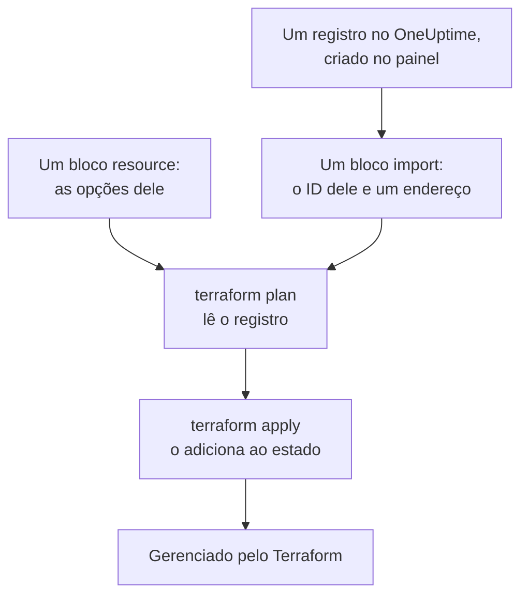

# Importar recursos

Você não precisa começar do zero para gerenciar o OneUptime com o Terraform. Importe os monitores, páginas de status, equipes e outros registros que você já tem, e o Terraform passa a gerenciá-los a partir daí, como estão. Uma importação apenas lê: nada muda no OneUptime até você aplicar uma alteração que planejou.

:::cards
- [Como funciona uma importação](#como-funciona-uma-importação): O que uma importação lê, e o que você escreve.
- [Importar um recurso](#importar-um-recurso): A partir da página dele no painel, em quatro etapas.
- [Importar muitos recursos](#importar-muitos-recursos): Blocos de importação para uma lista inteira, e a configuração que o Terraform escreve para você.
- [Parar de gerenciar um recurso](#parar-de-gerenciar-um-recurso): Devolva-o ao painel sem excluí-lo.
:::

## Como funciona uma importação

Uma importação liga um registro que já existe no OneUptime a um bloco `resource` da sua configuração. Você escreve um bloco `import` com o ID do registro e o endereço para onde ele vai. O próximo `terraform plan` lê o registro pelo ID e mostra que ele será importado, junto com cada diferença entre o registro e a sua configuração. `terraform apply` o adiciona ao estado do Terraform, e a partir daí o registro é gerenciado como qualquer coisa que o Terraform criou.



Escreva o bloco `resource` de modo que ele diga o que o registro já é. Onde eles diferem, o plano mostra a importação e uma alteração, e aplicá-lo altera o registro no OneUptime.

### O que pode ser importado

Todo recurso do provider pode ser importado pelo ID, exceto `oneuptime_file`: a API do OneUptime não consegue ler um arquivo de volta, então o provider responde `Import Not Supported`. Fontes de dados nunca são importadas. Para usar um registro na sua configuração sem gerenciá-lo, leia-o com uma [fonte de dados](/docs/terraform/complete-guide#ler-o-que-já-existe).

## Antes de começar

- **Terraform 1.5 ou posterior, ou OpenTofu 1.6 ou posterior.** Os blocos `import` desta página precisam dessas versões. Um Terraform mais antigo importa pela [linha de comando](#importar-pela-linha-de-comando).
- **Uma chave de API que possa ler o que você importa.** A importação lê cada registro com a chave do provider, e gerenciá-lo depois também precisa das permissões para alterá-lo e excluí-lo. Veja [Criar uma chave de API do projeto](/docs/terraform/quick-start#criar-uma-chave-de-api-do-projeto).
- **O provider na sua configuração**, preparado como no [Início rápido](/docs/terraform/quick-start#apontar-o-terraform-para-o-oneuptime).

## Importar um recurso

O painel escreve a configuração do recurso que você está vendo, com o bloco `import` dele, então raramente você escreve um à mão.

:::steps
### Abrir a página Terraform do recurso

Abra o monitor, a página de status ou outro recurso no painel. No menu lateral dele, abra **Desenvolvedores** e depois **Terraform**.

### Copiar a configuração

A página escreve o bloco `resource` do recurso a partir das opções atuais dele, e um bloco `import` com o ID dele. Coloque os dois em um arquivo `.tf`:

```hcl title="status-pages.tf"
resource "oneuptime_status_page" "public_status" {
  name       = "Public Status"
  page_title = "Acme Status"

  # Secrets are not shown here: master_password, embedded_overall_status_token.
  # Terraform leaves them as they are in OneUptime.
}

import {
  to = oneuptime_status_page.public_status
  id = "68a1b2c3-d4e5-4f6a-8b9c-0d1e2f3a4b02"
}
```

Ela escreve as opções que diferem dos padrões, e um comentário depois de cada ID nomeia o registro para o qual ele aponta. Segredos nunca são mostrados: os que o recurso precisa são lidos de variáveis marcadas como `sensitive`, e o comentário nomeia os que ela deixa de fora.

### Planejar

Execute `terraform plan`. Ele termina com `Plan: 1 to import, 0 to add, 0 to change, 0 to destroy.`: o Terraform encontrou o registro, e a sua configuração corresponde a ele.

### Aplicar

Execute `terraform apply`. A página de status agora está no estado do Terraform, e o próximo plano responde `No changes.` Depois você pode excluir o bloco `import`, ou mantê-lo como uma nota de onde o recurso veio: ele não faz mais nada quando o recurso já é gerenciado.
:::

### Escrever os blocos você mesmo

Sem o painel, escreva os dois blocos você mesmo. Comece o bloco `resource` com os atributos de que o recurso precisa, e execute `terraform plan`. Onde a sua configuração difere do registro, o plano mostra a alteração ao lado da importação:

```text
  # oneuptime_label.critical will be updated in-place
  # (imported from "68a1b2c3-d4e5-4f6a-8b9c-0d1e2f3a4b03")
  ~ resource "oneuptime_label" "critical" {
      ~ color = "#FF5733" -> "#000000"
    }

Plan: 1 to import, 0 to add, 1 to change, 0 to destroy.
```

Copie o valor do registro para a sua configuração (aqui `color = "#FF5733"`), e planeje de novo até o plano mostrar a importação e nenhuma alteração. O ID do registro está em três lugares:

| Onde | Como |
| --- | --- |
| A página do recurso | O cartão de detalhes dele termina com uma linha **ID**. Clique no ID, ou no botão de copiar ao lado, para copiar o ID inteiro. |
| A barra de endereço | O ID vem depois do nome da lista: `/dashboard/<project-id>/monitors/<monitor-id>`. |
| A API | Todo registro traz o seu ID em `_id`. |

## Importar muitos recursos

Para importar todos os monitores, páginas de status ou outros recursos de um mesmo tipo, comece pela lista deles.

:::steps
### Abrir a página Terraform da lista

Abra a lista, depois **Desenvolvedores** e **Terraform** no menu lateral dela, por exemplo **Monitores → Desenvolvedores → Terraform**.

### Copiar os blocos de importação

A página escreve um bloco `import` para cada registro (os 100 primeiros), com um endereço formado a partir do nome do registro. Coloque-os em um arquivo separado, como `imports.tf`:

```hcl title="imports.tf"
import {
  to = oneuptime_monitor.homepage
  id = "68a1b2c3-d4e5-4f6a-8b9c-0d1e2f3a4b01"
}

import {
  to = oneuptime_monitor.checkout_api
  id = "68a1b2c3-d4e5-4f6a-8b9c-0d1e2f3a4b05"
}
```

### Deixar o Terraform escrever a configuração

Execute o plano com um nome de arquivo para a configuração que o Terraform escreve. O arquivo ainda não pode existir: o Terraform só escreve em um arquivo novo.

```bash
terraform plan -generate-config-out=monitors.tf
```

O Terraform lê cada registro e escreve um bloco `resource` para cada bloco `import` que não tem um. Ele avisa que a geração de configuração é experimental, então leia o que ele escreveu.

### Revisar e aplicar

No arquivo novo, substitua os IDs de outros registros por referências aos recursos deles, como `labels = [oneuptime_label.critical.id]`, para que o Terraform saiba em que ordem trabalhar. Execute `terraform plan` até ele mostrar apenas as importações, e depois `terraform apply`.
:::

### Um projeto inteiro

Importe um projeto lista por lista, começando pelos registros aos quais outros se referem. Assim cada bloco de recurso pode se referir aos anteriores pelo endereço em vez do ID:

```mermaid title="Importe primeiro os registros aos quais outros se referem"
flowchart TB
    S["Rótulos, equipes,<br/>status de monitor<br/>e severidades de incidente"] --> M["Monitores, páginas de status<br/>e políticas de plantão"]
    M --> L["O que os liga:<br/>recursos de páginas de status,<br/>regras de escalonamento<br/>e membros de equipe"]
```

Os registros com que todo projeto começa, como os status de monitor e as severidades de incidente, muitas vezes são melhor lidos com fontes de dados do que importados: o Terraform pode então se referir a eles, mas nunca os altera nem os exclui. O projeto está importado quando `terraform plan` responde `No changes.`

## Importar pela linha de comando

`terraform import` importa um recurso por vez, e funciona em todas as versões do Terraform e do OpenTofu. Escreva primeiro o bloco `resource`, e depois execute o comando com o endereço do bloco e o ID do registro:

```bash
terraform import oneuptime_status_page.public_status 68a1b2c3-d4e5-4f6a-8b9c-0d1e2f3a4b02
terraform import oneuptime_label.critical 68a1b2c3-d4e5-4f6a-8b9c-0d1e2f3a4b03
terraform import oneuptime_team.sre 68a1b2c3-d4e5-4f6a-8b9c-0d1e2f3a4b04
```

Cada um termina com `Import successful!`. Ao contrário de um bloco `import`, o comando escreve o estado na hora, sem um plano para revisar antes: execute `terraform plan` depois dele, e altere a sua configuração até o plano responder `No changes.`

## Parar de gerenciar um recurso

Para devolver um recurso ao painel sem excluí-lo, substitua o bloco `resource` dele por um bloco `removed` que mantém o registro:

```hcl
removed {
  from = oneuptime_team.sre

  lifecycle {
    destroy = false
  }
}
```

O plano diz que a equipe não será mais gerenciada pelo Terraform, e não destrói nada. Aplique-o, e depois exclua o bloco `removed`. Um bloco `removed` com `destroy = false` precisa do Terraform 1.7 ou posterior, ou do OpenTofu 1.10 ou posterior. Em uma versão mais antiga, execute `terraform state rm oneuptime_team.sre` em vez disso.

> [!WARNING]
> Excluir um bloco `resource` exclui o registro dele no OneUptime no próximo apply. No Terraform, um bloco `removed` sem `destroy = false` faz o mesmo: sempre escreva o bloco `lifecycle`.

## Bom saber

- **Uma importação não altera nada, mas o próximo apply sim.** Aplicar um plano que mostra uma alteração ao lado de uma importação altera o registro no OneUptime. Primeiro faça o plano mostrar apenas a importação.
- **Segredos não são lidos de volta.** Um segredo que o OneUptime nunca devolve, como o `secret_value` de um segredo de monitor, não está no estado depois de uma importação. Se a sua configuração o define, o primeiro plano o mostra como uma alteração, e aplicá-lo escreve o segredo de novo.
- **Uma configuração para cada registro.** Um registro importado em duas configurações volta, a cada apply, ao que cada uma delas diz.
- **Registros importados são registros gerenciados.** `terraform destroy` os exclui do OneUptime, como os registros que o Terraform criou.

## Solução de problemas

:::details Mensagem “Cannot import non-existent remote object”
Nenhum registro tem esse ID, ou a chave de API do provider não pode lê-lo: o OneUptime responde da mesma forma nos dois casos. Verifique o ID, e se a chave pode ler esse tipo de registro.
:::

:::details Mensagem “Import Not Supported”
`oneuptime_file` é o único recurso que não pode ser importado. Deixe-o de fora, e deixe o Terraform criar um arquivo novo em vez disso.
:::

:::details Mensagem “Invalid ID format”
O ID não é o ID de um registro, por exemplo é um nome. Uma importação recebe o ID, um UUID como `68a1b2c3-d4e5-4f6a-8b9c-0d1e2f3a4b02`: copie-o da página do recurso.
:::

:::details Mensagem “Target generated file already exists”
`-generate-config-out` nomeia um arquivo que já existe. Nomeie um arquivo novo, ou mova o conteúdo do arquivo para outro lugar e exclua-o.
:::

:::details Mensagem “Resource already managed by Terraform”
`terraform import` recebeu um endereço que já está no estado. Importe o registro para outro endereço, ou verifique com `terraform state list` o que o endereço contém.
:::

## Próximos passos

:::cards
- [Guia completo](/docs/terraform/complete-guide): Fontes de dados, referências entre recursos, e estado.
- [Etapas do monitor](/docs/terraform/monitor-steps): Leia e altere o que um monitor importado verifica.
- [Exemplos](/docs/terraform/examples): Configurações prontas para os recursos mais comuns.
- [Solução de problemas](/docs/terraform/troubleshooting): Erros comuns e como corrigi-los.
:::
