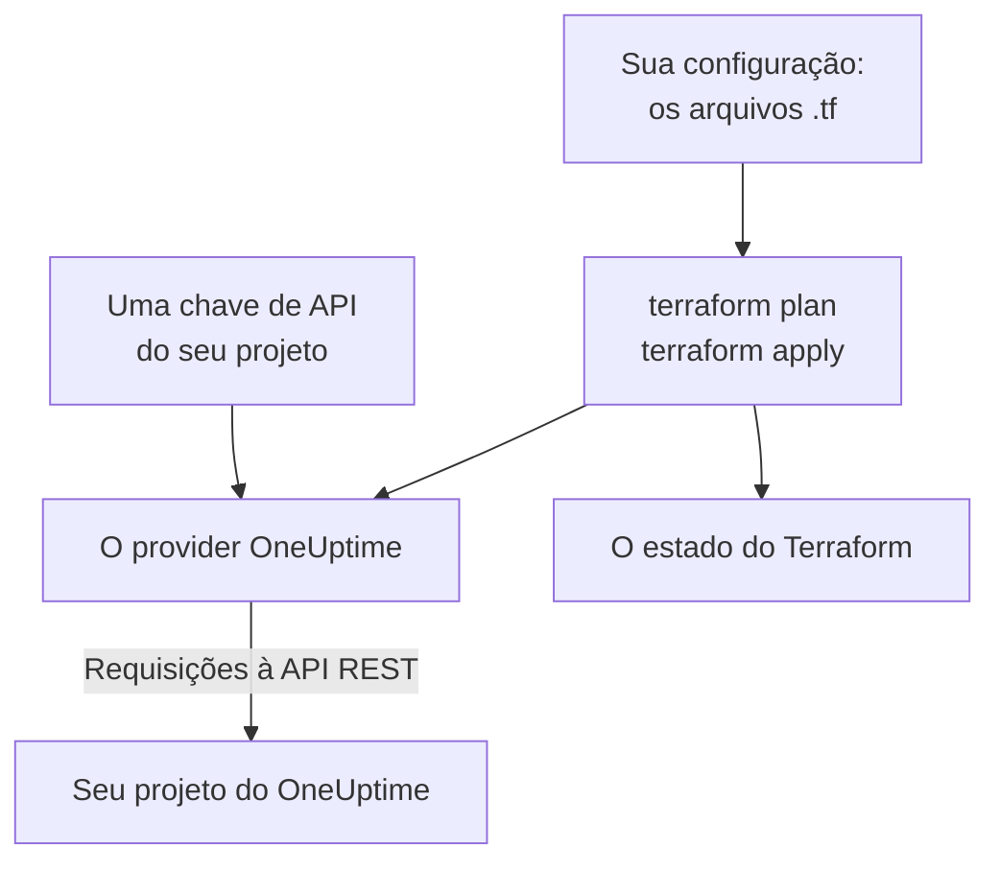

# Visão geral do Terraform

O provider Terraform do OneUptime gerencia o seu projeto do OneUptime como código. Descreva monitores, páginas de status, políticas de plantão, equipes, rótulos e os outros registros do seu projeto em arquivos `.tf`, veja o que vai mudar com `terraform plan` e faça a mudança com `terraform apply`. Ele funciona com o OneUptime Cloud e com um OneUptime auto-hospedado, e com o OpenTofu assim como com o Terraform.

:::cards
- [Como o provider funciona](#como-o-provider-funciona): Sua configuração, o plano e as requisições à API por trás deles.
- [Instalar o provider](#instalar-o-provider): O bloco do provider e a versão a escolher.
- [Deixe o painel escrever](#deixe-o-painel-escrever): Configuração e blocos de import para o que você já tem.
- [O que você pode gerenciar](#o-que-você-pode-gerenciar): Recursos, fontes de dados e como os atributos deles são escritos.
:::

## Como o provider funciona

O provider é um plugin que o Terraform baixa de um registry. No `terraform apply`, ele transforma cada mudança do plano em uma requisição à API REST do OneUptime, feita com uma chave de API do seu projeto. O Terraform guarda no seu estado o que criou, então o plano seguinte mostra só o que mudou desde então.



Uma chave de API pertence a um projeto e decide o que o Terraform pode ler e alterar nele, então uma configuração gerencia um projeto. Para gerenciar vários, dê ao provider um [alias](/docs/terraform/complete-guide#gerenciar-vários-projetos) para cada um.

## Antes de começar

- **Terraform 1.5 ou posterior, ou OpenTofu 1.6 ou posterior.** Os blocos `import` que o painel escreve precisam dessas versões.
- **Uma chave de API do seu projeto.** O [Início rápido](/docs/terraform/quick-start#criar-uma-chave-de-api-do-projeto) mostra como criar uma em **Configurações do projeto → Avançado → Chaves de API**.
- **No OneUptime Cloud, o plano Growth ou superior.** As chaves de API de um projeto só funcionam nele.

## Instalar o provider

Adicione o provider a um arquivo `.tf`. O `terraform init` o baixa do Terraform Registry, e o `tofu init` do OpenTofu Registry:

```hcl title="main.tf"
terraform {
  required_providers {
    oneuptime = {
      source  = "oneuptime/oneuptime"
      version = "{{TERRAFORM_PROVIDER_VERSION}}"
    }
  }
}

provider "oneuptime" {
  # The API key comes from the ONEUPTIME_API_KEY environment variable.
  # On a self-hosted OneUptime, add your OneUptime's address:
  # oneuptime_url = "https://oneuptime.example.com"
}
```

Mantenha a chave fora dos seus arquivos: exporte-a antes de executar o Terraform, ou passe-a em uma variável marcada como `sensitive`. O [Guia completo](/docs/terraform/complete-guide#configurar-o-provider) lista todas as formas de dar ao provider a sua chave e o seu endereço.

### Escolher uma versão

As versões do provider seguem as do OneUptime: o provider {{TERRAFORM_PROVIDER_MAJOR}}.x é gerado a partir do OneUptime {{TERRAFORM_PROVIDER_MAJOR}}.x. A restrição acima, `{{TERRAFORM_PROVIDER_VERSION}}`, pega a versão {{TERRAFORM_PROVIDER_MAJOR}}.x mais recente, que é a certa para o OneUptime Cloud. Em um OneUptime auto-hospedado, use o provider mais recente que não seja mais novo que o seu OneUptime: a [Configuração auto-hospedada](/docs/terraform/self-hosted) mostra como fixá-lo.

## Deixe o painel escrever

Você não precisa escrever à mão um recurso que já tem. Cada recurso do painel do OneUptime (um monitor, uma página de status, um workflow, uma política de plantão e os outros) tem uma seção **Desenvolvedores** no menu lateral, recolhida até você abri-la. A página **Terraform** dela escreve a configuração para você, preenchida com o seu próprio projeto.

:::steps
### Abrir o recurso

Abra o monitor, a página de status ou o outro recurso que você quer que o Terraform gerencie.

### Abrir a página Terraform dele

No menu lateral, abra **Desenvolvedores** e depois **Terraform**.

### Copiar a configuração

A página escreve a configuração do recurso a partir das configurações atuais dele, com um bloco `import`. Um comentário depois de cada ID dá o nome do registro para o qual ele aponta (`incident_severity_id = "..." # Critical Incident`).

### Planejar e aplicar

Execute `terraform plan`: ele mostra o recurso sendo importado e nada a alterar. Aplique, e o Terraform passa a gerenciar o recurso a partir daí.
:::

Abaixo da configuração, **Para ir além** traz o que as pessoas costumam adicionar ao lado do recurso, referindo-se a ele pelo seu endereço: uma equipe responsável por um incidente, um grupo de monitores para uma página de status, uma regra de escalonamento para uma política de plantão.

As páginas de lista (por exemplo **Incidentes** ou **Monitores**) têm a mesma seção. Ali, a página **Terraform** escreve um novo recurso com os campos que a maioria das pessoas preenche, usando os registros do seu próprio projeto: um incidente com uma das suas severidades, um monitor com os critérios que um novo monitor recebe no painel, ligado aos seus status. Ela traz **Configurações comuns** prontas (uma página de status com um grupo e um monitor, uma política de plantão que aciona uma equipe, um rodízio de plantão semanal) e um bloco `import` para cada recurso que você já tem (os 100 primeiros), pronto para `terraform plan -generate-config-out`. As duas páginas também dão o bloco do provider para o seu OneUptime: a `oneuptime_url` certa e uma restrição de versão que combina com o seu OneUptime.

Os segredos nunca são mostrados nessas páginas. Quando a configuração precisa de um (por exemplo o cabeçalho `Authorization` de um monitor), ela o lê de uma variável do Terraform marcada como `sensitive`. Os segredos de que ela não precisa ficam de fora, e o Terraform os deixa como estão no OneUptime.

A mesma seção tem uma página **API**, com comandos `curl` para o recurso, e uma página **Assistentes de IA**, que conecta o Claude, o GitHub Copilot ou o Cursor ao [servidor MCP](/docs/ai/mcp-server).

## O que você pode gerenciar

O provider tem um recurso para cada tipo de registro que você pode criar pela API do OneUptime, chamado `oneuptime_<name>`. Estes são os recursos com que a maioria das configurações começa:

| Recurso | O que é |
| --- | --- |
| `oneuptime_monitor` | Um monitor: site, API, ping, porta, certificado SSL, servidor, requisição recebida, manual e todos os outros tipos |
| `oneuptime_monitor_status` | Um status de monitor, como Operational, Degraded ou Offline |
| `oneuptime_monitor_group` | Um grupo de monitores, mostrado com um único status |
| `oneuptime_status_page` | Uma página de status pública ou privada |
| `oneuptime_status_page_domain` | Um domínio próprio de uma página de status |
| `oneuptime_domain` | Um domínio do seu projeto, verificado para as páginas de status |
| `oneuptime_label` | Um rótulo, para ordenar e filtrar registros |
| `oneuptime_team`, `oneuptime_team_member` | Uma equipe, e quem faz parte dela |
| `oneuptime_on_call_policy`, `oneuptime_escalation_rule` | Uma política de plantão, e as regras que ela aciona em ordem |
| `oneuptime_incident`, `oneuptime_incident_severity`, `oneuptime_incident_state` | Incidentes, suas severidades e seus estados |
| `oneuptime_alert`, `oneuptime_alert_severity`, `oneuptime_alert_state` | Alertas, suas severidades e seus estados |
| `oneuptime_scheduled_maintenance_event` | Uma janela de manutenção programada |
| `oneuptime_probe` | Uma sonda própria, que verifica a partir da sua rede |

O [Terraform Registry](https://registry.terraform.io/providers/oneuptime/oneuptime/latest/docs) lista cada recurso com cada um dos seus atributos.

### Ler o que já existe

Cada recurso tem uma fonte de dados com o mesmo nome, como `data "oneuptime_label"`. Uma fonte de dados lê um registro que esta configuração não gerencia, por exemplo um criado no painel. Busque-o pelo seu `id`, ou pelos seus outros argumentos simples: cada um que você define precisa corresponder, e exatamente um registro pode corresponder a todos.

```hcl
data "oneuptime_monitor_status" "offline" {
  name = "Offline"
}

# Any plain argument works. Set several, and all of them must match.
data "oneuptime_monitor_status" "offline_state" {
  is_offline_state = true
}
```

Nenhuma correspondência, ou mais de uma, é um erro, e não uma resposta vazia ou arbitrária. O [Guia completo](/docs/terraform/complete-guide#ler-o-que-já-existe) traz as regras.

### Recursos renomeados

Os nomes dos recursos mantêm inteiras palavras como IoT e vCenter: `oneuptime_iot_fleet` e `oneuptime_vcenter`, onde os providers mais antigos tinham `oneuptime_io_t_fleet` e `oneuptime_v_center` (e o mesmo vale para as regras de rótulo, os responsáveis e os feeds deles). Os nomes antigos ainda funcionam como aliases obsoletos, e um plano que usa um deles avisa. Para trocar, renomeie o recurso na sua configuração e adicione um bloco `moved`, e o Terraform mantém o recurso existente em vez de substituí-lo:

```hcl
# Was: resource "oneuptime_io_t_fleet" "factory"
resource "oneuptime_iot_fleet" "factory" {
  name = "Factory floor"
}

moved {
  from = oneuptime_io_t_fleet.factory
  to   = oneuptime_iot_fleet.factory
}
```

Mover um recurso para outro tipo exige o Terraform 1.8 ou posterior. Em um motor mais antigo, mantenha o nome antigo por enquanto: ele continua funcionando.

## Como os atributos são escritos

Os atributos seguem a API do OneUptime, em snake_case:

| Tipo de valor | Como você escreve | Exemplo |
| --- | --- | --- |
| Texto, números, verdadeiro ou falso | Como são | `is_public_status_page = false` |
| Uma referência a outro registro | O ID dele, normalmente o `id` de outro recurso | `incident_severity_id = oneuptime_incident_severity.sev1.id` |
| Uma lista de referências | Um conjunto de IDs, cuja ordem não faz diferença | `labels = [oneuptime_label.critical.id]` |
| Uma cor, um domínio e outros valores encapsulados | O valor simples deles | `color = "#FF5733"` |
| Uma data e hora | Texto no formato RFC 3339 | `starts_at = "2030-06-01T02:00:00Z"` |
| As verificações de um monitor | Atributos aninhados tipados: veja [Etapas do monitor](/docs/terraform/monitor-steps) | `monitor_steps = [{ ... }]` |
| Outras configurações estruturadas | JSON, escrito com `jsonencode()` | `log_monitor = jsonencode({ ... })` |

Dois tipos de valor são do servidor, e você os deixa de fora:

- **IDs dentro de um recurso.** As etapas e os critérios de um monitor, e os modelos de incidente e de alerta deles, têm IDs que o servidor atribui e mantém a cada apply, então os incidentes continuam apontando para os critérios que os abriram.
- **O que o servidor mantém atualizado.** O status atual de um monitor, ou quando ele recebeu o último heartbeat, pode mudar entre o `terraform plan` e o fim do `terraform apply`. O provider mantém o valor planejado para tudo o que você não definiu, e o refresh seguinte lê o do servidor, então isso nunca faz um apply falhar nem aparece como mudança.

## Obter ajuda

- Bugs e pedidos de funcionalidades: [github.com/OneUptime/oneuptime/issues](https://github.com/OneUptime/oneuptime/issues).
- O provider é gerado a partir da especificação OpenAPI do OneUptime no [repositório principal do OneUptime](https://github.com/OneUptime/oneuptime). O repositório publicado do provider é somente leitura, então relate os problemas no repositório principal.

## Próximos passos

:::cards
- [Início rápido](/docs/terraform/quick-start): Crie uma chave de API e aplique seus primeiros recursos em dez minutos.
- [Guia completo](/docs/terraform/complete-guide): Autenticação, estrutura do projeto, fontes de dados, estado e atualizações.
- [Etapas do monitor](/docs/terraform/monitor-steps): Decida o que um monitor verifica e o que cada resultado significa.
- [Exemplos](/docs/terraform/examples): Configurações prontas para uso para os recursos mais comuns.
- [Importar recursos](/docs/terraform/importing-resources): Traga para o Terraform o que você criou no painel.
:::
