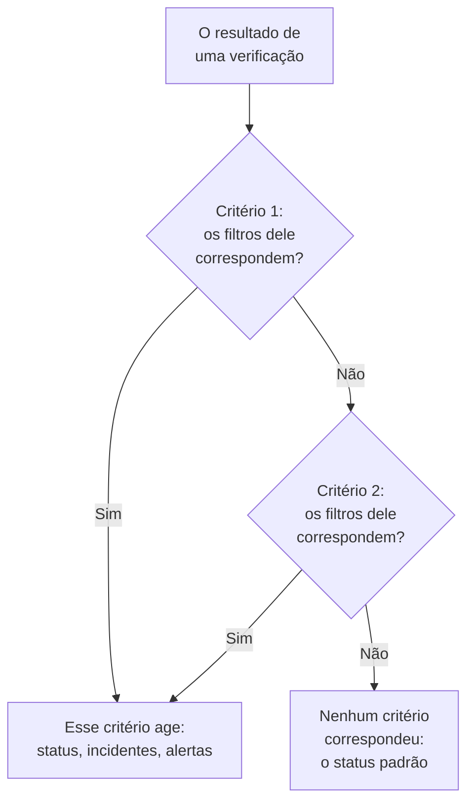
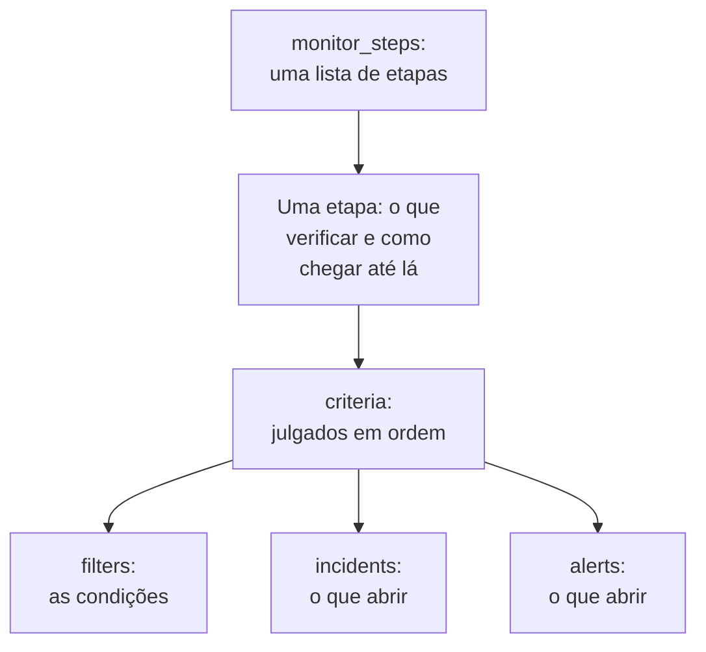

# Etapas do monitor

`monitor_steps` é o atributo de `oneuptime_monitor` que diz o que um monitor verifica e como cada resultado é julgado: o endereço a verificar, a requisição a enviar e os critérios que transformam um resultado em um status do monitor, um incidente ou um alerta. Esta página explica cada parte dele.

:::cards
- [Como uma verificação é julgada](#como-uma-verificação-é-julgada): Os critérios em ordem, e o primeiro que corresponde.
- [Escrever as etapas](#escrever-as-etapas): A forma delas, um exemplo completo e as duas regras para os valores.
- [Referência de filtros](#referência-de-filtros): O que um filtro pode verificar, e como ele compara.
- [Erros comuns](#erros-comuns): O que dá errado com mais frequência, e a correção.
:::

## Como uma verificação é julgada

Cada verificação dá um resultado: a resposta de uma sonda, o valor que um script retorna ou a telemetria que a verificação lê. Os critérios da etapa então o julgam na ordem deles. O primeiro critério cujos filtros correspondem decide o que acontece: ele pode mudar o status do monitor, abrir incidentes e abrir alertas. Os critérios depois dele não são considerados nessa verificação.



Então a ordem dos critérios importa: liste primeiro os critérios que alertam, o mais grave primeiro, e o saudável por último. [Atributos de um critério](#atributos-de-um-critério) explica por quê, e a única exceção.

## Escrever as etapas

`monitor_steps` é uma lista de objetos tipados escritos direto em HCL. Não há `jsonencode()`, nenhum invólucro `{_type, value}`, nenhuma chave em camelCase e nenhum ID a escrever: o provider transforma o seu HCL no formato da API, e o servidor dá o ID de cada etapa, critério, modelo de incidente e modelo de alerta. Ele mantém esses IDs a cada apply, associando cada critério e cada modelo àquele que substitui pelo nome, senão pela posição, para que os resultados das sondas fiquem com a sua etapa e os incidentes continuem apontando para os critérios que os abriram.



A menor etapa útil verifica um endereço e tem um critério com um filtro:

```hcl
resource "oneuptime_monitor" "example" {
  name         = "Example"
  description  = "The smallest monitor_steps"
  monitor_type = "Website"

  monitor_steps = [{
    monitor_destination      = "https://example.com"
    monitor_destination_type = "URL"
    request_type             = "GET"

    criteria = [
      {
        name             = "Check if online"
        description      = "The website responds"
        filter_condition = "All"

        filters = [
          {
            check_on    = "Is Online"
            filter_type = "True"
          }
        ]
      }
    ]
  }]
}
```

Duas regras valem em todo `monitor_steps`:

- **Deixe de fora o que você não usa.** Um atributo que você não define não é enviado à API. Nunca escreva `[]`, `{}` ou `""` como marcador: o provider recusa strings, listas e maps vazios, para que um valor ausente sempre signifique "não definido".
- **Os valores dos filtros são strings.** O `value` de um filtro é uma string, até para um número: `value = "200"`, não `value = 200`. Configurações numéricas como `port` são números.

:::details Migrar do provider 1.x, em que monitor_steps era JSON
No provider 1.x, `monitor_steps` era uma string JSON escrita com `jsonencode({ _type = "MonitorSteps", value = { ... } })`. Reescreva-a com os atributos tipados desta página: tire os invólucros `_type` e `value`, escreva as chaves em camelCase em snake_case (`monitorDestination` vira `monitor_destination` e `monitor_destination_type`, `filterCondition` vira `filter_condition`, `checkOn` vira `check_on`) e apague cada `id`. Agora o servidor atribui todos os IDs, o que também acaba com os IDs aleatórios fixos no código da issue [#2291](https://github.com/OneUptime/oneuptime/issues/2291). O estado salvo como string JSON não é atualizado sozinho: aplique a nova configuração.
:::

### Um exemplo completo

Este monitor de site verifica o que verifica o monitor de site dos testes de ponta a ponta do provider (teste `35-monitor-with-steps`): offline quando o site não responde, online quando responde com 200.

```hcl
resource "oneuptime_monitor_status" "operational" {
  name                 = "Operational"
  description          = "Monitor is operational"
  color                = "#2ecc71"
  priority             = 1
  is_operational_state = true
}

resource "oneuptime_monitor_status" "offline" {
  name                 = "Offline"
  description          = "Monitor is offline"
  color                = "#e74c3c"
  priority             = 3
  is_operational_state = false
}

resource "oneuptime_monitor" "website" {
  name         = "Website"
  description  = "Website monitor with explicit steps"
  monitor_type = "Website"

  monitor_steps = [{
    monitor_destination      = "https://example.com" # what to check
    monitor_destination_type = "URL"                 # URL, Hostname or IP
    request_type             = "GET"                 # the HTTP method

    criteria = [ # judged in order: the first match decides
      {
        name                  = "Offline"
        description           = "Check if website is offline"
        filter_condition      = "Any"
        change_monitor_status = true
        create_incidents      = false
        create_alerts         = false
        monitor_status_id     = oneuptime_monitor_status.offline.id

        filters = [
          {
            check_on    = "Is Online"
            filter_type = "False"
          }
        ]
      },
      {
        name                  = "Online"
        description           = "Check if website is online"
        filter_condition      = "All" # All: every filter, Any: at least one
        change_monitor_status = true
        create_incidents      = false
        create_alerts         = false
        monitor_status_id     = oneuptime_monitor_status.operational.id

        filters = [
          {
            check_on    = "Is Online"
            filter_type = "True"
          },
          {
            check_on    = "Response Status Code"
            filter_type = "Equal To"
            value       = "200" # a string, even for a number
          }
        ]
      }
    ]
  }]
}
```

Um critério se refere a um status pelo recurso dele, como `oneuptime_monitor_status.offline.id` faz aqui, ou a um que o seu projeto já tem por meio de uma [fonte de dados](/docs/terraform/complete-guide#ler-o-que-já-existe).

## Atributos de uma etapa

Cada item de `monitor_steps` é uma coisa a verificar:

| Atributo | Tipo | Usado por | Observações |
| --- | --- | --- | --- |
| `monitor_destination` | string | Site, API, Ping, IP, Porta, Certificado SSL, NTP | A URL, o nome de host ou o endereço IP a verificar. Precisa de `monitor_destination_type`. |
| `monitor_destination_type` | string | os mesmos | `URL`, `Hostname` ou `IP`, conforme o que o tipo de monitor aceita: uma URL para monitores de site, API e certificado SSL; um nome de host ou um endereço IP para monitores Ping, IP, Porta e NTP. |
| `port` | number | Porta, NTP | A porta TCP a verificar, como `443`. Para NTP, a porta UDP em que o servidor de hora responde: `123` quando não definida. |
| `request_type` | string | Site, API | O método HTTP: `GET`, `POST`, `PUT`, `DELETE`, `HEAD` ou `PATCH`. O servidor usa `GET` quando não está definido. |
| `request_headers` | map(string) | Site, API | Os cabeçalhos a enviar: `{ "Accept" = "application/json" }`. |
| `request_body` | string | API | O corpo da requisição, como texto. |
| `do_not_follow_redirects` | bool | Site, API | Parar na primeira resposta em vez de seguir os redirecionamentos. |
| `allow_self_signed_certificates` | bool | Site, API | Aceitar um certificado TLS autoassinado. |
| `tls_client_certificate` | string | Site, API | Um certificado de cliente para TLS mútuo: PEM, ou uma referência `{{monitorSecrets.name}}`. |
| `tls_client_key` | string (sensível) | Site, API | A chave privada do certificado de cliente. Defina-a junto com o certificado. |
| `tls_client_key_passphrase` | string (sensível) | Site, API | A frase secreta da chave privada. |
| `request_timeout_in_ms` | number | Verificações feitas por uma sonda | Quanto tempo uma tentativa pode levar, em milissegundos. A sonda reduz qualquer valor acima de 60000 para 60000. |
| `retry_count` | number | Verificações feitas por uma sonda | Novas tentativas depois de uma primeira tentativa que falhou: `0` verifica uma vez, `3` até quatro vezes. A sonda reduz qualquer valor acima de 3 para 3. |
| `custom_code` | string | Custom JavaScript Code, Synthetic | O script que a etapa executa. |
| `screen_size_types` | list(string) | Synthetic | `Mobile`, `Tablet` e `Desktop`. |
| `browser_types` | list(string) | Synthetic | `Chromium` e `Firefox`. |
| `retry_count_on_error` | number | Synthetic | Novas tentativas quando o script falha: `0` o executa uma vez. |
| `criteria` | list (obrigatório) | Todos | Como cada resultado é julgado: veja [Atributos de um critério](#atributos-de-um-critério). |

### Configurações de cada tipo de monitor

Os tipos de monitor com mais a definir do que um endereço guardam as suas configurações (uma consulta de logs, uma conexão com um banco de dados, um cluster a observar) em um atributo próprio, como JSON bruto escrito com `jsonencode()`: `log_monitor`, `trace_monitor`, `llm_monitor`, `metric_monitor`, `exception_monitor`, `profile_monitor`, `dns_monitor`, `domain_monitor`, `dnssec_monitor`, `sql_monitor`, `database_monitor`, `external_status_page_monitor`, `network_device_monitor`, `kubernetes_monitor`, `docker_monitor`, `docker_swarm_monitor`, `host_monitor`, `podman_monitor`, `proxmox_monitor`, `vmware_monitor`, `ceph_monitor`, `storage_array_monitor` e `iot_monitor`.

O JSON deles é o mesmo do painel, com as chaves em camelCase. Um ID dentro dele é escrito como a API o escreve: `{ _type = "ObjectID", value = "..." }`. Um monitor Logs que conta os erros de um serviço:

```hcl
resource "oneuptime_service" "checkout" {
  name = "checkout"
}

resource "oneuptime_monitor" "checkout_errors" {
  name         = "Checkout errors"
  monitor_type = "Logs"

  monitor_steps = [{
    log_monitor = jsonencode({
      attributes          = {}
      body                = "error"
      severityTexts       = ["Error"]
      telemetryServiceIds = [{ _type = "ObjectID", value = oneuptime_service.checkout.id }]
      lastXSecondsOfLogs  = 300
    })

    criteria = [
      {
        name             = "Errors found"
        filter_condition = "Any"

        filters = [
          {
            check_on    = "Log Count"
            filter_type = "Greater Than"
            value       = "0"
          }
        ]
      }
    ]
  }]
}
```

> [!TIP]
> A forma mais fácil de acertar esse JSON: configure o monitor no painel, depois abra a seção **Desenvolvedores** dele e **Terraform**. A página escreve as `monitor_steps` do monitor, com `jsonencode()` e tudo.

## Atributos de um critério

Cada item de `criteria` é uma regra: quando os filtros dela correspondem, faça o que ela diz.

Os critérios são julgados de cima para baixo, e o primeiro que corresponde decide, então liste primeiro os critérios que alertam, o mais grave primeiro (crítico, depois aviso), e o saudável por último. Um critério saudável no topo é a forma mais comum de construir um monitor que nunca alerta: uma regra ampla como `Is Online` é `True`, ou um valor de métrica `Greater Than` `0`, corresponde a quase toda verificação, e os critérios abaixo dela nunca são considerados. Colocado por último, ele só corresponde quando nada acima dele correspondeu, que é o que você quer.

Os monitores de métricas agrupados são a única exceção. Quando a consulta de um monitor de métricas é agrupada (`groupByAttributeKeys` definido no JSON de `metric_monitor`, em `metricViewConfig.queryConfigs[].metricQueryData.groupByAttributeKeys`), o monitor abre um alerta ou incidente para cada grupo (cada host, contêiner ou ponto de montagem), e todos os critérios são julgados, então um critério crítico e um de aviso podem disparar para hosts diferentes na mesma verificação. Um host que viola os dois ainda é acionado uma única vez, pelo primeiro critério que corresponde, então o mais grave continua indo primeiro. Veja [Monitor de métricas](/docs/monitor/metrics-monitor).

| Atributo | Tipo | O que é |
| --- | --- | --- |
| `name` | string (obrigatório) | O nome que o painel mostra. |
| `description` | string | A descrição que o painel mostra. |
| `filter_condition` | string (obrigatório) | `All`: todos os filtros precisam corresponder. `Any`: basta um. |
| `filters` | list (obrigatório) | As condições, pelo menos uma: veja [Referência de filtros](#referência-de-filtros). |
| `change_monitor_status` | bool | Se uma correspondência muda o status do monitor. |
| `monitor_status_id` | string | O ID do `oneuptime_monitor_status` para o qual mudar. Defina-o quando `change_monitor_status` for `true`. |
| `create_incidents` | bool | Se uma correspondência abre incidentes. |
| `incidents` | list | Os incidentes a abrir. Deixe-o de fora, a menos que `create_incidents = true`. |
| `create_alerts` | bool | Se uma correspondência abre alertas. |
| `alerts` | list | Os alertas a abrir. Deixe-o de fora, a menos que `create_alerts = true`. |
| `is_enabled` | bool | `true` no servidor quando não definido. Defina `false` para manter um critério sem julgar com ele. |
| `incident_grouping` | string (JSON) | Só monitores de requisições recebidas: um incidente para cada valor encontrado na requisição, como `jsonencode({ groupByJSONPath = "..." })`. |

### Incidentes e alertas

Um item de `incidents` aceita `title` e `description` (os dois obrigatórios), `incident_severity_id`, `auto_resolve_incident`, `remediation_notes`, `on_call_policy_ids`, `label_ids`, `owner_team_ids`, `owner_user_ids`, `show_incident_on_status_page` e `is_private`. Um item de `alerts` aceita os mesmos, com `alert_severity_id` e `auto_resolve_alert`, e sem `show_incident_on_status_page`.

Este critério marca o monitor como offline, abre um incidente que aciona a política de plantão e o resolve quando o site volta:

```hcl
criteria = [
  {
    name                  = "Offline"
    description           = "The site is unreachable"
    filter_condition      = "Any"
    change_monitor_status = true
    monitor_status_id     = oneuptime_monitor_status.offline.id
    create_incidents      = true

    filters = [
      {
        check_on    = "Is Online"
        filter_type = "False"
      }
    ]

    incidents = [
      {
        title                 = "Website is down"
        description           = "The website did not respond to the probe."
        incident_severity_id  = oneuptime_incident_severity.critical.id
        auto_resolve_incident = true
        on_call_policy_ids    = [oneuptime_on_call_policy.primary.id]
      }
    ]
  }
]
```

## Referência de filtros

Um filtro tem `check_on` (o que observar), `filter_type` (como comparar) e `value` (com o que comparar, como string; deixe-o de fora nas verificações de verdadeiro ou falso, como `True` e `False`).

Um filtro também pode julgar uma janela de tempo em vez da última verificação: defina `evaluate_over_time = true`, a duração da janela em `evaluate_over_time_minutes` e, em `evaluate_over_time_type`, como a janela é lida: `Average`, `Sum`, `Maximum Value`, `Minimum Value`, `All Values` ou `Any Value`.

`All Values` significa que todas as verificações da janela violaram a regra, então ele só corresponde quando a janela está coberta por dados: um monitor recém-criado espera a janela encher em vez de corresponder na primeira verificação. Dê a ele uma janela de pelo menos o dobro do `monitoring_interval` do monitor; senão a janela contém uma única verificação, e "todos os valores" significa o mesmo que "qualquer valor". `Any Value` corresponde a uma única verificação que viola a regra, de propósito.

`evaluate_over_time_no_data_policy` diz o que o filtro faz enquanto a janela não tem dados suficientes: `Ignore` (o padrão) não corresponde, `Trigger` trata a falta de dados como a falha, como faz um heartbeat, e `Treat As Zero` compara a janela como um único zero.

### O que um filtro pode verificar

Os valores de `check_on` que cada tipo de monitor mais usa. O editor de critérios do painel oferece os mesmos, e lista todos:

| Tipo de monitor | Valores de `check_on` |
| --- | --- |
| Site / API | `Is Online`, `Response Time (in ms)`, `Response Status Code`, `Response Body`, `Response Header`, `Response Header Value`, `JavaScript Expression`, `Is Request Timeout` |
| Ping / IP | `Is Online`, `Response Time (in ms)`, `Packet Loss (in %)`, `Jitter (in ms)`, `Is Request Timeout` |
| Porta | `Is Online`, `Response Time (in ms)` (o tempo total de conexão do painel), `Port DNS Lookup Time (in ms)`, `Port TCP Connect Time (in ms)`, `Is Request Timeout` |
| Certificado SSL | `Is Valid Certificate`, `Is Not A Valid Certificate`, `Is Self Signed Certificate`, `Is Expired Certificate`, `Expires In Days`, `Expires In Hours` |
| Requisição recebida | `Incoming Request`, `Request Body`, `Request Header`, `Request Header Value`, `JavaScript Expression` |
| E-mail recebido | `Email Received`, `Email Subject`, `Email From Address`, `Email To Address`, `Email Body` |
| Servidor | `Is Online`, `CPU Usage (in %)`, `Memory Usage (in %)`, `Disk Usage (in %)` (com `disk_path`), `Server Process Name` |
| Logs | `Log Count` |
| Traces | `Span Count` |
| Exceções | `Exception Count` |
| Perfis | `Profile Count` |
| IA / LLM | `Bad AI Answers (in %)`, `Bad AI Answers`, `AI Answers` |
| Métricas | `Metric Value` (os filtros de métricas podem receber JSON em `metric_monitor_options`) |
| Código personalizado / Synthetic | `Result Value` (pode comparar um campo dos dados retornados, indicado no JSON de `custom_code_monitor_options`, por ex. `jsonencode({ resultValuePath = "status" })` — veja abaixo), `Error`, `Execution Time (in ms)` |
| DNS | `DNS Is Online`, `DNS Response Time (in ms)`, `DNS Record Value`, `DNS Record Exists` |
| Domínio | `Domain Expires In Days`, `Domain Is Expired`, `Domain Registrar`, `Domain Name Server` |
| DNSSEC | `DNSSEC Chain Is Valid`, `DNSSEC DS Record Exists At Parent`, `DNSSEC Signature Expires In Days` |
| Consulta SQL | `SQL Is Online`, `SQL Query Row Count`, `SQL Query Scalar Value` |
| Saúde do banco de dados | `Database Is Online`, `Database Metric` (com JSON em `database_monitor_options` indicando a série, por ex. `jsonencode({ metricType = "oneuptime.monitor.database.connections.used.percent" })`), `Database Collection Error` |
| Página de status externa | `External Status Page Is Online`, `External Status Page Active Incidents`, `External Status Page Component Status` |
| NTP | `NTP Is Online`, `NTP Is Synchronized`, `NTP Stratum`, `NTP Clock Offset (in ms)`, `NTP Response Time (in ms)`, `NTP Root Dispersion (in ms)` (`NTP Is Online` e `NTP Is Synchronized` não recebem `value`) |
| Dispositivo de rede (SNMP) | `SNMP Device Is Online` (ele responde a ping ou SNMP), `SNMP Walk Is Succeeding` (false quando ele responde mas não pode ser percorrido), `SNMP OID Value` (os filtros SNMP podem receber JSON em `snmp_monitor_options`) |

### Como um filtro compara

| Tipo | Valores de `filter_type` |
| --- | --- |
| Verdadeiro ou falso | `True`, `False` |
| Números | `Equal To`, `Not Equal To`, `Greater Than`, `Less Than`, `Greater Than Or Equal To`, `Less Than Or Equal To` |
| Texto | `Contains`, `Not Contains`, `Starts With`, `Ends With`, `Is Empty`, `Is Not Empty` |
| Heartbeats | `Recieved In Minutes`, `Not Recieved In Minutes` (escritos como a API os escreve) |
| Processos do servidor | `Is Executing`, `Is Not Executing` |
| Scripts | `Evaluates To True` |
| Anomalias, para métricas, logs e traces | `Anomalously High`, `Anomalously Low`, `Anomalous` |

Um filtro que corresponde quando um certificado SSL expira em 14 dias ou menos:

```hcl
filters = [
  {
    check_on    = "Expires In Days"
    filter_type = "Less Than Or Equal To"
    value       = "14"
  }
]
```

O provider verifica `check_on`, `filter_type` e as outras listas fixas quando planeja, então um erro de digitação falha antes que qualquer coisa seja enviada à API. Os valores são os nomes que a API dá às opções do editor de critérios do painel.

### Comparar um campo do resultado de um script

O script de um monitor de código personalizado ou de um monitor Synthetic retorna `data`, e um filtro `Result Value` o compara. Quando `data` é um objeto ou um array, `custom_code_monitor_options` indica o campo dele a comparar: o **Caminho do campo** do filtro Result Value do painel. Use pontos para campos aninhados e `[n]` para itens de um array, e deixe o atributo de fora para comparar o valor inteiro:

```hcl
monitor_steps = [{
  custom_code = <<-EOT
    const response = await axios.get("https://api.example.com/health");
    // For example { status: "UP", checks: [{ name: "db", latency: 12 }] }
    return { data: response.data };
  EOT

  criteria = [
    {
      name             = "Unhealthy"
      filter_condition = "Any"
      filters = [
        {
          check_on                    = "Result Value"
          filter_type                 = "Not Equal To"
          value                       = "UP"
          custom_code_monitor_options = jsonencode({ resultValuePath = "status" })
        },
        {
          check_on                    = "Result Value"
          filter_type                 = "Greater Than"
          value                       = "500"
          custom_code_monitor_options = jsonencode({ resultValuePath = "checks[0].latency" })
        }
      ]
    }
  ]
}]
```

`Greater Than` e as outras condições numéricas só correspondem a um campo que é um número, e um campo ausente dos dados retornados só corresponde a `Is Empty`. Veja [Alertar sobre os dados retornados](/docs/monitor/custom-code-monitor#alertar-sobre-os-dados-retornados) para saber como os caminhos e as condições funcionam.

## Erros comuns

1. **Marcadores vazios.** `incidents = []`, `request_headers = {}` e `description = ""` são recusados: deixe o atributo de fora em vez disso.
2. **Um número onde vai uma string.** O `value` de um filtro é uma string, até para um número: `value = "200"`. Configurações numéricas como `port`, `retry_count`, `request_timeout_in_ms` e `evaluate_over_time_minutes` recebem números.
3. **O tipo de destino errado.** `monitor_destination_type = "URL"` com um nome de host simples, ou `Hostname` com uma URL completa, faz a verificação falhar. Monitores de site e de API recebem URLs; monitores Ping, IP e Porta recebem nomes de host ou endereços IP.
4. **Uma mudança de status sem status.** `change_monitor_status = true` sem `monitor_status_id` corresponde, e não tem nenhum status para o qual mudar.
5. **IDs.** Nenhum item de `monitor_steps` tem um atributo `id`. Se você está migrando do JSON antigo, apague-os: o servidor atribui os IDs.
6. **JSON escrito à mão.** Escreva `log_monitor` e as outras configurações com `jsonencode()`, para que o Terraform as coloque entre aspas e escreva o JSON sempre do mesmo jeito. Para `metric_monitor`, dê o objeto inteiro que o painel escreve: o servidor o normaliza.

## Quando nenhum critério corresponde

Uma verificação que não corresponde a nenhum critério coloca o monitor no status padrão dele: o status operacional do projeto, o que o painel escolhe para um novo monitor. Os incidentes abertos dele cujos critérios optaram pela resolução automática também são resolvidos. Para decidir você mesmo cada resultado, termine a lista com um critério saudável amplo, como fazem os exemplos desta página.

## Um monitor sem etapas

`monitor_steps` é opcional, mas um monitor criado sem ele não tem critérios com que julgar um resultado: as sondas pulam um monitor sem etapas, e ele fica no status em que começou. O seu estado mantém o atributo vazio, e o plano continua limpo. Um monitor manual nunca precisa de etapas: você mesmo define o status dele. Todos os outros tipos precisam de pelo menos uma etapa para verificar alguma coisa.

## O formato de transmissão

Por trás do provider, a API ainda fala o próprio JSON, em que cada objeto rico é encapsulado como `{_type, value}`:

```json
{
  "_type": "MonitorSteps",
  "value": {
    "monitorStepsInstanceArray": [
      {
        "_type": "MonitorStep",
        "value": {
          "monitorDestination": { "_type": "URL", "value": "https://example.com" },
          "requestType": "GET",
          "monitorCriteria": {
            "_type": "MonitorCriteria",
            "value": { "monitorCriteriaInstanceArray": [ { "_type": "MonitorCriteriaInstance", "value": { "...": "..." } } ] }
          }
        }
      }
    ]
  }
}
```

O provider monta isso a partir do seu HCL quando escreve, e o lê de volta em HCL, deixando de fora o que o servidor gerencia (os IDs e os valores padrão que ele adiciona). Você só o encontra quando lê as respostas da API por conta própria, por exemplo em um script que lê `monitorSteps`.

## Próximos passos

:::cards
- [Exemplos](/docs/terraform/examples): Monitores Ping, de porta, de certificado SSL e de API, prontos para uso.
- [Guia completo](/docs/terraform/complete-guide): Fontes de dados, estado e atualizações.
- [Monitor de métricas](/docs/monitor/metrics-monitor): Consultas de métricas, agrupamento e anomalias.
- [Solução de problemas](/docs/terraform/troubleshooting): Inclusive um resultado inconsistente depois de um apply em um monitor.
:::
