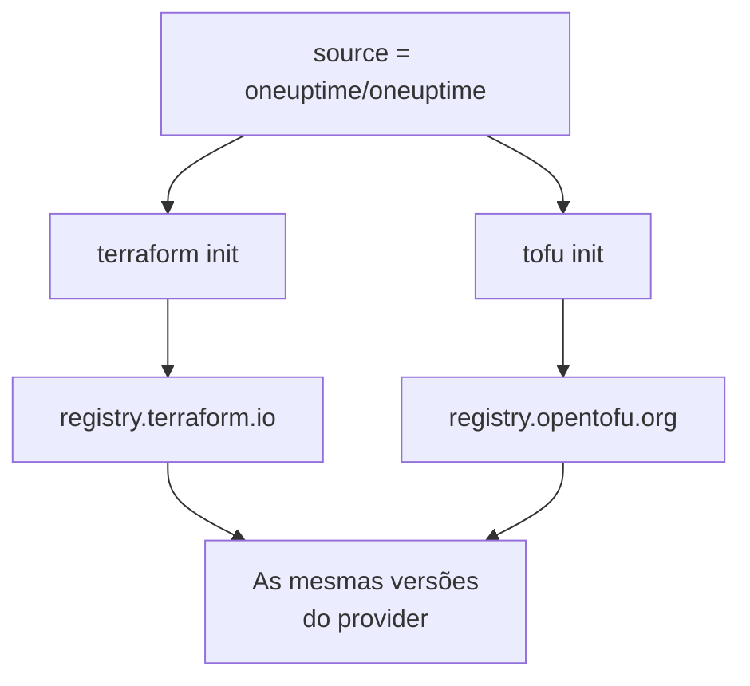

# OpenTofu

O provider do OneUptime funciona com o [OpenTofu](https://opentofu.org) como funciona com o Terraform. Ele é publicado no [OpenTofu Registry](https://search.opentofu.org/provider/oneuptime/oneuptime/latest), e toda versão passa nos mesmos testes de ponta a ponta com os dois antes de ser publicada. A sua configuração não muda: execute `tofu` onde esta documentação executa `terraform`.

:::cards
- [Usar o provider com o OpenTofu](#usar-o-provider-com-o-opentofu): A mesma configuração, executada com `tofu`.
- [O que difere do Terraform](#o-que-difere-do-terraform): Registros, arquivos de lock, arquivos `.tofu` e versões.
- [Passar uma configuração para o OpenTofu](#passar-uma-configuração-para-o-opentofu): Troque uma configuração existente em quatro etapas.
- [Um módulo reutilizável](#um-módulo-reutilizável): Monitores, uma política de plantão e uma página de status para um serviço.
:::

## Usar o provider com o OpenTofu

Você precisa do OpenTofu 1.6 ou posterior. Declare o provider como faria para o Terraform:

```hcl title="main.tf"
terraform {
  required_providers {
    oneuptime = {
      source  = "oneuptime/oneuptime"
      version = "{{TERRAFORM_PROVIDER_VERSION}}"
    }
  }
}

provider "oneuptime" {
  # The API key comes from the ONEUPTIME_API_KEY environment variable.
  # On a self-hosted OneUptime, add your OneUptime's address:
  # oneuptime_url = "https://oneuptime.example.com"
}
```

Depois execute-o com `tofu`:

```bash
export ONEUPTIME_API_KEY="<your-api-key>"
tofu init
tofu plan
tofu apply
```

`tofu init` baixa o provider do OpenTofu Registry. Tudo no [Início rápido](/docs/terraform/quick-start), no [Guia completo](/docs/terraform/complete-guide), em [Etapas do monitor](/docs/terraform/monitor-steps), em [Exemplos](/docs/terraform/examples) e em [Importar recursos](/docs/terraform/importing-resources) vale como está, e a configuração que as páginas **Terraform** do painel escrevem funciona sem alterações.

### Deixar o registro fora do endereço de origem

`source = "oneuptime/oneuptime"` não nomeia nenhum registro, então cada ferramenta o lê no seu próprio:



Deixe o nome do host de fora. Com ele, toda ferramenta usa aquele registro: com `registry.terraform.io/oneuptime/oneuptime`, o OpenTofu também baixa do Terraform Registry, e o Terraform recusa a cópia do OpenTofu Registry com `authentication signature from unknown issuer`.

## O que difere do Terraform

| Assunto | Com o OpenTofu |
| --- | --- |
| O registro | `oneuptime/oneuptime` é `registry.opentofu.org/oneuptime/oneuptime`, que publica as mesmas versões que o Terraform Registry. |
| Assinaturas | `tofu init` diz que a validação da assinatura foi pulada: o OpenTofu Registry não tem nenhuma chave de assinatura para este provider, então o OpenTofu verifica o download com os checksums do registro. |
| O bloco `terraform` | Continua `terraform`: ele faz parte da linguagem, e o OpenTofu o lê como está. |
| Arquivos `.tofu` | O OpenTofu 1.8 e posteriores também leem arquivos `.tofu`, e ignoram um arquivo `.tf` que tem um arquivo `.tofu` com o mesmo nome. O Terraform lê apenas arquivos `.tf`. |
| `required_version` | As versões do OpenTofu começam em 1.6.0, então `>= 1.5.0`, escrito para o Terraform, admite qualquer OpenTofu. |
| O arquivo de lock | Nomeia `registry.opentofu.org/oneuptime/oneuptime`. Trocar de ferramenta reescreve essa entrada: faça commit da alteração. |
| Estado | O OpenTofu lê como está um estado que o Terraform escreveu. |
| Variáveis | `TF_VAR_name` define uma variável também com o OpenTofu. |
| O arquivo de configuração da CLI | `~/.tofurc` ou `~/.terraformrc`, ou o arquivo que `TF_CLI_CONFIG_FILE` indica. |
| Um bloco `removed` | O bloco `lifecycle` dele precisa do OpenTofu 1.10 ou posterior. Sem ele, o OpenTofu esquece o recurso e mantém o registro, enquanto o Terraform o destrói. |
| Mover para um tipo de recurso renomeado | Um bloco `moved` de `oneuptime_io_t_fleet` para `oneuptime_iot_fleet`, ou entre os outros tipos renomeados, precisa do OpenTofu 1.12 ou posterior. |

## Passar uma configuração para o OpenTofu

Uma configuração que o Terraform gerencia passa para o OpenTofu como está, com o estado dela:

:::steps
### Instalar o OpenTofu

Instale o OpenTofu: a 1.6 basta para o provider, e a 1.12 ou posterior também move um recurso para um tipo renomeado, como `oneuptime_io_t_fleet` para `oneuptime_iot_fleet`.

### Inicializar com tofu

Na pasta da configuração, execute `tofu init`. Ele baixa o provider do OpenTofu Registry, e diz que alterou o arquivo de lock: a entrada do provider agora nomeia o OpenTofu Registry.

### Planejar

Execute `tofu plan`. Ele lê o estado que o Terraform deixou, e responde `No changes.`

### Fazer commit do arquivo de lock

Faça commit de `.terraform.lock.hcl`, e execute a configuração com `tofu` daqui em diante, inclusive na CI.
:::

## Um módulo reutilizável

[`Examples/opentofu/`](https://github.com/OneUptime/oneuptime/tree/master/Examples/opentofu) no repositório do OneUptime contém configurações prontas para executar, e um módulo que prepara um serviço: um monitor de site para cada endereço que você passar, um rótulo em tudo o que ele cria, uma política de plantão com uma regra de escalonamento, e uma página de status que lista os monitores. É HCL simples, então funciona também com o Terraform.

```hcl title="main.tf"
module "storefront" {
  source = "github.com/OneUptime/terraform-provider-oneuptime//modules/monitoring-and-incident-response?ref=vX.Y.Z"

  service_name          = "storefront"
  status_page_is_public = true

  monitors = {
    homepage = { url = "https://example.com" }
    checkout = { url = "https://example.com/checkout" }
    api      = { url = "https://api.example.com/health", expected_status_code = "204" }
  }
}
```

Substitua `vX.Y.Z` por uma versão publicada do provider, como a mais recente nas [versões do provider](https://github.com/OneUptime/terraform-provider-oneuptime/releases): o módulo é publicado com o provider, e o repositório dele muda a cada versão.

O módulo não cria status de monitor nem severidades de incidente. Ele busca pelo nome os que todo projeto tem desde o início: `Operational`, `Offline` e `Critical Incident`. Se o seu projeto os renomeou, defina `operational_monitor_status_name`, `offline_monitor_status_name` ou `incident_severity_name`.

A regra de escalonamento dele não aciona ninguém até você dizer quem: adicione uma equipe a ela com as saídas do módulo:

```hcl title="main.tf"
resource "oneuptime_team" "storefront" {
  name = "Storefront"
}

resource "oneuptime_team_on_call_duty_escalation_rule" "storefront" {
  on_call_duty_policy_id                 = module.storefront.on_call_policy_id
  on_call_duty_policy_escalation_rule_id = module.storefront.escalation_rule_id
  team_id                                = oneuptime_team.storefront.id
}
```

## Próximos passos

:::cards
- [Início rápido](/docs/terraform/quick-start): Crie uma chave de API e aplique os seus primeiros recursos.
- [Uso do registro](/docs/terraform/registry): Como as versões são numeradas, e o arquivo de lock.
- [Configuração auto-hospedada](/docs/terraform/self-hosted): O seu próprio OneUptime, e um espelho para máquinas offline.
- [Solução de problemas](/docs/terraform/troubleshooting): Erros comuns e como corrigi-los.
:::
