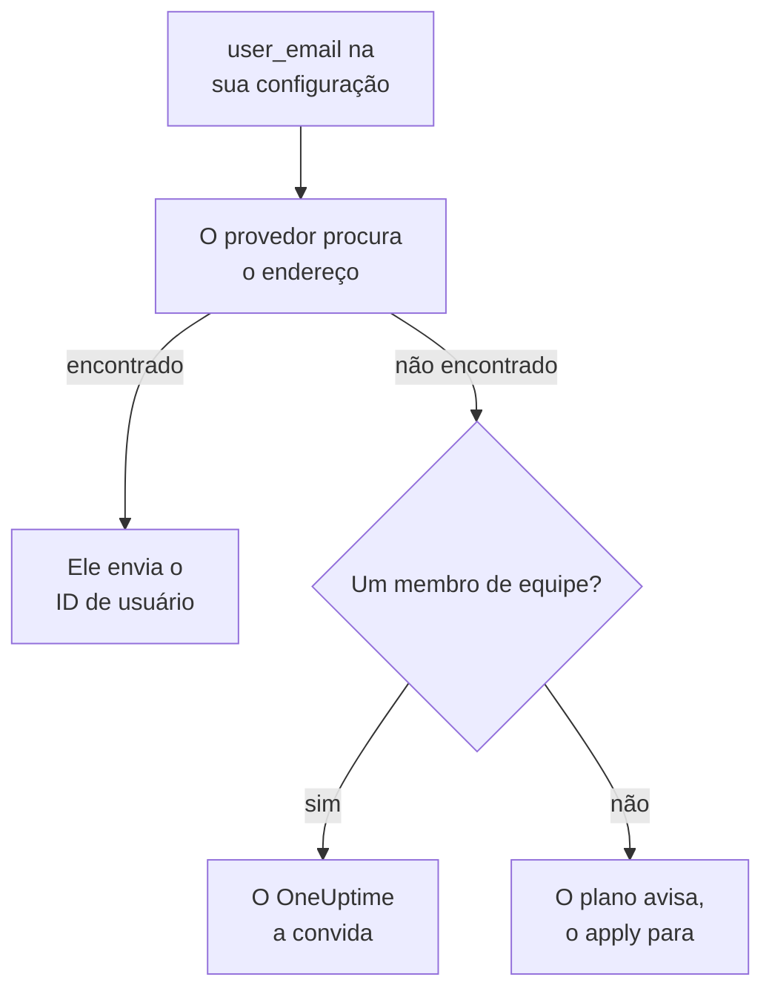

# Pessoas e equipes

Mantenha na sua configuração do Terraform quem está no seu projeto: as equipes e os seus membros, quem está de plantão e quem é dono de quê. Indique cada pessoa pelo endereço de e-mail: o provedor a encontra e convida quem for novo no projeto.

:::cards
- [Indicar pessoas pelo e-mail](#indicar-pessoas-pelo-e-mail): O atributo ao lado de cada ID de usuário.
- [Integrar alguém](#integrar-alguém): Convide alguém e dê a essa pessoa uma equipe, plantões e algo de que ser dona.
- [Desligar alguém](#desligar-alguém): Remova alguém, e o que o OneUptime remove junto com essa pessoa.
- [Importar os membros que você já tem](#importar-os-membros-que-você-já-tem): Pela equipe e pelo endereço.
:::

## Como funciona

O provedor procura o endereço entre as pessoas do projeto da chave de API: os seus membros e as pessoas convidadas para ele. Ele envia à API o ID da pessoa que encontra. Um membro de equipe indicado por um endereço que ninguém no projeto tem convida esse endereço no lugar.



Só o próprio projeto da chave de API é pesquisado. Ninguém de fora é encontrado, e o provedor não consegue saber se um endereço tem uma conta em outro lugar.

## Antes de começar

- **Uma chave de API que possa ler as equipes do projeto.** O provedor encontra as pessoas por meio delas.
- **Para adicionar alguém novo, uma chave que possa convidar pessoas.** Veja [Convidar pessoas](/docs/permissions/inviting-people).

## Indicar pessoas pelo e-mail

Todo recurso que indica uma pessoa aceita o endereço de e-mail dela ao lado do ID de usuário. Informe um dos dois:

| ID de usuário | Endereço de e-mail |
| --- | --- |
| `user_id` | `user_email` |
| `owner_users` | `owner_user_emails` |
| `assigned_to_user_id` | `assigned_to_user_email` |
| `override_user_id` | `override_user_email` |

O endereço é encontrado sem diferenciar maiúsculas e minúsculas, e mantido no state como você o escreveu. O ID de usuário é preenchido, para que outros recursos possam se referir a ele.

## Integrar alguém

Esta configuração adiciona Alice, nova no projeto, a uma equipe, dá a ela plantões desde o primeiro dia e torna Bob, que já está no projeto, dono de um monitor:

```hcl title="people.tf"
resource "oneuptime_team" "sre" {
  name        = "SRE"
  description = "Site reliability engineering"
}

# New to the project: OneUptime invites her.
resource "oneuptime_team_member" "alice" {
  team_id    = oneuptime_team.sre.id
  user_email = "alice@example.com"
}

resource "oneuptime_on_call_policy_schedule" "weekly" {
  name     = "SRE weekly"
  timezone = "UTC"
}

resource "oneuptime_on_call_schedule_layer" "weekly" {
  on_call_duty_policy_schedule_id = oneuptime_on_call_policy_schedule.weekly.id
  name                            = "Weekly"
  starts_at                       = "2030-01-07T09:00:00Z"
  hand_off_time                   = "2030-01-14T09:00:00Z"
}

# Named through her membership, so she is invited first.
resource "oneuptime_on_call_schedule_layer_user" "alice" {
  on_call_duty_policy_schedule_id       = oneuptime_on_call_policy_schedule.weekly.id
  on_call_duty_policy_schedule_layer_id = oneuptime_on_call_schedule_layer.weekly.id
  user_id                               = oneuptime_team_member.alice.user_id
}

resource "oneuptime_monitor" "api" {
  name         = "Public API"
  monitor_type = "Manual"
}

# In the project already: named by his address.
resource "oneuptime_monitor_user_owner" "api" {
  monitor_id = oneuptime_monitor.api.id
  user_email = "bob@example.com"
}
```

`terraform apply` convida Alice por e-mail, como faz um convite pelo painel. O OneUptime cria uma conta para ela se ela não tiver uma. `has_accepted_invitation` fica `false` até ela aceitar, e o aceite dela não é mudança nenhuma no plano. Quem já está no projeto entra em uma nova equipe na hora.

Para colocar de plantão alguém que esta configuração convida, ou torná-lo dono, refira-se à associação dele com `user_id = oneuptime_team_member.<name>.user_id`: assim o Terraform o convida antes de indicá-lo em qualquer outro lugar. Um endereço que ninguém no projeto tem é um aviso no plano e um erro no apply.

## Encontrar alguém

A fonte de dados `oneuptime_user` procura alguém por `email`, `name` ou `id`, e lê o ID de usuário, o nome, se a pessoa já entrou e as equipes em que está:

```hcl
data "oneuptime_user" "alice" {
  email = "alice@example.com"
}

output "alice_teams" {
  value = data.oneuptime_user.alice.team_ids
}
```

## Desligar alguém

Remova as associações da pessoa da sua configuração e aplique. Fora da sua última equipe do projeto, ela está fora do projeto, e o OneUptime a retira de toda escala de plantão, regra de escalonamento e substituição, e do que ela tem: de tudo, exceto os incidentes, alertas e eventos de manutenção que já terminaram. Remova no mesmo change os blocos que a indicam, ou o próximo plano os cria de novo para alguém que não está mais no projeto.

A conta dela no OneUptime continua dela: ela só sai do projeto. Uma equipe que precisa manter um membro não deixa sair o último que aceitou.

## Importar os membros que você já tem

Nenhuma tela mostra o ID de uma associação, então importe-a pelo ID da equipe e pelo endereço da pessoa:

```bash
terraform import oneuptime_team_member.alice 6b1d1c2e-4f3a-4b5c-8d6e-7f8091a2b3c4/alice@example.com
```

O endereço fica como você o escreveu, então escreva-o como a sua configuração faz. O próprio ID da associação também a importa, e então o endereço é lido do OneUptime, em minúsculas.

## Quando alguém muda de endereço

Uma pessoa que muda de endereço no OneUptime continua sendo a mesma pessoa para o Terraform: nada muda até você escrever o novo endereço, e então só `user_email` muda.

## Solução de problemas

:::details O plano diz que um endereço ainda não está neste projeto
Ninguém no projeto, nem convidado para ele, tem esse endereço. Convide a pessoa primeiro com um `oneuptime_team_member`. Se essa associação estiver na mesma configuração, refira-se a ela com `user_id = oneuptime_team_member.<name>.user_id` em vez do endereço. Se a pessoa mudou de endereço no OneUptime, use o novo.
:::

:::details O apply diz que o usuário já foi convidado para esta equipe
A pessoa já está na equipe. Importe essa associação em vez de criá-la, como em [Importar os membros que você já tem](#importar-os-membros-que-você-já-tem).
:::

## Próximos passos

:::cards
- [Importar recursos](/docs/terraform/importing-resources): Coloque o resto do seu projeto sob o Terraform.
- [Convidar pessoas](/docs/permissions/inviting-people): Como os convites funcionam no OneUptime.
- [Exemplos](/docs/terraform/examples): Configurações prontas para os recursos comuns.
:::
