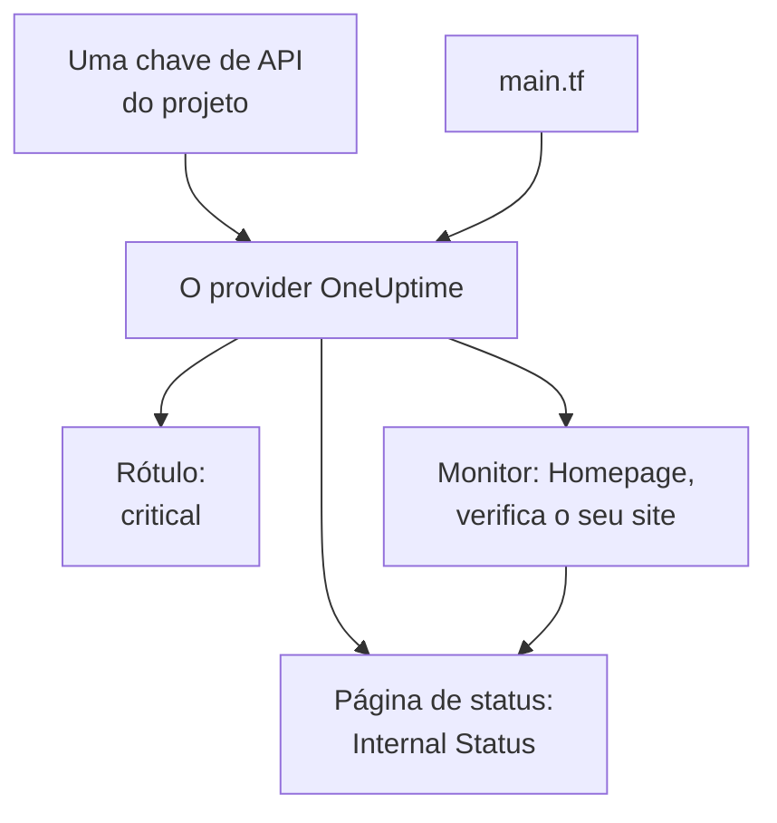

# Início rápido

Este guia leva você do zero a um projeto do OneUptime gerenciado pelo Terraform em cerca de dez minutos. Você cria uma chave de API, aponta o Terraform para o seu projeto e aplica um rótulo, um monitor que verifica o seu site e uma página de status privada que o mostra. Depois você altera um deles e faz a limpeza.

:::cards
- [Antes de começar](#antes-de-começar): O Terraform, um projeto e um plano com chaves de API.
- [Criar seus primeiros recursos](#criar-seus-primeiros-recursos): De uma chave de API a um plano aplicado, em seis etapas.
- [Alterar um recurso](#alterar-um-recurso): Edite a configuração, planeje e aplique.
- [Solução de problemas](#solução-de-problemas): Os erros em que uma primeira execução pode parar.
:::



## Antes de começar

- **Terraform 1.5 ou posterior, ou OpenTofu 1.6 ou posterior.** Com o OpenTofu, execute `tofu` sempre que este guia executa `terraform`.
- **Um projeto do OneUptime** em [oneuptime.com](https://oneuptime.com) ou no seu próprio OneUptime, no qual você possa criar chaves de API.
- **No OneUptime Cloud, o plano Growth ou superior.** As chaves de API de um projeto só funcionam nele.

## Criar seus primeiros recursos

:::steps
### Criar uma chave de API do projeto

No painel do OneUptime, abra **Configurações do projeto → Avançado → Chaves de API** e clique em **Criar: Chave de API**. Dê a ela um **Nome**, como `terraform`, e em **Acesso** escolha **Administrador do projeto**: o Terraform cria, lê, altera e exclui todos os tipos de registro que gerencia, e **Administrador do projeto** pode fazer tudo isso. Para uma chave mais restrita, escolha **Escolher as permissões depois** e adicione na página da chave só as permissões de que você precisa.

A chave expira daqui a um ano. Para escolher outra data, abra **Mais campos** antes de criá-la, ou altere a data depois na página da chave. Depois que a chave é criada, a página dela se abre: copie a **Chave de API** do cartão **Detalhes da chave de API**.

### Disponibilizar a chave para o Terraform

Coloque a chave na variável de ambiente `ONEUPTIME_API_KEY` do shell em que você executa o Terraform, para que ela nunca vá parar em um arquivo:

:::tabs
@tab Linux
```bash
export ONEUPTIME_API_KEY="<your-api-key>"
```
@tab macOS
```bash
export ONEUPTIME_API_KEY="<your-api-key>"
```
@tab Windows
```powershell
$env:ONEUPTIME_API_KEY = "<your-api-key>"
```
:::

### Apontar o Terraform para o OneUptime

Crie uma pasta vazia e, dentro dela, um arquivo chamado `main.tf`:

```hcl title="main.tf"
terraform {
  required_providers {
    oneuptime = {
      source  = "oneuptime/oneuptime"
      version = "{{TERRAFORM_PROVIDER_VERSION}}"
    }
  }
}

provider "oneuptime" {
  # The API key comes from ONEUPTIME_API_KEY.
  # On a self-hosted OneUptime, add your OneUptime's address:
  # oneuptime_url = "https://oneuptime.example.com"
}
```

Em um OneUptime auto-hospedado, leia a [Configuração auto-hospedada](/docs/terraform/self-hosted) antes de escolher uma versão do provider.

### Descrever seus recursos

Adicione estes blocos ao `main.tf`. Eles leem dois dos status de monitor com que todo projeto começa, e criam um rótulo, um monitor que verifica `https://example.com` a cada cinco minutos (coloque ali o seu próprio site) e uma página de status privada que mostra o monitor:

```hcl title="main.tf"
data "oneuptime_monitor_status" "operational" {
  name = "Operational"
}

data "oneuptime_monitor_status" "offline" {
  name = "Offline"
}

resource "oneuptime_label" "critical" {
  name        = "critical"
  description = "Resources that page on-call when down"
  color       = "#FF5733"
}

resource "oneuptime_monitor" "homepage" {
  name                = "Homepage"
  description         = "Checks that the homepage responds"
  monitor_type        = "Website"
  monitoring_interval = "*/5 * * * *"
  labels              = [oneuptime_label.critical.id]

  monitor_steps = [{
    monitor_destination      = "https://example.com"
    monitor_destination_type = "URL"
    request_type             = "GET"

    criteria = [
      {
        name                  = "Offline"
        description           = "The homepage does not respond"
        filter_condition      = "Any"
        change_monitor_status = true
        monitor_status_id     = data.oneuptime_monitor_status.offline.id

        filters = [
          {
            check_on    = "Is Online"
            filter_type = "False"
          }
        ]
      },
      {
        name                  = "Online"
        description           = "The homepage responds"
        filter_condition      = "All"
        change_monitor_status = true
        monitor_status_id     = data.oneuptime_monitor_status.operational.id

        filters = [
          {
            check_on    = "Is Online"
            filter_type = "True"
          }
        ]
      }
    ]
  }]
}

resource "oneuptime_status_page" "internal" {
  name                  = "Internal Status"
  description           = "Status of our internal services"
  page_title            = "Service Status"
  is_public_status_page = false
}

resource "oneuptime_status_page_resource" "homepage" {
  status_page_id = oneuptime_status_page.internal.id
  monitor_id     = oneuptime_monitor.homepage.id
  display_name   = "Homepage"
}

output "monitor_id" {
  value = oneuptime_monitor.homepage.id
}
```

As `monitor_steps` do monitor dizem o que ele verifica e o que cada resultado significa: depois de cada verificação, o primeiro critério que corresponde define o status dele. [Etapas do monitor](/docs/terraform/monitor-steps) explica cada parte.

### Planejar e aplicar

:::tabs
@tab Terraform
```bash
terraform init
terraform plan
terraform apply
```
@tab OpenTofu
```bash
tofu init
tofu plan
tofu apply
```
:::

O `init` baixa o provider. O plano termina com `Plan: 4 to add, 0 to change, 0 to destroy.` Digite `yes` para aplicá-lo; quando terminar, o Terraform imprime o ID do novo monitor.

### Conferir o painel

No painel do OneUptime:

- **Monitores** lista `Homepage`, com o rótulo `critical`. A primeira verificação dele chega em poucos minutos.
- **Páginas de status** lista `Internal Status`, que mostra `Homepage`.
- **Configurações do projeto → Básico → Rótulos** lista `critical`, na cor que você definiu.

Execute `terraform plan` de novo. Ele responde `No changes.`: o OneUptime contém exatamente o que a configuração diz.
:::

## Alterar um recurso

Altere a configuração, não o painel. Defina a `color` do rótulo como `"#2ECC71"` no `main.tf`, depois planeje e aplique:

```bash
terraform plan
terraform apply
```

O plano termina com `Plan: 0 to add, 1 to change, 0 to destroy.`: o rótulo é alterado no lugar. Uma mudança que alguém faz no painel em um recurso que o Terraform gerencia aparece no plano seguinte, e aplicá-lo traz de volta o que a configuração diz.

## Fazer a limpeza

Se isto foi um teste, exclua o que a configuração criou:

```bash
terraform destroy
```

Isso exclui o rótulo, o monitor, a página de status e o recurso dela. Os dois status de monitor ficam: as fontes de dados só os leem.

## Solução de problemas

:::details Mensagem “Missing API Key”
O provider não encontrou nenhuma chave de API. Exporte `ONEUPTIME_API_KEY` no shell em que você executa o Terraform, ou defina `api_key` no bloco do provider, e execute o comando de novo.
:::

:::details Mensagem “the OneUptime API returned status 400: Invalid API Key”
A chave foi digitada errado, expirou ou foi excluída, ou pertence a outro OneUptime que não aquele para o qual `oneuptime_url` aponta. Copie a chave de novo da página dela, ou crie uma nova.
:::

:::details Mensagem “the OneUptime API returned status 402: API keys need the Growth plan”
No OneUptime Cloud, as chaves de API de um projeto só funcionam no plano Growth ou superior. Faça o upgrade do projeto em **Configurações do projeto → Cobrança e faturas → Cobrança**, e a mesma chave volta a funcionar.
:::

:::details Mensagem “the OneUptime API returned status 422: You do not have permissions to create Monitor”
A chave não tem permissão para esse tipo de registro. Na página da chave, dê a ela **Administrador do projeto**, ou a permissão que a mensagem nomeia.
:::

:::details Mensagem “No monitor status matches {name = "Offline"}”
Os status de monitor do seu projeto têm outros nomes. Use os nomes que você vê em **Monitores → Configurações → Status do monitor**, ou busque o status por `is_offline_state = true`.
:::

## Próximos passos

:::cards
- [Guia completo](/docs/terraform/complete-guide): Autenticação, estrutura do projeto, fontes de dados, estado e atualizações.
- [Etapas do monitor](/docs/terraform/monitor-steps): Decida o que um monitor verifica e o que cada resultado significa.
- [Exemplos](/docs/terraform/examples): Configurações prontas para uso para os recursos mais comuns.
- [Importar recursos](/docs/terraform/importing-resources): Traga para o Terraform o que você criou no painel.
:::
