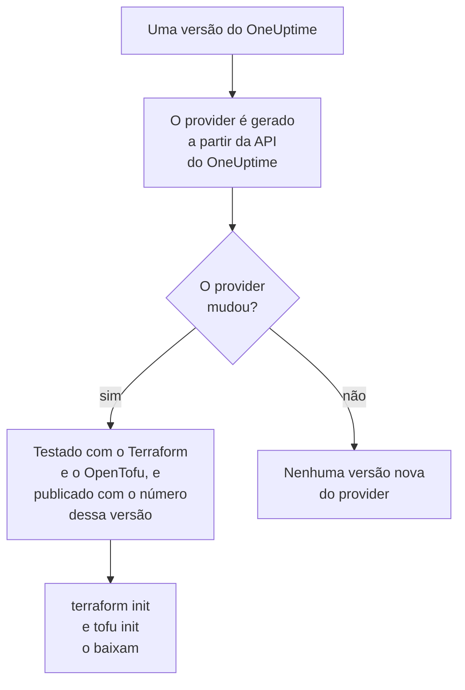

# Uso do registro

O provider do OneUptime é publicado no [Terraform Registry](https://registry.terraform.io/providers/oneuptime/oneuptime) e no [OpenTofu Registry](https://search.opentofu.org/provider/oneuptime/oneuptime/latest). `terraform init` e `tofu init` o baixam de lá: não há nada para instalar à mão. Esta página explica o que é publicado, como as versões são numeradas e como passar para uma versão mais nova.

:::cards
- [O que é publicado](#o-que-é-publicado): O provider para cada plataforma, a referência dele e as versões dele.
- [Como as versões são numeradas](#como-as-versões-são-numeradas): A versão de um provider é a versão do OneUptime que o publicou.
- [O arquivo de lock](#o-arquivo-de-lock): A versão e os checksums que toda máquina instala.
- [Passar para uma versão mais nova](#passar-para-uma-versão-mais-nova): Leia o que mudou, baixe-a e planeje.
:::

## O que é publicado

Toda versão do OneUptime gera o provider a partir da própria API do OneUptime. Quando o provider mudou, a versão o publica, com o número dessa versão, depois que ele passa nos testes de ponta a ponta com o Terraform e com o OpenTofu:



| O quê | Onde |
| --- | --- |
| O provider, para Linux, macOS, Windows, FreeBSD, OpenBSD e Solaris | Baixado por `terraform init` e `tofu init`, com checksums que o OneUptime assina |
| A referência de cada recurso e fonte de dados, com cada um dos seus atributos | A documentação do registro, agrupada por produto: monitores, páginas de status, incidentes, plantão e os outros |
| Um guia para usar o provider com o OpenTofu | Os guias do registro |
| Cada versão, a mais nova primeiro | A lista de versões do registro |

A referência diz o que é cada atributo. Esta documentação mostra como usá-los juntos: comece pela [Visão geral do Terraform](/docs/terraform/index).

## Como as versões são numeradas

A versão de um provider é a da versão do OneUptime que o publicou: o provider {{TERRAFORM_PROVIDER_MAJOR}}.0.20 veio com o OneUptime {{TERRAFORM_PROVIDER_MAJOR}}.0.20. Uma versão cujo provider não mudou não publica nenhum, então as versões têm lacunas, e uma restrição que nomeia uma única versão exata pode nomear uma versão que não existe. Escreva um intervalo em vez disso:

| Você usa | Restrição | O Terraform instala |
| --- | --- | --- |
| OneUptime Cloud | `{{TERRAFORM_PROVIDER_VERSION}}` | O provider {{TERRAFORM_PROVIDER_MAJOR}}.x mais recente |
| Um OneUptime auto-hospedado | Um intervalo que termina na versão do seu OneUptime, como `>= {{TERRAFORM_PROVIDER_MAJOR}}.0, <= {{TERRAFORM_PROVIDER_MAJOR}}.0.40` | O provider mais recente que não seja mais novo que o seu OneUptime |

Em um OneUptime auto-hospedado, um provider mais novo que o seu OneUptime pode enviar opções que o seu OneUptime ainda não tem: a [Configuração auto-hospedada](/docs/terraform/self-hosted#escolher-a-versão-do-provider) mostra como escrever o intervalo dele.

```hcl title="main.tf"
terraform {
  required_providers {
    oneuptime = {
      source  = "oneuptime/oneuptime"
      version = "{{TERRAFORM_PROVIDER_VERSION}}"
    }
  }
}
```

O endereço de origem não nomeia nenhum registro: o Terraform o lê no Terraform Registry, e o OpenTofu no OpenTofu Registry, que publicam as mesmas versões.

## O arquivo de lock

`terraform init` registra a versão que escolheu, e os checksums dos downloads dela, em `.terraform.lock.hcl`. Faça commit desse arquivo: toda máquina e toda execução de CI passa a instalar exatamente essa versão, até você escolher outra. Os checksums cobrem todas as plataformas que o registro publica, então um único arquivo de lock serve igualmente a máquinas Linux, macOS e Windows.

```hcl title=".terraform.lock.hcl"
provider "registry.terraform.io/oneuptime/oneuptime" {
  version     = "{{TERRAFORM_PROVIDER_MAJOR}}.0.20"
  constraints = "{{TERRAFORM_PROVIDER_VERSION}}"
  hashes = [
    "h1:...",
    "zh:...",
  ]
}
```

O arquivo de lock nomeia o registro. O OpenTofu escreve `registry.opentofu.org/oneuptime/oneuptime` onde o Terraform escreve `registry.terraform.io/oneuptime/oneuptime`, então trocar de ferramenta altera o arquivo de lock: o `init` substitui a entrada, e pede que você faça commit da alteração.

## Passar para uma versão mais nova

:::steps
### Ler o que mudou

[As versões do OneUptime](https://github.com/OneUptime/oneuptime/releases) dizem o que cada versão mudou, inclusive no provider. [As versões do provider](https://github.com/OneUptime/terraform-provider-oneuptime/releases) apontam para as alterações desde a anterior.

### Baixá-la

```bash
terraform init -upgrade
```

`init -upgrade` pega a versão mais nova que a sua restrição permite, a mostra e atualiza `.terraform.lock.hcl`. A restrição `{{TERRAFORM_PROVIDER_VERSION}}` pega toda versão {{TERRAFORM_PROVIDER_MAJOR}}.x; uma nova versão principal precisa de uma nova restrição.

### Planejar antes de aplicar

Execute `terraform plan`, e aplique só quando ele estiver vazio ou mostrar as alterações que você espera. Faça commit do arquivo de lock atualizado.
:::

Em um OneUptime auto-hospedado, atualize primeiro o OneUptime, e depois avance o fim do intervalo do provider.

## Onde fica o código

O provider é gerado a partir da API do OneUptime no [repositório principal do OneUptime](https://github.com/OneUptime/oneuptime), e cada versão é construída a partir da versão do OneUptime que a publicou. O repositório próprio dele, [OneUptime/terraform-provider-oneuptime](https://github.com/OneUptime/terraform-provider-oneuptime), contém o que o gerador escreveu, então as alterações são feitas no repositório principal: informe problemas, inclusive os da documentação, em [github.com/OneUptime/oneuptime/issues](https://github.com/OneUptime/oneuptime/issues).

## Próximos passos

:::cards
- [Configuração auto-hospedada](/docs/terraform/self-hosted): O intervalo de versões para o seu próprio OneUptime, e um espelho para máquinas offline.
- [OpenTofu](/docs/terraform/opentofu): O mesmo provider e a mesma configuração, com `tofu`.
- [Guia completo](/docs/terraform/complete-guide): Autenticação, estrutura do projeto, fontes de dados, estado e atualizações.
- [Solução de problemas](/docs/terraform/troubleshooting): Erros comuns e como corrigi-los.
:::
