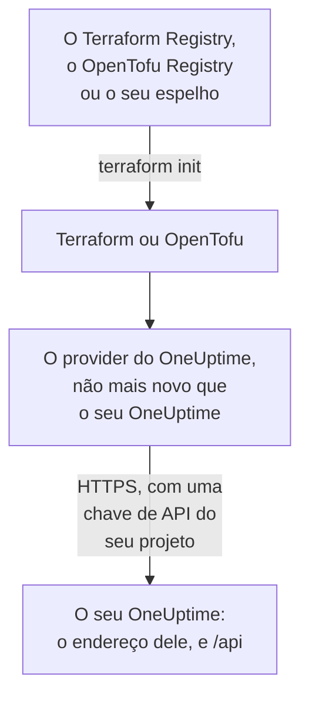

# Configuração auto-hospedada

O provider funciona com o seu próprio OneUptime do jeito que funciona com o OneUptime Cloud: os mesmos recursos, os mesmos atributos e as mesmas chaves de API do projeto. O que cabe a você definir: o endereço do seu OneUptime, a versão do provider que corresponde a ele e, onde precisar, um espelho para máquinas sem acesso à internet e a confiança em uma autoridade certificadora privada.

:::cards
- [Apontar o provider para o seu OneUptime](#apontar-o-provider-para-o-seu-oneuptime): O endereço dele, e uma chave de API do seu projeto.
- [Escolher a versão do provider](#escolher-a-versão-do-provider): O provider mais recente que não seja mais novo que o seu OneUptime.
- [Sem acesso à internet](#sem-acesso-à-internet): Espelhe o provider na sua rede.
- [TLS e certificados](#tls-e-certificados): Uma autoridade certificadora privada, proxies e HTTP simples.
:::



## Apontar o provider para o seu OneUptime

Defina `oneuptime_url` como o endereço em que você abre o painel: o esquema e o host, sem caminho. O provider adiciona `https://` quando o endereço não tem esquema, e `/api` no fim, então `https://oneuptime.example.com` envia cada requisição para `https://oneuptime.example.com/api`.

```hcl title="main.tf"
terraform {
  required_providers {
    oneuptime = {
      source  = "oneuptime/oneuptime"
      version = "{{TERRAFORM_PROVIDER_MATCHING}}"
    }
  }
}

provider "oneuptime" {
  oneuptime_url = "https://oneuptime.example.com"
  # The API key comes from the ONEUPTIME_API_KEY environment variable.
}
```

O endereço pode vir da variável de ambiente `ONEUPTIME_URL` em vez disso, para que uma configuração possa apontar para várias instalações:

```bash
export ONEUPTIME_URL="https://oneuptime.example.com"
export ONEUPTIME_API_KEY="<your-api-key>"
```

O endereço é o host em que a sua instalação é servida: `HOST` e `HTTP_PROTOCOL` em `config.env` com o Docker Compose, e `host` e `httpProtocol` nos valores do chart do Helm.

A chave é uma chave de API do projeto que você gerencia, criada no painel do seu OneUptime em **Configurações do projeto → Avançado → Chaves de API**, como no OneUptime Cloud. A chave de API mestra de um OneUptime auto-hospedado não pertence a nenhum projeto, então uma criação feita com ela falha com `ProjectId required`.

> [!TIP]
> O seu OneUptime escreve este bloco para você. Abra qualquer recurso ou lista no painel, e depois **Desenvolvedores** e **Terraform** no menu lateral: o bloco do provider que ele mostra tem o endereço do seu OneUptime, e um intervalo de versões que corresponde a ele.

## Escolher a versão do provider

Use o provider publicado mais recente que não seja mais novo que o seu OneUptime. As versões do provider seguem as do OneUptime: uma versão do OneUptime que altera o provider o publica com o seu próprio número de versão, e um provider mais novo que o seu OneUptime pode enviar opções que o seu OneUptime ainda não tem.

Então escreva um intervalo que termine na versão do seu OneUptime, como o painel faz. O bloco acima recebe `{{TERRAFORM_PROVIDER_MATCHING}}`, o intervalo para o OneUptime de onde esta documentação vem: quando você a lê no seu próprio OneUptime, esse intervalo é o seu. Caso contrário, escreva a sua versão:

:::steps
### Descobrir a versão do seu OneUptime

Pergunte ao seu OneUptime:

```bash
curl https://oneuptime.example.com/version
```

A resposta é JSON, como `{"version":"{{TERRAFORM_PROVIDER_MAJOR}}.0.40","commit":"..."}`. Como administrador master, você também pode abrir o rótulo da edição no cabeçalho do painel do administrador: veja [Descubra a sua versão atual](/docs/installation/upgrading#descubra-a-sua-versão-atual).

### Escrevê-la no intervalo

O intervalo começa na versão principal e termina na sua. Para um OneUptime {{TERRAFORM_PROVIDER_MAJOR}}.0.40:

```hcl title="main.tf"
terraform {
  required_providers {
    oneuptime = {
      source  = "oneuptime/oneuptime"
      version = ">= {{TERRAFORM_PROVIDER_MAJOR}}.0, <= {{TERRAFORM_PROVIDER_MAJOR}}.0.40"
    }
  }
}
```

O Terraform pega o provider mais recente do intervalo. Uma versão do OneUptime que não alterou o provider não publica nenhum, e o intervalo pula as versões que não existem.

### Baixar o provider

Execute `terraform init`. Ele mostra a versão que instalou e a registra em `.terraform.lock.hcl`.
:::

Ao atualizar, atualize primeiro o OneUptime. Depois mova o fim do intervalo para a nova versão dele, e execute `terraform init -upgrade`.

## Sem acesso à internet

Quando as máquinas que executam o Terraform não conseguem acessar o registro, copie o provider uma vez para a sua rede, e aponte o Terraform para a cópia.

:::steps
### Espelhar o provider

Em uma máquina com acesso à internet, em uma pasta com a sua configuração, baixe o provider para cada plataforma em que as suas máquinas rodam. Sem `-platform`, o comando baixa o provider apenas para a própria plataforma:

:::tabs
@tab Terraform
```bash
terraform providers mirror -platform=linux_amd64 -platform=darwin_arm64 /srv/terraform-mirror
```
@tab OpenTofu
```bash
tofu providers mirror -platform=linux_amd64 -platform=darwin_arm64 /srv/terraform-mirror
```
:::

A pasta contém o provider sob o endereço do registro, como `registry.terraform.io/oneuptime/oneuptime/`. Copie-a para a sua rede.

### Apontar o Terraform para o espelho

Escreva um arquivo de configuração da CLI que instale o provider do OneUptime a partir da pasta, e todo o resto como de costume:

:::tabs
@tab Terraform
```hcl title="mirror.tfrc"
provider_installation {
  filesystem_mirror {
    path    = "/srv/terraform-mirror"
    include = ["registry.terraform.io/oneuptime/oneuptime"]
  }
  direct {
    exclude = ["registry.terraform.io/oneuptime/oneuptime"]
  }
}
```
@tab OpenTofu
```hcl title="mirror.tfrc"
provider_installation {
  filesystem_mirror {
    path    = "/srv/terraform-mirror"
    include = ["registry.opentofu.org/oneuptime/oneuptime"]
  }
  direct {
    exclude = ["registry.opentofu.org/oneuptime/oneuptime"]
  }
}
```
:::

Indique-o em `TF_CLI_CONFIG_FILE`, que tanto o Terraform quanto o OpenTofu leem: `export TF_CLI_CONFIG_FILE=/etc/terraform/mirror.tfrc`.

### Inicializar

Execute `terraform init`: ele instala o provider a partir do espelho. Ele avisa que o arquivo de lock agora tem checksums apenas para esta plataforma. Para registrá-los para todas as plataformas, execute `terraform providers lock` com as mesmas opções `-platform` na máquina que tem acesso à internet, e faça commit de `.terraform.lock.hcl` com a sua configuração.
:::

Espelhe de novo sempre que mover o intervalo de versões.

## TLS e certificados

O provider verifica o certificado do seu OneUptime contra o repositório de confiança da máquina que executa o Terraform, e não há nenhuma opção para pular a verificação. Quando o certificado vem de uma autoridade certificadora privada, adicione essa autoridade ao repositório de confiança de toda máquina e runner de CI que executa o Terraform:

:::tabs
@tab Debian / Ubuntu
```bash
sudo cp my-ca.crt /usr/local/share/ca-certificates/
sudo update-ca-certificates
```
@tab RHEL / Fedora
```bash
sudo cp my-ca.crt /etc/pki/ca-trust/source/anchors/
sudo update-ca-trust
```
:::

No Linux, onde você não pode alterar o repositório de confiança, como em um contêiner de CI, defina `SSL_CERT_FILE` como um arquivo que contenha a sua autoridade e as autoridades públicas. No macOS e no Windows, adicione a autoridade ao repositório de certificados do sistema.

- **Proxies.** O provider envia as requisições dele pelo proxy em `HTTPS_PROXY`, exceto para os hosts em `NO_PROXY`. Um proxy reverso na frente do OneUptime precisa deixar passar sem alteração todo caminho `/api` e o cabeçalho `APIKey`.
- **HTTP simples.** Um endereço `http://` funciona, para uma instalação de teste. A chave de API viaja com cada requisição, então use HTTPS para todo o resto.

## Solução de problemas

:::details Mensagem “x509: certificate signed by unknown authority”
A máquina que executa o Terraform não confia no certificado do seu OneUptime: adicione a sua autoridade certificadora como mostra [TLS e certificados](#tls-e-certificados).
:::

:::details Mensagem “invalid character '<' looking for beginning of value”
Uma página web respondeu no lugar da API: `oneuptime_url` tem um caminho, ou um proxy respondeu. Defina-o só com o endereço do seu OneUptime.
:::

:::details Mensagem “no available releases match the given constraints”
Nenhum provider publicado atende à restrição de versão, por exemplo uma restrição que nomeia uma única versão que o OneUptime nunca publicou. Escreva um intervalo, como mostra [Escolher a versão do provider](#escolher-a-versão-do-provider).
:::

:::details Mensagem “ProjectId required”
A chave é a chave de API mestra, que não pertence a nenhum projeto. Crie uma chave de API do projeto, em **Configurações do projeto → Avançado → Chaves de API**.
:::

[Solução de problemas](/docs/terraform/troubleshooting) tem os outros erros, e o que cada um significa.

## Próximos passos

:::cards
- [Início rápido](/docs/terraform/quick-start): Crie uma chave de API e aplique os seus primeiros recursos.
- [Uso do registro](/docs/terraform/registry): Onde o provider é publicado, e como as versões são numeradas.
- [Solução de problemas](/docs/terraform/troubleshooting): Erros comuns e como corrigi-los.
- [Atualização](/docs/installation/upgrading): Atualize o seu OneUptime, antes de mover o intervalo do provider.
:::
