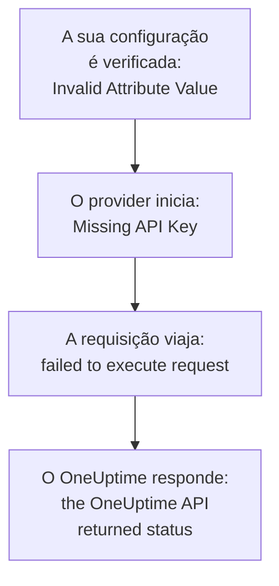

# Solução de problemas

Procure na tabela abaixo a mensagem que o Terraform exibiu, ou o que você viu acontecer: cada linha leva à sua correção. As seções depois da tabela explicam cada erro, agrupadas pela origem.

:::cards
- [Encontre o seu erro](#encontre-o-seu-erro): Cada mensagem e sintoma desta página, com a sua correção.
- [Chaves de API, permissões e planos](#chaves-de-api-permissões-e-planos): Quando o OneUptime recusa a chave do provider.
- [Planos que não se estabilizam](#planos-que-não-se-estabilizam): Alterações que voltam, e recursos que saem do estado.
- [Conectar a um OneUptime auto-hospedado](#conectar-a-um-oneuptime-auto-hospedado): O endereço, os certificados e os proxies.
:::

## Encontre o seu erro

| Mensagem ou sintoma | O que fazer |
| --- | --- |
| `Missing API Key` | Dê ao provider a chave dele: veja [`Missing API Key` ou `Invalid API Key`](#missing-api-key-ou-invalid-api-key) |
| `Invalid API Key` | Copie a chave de novo, ou crie uma nova: veja [`Missing API Key` ou `Invalid API Key`](#missing-api-key-ou-invalid-api-key) |
| `ProjectId required` | Use uma chave de API do projeto, não uma chave mestra: veja [`ProjectId required`](#projectid-required) |
| `You do not have permissions to create Monitor` | Dê à chave a permissão que a mensagem nomeia: veja [Falta uma permissão à chave](#falta-uma-permissão-à-chave) |
| `API keys need the Growth plan` | Volte o projeto para o plano Growth: veja [Pagamento necessário](#pagamento-necessário) |
| `402` para um recurso ou uma opção | Faça o upgrade do plano, ou deixe a opção no padrão: veja [Pagamento necessário](#pagamento-necessário) |
| `This project has been blocked` | Peça a um administrador master para desbloquear o projeto: veja [Um projeto bloqueado](#um-projeto-bloqueado) |
| `references records that are not in this project` | Use o ID de um registro do seu próprio projeto: veja [IDs de outro projeto](#ids-de-outro-projeto) |
| `Not Found` ou `Ambiguous Match` de uma fonte de dados | Corrija os argumentos da busca: veja [Buscas que não encontram nenhum ou encontram vários](#buscas-que-não-encontram-nenhum-ou-encontram-vários) |
| `Cannot import non-existent remote object` | Verifique o ID e as permissões da chave: veja [Importar recursos](/docs/terraform/importing-resources#solução-de-problemas) |
| `Provider produced inconsistent result after apply` | Atualize o provider: veja [Resultado inconsistente depois do apply](#resultado-inconsistente-depois-do-apply) |
| Um plano cria um recurso que você não adicionou | A chave não consegue mais lê-lo, e o OneUptime respondeu `404`: devolva à chave o acesso de leitura, e depois importe o recurso com `terraform import`: veja [Um recurso sai do estado, e o próximo apply o cria de novo](#um-recurso-sai-do-estado-e-o-próximo-apply-o-cria-de-novo) |
| Uma `priority` ou uma `order` muda depois do apply | Dê a cada um um número que nenhum outro tem: veja [Uma prioridade ou ordem que se move](#uma-prioridade-ou-ordem-que-se-move) |
| `Invalid Configuration for Read-Only Attribute` | Remova o atributo da configuração: veja [Atributos somente leitura](#atributos-somente-leitura) |
| `has been renamed to` | Renomeie o tipo de recurso, com um bloco `moved`: veja [Um tipo de recurso renomeado](#um-tipo-de-recurso-renomeado) |
| Um monitor criado com o Terraform nunca mostra as verificações dele | Atualize o OneUptime: veja [Monitores criados antes dos IDs de etapa](#monitores-criados-antes-dos-ids-de-etapa) |
| `must contain at least 1 elements` | Omita o atributo em vez de deixá-lo vazio: veja [Valores vazios](#valores-vazios) |
| JSON do painel em um arquivo `.tf` | Escreva-o em HCL: veja [JSON do painel](#json-do-painel) |
| `no available releases match the given constraints` | Use um intervalo de versões, não uma única versão exata: veja [Uma versão que nunca foi publicada](#uma-versão-que-nunca-foi-publicada) |
| `x509: certificate signed by unknown authority` | Confie na sua autoridade certificadora: veja [Certificados](#certificados) |
| `invalid character '<' looking for beginning of value` | Aponte `oneuptime_url` para o próprio OneUptime: veja [Uma página web no lugar da API](#uma-página-web-no-lugar-da-api) |
| `connection refused` ou `Client.Timeout exceeded` | Verifique o endereço, a rede e qualquer proxy: veja [Conexões que falham](#conexões-que-falham) |

## Como ler um erro

Um erro nomeia a etapa que falhou, e a mensagem dele diz de onde ele veio:



- Um erro que vem antes de qualquer requisição, como `Invalid Attribute Value`, é sobre a sua configuração: o provider a verifica antes de falar com o OneUptime.
- `failed to execute request` significa que a requisição nunca recebeu resposta: veja [Conectar a um OneUptime auto-hospedado](#conectar-a-um-oneuptime-auto-hospedado).
- `the OneUptime API returned status` é a resposta do OneUptime: o status e a mensagem depois dele dizem o que o OneUptime recusou.

O provider nomeia o que estava fazendo: `Unable to create monitor` e `Unable to update monitor` para uma alteração, e `Unable to parse label response` quando lê um recurso. Uma leitura que o OneUptime recusa é informada com o resumo `Parse Error`, mas a mensagem depois dele é a resposta do OneUptime, não um problema de análise.

## Chaves de API, permissões e planos

### `Missing API Key` ou `Invalid API Key`

`Missing API Key` para o provider antes que ele faça qualquer requisição: nem `api_key` no bloco do provider nem a variável de ambiente `ONEUPTIME_API_KEY` estão definidas. Exporte a variável no shell em que você executa o Terraform, ou passe a chave em uma variável marcada como `sensitive`.

`Invalid API Key` é a resposta do OneUptime a uma chave que ele não conhece: uma chave digitada errado, expirada ou excluída, ou uma de outro OneUptime que não aquele para o qual `oneuptime_url` aponta. Copie a chave de novo da página dela em **Configurações do projeto → Avançado → Chaves de API**, ou crie uma nova.

### `ProjectId required`

O provider precisa de uma chave de API do projeto que ele gerencia: é dela que vem o projeto. A chave de API mestra de um OneUptime auto-hospedado não pertence a nenhum projeto, então toda criação feita com ela falha com `ProjectId required`. Crie uma chave de API do projeto, como em [Criar uma chave de API do projeto](/docs/terraform/quick-start#criar-uma-chave-de-api-do-projeto), e use-a no lugar.

### Falta uma permissão à chave

`You do not have permissions to create Monitor` e mensagens parecidas vêm com o status `422`: a chave não pode fazer isso com esse tipo de registro. Elas nomeiam as permissões que permitiriam isso. Abra a página da chave em **Configurações do projeto → Avançado → Chaves de API** e dê a ela uma delas, ou **Administrador do projeto**. Uma importação precisa apenas da permissão de leitura.

### Pagamento necessário

- **402 Payment Required em toda requisição** — `API keys need the Growth plan...`: no OneUptime Cloud, o projeto está abaixo do **Growth**, e as chaves de API de um projeto - incluindo a do provider - param de funcionar abaixo dele. Toda chamada que o provider faz é recusada, inclusive `terraform plan`, até o projeto voltar ao Growth; então a mesma chave volta a funcionar, sem nada a mudar na sua configuração. Faça o upgrade em **Configurações do projeto → Cobrança e faturas → Cobrança**, ou gerencie o projeto no painel enquanto isso. Veja [Chaves de API e SCIM abaixo do plano](/docs/api-reference/api-reference#chaves-de-api-e-scim-abaixo-do-plano).
- **402 Payment Required** — você atingiu um limite do seu plano do OneUptime, ou a configuração ativa uma opção que o seu plano não inclui (uma página de status privada, relatórios por e-mail, um painel público, uma lista de IPs permitidos...), seja quando `terraform apply` cria o recurso com ela ou quando o altera depois. O Terraform mostra a mensagem do OneUptime como ela é. Faça o upgrade do plano, ou reduza a configuração.

Voltar uma opção dessas ao padrão, o que desativa a funcionalidade, funciona em todos os planos, então uma configuração que desativa funcionalidades pagas é aplicada depois que um teste termina ou o plano é rebaixado.

O mesmo vale para os recursos que o seu plano vende e que um projeto mantém depois de ser rebaixado - provedores de SSO, conexões SCIM, chaves de API, escalas de plantão, e regras e resumos do Slack e do Microsoft Teams: abaixo do plano (enquanto o projeto ainda está no Growth, de que a própria chave de API do provider precisa), os que o projeto já tem ainda podem ser lidos (então `terraform plan` e `import` funcionam), excluídos (então removê-los da configuração, ou `terraform destroy`, é aplicado), e desativados onde têm um atributo `is_enabled`. Criá-los, alterá-los ou ativá-los de novo ainda responde 402.

Outros recursos que o seu plano vende, como modelos, campos personalizados e grupos de monitores, ainda precisam do plano para serem lidos, então um plano que os atualiza responde 402; eles ainda podem ser excluídos, por exemplo com `terraform destroy -refresh=false`.

As permissões de uma chave de API não são excluídas uma a uma abaixo do Growth, já que excluir uma permissão de bloqueio daria mais acesso à chave: execute `terraform state rm` nos recursos de permissão, depois destrua a chave, e as permissões dela vão junto.

### Um projeto bloqueado

`This project has been blocked. Please contact your administrator.` vem com o status `403`: um administrador master bloqueou o projeto, e até que ele o desbloqueie, ninguém além de um administrador master age nele, nem mesmo as chaves de API do projeto.

## Registros e buscas

### IDs de outro projeto

Todo ID que um recurso nomeia - os rótulos de um monitor, a página de status de um grupo de página de status, o site de um dispositivo de rede, as equipes de uma regra de escalonamento - precisa ser um registro do projeto ao qual a sua chave de API pertence. O ID de um registro de outro projeto, um ID que não existe e o ID de um registro que a chave não pode ler recebem todos a mesma resposta, que nomeia o campo e o ID:

```text
This network device references records that are not in this project: Network Site "…". Please pick values from this project and try again.
```

Isso geralmente significa que um ID foi copiado da configuração ou do estado de outro projeto, ou que o registro foi excluído fora do Terraform. Refira-se ao registro pelo recurso dele ou por uma fonte de dados na mesma configuração (`oneuptime_label.critical.id`) em vez de um ID literal, e aplique de novo. Uma pessoa indicada como usuário precisa ser membro do projeto.

### Buscas que não encontram nenhum ou encontram vários

Uma fonte de dados encontra exatamente um registro, ou interrompe o plano. `Not Found` diz que nenhum registro tem o `id`, ou que nenhum corresponde aos argumentos que você definiu; `Ambiguous Match` diz que vários correspondem. Corrija os argumentos, defina mais deles para reduzir a busca a um só, ou busque o registro pelo `id`. [Ler o que já existe](/docs/terraform/complete-guide#ler-o-que-já-existe) tem as regras.

## Planos que não se estabilizam

### Resultado inconsistente depois do apply

`Provider produced inconsistent result after apply` significa que o provider devolveu valores diferentes dos que planejou. Providers mais antigos faziam isso com valores que o servidor calcula: padrões que o servidor adiciona dentro de `monitor_steps`, carimbos de data e hora que o servidor escrevia de outra forma, valores encapsulados como `probe_version`, e atributos que o servidor mantém atualizados, como quando um monitor de requisições recebidas recebeu o último heartbeat. Eles também liam um número decimal como null quando a API o enviava como texto, então todo apply de uma regra de cor de barra de página de status falhava em `uptime_percent_greater_than_or_equal_to`. Os providers atuais tratam tudo isso: carimbos de data e hora são comparados como instantes, listas de rótulos são conjuntos, números são lidos de volta como você os escreveu, e um atributo que você não definiu mantém o valor planejado até a próxima atualização ler o do servidor.

:::steps
1. Atualize o provider: mantenha `version = "{{TERRAFORM_PROVIDER_VERSION}}"` no requisito do provider, e execute `terraform init -upgrade`.
2. Aplique de novo. Um recurso que o apply com falha deixou marcado como tainted é substituído uma vez, e os planos ficam vazios depois disso. Para manter o recurso como está, tire a marca dele pelo endereço primeiro: `terraform untaint oneuptime_status_page_history_chart_bar_color.operational`.
:::

Se um provider atual ainda falhar assim, informe em [github.com/OneUptime/oneuptime/issues](https://github.com/OneUptime/oneuptime/issues), com a versão do provider, o tipo de recurso, o menor bloco `resource` que falha, e o erro inteiro. O erro nomeia o atributo cujo valor mudou, que é a coisa mais útil de enviar.

### Um recurso sai do estado, e o próximo apply o cria de novo

Uma leitura por ID responde `404` tanto para um registro que não existe quanto para um que a chave de API não pode ler: a API não diz nada sobre um registro que ela não mostra a você. O Terraform entende um `404` na atualização como um recurso excluído fora do Terraform. Ele remove o recurso do estado, e o próximo `terraform apply` o cria de novo, ao lado daquele que ainda está lá.

Isso acontece quando a chave que gerencia um recurso não consegue mais lê-lo: a permissão de leitura dela foi limitada a rótulos que o recurso não tem, ou aos recursos de que as equipes dela são donas, ou um bloqueio tira o recurso dela - ou os rótulos ou os donos do recurso mudaram.

**Antes de planejar:**

- Dê à chave, para cada tipo de recurso que ela gerencia, uma permissão de leitura que alcance cada recurso que ela gerencia: no escopo **Todos**, ou limitada a rótulos que esses recursos têm. As permissões de atualização e exclusão de uma chave só alcançam o que ela pode ler.
- Leia o plano antes de aplicá-lo: um recurso planejado para criação que você não adicionou é um recurso que a chave não consegue mais ler.

**Quando o estado já perdeu um recurso:** devolva à chave o acesso de leitura dela, e depois [importe](/docs/terraform/importing-resources) o recurso em vez de aplicar, para que o Terraform adote o que existe em vez de criar um segundo. Se uma cópia já foi criada, exclua a que você não quer.

### Uma prioridade ou ordem que se move

Status de monitor, estados e severidades de incidentes e alertas, e as outras listas que você ordena no painel guardam cada número uma vez. Um número que nenhum outro tem é mantido como escrito. Um número que outro já tem é tomado, e os que estão no caminho descem uma posição, como faz um arrastar no painel. Então dois deles configurados com o mesmo número trocam de lugar a cada apply.

Dê a cada um o seu próprio número com intervalos entre eles, como `101`, `102` e `103`, e reordene os que o Terraform gerencia no Terraform, não arrastando-os no painel.

### Atributos somente leitura

`Invalid Configuration for Read-Only Attribute` interrompe o plano quando uma configuração define um atributo que só o OneUptime escreve. Quem criou um registro, e quem o arquivou, resolveu ou reconheceu, é registrado a partir da requisição: a pessoa conectada, e ninguém para uma requisição feita com uma chave de API, que é como o Terraform se conecta. Então `created_by_user_id`, e todo outro atributo que termina em `_by_user_id`, pode ser lido de um recurso ou de uma fonte de dados, mas não definido. O mesmo vale para `archived_at`: definir `is_archived` registra quando o recurso foi arquivado, e aplicá-lo de novo sem alteração mantém esse horário. Remova o atributo do bloco do recurso; nada mais muda no recurso.

### Um tipo de recurso renomeado

`has been renamed to` avisa que um tipo de recurso tem um nome novo. Os tipos de recurso agora mantêm inteiras palavras como IoT e vCenter: `oneuptime_iot_fleet` e `oneuptime_vcenter`, onde providers mais antigos as dividiam (`oneuptime_io_t_fleet`, `oneuptime_v_center`). Os nomes antigos continuam funcionando como aliases obsoletos. Para mudar sem substituir nada, renomeie o recurso na sua configuração e diga ao Terraform que ele foi movido:

```hcl
resource "oneuptime_iot_fleet" "factory" {
  name = "Factory floor"
}

moved {
  from = oneuptime_io_t_fleet.factory
  to   = oneuptime_iot_fleet.factory
}
```

`terraform plan` então mostra a movimentação e nenhuma outra alteração. Mover entre tipos de recurso precisa do Terraform 1.8 ou posterior, ou do OpenTofu 1.12 ou posterior; em uma versão mais antiga, mantenha o nome antigo, que continua funcionando. As fontes de dados foram renomeadas da mesma forma: mude o nome, e nada mais.

### Monitores criados antes dos IDs de etapa

Os IDs dentro das etapas de um monitor - de cada etapa, critério, e modelo de incidente e de alerta - são atribuídos pelo servidor. Versões mais antigas do OneUptime davam IDs apenas aos critérios, e um conjunto novo deles a cada escrita, então um monitor escrito pela API, como era todo monitor que o provider criava, era salvo com uma etapa sem ID. As sondas dele ainda o verificavam e o status dele ainda mudava, mas a página do monitor não encontrava as verificações dele, os incidentes dele não conseguiam se resolver sozinhos, e todo `terraform apply` que alterava `monitor_steps` soltava os incidentes abertos dos critérios deles.

O OneUptime atual dá a cada um deles um ID na criação, mantém esses IDs em todo apply, e preenche os que faltam nos monitores existentes quando é atualizado. Nada muda na sua configuração: ainda não há IDs para escrever. Um incidente que o comportamento antigo deixou aberto se fecha na próxima recuperação do monitor, desde que o critério que o abriu ainda esteja lá; um cujo critério um apply anterior substituiu precisa ser resolvido uma vez à mão.

## Configuração que o provider recusa

### Valores vazios

O provider recusa uma lista, um mapa ou um texto vazios em `monitor_steps` e nas partes dele, como `monitor_steps = []`, `request_headers = {}` ou `request_body = ""`:

```text
Attribute monitor_steps list must contain at least 1 elements, got: 0
```

Omita o atributo em vez disso: um atributo que não está lá não está definido. [Etapas do monitor](/docs/terraform/monitor-steps) lista o que cada parte aceita.

### JSON do painel

O JSON que o painel e a API mostram para um recurso é o que a API envia, não configuração do Terraform: no Terraform os nomes de atributos são em snake_case, os valores são escritos de outra forma, e muitos campos são do servidor. Colado em um arquivo `.tf`, ele não funciona.

- Para adotar o recurso, [importe-o](/docs/terraform/importing-resources): a página **Terraform** do painel escreve a configuração para você.
- Para escrever um novo, comece pelos [Exemplos](/docs/terraform/examples).
- Para as etapas de um monitor, escreva o atributo tipado `monitor_steps` que [Etapas do monitor](/docs/terraform/monitor-steps) descreve: remova os invólucros `{_type, value}`, escreva as chaves camelCase em snake_case, e omita todo `id`.

## Versões e o registro

### Uma versão que nunca foi publicada

`no available releases match the given constraints` significa que nenhuma versão publicada atende à restrição de versão. Nem toda versão do OneUptime publica um provider: uma versão cujo provider não mudou não publica nenhum, então uma restrição que nomeia uma única versão exata pode nomear uma versão que não existe. Use um intervalo em vez disso:

```hcl
terraform {
  required_providers {
    oneuptime = {
      source  = "oneuptime/oneuptime"
      version = "{{TERRAFORM_PROVIDER_VERSION}}"
    }
  }
}
```

Em um OneUptime auto-hospedado, limite o intervalo à versão do seu OneUptime, como mostra a [Configuração auto-hospedada](/docs/terraform/self-hosted#escolher-a-versão-do-provider). [Uso do registro](/docs/terraform/registry#como-as-versões-são-numeradas) explica como as versões são numeradas.

## Conectar a um OneUptime auto-hospedado

### Certificados

`x509: certificate signed by unknown authority` significa que a máquina que executa o Terraform não confia no certificado que o seu OneUptime apresenta, geralmente um de uma autoridade certificadora privada. O provider o verifica contra o repositório de confiança dessa máquina. Adicione a sua autoridade certificadora lá, em toda máquina e runner de CI que executa o Terraform: veja [TLS e certificados](/docs/terraform/self-hosted#tls-e-certificados). Não há nenhuma opção para pular a verificação.

### Uma página web no lugar da API

`invalid character '<' looking for beginning of value` significa que uma página web respondeu onde o provider esperava a API: `oneuptime_url` tem um caminho depois do host, como `/dashboard`, ou um proxy na frente do OneUptime respondeu no lugar. Defina `oneuptime_url` só com o endereço do seu OneUptime, como `https://oneuptime.example.com`: o provider adiciona `/api` sozinho.

### Conexões que falham

`failed to execute request` com `connection refused`, `no such host` ou `Client.Timeout exceeded` significa que nenhuma resposta voltou. Verifique se o endereço e a porta estão certos e acessíveis de onde o Terraform é executado, e defina `HTTPS_PROXY` se a máquina acessa a internet por um proxy. O provider espera até 60 segundos por cada resposta. Ele tenta uma leitura ou uma exclusão até três vezes quando nenhuma resposta chega, ou a resposta é `429`, `502`, `503` ou `504`, mas nunca uma criação ou uma alteração: depois que uma criação falha assim, olhe no painel antes de aplicar de novo, caso ela tenha sido feita.

## Obter mais detalhes

O provider escreve os avisos dele no log do Terraform. Execute o comando com `TF_LOG_PROVIDER=WARN` para vê-los, e com `TF_LOG_PATH` para guardá-los em um arquivo:

```bash
TF_LOG_PROVIDER=WARN TF_LOG_PATH=terraform.log terraform plan
```

`OneUptime rejected a column in the select; dropping it and retrying` nomeia uma coluna que o OneUptime não quis enviar à chave do provider, geralmente por falta de uma permissão. Esse atributo fica vazio no estado, então pode aparecer como uma alteração em todo plano.

## Ainda com problemas?

Abra uma issue em [github.com/OneUptime/oneuptime/issues](https://github.com/OneUptime/oneuptime/issues) com a versão do provider (`terraform version` a mostra depois do `init`), o bloco do recurso e o erro inteiro. O provider é gerado a partir do código do OneUptime, então as issues dele ficam no repositório principal.

## Próximos passos

:::cards
- [Importar recursos](/docs/terraform/importing-resources): Adote o que você criou no painel, e corrija erros de importação.
- [Configuração auto-hospedada](/docs/terraform/self-hosted): O endereço, a versão e os certificados do seu próprio OneUptime.
- [Guia completo](/docs/terraform/complete-guide): Autenticação, fontes de dados, estado e atualizações.
- [Etapas do monitor](/docs/terraform/monitor-steps): Todos os atributos das verificações de um monitor.
:::
