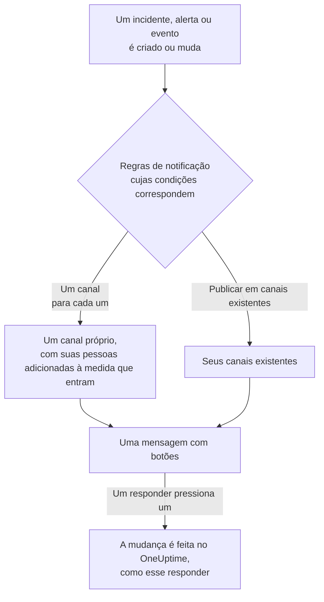

# Mattermost

Conecte o OneUptime ao seu servidor do Mattermost para publicar nos seus canais incidentes, alertas, episódios, manutenções programadas, monitores e atualizações de plantão, dar a cada incidente um canal próprio e deixar os responders confirmarem, resolverem, adicionarem notas e mudarem o estado sem sair do Mattermost.

:::cards
- [Conectar o Mattermost](#conectar-o-mattermost): Crie uma conta de bot para o OneUptime e depois conecte o projeto com o token dela.
- [Conectar a sua própria conta](#conectar-a-sua-própria-conta-do-mattermost): Vincule a sua conta do Mattermost à sua conta do OneUptime.
- [Regras de notificação](#regras-de-notificação): Decida quais eventos são publicados onde, e quais ganham um canal próprio.
- [Quem está no canal de um registro](#quem-está-no-canal-de-um-registro): Veja quem está nele, entre e adicione pessoas, pela página do registro.
- [Agir pelo Mattermost](#agir-sobre-incidentes-alertas-e-eventos-pelo-mattermost): Os botões das mensagens do OneUptime.
- [Rede e auto-hospedagem](#rede-e-auto-hospedagem): O que cada servidor precisa conseguir alcançar.
:::

## Como funciona

Duas conexões fazem isso funcionar:

- **A conexão do projeto**, feita uma vez: uma conta de bot no seu servidor do Mattermost, nas equipes em que o OneUptime publica. Ela publica as mensagens, cria os canais e adiciona as pessoas a eles.
- **A conexão de cada pessoa**: a conta do Mattermost dela vinculada à conta dela no OneUptime. Os botões agem como essa pessoa, com as permissões dela no projeto.

Uma equipe do Mattermost pode estar conectada a mais de um projeto, como produção e staging. Um botão age no projeto do registro de que trata a mensagem dele.

## Antes de começar

- **Uma função que possa conectar o projeto:** **Proprietário do projeto**, **Administrador do projeto** ou **Membro do projeto**. Desconectar requer **Proprietário do projeto** ou **Administrador do projeto**.
- **Um servidor do Mattermost** em que você possa criar uma conta de bot, ou um administrador do Mattermost que possa criar uma para você. Tanto o Mattermost Cloud quanto o Mattermost auto-hospedado funcionam.
- **O plano Growth no OneUptime Cloud** para regras de notificação e resumos.

O OneUptime não precisa de nada configurado no próprio servidor para o Mattermost: cada projeto traz o próprio servidor do Mattermost e a própria conta de bot.

## Conectar o Mattermost

:::steps
### Criar uma conta de bot no Mattermost

No Mattermost, abra **System Console** > **Integrations** > **Bot Accounts** e verifique se **Enable Bot Account Creation** está ativado. Depois vá para **Integrations** > **Bot Accounts** > **Add Bot Account**, dê a ela o nome `oneuptime` e salve. O Mattermost mostra o token de acesso do bot uma única vez: copie-o.

### Adicionar o bot à sua equipe

Adicione o bot a cada equipe em que o OneUptime deve publicar, como você adicionaria uma pessoa: **Main Menu** > **Invite People**, e convide `@oneuptime`. O OneUptime cria canais e publica apenas nas equipes das quais o bot é membro.

### Conectar o projeto

No OneUptime, vá para **Configurações do projeto** > **Espaço de trabalho** > **Mattermost** e clique em **Conectar ao Mattermost**. Informe o endereço do seu servidor, como `https://chat.example.com`, e o token de acesso do bot. O OneUptime verifica o token com o seu servidor antes de guardar qualquer coisa. Se o bot estiver em mais de uma equipe, o OneUptime pergunta qual delas é a padrão: a equipe em que uma regra de notificação que não indica nenhuma equipe cria seus canais. Enquanto nenhum workspace estiver conectado, a seção **Espaço de trabalho** dos menus Incidentes, Alertas, Manutenção programada, Monitores e Plantão contém **Conectar um espaço de trabalho**, que também leva até aqui.

### Adicionar uma regra de notificação

Vá para **Incidentes** > **Espaço de trabalho** > **Mattermost** e crie uma regra. Por exemplo, uma que crie um canal do Mattermost para cada novo incidente com todos que trabalham nele. Consulte [Regras de notificação](#regras-de-notificação).
:::

O token de acesso do bot fica guardado apenas no servidor do OneUptime, criptografado com os outros segredos do projeto, e nunca mais é mostrado. O endereço do servidor, as equipes e o nome de usuário do bot são mostrados a todos no projeto, na página de configurações do Mattermost.

Um projeto fica conectado a um único servidor do Mattermost. Para movê-lo para outro servidor, desconecte-o primeiro: **Configurações do projeto** > **Espaço de trabalho** > **Mattermost**, depois **⋯** > **Desconectar o Mattermost**. Desconectar também desconecta a conta do Mattermost de cada membro e remove os métodos de notificação do Mattermost dele e as regras de plantão que os usam. As suas regras de notificação e os seus resumos são mantidos para quando você conectar de novo.

## Mais de uma equipe

O OneUptime funciona em cada equipe do seu servidor do Mattermost da qual o bot dele é membro:

1. No Mattermost, adicione o bot a cada equipe que deve usar o OneUptime, como você adicionaria uma pessoa: abra a equipe e depois **Main Menu** > **Invite People**.
2. O cartão **Equipes do Mattermost** em **Configurações do projeto** > **Espaço de trabalho** > **Mattermost** lista essas equipes, a padrão primeiro. Clique em **Atualizar** depois de adicionar o bot a outra equipe.

- **Qual equipe uma regra usa.** As regras de notificação escolhem a **Equipe do Mattermost** dos seus canais. Se ficar em branco, a regra cria o canal dela na equipe padrão e procura os canais que nomeia primeiro ali, depois nas outras equipes do bot.
- **Qual equipe um resumo usa.** Os resumos, na aba **Resumo** de **Incidentes** e **Alertas**, também escolhem a **Equipe do Mattermost** dos seus canais. Se ficar em branco, um resumo procura os seus canais primeiro na equipe padrão, depois nas outras equipes do bot.
- **A equipe padrão.** É a equipe à qual você conectou o projeto. **Tornar padrão** no cartão torna outra equipe a padrão, para uma função que possa conectar o projeto.
- **Onde o OneUptime funciona.** Os botões das mensagens do OneUptime, e os formulários que eles abrem, funcionam em cada uma dessas equipes. Em uma equipe da qual o bot foi removido, um botão apenas informa que a equipe não está mais conectada.
- **Uma equipe padrão da qual o bot foi removido.** O cartão avisa. Adicione o bot de novo no Mattermost, ou torne outra equipe a padrão.
- **Uma equipe que uma regra indica e da qual o bot foi removido.** O cartão da regra avisa, e a regra não usa outra equipe no lugar. Adicione o bot de novo à equipe no Mattermost, ou escolha outra equipe na regra: o formulário dela ainda mostra a escolha antiga, para que você possa mudá-la.

## Conectar a sua própria conta do Mattermost

O Mattermost não tem um login para o qual o OneUptime possa enviar você, então, em vez disso, o bot do OneUptime envia à sua conta do Mattermost uma mensagem direta com um link:

:::steps
1. Vá para **Configurações do usuário** > **Espaço de trabalho** > **Mattermost**. O OneUptime procura a conta do Mattermost com o seu endereço de e-mail. Se encontrar uma, clique em **Enviar link para @your-username**. Se não, clique em **Enviar um link para mim** e informe o seu nome de usuário do Mattermost.
2. Abra a mensagem direta do bot do OneUptime no Mattermost e clique em **Connect my account**.
3. O link abre o OneUptime, que conecta a sua conta.
:::

Abra o link no mesmo navegador em que você o pediu: ele só funciona ali, só uma vez e só por 15 minutos. Isso prova que quem o pediu tem as duas contas, então ninguém consegue conectar a conta do Mattermost de outra pessoa. Se você não pediu um link, ignore-o: nada é conectado até que ele seja aberto no navegador que o pediu.

A conexão da sua conta pertence a este projeto. Em outro projeto conectado à mesma equipe do Mattermost, conecte-a lá também.

## Ser acionado no Mattermost

Para ser acionado por mensagem direta quando estiver de plantão, adicione o Mattermost como um dos seus métodos de notificação:

:::steps
1. Conecte a sua própria conta do Mattermost (consulte [Conectar a sua própria conta do Mattermost](#conectar-a-sua-própria-conta-do-mattermost)).
2. Vá para **Configurações do usuário** > **Métodos de notificação**, abra a aba **Aplicativos do espaço de trabalho** e clique em **Adicionar conta do Mattermost**.
3. Clique em **Send Test Message** na linha dele. A mensagem chega como mensagem direta do bot do projeto.
:::

Adicioná-lo o inclui imediatamente nas suas regras de plantão, então a partir daí os acionamentos chegam a você no Mattermost. Altere quais acionamentos ele recebe em **Configurações do usuário** > **Como me contatar**. Cada acionamento traz um link para confirmá-lo e outro para escaloná-lo. Desconectar a sua conta do Mattermost remove este método e as regras de plantão que o usam.

## Regras de notificação

Uma regra de notificação diz quais eventos são publicados no Mattermost, e onde. Cada produto tem as suas próprias regras, em **Espaço de trabalho** > **Mattermost** no seu menu: **Incidentes** (com **Episódios de incidentes** e uma aba **Resumo**), **Alertas** (com **Episódios de alertas** e **Resumo**), **Manutenção programada**, **Monitores**, **Plantão**, **Eventos de segurança** e **SLOs**. Elas funcionam como as do Slack: consulte [Regras de notificação](/docs/workspace-connections/slack#regras-de-notificação) para condições, destinos, as atualizações que uma regra publica e quem entra em um canal.

Um canal que uma regra cria recebe o nome do seu registro: o incidente INC-42 recebe `inc-42`. O Mattermost aceita letras minúsculas, números, `-` e `_`, até 64 caracteres, começando e terminando com uma letra ou um número, e o formulário da regra mostra o nome enquanto você digita. Se já existir um canal com esse nome, como um arquivado, o OneUptime adiciona `-2`, `-3` e assim por diante. Um incidente, alerta ou episódio privado recebe um canal privado.

Para publicar em um canal existente, informe o nome dele como aparece no endereço do canal, como `incidents` para `chat.example.com/team/channels/incidents`, ou o nome de exibição dele. O OneUptime entra sozinho em um canal público na primeira vez que publica nele. Adicione o bot a um canal privado no Mattermost antes que uma regra publique nele. Quando o bot está em mais de uma equipe, uma regra também escolhe a equipe em que os canais dela estão: consulte [Mais de uma equipe](#mais-de-uma-equipe).

As pessoas entram no canal de uma regra pela conta do Mattermost que conectaram, ou então pela conta do Mattermost que tem o endereço de e-mail delas, quando o seu servidor mostra endereços de e-mail ao bot (**System Console** > **Site Configuration** > **Users and Teams** > **Show Email Address**). O OneUptime nomeia quem não conseguiu adicionar em uma única mensagem no canal, com um link para conectar a conta.

Um incidente, alerta, episódio ou evento de manutenção agendada com um canal próprio tem **Abrir no Mattermost** no cabeçalho da sua página no OneUptime, ao lado dos botões de estado. Ele abre esse canal em uma nova aba, no seu servidor do Mattermost. Um registro com dois canais próprios lista os dois sob o botão. Um registro que também tem canais no Slack ou no Microsoft Teams tem, em vez disso, um único botão **Abrir canal**, que lista todos eles. Os canais existentes em que as suas regras publicam não são oferecidos.

**Testar regra** na linha de uma regra publica uma mensagem de teste dessa regra nos canais que ela indica, como faz para o Slack.

As mensagens do OneUptime não notificam ninguém com o que citam: um nome ou uma descrição que contenha `@channel`, `@here` ou `@someone` é mostrado como foi escrito, e não notifica ninguém.

## Quem está no canal de um registro

Um incidente, alerta, episódio ou evento de manutenção agendada com um canal do Mattermost próprio tem um cartão **Canal do Mattermost** na sua página no OneUptime. O cartão mostra o canal, como um link que o abre no seu servidor do Mattermost, se ele é privado e quem está nele, você primeiro. Pelo cartão, sem um administrador do Mattermost:

- **Entrar no canal** adiciona você, quando você não está no canal.
- **Adicionar pessoas** abre uma lista das pessoas e equipes do projeto: escolha uma pessoa para adicioná-la, ou uma equipe para adicionar todos os membros dela.

O bot do OneUptime as adiciona, como adiciona as pessoas do canal de uma regra. O bot fica nos canais que cria, então isso funciona também para um canal privado que todos deixaram. Um registro que também tem canais no Slack ou no Microsoft Teams lista todos em um único cartão **Canais de chat**.

- **Quem pode adicionar pessoas.** Quem pode editar o registro: **Proprietário do projeto**, **Administrador do projeto**, **Membro do projeto**, **Administrador de incidentes** e **Membro de incidentes** para um incidente, ou **Edit Incident** em uma função personalizada, e a mesma permissão para um alerta, um episódio ou um evento (**Edit Alert**, por exemplo). Os demais veem quem está no canal e como entrar.
- **Quem pode ser adicionado.** Alguém que o OneUptime encontra no Mattermost, pela conta que a pessoa conectou ou então pelo endereço de e-mail dela, quando o seu servidor mostra endereços de e-mail ao bot, e que está na equipe do canal. Uma conta de convidado dessa equipe também pode ser adicionada: o Mattermost permite que os membros de um canal adicionem convidados. O cartão nomeia quem não pôde adicionar, e por quê.
- **O que fica registrado.** Quem foi adicionado, e por quem, no feed do registro (**Membro adicionado ao canal**) e em **Configurações do projeto** > **Notificações** > **Logs de notificação**, na aba **Espaço de trabalho**.
- **Um canal arquivado.** O cartão continua listando quem está nele, e não adiciona ninguém até que o canal seja desarquivado no Mattermost.
- **Um canal do qual o bot foi removido.** O Mattermost mostra as pessoas de um canal só a quem está nele, mesmo em um canal público, então o cartão diz que não consegue ver o canal. Alguém que esteja nele pode adicionar o bot de novo no Mattermost. O OneUptime também entra sozinho em um canal público na próxima vez que publica nele.
- **Tirar alguém.** O OneUptime só adiciona pessoas: tire alguém do canal no Mattermost.

## Agir sobre incidentes, alertas e eventos pelo Mattermost

As mensagens do OneUptime trazem botões, e um menu **More actions** para o que menos pessoas precisam. Cada um age como você, com as suas permissões no projeto, e responde em uma mensagem que só você vê.

| Registro | Botões e menu |
| --- | --- |
| **Incidente** | **Acknowledge**, **Resolve**, **Add Note** e, no menu, **Change Severity** e **Change State** |
| **Alerta** | **Acknowledge**, **Resolve**, **Add Note**, **Change State**, **Execute On-Call Policy** |
| **Episódio de incidente, episódio de alerta** | **Acknowledge**, **Resolve**, **Add Note**, **Change State**, **Execute On-Call Policy** |
| **Manutenção programada** | **Mark as Ongoing**, **Mark as Complete**, **Add Note**, **Change State** |

**Add Note**, **Change State**, **Change Severity** e **Execute On-Call Policy** abrem um formulário no Mattermost. Uma nota em um incidente ou em um evento de manutenção programada pode ser pública, mostrada na página de status, ou privada; uma nota em um incidente privado é sempre privada, e em um alerta também é sempre privada. Toda mensagem também tem um link que abre o registro dela no OneUptime, para todo o resto. Quando as notas públicas do projeto precisam de aprovação, uma nota pública enviada pelo formulário aguarda por ela, e uma mensagem que só você vê diz quem ela aguarda: veja [Aprovação de notas públicas](/docs/incidents/notes-owners-and-feed#aprovação-de-notas-públicas).

Se a sua conta do Mattermost ainda não estiver conectada, um botão avisa você disso, com um link para **Configurações do usuário** > **Espaço de trabalho** > **Mattermost**. Conecte a sua conta e pressione o botão de novo.

Cada botão pressionado fica registrado em **Configurações do projeto** > **Notificações** > **Logs de notificação**, na aba **Espaço de trabalho**, com quem o pressionou.

## Aprovar uma nota pública

Quando as notas públicas do seu projeto precisam de aprovação e você ativa o Mattermost para **Aprovação de notas públicas** nas suas configurações de notificação, cada nota pública que aguarda uma etapa que você aprova chega às suas mensagens diretas com o bot da OneUptime: quem a enviou, a etapa que ela aguarda, a nota, **Approve**, **Reject** e um link para a nota na OneUptime. **Approve** a aprova para essa etapa; na última etapa ele se chama **Approve and publish**, e a nota é publicada na hora. **Reject** abre um formulário que pergunta o motivo: o motivo é obrigatório, e o autor da nota o vê. Os botões agem como você, com as mesmas regras da OneUptime, e respondem numa mensagem que só você vê. Um clique depois que outra pessoa decidiu, ou depois que a nota ou as etapas dela mudaram, não decide nada e diz o que aconteceu. Assim que a nota é decidida, a mensagem de cada aprovador sobre ela, incluindo a sua, muda para dizer o que aconteceu: aprovada para a etapa dela e quem ela aguarda agora, publicada, rejeitada, alterada ou enviada para aprovação de novo, publicada sem aprovação, ou excluída. Ela mantém o link para a nota na OneUptime, e **Approve** e **Reject** somem. Se a sua conta do Mattermost não estiver conectada, conecte-a em **Configurações do usuário** > **Espaço de trabalho** > **Mattermost** e clique no botão de novo. Quando as etapas de aprovação mudam enquanto uma nota aguarda, sua mensagem sobre ela também muda se a nota não aguarda mais a sua etapa ou se você não é mais consultado, e quem ela aguarda agora recebe uma mensagem própria. Veja [Aprovação de notas públicas](/docs/incidents/notes-owners-and-feed#aprovação-de-notas-públicas).

## Rede e auto-hospedagem

Dois servidores se comunicam:

- **O OneUptime chama o seu servidor do Mattermost**, para publicar, criar canais e adicionar pessoas. No OneUptime Cloud, o seu servidor do Mattermost precisa ser acessível pela internet. Um OneUptime auto-hospedado consegue alcançar um servidor do Mattermost em uma rede privada depois que o operador desse OneUptime permite endereços privados com `ALLOW_PRIVATE_NETWORK_WEBHOOKS` ou `PRIVATE_NETWORK_WEBHOOK_ALLOWLIST`. O OneUptime nunca chama um endereço da própria máquina nem um endereço de metadados de nuvem, e nunca segue um redirecionamento.
- **O seu servidor do Mattermost chama o OneUptime** quando alguém pressiona um botão ou envia um formulário: `https://<your OneUptime>/api/mattermost/interactive` e `/api/mattermost/dialog`. Se o endereço do OneUptime for privado, adicione o host dele em **System Console** > **Environment** > **Developer** > **Allow untrusted internal connections to** no Mattermost, ou os botões não vão funcionar.

Todo botão que o OneUptime publica leva uma assinatura, verificada quando ele é pressionado, para a equipe do Mattermost em que foi publicado: um clique que o OneUptime não assinou, ou um enviado de outra equipe, não faz nada.

## Solução de problemas

| O que você vê | O que fazer |
| --- | --- |
| **Mattermost did not accept the access token** | Copie o token do bot de novo. O Mattermost só o mostra uma vez: crie um novo em **Integrations** > **Bot Accounts**, se precisar. |
| **The bot account is not a member of any team** | Adicione o bot à sua equipe no Mattermost e conecte de novo. |
| Uma equipe à qual você adicionou o bot não aparece no cartão **Equipes do Mattermost** | Clique em **Atualizar** no cartão. |
| **OneUptime's bot is not a member of this Mattermost team** | Você escolheu uma equipe da qual o bot saiu. Adicione o bot a ela no Mattermost e depois clique em **Atualizar**. |
| **OneUptime's bot may not create channels in the Mattermost team this rule names** | Adicione o bot a essa equipe no Mattermost, ou escolha outra equipe na regra. |
| **OneUptime's bot is not a member of the Mattermost team chosen for the channel** | Adicione o bot a essa equipe no Mattermost, ou escolha outra equipe na regra. |
| **OneUptime's bot is no longer a member of the project's default Mattermost team** | Adicione o bot de novo a essa equipe no Mattermost, ou torne outra equipe a padrão. |
| **OneUptime could not reach the Mattermost server** | Verifique o endereço, e se o OneUptime consegue alcançá-lo. Consulte [Rede e auto-hospedagem](#rede-e-auto-hospedagem). |
| **The bot is not a member of the private Mattermost channel** | Adicione o bot ao canal no Mattermost. |
| Um botão não faz nada, ou o Mattermost diz que não conseguiu concluir a ação | O Mattermost não consegue alcançar o OneUptime. Consulte [Rede e auto-hospedagem](#rede-e-auto-hospedagem). |
| Nenhuma mensagem direta chega com o seu link | Verifique o nome de usuário, e se o bot está em uma equipe da qual você faz parte. |
| O cartão do canal diz que o OneUptime não consegue ver o canal | O canal foi excluído, ou o bot foi removido dele. Se ele ainda existir, alguém que esteja nele pode adicionar o bot de novo no Mattermost. |
| O cartão do canal diz que alguém não está na equipe do Mattermost | Adicione a pessoa, no Mattermost, à equipe do canal e depois adicione-a de novo. |
