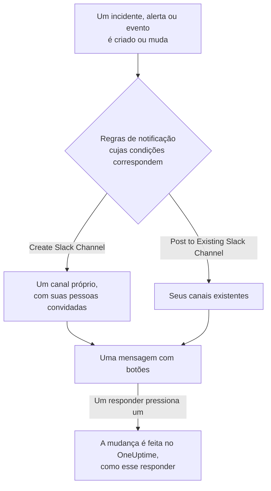

# Slack

Conecte o OneUptime ao Slack para publicar nos seus canais incidentes, alertas, episódios, manutenções programadas, monitores e atualizações de plantão, dar a cada incidente um canal próprio e deixar os responders agirem sem sair do Slack: confirmar, resolver, adicionar notas, acionar o plantão e declarar incidentes.

:::cards
- [Conectar o Slack](#conectar-o-slack): Instale o OneUptime no seu workspace e depois vincule a sua própria conta.
- [Regras de notificação](#regras-de-notificação): Decida quais eventos são publicados onde, e quais ganham um canal próprio.
- [Criar incidentes e manutenções pelo Slack](#criar-incidentes-e-manutenções-pelo-slack): `/incident` e `/maintenance`, como você mesmo.
- [Agir sobre incidentes, alertas e eventos pelo Slack](#agir-sobre-incidentes-alertas-e-eventos-pelo-slack): Os botões das mensagens do OneUptime.
:::

## Como funciona

Duas conexões fazem isso funcionar:

- **A conexão do projeto**, feita uma vez: o app do OneUptime instalado no seu workspace do Slack. Ele publica as mensagens, cria os canais e convida as pessoas.
- **A conexão de cada pessoa**: a conta do Slack dela vinculada à conta dela no OneUptime. Botões, comandos e reações com emoji agem como essa pessoa, com as permissões dela no projeto.

## Antes de começar

- **Uma função que possa conectar o projeto:** **Project Owner**, **Project Admin** ou **Project Member**. Desinstalar o app requer **Project Owner** ou **Project Admin**.
- **Um workspace do Slack** onde você possa instalar apps.
- **O plano Growth no OneUptime Cloud** para regras de notificação e resumos. Consulte [Regras de notificação abaixo do plano Growth](#regras-de-notificação-abaixo-do-plano-growth).
- **Em um servidor auto-hospedado,** antes um app do Slack configurado para ele. Consulte [Integração com Slack](/docs/self-hosted/slack-integration).

## Conectar o Slack

:::steps
### Instalar o OneUptime no seu workspace do Slack

Vá para **Configurações do projeto** > **Espaço de trabalho** > **Slack** e clique em **Connect with Slack**. Escolha o workspace e autorize o OneUptime. O Slack devolve você à mesma página, que agora mostra o workspace ao qual o projeto está conectado. Enquanto nenhum workspace estiver conectado, a seção **Espaço de trabalho** dos menus Incidentes, Alertas, Manutenção programada, Monitores e Plantão contém **Conectar Slack ou Teams**, que também leva até aqui.

### Conectar a sua própria conta do Slack

Instalar o app vincula a conta de quem o instalou. Todos os outros vinculam a própria conta do Slack em **Configurações do usuário** > **Espaço de trabalho** > **Slack** com **Connect my account with Slack**, para agir sobre incidentes e receber mensagens diretas como eles mesmos. Essa seção aparece assim que o projeto está conectado ao Slack.

### Adicionar uma regra de notificação

Vá para **Incidentes** > **Espaço de trabalho** > **Slack**. A seção **Espaço de trabalho** lista apenas os espaços de chat que o seu projeto conectou, então **Slack** aparece ali assim que é conectado. Crie uma regra, por exemplo uma que crie um canal do Slack para cada novo incidente e convide os proprietários do incidente. Consulte [Regras de notificação](#regras-de-notificação).

### Testar a regra

Clique em **Regra de teste** na linha da regra. Uma mensagem de teste chega aos canais que a regra indica. Consulte [Testar uma regra](#testar-uma-regra).
:::

## Regras de notificação

Uma regra de notificação diz quais eventos são publicados no Slack, e onde. Cada produto tem as suas próprias regras, em **Espaço de trabalho** > **Slack** no seu menu:

| Produto | Abas da sua página **Slack** |
| --- | --- |
| **Incidentes** | **Incidentes**, **Incidente Episódios**, **Summary** |
| **Alertas** | **Alertas**, **Alerta Episódios**, **Summary** |
| **Manutenção programada** | Uma lista de regras |
| **Monitores** | Uma lista de regras |
| **Plantão** | Uma lista de regras |

Criar uma regra passa por quatro etapas:

| Etapa | O que você define |
| --- | --- |
| **Básico** | **Nome da regra** e **Descrição da regra**. |
| **Condições** | Para quais eventos a regra dispara, por exemplo por gravidade, estado, rótulo, monitor ou palavras no título. Sem condições, ela dispara para todo evento. Com duas ou mais, **Condição de correspondência** diz se todas precisam corresponder ou se basta uma. |
| **Destino** | Onde ela publica: **Post to Existing Slack Channel** com os nomes dos canais, **Create Slack Channel** com o nome do novo canal e quem é convidado, ou ambos. |
| **Video Call** | Somente incidentes e alertas: inicia uma chamada para cada um. Consulte [Videochamadas](/docs/workspace-connections/video-calls). |

Um canal que a regra cria recebe o nome de **New Slack Channel Name** seguido do número do registro, como `oneuptime-incident-42`, e só um canal criado recebe as pessoas que a regra convida: os proprietários do registro, as equipes e os usuários escolhidos e, para incidentes e alertas, as pessoas de plantão à medida que são acionadas. Um incidente, alerta ou episódio privado recebe um canal privado. Toda atualização posterior do registro — uma mudança de estado, uma nota, um novo proprietário — é publicada nos seus canais e nos canais existentes que as suas regras indicam. Um incidente, alerta ou episódio criado já resolvido não recebe um canal próprio; a mensagem de criação dele ainda vai para os canais que as suas regras indicam. Consulte [Declarado já confirmado ou resolvido](/docs/incidents/declaring-incidents#declarado-já-confirmado-ou-resolvido).

**Configurações do projeto** > **Espaço de trabalho** > **Slack** lista os canais que o OneUptime consegue ver, com **Enviar teste** ao lado de cada um. O OneUptime entra sozinho em um canal público na primeira vez que publica nele. Um canal privado só é listado, e só pode receber publicações, depois que o app do OneUptime é convidado para ele no Slack.

## Testar uma regra

**Regra de teste** na linha de uma regra publica uma mensagem de teste dessa regra nos canais que ela indica, para você vê-la chegar. Se a regra cria um canal para cada evento, o teste também cria um e convida para ele as pessoas da regra.

Como **Enviar teste** ao lado de um canal em **Configurações do projeto** > **Espaço de trabalho** > **Slack**, ele requer permissão para criar regras de notificação: **Project Owner**, **Project Admin**, **Project Member**, **Settings Admin**, **Settings Member**, ou **Create Workspace Notification Rule** e **Read Workspace Notification Rule** em uma função personalizada. Para quem só pode ver as regras, como um **Viewer**, **Regra de teste** fica bloqueado, e a sua dica diz o que é preciso; a API recusa o teste dessa pessoa com "You do not have permission to send test notifications in this project." No OneUptime Cloud, testar uma regra requer o plano **Growth**, assim como adicionar uma.

No OneUptime Cloud, **Enviar teste** ao lado de um canal também requer o plano **Growth**, já que publicar em um canal é o que regras e resumos fazem. **Enviar teste agora** em um resumo requer permissão para criar resumos (**Create Workspace Notification Summary** e **Read Workspace Notification Summary** em uma função personalizada) e, no OneUptime Cloud, o plano **Growth**; para qualquer outra pessoa fica bloqueado, e a sua dica diz o que é preciso. Um cliente MCP conectado com acesso somente leitura não pode enviar nenhum teste.

## Resumos

A aba **Summary** de **Incidentes** > **Espaço de trabalho** > **Slack** (e de **Alertas**) publica um resumo periódico nos canais que você indicar: quantos incidentes ou alertas houve, com que rapidez foram confirmados e resolvidos, e uma lista com links. Um novo resumo sai toda semana e cobre os últimos 7 dias. Deixe **Enviar primeiro relatório às** vazio, e o primeiro sai às 09:00 no início da próxima semana, dia ou mês; o formulário diz quando.

Um resumo sai pelo relógio do seu **Fuso horário**, que começa com o seu. Ele mantém ali o seu horário do dia o ano todo: um definido para 09:00 em Berlim continua saindo às 09:00 em Berlim depois da mudança para o horário de verão, e as datas da sua mensagem também são as de Berlim. Pela API, envie `timezone` como um nome de fuso horário IANA, como `Europe/Berlin`. Um resumo criado sem fuso horário usa o do perfil de quem o criou, ou UTC quando uma chave de API o cria.

O formulário de um resumo tem quatro etapas: **Informações básicas** (o nome e os canais), **Agendamento**, **Conteúdo** (**O que incluir**) e **Filtros** (quais incidentes ou alertas ele conta).

## Regras de notificação abaixo do plano Growth

No OneUptime Cloud, regras de notificação e resumos estão no plano **Growth** e acima. Um projeto abaixo dele mantém as regras e os resumos que já tem, e eles continuam publicando no Slack. Por isso a página **Slack** de cada produto (Incidentes, Alertas, Manutenção programada, Plantão, Monitores) mostra o aviso do plano com eles listados abaixo (**Regras de notificação ainda configuradas**, **Resumos ainda configurados**): exclua uma regra, ou desative ou exclua um resumo. Adicionar ou alterar regras e resumos requer **Growth**.

## Ser acionado no Slack

Para ser acionado por mensagem direta quando estiver de plantão, adicione o Slack como um dos seus métodos de notificação:

:::steps
1. Conecte a sua própria conta do Slack (consulte [Conectar o Slack](#conectar-o-slack)).
2. Vá para **Configurações do usuário** > **Métodos de notificação**, abra a aba **Workspace Apps** e clique em **Add Slack Account**.
3. Clique em **Send Test Message** na linha dele. A mensagem chega às suas mensagens diretas do Slack.
:::

Adicioná-lo o inclui imediatamente nas suas regras de plantão, então a partir daí os acionamentos chegam a você no Slack. Altere quais acionamentos ele recebe em **Configurações do usuário** > **Regras de Plantão**.

## Salvar mensagens como notas

Reaja a uma mensagem no canal de um incidente, alerta, episódio ou evento de manutenção programada, e o OneUptime a salva como nota nesse registro e confirma com uma resposta na thread:

| Reação | Salva como |
| --- | --- |
| 📌 Um emoji de alfinete, ou o próprio **Pin to channel** do Slack | Uma nota privada, vista só pela sua equipe |
| 📢 Um emoji de megafone ou de alto-falante | Uma nota pública, mostrada na página de status. Somente incidentes e eventos de manutenção programada. |

A nota é salva como você, com as suas permissões, então a sua própria conta do Slack precisa estar conectada. Uma mensagem só é salva uma vez, não importa quantas pessoas reajam.

## Perguntar ao OneUptime AI pelo Slack

Pergunte sobre seus logs, traces, métricas, incidentes e monitores em linguagem natural. Mencione o OneUptime com @ em um canal, ou envie uma mensagem direta a ele, e ele responde na thread; responda ali para perguntar mais. `/oneuptime ask which monitors are down?` publica a resposta no canal. Ambos exigem a sua própria conta do Slack conectada e a IA ativada para o projeto. As respostas no Slack apenas leem: para mudar algo, use os botões. Consulte [Pergunte à IA](/docs/ai/ask-ai).

## Criar incidentes e manutenções pelo Slack

`/incident` e `/maintenance` abrem um formulário que você preenche e envia como você mesmo: como a conta do OneUptime à qual a sua conta do Slack está conectada (consulte [Conectar o Slack](#conectar-o-slack)), com as permissões dessa conta no projeto. Se a sua conta do Slack não estiver conectada, ou se a sua conta do OneUptime não for mais membro do projeto, o OneUptime diz o que fazer em uma mensagem direta, e nenhum formulário se abre. Os atalhos **Create New Incident** e **Create Scheduled Event** abrem os mesmos formulários.

- **Quem pode usá-los.** As pessoas que podem declarar um incidente ou criar um evento de manutenção programada no OneUptime: **Project Owner**, **Project Admin**, **Project Member**, **Incident Admin** e **Incident Member** para um incidente (**Create Incident** em uma função personalizada), e **Scheduled Maintenance Admin** e **Scheduled Maintenance Member** para um evento (**Create Scheduled Maintenance**). Qualquer outra pessoa é avisada em uma mensagem direta, e nenhum formulário se abre.
- **O que um formulário oferece.** Cada lista — gravidades, monitores, status de monitor, políticas de plantão e rótulos — contém o que você pode ler, como a mesma lista no OneUptime: com uma função limitada a alguns rótulos, os monitores e as políticas de plantão que têm esses rótulos. Uma lista que você não pode ler de forma alguma fica fora do formulário. Políticas de plantão arquivadas nunca são oferecidas.
- **O que um formulário pode indicar.** O incidente ou evento é criado com as suas próprias permissões e atribuído a você. Um monitor, política de plantão, rótulo, gravidade ou status que você não pode ler, ou um de outro projeto, é recusado como um que o projeto não tem, mesmo em um formulário aberto antes de o seu acesso mudar, e nada é criado. O OneUptime explica o motivo em uma mensagem direta.

**Execute On-Call Policy** em um incidente, alerta ou episódio funciona do mesmo jeito: requer permissão para executar uma política de plantão (**Project Owner**, **Project Admin**, **Project Member**, **On-Call Admin** e **On-Call Member**, ou **Create On-Call Duty Policy Execution Log** em uma função personalizada) e para ler esse incidente, alerta ou episódio, e oferece as políticas de plantão ativas que você pode ler.

## Agir sobre incidentes, alertas e eventos pelo Slack

Os botões das mensagens do OneUptime no Slack também agem como você: como a conta do OneUptime à qual a sua conta do Slack está conectada, com as permissões dessa conta no projeto. **Acknowledge**, **Resolve**, **Change State**, **Add Note** e **Execute On-Call Policy** em um incidente, um alerta ou um episódio, e **Mark as Ongoing**, **Mark as Complete**, **Change State** e **Add Note** em um evento de manutenção programada, fazem cada um a mudança que a mesma ação faz no OneUptime, e ela é atribuída a você ali: a linha do tempo de estados e o feed do registro mostram que você mudou o estado, e a nota é sua. Uma nota salva a partir de uma mensagem com uma reação de emoji é publicada do mesmo jeito.

- **Quem pode usá-los.** As pessoas que podem fazer a mesma mudança no OneUptime. Confirmar, resolver ou mudar o estado de um incidente requer permissão para mudar o estado dele: **Project Owner**, **Project Admin**, **Project Member**, **Incident Admin** e **Incident Member**, ou **Create Incident State Timeline** em uma função personalizada. Um alerta, um episódio ou um evento de manutenção programada requer a mesma permissão para o seu próprio tipo (**Create Alert State Timeline**, por exemplo), e uma nota requer permissão para publicar esse tipo de nota. Qualquer outra pessoa é avisada em uma mensagem direta, e nada muda.
- **Quais registros.** Os que você pode ler, como no OneUptime: com uma função limitada a alguns rótulos, os incidentes, alertas, episódios e eventos que os têm. Um botão em qualquer outro registro, ou em um de outro projeto, recebe como resposta que o registro "was not found in this project, or you do not have access to it.", e nada muda. No OneUptime Cloud, uma mudança que o plano do projeto não inclui é recusada indicando o plano necessário.
- **O que Change State oferece.** Os estados que você pode ler para os quais o registro pode passar em seguida, na ordem do projeto: nenhum anterior ao estado em que ele está, tanto para um episódio como para um incidente, um alerta ou um evento de manutenção programada, já que uma mudança de estado nunca faz um registro voltar a subir na sua lista (consulte [A ordem é uma restrição real, não uma preferência de exibição](/docs/incidents/states-and-severities#a-ordem-é-uma-restrição-real-não-uma-preferência-de-exibição)). Quando você não pode ler nenhum, é avisado com "No incident states are available to you in this project. Ask a project admin for access to them."; quando o registro está no último estado que pode alcançar, é avisado com "There is no later state to move this incident to." Nenhum dos dois abre um formulário vazio.

## Desconectar

- **Disconnect** desvincula apenas a sua própria conta do Slack, e remove com ela o seu método de notificação do Slack.
- **Uninstall OneUptime from Slack**, em **Configurações do projeto** > **Espaço de trabalho** > **Slack**, desconecta o projeto. O OneUptime para de publicar no Slack, e os menus **Espaço de trabalho** deixam de listá-lo. As regras de notificação e os resumos são mantidos para quando você conectar de novo.

> [!WARNING]
> Desinstalar também desvincula a conta do Slack de cada membro do projeto, e remove os métodos de notificação do Slack e as regras de plantão que os usavam. Quem era acionado no Slack passa a ser acionado nos seus outros métodos de notificação até adicionar o Slack de novo.

## Solução de problemas

:::details Uma regra não publica nada
Verifique as condições da regra com **Regra de teste**: se o teste chegar, as condições da regra não corresponderam ao evento. Se não chegar, a página do Slack diz por quê. Para um canal privado, convide antes o app do OneUptime para ele no Slack. Cada mensagem que o OneUptime publica, e cada uma que o Slack recusou, está listada em **Configurações do projeto** > **Notificações** > **Logs de notificação**, na aba **Espaço de trabalho**.
:::

:::details O Slack não foi conectado
Quando o Slack devolve você sem uma conexão, a página de onde você começou diz **O Slack não foi conectado**, e uma frase diz por quê: falta a você a permissão, o link já foi usado ou expirou, você entrou em outro workspace, ou o servidor não está configurado para o Slack. Consulte [A conexão não foi concluída](/docs/self-hosted/slack-integration#a-conexão-não-foi-concluída) para cada frase e o que fazer.
:::

:::details Um botão ou comando diz que a minha conta do Slack não está conectada
Vincule-a em **Configurações do usuário** > **Espaço de trabalho** > **Slack** com **Connect my account with Slack**. Se você não for mais membro do projeto, o OneUptime diz isso em vez disso, e não age sobre nada por você.
:::

:::details As notificações chegam, mas botões e comandos não fazem nada
Em um servidor auto-hospedado, o Slack precisa conseguir alcançar o OneUptime para botões, formulários e comandos; as notificações só precisam de acesso de saída. Consulte [Acesso à rede para implantações auto-hospedadas](/docs/self-hosted/slack-integration#acesso-à-rede-para-implantações-auto-hospedadas).
:::

## Próximos passos

:::cards
- [Microsoft Teams](/docs/workspace-connections/microsoft-teams): As mesmas notificações e ações no Microsoft Teams.
- [Videochamadas](/docs/workspace-connections/video-calls): Dê a cada incidente uma chamada, publicada com as suas atualizações.
- [Integração com Slack](/docs/self-hosted/slack-integration): Configurar o app do Slack em um servidor auto-hospedado.
- [Declarar um incidente](/docs/incidents/declaring-incidents): Todas as formas como um incidente começa, e o que é executado quando isso acontece.
:::
