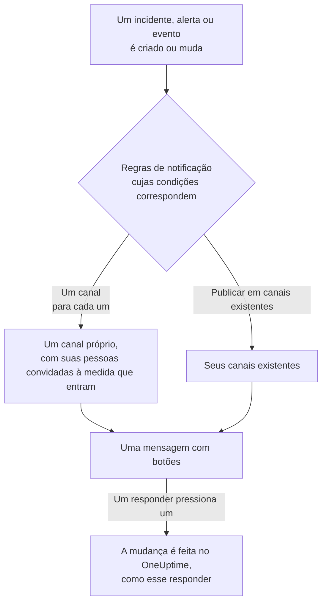

# Slack

Conecte o OneUptime ao Slack para publicar nos seus canais incidentes, alertas, episódios, manutenções programadas, monitores e atualizações de plantão, dar a cada incidente um canal próprio e deixar os responders agirem sem sair do Slack: confirmar, resolver, adicionar notas, acionar o plantão e declarar incidentes.

:::cards
- [Conectar o Slack](#conectar-o-slack): Instale o OneUptime no seu workspace e depois vincule a sua própria conta.
- [Pedir a todos que conectem a conta](#pedir-a-todos-que-conectem-a-conta): Envie uma mensagem, de uma só vez, a cada membro que ainda não conectou a conta.
- [Regras de notificação](#regras-de-notificação): Decida quais eventos são publicados onde, e quais ganham um canal próprio.
- [Quem está no canal de um registro](#quem-está-no-canal-de-um-registro): Veja quem está nele, entre e adicione pessoas, pela página do registro.
- [O comando /oneuptime](#o-comando-oneuptime): Declare incidentes, agende manutenções, veja quem está de plantão e pergunte à IA.
- [Grupos de usuários de plantão](#grupos-de-usuários-de-plantão): Mantenha um grupo de usuários igual a quem está de plantão, e acione-o.
- [Agir sobre incidentes, alertas e eventos pelo Slack](#agir-sobre-incidentes-alertas-e-eventos-pelo-slack): Os botões das mensagens do OneUptime.
:::

## Como funciona

Duas conexões fazem isso funcionar:

- **A conexão do projeto**, feita uma vez: o app do OneUptime instalado no seu workspace do Slack. Ele publica as mensagens, cria os canais e convida as pessoas.
- **A conexão de cada pessoa**: a conta do Slack dela vinculada à conta dela no OneUptime. Botões, comandos e reações com emoji agem como essa pessoa, com as permissões dela no projeto.

Um workspace do Slack pode estar conectado a mais de um projeto, como produção e staging. Um botão ou um formulário age no projeto do registro a que se refere. Um comando ou uma mensagem ao OneUptime age no projeto do canal em que está, como o canal de um incidente, ou então no único projeto em que a sua conta do Slack está conectada. Quando nada indica qual, o OneUptime pergunta a qual projeto você se refere, com um botão para cada projeto de que você faz parte, e continua nele assim que você escolhe. Numa conversa com o OneUptime AI, a sua escolha vale para o resto da thread.

## Antes de começar

- **Uma função que possa conectar o projeto:** **Proprietário do projeto**, **Administrador do projeto** ou **Membro do projeto**. Desinstalar o app requer **Proprietário do projeto** ou **Administrador do projeto**.
- **Um workspace do Slack** onde você possa instalar apps.
- **O plano Growth no OneUptime Cloud** para regras de notificação e resumos. Consulte [Regras de notificação abaixo do plano Growth](#regras-de-notificação-abaixo-do-plano-growth).
- **Em um servidor auto-hospedado,** antes um app do Slack configurado para ele. Consulte [Integração com Slack](/docs/self-hosted/slack-integration).

## Conectar o Slack

:::steps
### Instalar o OneUptime no seu workspace do Slack

Vá para **Configurações do projeto** > **Espaço de trabalho** > **Slack** e clique em **Connect with Slack**. Escolha o workspace e autorize o OneUptime. O Slack devolve você à mesma página, que agora mostra o workspace ao qual o projeto está conectado. Enquanto nenhum workspace estiver conectado, a seção **Espaço de trabalho** dos menus Incidentes, Alertas, Manutenção programada, Monitores e Plantão contém **Conectar Slack ou Teams**, que também leva até aqui.

### Conectar a sua própria conta do Slack

Instalar o app vincula a conta de quem o instalou. Todos os outros vinculam a própria conta do Slack em **Configurações do usuário** > **Espaço de trabalho** > **Slack** com **Connect my account with Slack**, para agir sobre incidentes e receber mensagens diretas como eles mesmos. Essa seção aparece assim que o projeto está conectado ao Slack. Para trazer uma equipe inteira de uma vez, consulte [Pedir a todos que conectem a conta](#pedir-a-todos-que-conectem-a-conta).

### Adicionar uma regra de notificação

Vá para **Incidentes** > **Espaço de trabalho** > **Slack**. A seção **Espaço de trabalho** lista apenas os espaços de chat que o seu projeto conectou, então **Slack** aparece ali assim que é conectado. Crie uma regra, por exemplo uma que crie um canal do Slack para cada novo incidente com todos que trabalham nele: as pessoas acionadas, o comandante do incidente e os proprietários. Consulte [Regras de notificação](#regras-de-notificação).

### Testar a regra

Clique em **Regra de teste** na linha da regra. Uma mensagem de teste chega aos canais que a regra indica. Consulte [Testar uma regra](#testar-uma-regra).
:::

## Pedir a todos que conectem a conta

Ninguém pode conectar a conta do Slack de outra pessoa, nem mesmo um administrador: cada pessoa entra com a sua própria. Para trazer uma equipe inteira, um **Proprietário do projeto** ou **Administrador do projeto** pede a todos de uma vez em **Configurações do projeto** > **Espaço de trabalho** > **Slack**. O cartão **Members' Slack accounts** diz quantos membros já conectaram a conta. **Ask everyone to connect** envia a cada membro que ainda não a conectou uma mensagem direta do OneUptime no Slack, com um botão **Connect Slack account** que conecta a conta dele com um só clique.

- **Quem recebe uma mensagem.** Cada membro do projeto que ainda não conectou a conta do Slack, encontrado no Slack pelo endereço de e-mail dele. Quem recebeu o pedido nas últimas 24 horas não o recebe de novo, então, ao pedir outra vez no dia seguinte, só recebe o lembrete quem ainda não conectou a conta.
- **O que o cartão diz.** Até onde o envio chegou, enquanto as mensagens saem, e depois quem pediu e quantos membros receberam uma mensagem. Os membros que o OneUptime não encontrou no Slack pelo endereço de e-mail aparecem pelo nome no cartão: eles mesmos conectam a conta em **Configurações do usuário** > **Espaço de trabalho** > **Slack**.
- **O que o botão conecta.** A conta do Slack de quem pressiona o botão e entra, à conta do OneUptime dessa mesma pessoa. Uma mensagem repassada a outra pessoa não conecta nada ao membro para quem foi enviada.

## Regras de notificação

Uma regra de notificação diz quais eventos são publicados no Slack, e onde. Cada produto tem as suas próprias regras, em **Espaço de trabalho** > **Slack** no seu menu:

| Produto | Abas da sua página **Slack** |
| --- | --- |
| **Incidentes** | **Incidentes**, **Incidente Episódios**, **Resumo** |
| **Alertas** | **Alertas**, **Alerta Episódios**, **Resumo** |
| **Manutenção programada** | Uma lista de regras |
| **Monitores** | Uma lista de regras |
| **Plantão** | Uma lista de regras |

Criar uma regra passa por quatro etapas:

| Etapa | O que você define |
| --- | --- |
| **Básico** | **Nome da regra** e **Descrição da regra**. |
| **Condições** | A quais eventos a regra se aplica, por exemplo por gravidade, estado, rótulo, monitor ou palavras no título. Elas são verificadas quando um evento é criado e novamente a cada atualização que o OneUptime publica sobre ele, então uma regra para incidentes confirmados age quando um incidente é confirmado. Uma regra nova vale para todo evento, por exemplo **Todos os incidentes**. Para restringi-la, escolha **Somente os incidentes que atendem às condições** e adicione as condições. Com duas ou mais, **Condição de correspondência** diz se todas precisam corresponder ou se basta uma. |
| **Destino** | Onde ela publica: **Publicar em canais existentes** com os nomes dos canais, **Criar um canal para cada incidente** (ou alerta, episódio, evento, monitor ou política de plantão) com quem entra nele, ou ambos. Abaixo da etapa, **O que esta regra faz** diz isso em frases, como o cartão da regra. |
| **Video Call** | Somente incidentes e alertas: inicia uma chamada para cada um. Consulte [Videochamadas](/docs/workspace-connections/video-calls). |

Um canal que a regra cria recebe o nome do seu registro: o incidente INC-42 recebe `inc-42`, o alerta ALT-7 recebe `alt-7` e, em um projeto sem prefixos de número, o incidente 42 recebe `incident-42`. O texto em **Prefixo do nome do canal** vai na frente, então `prod-` vira `prod-inc-42`, e o formulário mostra o nome enquanto você digita. Em um evento de manutenção agendada, o prefixo substitui o prefixo de número: SM-5 recebe `sm-5`, e `maint-` vira `maint-5`. O Slack aceita letras minúsculas, números, `-` e `_`, até 80 caracteres. Se já existir um canal com esse nome, como o de outro projeto ou um arquivado, o OneUptime adiciona `-2`, `-3` e assim por diante.

Uma regra cria o seu canal na primeira vez que um evento corresponde a ela: quando o evento é criado, ou depois, quando uma atualização o faz corresponder enquanto ele ainda está aberto. Uma regra para incidentes confirmados cria o canal quando o incidente é confirmado. Um incidente, alerta ou episódio privado recebe um canal privado.

**Quem entra no canal** lista quem a regra adiciona ao seu canal, cada um à medida que entra no registro, não só quando o canal é criado: **Pessoas de plantão, à medida que são acionadas**, **Comandante do incidente e outras funções de incidente, à medida que são atribuídas** (incidentes e episódios de incidente) e **Proprietários, à medida que são adicionados**, todos marcados numa regra nova, e as pessoas, equipes e agendamentos de plantão em **Convidar também** quando o canal é criado. O comandante do incidente costuma ser atribuído quando alguém confirma o incidente pela primeira vez, e entra no canal nesse momento. Uma regra salva antes de as funções de incidente terem uma caixa própria as adiciona quando adiciona os proprietários ou as pessoas de plantão, e a caixa aparece marcada. Um canal existente em que uma regra publica não recebe ninguém.

Para um agendamento de plantão em **Convidar também**, quem está de plantão nele quando o canal é criado, conforme mostra a página do agendamento, entra no canal e não é acionado. Para adicionar pessoas só aos canais de alguns incidentes, dê a uma segunda regra essas condições e essas pessoas, com o mesmo **Prefixo do nome do canal** da primeira: as regras que correspondem a um incidente quando o canal dele é criado compartilham esse canal, e cada uma adiciona as próprias pessoas.

Toda atualização posterior do registro — uma mudança de estado, uma nota, um novo proprietário — é publicada nos seus canais, e nos canais existentes que as suas regras indicam enquanto as condições delas corresponderem. Com **Arquivar o canal quando o incidente for resolvido** ativado, ou o equivalente para alertas, episódios, eventos, monitores e políticas de plantão, a regra que criou um canal o arquiva quando o registro é resolvido, concluído ou excluído, seja o que for que as condições dela digam então. Um incidente, alerta ou episódio criado já resolvido não recebe um canal próprio; a mensagem de criação dele ainda vai para os canais que as suas regras indicam. Consulte [Declarado já confirmado ou resolvido](/docs/incidents/declaring-incidents#declarado-já-confirmado-ou-resolvido).

Um incidente, alerta, episódio ou evento de manutenção agendada com um canal próprio tem **Abrir no Slack** no cabeçalho da sua página no OneUptime, ao lado dos botões de estado. Ele abre esse canal em uma nova aba, no aplicativo do Slack ou no navegador. Um registro com dois canais próprios lista os dois sob o botão. Um registro com canais tanto no Slack quanto no Microsoft Teams tem, em vez disso, um único botão **Abrir canal**, que lista todos eles. Os canais existentes em que as suas regras publicam não são oferecidos.

Um canal continua legível: cada evento é publicado uma vez, e o primeiro estado de um registro vem na mensagem que anuncia o registro, não em uma mensagem à parte. Uma execução de uma política de plantão é uma só mensagem, editada à medida que a execução escala: quem foi acionado, quantas vezes e como, quem não foi e por quê, e quem confirmou. Uma nova mensagem só é publicada quando alguém precisa agir: uma regra de escalonamento não alcançou ninguém, ou a execução terminou sem que ninguém confirmasse. Alguém cuja conta do Slack não está conectada ao OneUptime é adicionado pela conta do Slack que tem o endereço de e-mail dele. Quem o OneUptime não encontra de nenhuma das duas formas, ou quem é um convidado no Slack, não pode ser adicionado a um canal; o OneUptime diz isso uma vez por canal, em uma só mensagem que nomeia todos eles e é editada quando a lista cresce. Envie a eles o link **Connect Slack account** dessa mensagem para que conectem a conta em uma única etapa. Que os proprietários do registro ou os assinantes da página de status foram avisados fica no feed dele no OneUptime.

**Configurações do projeto** > **Espaço de trabalho** > **Slack** lista os canais que o OneUptime consegue ver, com **Enviar teste** ao lado de cada um. O OneUptime entra sozinho em um canal público na primeira vez que publica nele. Um canal privado só é listado, e só pode receber publicações, depois que o app do OneUptime é convidado para ele no Slack.

## Quem está no canal de um registro

Um incidente, alerta, episódio ou evento de manutenção agendada com um canal do Slack próprio tem um cartão **Canal do Slack** na sua página no OneUptime. O cartão mostra o canal, como um link que o abre no Slack, se ele é privado e quem está nele, você primeiro. Pelo cartão, sem um administrador do Slack:

- **Entrar no canal** adiciona você, quando você não está no canal.
- **Adicionar pessoas** abre uma lista das pessoas e equipes do projeto: escolha uma pessoa para adicioná-la, ou uma equipe para adicionar todos os membros dela.

O app do OneUptime as adiciona, como adiciona as pessoas do canal de uma regra. O app fica nos canais que cria, então isso funciona também para um canal privado que todos deixaram.

- **Quem pode adicionar pessoas.** Quem pode editar o registro: **Proprietário do projeto**, **Administrador do projeto**, **Membro do projeto**, **Administrador de incidentes** e **Membro de incidentes** para um incidente, ou **Edit Incident** em uma função personalizada, e a mesma permissão para um alerta, um episódio ou um evento (**Edit Alert**, por exemplo). Os demais veem quem está no canal e como entrar.
- **Quem pode ser adicionado.** Alguém que o OneUptime encontra no Slack: pela conta do Slack que a pessoa conectou, ou então pelo endereço de e-mail que o Slack tem dela. O cartão nomeia quem não pôde adicionar, e por quê, como um convidado que o Slack deixa fora do canal.
- **O que fica registrado.** Quem foi adicionado, e por quem, no feed do registro (**Membro adicionado ao canal**) e em **Configurações do projeto** > **Notificações** > **Logs de notificação**, na aba **Espaço de trabalho**.
- **Tirar alguém.** O OneUptime só adiciona pessoas: tire alguém do canal no Slack.

## Testar uma regra

**Regra de teste** na linha de uma regra publica uma mensagem de teste dessa regra nos canais que ela indica, para você vê-la chegar. Se a regra cria um canal para cada evento, o teste também cria um e convida para ele as pessoas da regra.

Como **Enviar teste** ao lado de um canal em **Configurações do projeto** > **Espaço de trabalho** > **Slack**, ele requer permissão para criar regras de notificação: **Proprietário do projeto**, **Administrador do projeto**, **Membro do projeto**, **Administrador de configurações**, **Membro de configurações**, ou **Create Workspace Notification Rule** e **Read Workspace Notification Rule** em uma função personalizada. Para quem só pode ver as regras, como um **Visualizador**, **Regra de teste** fica bloqueado, e a sua dica diz o que é preciso; a API recusa o teste dessa pessoa com "You do not have permission to send test notifications in this project." No OneUptime Cloud, testar uma regra requer o plano **Growth**, assim como adicionar uma.

No OneUptime Cloud, **Enviar teste** ao lado de um canal também requer o plano **Growth**, já que publicar em um canal é o que regras e resumos fazem. **Enviar teste agora** em um resumo requer permissão para criar resumos (**Create Workspace Notification Summary** e **Read Workspace Notification Summary** em uma função personalizada) e, no OneUptime Cloud, o plano **Growth**; para qualquer outra pessoa fica bloqueado, e a sua dica diz o que é preciso. Um cliente MCP conectado com acesso somente leitura não pode enviar nenhum teste.

## Resumos

A aba **Resumo** de **Incidentes** > **Espaço de trabalho** > **Slack** (e de **Alertas**) publica um resumo periódico nos canais que você indicar: quantos incidentes ou alertas houve, com que rapidez foram confirmados e resolvidos, e uma lista com links. Um novo resumo sai toda semana e cobre os últimos 7 dias. Deixe **Enviar primeiro relatório às** vazio, e o primeiro sai às 09:00 no início da próxima semana, dia ou mês; o formulário diz quando.

Um resumo sai pelo relógio do seu **Fuso horário**, que começa com o seu. Ele mantém ali o seu horário do dia o ano todo: um definido para 09:00 em Berlim continua saindo às 09:00 em Berlim depois da mudança para o horário de verão, e as datas da sua mensagem também são as de Berlim. Pela API, envie `timezone` como um nome de fuso horário IANA, como `Europe/Berlin`. Um resumo criado sem fuso horário usa o do perfil de quem o criou, ou UTC quando uma chave de API o cria.

O formulário de um resumo tem quatro etapas: **Informações básicas** (o nome e os canais), **Agendamento**, **Conteúdo** (**O que incluir**) e **Filtros** (quais incidentes ou alertas ele conta).

## Regras de notificação abaixo do plano Growth

No OneUptime Cloud, regras de notificação e resumos estão no plano **Growth** e acima. Um projeto abaixo dele mantém as regras e os resumos que já tem, e eles continuam publicando no Slack. Por isso a página **Slack** de cada produto (Incidentes, Alertas, Manutenção programada, Plantão, Monitores) mostra o aviso do plano com eles listados abaixo (**Regras de notificação ainda configuradas**, **Resumos ainda configurados**): exclua uma regra, ou desative ou exclua um resumo. Adicionar ou alterar regras e resumos requer **Growth**.

## Ser acionado no Slack

Para ser acionado por mensagem direta quando estiver de plantão, adicione o Slack como um dos seus métodos de notificação:

:::steps
1. Conecte a sua própria conta do Slack (consulte [Conectar o Slack](#conectar-o-slack)).
2. Vá para **Configurações do usuário** > **Métodos de notificação**, abra a aba **Workspace Apps** e clique em **Add Slack Account**.
3. Clique em **Send Test Message** na linha dele. A mensagem chega às suas mensagens diretas do Slack.
:::

Adicioná-lo o inclui imediatamente nas suas regras de plantão, então a partir daí os acionamentos chegam a você no Slack. Altere quais acionamentos ele recebe em **Configurações do usuário** > **Regras de Plantão**.

## Salvar mensagens como notas

Reaja a uma mensagem no canal de um incidente, alerta, episódio ou evento de manutenção programada, e o OneUptime a salva como nota nesse registro e confirma com uma resposta na thread:

| Reação | Salva como |
| --- | --- |
| 📌 Um emoji de alfinete, ou o próprio **Pin to channel** do Slack | Uma nota privada, vista só pela sua equipe |
| 📢 Um emoji de megafone ou de alto-falante | Uma nota pública, mostrada na página de status. Somente incidentes e eventos de manutenção programada. Num incidente privado, uma nota privada, e a confirmação diz por quê. |

A nota mantém a mensagem como o Slack a mostrava: a formatação, os links e o código, as pessoas e os canais que ela menciona pelo nome, e os arquivos e as imagens como links para eles. Uma nota pública deixa os arquivos e as imagens de fora, já que eles só abrem para a sua equipe.

São as palavras de quem escreveu a mensagem: o nome dessa pessoa no OneUptime quando a conta do Slack dela está conectada; caso contrário, o nome que o Slack mostra. Uma nota privada entra na linha do tempo no momento em que a mensagem foi publicada, não importa quanto tempo depois seja salva. Uma nota pública entra no momento em que é salva, que é quando a página de status a mostra. A linha do tempo diz quem a salvou. A nota não é publicada de volta no canal, onde a mensagem já está.

A nota é salva como você, com as suas permissões. Se a sua conta do Slack ainda não estiver conectada, o OneUptime pede que você a conecte, em uma mensagem que só você vê, com um botão que salva a mensagem assim que você fizer isso. Uma mensagem só é salva uma vez, não importa quantas pessoas reajam.

## O comando /oneuptime

O OneUptime tem um único comando no Slack, `/oneuptime`. A palavra que você digita depois dele diz o que fazer; qualquer outra coisa depois dele é uma pergunta para o OneUptime AI.

| Comando | O que faz |
| --- | --- |
| `/oneuptime help` | Lista os comandos, com exemplos. |
| `/oneuptime incident [title or number]` | Abre o formulário de incidente, com o título preenchido. O número de um incidente, como `42` ou `INC-42`, mostra esse incidente em vez disso: consulte [Gerenciar um incidente pelo Slack](#gerenciar-um-incidente-pelo-slack). |
| `/oneuptime maintenance [title]` | Abre o formulário de manutenção programada, com o título preenchido. |
| `/oneuptime oncall` | Lista quem está de plantão agora em cada agendamento de plantão que você pode ver, até quando, e quem é o próximo. |
| `/oneuptime page [who] [message]` | Aciona as pessoas que você menciona com @ sobre a sua mensagem, ou abre um formulário para escolher quem acionar. Consulte [Acionar alguém pelo Slack](#acionar-alguém-pelo-slack). |
| `/oneuptime ask [question]`, ou qualquer pergunta | O OneUptime AI responde sobre seus logs, traces, métricas, incidentes e monitores. |

As respostas a `help` e `oncall` são mensagens que só você vê, abaixo do comando. Uma primeira palavra que parece um comando digitado errado, como `incidnet`, recebe o comando com que se parece, não uma resposta do OneUptime AI. Os formulários de incidente e de manutenção agem como você: consulte [Criar incidentes e manutenções pelo Slack](#criar-incidentes-e-manutenções-pelo-slack).

> [!NOTE]
> `/oneuptime incident` e `/oneuptime maintenance` substituem `/incident` e `/maintenance`, que podiam conflitar com comandos de mesmo nome de outros apps do Slack. Um app do Slack criado a partir de um manifesto anterior os mantém, e eles abrem os mesmos formulários, até que o app seja atualizado: consulte [Apps criados a partir de um manifesto mais antigo](/docs/self-hosted/slack-integration#apps-criados-a-partir-de-um-manifesto-mais-antigo).

## A página inicial do OneUptime no Slack

Abra o OneUptime em **Apps**, na barra lateral do Slack: a aba **Home** dele mostra o que está acontecendo no projeto, do jeito que você pode ver, e é lida de novo cada vez que você a abre.

- **Seu plantão.** Os agendamentos de plantão em que você está de plantão agora, e até quando, ou então o seu próximo turno.
- **O que está aberto.** Os incidentes e alertas abertos mais recentes que você pode ler, cada um com um link para a página dele no OneUptime.
- **Os botões.** **Declare incident**, **Schedule maintenance** e **Page someone** abrem os mesmos formulários que `/oneuptime incident`, `/oneuptime maintenance` e `/oneuptime page`, e **Who's on call** responde como `/oneuptime oncall`.

A página inicial lê como você, então precisa da sua própria conta do Slack conectada. Enquanto ela não estiver, a página inicial mostra um botão **Connect Slack account**, e mostra a sua página inicial assim que você a conectar.

Num workspace do Slack conectado a mais de um projeto, a página inicial mostra um projeto de cada vez. Se a sua conta do Slack estiver conectada em dois ou mais deles, o menu **Switch project**, ao lado do nome do projeto, lista os outros de que você é membro. Escolha um para ver a página inicial dele, e a partir daí a página inicial abre nele, enquanto você continuar sendo membro dele. Até você escolher um, ela mostra aquele dos seus projetos que foi conectado ao Slack primeiro.

Quando alguém adiciona o OneUptime a um canal, ele publica uma saudação ali: como fazer uma pergunta a ele e onde adicionar uma regra de notificação que publique no canal. Na primeira vez que você abre a aba **Messages** dele, ele dá as boas-vindas a você ali: o que ele faz no Slack e como começar.

## Perguntar ao OneUptime AI pelo Slack

Pergunte sobre seus logs, traces, métricas, incidentes e monitores em linguagem natural. Mencione o OneUptime com @ em um canal, ou envie uma mensagem direta a ele, e ele responde na thread. `/oneuptime ask which monitors are down?` publica a resposta no canal. Ambos exigem a sua própria conta do Slack conectada e a IA ativada para o projeto. As respostas no Slack apenas leem: para mudar algo, use os botões. Consulte [Pergunte à IA](/docs/ai/ask-ai).

O OneUptime só responde ao que é dirigido a ele.

- **Na sua própria conversa, basta responder.** Uma pergunta que você faz em um canal, fora de uma thread, inicia uma conversa na thread abaixo dela: responda ali para perguntar mais sem mencionar o OneUptime de novo, e qualquer outra pessoa entra na conversa mencionando-o.
- **Em qualquer outra thread, mencione o OneUptime.** Abaixo da mensagem de um incidente, por exemplo, mencione-o todas as vezes: o que as pessoas escrevem umas para as outras ali não recebe resposta.
- **Se a sua conta do Slack não estiver conectada.** O OneUptime pede uma vez em cada conversa que você a conecte, em uma mensagem que só você vê, com um botão **Connect Slack account**.

## Criar incidentes e manutenções pelo Slack

`/oneuptime incident` e `/oneuptime maintenance` abrem um formulário que você preenche e envia como você mesmo: como a conta do OneUptime à qual a sua conta do Slack está conectada (consulte [Conectar o Slack](#conectar-o-slack)), com as permissões dessa conta no projeto. Se a sua conta do Slack não estiver conectada, ou se a sua conta do OneUptime não for mais membro do projeto, o OneUptime diz o que fazer onde você executou o comando, em uma mensagem que só você vê, e nenhum formulário se abre. Os atalhos **Create New Incident** e **Create Scheduled Event** abrem os mesmos formulários.

- **Quem pode usá-los.** As pessoas que podem declarar um incidente ou criar um evento de manutenção programada no OneUptime: **Proprietário do projeto**, **Administrador do projeto**, **Membro do projeto**, **Administrador de incidentes** e **Membro de incidentes** para um incidente (**Create Incident** em uma função personalizada), e **Administrador de manutenção programada** e **Membro de manutenção programada** para um evento (**Create Scheduled Maintenance**). Qualquer outra pessoa é avisada onde o executou, e nenhum formulário se abre.
- **O que um formulário oferece.** Cada lista — gravidades, monitores, status de monitor, políticas de plantão e rótulos — contém o que você pode ler, como a mesma lista no OneUptime: com uma função limitada a alguns rótulos, os monitores e as políticas de plantão que têm esses rótulos. Uma lista que você não pode ler de forma alguma fica fora do formulário. Políticas de plantão arquivadas nunca são oferecidas.
- **O que um formulário pode indicar.** O incidente ou evento é criado com as suas próprias permissões e atribuído a você. Um monitor, política de plantão, rótulo, gravidade ou status que você não pode ler, ou um de outro projeto, é recusado como um que o projeto não tem, mesmo em um formulário aberto antes de o seu acesso mudar, e nada é criado. O OneUptime explica o motivo no canal, em uma mensagem que só você vê.

**Execute On-Call Policy** em um incidente, alerta ou episódio funciona do mesmo jeito: requer permissão para executar uma política de plantão (**Proprietário do projeto**, **Administrador do projeto**, **Membro do projeto**, **Administrador de plantão** e **Membro de plantão**, ou **Create On-Call Duty Policy Execution Log** em uma função personalizada) e para ler esse incidente, alerta ou episódio, e oferece as políticas de plantão ativas que você pode ler.

## Acionar alguém pelo Slack

`/oneuptime page @nawaz The checkout API is throwing 500s` aciona o Nawaz na hora. O OneUptime cria um alerta cujo título é a sua mensagem, e cada pessoa que você menciona com @ recebe uma ligação, um SMS, uma notificação push ou um e-mail, conforme as próprias regras de plantão dela, até que alguém confirme o alerta.

- **Quem é acionado na hora.** As pessoas que você menciona com @, e quem está de plantão nos agendamentos que um grupo de usuários que você menciona com @ segue (veja [Grupos de usuários de plantão](#grupos-de-usuários-de-plantão)), quando uma mensagem vem depois delas. O OneUptime reconhece uma pessoa pela conta do OneUptime à qual a conta do Slack dela está conectada, ou então pelo endereço de e-mail que o Slack tem dela. Ninguém de fora do projeto é acionado.
- **Todo o resto abre um formulário.** Sem ninguém mencionado com @, sem mensagem, com `@here`, com um grupo de usuários que não segue nenhum agendamento de plantão que você possa ver, ou com uma pessoa que o OneUptime não reconhece, o formulário **Page someone** se abre com o que você digitou já preenchido, e diz quem ele não conseguiu escolher. Escolha pessoas, uma equipe, um agendamento de plantão, que aciona quem estiver de plantão nele agora, ou uma política de plantão, que aciona pelas regras de escalonamento dela, e envie. Um nome que você digita primeiro, como em `/oneuptime page Primary The disk is full`, escolhe o agendamento, a equipe ou a política com esse nome.
- **Onde aparece.** O canal mostra o acionamento como uma única mensagem, mantida atualizada: quem foi acionado e como, e quem confirmou. Onde o OneUptime não pode publicar, como em um canal privado para o qual não foi convidado, uma mensagem que só você vê diz quem foi acionado, com um link para o alerta.
- **Quem pode acionar.** Quem pode tanto executar uma política de plantão quanto criar um alerta: **Proprietário do projeto**, **Administrador do projeto** e **Membro do projeto**, ou **Membro de plantão** junto com **Membro de alertas** (**Create On-Call Duty Policy Execution Log** e **Create Alert** em uma função personalizada). Acionar pessoas, uma equipe ou um agendamento diretamente, sem uma política de plantão por trás do acionamento, também exige acesso a todas as políticas de plantão do projeto. Qualquer outra pessoa é avisada onde executou o comando, e ninguém é acionado. No OneUptime Cloud, acionar exige o plano Growth: abaixo dele, o OneUptime diz qual plano é necessário, e ninguém é acionado.

## Grupos de usuários de plantão

Mantenha um grupo de usuários do Slack, como `@payments-oncall`, igual a quem está de plantão em um ou mais agendamentos de plantão, para que qualquer pessoa possa mencioná-lo com @ e falar com eles. O OneUptime muda os membros do grupo a cada passagem de turno e substituição, e o verifica a cada 15 minutos.

:::steps
### Conectar um grupo de usuários a um agendamento

Abra o agendamento em **Plantão** > **Agendamentos de plantão**. No cartão **Grupos de usuários do Slack** dele, clique em **Conectar grupo de usuários** e escolha um dos grupos de usuários do seu espaço de trabalho, ou **Criar um novo grupo de usuários** com um nome e um identificador. Os membros dele são substituídos na hora por quem está de plantão.

### Conectá-lo também ao agendamento secundário

Para um grupo com o plantão principal e o secundário, conecte o mesmo grupo na página do agendamento secundário. Um grupo pode seguir quantos agendamentos você quiser.
:::

- **O que o cartão mostra.** Quem está em cada grupo agora, os outros agendamentos que ele segue e se o status dele é **Atualizado**. Quem está de plantão mas não pode entrar no grupo aparece com o motivo: o OneUptime encontra uma pessoa pela conta do Slack conectada dela, ou então pelo endereço de e-mail que o Slack tem dela, e o Slack deixa convidados fora dos grupos de usuários.
- **Ninguém de plantão.** O Slack não mantém um grupo de usuários vazio, então o OneUptime desativa o grupo até alguém estar de plantão e depois o reativa.
- **Acionar o grupo.** `/oneuptime page @payments-oncall The checkout API is down` aciona quem está de plantão nos agendamentos que o grupo segue. Veja [Acionar alguém pelo Slack](#acionar-alguém-pelo-slack).
- **O que o Slack exige.** Grupos de usuários fazem parte dos planos pagos do Slack, e um espaço de trabalho pode permitir que só os proprietários e administradores os alterem: o cartão diz qual é o caso, e o que fazer. Se o Slack foi conectado antes de o OneUptime poder manter grupos de usuários, conecte-o de novo uma vez em **Configurações do projeto** > **Espaço de trabalho** > **Slack**.
- **Quem pode conectar um.** As funções que podem editar agendamentos: **Proprietário do projeto**, **Administrador do projeto**, **Membro do projeto**, **Administrador de plantão** e **Membro de plantão**, ou **Edit On-Call Duty Policy Schedule** em uma função personalizada. No OneUptime Cloud, conectar um exige o plano **Growth**.
- **Desconectar.** O OneUptime para de mudar o grupo. O grupo e os membros dele ficam no Slack como estão.

## Gerenciar um incidente pelo Slack

A mensagem de um incidente tem quatro botões, **Acknowledge Incident**, **Resolve Incident**, **Add Note** e **View Incident**, e o resto no menu dela, o botão de três pontos depois deles:

| Item do menu | O que faz |
| --- | --- |
| **Change Severity** | Define a severidade do incidente. |
| **Change Incident State** | Leva o incidente a um estado posterior. |
| **Assign Role** | Dá a alguém uma função no incidente, como **Incident Commander**. Uma função de uma só pessoa passa para ela. |
| **Page Someone** | Aciona pessoas, uma equipe, quem estiver de plantão em um agendamento, ou uma política de plantão sobre o incidente, até que alguém o confirme. |
| **Edit Custom Fields** | Define os campos personalizados do incidente, cada um preenchido com o que o incidente tem. Um campo deixado vazio é limpo. |

`/oneuptime incident 42` mostra o incidente 42, com esses botões e o menu dele, em uma mensagem que só você vê. Digite o número como o OneUptime o mostra: `42`, `#42` ou `INC-42`. No canal próprio de um incidente, `/oneuptime incident` sozinho mostra esse incidente.

- **Quem pode usá-los.** As pessoas que podem fazer a mesma alteração no OneUptime. **Change Severity** e **Edit Custom Fields** exigem permissão para editar o incidente: **Proprietário do projeto**, **Administrador do projeto**, **Membro do projeto**, **Administrador de incidentes** e **Membro de incidentes**, ou **Edit Incident** em uma função personalizada. **Assign Role** exige **Create Incident Member**, e **Delete Incident Member** para passar uma função de uma só pessoa. **Page Someone** exige o mesmo que **Execute On-Call Policy**. Qualquer outra pessoa fica sabendo por quê, e nenhum formulário abre.
- **O que os formulários oferecem.** O que você pode ler no projeto. Um campo personalizado copiado do monitor do incidente fica de fora, pois seria copiado de novo, e um formulário comporta 40 campos: edite o restante no OneUptime.
- **O que acontece.** O formulário fecha, e a alteração é feita como você, como no OneUptime: o feed do incidente, e com ele os canais do incidente, dizem o que mudou, cada campo personalizado com seu novo valor. Um valor que não cabe no campo, como texto para um número, é indicado abaixo do campo, e o formulário continua aberto. **Page Someone** diz quem foi acionado, ou por que ninguém foi; um incidente que já está resolvido não aciona ninguém.
- **Mensagens publicadas antes do menu.** Elas mantêm o botão **Execute On-Call Policy**, que continua funcionando: **Page Someone** também aciona uma política de plantão. Alertas e episódios mantêm o deles.

## Agir sobre incidentes, alertas e eventos pelo Slack

Os botões das mensagens do OneUptime no Slack também agem como você: como a conta do OneUptime à qual a sua conta do Slack está conectada, com as permissões dessa conta no projeto. **Acknowledge**, **Resolve**, **Change State**, **Add Note** e **Execute On-Call Policy** em um incidente, um alerta ou um episódio, e **Mark as Ongoing**, **Mark as Complete**, **Change State** e **Add Note** em um evento de manutenção programada, fazem cada um a mudança que a mesma ação faz no OneUptime, e ela é atribuída a você ali: a linha do tempo de estados e o feed do registro mostram que você mudou o estado, e a nota é sua. Uma nota salva a partir de uma mensagem com uma reação de emoji é publicada do mesmo jeito.

- **Quem pode usá-los.** As pessoas que podem fazer a mesma mudança no OneUptime. Confirmar, resolver ou mudar o estado de um incidente requer permissão para mudar o estado dele: **Proprietário do projeto**, **Administrador do projeto**, **Membro do projeto**, **Administrador de incidentes** e **Membro de incidentes**, ou **Create Incident State Timeline** em uma função personalizada. Um alerta, um episódio ou um evento de manutenção programada requer a mesma permissão para o seu próprio tipo (**Create Alert State Timeline**, por exemplo), e uma nota requer permissão para publicar esse tipo de nota. Qualquer outra pessoa é avisada, e nada muda.
- **Quais registros.** Os que você pode ler, como no OneUptime: com uma função limitada a alguns rótulos, os incidentes, alertas, episódios e eventos que os têm. Um botão em qualquer outro registro diz por quê, e nada muda: em um incidente que a sua função não alcança, "your access in this project does not include this incident. Ask a project admin for access to it."; em um incidente privado do qual você não é responsável, "this incident is private, so only its owners and the project's owners and admins can see it. Ask one of them to add you as an owner."; e em um excluído desde então, "the incident was not found. It may have been deleted." No OneUptime Cloud, uma mudança que o plano do projeto não inclui é recusada indicando o plano necessário.
- **O que Change State oferece.** Os estados que você pode ler para os quais o registro pode passar em seguida, na ordem do projeto: nenhum anterior ao estado em que ele está, tanto para um episódio como para um incidente, um alerta ou um evento de manutenção programada, já que uma mudança de estado nunca faz um registro voltar a subir na sua lista (consulte [A ordem é uma restrição real, não uma preferência de exibição](/docs/incidents/states-and-severities#a-ordem-é-uma-restrição-real-não-uma-preferência-de-exibição)). Quando você não pode ler nenhum, é avisado com "No incident states are available to you in this project. Ask a project admin for access to them."; quando o registro está no último estado que pode alcançar, é avisado com "There is no later state to move this incident to." Nenhum dos dois abre um formulário vazio.
- **Add Note num incidente ou episódio privado.** Um incidente ou episódio privado não aceita notas públicas, então o formulário não pede tipo de nota e adiciona uma nota privada. Um formulário aberto antes de ele se tornar privado também adiciona uma nota privada, e diz isso. Veja [Incidentes privados aceitam apenas notas privadas](/docs/incidents/notes-owners-and-feed#incidentes-privados-aceitam-apenas-notas-privadas).
- **Onde você recebe a resposta.** Abaixo da mensagem que tem o botão, em uma mensagem que só você vê; em uma mensagem direta só se o Slack recusar. Um botão pressionado tarde demais diz quem chegou primeiro, e quando, por exemplo "Incident INC-2 was already acknowledged by Simon Lee at 6:07 PM."
- **Se a sua conta do Slack não estiver conectada.** A resposta pede que você a conecte, com um botão **Connect Slack account**. O botão abre as suas próprias configurações do Slack no OneUptime e conecta a sua conta em uma única etapa, depois que você entra no OneUptime, se precisar. Em seguida, o OneUptime conclui o que você pressionou, como você, e responde abaixo da mesma mensagem; para um botão que abre um formulário, ou um comando, ele pede que você o pressione ou execute de novo. O botão funciona uma vez, por 30 minutos, e só para a conta do Slack que o pressionou: com o Slack conectado como outra pessoa, ele não conecta nada.

## Desconectar

- **Desconectar** desvincula apenas a sua própria conta do Slack, e remove com ela o seu método de notificação do Slack.
- **Uninstall OneUptime from Slack**, em **Configurações do projeto** > **Espaço de trabalho** > **Slack**, desconecta o projeto. O OneUptime para de publicar no Slack, e os menus **Espaço de trabalho** deixam de listá-lo. As regras de notificação e os resumos são mantidos para quando você conectar de novo.

> [!WARNING]
> Desinstalar também desvincula a conta do Slack de cada membro do projeto, e remove os métodos de notificação do Slack e as regras de plantão que os usavam. Quem era acionado no Slack passa a ser acionado nos seus outros métodos de notificação até adicionar o Slack de novo.

## Seus dados do Slack

O OneUptime lê do Slack apenas o que esses recursos precisam, com as permissões que você concede ao instalá-lo:

- **Mensagens dirigidas ao OneUptime.** Uma mensagem que o menciona com @, uma que você envia a ele em mensagem direta e as suas respostas em uma conversa com ele, junto com as mensagens anteriores daquela thread ou mensagem direta, para que o OneUptime AI possa responder. O Slack também envia a ele as outras mensagens dos canais e das mensagens diretas em grupo em que ele está; o OneUptime não as responde nem as guarda.
- **Mensagens que você salva como notas.** Uma mensagem à qual você reage com 📌 ou 📢, ou que você fixa, no canal de um incidente, alerta, episódio ou evento de manutenção programada, salva como nota nesse registro com o nome de quem a escreveu.
- **Nomes de canais e de pessoas.** Os canais em que ele pode publicar, para você poder escolhê-los, os nomes das pessoas, para mostrar quem escreveu ou fez algo, e quem está no canal próprio de um registro, lido quando a página do registro o mostra.
- **Endereços de e-mail.** O endereço de e-mail que o Slack tem de uma pessoa, para associar a conta do Slack dela à conta do OneUptime dela quando ela não a conectou: para acioná-la, para colocá-la em um grupo de usuários de plantão, para adicioná-la ao canal de um registro ou para pedir que ela a conecte.
- **Grupos de usuários.** Os grupos de usuários do seu espaço de trabalho, para você escolher um para um agendamento de plantão, e as pessoas de um grupo que você conecta, para mantê-lo igual a quem está de plantão.

O que o OneUptime guarda disso — o nome do espaço de trabalho, os canais dele, as contas do Slack que as pessoas conectam, as notas e os grupos de usuários — é armazenado com o seu projeto. A [Política de Privacidade](https://oneuptime.com/legal/privacy) explica como o OneUptime trata os seus dados.

## Solução de problemas

:::details Uma regra não publica nada
Verifique as condições da regra com **Regra de teste**: se o teste chegar, as condições da regra não corresponderam ao evento. Se não chegar, a página do Slack diz por quê. Para um canal privado, convide antes o app do OneUptime para ele no Slack. Cada mensagem que o OneUptime publica, e cada uma que o Slack recusou, está listada em **Configurações do projeto** > **Notificações** > **Logs de notificação**, na aba **Espaço de trabalho**.
:::

:::details Falta alguém no canal de uma regra
O cartão da regra diz em **Depois** quem a regra convida. Cada tipo de pessoa entra à medida que entra no registro: as pessoas acionadas quando são acionadas, o comandante do incidente quando é atribuído, um proprietário quando é adicionado, e quem já estava no registro quando o canal foi criado. Quem o OneUptime não consegue encontrar no Slack, nem pela conta que a pessoa conectou nem pelo endereço de e-mail dela, não pode ser adicionado; o OneUptime menciona a pessoa no canal, com um link para conectar a conta dela. Para adicionar alguém agora, pressione **Adicionar pessoas** no cartão **Canal do Slack** do registro.
:::

:::details Todos saíram de um canal privado
Abra o incidente, alerta, episódio ou evento no OneUptime e pressione **Entrar no canal** no cartão **Canal do Slack** dele, depois **Adicionar pessoas** para trazer os outros de volta. Isso exige permissão para editar o registro, não um administrador do Slack: o app do OneUptime continua no canal, e é ele que os adiciona. Se o cartão disser que o OneUptime não consegue ver o canal, o canal foi excluído ou o app foi removido dele: alguém no canal pode adicionar o app de volta digitando `/invite @OneUptime`.
:::

:::details O Slack não foi conectado
Quando o Slack devolve você sem uma conexão, a página de onde você começou diz **O Slack não foi conectado**, e uma frase diz por quê: falta a você a permissão, o link já foi usado ou expirou, você entrou em outro workspace, ou o servidor não está configurado para o Slack. Consulte [A conexão não foi concluída](/docs/self-hosted/slack-integration#a-conexão-não-foi-concluída) para cada frase e o que fazer.
:::

:::details Um botão ou comando diz que a minha conta do Slack não está conectada
Pressione **Connect Slack account** nessa resposta para conectá-la em uma única etapa, ou vincule-a em **Configurações do usuário** > **Espaço de trabalho** > **Slack** com **Connect my account with Slack**. Se você não for mais membro do projeto, o OneUptime diz isso em vez disso, e não age sobre nada por você.
:::

:::details O OneUptime não responde a uma resposta em uma thread
Uma resposta sem menção só é respondida na sua própria conversa com o OneUptime AI: a thread abaixo de uma pergunta que você fez a ele em um canal. Em qualquer outra thread, como a que fica abaixo da mensagem de um incidente, mencione o OneUptime com @. Se a sua conta do Slack não estiver conectada, o OneUptime pede que você a conecte uma vez em cada conversa, não a cada mensagem: pressione **Connect Slack account** nessa mensagem, ou vincule-a em **Configurações do usuário** > **Espaço de trabalho** > **Slack**. Consulte [Perguntar ao OneUptime AI pelo Slack](#perguntar-ao-oneuptime-ai-pelo-slack).
:::

:::details As notificações chegam, mas botões e comandos não fazem nada
Em um servidor auto-hospedado, o Slack precisa conseguir alcançar o OneUptime para botões, formulários e comandos; as notificações só precisam de acesso de saída. Consulte [Acesso à rede para implantações auto-hospedadas](/docs/self-hosted/slack-integration#acesso-à-rede-para-implantações-auto-hospedadas).
:::

## Próximos passos

:::cards
- [Microsoft Teams](/docs/workspace-connections/microsoft-teams): As mesmas notificações e ações no Microsoft Teams.
- [Videochamadas](/docs/workspace-connections/video-calls): Dê a cada incidente uma chamada, publicada com as suas atualizações.
- [Integração com Slack](/docs/self-hosted/slack-integration): Configurar o app do Slack em um servidor auto-hospedado.
- [Declarar um incidente](/docs/incidents/declaring-incidents): Todas as formas como um incidente começa, e o que é executado quando isso acontece.
:::
