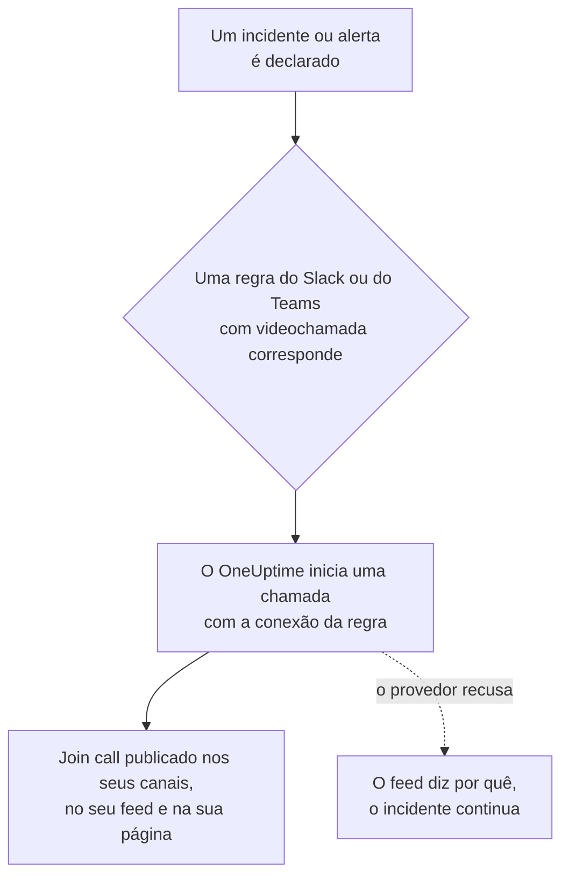

# Videochamadas

Dê a cada incidente e a cada alerta a sua própria chamada. Quando uma regra de notificação do Slack ou do Microsoft Teams dispara para um novo incidente ou alerta, o OneUptime inicia uma reunião dedicada (uma reunião do Zoom, um Google Meet, uma reunião do Microsoft Teams ou o huddle do canal do Slack do incidente) e publica um botão **Join call** onde quer que as atualizações do incidente cheguem. Os responders entram com um clique, e ninguém precisa criar uma reunião às 3 da manhã e espalhar o link.

:::cards
- [Como funciona](#como-funciona): Uma regra inicia a chamada, e os responders entram de onde estiverem.
- [Conectar com um clique](#conectar-com-um-clique): Zoom, Google Meet ou Microsoft Teams, fazendo login.
- [Provedores](#provedores): A identidade de serviço do seu próprio app, um link de reunião permanente ou um huddle do Slack.
- [Iniciar uma chamada manualmente](#iniciar-uma-chamada-manualmente): A partir da página de um incidente ou de um alerta.
- [Transcrições de chamadas](#transcrições-de-chamadas): O que foi dito na chamada de um incidente, e a causa raiz que a OneUptime AI lê nela.
:::

## Como funciona



:::steps
### Conectar um provedor

Vá para **Configurações do projeto** > **Espaço de trabalho** > **Video Calls** e conecte o Zoom, o Google Meet ou o Microsoft Teams, ou adicione um link de reunião permanente. No OneUptime Cloud, conectar o Zoom, o Google Meet ou o Microsoft Teams é um clique: faça login e permita que o OneUptime crie reuniões (consulte [Conectar com um clique](#conectar-com-um-clique)). Os huddles do Slack não precisam de nada além da conexão do Slack do projeto.

### Ativá-la em uma regra

Abra uma regra de notificação do Slack ou do Microsoft Teams para incidentes ou alertas (**Incidentes** > **Espaço de trabalho** > **Slack**, por exemplo). Na etapa **Video Call** da regra, ative **Start a video call for the incident** e escolha onde a chamada acontece.

### Entrar com um clique

Quando a regra dispara, o OneUptime inicia uma chamada para o incidente e a publica com um botão **Join call** nos canais para onde vão as atualizações do incidente e no feed do incidente. A página do incidente mostra a chamada no cartão **Video Call** e um botão **Entrar na chamada** no cabeçalho.
:::

As condições da regra decidem quais incidentes recebem uma chamada. Para uma sala apenas para incidentes Sev1, dê à regra uma condição de **Gravidade**. As chamadas começam para incidentes e alertas declarados em andamento. Um incidente criado já resolvido não recebe chamada.

### Uma chamada por incidente

Uma chamada é iniciada uma vez por incidente para cada lugar onde uma chamada acontece. Regras que escolhem a mesma conexão compartilham uma chamada, e uma regra nunca inicia uma segunda chamada para um incidente que já tem uma dessa conexão. Regras que escolhem lugares diferentes iniciam cada uma a sua própria chamada, por exemplo uma reunião do Zoom para os responders e o huddle do canal do Slack do incidente.

### Quando uma chamada não pode começar

Declarar um incidente nunca espera por um provedor de videochamadas. A chamada é iniciada depois que o incidente é criado, então um provedor lento ou com falha nunca atrasa o incidente nem as notificações de plantão dele.

Se o provedor recusar (um segredo expirado, uma permissão ausente, um host excluído), o feed do incidente diz que a chamada da regra não pôde ser iniciada, com o motivo do provedor, para que os responders saibam iniciar uma a partir da página do incidente. A execução da regra aparece nos logs de notificação do workspace como **Iniciar videochamada**, e a linha da conexão em **Configurações do projeto** > **Espaço de trabalho** > **Video Calls** mostra o erro até que uma chamada comece de novo.

### Incidentes privados

Uma reunião recebe o nome do incidente para o qual existe, com o seu número e título, e a sua descrição leva de volta ao incidente. Para um incidente privado o título fica de fora, porque todos os convidados para a reunião podem ler o nome dela.

## Conectar com um clique

No OneUptime Cloud, conectar o Zoom, o Google Meet ou o Microsoft Teams leva um clique e não há nada a configurar no provedor:

:::steps
1. Vá para **Configurações do projeto** > **Espaço de trabalho** > **Video Calls** e clique em **Conectar** no Zoom, no Google Meet ou no Microsoft Teams.
2. Clique em **Continue to Zoom** (ou Google, ou Microsoft), faça login e permita que o OneUptime crie reuniões.
3. Você volta à página de videochamadas com a conexão feita. **Start a test meeting** a verifica de ponta a ponta; depois escolha a conexão em uma regra de notificação do Slack ou do Microsoft Teams.
:::

Cada reunião é criada como a conta com que você faz login, que é a anfitriã. Faça login com uma conta compartilhada, como incidents@example.com, em vez da sua, para que as chamadas continuem começando quando pessoas saírem. A linha da conexão mostra com qual conta ela está conectada.

| Provedor | Fazer login com | O que o OneUptime pode fazer |
| --- | --- | --- |
| Zoom | Um usuário do Zoom. Reuniões hospedadas por um usuário Basic (gratuito) terminam após 40 minutos. | Criar reuniões para esse usuário (`meeting:write:meeting`) e ler quem ele é (`user:read:user`). Para as [transcrições de chamadas](#transcrições-de-chamadas), ler as transcrições das gravações na nuvem das reuniões dele (`cloud_recording:read:list_recording_files`, `cloud_recording:read:meeting_transcript`). |
| Google Meet | Uma conta do Google que possa usar o Google Meet. | Criar espaços do Meet como essa conta (`meetings.space.created`) e ler o endereço de e-mail dela. |
| Microsoft Teams | Uma conta corporativa ou de estudante com Microsoft Teams. Contas pessoais da Microsoft não podem criar reuniões do Teams. | Criar reuniões online como essa conta (a permissão delegada `OnlineMeetings.ReadWrite`) e permanecer conectado (`offline_access`). Para [gravar e transcrever chamadas de incidentes](#gravar-e-transcrever-todas-as-chamadas), colocar as reuniões no calendário dela (`Calendars.ReadWrite`) e ler as transcrições delas (`OnlineMeetingTranscript.Read.All`, que um administrador aprova). |

Uma conexão feita por login ainda tem as configurações que decidem quem espera: **Who can join** para o Google Meet e **Who skips the lobby** para o Microsoft Teams. Altere-as com **Editar** na linha da conexão.

Uma conexão do Zoom feita antes de o OneUptime ler transcrições de chamadas inicia chamadas como antes, mas só lê as transcrições delas depois de entrar de novo: **Reconnect** na linha dela pede ao Zoom as permissões de transcrição.

Uma conexão do Microsoft Teams feita enquanto a opção **Gravar e transcrever chamadas de incidentes** estava desativada inicia chamadas como antes, sem gravá-las. Depois que a opção é ativada, **Reconnect** na linha dela pede à Microsoft também as permissões de calendário e de transcrição.

### Permanecer conectado

O OneUptime guarda o token de atualização do login, criptografado, e o renova pelo menos uma vez por semana, então ele nunca expira por falta de uso, por mais tempo que o projeto passe sem um incidente. Se o login parar de funcionar (a conta removeu o OneUptime, foi excluída ou suspensa, ou a política da sua organização pede um novo login), a linha da conexão mostra **Não funciona** com o motivo no dia em que o OneUptime percebe, não no próximo incidente. **Reconnect** na linha faz o login de novo.

Conexões feitas com a mesma conta compartilham um único login, em todos os projetos: o Zoom guarda só um login por conta, então conectar de novo o mesmo usuário do Zoom o substitui para todas elas.

### Reconectar e remover

**Reconnect** na linha de uma conexão faz o login de novo, com a mesma conta ou com outra. Use-o depois que a conta tiver removido o OneUptime, ou para mover as reuniões de incidentes para outra conta.

Excluir uma conexão retira o acesso do OneUptime no Zoom e no Google assim que nenhuma outra conexão usa aquele login. Na Microsoft, remova o OneUptime em **My Apps** (myapps.microsoft.com) da conta. Remover o OneUptime da sua conta do Zoom no Zoom App Marketplace exclui o login dele de todas as conexões feitas com essa conta, e elas mostram **Não funciona** até serem reconectadas.

### Se a Microsoft pedir um administrador

Algumas organizações do Microsoft 365 só permitem que administradores aprovem apps. Se a Microsoft disser que você precisa da aprovação de um administrador, peça a um administrador do Microsoft 365 que conecte o Microsoft Teams, ou que aprove o OneUptime no [centro de administração do Microsoft Entra](https://entra.microsoft.com/) em **Enterprise applications** > **Admin consent requests**. Um projeto que grava as suas chamadas do Teams precisa dessa aprovação em cada organização, uma única vez: só um administrador pode permitir que um app leia transcrições de reuniões.

### Usar o seu próprio app

Para conectar com uma identidade de serviço em vez do login de uma pessoa — um app Server-to-Server OAuth do Zoom, uma conta de serviço do Google com delegação em todo o domínio ou um registro de aplicativo do Microsoft Entra — clique em **Use your own Zoom app** (ou Google, ou Microsoft) na caixa de diálogo Conectar. [Provedores](#provedores) explica cada um. Em um servidor auto-hospedado sem apps de um clique configurados, **Conectar** abre este formulário diretamente; consulte [Conectar com um clique em um servidor auto-hospedado](#conectar-com-um-clique-em-um-servidor-auto-hospedado) para configurá-los.

## Iniciar uma chamada manualmente

O cartão **Video Call** na página de um incidente ou alerta tem **Start call** (ou **Start another** quando já existe uma). Escolha uma das conexões do projeto, o huddle do canal do Slack do incidente, ou cole um link de reunião seu. A chamada é publicada nos canais e no feed do incidente como uma que uma regra inicia.

**Remover** no cartão tira uma chamada da página do incidente. A reunião em si não é excluída, e quem tiver o link ainda pode entrar nela.

Iniciar e remover chamadas requer permissão para trabalhar em incidentes (ou alertas): **Project Owner**, **Project Admin**, **Project Member**, **Incident Admin** ou **Incident Member**, ou **Create Incident Video Call** e **Delete Incident Video Call** em uma função personalizada. Todos que podem ler o incidente veem as chamadas dele.

## Transcrições de chamadas

O que os responsáveis dizem numa chamada, o que verificaram, o que suspeitam e o que decidiram, é o melhor registro de como um incidente foi tratado, e some quando a chamada termina. A chamada de um incidente guarda a transcrição dela, e a OneUptime AI a lê em busca da causa raiz que a chamada aponta. Nada do que ela lê chega ao incidente até que um responsável o use.

:::steps
### Obtenha a transcrição depois da chamada

No card **Video Call** do incidente, **Obter do Zoom**, **Obter do Google Meet** ou **Obter do Microsoft Teams** lê a transcrição de uma reunião que o OneUptime iniciou lá (no Microsoft Teams, uma que ele iniciou enquanto todas as chamadas são gravadas e transcritas). Para qualquer outra chamada, **Adicionar transcrição** recebe o arquivo que a ferramenta de reunião salvou (`.vtt`, `.srt` ou `.txt`, até 5 MB) ou a transcrição colada. Com [todas as chamadas gravadas e transcritas](#gravar-e-transcrever-todas-as-chamadas), o OneUptime a obtém sozinho quando a chamada termina.

### A OneUptime AI a lê

Em um ou dois minutos, o card **AI Investigation** do incidente mostra a **Causa raiz sugerida**, marcada como **Não confirmada**, com as linhas da transcrição em que se baseia, citadas com horário e quem falou. Abaixo, recolhido, está o resto do que a chamada disse: as descobertas, separadas em **Confirmado na chamada** e **Hipóteses**, depois o que foi tentado, as decisões, os acompanhamentos e as perguntas em aberto. O que a OneUptime AI leu também é publicado no feed do incidente e, de lá, nos canais do Slack e do Microsoft Teams dele.

### Use ou dispense

**Usar como causa raiz** abre a sugestão, com as citações, no editor da causa raiz. Altere o que precisar e salve: ela se torna a causa raiz do incidente como edição sua, registrada no feed dele. **Dispensar** deixa a sugestão de lado, e **Desfazer** a traz de volta.
:::

A OneUptime AI só sugere uma causa quando a chamada cita uma, com as linhas que dizem isso, e cita essas linhas como a transcrição as traz. Quando a chamada não esclareceu a causa, o card diz **Não se falou o suficiente na chamada para sugerir uma causa raiz** em vez de adivinhar.

### Gravar e transcrever todas as chamadas

Para que ninguém precise se lembrar de gravar uma chamada nem de obter a transcrição dela, ative **Gravar e transcrever chamadas de incidentes** em **Configurações do projeto** > **Espaço de trabalho** > **Video Calls**. Enquanto a opção estiver ativada:

- O OneUptime pede ao Zoom que grave na nuvem cada reunião de incidente que ele inicia, ao Google Meet que a transcreva e ao Microsoft Teams que a grave e a transcreva automaticamente. A mensagem que publica a chamada avisa isso antes que alguém entre.
- Quando a chamada termina, o OneUptime obtém a transcrição sozinho, como **Obter do Zoom** faria, e a OneUptime AI a lê. Até lá, o card **Video Call** diz que está aguardando.
- O que a OneUptime AI leu vai para o feed do incidente e para os canais do Slack e do Microsoft Teams dele: a causa raiz sugerida, marcada como não confirmada, depois o que foi confirmado, tentado e decidido, os acompanhamentos e as perguntas em aberto.
- Quando o incidente é resolvido antes de a transcrição chegar, o rascunho automático do post-mortem espera por ela, para ler o que foi dito na chamada: até seis horas enquanto o provedor prepara a transcrição, e uma hora quando ainda não há sinal dela.

A opção fica desativada por padrão, porque grava pessoas: todos nessas chamadas veem que elas estão sendo gravadas ou transcritas, então verifique se a sua organização permite isso. O Zoom só guarda uma transcrição quando a conta grava na nuvem com a transcrição de áudio ativada, e o Google Meet só numa edição do Google Workspace que tenha transcrições. Huddles do Slack e links de reunião não são gravados, e as chamadas de alertas também não: adicione as transcrições delas manualmente.

A Microsoft só deixa os apps lerem as transcrições de reuniões do Teams que estão num calendário, então o OneUptime coloca cada reunião de incidente no calendário do organizador dela e ativa a gravação e a transcrição automáticas nas opções da reunião. Para isso, a conexão precisa de mais duas permissões do Microsoft Graph, `Calendars.ReadWrite` e `OnlineMeetingTranscript.Read.All`: adicione-as ao seu registro de aplicativo (veja [Microsoft Teams](#microsoft-teams)), ou use **Reconnect** numa conexão feita por login. A política de reunião do Teams do organizador precisa permitir a gravação na nuvem, a transcrição e a gravação automática, e a sua organização não pode ter desativado o acesso dos apps às transcrições. Uma chamada que o OneUptime não consegue colocar no calendário começa mesmo assim, sem gravação, e o card **Video Call** dela diz o motivo.

### O que cada provedor guarda

| Chamada | Como obtém a transcrição | Do que precisa |
| --- | --- | --- |
| Zoom | **Obter do Zoom** | Uma reunião gravada na nuvem com a transcrição de áudio ativada, ou com o resumo de reunião do AI Companion ativado. A conexão precisa dos escopos de transcrição (veja [Zoom](#zoom)), e uma feita antes deles precisa de **Reconnect**. O Zoom prepara uma transcrição depois da reunião, geralmente em até o dobro da duração dela. |
| Google Meet | **Obter do Google Meet** | Transcrições ativadas na chamada, numa edição do Google Workspace que as tenha. Não há mais nada a configurar: o OneUptime lê as transcrições das reuniões que criou. O Google mantém uma transcrição disponível para apps por 30 dias. |
| Microsoft Teams | **Obter do Microsoft Teams** | Uma reunião que o OneUptime iniciou enquanto [todas as chamadas são gravadas e transcritas](#gravar-e-transcrever-todas-as-chamadas): a Microsoft só deixa os apps lerem as transcrições de reuniões que estão num calendário, e guarda uma reunião por 60 dias. Para qualquer outra reunião do Teams, **Adicionar transcrição**: no Teams, abra o resumo da reunião, depois a transcrição, e baixe-a como arquivo `.vtt`. |
| Link de reunião ou huddle do Slack | **Adicionar transcrição** | A transcrição que a ferramenta de reunião, ou as notas do huddle, guardam. |

### Quem pode fazer o quê

Obter, adicionar, substituir e remover uma transcrição, fazê-la ser lida de novo e dispensar uma sugestão exigem permissão para iniciar as chamadas do incidente: **Project Owner**, **Project Admin**, **Project Member**, **Incident Admin** ou **Incident Member**, ou **Create Incident Video Call** numa função personalizada. **Usar como causa raiz** exige permissão para editar a causa raiz do incidente. Quem pode ler o incidente vê as transcrições das chamadas dele e o que a OneUptime AI leu nelas.

### O que a OneUptime AI lê

Ler uma transcrição é trabalho de IA como uma investigação: só roda enquanto a IA está ativada para o projeto, e conta para o uso de IA e os limites diários do projeto (veja [Controle de custos](/docs/ai/ai-sre#controle-de-custos)). Uma transcrição longa é lida em partes. Quando a IA está desativada, a transcrição é mantida e o card diz que ela não foi lida. Remover uma transcrição remove o que a OneUptime AI leu nela, e mantém a causa raiz do incidente. Um rascunho de post-mortem da IA também lê o que foi dito nas chamadas do incidente (veja [Post-mortems](/docs/incidents/postmortems)).

## Provedores

Esta seção trata de conectar um provedor com a identidade de serviço do seu próprio app: um app Server-to-Server OAuth do Zoom, uma conta de serviço do Google, um registro de aplicativo do Microsoft Entra. Uma identidade de serviço nunca depende de uma pessoa, então continua funcionando quem quer que saia. Para conectar fazendo login, consulte [Conectar com um clique](#conectar-com-um-clique).

As credenciais são criptografadas em repouso e nunca são retornadas pela API. Quando você edita uma conexão, uma credencial deixada em branco mantém a que está salva.

**Start test meeting** no formulário da conexão, e **Testar** na linha de uma conexão, criam uma reunião real com as configurações da conexão e mostram o link dela. É a única verificação que prova que as credenciais, a permissão do lado do provedor e o host funcionam juntos. Nada é publicado em lugar nenhum.

Conectar um provedor requer **Project Owner**, **Project Admin** ou **Settings Admin**, ou **Create Video Call Connection** e **Edit Video Call Connection** em uma função personalizada.

### Zoom

O OneUptime cria uma reunião do Zoom para cada incidente por meio de um app **Server-to-Server OAuth** do Zoom, hospedada por um usuário licenciado do Zoom à sua escolha.

:::steps
1. No [Zoom App Marketplace](https://marketplace.zoom.us/), escolha **Develop** > **Build App** e crie um app **Server-to-Server OAuth**. Criar um requer um administrador da conta do Zoom, ou uma função que permita apps Server-to-Server OAuth.
2. Na página **Scopes** do app, adicione **meeting:write:meeting:admin** (criar uma reunião para um usuário). Um app criado antes dos escopos granulares pode usar **meeting:write:admin** em vez disso. Para que o OneUptime também leia [transcrições de chamadas](#transcrições-de-chamadas), adicione **cloud_recording:read:list_recording_files:admin** e **cloud_recording:read:meeting_transcript:admin** (ou **recording:read:admin** num app criado antes dos escopos granulares).
3. Clique em **Activate** para ativar o app e copie o **Account ID**, o **Client ID** e o **Client secret** da página **App Credentials** dele para o formulário da conexão.
4. Informe o **Meeting host**: o e-mail de um usuário licenciado do Zoom, de preferência uma conta de serviço como incidents@example.com, para que as reuniões continuem funcionando quando pessoas saírem. Reuniões hospedadas por um usuário Basic (gratuito) terminam após 40 minutos.
5. Os responders entram sem esperar pelo host, porque o host é uma conta de serviço que nunca entra. Verifique se a configuração **Waiting room** da sua conta do Zoom não está travada como ativada, ou ninguém consegue entrar.
:::

| Campo | Onde encontrá-lo |
| --- | --- |
| Account ID | A página **App Credentials** do app |
| Client ID | A página **App Credentials** do app |
| Client secret | A página **App Credentials** do app |
| Meeting host | O e-mail do usuário licenciado do Zoom que hospeda cada reunião |

### Google Meet

O OneUptime cria um Google Meet para cada incidente com a Google Meet REST API, por meio de uma conta de serviço do Google Cloud que age como um usuário do Google Workspace com delegação em todo o domínio.

:::steps
1. No [console do Google Cloud](https://console.cloud.google.com/), escolha ou crie um projeto e ative nele a **Google Meet REST API**.
2. Em **IAM & Admin** > **Service accounts**, crie uma conta de serviço. Abra-a, vá para **Keys** > **Add key** > **Create new key**, escolha **JSON** e cole o arquivo baixado no formulário da conexão como **Service account JSON key**.
3. No [Google Admin Console](https://admin.google.com/), abra **Security** > **Access and data control** > **API controls** > **Manage Domain Wide Delegation** e clique em **Add new**. Informe o **Client ID** numérico da conta de serviço e o escopo `https://www.googleapis.com/auth/meetings.space.created`.
4. Informe em **Create meetings as** o usuário do Google Workspace como o qual a conta de serviço age: uma conta dedicada como incidents@example.com. Toda reunião pertence a esse usuário.
:::

**Who can join** decide quem entra sem pedir: com **People in your organization join directly, others ask to join** (o padrão), pessoas de fora do seu Google Workspace pedem para entrar e alguém na chamada as admite. Com **Anyone with the link joins directly**, ninguém espera.

A delegação em todo o domínio pode levar alguns minutos para começar a funcionar. Se o teste disser, logo depois de você adicionar a delegação, que o Google não deixou a conta de serviço agir como o usuário, espere alguns minutos e teste de novo.

### Microsoft Teams

O OneUptime cria uma reunião do Microsoft Teams para cada incidente com o Microsoft Graph, por meio de um registro de aplicativo do Microsoft Entra que organiza reuniões em nome de um usuário licenciado do Teams.

:::steps
1. No [centro de administração do Microsoft Entra](https://entra.microsoft.com/), abra **App registrations** > **New registration** e registre um app de locatário único. Copie o **Directory (tenant) ID** e o **Application (client) ID** dele.
2. Em **API permissions**, adicione a permissão de **application** do Microsoft Graph **OnlineMeetings.ReadWrite.All** (e, para também [gravar e transcrever chamadas de incidentes](#gravar-e-transcrever-todas-as-chamadas), **Calendars.ReadWrite** e **OnlineMeetingTranscript.Read.All**) e depois clique em **Grant admin consent**.
3. Em **Certificates & secrets**, crie um segredo do cliente e cole o **Value** dele, não o Secret ID, no formulário da conexão como **Client secret**.
4. Escolha o organizador: um usuário licenciado do Teams, de preferência uma conta de serviço. Copie o **Object ID** dele em **Users** no centro de administração do Entra para **Organizer object ID**.
5. Permita que o app crie reuniões para o organizador com uma política de acesso de aplicativo. No Teams PowerShell, depois de `Connect-MicrosoftTeams`, execute os dois comandos abaixo.
:::

```powershell
New-CsApplicationAccessPolicy -Identity OneUptime-Meetings -AppIds "<application-client-id>"
Grant-CsApplicationAccessPolicy -PolicyName OneUptime-Meetings -Identity "<organizer-object-id>"
```

A política pode levar até 30 minutos para ser aplicada. Até lá, o teste diz que o app não tem permissão para criar reuniões para o organizador.

A mesma política deixa o app ler as transcrições das reuniões do organizador. `Calendars.ReadWrite` deixa um app alterar todos os calendários da sua organização: para restringir essa permissão ao calendário do organizador, conceda-a com [RBAC para aplicativos no Exchange Online](https://learn.microsoft.com/exchange/permissions-exo/application-rbac), com escopo no organizador, em vez de em **API permissions**.

**Who skips the lobby** decide quem entra sem esperar: com **People in your organization skip the lobby** (o padrão), qualquer outra pessoa espera no lobby até que alguém na reunião a admita. Com **Everyone skips the lobby**, ninguém espera.

### Link de reunião

Um link de reunião permanente é a mesma sala para todo incidente: uma sala de reunião pessoal do Zoom, uma reunião recorrente do Microsoft Teams ou do Google Meet, uma sala pessoal do Webex ou uma sala do Jitsi. Nada é criado por incidente, então não há nada a autorizar.

:::steps
1. Crie uma reunião que nunca expira na ferramenta que a sua equipe já usa.
2. Cole o link https de participação dela no formulário da conexão como **Meeting link**.
:::

Todo incidente e todo alerta iniciados com essa conexão compartilham a sala, então dois incidentes ao mesmo tempo também a compartilham. Verifique se a reunião permite que as pessoas entrem sem o host.

### Huddles do Slack

Uma regra do Slack pode, em vez disso, iniciar o huddle do canal do Slack do incidente. Não há nada a conectar: escolha **Slack huddle** na etapa **Video Call** da regra.

O huddle acontece no canal que a regra cria para o incidente ou, quando a regra publica em canais existentes, no primeiro deles. Então a regra precisa criar um canal ou publicar em um existente. O botão **Entrar no huddle** abre o huddle do canal no Slack. O primeiro responder a abri-lo inicia o huddle, e todos depois dele entram nele. O Slack não oferece a um app nenhuma forma de iniciar um huddle, então ninguém está no huddle até que alguém o abra.

Um huddle do Slack é só para regras do Slack. Uma regra do Microsoft Teams inicia as suas chamadas com uma das conexões de videochamada do projeto.

## Usar a API

Uma chamada é um registro no incidente (`IncidentVideoCall`) ou no alerta (`AlertVideoCall`). Crie um com o `_id` do incidente e um destes:

- `videoCallConnectionId`: iniciar uma nova reunião com essa conexão.
- `provider` definido como `SlackHuddle`: o huddle do canal do Slack do incidente.
- `joinUrl` (e opcionalmente `title`): um link de reunião seu.

```json
{
  "data": {
    "projectId": "<project-id>",
    "incidentId": "<incident-id>",
    "videoCallConnectionId": "<connection-id>"
  }
}
```

`POST /api/video-call-connection/test` inicia uma reunião de teste com uma conexão salva (`{ "connectionId": "..." }`) ou com configurações ainda não salvas (`{ "provider": "Zoom", "config": { ... }, "secrets": { ... } }`), e retorna o `joinUrl` dela.

O `authMethod` de uma conexão diz como ela faz login: `OAuth` para uma feita por login, `AppCredentials` para uma com as credenciais do seu próprio app, e nada para um link de reunião. Uma conexão feita por login só é criada fazendo login, no painel. Pela API você pode renomeá-la e alterar o `config` dela, e o `connectedAccount` dela diz com qual conta ela está conectada.

## Conectar com um clique em um servidor auto-hospedado

O OneUptime Cloud tem os seus próprios apps do Zoom, do Google e da Microsoft para conectar com um clique. Um servidor auto-hospedado oferece isso para cada provedor cujo app você configurar. Sem ele, **Conectar** abre o formulário para o seu próprio app.

Crie um app OAuth por provedor e registre nele este URI de redirecionamento, com o host do seu servidor:

| Provedor | URI de redirecionamento | Variáveis de ambiente | Valores do Helm |
| --- | --- | --- | --- |
| Zoom | `https://<host>/api/video-call-oauth/zoom/callback` | `ZOOM_APP_CLIENT_ID`, `ZOOM_APP_CLIENT_SECRET`, `ZOOM_APP_WEBHOOK_SECRET_TOKEN` | `zoomApp.clientId`, `zoomApp.clientSecret`, `zoomApp.webhookSecretToken` |
| Google Meet | `https://<host>/api/video-call-oauth/google-meet/callback` | `GOOGLE_MEET_APP_CLIENT_ID`, `GOOGLE_MEET_APP_CLIENT_SECRET` | `googleMeetApp.clientId`, `googleMeetApp.clientSecret` |
| Microsoft Teams | `https://<host>/api/video-call-oauth/microsoft-teams/callback` | `MICROSOFT_TEAMS_MEETINGS_APP_CLIENT_ID`, `MICROSOFT_TEAMS_MEETINGS_APP_CLIENT_SECRET` | `microsoftTeamsMeetingsApp.clientId`, `microsoftTeamsMeetingsApp.clientSecret` |

- **Zoom**: no [Zoom App Marketplace](https://marketplace.zoom.us/), escolha **Develop** > **Build App** e crie um **General App**, gerenciado pelos usuários. Em **Basic Information**, adicione o URI de redirecionamento como OAuth Redirect URL nas abas **Development** e **Production** e na lista de permissões do OAuth, e na aba **Production** defina a URL do endpoint de **Deauthorization Notification** como `https://<host>/api/video-call-oauth/zoom/events`. Em **Scopes**, adicione `meeting:write:meeting` e `user:read:user`. Para que ele leia [transcrições de chamadas](#transcrições-de-chamadas), adicione também `cloud_recording:read:list_recording_files` e `cloud_recording:read:meeting_transcript`. O **Secret Token** em **Features** > **Access** é o `ZOOM_APP_WEBHOOK_SECRET_TOKEN`. As credenciais de **Development** só funcionam para usuários da sua própria conta do Zoom; as de **Production** funcionam para todos depois que o Zoom revisar e publicar o app.
- **Google Meet**: no [console do Google Cloud](https://console.cloud.google.com/), ative a **Google Meet REST API**, configure a tela de consentimento OAuth (**Google Auth Platform**) com os escopos `openid`, `email` e `https://www.googleapis.com/auth/meetings.space.created`, e crie um cliente OAuth do tipo **Web application** com o URI de redirecionamento. Publique o app em produção: um app deixado em teste perde os seus logins após sete dias. O Google revisa os apps que pedem o escopo do Meet; até que isso aconteça, as pessoas veem um aviso antes de fazer login.
- **Microsoft Teams**: no [centro de administração do Microsoft Entra](https://entra.microsoft.com/), registre um app para **Accounts in any organizational directory**, adicione o URI de redirecionamento como URI de redirecionamento **Web**, adicione as permissões delegadas do Microsoft Graph `openid`, `profile`, `email`, `offline_access` e `OnlineMeetings.ReadWrite` (além de `Calendars.ReadWrite` e `OnlineMeetingTranscript.Read.All`, pedidas por um projeto que [grava e transcreve as suas chamadas](#gravar-e-transcrever-todas-as-chamadas)), e crie um segredo do cliente. Use um registro próprio, não o do bot do Microsoft Teams (`MICROSOFT_TEAMS_APP_CLIENT_ID`). Até que o app tenha um editor verificado, a maioria das organizações precisa que um administrador dê consentimento a ele.

Os IDs de cliente são públicos: eles são enviados ao painel para que ele saiba quais provedores conectam com um clique. Mantenha em segredo os segredos e o token secreto do webhook. Todo dia, o worker renova os logins que chegaram a hora de renovar, então precisa dos mesmos valores que o app.

## Solução de problemas

:::details Nenhuma chamada foi iniciada para um incidente
Verifique se a regra correspondeu ao incidente (**Regra de teste**), se a etapa **Video Call** dela está ativada e se o incidente foi declarado em andamento: um incidente criado já resolvido não recebe chamada. Uma regra que já iniciou uma chamada para o incidente com essa conexão não inicia outra.
:::

:::details O feed diz que a chamada não pôde ser iniciada
O provedor recusou, e o feed dá o motivo. Enquanto isso, inicie uma chamada a partir da página do incidente. Depois execute **Testar** na linha da conexão: ele mostra o mesmo motivo enquanto você corrige a configuração no provedor, como um segredo do cliente expirado ou uma permissão ausente.
:::

:::details Uma conexão mostra Não funciona
O login dela parou de funcionar: a conta removeu o OneUptime, foi excluída ou suspensa, ou precisa fazer login de novo. Clique em **Reconnect** na linha dela. Até lá, as chamadas que ela deveria iniciar não podem começar.
:::

:::details As pessoas esperam em um lobby ou em uma sala de espera
Altere **Who can join** (Google Meet) ou **Who skips the lobby** (Microsoft Teams) com **Editar** na linha da conexão. No Zoom, verifique se a configuração **Waiting room** da conta não está travada como ativada.
:::

:::details Obter do Zoom não encontra nenhuma transcrição
O Zoom só guarda a transcrição de uma reunião gravada na nuvem com a transcrição de áudio ativada, ou com o resumo de reunião do AI Companion ativado, e a prepara depois que a reunião termina. O card diz qual é o caso: tente de novo mais tarde, ou ative uma das duas opções para as suas reuniões de incidente. Enquanto isso, **Adicionar transcrição** recebe uma transcrição que você salvou.
:::

:::details O card Video Call ainda aguarda uma transcrição
Depois que a chamada termina, o OneUptime pede a transcrição ao Zoom, ao Google Meet ou ao Microsoft Teams a cada poucos minutos, com menos frequência à medida que a chamada fica mais antiga, por três dias após o início da chamada. A transcrição chega poucos minutos depois que o provedor a prepara, e o Zoom leva até cerca do dobro da duração da chamada. **Obter do Zoom** pede na hora. Quando o provedor não guarda nenhuma transcrição, o card diz isso: verifique se a conta do Zoom grava na nuvem com a transcrição de áudio ativada, se a sua edição do Google Workspace tem transcrições ou se a política de reunião do Teams do organizador permite a gravação automática.
:::

:::details Uma chamada do Microsoft Teams não foi gravada
O OneUptime não conseguiu colocar a reunião no calendário do organizador dela, então iniciou a chamada do jeito habitual, sem gravação, e o card **Video Call** diz o motivo. Normalmente falta à conexão `Calendars.ReadWrite` ou `OnlineMeetingTranscript.Read.All`: adicione-as ao registro de aplicativo e conceda o consentimento do administrador, ou use **Reconnect** numa conexão feita por login. As chamadas iniciadas depois disso são gravadas.
:::

:::details A OneUptime AI não conseguiu ler uma transcrição
O card diz o motivo: a IA está desativada para o projeto, o projeto atingiu um limite diário de IA, ou o provedor de IA recusou. Depois de resolver isso, **Tentar novamente** no card a lê de novo.
:::

## Próximos passos

:::cards
- [Slack](/docs/workspace-connections/slack): As regras que iniciam chamadas, e os canais em que publicam.
- [Microsoft Teams](/docs/workspace-connections/microsoft-teams): As mesmas regras e chamadas no Microsoft Teams.
- [Integração com Microsoft Teams](/docs/self-hosted/microsoft-teams-integration): Configurar o bot do Teams em um servidor auto-hospedado.
- [Declarar um incidente](/docs/incidents/declaring-incidents): O que acontece quando um incidente começa.
:::
