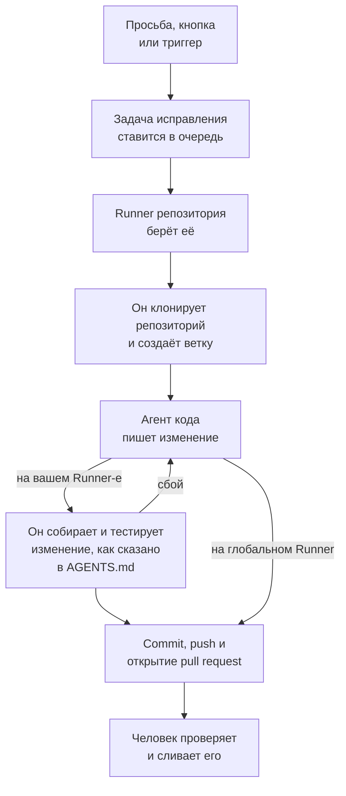

# Код

Код — это место, где вы просите OneUptime AI поработать в ваших репозиториях, как попросили бы агента для программирования: исправить ошибку, написать тесты, объяснить код, внести изменение. Он открывается на поле, где вы пишете просьбу, с выбранными в нём репозиторием и веткой и всеми задачами под ним; страница задачи — это разговор, в котором можно ответить. OneUptime запускает задачи и сам, из исключений, трассировок и расследований. [Runner](/docs/runbooks/agents) клонирует репозиторий, пишет изменение в новой ветке, собирает и тестирует его и открывает pull request. Каждый из них проверяет и сливает человек: Runner может отправлять ветки и открывать pull request, и ничего больше.

:::cards
- [Попросить ИИ в репозитории](#попросить-ии-в-репозитории): Просьба своими словами, с нужным ей контекстом.
- [Разговор задачи](#разговор-задачи): Что сделал ИИ, что он изменил, и ваш ответ.
- [Как проходит запуск исправления](#как-проходит-запуск-исправления): От клика до pull request, шаг за шагом.
- [Где начинаются задачи исправления](#где-начинаются-задачи-исправления): Задачи, которые запускает OneUptime, и что делает каждый pull request.
- [Телеметрия продакшена в исправлении](#телеметрия-продакшена-в-исправлении): Что исправление читает из продакшена, пока пишет изменение.
- [Проверка pull request по продакшену](#проверка-pull-request-по-продакшену): Что продакшен говорит о коде, который меняет каждый pull request.
- [Подключение репозитория](#подключение-репозитория): GitHub, GitLab, Forgejo или Gitea либо любой Git-сервер.
- [Прежде чем начать](#прежде-чем-начать): Модель, подключённый репозиторий и Runner.
- [Когда исправление не удаётся](#когда-исправление-не-удаётся): Что происходит с запуском, который завершается ошибкой, зависает или ждёт.
:::

> [!TIP]
> Это можно запустить и из GitHub. Упомяните GitHub App от OneUptime в issue или в pull request, и он реализует, доработает или проверит изменение прямо там: см. [GitHub App](/docs/ai/github-app). Это тот же агент, тот же Runner и те же бюджеты; отличается только триггер.

## Попросить ИИ в репозитории

:::steps
### Откройте раздел «Код»

Откройте **Продукты → Код**. Раздел открывается вопросом **Что должен сделать ИИ?** над полем, где вы пишете просьбу; под ним — все задачи, сначала новые. Пока репозиториев нет, вместо этого он предлагает **Подключить GitHub**, а под ним — GitLab, Forgejo или Gitea и любой Git-сервер (см. [Подключение репозитория](#подключение-репозитория)). **Репозитории** в боковом меню перечисляет репозитории, в которых может работать ИИ, а те, до которых OneUptime больше не дотягивается, сворачивает под **Не подключено**. На странице каждого репозитория есть такое же поле для этого репозитория.

### Выберите репозиторий и ветку

Поле открывается на репозитории, который вы выбрали последним. Выберите другой в его нижней строке, а рядом — ветку, от которой начнётся задача: основную ветку репозитория с пометкой **По умолчанию**, пока вы не выберете другую. ИИ создаёт свою ветку от выбранной и открывает в неё свой pull request.

### Скажите, что нужно

Опишите своими словами изменение, ошибку или вопрос. Пока ничего не попросили, «Код» предлагает несколько в разделе **Попробуйте попросить**.

### Добавьте контекст

Нажмите **Добавить контекст**, чтобы дать ИИ то, что ему нужно: файл или папку репозитория, заметку, ссылку или запись проекта. OneUptime читает каждую запись в момент отправки просьбы, с вашими правами, и сохраняет то, что получил ИИ.

### Запустите задачу

Нажмите **Запустить задачу** или клавишу Enter. Откроется страница задачи, и работа ИИ будет появляться там по ходу дела.
:::

| Контекст | Что получает ИИ |
| --- | --- |
| **Файл или папка** | Путь в репозитории, который ИИ читает первым. |
| **Заметка** | Текст, который вы вставляете: ошибку, спецификацию, строку журнала. |
| **Ссылка** | Веб-адрес, как справку. |
| **Инцидент** или **Оповещение** | Его состояние, описание и первопричину — такими, какие они в момент отправки просьбы. |
| **Исключение** | Его сообщение и трассировку стека. |
| **Монитор** | Его тип, статус и описание. |
| **Трассировка** | Её спаны: их имена, длительности и ошибки. |
| **Журналы** | Последние 20 строк журнала, содержащих ваш запрос, за последний час, день или неделю. |
| **Профиль производительности** | Куда уходит время функции в профилях её сервиса: кто её вызывает, что вызывает она и её самые горячие строки. |

Просьба несёт не больше 10 элементов контекста. Токены, ключи, пароли и адреса электронной почты в том, что читает OneUptime, скрываются до того, как их увидит ИИ, как и везде, где OneUptime AI читает ваши данные.

## Разговор задачи

Страница задачи — это разговор: что попросили и какой контекст добавили, затем ход ИИ — шаги, которые он делает, по мере того как он их делает (файлы, которые он прочитал и изменил, что он искал, какие команды выполнил), его ответ, файлы, которые он изменил, с их diff, и pull request. Вверху страницы видно, где работает задача (её репозиторий и ветка, от которой она начата), сколько строк она изменила, с кнопкой её pull request, и в каком состоянии задача:

| Состояние | Что это значит |
| --- | --- |
| **В очереди** | Задача ждёт, когда её возьмёт Runner. |
| **Работает…** | ИИ работает над ней. **Остановить** останавливает её; то, что уже отправлено, остаётся в ветке. |
| **Ожидает вас** | ИИ задал вопрос. Ответьте на него в поле ниже. |
| **Готово** | ИИ закончил: его ответ и pull request, если он изменил код. |
| **Не удалось** | Ход не удалось завершить, и в нём сказано почему. **Повторить попытку** просит то же самое ещё раз. |
| **Остановлено** | Кто-то остановил задачу. **Повторить попытку** просит то же самое ещё раз. |

Чтобы продолжить, напишите в поле внизу, которое остаётся на виду, пока разговор прокручивается: ответьте ИИ, добавьте контекст или попросите изменений. Каждый ответ — следующий ход той же задачи: он работает в той же ветке и отправляет изменения в тот же pull request, пока тот открыт. Задача делает один ход за раз, поэтому поле ждёт, пока ИИ работает. **Журнал** каждого хода — дословная запись того, что в нём было сделано. В задаче из нескольких ходов переключатель вверху страницы **Журнал** переходит между ними.

Кто может читать репозиторий, читает и его задачи. Чтобы попросить ИИ, ответить или остановить задачу, нужно право изменять репозиторий, и чтобы увидеть diff изменения — тоже: остальные видят, какие файлы изменились. Задачи, которые OneUptime запускает сам (ниже), тоже находятся в своём репозитории, как разговоры, в которых можно ответить.

## Как проходит запуск исправления



1. Вы нажимаете **Запустить задачу** в разделе «Код» или **Исправить с ИИ** в нерешённом исключении, или задачу запускает другая кнопка или триггер (см. [Где начинаются задачи исправления](#где-начинаются-задачи-исправления)).
2. Задача ставится в очередь своего репозитория, и её берёт Runner, на котором работает репозиторий: тот, которого он выбрал, иначе Runner проекта по умолчанию, иначе глобальный Runner (см. [Выбор Runner для репозитория](#выбор-runner-для-репозитория)).
3. Runner получает контекст задачи. Для просьбы это её слова, добавленный контекст и разговор до этого момента; для исключения — его тип, сообщение и трассировка стека.
4. Он клонирует репозиторий в собственное рабочее пространство и создаёт ветку. Исправление исключения называется `oneuptime-fix-exception-`, за которым идут первые символы id запуска. Просьба начинается от ветки, выбранной при её отправке, и её pull request открывается в эту ветку. Ответ вместо этого работает в ветке открытого pull request задачи.
5. Агент кода, работающий на провайдере LLM вашего проекта, читает код и пишет изменение. Вызовы LLM делает сервер OneUptime, поэтому у Runner никогда нет API-ключа вашего провайдера, а каждый вызов учитывается и попадает в журналы ИИ. Исправление исключения, медленной трассировки или инцидента по ходу работы читает и продакшен: исключения, трассировки, журналы и метрики сервисов репозитория (см. [Телеметрия продакшена в исправлении](#телеметрия-продакшена-в-исправлении)).
6. На собственном Runner агент кода собирает и тестирует своё изменение так, как сказано в `AGENTS.md` репозитория, до любого коммита и исправляет то, что не проходит (см. [Проверка перед pull request](#проверка-перед-pull-request)).
7. Runner делает коммит, отправляет ветку, открывает pull request (для просьбы — только если изменён код) и удаляет рабочее пространство.

Страница, с которой запустили задачу, показывает её статус в реальном времени. Каждая задача перечислена в своём репозитории в **Продукты → Код**: её страница — это её разговор, а в **Журнал** каждого хода записана строка на каждый файл, который Runner прочитал или записал, и на каждую выполненную им команду.

Каждый запуск ограничен бюджетами, которые соблюдает сервер: не более **40 вызовов LLM** и **100 000 выходных токенов**. Запросы запуска к телеметрии продакшена учитываются в тех же 40 вызовах. Запуск, достигший одного из них, завершается сводкой проделанной работы, а не ходит по кругу. Запуски исправлений также учитываются в дневных лимитах ИИ проекта, если проект их задаёт.

## Где начинаются задачи исправления

| Где | Нажать | Что делает pull request |
| --- | --- | --- |
| Страница **AI Assistance** исключения | **Исправить с ИИ** | Исправляет ошибку, стоящую за исключением. |
| Страница **AI Assistance** исключения | **Generate Regression Test** | Добавляет тест, который воспроизводит исключение и падает, пока ошибка не исправлена. |
| Страница **AI Assistance** исключения | **Улучшить обработку ошибок** | Для ожидаемой ошибки, например неверного ввода: убирает пользовательские данные из сообщения, проверяет ввод раньше и помечает ошибку как обработанную, не меняя поведения. |
| Карточка **AI Investigation** инцидента или оповещения | **Open Fix PR from this analysis** | Исправляет первопричину, опубликованную расследованием (см. [Автоматические исправления кода по расследованиям](#автоматические-исправления-кода-по-расследованиям)). |
| Трассировка, которую стоит исправить | **Ускорить с помощью ИИ** | Исправляет медленный шаблон, который называет кнопка, например запрос N+1 или вызовы, которые можно было бы выполнять параллельно. |
| Страница **Журналы** сервиса | **Улучшить журналирование** | Делает логи сервиса структурированными, с правильным уровнем важности и связанными с его трассировками, не меняя поведения. |
| Страница **Трассировки** сервиса | **Улучшить трассировку** | Добавляет span-ы и атрибуты там, где трассировки сервиса не хватает, не меняя поведения. |
| Функция в разделе **Профили производительности** | **Исправить с ИИ** | Заставляет функцию делать ту же работу за меньшее время или с меньшей памятью, с её профилем в качестве доказательства. |

Эти кнопки появляются только там, где они могут запустить задачу. Если ИИ для проекта выключен, не показывается ни одна из них, а в боковом меню исключения нет **AI Assistance**. **Улучшить журналирование** и **Улучшить трассировку** появляются, как только подключён репозиторий, а **Ускорить с помощью ИИ** — только у трассировки, которую стоит исправить (см. [Обозреватель трассировок](/docs/telemetry/traces-explorer)). Кнопка **Исправить с ИИ** у функции появляется только для собственного кода приложения, который занимает не меньше 5 % времени или памяти профиля либо чья доля выросла на 3 п. п. или больше по сравнению с окном, с которым его сравнивают (см. [Непрерывное профилирование](/docs/telemetry/profiles)).

Чтобы открыть страницу **AI Assistance** исключения, откройте исключение в **Продукты → Наблюдаемость → Исключения** и выберите **AI Assistance** в его боковом меню. Решённое или архивированное исключение сначала нужно пометить как нерешённое.

OneUptime AI также запускает задачи исправления сам: из расследования, которое находит изменение в коде, из расследования, завершившегося без вывода из-за нехватки телеметрии, и из AI Insights об исключениях и медленных трассировках. У каждого источника свой переключатель; см. [Автоматические исправления кода](/docs/ai/ai-sre#автоматические-исправления-кода).

## Телеметрия продакшена в исправлении

OneUptime хранит то, что ваш код делает в продакшене, поэтому исправлению не приходится опираться на одну лишь трассировку стека. Пока агент кода работает, он может запрашивать телеметрию продакшена сервисов, к которым относится репозиторий:

| Что он читает | Зачем |
| --- | --- |
| **Исключения** | Группы исключений, выброшенных в заданных файлах или функции: как часто за последние дни, с какого релиза, и трассировку недавнего появления. |
| **Трассировки** | Профиль задержек и ошибок конечной точки или операции, а также спаны одной трассировки. |
| **Журналы** | Строки журналов сервиса по времени, уровню важности, тексту или трассировке. |
| **Метрики** | Метрика, которую сообщает сервис, во времени; без имени — метрики, которые он сообщает. |
| **Инциденты** | Инциденты, которые затронули сервисы или для которых было открыто исправление OneUptime в этом репозитории, с их первопричиной и постмортемом. |
| **Развёртывания** | Недавние развёртывания и другие изменения сервисов, каждое с вердиктом OneUptime о том, навредило ли оно своему сервису. |

| Задача | Что она проверяет |
| --- | --- |
| **Исправить с ИИ** в исключении | Как часто оно выбрасывается сейчас и с какого релиза, журналы и трассировку одного из появлений. |
| **Ускорить с помощью ИИ** | Насколько нагружена и насколько медленна операция по всем её трассировкам, а не только по проанализированной. Если операция больше не медленная, ничего не меняет. |
| **Open Fix PR from this analysis** и исправления, автоматически открытые по расследованиям | Развёртывания перед инцидентом, его ошибки, журналы и медленные операции, а также то, проявлялась ли эта причина раньше. |
| `@oneuptime review` из GitHub | Что продакшен говорит об изменённом коде (см. [Ревью с контекстом продакшена](/docs/ai/github-app#ревью-с-контекстом-продакшена)). |

В описании pull request сказано, что запрашивал агент и что это показало. Другие задачи, например регрессионные тесты и улучшения журналирования или трассировки, продакшен не запрашивают.

Что агент может читать, решает сервер OneUptime, исходя из самой задачи:

- **Только чтение.** Запросы выполняются на сервере OneUptime, никогда на Runner, у которого нет учётных данных для чтения телеметрии. Ничто из того, что они делают, не может изменить ваш проект.
- **Этот проект и только сервисы, к которым относится этот репозиторий.** Сопоставлять их вам не нужно: это сервисы, для которых OneUptime находит этот репозиторий, так же как он находит репозиторий исправления, — трассировки стека их исключений проходят через его файлы, они названы так же, как он, или это единственный репозиторий проекта. Телеметрию другого сервиса прочитать нельзя.
- **Никаких приватных инцидентов**, а токены, ключи, пароли и адреса электронной почты скрываются до того, как агент увидит результат, как и везде, где OneUptime AI читает ваши данные.
- **Ограничено.** Не более **12** запросов за запуск, и каждый учитывается в 40 вызовах запуска.

Если репозиторию не соответствует ни один сервис, задача выполняется без телеметрии продакшена, как и раньше.

## Проверка pull request по продакшену

OneUptime знает, что ваш код делает в продакшене, поэтому может проверить pull request с тем, чего не видно при чтении диффа. Включите **Проверять запросы на слияние по данным продакшена** на странице **Настройки** репозитория в разделе «Код», в блоке **Дополнительные настройки**, и каждый pull request, который открывает или обновляет человек с правом записи, получит один комментарий о том, что продакшен показывает о меняемом коде. Комментарий обновляется на месте при каждом push, а страница **Проверки по продакшену** репозитория в разделе «Код» хранит каждую проверку, с кнопкой **Проверить снова**.

| Что она читает | Из кода, который меняет pull request |
| --- | --- |
| **Исключения** | Исключения, выброшенные в изменённых строках, функциях и файлах за последние 7 дней, с отметкой новых и необработанных. |
| **Операции** | Трассированные операции, выполняющие изменённый код за последний час: их спаны, ошибки и p95. |
| **Тяжёлые функции** | Функции изменённого кода, занимающие долю профилей сервисов за последний час. |
| **Инциденты** | Инциденты сервисов за последние 30 дней, которые ещё открыты или в первопричине или постмортеме которых упомянут изменённый код. Приватные инциденты не читаются. |
| **Развёртывания** | Развёртывания сервисов за последние 7 дней, которые OneUptime подозревает в регрессии. |

Когда продакшен что-то показывает, OneUptime AI читает это рядом с диффом и добавляет **На что обратить внимание**: несколько коротких пунктов, каждый из которых опирается на факты. Это работает, только пока ИИ включён для проекта, не чаще 10 раз в день для одного pull request и 100 раз для репозитория, и учитывается как любой вызов ИИ; факты читаются каждый раз и без него. Если продакшен ничего не показывает об изменении, OneUptime ничего не публикует.

- **Только агрегаты.** Комментарий содержит количества, длительности и имена кода: никогда не сообщение исключения, строку журнала, название инцидента или персональные данные.
- **Публичные репозитории получают ссылку.** Pull request публичного репозитория может прочитать кто угодно, поэтому там комментарий только ссылается на проверку в OneUptime, которую могут открыть лишь участники проекта. **Комментарий проверки по продакшену** в разделе **Дополнительные настройки** на странице **Настройки** репозитория может публиковать **Только ссылка на проверку** везде или **Проверка, даже в публичном репозитории**.
- **Внешние участники не могут её запустить.** Pull request проверяется сам, только когда его автор и тот, кто отправил в него изменения, могут писать в репозиторий. Pull request любого другого человека - внешнего участника, из форка, от бота - проверяется, когда человек с правом записи пишет в нём комментарий `@oneuptime production review` или нажимает **Проверить снова** в разделе «Код».
- **Только чтение.** Проверка ничего не клонирует и ничего не запускает из pull request. Его дифф и заголовок — это данные для OneUptime AI, а не инструкции: у ИИ нет инструментов, а то, что он пишет, вставляется в комментарий как текст.

Переключатель включён для репозиториев, которые GitHub App подключает с этого момента. Репозиторий, подключённый до его появления, оставляет его выключенным, пока вы его не включите.

## Проверка перед pull request

Репозиторий описывает, как его собирать и тестировать, в `AGENTS.md` в своём корне — файле, который читают агенты для написания кода. Прежде чем что-либо менять, агент кода читает `AGENTS.md` репозитория (или его `CLAUDE.md`, если `AGENTS.md` нет) из ветки, с которой начинается задача, и работает так, как там сказано. Если нет ни того, ни другого, он узнаёт это из `CONTRIBUTING.md` репозитория, README, скриптов пакета, `Makefile` или CI-воркфлоу. В OneUptime ничего настраивать не нужно.

| Где работает ИИ | Что он делает со сборкой и тестами репозитория |
| --- | --- |
| Один из ваших Runner-ов | Собирает и тестирует своё изменение до открытия pull request, исправляет то, что не проходит, и проверяет снова, а в итоговом описании говорит, какие проверки запускал. Каждой команде, которую он запускает, даётся 2 минуты, а медленной установке, сборке или набору тестов — до 10, и в её окружении нет собственных учётных данных Runner. |
| **Глобальный Runner** | Не выполняет ни одной команды: пишет изменение и открывает pull request, а собственный CI вашего репозитория его проверяет. |

Ничто из pull request, пришедшего из форка, никогда не читается как инструкции репозитория: доработка отклоняет такой pull request, а ревью читает базовую ветку.

### Команды, заданные в репозитории

Раздел «Код» больше не спрашивает команды установки, сборки и тестов, но репозиторий, у которого они есть, заданные раньше или через API или Terraform, сохраняет их. Они показаны только для чтения на карточке **Команды сборки и тестов** в разделе **Дополнительные настройки** на странице **Настройки** репозитория, а **Удалить команды** удаляет все три. Пока задана хотя бы одна из них, каждый запуск исправления на собственном Runner также проверяет ими своё изменение до открытия pull request:

1. Когда агент кода заканчивает, команды выполняются по порядку в корне репозитория, на Runner, в клонированном рабочем пространстве. Каждой даётся до 15 минут, и она выполняется с `CI=true`, чтобы ничто не ждало ввода; первый сбой останавливает проход.
2. При сбое конец вывода упавшей команды возвращается тому же агенту кода как задача на починку, с указанием исправить собственное изменение, а не ослаблять или пропускать тесты, и команды выполняются снова. Он делает не более **2** попыток починки. Они делят бюджет LLM запуска, а их правки попадают в тот же коммит, что и исправление.
3. Итог — пройдено, не пройдено или пропущено (команды не заданы или глобальный Runner) — записывается в раздел Verification описания pull request и сохраняется в pull request задачи.

Изменение, которое так и не прошло проверку, не выбрасывается: pull request всё равно открывается, с хорошо заметным разделом "Verification failed", который называет упавшую команду и заканчивается её выводом. Работа сохраняется, а решает проверяющий. Репозиторий без заданных команд отмечается как пропущенный, а не делает вид, что сборка зелёная.

Команды — это настройки репозитория, которые пишет ваша команда, и выполняются они на вашем собственном Runner: та же модель доверия, что и у шагов Bash в runbook. ИИ никогда их не пишет и не меняет. Глобальный Runner, который OneUptime запускает для всех проектов, никогда их не выполняет: на глобальном Runner исправление пишется и открывается на ревью, проверка отмечается как пропущенная, а собственный CI вашего репозитория проверяет изменение. [Запустите собственный Runner](#запуск-собственного-runner), чтобы исправления собирались и тестировались до открытия pull request.

## После слияния исправления

Слияние исправления ничего не исправляет, пока оно не запущено. Как только запрос на слияние с исправлением слит, OneUptime ждёт записанного развёртывания, которое его содержит (см. [Развёртывания и изменения](/docs/telemetry/change-events)), и следит в этом развёртывании за тем, для чего было исправление. Запрос на слияние задачи в Code показывает, чем всё закончилось, как и страница **AI Assistance** исключения, журналы ИИ инцидента и инсайт ИИ, из которого пришло исправление:

| Исправление для | Что отслеживается | Сработало | Не сработало |
| --- | --- | --- | --- |
| Исключения | Повторится ли исключение | **Исправлено в продакшене** | **Всё ещё происходит после исправления** |
| Медленной трассы или инсайта о задержке | p99 операции, которую называет исправление | **Быстрее в продакшене** | **Всё ещё медленно после исправления** |
| Первопричины инцидента или оповещения | Поднимет ли его монитор ещё один | **Исправлено в продакшене** | **Повторилось после исправления** |
| Недостающей телеметрии, логирования или трассировки | То, что добавляет исправление, и остальная телеметрия сервиса | **Поступает в продакшене** | **Телеметрия пропала после исправления** |

Пока развёртывание его не доставит, у исправления указано **Слито, ожидается деплой**, затем **Развёрнуто, наблюдение в продакшене**, пока за ним следят. Исправление, которого ни одно записанное развёртывание не содержит в течение 14 дней или о котором продакшен ничего не может сказать, получает **Не проверено в продакшене**. [Автоматические исправления кода](/docs/ai/ai-sre#автоматические-исправления-кода) описывает правила. Регрессионный тест, улучшенная обработка ошибок, ревью и запрос в Code не отслеживаются: продакшен не может показать, что они меняют.

## Подключение репозитория

Откройте **Репозитории** в боковом меню раздела «Код» и нажмите **Подключить репозитории**: раздел спросит, где находится ваш код, и подключит каждое место по-своему. Что ИИ делает в репозитории, зависит от того, где он находится:

| Где находится код | Как он подключается | Что там делает ИИ |
| --- | --- | --- |
| **GitHub** | GitHub App OneUptime, установленная на выбранные ею репозитории. | Всё, что описано на этой странице, вместе с командами из GitHub (см. [GitHub App](/docs/ai/github-app)) и [проверками по продакшену](#проверка-pull-request-по-продакшену). |
| **GitLab**, на GitLab.com или собственный | Токен доступа: личный, групповой или проектный токен с областями `api` и `write_repository` и ролью не ниже Developer. | Задачи и исправления, каждое изменение — в запросе на слияние; выбор ветки; код, через который проходит трассировка стека или профиль; было ли исправление слито и что показал продакшен после выкатки. |
| **Forgejo или Gitea**, на Codeberg или собственный | Токен доступа с правами на чтение и запись репозиториев и на чтение пользователя. | То же, что и в GitLab, каждое изменение — в pull request. |
| **Любой Git-сервер**, по HTTPS | Адрес, по которому вы клонируете репозиторий, имя пользователя и пароль или токен доступа, которые могут читать репозиторий и отправлять в него изменения. | ИИ клонирует репозиторий и отправляет каждое изменение в новую ветку, которую называет в ответе: запрос на слияние открываете вы. Для Bitbucket и Azure DevOps он даёт ссылку туда, где его открыть. |

Командам из комментариев и проверкам по продакшену нужна GitHub App, поэтому пока они работают только в репозиториях GitHub, и **Настройки** репозитория об этом говорят.

Для GitLab, Forgejo или Gitea введите адрес сервера (GitLab.com и Codeberg уже подставлены) и токен, а затем выберите репозитории для подключения: в списке есть только те, в которые токен может отправлять изменения, а подключить другие позже можно с тем же токеном. OneUptime проверяет каждый токен на его сервере, прежде чем сохранить, хранит его в зашифрованном виде и больше никогда не показывает. **Настройки** репозитория показывают его сервер, учётную запись и последние символы токена, с кнопкой **Заменить токен доступа**. Когда сервер отклоняет токен, срок действия которого истёк или который отозван, его репозитории показывают **Токен отклонён**, и ИИ перестаёт в них работать, пока замена токена снова не подключит все репозитории, которые его используют. В репозитории GitLab настройки, как и сам GitLab, говорят о запросах на слияние: **Запросы на слияние**, **Запросы на слияние с исправлениями ИИ** и **Макс. открытых запросов на слияние с исправлениями**.

### Git-сервер в частной сети

OneUptime Cloud обращается только к Git-серверам в интернете, никогда к частному, петлевому или локальному для канала адресу. Сервер, до которого доходит только ваша сеть, подключите как **Любой Git-сервер**: раздел скажет, что не может до него достучаться, а **Всё равно подключить** подключит его для одного из ваших собственных Runner в этой сети. Выберите этот Runner на карточке **Runner** репозитория (см. [Выбор Runner для репозитория](#выбор-runner-для-репозитория)). Глобальный Runner никогда в нём не работает, а OneUptime ничего не читает из него на сервере, поэтому выбор ветки предлагает только его основную ветку. Самостоятельно размещённый OneUptime и его глобальный Runner доходят до Git-серверов своей сети.

## Прежде чем начать

Задаче нужны три вещи. Поле просьбы в разделе «Код» и страница **AI Assistance** исключения проверяют все три, прежде чем предложить запуск, и сообщают, чего не хватает.

| Что | OneUptime Cloud | Самостоятельный хостинг |
| --- | --- | --- |
| Провайдер LLM | Ничего настраивать не нужно: проект без собственного провайдера использует глобальный провайдер, оплачиваемый из ИИ-кредитов проекта. Собственный провайдер в **Настройки проекта → ИИ → Провайдеры LLM** имеет приоритет. | Один раз задайте на сервере переменные окружения `GLOBAL_LLM_PROVIDER_*` или добавьте провайдер в проект. |
| Репозиторий, подключённый через GitHub App | **Продукты → Код**, затем **Подключить GitHub**. Если приложение уже установлено в учётной записи GitHub, нажмите вместо этого **Подключить существующую установку**: повторная установка его не подключает. Нужен тариф Growth. | То же самое, когда у вашего экземпляра есть GitHub App (см. [Интеграция с GitHub](/docs/self-hosted/github-integration)). |
| Или репозиторий на GitLab, Forgejo или Gitea либо на любом Git-сервере | **Репозитории** в разделе «Код», затем **Подключить репозитории** (см. [Подключение репозитория](#подключение-репозитория)). Нужен тариф Growth. | То же самое, без GitHub App, которую нужно настраивать. |
| Runner, выполняющий ИИ-исправления кода | Ничего запускать не нужно: репозиторий, не выбравший Runner, работает на Runner-е проекта по умолчанию, а без него — на глобальных Runner-ах OneUptime. | Сервис `runner` из Docker Compose или Runner из Helm-чарта (`runner.enabled`, включён по умолчанию) сам регистрируется и выполняет ИИ-исправления кода в каждом репозитории, который работает на глобальном Runner. |

На собственном экземпляре глобальный провайдер — это один блок в `config.env` (Docker Compose) или в ваших значениях Helm. Для собственного Ollama:

```bash
GLOBAL_LLM_PROVIDER_TYPE=Ollama
# An address the OneUptime server can reach, never localhost.
GLOBAL_LLM_PROVIDER_BASE_URL=http://ollama:11434
GLOBAL_LLM_PROVIDER_MODEL_NAME=llama3.1
# No GLOBAL_LLM_PROVIDER_API_KEY needed — Ollama is keyless.
```

Подходит любой поддерживаемый провайдер: см. [Провайдеры LLM](/docs/ai/llm-provider), где описаны все провайдеры и каждая переменная окружения.

Вы не сопоставляете репозитории с сервисами. Когда задача запускается, OneUptime находит репозиторий, сравнивая пути файлов из трассировки стека исключения с вашими подключёнными репозиториями. Если ничего не совпадает, он берёт репозиторий с тем же именем, что и сервис, а затем единственный репозиторий проекта, если он один. Страница **AI Assistance** показывает, какой репозиторий найден.

### Выбор Runner для репозитория

Каждый репозиторий выбирает Runner, на котором в нём работает ИИ: на его странице **Настройки** в разделе «Код» откройте **Дополнительные настройки**, нажмите **Редактировать** на карточке **Runner** и выберите Runner. Репозиторий, который не выбрал ни одного, работает на [Runner по умолчанию](/docs/runbooks/agents#runner-проекта-по-умолчанию) проекта — первом варианте с пометкой **По умолчанию для проекта** — и переходит вместе с ним, когда по умолчанию становится другой Runner. В проекте без Runner по умолчанию он работает на **Глобальный Runner**, который OneUptime запускает для всех проектов. Чтобы оставить репозиторий на **Глобальный Runner**, пока у проекта есть Runner по умолчанию, выберите его.

| Runner | Что он делает с задачей |
| --- | --- |
| **Глобальный Runner** | Пишет изменение и открывает pull request, не собирая и не тестируя его: собственный CI вашего репозитория проверяет изменение. |
| Один из ваших Runner-ов | Ещё и собирает и тестирует изменение так, как сказано в `AGENTS.md` репозитория, на хосте, который вы контролируете. |

Задачи репозитория и токен для него получает только тот Runner, на котором он работает. В проекте, где **Использовать глобальные Runner-ы** выключено в **Сборники инструкций → Агенты runbook-ов**, каждому репозиторию нужен один из Runner-ов самого проекта: тот, которого он выбрал, или Runner проекта по умолчанию. На странице Runner перечислены репозитории, которые на нём работают.

### Запуск собственного Runner

Чтобы запустить Runner в другом месте, например на машине рядом с вашими репозиториями:

:::steps
### Создайте Runner

Создайте Runner в **Сборники инструкций → Агенты runbook-ов** и нажмите **Показать инструкции по настройке** в его строке. Команда содержит секретный ключ Runner, который может прочитать только Project Owner, Project Admin или Runbook Admin. Она выглядит так:

```bash
docker run --name oneuptime-runner --restart unless-stopped \
  -e ONEUPTIME_RUNNER_ID=<runner-id> \
  -e ONEUPTIME_RUNNER_KEY=<runner-key> \
  -e ONEUPTIME_URL=<your-oneuptime-url> \
  -d oneuptime/runner:release
```

### Выберите его для репозитория

На странице **Настройки** репозитория в разделе «Код» откройте **Дополнительные настройки**, нажмите **Редактировать** на карточке **Runner** и выберите Runner. Runner подхватывает изменение со следующим heartbeat, примерно в течение минуты; ничего перезапускать не нужно.

### Проверьте подключение

Runner появляется как подключённый на странице **Сборники инструкций → Агенты runbook-ов** в течение минуты-двух. Если нет, посмотрите лог контейнера (`docker logs oneuptime-runner`) на предмет ошибки учётных данных или сети.
:::

Подходит любой способ запуска контейнера (Docker Compose, Kubernetes и так далее), если у него есть эти переменные и он может достучаться до вашего экземпляра OneUptime по HTTPS:

| Переменная | Что это |
| --- | --- |
| `ONEUPTIME_RUNNER_ID` | Id Runner из панели управления. |
| `ONEUPTIME_RUNNER_KEY` | Секретный ключ Runner. |
| `ONEUPTIME_URL` | Адрес вашего экземпляра OneUptime (`https://oneuptime.com` в OneUptime Cloud). |

> [!NOTE]
> До OneUptime 12 ИИ-исправления кода работали в отдельном компоненте AI Agent (образ `oneuptime/ai-agent` с переменными `AI_AGENT_*`). Он вошёл в Runner: если вы всё ещё запускаете его, [руководство по обновлению с v11 до v12](/docs/installation/upgrading) объясняет, как его заменить.

## Автоматические исправления кода по расследованиям

Когда [ИИ-расследование](/docs/ai/ai-sre) публикует анализ первопричины в инциденте или оповещении, и его тщательная классификация рекомендует изменение в коде, карточка расследования предлагает **Open Fix PR from this analysis**: задачу исправления, весь контекст которой — опубликованный анализ. Кнопка скрыта, когда решение операционное, касается только инфраструктуры, внешнее, является ожидаемым отказом, ошибкой пользователя или не дало вывода. Подходящие исправления происходят без клика, пока включено **Автоматически исправлять новые инциденты** на **Инциденты → ИИ → Настройки** (и **Автоматически исправлять новые оповещения** на **Оповещения → ИИ → Настройки**). Исправление изначально выключено, в том числе в новых проектах. Без правил ИИ открывается каждое подходящее исправление; с правилами — только для того, что подходит под правило, когда у правила включено **Pull request с исправлениями** (у нового правила оно включено), в репозиториях кода, которые оно указывает.

Пока исправление включено, расследование, которое завершается уверенной, подкреплённой доказательствами первопричиной, устранимой изменением кода, ставит в очередь ту же задачу исправления, что создаёт кнопка. Решение — это ограниченная классификация, которую проверяет сервер, а не шаблон, сопоставленный с текстом анализа: pull request открывает только положительный вердикт об исправлении кода. Нехватка доказательств, решение вне кода и неудачная классификация — всё это заканчивается тем, что ничего не происходит.

Всё остальное совпадает с кнопкой:

- Pull request открывается готовым к проверке, написанным по опубликованному анализу, и требует подключённого репозитория — одного из указанных в подходящих правилах, если они их указывают, — и Runner в сети, чтобы в нём работать: того, которого выбрал репозиторий, или глобального Runner.
- Он учитывается в дневном лимите задач исправления этого сигнала (**Daily Incident AI Fix Task Limit** или **Daily Alert AI Fix Task Limit**, в **Дополнительные настройки** на его странице настроек ИИ) и в ограничении репозитория на открытые pull request, если что-то из этого задано. Если не задано, ничто ничего не ограничивает.
- Каждый триггер сначала ищет задачу исправления, уже стоящую в очереди или выполняющуюся для того же инцидента или оповещения, так что автоматический триггер и клик обычно дают одну задачу, а не два pull request. Проверка — это чтение перед записью, а не блокировка, поэтому два триггера в один и тот же момент всё же могут пройти оба.
- Запуск создаётся системой, никому не приписывается, и ничего не сливается само.

## Когда исправление не удаётся

:::details Запуск завершается ошибкой
Исправление не удалось применить, репозиторий или ветка, от которой начата просьба, были недоступны, или вызов LLM не удался. Разговор задачи и страница, с которой её запустили, показывают причину и предлагают попробовать снова. В **Журнал** хода записан полный журнал запуска.
:::

:::details Runner останавливается посреди запуска
Запуск, чей heartbeat молчит дольше 12 минут, завершается с ошибкой. Он никогда не ставится в очередь заново сам, потому что Runner мог уже отправить часть ветки исправления; запустите его снова там, где запускали. Команда, которую запускает агент кода, поддерживает heartbeat, пока выполняется, поэтому долгая сборка или набор тестов не принимаются за остановившийся Runner.
:::

:::details Ни один Runner не берёт задачу
Задача, которая ждёт дольше 30 минут, пока Runner, который должен её взять, не подключён — тот, которого выбрал её репозиторий, Runner проекта по умолчанию для репозитория, не выбравшего ни одного, или глобальный Runner, — завершается ошибкой с сообщением, которое говорит, какой именно, чтобы она никогда не висела в работе вечно. Когда Runner в сети, но занят, задачи в очереди ждут своей очереди. Runner, который старше раздела «Код», никогда не получает просьб из него: обновляйте свой Runner вместе с сервером.
:::

## Конфиденциальность

Клон вашего репозитория находится в рабочем пространстве внутри контейнера Runner и удаляется, когда запуск заканчивается, успешно или нет. У Runner никогда нет API-ключа вашего провайдера LLM: вызовы LLM за него делает сервер OneUptime, и он же выполняет запросы к телеметрии продакшена. OneUptime не хранит ваш репозиторий и не обучается на вашем коде. Журнал задачи хранит первые 300 символов вывода каждого шага, чтобы вы могли проверить, что сделал Runner, и туда могут попасть фрагменты кода. Запустите собственный Runner со своим провайдером LLM (включая локальный Ollama), и ваш код никогда не покинет вашу инфраструктуру.

## Дальнейшие шаги

:::cards
- [GitHub App](/docs/ai/github-app): Попросите изменение, доработку или проверку прямо из GitHub.
- [AI SRE](/docs/ai/ai-sre): Расследования, чьи анализы задачи исправления могут превратить в pull request.
- [Агенты runbook-ов](/docs/runbooks/agents): Исполнитель, который выполняет каждый запуск исправления.
:::
