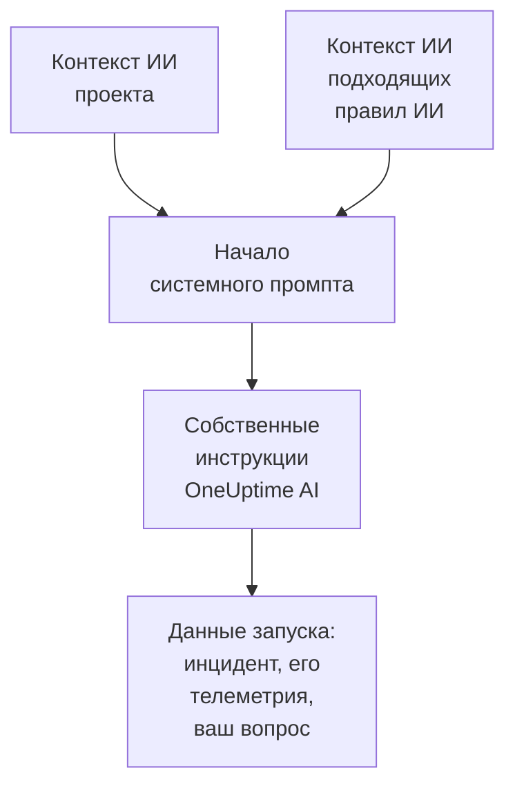

# Контекст ИИ

Контекст ИИ — это то, что ваша команда записывает для OneUptime AI о ваших собственных системах: как они связаны между собой, кому принадлежит какой симптом, где лежат логи и какие слова использует ваша команда. OneUptime AI читает его первым в каждом расследовании, каждом исправлении, каждом черновике постмортема и каждом разговоре в «Спросить ИИ», поэтому начинает с того, что ваша команда уже знает.

:::cards
- [Написать контекст ИИ](#написать-контекст-ии): Одна карточка в настройках ИИ проекта.
- [Собственные заметки правила ИИ](#собственные-заметки-правила-ии): Заметки о том, что подходит под одно правило.
- [Что его читает](#что-его-читает): Функции, которые его читают, и те, которые не читают.
- [Что прочитал запуск](#что-прочитал-запуск): Каждый запуск показывает заметки, которые он получил.
:::

## Как это работает

OneUptime AI ставит контекст ИИ в самое начало своего системного промпта, перед собственными инструкциями и данными запуска: сначала заметки проекта, затем заметки подходящих правил ИИ. Он читает их как фоновые знания вашей команды. Они не доказывают, что происходит сейчас, и никогда не меняют собственные правила OneUptime AI.

Поскольку заметки идут первыми и не меняются от запуска к запуску, они входят в начало промпта, которое провайдеры кэшируют. Для Anthropic OneUptime помечает системный промпт для кэширования; OpenAI, Azure OpenAI и другие провайдеры, которые кэшируют повторяющееся начало промпта, делают это сами. Заметки, которые не менялись, дешевле прочитать снова.

## Написать контекст ИИ

:::steps
### Откройте AI Features
Откройте **Настройки проекта → ИИ → AI Features**. Карточка **Контекст ИИ** находится под **Включить ИИ**.

### Напишите заметки
Нажмите **Добавить контекст ИИ** или, когда заметки уже есть, **Редактировать**. Пишите в Markdown или нажмите **Начать с плана**, чтобы получить заголовок для каждого вида заметок.

### Сохраните их
Нажмите **Сохранить изменения**. Карточка показывает заметки, их длину и примерно сколько токенов модель на них тратит.
:::

Напишите то, что вы рассказали бы новому человеку в команде:

| Вид заметки | Например |
| --- | --- |
| Как связаны ваши системы | `checkout-api` обслуживает страницу оплаты и зависит от `payments-db`. |
| Кому принадлежит какой симптом | Ошибка 502 на странице оплаты — дело команды платежей: сначала проверьте `payments-db`. |
| Где лежат логи | Логи оплаты лежат в Loki под `app=checkout`. |
| Слова вашей команды | PSP — это наш платёжный провайдер. |

> [!WARNING]
> Не записывайте секреты: любой, кто видит, что сделал запуск ИИ, может прочитать заметки, которые он получил.

## Собственные заметки правила ИИ

У правила ИИ могут быть собственные заметки об инцидентах или оповещениях, которые под него подходят: сервисы одного продукта, кто ими владеет, где лежат их логи. Напишите их в поле правила **Контекст ИИ**, в разделе **Дополнительные поля**, после **Поставщик LLM**. Правило, которое каждый раз только запускает свои ранбуки, ни о чём не просит OneUptime AI, поэтому писать для него контекст ИИ не нужно.

- Расследование читает заметки проекта, затем заметки каждого включённого правила ИИ, которое расследует и подходит под инцидент или оповещение, в порядке названий правил.
- Исправление читает заметки проекта, затем заметки своего правила.
- Разговор об инциденте или оповещении читает те же заметки, что и его расследование.

## Что его читает

| Функция | Что она читает |
| --- | --- |
| Расследования AI SRE и их повторные проверки, когда открывается новое оповещение | Заметки проекта и заметки подходящих правил ИИ |
| Исправления, которые запускает правило ИИ: их планы, команды и серверы MCP | Заметки проекта и заметки правила |
| «Спросить ИИ» и разговор об инциденте или оповещении | Заметки проекта; для инцидента или оповещения также заметки подходящих правил ИИ |
| Ответы в Slack и Microsoft Teams | Заметки проекта |
| Черновики постмортемов для инцидентов и эпизодов | Заметки проекта |
| Разбор в AI Insights и оценка кейсов безопасности | Заметки проекта |

Вызовы, которые лишь пересказывают или оценивают то, что получили, его не читают: черновики заметок и публичных заметок, сводки звонков, сводка, уверенность и оценка расследования, а также заголовок разговора. Не читают его и промпты, которые люди пишут сами, в шаге ИИ рабочего процесса.

## Ограничения

| Что | Не больше |
| --- | --- |
| Контекст ИИ проекта | 20 000 символов |
| Контекст ИИ правила ИИ | 5 000 символов |
| Весь контекст ИИ, который читает один запуск | 30 000 символов |

Форма считает символы, пока вы печатаете, и не даёт сохранить текст сверх ограничения, как и API. Запуск сначала читает заметки проекта, затем заметки каждого подходящего правила в порядке их названий. Правило, заметки которого вывели бы запуск за пределы 30 000 символов, пропускается целиком, и активность запуска об этом сообщает.

Число токенов — это оценка: размер заметок в байтах UTF-8, делённый на 4 и округлённый вверх. Каждая модель считает токены по-своему, поэтому счёт провайдера может отличаться, сильнее всего для текста не на английском.

## Что прочитал запуск

Каждый запуск дословно сохраняет заметки, которые он прочитал. Его активность сообщает **Прочитан контекст ИИ проекта** или сколько правил ИИ он прочитал вдобавок, с примерным числом токенов. **Просмотр** открывает заметки так, как их прочитал запуск: сначала заметки проекта, затем заметки каждого правила под его названием, даже если их потом изменили. Если заметки правила были пропущены из-за ограничения запуска, об этом сообщает предупреждение.

## Кто может его менять

- **Project Owner** и **Project Admin** могут менять контекст ИИ проекта. **Project Member**, **Viewer** и **Read Project** могут его читать.
- Заметки правила ИИ — часть правила: кто может менять правило, может менять и их.
- Заметки читаются только для их собственного проекта: ни один запуск не читает контекст ИИ другого проекта.

Через API или Terraform заметки проекта — это поле проекта `aiContext`, а заметки правила ИИ — собственное поле правила `aiContext`.

## Дальнейшие шаги

:::cards
- [AI SRE](/docs/ai/ai-sre): Пусть OneUptime AI расследует каждый новый инцидент и каждое новое оповещение.
- [Спросить ИИ](/docs/ai/ask-ai): Спрашивайте о данных вашего проекта в разговоре.
- [Провайдеры LLM](/docs/ai/llm-provider): Выберите модель, которая читает заметки.
:::
