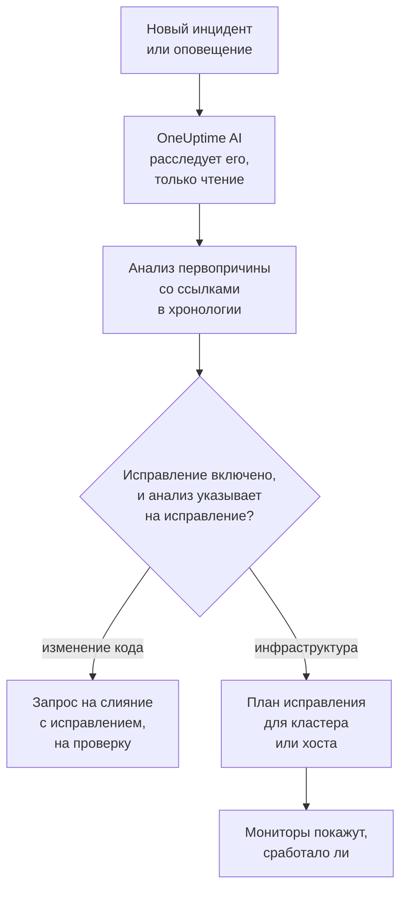
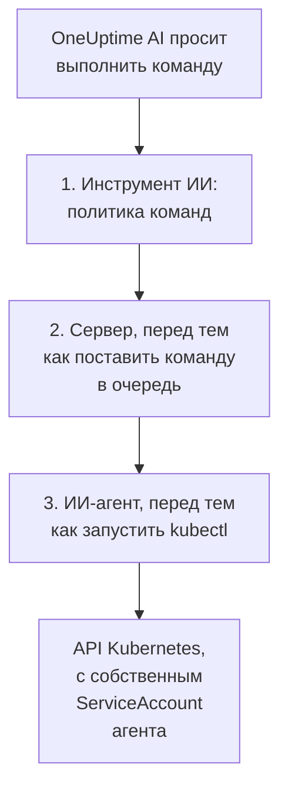

# AI SRE

OneUptime AI — ваш инженер по надёжности сайтов (SRE) на базе ИИ. Как только объявляется новый инцидент или оповещение, он приступает к работе, расследует его по вашей собственной телеметрии — журналам, метрикам, трассировкам, исключениям, мониторам и недавним изменениям — и публикует анализ первопричины со ссылками на источники в хронологии инцидента или оповещения, обычно ещё до того, как дежурный дочитает уведомление.

Каждое утверждение в анализе снабжено ссылкой, которая ведёт прямо к тем данным, на которые оно опирается, а само расследование **строго только для чтения**: во время расследования OneUptime AI никогда не может ничего изменить в вашем проекте.

:::cards
- [Как это работает](#как-это-работает): От нового инцидента к анализу со ссылками, а если вы разрешите, и к исправлению.
- [Включение ИИ-расследований](#включение-ии-расследований): Переключатели и то, что им нужно.
- [Доступ к кластеру — пусть OneUptime AI выполняет kubectl](#доступ-к-кластеру-пусть-oneuptime-ai-выполняет-kubectl): Расследование и исправление внутри Kubernetes.
- [Контроль затрат](#контроль-затрат): Лимиты для инцидентов, для оповещений и для всего проекта.
:::

## Как это работает

Для нового инцидента или оповещения OneUptime AI делает три вещи, и у каждой свой переключатель:

- **Расследует** (по умолчанию включено). Читает вашу телеметрию, а также кластеры и хосты, где работает ИИ-агент, и публикует анализ первопричины со ссылками. Расследование ничего не меняет.
- **Исправляет** (по умолчанию выключено). Когда исправление включено, уверенный анализ превращается в исправление: запрос на слияние с изменением вашего кода или план команд для кластера или хоста, выполняемый так, как разрешает ИИ-агент этого кластера или хоста.
- **Учится.** Страницы AI Insights показывают, что раз за разом идёт не так, на основе всего, что было записано.



Анализ, который не нашёл причины, публикуется тихо, никого не оповещая (см. [Тихий режим](#тихий-режим)), и без причины ничего не исправляется.

## Что публикует расследование

Когда расследование завершается, OneUptime AI публикует анализ первопричины со следующими разделами:

- **Summary** — одно-два предложения, которые оповещённый инженер прочитает за пять секунд.
- **Most likely root cause** — гипотеза ровно с той уверенностью, которую дают доказательства, и со ссылкой для каждого фактического утверждения. Если телеметрии недостаточно, ИИ прямо говорит об этом и перечисляет, что проверил, вместо того чтобы гадать.
- **Evidence** — ключевые находки, подтверждающие или исключающие гипотезу, каждая со ссылкой.
- **Suggested next steps** — конкретные действия для дежурного.

Для инцидентов анализ публикуется в ленте инцидента **и** как внутренняя заметка инцидента (где совместно работают те, кто его разбирает). Для оповещений он публикуется в ленте оповещения.

Пока идёт расследование, на странице инцидента или оповещения в реальном времени отображается панель **AI Investigation**, которая описывает каждый шаг — какие инструменты запускались, что они нашли и сколько времени заняли, — так что вы видите ход его рассуждений. Если расследование завершается ошибкой, панель показывает её причину, а не молчаливый пробел.

Расследование идёт, пока не завершится: у него **нет лимита времени** и нет маленького бюджета запросов, поэтому оно может выполнить любой запрос и любую команду kubectl или инфраструктуры, какая ему нужна. Длинный вывод команды (`kubectl describe node` нагруженного узла, журналы пода) никогда не обрезается — OneUptime AI читает его постранично. Если нужна жёсткая остановка, задайте **лимит времени расследования** для каждого типа сигнала (см. **Контроль затрат** ниже).

## Что читает расследование

Расследование начинается с инцидента или оповещения и с инфраструктуры, с которой он связан: хостов, хостов Docker и Podman, кластеров Kubernetes, баз данных и сервисов, за которыми следят его мониторы. Монитор сайта, API или синтетический монитор следит за тем, с чем вы его связали в **Монитор → Обзор → Связанные ресурсы**, поэтому свяжите его с хостами, которые обслуживают то, что он проверяет, и каждое расследование его инцидентов начнётся там.

- Оповещения в этой инфраструктуре, открытые за 30 минут до инцидента или всё ещё открытые, сначала самые новые, например оповещение о высокой загрузке CPU хоста, стоящего за медленным сайтом. Частные оповещения не включаются.
- Собственные метрики инфраструктуры, прочитанные так, как их читают люди. Метрики хоста, такие как `system.cpu.utilization` и `system.memory.utilization`, передаются отдельно для каждого состояния, и состояния в сумме дают 100 %, поэтому одно среднее по всем ничего не говорит. OneUptime AI читает их по одному состоянию (занятый CPU — это user плюс system) и любую метрику по контейнеру, по точке монтирования или по любому другому атрибуту.
- Контейнеры хоста Docker или Podman: самые загруженные по CPU, памяти или перезапускам и те, что перестали присылать данные. Остановленный контейнер присылает не ноль, а ничего, поэтому цифры по всему хосту его скрывают.
- Изменения, записанные за 2 часа до инцидента или оповещения, — развёртывания, выкатки в Kubernetes, изменения конфигурации и исправления, выполненные OneUptime, — и то, какие из них телеметрия его сервисов делает подозреваемыми: сервис, работа которого заметно ухудшилась сразу после изменения. См. [Развёртывания и изменения](/docs/telemetry/change-events).

Активность расследования на карточке **AI Investigation** показывает, сколько открытых или недавних оповещений оно прочитало и на каких ресурсах.

### Повторная проверка, когда открывается новое оповещение

Расследование начинается в момент объявления инцидента, а оповещение хоста, которому нужно несколько минут метрик, может открыться позже. Когда оповещение открывается в связанной с инцидентом инфраструктуре в течение 30 минут после инцидента, уже после того, как расследование её прочитало, а инцидент всё ещё открыт, OneUptime AI проверяет инцидент ещё раз с этим оповещением на руках. Новый анализ начинается с **Checked again** и оповещения, из-за которого проверка состоялась, и его активность говорит то же самое.

Это происходит не больше одного раза на инцидент, с теми же переключателями и лимитами, что и у нового расследования: **Включить ИИ**, _Расследовать новые инциденты_, кредиты ИИ, а также дневные лимиты и лимиты одновременных расследований. Ничего включать не нужно. Повторная проверка никогда не запускает автоматическое исправление снова и сама никогда не проверяется повторно, а расследование оповещения повторно не проверяется.

## Поговорите с OneUptime AI об инциденте

Карточка **AI Investigation** заканчивается разговором — **Ask OneUptime AI**, — который видят все, кто может видеть инцидент или оповещение. Это одна карточка, что бы ни происходило выше: под отчётом вы задаёте уточняющие вопросы, а если автоматическое расследование не запускалось (или остановилось до отчёта), первое предложение — **What is the root cause?**, по которому OneUptime AI проводит расследование по запросу.

- **Задавайте уточняющие вопросы** — «какие поды потребляют больше всего памяти?», «что изменилось прямо перед началом?», «затронуто ли что-то ещё?». OneUptime AI опирается на свой отчёт, запрашивает свежие данные (и выполняет команды kubectl или инфраструктуры только для чтения там, где у него есть доступ, — на тех кластерах и ресурсах, которые вам разрешено просматривать) и подкрепляет ссылкой каждое утверждение.
- **Попросите его действовать** — «подтверди этот инцидент», «опубликуй обновление статуса о том, что мы разбираемся», «оповести дежурного по базе данных», «повысь серьёзность». Он использует те же действия, что и Спросить ИИ, и всегда действует **с вашими собственными правами**, поэтому никогда не сможет сделать больше, чем могли бы вы.
- **Выберите, как он действует**, переключателем в поле сообщения, рядом с которым написано, что означает выбранный режим: _Auto-run_ (по умолчанию — на ясную просьбу он действует сразу), _Ask to act_ (сначала показывает карточку подтверждения, которую любой участник инцидента может одобрить или отклонить) или _Только чтение_.
- **Одна общая ветка.** У каждого вопроса видно, кто его задал, все видят один и тот же разговор в реальном времени, и любой может остановить ответ, пока он формируется. Графики и таблицы в ответе показываются тому, кто спросил; остальные видят ответ со ссылками. Каждый ответ перечисляет свои **Источники**, а источник со своей страницей (журналы, метрики, монитор) её открывает. Длинная ветка открывается на самых новых сообщениях, а кнопка над ними (например, **Show 6 earlier messages**) возвращает остальные.

## Включение ИИ-расследований

Автономные расследования **включены по умолчанию для новых проектов**. Как и черновики постмортемов и AI Insights. Исправление по умолчанию выключено, как и запросы на слияние, которые входят в него (см. [Автоматические исправления кода](#автоматические-исправления-кода)). Проект, созданный до появления этого значения по умолчанию, сохраняет свою настройку; включите расследования, как в шаге 3, или кнопкой **Включить** на странице **ИИ-агент** любого кластера Kubernetes (Project Owner или Project Admin). Чтобы проверить или изменить их:

:::steps
1. **Настройте провайдера LLM.** Самостоятельно размещённые установки используют собственный ключ (или работают полностью изолированно с локальной Ollama) — см. [Провайдеры LLM](/docs/ai/llm-provider). Пользователи OneUptime Cloud могут использовать предварительно настроенного глобального провайдера, который тарифицируется как учтённые токены ИИ, поэтому проекту нужны кредиты ИИ: владелец проекта или сотрудник с правом **Manage Billing** добавляет их в **Настройки проекта → ИИ → Кредиты ИИ**, где **Автопополнение** не даёт им закончиться.
2. **Убедитесь, что ИИ включён для проекта** (по умолчанию так и есть): **Включить ИИ** в **Настройки проекта → ИИ → AI Features**.
3. **Выберите для каждого типа сигнала** (в новых проектах включено и то и другое):
   - Инциденты: **Инциденты → ИИ → Настройки** — включите _Расследовать новые инциденты_.
   - Оповещения: **Оповещения → ИИ → Настройки** — включите _Расследовать новые оповещения_.
:::

Каждое поведение ИИ на этих страницах — это переключатель, который сохраняется сразу, как только вы его переключите; кнопки «Сохранить» нет. На странице инцидентов их три, в разделе **Что делает OneUptime AI**: _Расследовать новые инциденты_, _Автоматически исправлять новые инциденты_ и _Готовить черновик постмортема, когда инцидент решён_. На странице оповещений те же, но без постмортема. _Автоматически исправлять новые инциденты_ (и _Автоматически исправлять новые оповещения_) по умолчанию **выключено**, в том числе для новых проектов: этот переключатель позволяет OneUptime AI менять вашу инфраструктуру, поэтому проект включает его сам — см. [Какие инциденты расследуются и исправляются](#какие-инциденты-расследуются-и-исправляются). В него входят ещё два переключателя, которые отображаются под ним, пока он включён: _Открывать запрос на слияние с исправлением, когда расследование находит изменение в коде_ и _Открывать запрос на слияние, который добавляет недостающую телеметрию_. Включение исправления включает оба, выключение — выключает оба; пока исправление включено, выключите тот из них, который вам не нужен. Project Owners и Project Admins могут их менять; для всех остальных каждый переключатель заблокирован и сообщает, какое право для него нужно.

Страницы сообщают о двух вещах, только когда это правда. Если **Включить ИИ** выключено, на них ничего не работает, и страница говорит об этом вверху, показывая сам переключатель «Включить ИИ» тем, кто может его менять (Project Owners и всем, у кого есть Manage Billing); остальным сообщается, кто может. Если у проекта нет провайдера LLM, которого может использовать OneUptime AI, — нет совсем или провайдеры есть, но ни один не выбран по умолчанию, — страница говорит и об этом, со ссылкой на **Настройки проекта → ИИ → Провайдеры LLM**. В OneUptime Cloud глобальный провайдер учитывается, поэтому там ничего не сообщается.

Инциденты и оповещения настраиваются независимо, так что каждому типу сигнала можно задать свой лимит параллельных расследований, дневной бюджет токенов, бюджет задач исправления и политику последующих запросов на слияние. Ни один из этих лимитов не действует, пока вы его не зададите, — они свёрнуты в **Дополнительные настройки** внизу каждой страницы; см. **Контроль затрат** ниже. Изменение настройки ИИ для оповещений не меняет соответствующую настройку для инцидентов, и наоборот.

Исправление опирается на расследования: пока **Автоматически исправлять новые инциденты** (или оповещения) включено, **Открывать запрос на слияние с исправлением, когда расследование находит изменение в коде** позволяет расследованию, уверенно определившему нужное изменение кода в репозитории, автоматически открыть запрос на слияние с исправлением — см. **Автоматические исправления кода** ниже.

## Доступ к кластеру — пусть OneUptime AI выполняет kubectl

Изначально расследование может использовать только телеметрию, которую присылают ваши агенты. Для сигнала Kubernetes этого часто мало: «поды зависли в Pending» — это проблема планирования, которую диагностируют, описывая под и читая его события, а не глядя на метрику. **ИИ-агент Kubernetes** позволяет OneUptime AI сделать именно это, а если вы разрешите, то и исправить найденное.

На странице каждого кластера в боковом меню есть раздел **ИИ**:

- **Агент** — страница кластера **ИИ-агент**: подключён ли агент, что ИИ может делать в кластере и всё, что требует внимания, — для каждого пункта указан шаг, который это исправляет. То же пояснение появляется на панели расследования инцидента, когда ИИ пришлось расследовать только по данным OneUptime.
- **Аналитика** — страница кластера **AI Insights**: что OneUptime AI выяснил о кластере — что раз за разом идёт не так и почему, и что с этим делать (см. [Что ИИ узнал о кластере](#что-ии-узнал-о-кластере)).
- **Журналы** — страница кластера **Журналы ИИ**: всё, что OneUptime AI делал в кластере, от новых к старым (см. [Всё, что ИИ сделал в кластере](#всё-что-ии-сделал-в-кластере)).

Страница **Обзор** кластера заканчивается карточкой **ИИ-агент**, которая кратко повторяет страницу ИИ-агента: подключён ли агент, включено ли **Расследование с помощью kubectl**, как выполняются исправления (**Выключено**, **Запрашивать подтверждение**, **Автоматически** или **Без подтверждения**) и что требует внимания, со ссылкой на страницу ИИ-агента, где всё это меняется.

### ИИ-агент Kubernetes — включён по умолчанию, только чтение

Чарт [агента Kubernetes от OneUptime](/docs/telemetry/kubernetes-agent) по умолчанию запускает ИИ-агент Kubernetes: один небольшой под (`component=ai-agent`, образ `oneuptime/kubernetes-ai-agent`) с ServiceAccount **только для чтения**. Он подключается с ключом API, который чарт уже использует, поэтому в панели управления ничего настраивать не нужно: в течение минуты страница ИИ-агента кластера показывает его как **Подключено**, а **Расследование с помощью kubectl** включено — если только кто-то уже не выбрал там настройки ИИ для кластера; они сохраняются как есть.

Если агент был установлен до появления ИИ-агента Kubernetes, сначала обновите индекс чартов, а затем выполните обновление:

```bash
helm repo update
helm upgrade kubernetes-agent oneuptime/kubernetes-agent \
  --namespace oneuptime-agent --reset-then-reuse-values \
  --set aiAgent.enabled=true
```

`kubernetes-agent` в `oneuptime-agent` — это имя релиза и пространство имён из инструкций по установке в панели управления; если вы устанавливали агент с другими именами, используйте свои (`helm list -A | grep kubernetes-agent` их покажет). Без `helm repo update` Helm может взять чарт, из которого вы устанавливали, который не знает `aiAgent` и завершается ошибкой `Additional property aiAgent is not allowed`. В самостоятельно размещённом OneUptime сначала обновите OneUptime, а потом чарт — см. [Обновление агента](/docs/telemetry/kubernetes-agent#обновление-агента). Чтобы запустить чарт без ИИ-агента, передайте `--set aiAgent.enabled=false`.

**Проверить подключение** в меню **⋯** рядом со статусом агента на странице ИИ-агента выполняет через агента `kubectl version` и `kubectl auth can-i --list` и показывает результаты: до чего он может дотянуться и что ему разрешено. Если страница говорит, что агент не подключён, прочитайте его журнал командой `kubectl logs -n oneuptime-agent -l component=ai-agent --tail=100`. Ключ с заданным **Pinned Service Name** не может зарегистрировать агента — дайте чарту ключ без него. Когда сервер отклоняет регистрацию, журнал сообщает, снимется ли отказ сам (предыдущий под агента ещё отчитывается или старый Runner в кластере ещё завершает работу во время обновления) или что нужно изменить. **Сбросить агент** в том же меню заставляет сервер забыть ключ агента после вашего подтверждения; под переподключается сам в течение нескольких минут.

ИИ-агент Kubernetes — не Runner и никогда не появляется в разделе Сборники инструкций → Агенты runbook-ов. Он всегда использует только собственный ServiceAccount, поэтому OneUptime никогда не передаёт ему учётные данные, он никогда не используется как хост Bash/SSH для runbook-ов и никогда не принимается как Runner команд для правила автоисправления.

### Что может делать ИИ — задаёт агент

Что OneUptime AI может делать в кластере, задаётся там, где работает агент, — в чарте, двумя значениями:

- `aiAgent.investigation` — `true`: во время расследования ИИ может выполнять kubectl только для чтения в кластере. `false`: он всё равно расследует, но по данным, которые уже есть у OneUptime.
- `aiAgent.fixes` — как ИИ применяет исправление: `off`, `ask-for-approval`, `automatic` или `bypass-approval` (см. [Как работают исправления](#как-работают-исправления)). Любой уровень, кроме `off`, даёт ИИ-агенту доступ на запись; с `off` у него доступа нет, и он сам отклоняет любую запись.

ИИ-агент сообщает оба значения OneUptime при каждом heartbeat, и OneUptime применяет их к кластеру. **Что может делать ИИ** на странице ИИ-агента кластера показывает их — **Включено** и уровень исправлений, зелёным, когда они включены, — без возможности изменить их там; **Изменить** показывает каждый вариант с точной командой `helm upgrade`, которая его задаёт. Изменение, сделанное в любом другом месте — на странице ИИ-агента, через API или Terraform, — отклоняется, пока их задаёт агент.

Релиз, в котором не задано ни одно из двух значений, позволяет агенту использовать свои значения по умолчанию (расследование включено; исправления выключены или ask-for-approval со старым `aiAgent.remediation.enabled=true`). OneUptime применяет эти значения по умолчанию только к кластеру, для которого никто не выбирал настройки ИИ на его странице ИИ-агента: выбранные там настройки сохраняются как есть, а страница показывает команду, которая переносит их в чарт. Так же и для кластера, чей ИИ-агент слишком старый, чтобы их сообщать, — обновление чарта с этими двумя значениями переносит их.

### Пусть ИИ исправляет найденное

Исправления выключены, пока вы не включите их через `aiAgent.fixes`, что заодно даёт ИИ-агенту доступ на запись — в идеале только в тех пространствах имён, которые ИИ может исправлять, и с выключенными операциями над узлами:

```bash
helm repo update
helm upgrade kubernetes-agent oneuptime/kubernetes-agent \
  --namespace oneuptime-agent --reset-then-reuse-values \
  --set aiAgent.enabled=true \
  --set aiAgent.investigation=true \
  --set aiAgent.fixes=ask-for-approval \
  --set "aiAgent.remediation.namespaces={web,api}" \
  --set aiAgent.remediation.nodeOperations=false
```

Или на весь кластер:

```bash
helm repo update
helm upgrade kubernetes-agent oneuptime/kubernetes-agent \
  --namespace oneuptime-agent --reset-then-reuse-values \
  --set aiAgent.enabled=true \
  --set aiAgent.investigation=true \
  --set aiAgent.fixes=ask-for-approval \
  --set-json 'aiAgent.remediation.namespaces=[]'
```

Замените `{web,api}` на пространства имён, которые ИИ может исправлять. Каждое указанное пространство имён уже должно существовать: чарт создаёт в каждом по одному RoleBinding и никогда не создаёт пространства имён, поэтому отсутствующее пространство приводит к ошибке всей установки или всего обновления — вместе с коллектором — с текстом `namespaces "api" not found`. Сначала создайте его или уберите из списка; убирайте пространство имён из списка до того, как удалите его. Если при обновлении не указать флаг, сохранённый в релизе список останется прежним, поэтому, чтобы вернуться к работе на весь кластер, передайте `--set-json 'aiAgent.remediation.namespaces=[]'` (Helm 3.10+), как во второй команде, — а не `={}`, которое Helm читает как одно пустое имя, а чарт отклоняет. `--set aiAgent.remediation.namespaces=null` не сбрасывает сохранённый список при `--reuse-values`: Helm сохраняет прежний список. `aiAgent.remediation.nodeOperations=false` не подпускает исправления к узлам; установите `true`, чтобы ИИ мог выводить узлы из планирования, возвращать их, освобождать и ставить на них taints (drain, taint или patch узла по-прежнему ждут человека).

Для большей самостоятельности используйте `automatic` или `bypass-approval` вместо `ask-for-approval`, а `--set aiAgent.fixes=off` снова выключает исправления и заодно убирает доступ на запись. Исправлениям нужны ещё два переключателя проекта. **Автоматически исправлять новые инциденты** (в **Инциденты → ИИ → Настройки**) и **Автоматически исправлять новые оповещения** (в **Оповещения → ИИ → Настройки**) по умолчанию выключены: пока ни один из них не включён, ничего нового этого вида не исправляется. **Включить ИИ** (**Настройки проекта → ИИ → AI Features**) включён, если его никто не выключал; он выключает весь ИИ для проекта, что бы ни говорила конфигурация агента.

### На какие инциденты действуют исправления кластера

Пока **Автоматически исправлять новые инциденты** включено и не настроено ни одного правила автоисправления, OneUptime AI исправляет каждый новый инцидент, с которым связан кластер, в режиме, заданном на странице его ИИ-агента, — и так же оповещения с **Автоматически исправлять новые оповещения**. При наличии правил он исправляет только инциденты, которым соответствует правило, исправляющее с помощью OneUptime AI (см. [Какие инциденты расследуются и исправляются](#какие-инциденты-расследуются-и-исправляются)). То, с чем он не связан, он не трогает, как бы явно причина ни находилась в кластере. Инцидент или оповещение связаны с кластером, когда:

- телеметрия, по которой они возникли, называет кластер (монитор метрик, журналов или трассировок по данным кластера);
- их монитор — это монитор Kubernetes этого кластера;
- их монитор связан с кластером в **Монитор → Обзор → Связанные ресурсы** — так связывают монитор сайта, API или синтетический монитор с кластером, который обслуживает то, что он проверяет;
- кто-то выбрал кластер в **Другие затронутые ресурсы** при объявлении (выбор связанного монитора добавляет его туда за вас).

Каждый инцидент и оповещение сообщает на карточке **Исправление**, был ли он связан с кластером и что сделали исправления кластера; см. [Что сделало автоисправление](#что-сделало-автоисправление). То же верно для инфраструктурного ресурса и его ИИ-агента.

### Кто может это менять

Пока расследование и исправления задаёт ИИ-агент Kubernetes, их меняет тот, кто может менять значения чарта в кластере; изменение, сделанное где-либо ещё, OneUptime отклоняет. Правила ниже относятся к тому, что остаётся в OneUptime, — списку разрешённых команд kubectl и привязке Runner-а и учётных данных, — а также к расследованию и исправлениям в кластере, чьи настройки всё ещё задаются в OneUptime (см. [Что может делать ИИ — задаёт агент](#что-может-делать-ии-задаёт-агент)).

Включение исправлений — любой переход из **Выключено** в другой режим — и их ослабление — переход на **Автоматически** или **Без подтверждения**, запись списка разрешённых команд kubectl, привязка Runner-а или учётных данных либо снятие этой привязки с кластера, у которого есть ИИ-агент Kubernetes, — требуют Project Owner, Project Admin или права **Edit Auto Remediation Rule**, то есть тех же людей, которые могут создать полностью автоматическое правило исправления. Привязка учётных данных требует также права **Read Runbook Credential**, если вы не Project Owner и не Project Admin. **Сбросить агент** требует тех же людей, что и включение исправлений. Ужесточение — **Выключено**, возврат к **Запрашивать подтверждение**, очистка списка разрешённых — доступно любому, кто может редактировать кластер, как и **Проверить подключение** и одобрение исправления, которое OneUptime AI предлагает для этого кластера. Всё это требует права редактировать именно этот кластер: разрешение, ограниченное некоторыми метками или кластерами, которыми владеете вы или ваши команды, распространяется только на эти кластеры, а блокирующая запись с метками убирает кластеры с этими метками.

### Что может выполнять расследование

При наличии доступа расследование выполняет kubectl **только для чтения** через ИИ-агента — `get`, `describe`, `logs`, `events`, `top`, `rollout status/history`, `auth can-i` — столько команд, сколько нужно, и ссылается на каждую команду, как на любое другое доказательство. Вывод никогда не обрезается: агент сохраняет до мегабайта, а OneUptime AI читает длинный вывод постранично. Три независимые проверки удерживают его в режиме только для чтения: политика, классифицирующая каждую команду, сервер, который отказывается ставить в очередь для расследования что-либо иное, и ИИ-агент, который повторно проверяет ту же политику перед запуском kubectl. «Только чтение — в ваших системах ничего не изменено» остаётся буквально верным.



### Как работают исправления

У **Исправления** на странице ИИ-агента четыре настройки (`aiAgent.fixes` в чарте: `off`, `ask-for-approval`, `automatic`, `bypass-approval`):

- **Выключено** — ИИ только расследует.
- **Запрашивать подтверждение** — после анализа первопричины OneUptime AI ставит диагноз с помощью kubectl и составляет минимальный план kubectl, устраняющий причину, например `kubectl rollout restart deployment/web -n web`. План появляется в инциденте вместе с обоснованием, ожидаемым эффектом и откатом; человек одобряет его одним щелчком, и OneUptime выполняет ровно эти команды. Если мониторы не восстанавливаются, выполняется откат, и OneUptime AI составляет ещё один план — снова на подтверждение — с учётом неудачной попытки, чтобы выбрать другой подход или сказать, на что стоит посмотреть человеку.
- **Автоматически** — безопасные изменения выполняются сами; более рискованные — никогда. Если раунд нашёл только более рискованные исправления, он завершается тем, что предлагает именно их на подтверждение одним щелчком. Если он выполнил и безопасное исправление, более рискованное остаётся в анализе и предлагается, только если проверка покажет, что безопасное исправление не восстановило мониторы, — уже последующим раундом, который запрашивает подтверждение. Добавьте шаблон более рискованной команды в список разрешённых на странице ИИ-агента, и она тоже будет выполняться сама. Автоматический режим также закрывает сигнал, как только проверка подтверждает восстановление мониторов, и ограничен предохранителем — три исправления без присмотра на кластер в час: сверх этого, а также пока другой раунд OneUptime AI без присмотра ещё меняет или проверяет тот же кластер, раунд предлагает свой план на подтверждение вместо выполнения.
- **Без подтверждения** — ИИ не спрашивает. Каждое изменение, которое разрешает политика, включая более рискованные, выполняется само, как и последующий раунд после неудачной проверки; сигнал закрывается сам, как только проверка подтверждает восстановление. То, что во всех режимах требует человека (см. ниже), по-прежнему его ждёт. Раунд также предлагает свой план на подтверждение вместо выполнения и объясняет причину в инциденте, когда:
  - сработал часовой предохранитель (три исправления без присмотра на кластер в час) или его невозможно проверить;
  - другой раунд OneUptime AI без присмотра ещё меняет тот же кластер или ещё проверяет на нём исправление — обычно это оповещение и инцидент от одного монитора, — или это невозможно проверить;
  - это последующий раунд после исправления, откат которого не завершился.

**Сначала откат.** Если OneUptime пометил выкатку в Kubernetes на этом кластере как подозреваемую для инцидента (см. [Развёртывания и изменения](/docs/telemetry/change-events)), OneUptime AI пытается откатить её раньше любого другого исправления. OneUptime строит `kubectl rollout undo` по записанному изменению и никогда — по тому, что пишет модель, а команда выполняется или ждёт подтверждения, как любое безопасное изменение в режиме этого кластера. Откат не предлагается, если Deployment снова изменился после этой выкатки: тогда он отменил бы более позднее изменение.

**Безопасное** изменение затрагивает ровно один названный объект: `rollout restart/undo/pause/resume`, `scale` (до любого значения, кроме 0), удаление названного пода, `cordon`/`uncordon`, а также `label`/`annotate` для одного названного Pod, Deployment, StatefulSet, DaemonSet, ReplicaSet, Job или CronJob с обычным ключом (не зарезервированным вроде `*.kubernetes.io/…` или `*.k8s.io/…`). Всё остальное, что разрешает политика, — **более рискованное**: те же глаголы для вида ресурса без имени (`rollout restart deployment`), для нескольких объектов, с селектором или с `--all`; `scale` до 0; удаление job; `taint`; `drain`; `patch`; `set image/env/resources`; `create`; удаление с `--force`; а также метки или аннотации на любом другом виде ресурса или с зарезервированным ключом.

Некоторые границы действуют в **любом** режиме, включая Без подтверждения, и никакая запись в списке разрешённых их не меняет:

- Запись в **kube-system**, **kube-public** или **kube-node-lease** всегда требует человека. Пользовательский ресурс оценивается по пространству имён, в которое он пишется, даже если его имя похоже на встроенный вид уровня кластера (`nodes.example.com`, `namespaces.example.com`).
- `drain`, `taint` или `patch` узла всегда требуют человека. Освобождение узла вытесняет поды во всех пространствах имён — включая три перечисленных выше и собственное пространство агента, — а taint `NoExecute` тоже вытесняет их, ставит ли его `kubectl taint` или `patch` узла.
- ИИ-агент никогда ничего не меняет в собственном пространстве имён — исправление там могло бы смасштабировать до нуля агента Kubernetes или самого ИИ-агента, — ничего вне пространств имён, в которые ему разрешает писать чарт (`aiAgent.remediation.namespaces`), и никаких узлов, если чарт выключил операции над узлами (`aiAgent.remediation.nodeOperations=false`). OneUptime берёт эти границы из того, что сообщает ИИ-агент, и отклоняет такое исправление, когда OneUptime AI его предлагает, и ещё раз, когда кто-то его одобряет, поэтому оно никогда не доходит до ИИ-агента как неудачное исправление; ИИ-агент тоже отклоняет его, прежде чем запустить `kubectl`.
- Деструктивные команды (см. ниже) никогда не выполняются, даже с одобрения человека.

Список разрешённых для автоматического режима сравнивается с разобранной командой слово за словом, а не как произвольный текст: `*` означает ровно одно слово (образ, имя) и никогда — лишние объекты, флаги или второй `-n`, а каждый флаг, который использует команда, должен быть явно записан в записи. `kubectl set image deployment/web * -n web` разрешает новый образ для `web` в `web` — и ничего больше. Запись должна явно называть глагол — и подкоманду `rollout`, `set` или `create`, — а не подставлять вместо него `*`, и должна содержать больше одного слова после необязательного начального `kubectl`; запись, нарушающая эти правила, например `scale` или `kubectl *`, никогда не смогла бы заранее одобрить изменение и отклоняется при сохранении.

:::details Команды, которые никогда не выполняются, и как читается команда
Некоторые команды **никогда** не выполняются, в каком бы режиме ни было и даже с одобрения человека. Их отклоняет политика команд, и она применяется трижды — инструментом сервера, контрольной точкой, через которую сервер ставит команды в очередь, и ИИ-агентом перед запуском `kubectl`: `exec`, `attach`, `cp`, `port-forward`, `proxy`, `debug`, `run`, `edit`, `apply`, `replace`, `diff`, плагины kubectl и любой другой глагол, которого нет в её списке, любой ввод из файла (`-f`, `-k`) или формат вывода, читающий файл (`-o jsonpath-file=`, `-o go-template-file=`, `-o custom-columns-file=`, `--template`, а также голый `-o jsonpath`/`go-template`/`custom-columns` без встроенного шаблона), флаги учётных данных, подмены пользователя (`--as`, `--as-group`, `--as-uid`, `--as-user-extra`), выбора кластера, `--kuberc`, низкоуровневого API и подробного журналирования, объекты Secret с **любым** глаголом — OneUptime AI никогда не читает, не изменяет, не удаляет и не создаёт Secret, а `create secret`, `create token` и `set env --resolve` отклоняются вместе с ними, — всё, что выдаёт RBAC (`create role`, `create clusterrole`, `create rolebinding`, `create clusterrolebinding`, `set subject`), `certificate approve`, `set serviceaccount`, `create deployment`, `create cronjob` или `create job` с `--image` (`create job --from=cronjob/…` остаётся более рискованным изменением), `expose --overrides` или `--override-type` (переопределение может заставить kubectl создать Job, ClusterRoleBinding или объект любого другого вида вместо Service), тело `patch`, не являющееся JSON (kubectl прочитал бы его как YAML, теги которого могут задать поле, невидимое для проверок), патчи, меняющие ServiceAccount, тома или настройки безопасности шаблона пода (включая порты хоста, отказ от пространства имён пользователей `hostUsers` и класс среды выполнения `runtimeClassName`), патчи, заменяющие целую часть шаблона пода вместо задания полей в ней (strategic-merge `$patch: replace`, merge patch, задающий весь список `containers`, или JSON patch, заменяющий или удаляющий спецификацию пода), — что отбросило бы эти настройки, не называя их, — метка или аннотация на объектах Namespace, выбранных через `--all` или селектор, а не по имени, любая запись — `patch`, `label`, `annotate`, `set` — в объекты RBAC, CustomResourceDefinitions, APIServices, конфигурации admission-вебхуков или admission-политики, запись с `--all-namespaces`, `delete --all`, а также удаление пространств имён, узлов, томов, CRD или кластерных ролей. Флаги разбираются так же, как их разбирает kubectl, поэтому запрещённый флаг или вид не спрячется за другим: объединённые короткие флаги разделяются по буквам (`-As` распознаётся), флаги с необязательным значением (`--cascade`, `--dry-run`, `--validate`) никогда не поглощают следующее слово, а любой флаг, кроме `-n`/`--namespace`, `--request-timeout` и `--match-server-version`, должен идти после глагола (и после подкоманды `rollout`, `set`, `create`, `auth`, `cluster-info` и `top`), потому что kubectl выбирает команду до разбора флагов. ИИ-агент поставляется с собственным kubectl фиксированной версии (v1.36.5) и выключает kuberc, поэтому файл kuberc не может добавить значения по умолчанию или псевдонимы к команде после того, как её проверила политика. Каждой команде он выдаёт собственный kubeconfig для своего ServiceAccount, указывающий на смонтированный файл токена, и никогда — копию токена.
:::

### Что ограничивает RBAC ИИ-агента, а что нет

:::details Что выдаёт RBAC чарта
RBAC чарта — это отдельный от политики уровень, и он ограничивает, **куда** может писать ИИ-агент, а не что может сделать запись. Доступ только для чтения (get/list/watch, журналы подов) выдаётся на весь кластер. `aiAgent.remediation.enabled` добавляет patch/update для Deployments, StatefulSets, DaemonSets, ReplicaSets и их подресурса scale, Jobs, CronJobs, Pods и HPA; create для Jobs и HPA; и delete только для Pods и Jobs. `aiAgent.remediation.nodeOperations` (включено по умолчанию) добавляет cordon, uncordon, taint и drain для узлов на весь кластер; установите `false`, и чарт не выдаст RBAC для узлов и сообщит об этом ИИ-агенту (`ONEUPTIME_KUBECTL_ALLOW_NODE_OPERATIONS=false`), который тогда отклоняет cordon, uncordon, drain, taint и label/annotate/patch для узла до запуска kubectl, — а поскольку ИИ-агент сообщает этот переключатель, OneUptime отклоняет такое исправление уже при его предложении или одобрении. Он никогда не выдаёт Secrets, `exec`, `attach`, `port-forward`, токены ServiceAccount, подмену пользователя, CRD или запись RBAC, поэтому удаление ресурса любого другого вида или установка метки на Service, ConfigMap, Ingress, Namespace или PVC завершается на API-сервере ошибкой `Forbidden`, даже если человек это одобрил. Эти два уровня не копируют друг друга: для RBAC `apply`, `edit`, `replace`, запись с `--all-namespaces` и `delete --all` — обычные вызовы patch, update и delete, и остановить их может только политика.
:::

:::warning Что означает доступ на запись
При этом ясно представляйте, что означает такой доступ на запись: **patch/update для рабочих нагрузок, подов и CronJobs и create для Jobs в пространстве имён равносильны запуску любого образа от имени любого ServiceAccount этого пространства имён и чтению его Secrets.** Шаблон пода может указать любой образ, любой ServiceAccount и любой том Secret, а в RBAC нет глагола «patch, но не шаблон пода» — то, что ни одно правило не называет `exec` или Secrets, этого не меняет. Поэтому политика отклоняет изменение того, с каким ServiceAccount, настройками безопасности, томами, командой или подключением Secrets работает под (патчи безопасности шаблона пода, патчи, заменяющие спецификацию пода или весь список `containers`, `set serviceaccount`, `create … --image`, `expose --overrides`, тела патчей не в JSON), поэтому защищённые пространства имён всегда требуют человека и поэтому существует `aiAgent.remediation.namespaces`. Политика **не** запрещает менять образ: `set image` или патч поля образа — это более рискованное изменение (новый образ работает от имени собственного ServiceAccount рабочей нагрузки, с её Secrets), которое одобряет человек, если только кластер не обходит подтверждения или его список разрешённых не называет эту команду. Без `aiAgent.remediation.namespaces` роль на запись привязывается на весь кластер — включая kube-system, kube-public, kube-node-lease и собственное пространство имён агента, поскольку RBAC не может исключить пространства имён из привязки на весь кластер, — и там границу держат политика и ИИ-агент, а не RBAC. С ним чарт привязывает роль ровно в тех пространствах имён, которые вы перечислили, OneUptime отклоняет запись в любом другом месте при предложении или одобрении, а ИИ-агент отклоняет её ещё раз перед запуском kubectl.
:::

### Что ИИ узнал о кластере

Страница кластера **AI Insights** (ИИ → Аналитика) рассказывает, что стоит знать о кластере по данным последних 30 дней, — не журнал того, что делал ИИ, а то, что он выяснил:

- **Что нашёл OneUptime AI** — несколько самых важных вещей, самое важное первым, у каждой — стоящие за ней инциденты и оповещения и один следующий шаг:
  - проблема, которая возвращается снова и снова: как часто (считается каждый вызванный ею инцидент и каждое оповещение, расследованные или нет) и какую долю от всего это составляет, новая ли она на этой неделе или становится хуже, время суток, когда она обычно начинается (в вашем часовом поясе), какие части кластера она затрагивает, что нашло последнее расследование и первый шаг, который предлагает его отчёт;
  - исправление, которое не решило свою проблему, и исправления, ожидающие вашего подтверждения;
  - риск, замеченный до того, как кого-либо оповестили: открытый [инсайт](#инсайты-упреждающее-обнаружение) серьёзности High или Medium по собственной телеметрии кластера;
  - узел, под, пространство имён или рабочая нагрузка, стоящие за несколькими разными проблемами, со ссылкой на их собственную страницу в кластере;
  - что ИИ исправил сам и удержалось ли исправление, и — если ваша команда одобряла каждое предложенное ИИ исправление — что ИИ мог бы применять такие исправления сам;
  - проблема, которая возвращалась снова и снова и прекратилась после исправления.

  Если ничего не выделяется, страница так и говорит.
- **Другие проблемы** — всё остальное, что рассматривал ИИ, сгруппированное по тому, что это вызвало (один монитор — одна проблема, сколько бы подов или узлов он ни затронул), самое частое первым: как часто, какие пространства имён, рабочие нагрузки, поды или узлы это затрагивает, что нашло и предлагает последнее расследование, что стало с предложенными ИИ исправлениями и что сказали о находках ваша команда и оценка. Проблема, возникавшая больше одного раза, помечается как **Повторяющееся**, **Новое на этой неделе** или **Становится хуже**.
- **Где возникают проблемы** — части кластера, которые встречались чаще всего, и в скольких разных проблемах.
- **Замечено до того, как кого-либо оповестили** — остальные открытые инсайты, которые детекторы завели по собственной телеметрии кластера.
- **Что OneUptime AI сделал здесь** — сноска: сколько было расследований, исправлений и команд и сколько из них завершились неудачей, расследования по дням, чем закончились предложенные ИИ исправления и решили ли проблему применённые, а также что пошло не так в собственной работе ИИ (неудачные расследования, команды, которые агент так и не забрал, находки, отклонённые вашей командой), для каждого пункта — где смотреть.

Если для проекта выключено **Включить ИИ** или нет провайдера LLM, которого может использовать OneUptime AI, страница сообщает об этом вверху: ничего нового не расследуется, поэтому ничего нового и не появляется.

Всё на странице берётся из того, что OneUptime уже записал, — инцидентов и оповещений, их расследований и выводов, оценок этих выводов, исправлений и команд, — и для её построения не вызывается никакая модель: слова, принадлежащие самому ИИ (находка, предлагаемый шаг), написало расследование, которое их нашло, и они показываются как его слова. Страницу может видеть любой, кто может видеть кластер, и на ней упоминаются только те инциденты и оповещения, которые этому человеку разрешено читать.

### Всё, что ИИ сделал в кластере

Страница кластера **Журналы ИИ** (ИИ → Журналы) — это запись всего, что OneUptime AI там сделал, от новых к старым: каждое расследование с его инцидентом или оповещением и сводкой, каждое предложенное или выполненное исправление с его статусом и каждая команда kubectl — расследования или исправления — с самой командой, её статусом и временем запуска. Сводка расследования — это его TL;DR или, если TL;DR написать не удалось, сводка, с которой начинается его отчёт. Раньше эта страница называлась AI Insights; закладка на её старый адрес теперь открывает страницу AI Insights, которая ссылается сюда.

### Через Runner (для опытных)

Кластер, в котором не запущен чарт, — тот, что отправляет телеметрию Kubernetes иным способом, — может дать OneUptime AI доступ к kubectl через Runner, которым управляете вы (Сборники инструкций → Агенты runbook-ов). Привяжите Runner и учётные данные Kubernetes (URL API-сервера + токен ServiceAccount, в **Сборники инструкций → Агенты runbook-ов → Учётные данные**) к кластеру через API или Terraform (поля кластера **AI Access Runner** и **AI Access Credential**) и включите **Выполняет ИИ-команды устранения** для этого Runner-а. Исправлениям через Runner нужны те же переключатели проекта, что и исправлениям через ИИ-агента: **Включить ИИ** и **Автоматически исправлять новые инциденты** (или оповещения). Чтобы ограничить, куда такой Runner может писать, запустите его с `ONEUPTIME_KUBECTL_WRITE_NAMESPACES` (и `ONEUPTIME_KUBECTL_ALLOW_NODE_OPERATIONS=false`, чтобы не подпускать исправления к узлам): Runner сообщает эти ограничения, поэтому OneUptime отклоняет исправление за их пределами при его предложении или одобрении, ещё до того как оно дойдёт до Runner-а, а Runner отклоняет его ещё раз. Кластер, привязанный к Runner-у, продолжает его использовать, даже если установлен ИИ-агент Kubernetes; тогда страница ИИ-агента показывает, через какой Runner и какие учётные данные идёт работа, и, как только ИИ-агент подключится, предлагает **Переключиться на ИИ-агент** в меню **⋯** рядом со статусом агента.

Кластеры, настроенные с более ранним чартом (`aiAccess.enabled=true`), обращаются к OneUptime AI через прежний Runner внутри кластера, пока чарт не будет обновлён. Обновление заменяет этот Runner ИИ-агентом Kubernetes и переносит его настройки — см. [Обновление агента](/docs/telemetry/kubernetes-agent#обновление-агента).

## Доступ к инфраструктуре — Docker, Podman, Swarm, Proxmox, VMware, Ceph, базы данных и хосты

Такой же доступ есть и для остальной вашей инфраструктуры. ИИ-агент ресурса (образ `oneuptime/resource-ai-agent`) работает рядом с коллектором хоста Docker или Podman, кластера Docker Swarm, кластера Proxmox, VMware vCenter, кластера Ceph или сервера баз данных — или сам по себе на хосте Linux — и позволяет OneUptime AI выполнять там команды только для чтения во время расследования (`docker logs`, `pvesh get`, `govc vm.info`, `ceph health detail`, фиксированный каталог диагностики баз данных, `systemctl status`, `journalctl`, …), а только если вы запустите агента с `ONEUPTIME_AI_ALLOW_WRITES=true` и уровнем исправлений (`ONEUPTIME_AI_FIXES`), — применять исправления в тех же четырёх режимах и с теми же тремя проверками, что и для кластера Kubernetes. Как и для кластера, что ИИ может делать на таком ресурсе, задаётся там, где работает его агент (`ONEUPTIME_AI_INVESTIGATION`, `ONEUPTIME_AI_FIXES`), и показывается только для чтения на странице его ИИ-агента. У каждого такого ресурса есть те же страницы **ИИ-агент**, **Аналитика** и **Журналы**. О том, как их установить, что может выполнять каждый из них и какова их модель безопасности, см. [ИИ-агенты инфраструктуры](/docs/ai/infrastructure-ai-agents).

## Тихий режим

Расследование, которое не может определить причину, публикует анализ в хронологии, **не** уведомляя ваше рабочее пространство Slack/Teams и дежурного. Отсутствие ответа никогда не должно никого будить: анализ доступен, когда кто-то посмотрит, но из-за «неубедительного результата» никого не поднимают. Уверенные анализы уведомляют рабочее пространство как обычно.

Считается ли анализ уверенным, решает проверенный сервером сигнал, а не то, что написано в тексте анализа: расследование, не собравшее доказательств (ни одного успешного запроса телеметрии, ни одной ссылки), всегда считается неубедительным, а в остальных случаях анализ классифицирует отдельная ограниченная проверка. Если сама эта проверка завершается ошибкой, OneUptime AI склоняется к уведомлению — тихий режим при сбое становится громче, но никогда не молчит.

## Автоматические исправления кода

Уверенный анализ, рекомендующий изменить код в репозитории, может пойти на шаг дальше уведомления: он открывает исправление. Переключатель **Открывать запрос на слияние с исправлением, когда расследование находит изменение в коде** входит в исправление: он находится под **Автоматически исправлять новые инциденты** в **Инциденты → ИИ → Настройки** и под **Автоматически исправлять новые оповещения** в **Оповещения → ИИ → Настройки** и открывает запросы на слияние, только пока включён тот переключатель. Оба по умолчанию **выключены**, в том числе для новых проектов; включение исправления включает его, а выключение исправления выключает. Ничего не открывается, пока у проекта нет репозитория, подключённого через GitHub App, и Runner-а с возможностью исправления кода. Тип сигнала, для которого включена эта настройка, автоматически ставит в очередь ту же задачу исправления, что и кнопка **Open Fix PR from this analysis** на панели расследования: задачу ИИ-агента, которая превращает опубликованный анализ в запрос на слияние, готовый к проверке. Кнопка использует ту же рекомендацию и скрыта для анализов, где решение операционное, касается только инфраструктуры, внешнее, ожидаемый отказ, ошибка пользователя или результат неубедителен.

Второй переключатель в составе исправления, **Открывать запрос на слияние, который добавляет недостающую телеметрию**, предназначен для расследований, которые заканчиваются неубедительно, потому что нужных им журналов, трассировок или метрик не было: OneUptime AI открывает запрос на слияние, добавляющий эту инструментацию в затронутые участки кода, на проверку вашей команде. Ему нужен репозиторий, подключённый через GitHub App, и он тоже включается и выключается вместе с исправлением.

Запрос на слияние ничего не меняет, пока ваша команда его не сольёт, но исправление делает больше, чем просто открывает их. Чтобы получать запросы на слияние, но не позволять OneUptime AI менять ваши кластеры или хосты, включите исправление, оставьте **Исправления** выключенными на странице **ИИ-агент** каждого кластера Kubernetes и каждого хоста (выключено — их значение по умолчанию) и не добавляйте правил автоисправления: при включённом исправлении и без правил OneUptime AI исправляет только там, где это разрешает страница ИИ-агента. Правила автоисправления сужают эти исправления и runbook-и, но не запросы на слияние: пока исправление включено, каждое подходящее расследование может открыть такой запрос.

Через API или Terraform это три отдельных поля проекта, и сервер сохраняет то, что вы записали: `enableAutomaticIncidentRemediation` включает исправление, а запросы на слияние открываются, только пока оно включено и их собственное поле тоже включено, — `enableAutomaticIncidentCodeFixes` и `enableIncidentInstrumentationFixTasks` (`enableAutomaticAlertRemediation`, `enableAutomaticAlertCodeFixes` и `enableAlertInstrumentationFixTasks` для оповещений). Сервер сам не включает и не выключает ни одно из них, поэтому, чтобы включить исправление вместе с запросами на слияние, задайте все три в одном запросе.

Та же ограниченная, проверенная сервером классификация, которая определяет уверенность, решает и то, уместно ли изменение в репозитории. Только положительная классификация как исправление кода предлагает или автоматически открывает запрос на слияние. Расследование, не собравшее проверенных сервером доказательств, рекомендующее решение без изменения кода или с неудавшейся классификацией, никогда его не открывает — создание PR при сбое всегда склоняется к бездействию. Всё остальное совпадает с ручной кнопкой: запрос на слияние открывается готовым к проверке, требует репозитория, подключённого через GitHub App, и Runner-а с возможностью исправления кода, учитывается в дневном лимите задач исправления этого типа сигнала и в лимите открытых PR репозитория, если какой-либо из них задан, и одновременно для одного инцидента или оповещения может быть активна не более одной задачи исправления. Само расследование остаётся только для чтения — исправление выполняется как отдельная, полностью журналируемая задача агента. О том, как работают запросы на слияние с исправлениями, включая проверку сборкой и тестами перед открытием каждого запроса, см. [Код](/docs/ai/ai-agent).

## Какие инциденты расследуются и исправляются

Два переключателя на странице настроек ИИ каждого типа сигнала определяют, что OneUptime AI делает с новым инцидентом сам: _Расследовать новые инциденты_ (по умолчанию включено) и _Автоматически исправлять новые инциденты_ (по умолчанию выключено); у оповещений своя пара. Правила, свёрнутые в **Дополнительные настройки** на той же странице, сужают каждый из них. Большинству проектов они не нужны.

- **Правила расследования** — какие новые инциденты расследуются. Без правил — все. С правилами — только инциденты, соответствующие хотя бы одному включённому правилу; остальные сообщают об этом на своей карточке **AI Investigation** (**This incident was outside the investigation rules at creation**), и вы всё равно можете спросить о них OneUptime AI. Правило — это имя и его условия. Правила, которые не удаётся прочитать, никогда не останавливают расследование: инцидент расследуется так, будто правил нет.
- **Правила автоисправления** — какие новые инциденты исправляются и как, пока включено _Автоматически исправлять новые инциденты_. Без правил OneUptime AI исправляет каждый новый инцидент на кластерах Kubernetes и хостах, с которыми он связан, в режиме, заданном на странице ИИ-агента каждого из них. С правилами исправляются только инциденты, соответствующие хотя бы одному включённому правилу, каждый — так, как велят подходящие правила.

Правило автоисправления задаёт три вопроса:

1. **Условия** — каким инцидентам оно соответствует: вариант **Все инциденты**, с которого начинается новое правило, или **Только инциденты, соответствующие условиям** по мониторам, уровням серьёзности, меткам, меткам мониторов, заголовку и описанию — те же условия, что и в других правилах проекта для инцидентов и оповещений.
2. **Чем исправлять** — **OneUptime AI** исправляет инцидент через ИИ-агента на затронутом кластере или хосте; **Сборники инструкций** запускает runbook-и, указанные в правиле, каждый раз одинаково.
3. **Подтверждение** — **Спрашивать перед исправлением**: ничего не выполняется, пока кто-то не одобрит исправление одним щелчком. **Исправлять, не спрашивая**: runbook-и запускаются сразу, а OneUptime AI исправляет без подтверждения везде, где это разрешают настройки ИИ-агента, — кластер или хост, настроенный на запрос подтверждения, всё равно спрашивает.

Когда подходят несколько правил, выполняется каждое: OneUptime AI исправляет инцидент один раз, а каждое правило runbook запускает свои runbook-и. Если хоть одно подходящее правило OneUptime AI спрашивает перед исправлением, каждое исправление OneUptime AI для инцидента сначала спрашивает, а его строка на карточке **Исправление** называет это правило.

Правило, сохранённое до упрощения правил, продолжает делать то же, что и раньше. Правило, по которому ИИ составлял команды на Runner-ах или выбирал один из runbook-ов проекта, отображается как **OneUptime AI: команды на Runner-ах** или **OneUptime AI: выбирает runbook** и продолжает это делать; оно не включает исправления кластеров и хостов и не заставляет их спрашивать. Его прочие настройки (список разрешённых команд, Runner-ы команд, окно проверки) сохраняются и задаются через API или Terraform.

**Команды на Runner-ах и учётные данные, с которыми они выполняются.** SSH-команда, которую OneUptime AI составляет для такого правила, выполняется на хосте, до которого он добирается с одними из учётных данных, назначенных Runner-у, — теми, что выбрал OneUptime AI. Одобрение плана с SSH-командой подтверждает этот выбор, поэтому требует права на чтение учётных данных runbook-ов (**Read Runbook Credential** или роли Project Owner или Project Admin), так же как указание учётных данных в шаге runbook; без него одобрение отклоняется с указанием, кто может одобрить план, и ничего не выполняется. Чтобы такое правило выполняло команды, не спрашивая, — **Исправлять, не спрашивая**, со списком разрешённых команд, — нужно то же право, когда сохранение включает это — включая включение такого правила — или добавляет в список разрешённых шаблоны или Runner-ы, как бы ни был записан список; сужение правила или выключение этого его не требует. Включение **Выполняет ИИ-команды устранения** для Runner-а, у которого есть учётные данные SSH, требует того же права, поскольку правило, не называющее Runner-ов, достаёт до каждого Runner-а, выполняющего команды OneUptime AI. Назначение учётных данных SSH Runner-у, выполняющему команды OneUptime AI, — создание учётных данных с этим Runner-ом или добавление к ним Runner-а — тоже его требует, поэтому учётные данные SSH попадают к такому Runner-у только через того, кто может их прочитать, что бы ни было сохранено первым — учётные данные или переключатель (см. [Runner-ы, выполняющие команды OneUptime AI](/docs/runbooks/credentials#runner-ы-выполняющие-команды-oneuptime-ai)). Шагу workflow это право никогда не передаётся через действие от имени Project Admin: эти изменения должен вносить человек, у которого оно есть. Команда kubectl выполняется с учётными данными, привязанными к её кластеру на странице **ИИ-агент**, а привязать их может только тот, кто может читать учётные данные runbook-ов (см. [Кто может это менять](#кто-может-это-менять)), поэтому для её одобрения больше ничего не требуется.

## Автоисправление ждёт анализа

Когда проект автоматически исправляет новые инциденты или оповещения (**Автоматически исправлять новые инциденты** и **Автоматически исправлять новые оповещения**, с правилами автоисправления в **Дополнительные настройки** на **Инциденты → ИИ → Настройки** и **Оповещения → ИИ → Настройки**), исправление ждёт расследования — **сначала анализ первопричины**:

- Когда новый инцидент или оповещение **ставит в очередь ИИ-расследование**, автоисправление для них откладывается, пока расследование **не завершится** — с любым окончательным исходом: анализ опубликован, запуск завершился ошибкой после повторных попыток, истёк срок в очереди или расследование устарело. Только тогда запускаются правила исправления, поэтому планировщик исправления всегда получает на вход опубликованный анализ первопричины, а не соревнуется с ним.
- Когда **расследование не ставится в очередь** (расследования выключены или его пропустили заданные вами порог серьёзности, период ожидания или бюджет), исправление запускается сразу при создании инцидента или оповещения, точно как раньше. Автоисправление никогда не зависит от того, включена ли линия ИИ-расследований.
- Инцидент или оповещение, **созданные уже решёнными**, не расследуются и не исправляются: они закончились ещё до того, как были записаны. Их карточка **AI Investigation** сообщает об этом, и вы всё равно можете спросить о них OneUptime AI. См. [Объявленные уже подтверждёнными или решёнными](/docs/incidents/declaring-incidents#объявлен-уже-подтверждённым-или-устранённым).

Расследование, которое завершилось ошибкой, истекло или устарело, всё равно освобождает исправление: отсрочка задерживает исправление до тех пор, пока исход не станет известен; она никогда его не отменяет.

Пока исправление ждёт, карточка **Исправление** инцидента или оповещения сообщает об этом и показывает, что произошло, когда расследование завершится.

Автоисправление зависит от двух переключателей. **Автоматически исправлять новые инциденты** (или оповещения) выключен, пока проект его не включит: когда он выключен, ни один новый инцидент (или оповещение) не исправляется. И **Включить ИИ** (**Настройки проекта → ИИ → AI Features**) — главный переключатель ИИ проекта: когда он выключен, не выполняется ни одно правило автоисправления — даже то, что запускает runbook без ИИ, — и ни один кластер или ресурс не исправляется.

## Что сделало автоисправление

У каждого инцидента и оповещения есть карточка **Исправление**, которая говорит, что с ним сделало автоисправление, — в том числе когда оно ничего не сделало. Каждый раз, когда движок оценивает инцидент или оповещение, он записывает по одной строке на каждый способ его исправить:

- **Каждый кластер Kubernetes, с которым он связан** — OneUptime AI начал исправление (и запрашивает ли оно подтверждение или выполняется само); исправления в кластере выключены; исправления включены, но заблокированы — с причиной и следующим шагом со страницы ИИ-агента кластера; у кластера уже есть исправление для него; или исправление не удалось начать.
- **Каждый инфраструктурный ресурс, с которым он связан** — то же самое, а также то, что единственное ИИ-исправление, положенное инциденту, досталось другому связанному ресурсу.
- **Правила автоисправления** — при настроенных правилах ни одно не подошло (и сколько было проверено), поэтому ничего не исправлено; или что сделало каждое подходящее правило: поручило OneUptime AI исправить инцидент (спрашивая сначала или нет), предложило или запустило runbook, поручило ИИ составить команды или выбрать runbook, или не смогло — и почему.
- **Проект** — **Автоматически исправлять новые инциденты** (или оповещения) выключено; **Включить ИИ** выключено, поэтому ничего не выполняется; у инцидента уже максимум исправлений, который он может получить; или оценка остановилась из-за ошибки.

Если инцидент вообще не связан ни с одним кластером и ни с одним инфраструктурным ресурсом, карточка говорит об этом одной строкой — это самая частая причина, по которой ничего не исправлено, — со ссылкой на каждый из его мониторов, где их можно связать с тем, что они отслеживают, чтобы следующий вызванный ими инцидент был связан. Каждая строка ведёт туда, где это меняется: на страницу ИИ-агента кластера или ресурса, в настройки ИИ инцидента (или оповещения), где находятся переключатель исправления и правила, к **Включить ИИ** или к провайдерам LLM. Инциденты и оповещения, созданные до того, как это начали записывать, показывают карточку, только если что-то было предложено.

## Что узнал OneUptime AI и всё, что он сделал

Раздел **ИИ** в боковых меню инцидентов и оповещений открывается двумя страницами, которые оглядываются на то, что OneUptime AI сделал для этого типа сигнала. Ни одна из них ничего не меняет: обе показывают только то, что было записано, и только по тем инцидентам (или оповещениям), которые вам разрешено видеть.

- **Аналитика** (**Инциденты → ИИ → Аналитика**, **Оповещения → ИИ → Аналитика**) — та же страница AI Insights, что и у кластера (см. [Что ИИ узнал о кластере](#что-ии-узнал-о-кластере)), по инцидентам (или оповещениям) за последние 30 дней, вычисленная на сервере по записанным данным:
  - **Что нашёл OneUptime AI** — несколько самых важных вещей, у каждой — стоящие за ней инциденты и один следующий шаг: инцидент, который возвращается снова и снова (как часто и какую долю от всего это составляет, новый ли он на этой неделе или становится хуже, когда он обычно начинается, мониторы, которые его вызвали, что нашёл ИИ и шаг, который он предлагает), исправление, которое не помогло или ждёт подтверждения, инциденты, которые ИИ не рассматривал, и почему (с путём к настройке, которая это решает, для тех, кто может её менять), служба или монитор, стоящие за несколькими разными проблемами, что ИИ исправил сам и — если ваша команда одобряла каждое предложенное ИИ исправление — способ позволить ИИ применять такие исправления самостоятельно.
  - **Другие проблемы** — всё остальное, что рассматривал ИИ, сгруппированное по вызвавшему это монитору (по заголовку, если монитора нет), самое частое первым: как часто, стоящие за этим мониторы, какие хосты, поды или другие части это затрагивает, что нашло и предлагает последнее расследование, что стало с предложенными ИИ исправлениями и что подумали о находках ваша команда и автоматическая оценка.
  - **Мониторы, которые сбоят снова и снова** и **Службы, которые сбоят снова и снова** — мониторы, стоящие за наибольшим числом инцидентов за 30 дней, и службы, затронутые наибольшим их числом, расследованные или нет.
  - **Что OneUptime AI сделал здесь** — сноска: сколько было расследований и сколько из созданных за 30 дней инцидентов расследовал ИИ, исправления и команды и сколько из них завершились неудачей, расследования по дням, чем закончились исправления и запросы на слияние с исправлениями и почему ИИ не расследовал остальные, с путём к настройкам ИИ, которые это решают.

  Чтобы видеть числа по исправлениям, нужно право на чтение предложений автоисправления; без него они не показываются, а не отображаются как ноль.
- **Журналы** (**Инциденты → ИИ → Журналы**, **Оповещения → ИИ → Журналы**) — каждое расследование, исправление, запрос на слияние с исправлением и команда, от новых к старым, каждое со ссылкой на свой инцидент или оповещение. Сводка расследования — это его TL;DR или, если TL;DR написать не удалось, сводка, с которой начинается его отчёт. Отфильтруйте по одному виду и используйте **Загрузить более старые записи**, чтобы листать назад. Для команд нужно право на чтение заданий Runner-ов, а для исправлений — право на чтение предложений автоисправления; страница сообщает, какие виды она скрывает для вашей роли.

Настройки ИИ и правила автоисправления раньше находились по адресам `…/settings/ai` и `…/settings/auto-remediation-rules`, а правила затем — по адресу `…/ai/auto-remediation-rules`; эти адреса по-прежнему работают и открывают **ИИ → Настройки**, где правила теперь находятся в **Дополнительные настройки**.

## Контроль затрат

Любой лимит ниже необязателен, и ни один не действует, пока вы его не зададите: при включённом автоматическом расследовании расследуется каждый новый инцидент и каждое оповещение, какой бы ни была их серьёзность, и ничто не ограничивает число выполняемых расследований или задач исправления. Оповещений может быть намного больше, чем инцидентов, поэтому именно к этим настройкам стоит обращаться, когда нужен потолок.

Они свёрнуты в **Дополнительные настройки** внизу страницы настроек ИИ каждого типа сигнала, вместе с правилами расследования и правилами автоисправления (см. [Какие инциденты расследуются и исправляются](#какие-инциденты-расследуются-и-исправляются)) и, на странице инцидентов, с правилами постмортема (см. [Автоматический постмортем](#автоматический-постмортем)), на **Инциденты → ИИ → Настройки** и **Оповещения → ИИ → Настройки**, в трёх разделах, каждый из которых редактируется на одной странице: **Какие инциденты расследуются** (или оповещения: порог серьёзности и период ожидания), **Лимиты расследований** (лимит параллельных расследований и лимит времени) и **Дневные лимиты** (лимиты токенов и задач исправления). В свёрнутом виде **Дополнительные настройки** называет свои таблицы правил и три раздела (на странице инцидентов — четыре из них и сколько ещё) и говорит, что делают значения по умолчанию, — расследуется каждый инцидент (или оповещение), какой бы ни была серьёзность, каждый исправляется, пока исправление включено, каждый решённый инцидент получает черновик постмортема, и ничто не ограничивает объём работы OneUptime AI, — а как только задано правило или лимит, показывает таблицу или раздел, где оно находится. В развёрнутом виде это одна карточка: каждая таблица и каждый набор лимитов — её раздел со своим заголовком и кнопкой **Редактировать** или **Создать**, отделённый от следующего разделителем.

| Настройка | Поведение |
| --- | --- |
| Порог серьёзности | Расследуются только инциденты или оповещения с серьёзностью не ниже минимальной. Не задано (по умолчанию) означает **любая серьёзность**. |
| Период ожидания перед повторным расследованием | Повторный инцидент или оповещение от монитора, который уже расследовался в течение периода ожидания, повторно не расследуется — остаётся первый анализ. Не задано (по умолчанию) или 0 означает **без периода ожидания**: расследуется каждый инцидент и каждое оповещение. Не более 1440 минут (сутки). |
| Лимит параллельных расследований | Сколько расследований этого типа сигнала выполняется одновременно. У инцидентов и оповещений отдельные пулы. Не задано (по умолчанию) означает **без лимита**: каждое расследование начинается сразу. Заданный вами лимит не меньше 1 и без максимума; только тогда расследования в очереди ждут свободного места, а через 30 минут их срок истекает. |
| Лимит времени расследования | Необязательно. Останавливает расследование через указанное число минут и сообщает, что оно нашло. Не задано (по умолчанию) означает **без лимита времени** — расследование идёт, пока не завершится, лишь с защитой от зацикливания в 100 вызовов LLM и 300 вызовов инструментов. Завершённое расследование дополнительно тратит один крошечный вызов для классификации уверенности (не более 20 выходных токенов), который учитывается и засчитывается в дневной лимит токенов. |
| Дневной лимит токенов | Необязательный максимум токенов за сутки UTC для автономной работы ИИ, связанной с этим типом сигнала, включая расследования, исправление и последующие задачи исправления. Расход инцидентов и оповещений считается отдельно. Когда лимит достигнут, до следующего дня приостанавливается только работа ИИ для этого типа сигнала — интерактивный ИИ-чат никогда не блокируется. Не задано (по умолчанию) означает **без лимита**; задайте **0**, чтобы приостановить эту линию. |
| Дневной лимит задач исправления | Максимальное число задач исправления, связанных с инцидентами или оповещениями, создаваемых за сутки UTC. У каждого типа сигнала свой лимит. Не задано (по умолчанию) означает **без лимита**; задайте 0, чтобы приостановить задачи исправления этой линии. |

Работа ИИ вне инцидентов и оповещений — разбор инсайтов и задачи исправления для исключений, инсайтов и регрессий производительности — не имеет собственной настройки и ни одного из лимитов таблицы; к ней применяются только собственные дневные лимиты проекта (см. ниже). Её запросы на слияние учитываются в **Max Open Fix Pull Requests** репозитория (на странице репозитория **Настройки**), как только вы его зададите; не задано означает без ограничения, а 0 блокирует ИИ-запросы на слияние с исправлениями для этого репозитория.

### Собственные дневные лимиты проекта

Поверх всех лимитов таблицы проект может ограничить, сколько OneUptime AI расходует за сутки, чем бы он ни занимался: Спросить ИИ, расследования, черновики постмортемов, запросы на слияние с исправлениями, разбор инсайтов, рабочие процессы, runbook-и и вопросы в Slack или Microsoft Teams — всё вместе. Лимиты находятся на **Настройки проекта → ИИ → AI Features**, свёрнутые в **Дополнительные настройки**, в разделе **Дневные лимиты**:

- **Дневной лимит токенов ИИ**: наибольшее число токенов, которое ИИ проекта может использовать за сутки через любого провайдера LLM.
- **Дневной лимит расходов на ИИ (USD)**, в OneUptime Cloud: наибольшая сумма кредитов ИИ в целых долларах США, которую ИИ проекта может потратить за сутки. Учитывается только ИИ, оплачиваемый из кредитов ИИ проекта, поэтому этот лимит никогда не останавливает ИИ, работающий на собственном провайдере LLM проекта. Самостоятельно размещённые установки не тарифицируют ИИ, поэтому этого лимита в них нет.

Не задано (по умолчанию) означает **без лимита**. Лимит — целое число не меньше 1; чтобы выключить ИИ, используйте **Включить ИИ**. Сутки — это сутки UTC, как и для лимитов инцидентов и оповещений: расход считается с полуночи UTC, и счёт начинается заново в следующую полночь UTC. В свёрнутом виде раздел показывает, что действует и сколько ИИ израсходовал сегодня, например «Не более 200 000 токенов в сутки. Израсходовано сегодня: 45 210 токенов.» Изменить лимиты может только владелец проекта или сотрудник с правом **Manage Billing** — те же люди, которые могут выключить ИИ.

Когда лимит достигнут, новая работа ИИ останавливается до полуночи UTC. Уже выполняющийся вызов завершается, а каждый следующий вызов отклоняется одним предложением, где сказано, какой лимит достигнут, сколько израсходовано и кто и где может его изменить: «A project owner or someone with Manage Billing can raise or remove the limit in Project Settings → AI → AI Features → More settings.» Спросить ИИ, кнопка **Generate with AI**, рабочий процесс, шаг runbook, а также Slack и Microsoft Teams отвечают этим предложением, и каждый отклонённый вызов отображается в журналах ИИ (**Настройки проекта → ИИ → Журналы ИИ**) со статусом **Budget Exceeded**. Автоматические расследования, черновики постмортемов и разбор инсайтов вообще не запускаются. Инцидент или оповещение, созданные за это время, сообщают об этом на карточке ИИ-расследования со ссылкой на лимиты для тех, кто может их изменить. Дневные лимиты токенов для инцидентов и оповещений продолжают действовать под лимитом проекта: ИИ останавливается на том, который будет достигнут первым.

#### Когда лимит достигнут

**Владельцы проекта получают письмо.** Когда лимит впервые за сутки UTC останавливает OneUptime AI, каждый владелец проекта получает одно письмо: какой лимит, сколько проект израсходовал из него сегодня, когда он сбрасывается, и ссылку на **Настройки проекта → ИИ → AI Features**, где его можно повысить или убрать. Оно приходит раз в сутки для каждого лимита: лимит токенов и лимит расходов отправляют каждый своё письмо, и больше в этот день ничего не отправляется, сколько бы вызовов ни было отклонено. Это то же письмо, которое владельцы получают о выставлении счетов, и оно, как и они, видно в журналах писем проекта.

**Пропущенные инциденты и оповещения расследуются после сброса.** Инцидент или оповещение, которые не расследовались из-за достигнутого лимита, расследуются, как только лимит перестаёт останавливать ИИ: после полуночи UTC или как только владелец повысит или уберёт лимит. Только пока они ещё открыты и созданы меньше суток назад, и только один раз. Действуют настройки на этот момент, как для нового инцидента или оповещения: пока выключены Включить ИИ или автоматическое расследование, нет провайдера LLM или кредитов ИИ либо достигнут дневной лимит токенов инцидентов или оповещений, они продолжают ждать; порог серьёзности и период ожидания всё ещё могут их пропустить, и тогда карточка объясняет почему. Запись, которая за это время была решена или которую кто-то за это время попросил расследовать OneUptime AI, повторно не расследуется. Каждые пять минут берутся несколько записей, самые новые первыми, и только пока в очереди расследований проекта больше ничего не ждёт, так что новые инциденты и оповещения идут первыми; если лимит снова достигнут, остальные ждут следующего сброса.

### Когда кредиты ИИ заканчиваются

В OneUptime Cloud работа OneUptime AI на глобальном провайдере оплачивается из кредитов ИИ проекта на **Настройки проекта → ИИ → Кредиты ИИ**. Что происходит, когда они заканчиваются, зависит от **Автопополнение** на той же странице:

- **Автопополнение включено**: вызов ИИ, который первым обнаружит, что кредиты закончились, добавляет сумму, заданную для автопополнения, списывая её с карты проекта, и затем выполняется. Вызовы, пришедшие в тот же момент, списывают средства с карты только один раз. Если включить автопополнение, пока кредиты ниже его порога, они пополняются сразу — так же, как это делает автопополнение баланса SMS и звонков.
- **Автопополнение выключено**: OneUptime AI останавливается. Каждый вызов ИИ отклоняется с указанием, кто и где может добавить кредиты: «A project owner or someone with Manage Billing can add AI credits in Project Settings → AI → AI Credits.» Каждый отклонённый вызов отображается в журналах ИИ (**Настройки проекта → ИИ → Журналы ИИ**) со статусом **Insufficient Balance**. Автоматические расследования и черновики постмортемов не запускаются, а страницы ИИ-агентов и раздел «Код» сообщают, что у проекта закончились кредиты ИИ.
- **Автопополнению не удалось списать средства с карты** (нет способа оплаты или карта отклонена): OneUptime AI останавливается так же, а владельцы получают письмо о том, что пополнение не удалось. Автопополнение повторяет попытку списания через час. Ручное добавление кредитов или повторное сохранение автопополнения пробует сразу. До тех пор **Кредиты ИИ** сообщает об этом вверху всем, кто её открывает: владельцу проекта или сотруднику с правом **Manage Billing** предлагается проверить способ оплаты или добавить кредиты, а остальным сообщается, кто может это сделать.

**Владельцы проекта получают письмо**, когда OneUptime AI впервые останавливается из-за нехватки кредитов: когда завершается вызов, израсходовавший последние из них, или когда отклоняется вызов ИИ либо пропускается расследование. В письме сказано, что делать, и есть ссылка на **Кредиты ИИ**. Оно приходит один раз при каждом исчерпании кредитов; после пополнения следующее исчерпание вызовет новое письмо.

## Доверие и безопасность

- **Всегда только чтение.** Автономные расследования выполняются с отобранным набором инструментов только для чтения (запросы метрик, журналов, трассировок, исключений и изменений — включая `baseline_anomaly`, который оценивает метрику относительно её выученного нормального диапазона для каждого часа недели). Из расследования ИИ не может ничего подтвердить, решить, оповестить или изменить.
- **Ссылки создаются на сервере** из вызовов инструментов, которые действительно выполнялись, — модель не может выдумать ссылку на данные, которых она никогда не читала.
- **Полный журнал аудита.** Каждое расследование записывается как запуск ИИ с упорядоченным журналом событий (каждый вызов LLM и каждый вызов инструмента), а каждый вызов LLM учитывается на странице журналов ИИ (**Настройки проекта → ИИ → Журналы ИИ**) с числом токенов и стоимостью.
- **Секреты скрываются** в результатах инструментов до того, как что-либо будет отправлено в LLM (токены, учётные данные, шаблоны ключей).
- **Изображения не попадают в то, что читает модель.** Изображение, встроенное в текст инцидента или оповещения, — снимок экрана синтетического монитора в описании, картинка, вставленная в заметку, — это сотни килобайт base64, которые модель не может прочитать и за которые платили бы при каждом вызове. Вместо него ставится короткая пометка, например `[image omitted: JPEG, 340 KB]`, а в ходе расследования отмечается, что было пропущено. Описание, первопричина или заметка длиннее 4000 символов обрезается так же и заканчивается пометкой о том, сколько пропущено (16 000 символов в черновике постмортема или заметки). Люди по-прежнему видят каждое изображение: меняется только то, что читает модель.
- **Самостоятельное размещение = никаких данных третьим лицам.** С собственным провайдером LLM (включая локальную Ollama) телеметрия никогда не покидает вашу инфраструктуру.
- **То, что он пишет, ни на что не действует.** OneUptime AI пишет на основе вашей телеметрии, а телеметрия может содержать текст, призванный им управлять. Куда бы ни попал его Markdown — отчёт в ленте и внутренняя заметка, черновик постмортема, заметки, обновления статуса и описания инцидентов, которые он пишет, и его ответы в Slack и Microsoft Teams, — в нём сохраняются заголовки, списки, таблицы и код, но упоминание Slack вроде `<!channel>` в нём никого не уведомляет, изображение показывается как ссылка, ссылка показывает свой текст и адрес так, как они записаны (голый адрес остаётся ссылкой, показывающей, куда она ведёт), а HTML-тег показывается как текст.

## Автоматический постмортем

Отдельно от расследований OneUptime AI может автоматически готовить черновик постмортема, когда инцидент решён. Для этого есть свой переключатель — **Готовить черновик постмортема, когда инцидент решён** на странице настроек ИИ для инцидентов (**Инциденты → ИИ → Настройки**), — так что можно расследовать без черновиков или готовить черновики без расследований. Он **включён по умолчанию для новых проектов**; проект, созданный до появления этого значения по умолчанию, сохраняет свою настройку. Черновик никогда не перезаписывает существующую заметку постмортема и не записывается в постмортем, для которого уже включено **Опубликовать на странице статуса**: там он попал бы на страницу статуса без проверки, а подписчиков бы о нём уведомили. Используется тот же провайдер LLM, и черновик появляется на вкладке постмортема инцидента для проверки человеком.

**Правила постмортема**, свёрнутые в **Дополнительные настройки** на той же странице, решают, какие решённые инциденты получают черновик и каким шаблонам постмортема он может следовать. Без правил каждый решённый инцидент получает черновик по стандартной структуре OneUptime AI. С правилами решает первое включённое правило, соответствующее инциденту, считая от верха списка; инцидент, которому не соответствует ни одно правило, не получает черновика, как и любой инцидент, пока правила не удаётся прочитать. См. [Какие инциденты получают черновик и по какому шаблону](/docs/incidents/postmortems#какие-инциденты-получают-черновик-и-по-какому-шаблону).

## Инсайты — упреждающее обнаружение

Расследования реагируют на инциденты и оповещения. **AI Insights** следят за проблемами до того, как кого-либо оповестят: каждые 15 минут детерминированные детекторы просматривают вашу телеметрию в поисках неприятностей, которые (пока) не сработали ни на одном мониторе. В **цикле наблюдения нет ИИ** — детекторы представляют собой статистические проверки с фиксированными порогами, поэтому постоянно работающая часть функции не тратит токены и не может выдумать находку. Пороги намеренно консервативны: инсайт означает, что что-то действительно сдвинулось, а не что число дрогнуло.

За чем следят детекторы:

| Детектор | Срабатывает, когда | Серьёзность |
| ------------------------- | ------------------------------------------------------------------------------------------------------------------------------------------------------------------------------------------------------------------------------------------------------------------------------------------ | ------------------------------------------------------------------------------------------------------- |
| Новые исключения | Исключение, впервые замеченное за последние 24 часа, уже возникло 3+ раз | Medium; High при 50+ случаях |
| Всплески исключений | Известное исключение подскакивает до 10+ случаев за последний час, в 5×+ выше своей обычной почасовой частоты, — включая давно спавшее исключение, которое проснулось | Medium; High при 10× |
| Всплески журналов ошибок | Объём журналов Error/Fatal по всему проекту достигает 100+ за последний час, в 3×+ выше среднего почасового значения предыдущих суток; инсайт называет службы, которые вносят наибольший вклад | Medium; High при 10× |
| Регрессии задержки трассировок | Задержка p99 службы за последний час составляет не менее 1 секунды и в 2×+ выше её p99 за предыдущие 24 часа при достаточном для значимости трафике. Детектор углубляется в типичную медленную трассировку и записывает найденное — шаблоны запросов N+1, преобладающие медленные спаны — как доказательство в инсайте | Medium; High при 4× |
| Дрейф метрик | Среднее значение метрики на этой неделе сдвинулось на 50%+ по сравнению с той же метрикой на прошлой неделе | Всегда Low — направление дрейфа ничего не говорит о том, плохое ли это изменение, поэтому дрейф никогда не исправляется автоматически |
| Регрессии после развёртываний | За 30 минут после записанного развёртывания служба стала заметно хуже, чем за 30 минут до него, по тем же порогам, по которым расследование называет изменение подозреваемым (см. [Развёртывания и изменения](/docs/telemetry/change-events)). Инсайт называет развёртывание: его версию, его коммит и то, что сдвинулось | Medium; High, когда сдвинулись два сигнала или сбоем завершилась десятая часть спанов |

Каждая находка становится **инсайтом** в спокойном входящем ящике — **Продукты → AI → Insights** в панели управления. Ящик начинается с того, на что стоит посмотреть в первую очередь: открытая находка, которая важнее всего (самая серьёзная, замеченная последней), с выводом её разбора, служба, стоящая за большинством открытых находок, если такая выделяется, и сколько новых на этой неделе. Инсайты **никогда никого не оповещают и никогда не открывают инциденты**; они ждут, пока кто-нибудь посмотрит. Повторяющаяся находка обновляет существующий инсайт (когда замечена в последний раз, число случаев), а не плодит дубликаты; находка, которую вы скрыли, не появляется во входящих 7 дней, а каждое сканирование заводит не более 10 новых инсайтов на проект.

Если настроен провайдер LLM, каждый новый инсайт также получает **разбор**: ИИ-расследование только для чтения со ссылками — тот же движок, тот же журнал аудита и тот же бюджет на запуск, что и у автономных расследований, — которое оценивает вероятную первопричину, масштаб последствий и одно следующее действие, которое стоит предпринять. Разбор инсайтов не привязан к инциденту или оповещению, поэтому никогда не расходует бюджет токенов ни инцидентов, ни оповещений. Результат сохраняется на странице инсайта. Без провайдера вы всё равно получаете инсайты — просто без ИИ-разбора.

При желании OneUptime AI может также открывать **запрос на слияние с исправлением** для типов инсайтов с самыми весомыми доказательствами: новых исключений и всплесков исключений (через существующий конвейер исправления исключений) и регрессий задержки трассировок (на основе доказательств по спанам, записанных в инсайте). Всплески журналов ошибок, дрейф метрик и регрессии после развёртываний никогда не исправляются автоматически. Каждый автоматический PR с исправлением открывается готовым к проверке и требует проверки человеком — автоматического слияния не существует. У работы ИИ вне инцидентов и оповещений нет дневного лимита задач исправления, поэтому единственное ограничение для этих запросов на слияние — лимит открытых PR репозитория, если вы его задали.

Все три настройки **включены по умолчанию для новых проектов** (проект, созданный до появления этого значения по умолчанию, сохраняет свою настройку) и находятся на **Продукты → AI → Insights → Настройки**. Каждая — это переключатель, который сохраняется сразу, как только вы его переключите:

1. **Следить за проблемами в телеметрии** — включает цикл наблюдения, входящий ящик и разбор.
2. **Открывать запрос на слияние с исправлением, когда инсайт указывает на ваш код** — включает создание задач исправления для подходящих инсайтов. Для этого нужна та же настройка, что и для ручного сценария «Fix with AI»: репозиторий, подключённый через GitHub App, и провайдер LLM.
3. **Архивировать ожидаемые исключения** — группы исключений, которые разбор относит к ожидаемым отказам (отклонённые входы, ограничения тарифа, сканеры, вызывающие намеренную проверку), архивируются, чтобы больше не отображаться как нерешённые. Ошибки пользователей и состояния инфраструктуры никогда не архивируются, а архивированную группу можно вернуть с вкладки **Архивировано**.

При выключенном **Включить ИИ** инсайты по-прежнему находятся (детекторы не используют ИИ), но ни один не разбирается, не архивируется и не исправляется; страница настроек сообщает об этом вверху. Без провайдера LLM, которого может использовать OneUptime AI, она сообщает, что инсайты не разбираются.

У каждого инсайта есть кнопки **Подтвердить** и **Скрыть** — пользуйтесь ими, даже если ничего не предпринимаете по находке. Ваши голоса «подтвердить» и «скрыть» — это то, чем измеряется точность каждого детектора, и именно эта измеренная точность решает, какие типы инсайтов со временем заслуживают большей автоматизации. Скрытие также убирает ту же находку из входящих на следующие 7 дней.

## Требования и ограничения

- Должен быть настроен провайдер LLM (собственный для проекта или глобальный провайдер в облаке).
- Расследования запускаются только для **только что созданных** инцидентов и оповещений — включение переключателей не расследует прошлые сигналы.
- Проверке `baseline_anomaly` нужно около двух недель истории метрик, прежде чем её базовые линии для каждого часа недели станут надёжными; до этого она сообщает «insufficient baseline data», а не гадает.
- В OneUptime Cloud с глобальным провайдером расследования расходуют учитываемые токены ИИ (см. **Настройки проекта → ИИ → Кредиты ИИ**). Подключите собственный ключ провайдера для неучитываемого использования или ограничьте суточные расходы ИИ дневным лимитом расходов на ИИ (Настройки проекта → ИИ → AI Features → Дополнительные настройки).

## Устранение неполадок

:::details Инцидент не был расследован
Его карточка **AI Investigation** объясняет почему: ИИ выключен для проекта, нет провайдера LLM или кредитов ИИ, достигнут лимит, инцидент не попал под правила расследования или оказался ниже порога серьёзности, его монитор уже расследовался в течение периода ожидания, или он был создан уже решённым. Попросите OneUptime AI на карточке расследовать его сейчас.
:::

:::details Анализ говорит, что не удалось найти причину
Расследование нашло слишком мало доказательств: оно сообщает, что проверило. Убедитесь, что служба отправляет журналы, трассировки или метрики, в которых проявилась бы причина, и дайте кластеру или хосту ИИ-агента, чтобы OneUptime AI мог заглянуть внутрь. При включённом **Открывать запрос на слияние, который добавляет недостающую телеметрию** OneUptime AI открывает запрос на слияние, добавляющий недостающее.
:::

:::details Ничего не было исправлено
На карточке инцидента **Исправление** есть строка для каждого способа, которым его можно было исправить, с причиной, почему этого не произошло, и ссылкой туда, где это меняется: исправление выключено, с инцидентом не связан ни кластер, ни хост, исправления выключены на странице ИИ-агента или не подошло ни одно правило автоисправления.
:::

:::details OneUptime AI перестал работать на сегодня
Исчерпан дневной лимит или закончились кредиты ИИ. В отказе сказано, что именно и кто может это изменить; см. [Контроль затрат](#контроль-затрат).
:::

## Дальнейшие шаги

:::cards
- [ИИ-агенты инфраструктуры](/docs/ai/infrastructure-ai-agents): Позвольте OneUptime AI заглянуть внутрь Docker, Proxmox, VMware, Ceph, баз данных и хостов.
- [Код](/docs/ai/ai-agent): Как пишется и проверяется запрос на слияние с исправлением.
- [Спросить ИИ](/docs/ai/ask-ai): Спрашивайте о чём угодно в своём проекте с любой страницы.
:::
