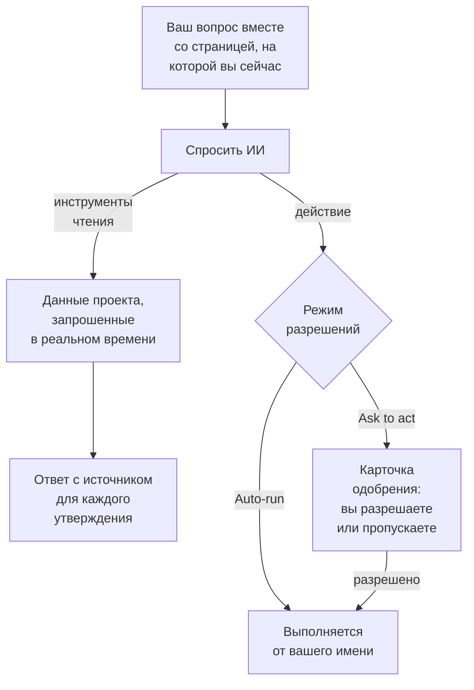

# Спросить ИИ

Спросить ИИ — это чат OneUptime по данным вашего проекта. Спрашивайте о логах, трассировках, метриках, исключениях, инцидентах, оповещениях, мониторах, дежурствах, страницах состояния, SLO, runbook-ах или рабочих процессах: чат запрашивает ваш проект в реальном времени, подкрепляет каждое утверждение ссылкой на источник и, если вы разрешите, действует за вас.

:::cards
- [Как открыть Спросить ИИ](#как-открыть-спросить-ии): Из шапки, с клавиатуры, из графика или из меню продуктов.
- [Что он видит](#что-он-видит): Данные, которые он читает, чтобы ответить вам.
- [Действия и режимы разрешений](#действия-и-режимы-разрешений): Решите, может ли он действовать и когда сначала спрашивает.
- [Действия выполняются от вашего имени](#действия-выполняются-от-вашего-имени): Ваши разрешения, ваше имя на каждом изменении.
:::

## Как отвечает Спросить ИИ

Спросить ИИ отвечает только тем, что возвращают его инструменты: он выполняет запросы к вашему проекту, а не отвечает по памяти. У каждого факта в ответе есть чип источника, который показывает запрос за ним и открывает прочитанные данные. Когда вы просите что-то изменить, режим разрешений беседы решает, спросит ли он вас сначала. Перед вашим вопросом он читает [контекст ИИ](/docs/ai/ai-context) проекта: то, что ваша команда записала для OneUptime AI о ваших собственных системах.

В режиме **Только чтение** действия модели вообще не предлагаются, поэтому беседа только читает.

## Как открыть Спросить ИИ

| Где | Как |
| --- | --- |
| Любая страница | Нажмите **Спросить ИИ** в шапке или нажмите `Ctrl` + `I` (`Cmd` + `I` на Mac). Пока вы печатаете в текстовом поле или редакторе, эти клавиши остаются сочетанием редактора для курсива. |
| Палитра команд | Нажмите `Ctrl` + `K` (`Cmd` + `K` на Mac) и выберите **Спросить ИИ**. |
| Шаблон ошибки в логах или выводы графика | Нажмите **Объяснить с ИИ**: Спросить ИИ откроется с доказательствами в виде вопроса, который можно изменить перед отправкой. |
| Меню продуктов | Откройте **Продукты → AI → Chat**. Спросить ИИ откроется поверх страницы, на которой вы были. У каждой беседы свой адрес, так что её можно добавить в закладки и вернуться к ней. |

Спросить ИИ открывается посередине экрана, поверх страницы, на которой вы были, а на телефоне занимает весь экран. Нажмите `Esc` или щёлкните рядом, чтобы вернуться на страницу. Беседа остаётся там, где вы её оставили: откройте Спросить ИИ снова, чтобы продолжить. Если закрыть его, пока он ещё отвечает, напоминание в углу скажет, когда ответ будет готов, и откроет его.

У инцидента или оповещения на карточке **AI Investigation** есть своя беседа, **Ask OneUptime AI**, общая для всех, кто видит этот инцидент или это оповещение: см. [Разговор с OneUptime AI об инциденте](/docs/ai/ai-sre#поговорите-с-oneuptime-ai-об-инциденте).

## Что он видит

Спросить ИИ читает ваш проект с вашими собственными разрешениями, поэтому видит то, что можете видеть вы, и ничего больше.

| Область | Что читает Спросить ИИ |
| --- | --- |
| Телеметрия | Поиск по логам и гистограммы, агрегации трассировок и деревья спанов, метрики, исключения, события безопасности, мониторинг реальных пользователей и Web Vitals, недавние изменения и проверки аномалий относительно изученных базовых линий. |
| Инфраструктура | Хосты, Docker, Podman, Kubernetes, Docker Swarm, Proxmox, VMware vCenter, Ceph, системы хранения, бессерверные функции, облачные среды, парки IoT и сетевые устройства: что есть в инвентаре, их сообщённое состояние подключения, тренды метрик, число логов по серьёзности и сводки операций трассировок. Запрос охватывает и телеметрию, которая называет сервис, и телеметрию, которая называет ресурс инфраструктуры. |
| Реагирование на инциденты | Инциденты и оповещения с фильтрами состояния («что активно прямо сейчас?»), их хронологии активности (смены состояния, внутренние и публичные заметки, лента) и владельцы, а также поиск по прошлым инцидентам, чтобы повторно использовать способы их решения. |
| Дежурство | Кто дежурит сейчас, политики и цепочки эскалации, а также доставлены ли и подтверждены ли последние вызовы. |
| Работа самого ИИ | Результаты расследований AI SRE и AI Insights, чтобы на вопрос «что нашёл ИИ?» отвечать по опубликованному анализу, а не выяснять всё заново. |
| Платформа | Мониторы (с фильтрами состояния), плановое обслуживание, страницы состояния и их объявления, SLO, runbook-и, запуски рабочих процессов, состояние проб, команды и код подключённых репозиториев. |

## Контекст страницы

Спросить ИИ знает, с какой страницы вы его открыли. На странице инцидента «почему это случилось?» означает этот инцидент: поле ввода показывает чип с темой страницы, а предлагаемые вопросы относятся к этой странице. Уберите чип, чтобы спросить о проекте целиком, и верните его тем же способом. Откройте Спросить ИИ на другой странице, и контекст последует за вами. Беседа запоминает свою первую тему и на сервере, поэтому уточняющий вопрос через несколько дней по-прежнему понимает «этот инцидент».

На инциденте, оповещении, мониторе или плановом обслуживании вопросы также следуют за тем, в каком состоянии эта запись: Спросить ИИ читает его каждый раз, когда открывается на ней. Устранённый инцидент спрашивает, как прошло реагирование и что помешало бы ему повториться, устранённое оповещение — было ли оно реальной проблемой и как часто срабатывают подобные оповещения, а монитор, который не работает, спрашивает почему. Обслуживание, которое ещё не началось, спрашивает, в порядке ли его мониторы до начала, а завершившееся — вернулись ли они к норме.

Списки инфраструктуры и страницы ресурсов предлагают вопросы для того вида ресурса, который вы смотрите. Откройте кластер Kubernetes и спросите «Какие метрики изменились за последние 24 часа?» или откройте хост Docker и спросите «Подведи итог по серьёзности логов и ошибкам трассировок за последние шесть часов.» Ссылки на доказательства ведут обратно на страницу ресурса. Чтение учитывает ваши разрешения на проект, ресурсы и телеметрию, включая ограничения по владельцам и меткам.

На странице дочернего объекта контекст также записывает выбранный под, контейнер, ВМ, процесс или другой дочерний объект. Инструменты инфраструктуры читают телеметрию родительского ресурса; измерить отдельный дочерний объект только по его имени они не могут. Спросить ИИ говорит об этом и не угадывает пространство имён Kubernetes, которое страница не указывает. Состояние подключения — это не здоровье рабочей нагрузки, а отсутствие телеметрии не значит, что ресурс исправен.

## Команды на вашей инфраструктуре

Открытый на странице ресурса, ИИ-агент которого подключён (хоста, хоста Docker или Podman, кластера Docker Swarm, кластера Proxmox, VMware vCenter, кластера Ceph, сервера баз данных или кластера Kubernetes), Спросить ИИ по вашей просьбе выполняет на нём команды через этот агент: «выполни `uptime` на этом хосте» или «покажи последние 100 строк `journalctl -u nginx`». В ответе — то, что вернулось, со ссылкой на источник, как у любого другого доказательства. Открытый на инциденте или оповещении, он достаёт до связанных с ним ресурсов.

- Он выполняет только те команды только для чтения, которые ИИ-расследование может выполнять на ресурсе такого типа (см. [ИИ-агенты инфраструктуры](/docs/ai/infrastructure-ai-agents)), не больше 30 на один ответ через каждый вид агента, и в любом режиме разрешений их проверяет OneUptime, а затем ещё раз агент. Изменение через агент, например перезапуск службы, никогда не выполняется из Спросить ИИ: вместо этого он даёт вам точную команду, а агент вносит изменения, только когда OneUptime AI устраняет инцидент или оповещение, по собственным настройкам исправлений ресурса. Собственные действия Спросить ИИ, например запуск runbook, подчиняются режиму разрешений беседы, описанному ниже.
- Он достаёт только до ресурсов, которые вам разрешено просматривать, и только пока для ресурса включено ИИ-расследование.
- Когда он не может выполнить там команду (агент не подключён, агент не в сети или ИИ-расследование для ресурса выключено), он говорит об этом, вместе с тем, что нужно изменить, и отвечает вместо этого по данным вашего проекта.

## Действия и режимы разрешений

У каждой беседы есть режим разрешений, который выбирается в поле ввода, рядом с полем для текста:

| Режим | Что происходит |
| --- | --- |
| **Спрашивать перед действием** | По умолчанию. Спросить ИИ предлагает каждое действие на карточке одобрения, и ничего не выполняется, пока вы не выберете для него **Разрешить** или **Пропустить** либо **Отклонить все**. |
| **Автозапуск** | Действия выполняются, как только модель их запрашивает, по-прежнему в пределах того, что разрешено вашей роли. Используйте осторожно. |
| **Только чтение** | Действия модели вообще не предлагаются: Спросить ИИ может только читать. |

Что Спросить ИИ может делать, когда режим это разрешает:

- Создать инцидент или оповещение, подтвердить или решить инциденты и оповещения и изменить серьёзность инцидента.
- Связать инцидент или оповещение с инфраструктурой и сервисами, к которым он относится. Инцидент или оповещение, созданные на странице ресурса, например хоста, связываются с этим ресурсом, а карточка подтверждения называет, с чем связывает каждое действие. OneUptime AI расследует и исправляет то, с чем связан инцидент или оповещение.
- Опубликовать внутреннюю заметку к инциденту или оповещению. Внутренние заметки никогда не появляются на странице состояния.
- Опубликовать публичное обновление статуса инцидента. Это отдельное действие, потому что оно уведомляет подписчиков страницы состояния.
- Вызвать политику дежурства, запустить runbook или начать ИИ-расследование инцидента или оповещения.
- Предложить изменение кода: сделать коммит в новую ветку подключённого репозитория и открыть pull request. Он никогда не пишет в ветку по умолчанию или защищённую ветку, так что изменение по-прежнему сливает человек.

Просите инцидент, когда затронуты пользователи, и оповещение, когда чему-то сначала нужно внимание вашей команды, например памяти хоста, которая всё растёт. И то и другое создаётся один раз и ничего не отслеживает: чтобы получать оповещение каждый раз, когда память хоста превышает 75 %, создайте [монитор хоста](/docs/monitor/host-monitor#готовые-шаблоны-оповещений) из его шаблона для памяти с порогом 75 %. Спросить ИИ не может создавать мониторы. Если попросить его об этом, он так и скажет, проверит текущее значение и предложит создать оповещение, если оно уже превышено.

## Действия выполняются от вашего имени

Каждое действие Спросить ИИ выполняется от вашего имени: он вносит то же изменение, что вносит панель управления для того же действия, с вашими собственными разрешениями в проекте, и изменение записывается на вас. Подтверждение инцидента из чата создаёт ту же смену состояния, что и панель состояния инцидента, поэтому хронология и лента инцидента показывают, что состояние изменили вы. Вызов, отправленный из чата, показывает вас как того, кто его запустил.

- **Что нужно каждому действию.** Разрешение, которое панель управления требует для того же изменения. Чтобы создать инцидент или оповещение, нужно разрешение их создавать: роль, которой это разрешено, или **Create Incident** или **Create Alert** в пользовательской роли. Чтобы подтвердить или решить инцидент, нужно разрешение менять его состояние: **Владелец проекта**, **Администратор проекта**, **Участник проекта**, **Администратор инцидентов** и **Участник инцидентов** либо **Create Incident State Timeline** в пользовательской роли; оповещению нужно такое же разрешение для оповещений (**Create Alert State Timeline**). Чтобы вызвать политику дежурства, нужно разрешение её выполнять (**Create On-Call Duty Policy Execution Log**), а чтобы запустить runbook, нужно разрешение запускать выполнения runbook-ов: роль, которая запускает runbook-и, для тех runbook-ов, до которых дотягиваются её метки, либо **Create Runbook Execution** в пользовательской роли, которое распространяется на все runbook-и проекта. Чтобы изменить серьёзность инцидента, начать ИИ-расследование инцидента или оповещения и записать код в подключённый репозиторий, нужно разрешение изменять этот инцидент, оповещение или репозиторий. Действие, которое вам не разрешено, отклоняется, и ИИ сообщает, какое разрешение нужно. Если разрешение у вас есть, но его блокирует команда, в которой вы состоите, ИИ сообщает об этом: блокировка по некоторым меткам отклоняет это действие в Спросить ИИ для всех записей, а не только для записей с этими метками.
- **Какие записи.** Те, которые вы можете изменять, как и везде в OneUptime: с ролью, ограниченной некоторыми метками или вашими собственными записями, действие над любой другой записью ничего не меняет. Runbook запускается, только если на него распространяется ваше разрешение запускать выполнения runbook-ов. В OneUptime Cloud действие, которого нет в тарифе проекта, отклоняется с указанием нужного тарифа.
- **Когда действие отклонено.** Ничего не меняется, и ИИ прямо говорит, что действие не выполнено и почему, а не пытается снова.
- **Slack, Microsoft Teams и ИИ-расследования.** Ответы ИИ в Slack и Microsoft Teams и автономные ИИ-расследования только читают: ни одного из этих действий они не выполняют. Чтобы действовать из Slack или Microsoft Teams, используйте кнопки в сообщениях OneUptime, которые тоже действуют от вашего имени (см. [Slack](/docs/workspace-connections/slack#действия-с-инцидентами-оповещениями-и-событиями-из-slack) и [Microsoft Teams](/docs/workspace-connections/microsoft-teams#действия-с-инцидентами-оповещениями-и-событиями-из-microsoft-teams)).

## Управление беседой

- **Остановите его.** Пока Спросить ИИ работает, кнопка отправки превращается в кнопку остановки. Остановите выполнение в любой момент и сразу спросите о другом.
- **Следите за его работой.** Пока он отвечает, одна строка говорит, что он делает сейчас, например ищет в журналах. Нажмите на число шагов рядом, чтобы увидеть каждый шаг.
- **Выберите модель.** Если проект может использовать больше одного LLM-провайдера, выбор провайдера в поле ввода показывает LLM-провайдеров вашего проекта и глобальных, провайдер по умолчанию отмечен. Новая беседа использует провайдера по умолчанию.
- **Оцените ответ.** **Хороший ответ** и **Плохой ответ** сохраняются вместе с сообщением, чтобы качество ответов можно было измерять со временем.
- **Посмотрите стоимость.** Под каждым ответом его источники раскрываются в запросы, которые он выполнил, а у последнего ответа они также показывают, сколько запросов он выполнил, его токены и стоимость. Каждый чип источника в ответе открывает данные за ним.
- **Сохраните копию.** **Скачать разговор** сохраняет ветку через **Скачать в Markdown**, чтобы читать или вставить в тикет, или через **Скачать в PDF**, чтобы передать кому-то.
- **Продолжайте с того места, где остановились.** **Все разговоры** в шапке Спросить ИИ показывает ваши беседы, сначала новые, чтобы снова открыть или удалить их. В начале новой беседы видны три последние.

## Требования

- **LLM-провайдер.** Спросить ИИ использует LLM-провайдера проекта по умолчанию (см. [Провайдеры LLM](/docs/ai/llm-provider)). В OneUptime Cloud он сразу работает с глобальным провайдером, оплачиваемым из ИИ-кредитов проекта; в самостоятельно размещённой установке настраивается провайдер или переменные окружения глобального провайдера. Ответы хороши настолько, насколько хороша модель: небольшая самостоятельно размещённая модель без надёжного вызова инструментов отвечает плохо.
- **Тариф Growth в OneUptime Cloud.** Проект на более низком тарифе видит, что ИИ не входит в его тариф, со ссылкой на **Настройки проекта → Биллинг и счета → Биллинг**.
- **ИИ включён для проекта.** **Включить ИИ** на **Настройки проекта → ИИ → AI Features** отключает все функции ИИ проекта, включая Спросить ИИ. Он включён, если только его никто не выключил.

Спросить ИИ учитывается в собственных дневных лимитах ИИ проекта, когда проект их задаёт (Настройки проекта → ИИ → AI Features → Дополнительные настройки): когда один из них достигнут, Спросить ИИ показывает фразу, в которой сказано, какой лимит достигнут, что OneUptime AI снова начнёт работу в полночь по UTC и кто может поднять или снять лимит. Владельцы проекта получают письмо, когда лимит впервые за день достигнут. Дневные лимиты инцидентов и оповещений никогда не останавливают Спросить ИИ. См. [собственные дневные лимиты проекта](/docs/ai/ai-sre#собственные-дневные-лимиты-проекта).

## Устранение неполадок

:::details Спросить ИИ сообщает, что ИИ недоступен
Спросить ИИ называет причину ещё до того, как вы начнёте печатать: тариф проекта не включает ИИ, **Включить ИИ** выключено или у проекта нет LLM-провайдера. Каждое сообщение ведёт на страницу, где это меняется.
:::

:::details Действие отклонено
Спросить ИИ сообщает, какое разрешение нужно действию или какая команда его блокирует. Попросите того, кто может внести изменение, или попросите владельца проекта выдать разрешение вашей роли. Ничего не изменилось.
:::

:::details Ответы расплывчатые или никогда не используют данные
Проверьте модель за провайдером. Спросить ИИ нужна модель, которая надёжно вызывает инструменты; небольшие локальные модели часто отвечают, не выполнив ни одного запроса. См. [Провайдеры LLM](/docs/ai/llm-provider).
:::

## Дальнейшие шаги

:::cards
- [AI SRE](/docs/ai/ai-sre): Пусть OneUptime AI расследует каждый новый инцидент и каждое новое оповещение.
- [Провайдеры LLM](/docs/ai/llm-provider): Выберите модель, которую используют Спросить ИИ и другие функции ИИ.
- [Сервер MCP](/docs/ai/mcp-server): Спрашивайте об OneUptime из Claude, Cursor или VS Code.
:::
