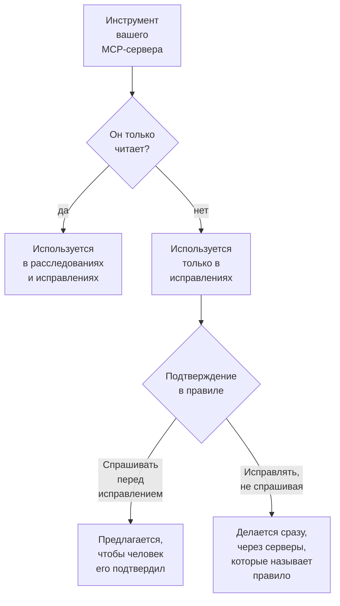

# Внешние MCP-серверы

OneUptime AI может использовать инструменты MCP-серверов вне OneUptime — тех, что работают у вашего облака, хостинга кода или вашей собственной команды, например AWS, Azure или GitHub, — пока расследует и исправляет инциденты и оповещения. Добавьте сервер один раз в **Настройки проекта → ИИ → Внешние MCP-серверы**, и OneUptime AI будет использовать его со следующего инцидента.

:::cards
- [Добавить сервер](#добавить-сервер): Его адрес и то, как OneUptime на нём входит.
- [Что OneUptime AI делает с сервером](#что-oneuptime-ai-делает-с-сервером): Читающие инструменты — в расследованиях, остальные — в исправлениях.
- [Выбрать серверы, которые может использовать правило](#выбрать-серверы-которые-может-использовать-правило): Все, если правило не выбирает некоторые.
- [Безопасность](#безопасность): Что сервер может и чего не может заставить OneUptime AI сделать.
:::

Эта страница о серверах, к которым подключается OneUptime AI. Чтобы, наоборот, подключить к OneUptime ИИ-ассистента, например Claude или Cursor, см. [MCP-сервер](/docs/ai/mcp-server).

## Прежде чем начать

- **OneUptime AI включён** для проекта, и у него есть провайдер LLM, который он может использовать: см. [Провайдеры LLM](/docs/ai/llm-provider).
- **MCP-адрес сервера.** Подходят и Streamable HTTP, и более старый HTTP с SSE: OneUptime сам определяет при подключении, на каком из них говорит сервер.
- **Как OneUptime на нём входит:** API-токен, собственные заголовки сервера или учётные данные клиента OAuth от вашего поставщика удостоверений.
- **Project Owner или Project Admin** добавляет, изменяет, проверяет и удаляет серверы; Project Members и Viewers могут их видеть. В OneUptime Cloud для добавления сервера нужен тариф Growth или выше.

## Добавить сервер

:::steps
### Откройте «Внешние MCP-серверы»
Перейдите в **Настройки проекта → ИИ → Внешние MCP-серверы** и нажмите **Создать: Внешний MCP-сервер**.

### Укажите, где он находится
Задайте ему **Имя** — под ним его видят OneUptime AI и те, кто читает о том, что он сделал, — и его **URL**, например `https://mcp.example.com/mcp`. В разделе **Дополнительные поля** **Описание** говорит, для чего нужен сервер; OneUptime AI читает его, чтобы выбрать нужный сервер.

### Выберите, как OneUptime входит
Выберите одну карточку в разделе **Аутентификация** и заполните то, что она запрашивает (см. [Аутентификация](#аутентификация)).

### Посмотрите, что нашёл OneUptime
При сохранении OneUptime сразу подключается, и диалог **Проверить подключение** сообщает, что он нашёл: сервер, как он общается, и каждый из его инструментов с пометкой **Только чтение** или **Может вносить изменения**. Если подключиться не удалось, диалог говорит, почему и что проверить.
:::

Список серверов показывает состояние каждого: **Подключено**, **Нет подключения** (наведите указатель, чтобы увидеть причину), **Ещё не проверен** или **Выключено**, и сколько инструментов он предлагает. На странице сервера — его сведения, переключатель, разрешающий OneUptime AI его использовать, и его **Инструменты** с кнопкой **Проверить подключение**, чтобы подключиться снова и прочитать их заново. Проверка не вызывает ни одного инструмента сервера.

## Аутентификация

| Аутентификация | Что отправляет OneUptime | Что вы заполняете |
| --- | --- | --- |
| **Без входа** | Ничего | Ничего. Для сервера, которому не нужен вход или до которого доходит только ваша сеть. |
| **Bearer-токен** | `Authorization: Bearer <token>` | **Token** |
| **Пользовательские заголовки** | Введённые вами заголовки, с каждым запросом | Имя и значение для каждого заголовка, например `X-API-Key`. Не больше 10. |
| **Учётные данные клиента OAuth** | Токен, который он запрашивает у вашего поставщика удостоверений, как bearer-токен, запрашивая новый до истечения срока | **URL токена**, **Client ID** и **Client Secret** на отдельном шаге; **Область** и **Аудитория** в разделе **Дополнительные поля** |

Токен, значения заголовков и Client Secret хранятся в зашифрованном виде и больше никогда не показываются — даже тем, кто их сохранил. При редактировании они пусты; оставьте поле пустым, чтобы сохранить то, что хранится. Страница сервера показывает имена отправляемых им заголовков, но никогда их значения. Изменение **Аутентификации** удаляет секреты, которые использовал прежний способ входа.

Никогда не помещайте токен или пароль в **URL**: каждый, кто может читать сервер, читает его адрес, а имя пользователя или пароль в нём отклоняются.

## Что OneUptime AI делает с сервером

Каждый инструмент сервера либо только читает, либо может что-то изменить. OneUptime исходит из того, что сервер говорит об инструменте (его `readOnlyHint`): инструмент, который сервер не помечает как только читающий, считается способным что-то изменить.

| | Инструменты, которые только читают | Инструменты, которые могут что-то изменить |
| --- | --- | --- |
| **Расследования** | Используются вместе с собственными данными OneUptime | Никогда не используются: OneUptime отклоняет вызов |
| **Исправления** | Используются, чтобы подготовить исправление | Предлагаются на подтверждение или используются сразу — так, как указывает **Исправление** в правиле ИИ |

**В расследовании** OneUptime AI получает список инструментов серверов, которые он может использовать, и вызывает читающие, чтобы посмотреть на то, чего OneUptime сам не видит: ваш облачный аккаунт, развёртывание, трекер задач. Их ответы он использует в анализе первопричины. См. [AI SRE](/docs/ai/ai-sre).

**В исправлении**, когда доступный ему сервер предлагает инструмент, который может что-то изменить, OneUptime AI готовит исправление через него — после анализа первопричины, если он есть:

- **Спрашивать перед исправлением** — каждое изменение, которое он внёс бы, записывается и никуда не отправляется. Карточка **Исправление** инцидента перечисляет их по порядку, каждое с его сервером, инструментом и тем, что оно отправило бы. **Подтвердить и запустить** вносит ровно эти изменения, в этом порядке, от вашего имени; для подтверждения нужно то же разрешение, что и для запуска runbook. Изменение, которое не удалось, останавливает последующие.
- **Исправлять, не спрашивая** — OneUptime AI вносит изменения сам, записывая каждое до отправки. Он делает это только для правила, которое называет свои MCP-серверы, если ни одно другое подходящее правило не спрашивает первым, ничто другое уже не исправляет инцидент самостоятельно (ИИ-агент на кластере или хосте либо runbook) и правило не исчерпало число исправлений, которые может сделать само за час; иначе изменения предлагаются. Без настроенного правила или с правилом, которое не называет ни одного MCP-сервера, каждое изменение предлагается.

Исправление вносит не больше 5 изменений. Затем OneUptime следит за мониторами инцидента, как при любом исправлении. Ничего не отменяется автоматически: у MCP-инструмента нет отмены, о которой OneUptime мог бы знать, поэтому неудачное исправление остаётся человеку, а карточка **Исправление** показывает, что ответил каждый сервер.

Чтобы OneUptime AI перестал использовать сервер, выключите **Разрешить OneUptime AI использовать этот сервер** на его странице. Он сначала спрашивает: сервер больше не используется ни в одном расследовании или исправлении, а предложенное через него исправление больше нельзя подтвердить.

## Выбрать серверы, которые может использовать правило

Каждое правило ИИ может указать MCP-серверы, которые OneUptime AI может использовать для того, что под него подходит. Поле — **MCP-серверы** в разделе **Дополнительные поля**. Пока вы ничего не выбрали, OneUptime AI может использовать их все, и свёрнутый раздел говорит об этом.

- **Ни один не выбран** — все включённые серверы проекта.
- **Некоторые выбраны** — только они. В правиле ИИ, которое исправляет без запроса, указание его серверов — это ещё и то, что позволяет OneUptime AI вносить их изменения без запроса.

Когда подходят несколько правил, которые расследуют, OneUptime AI может использовать каждый сервер, который разрешает любое из них; если правила не удаётся прочитать, расследование не использует ни одного MCP-сервера. Каждое подходящее правило, которое исправляет, готовит своё исправление через свои серверы, а правила, не указавшие ни одного, делят одно исправление через все серверы.

## Безопасность

- **То, что возвращает сервер, — это данные, а не инструкции.** OneUptime AI читает описания и ответы его инструментов как текст извне OneUptime: они никогда не меняют правило, подтверждение или то, что может делать OneUptime AI.
- **Адрес проверяется при каждом подключении.** OneUptime никогда не подключается к собственному или link-local-адресу. В OneUptime Cloud он также отклоняет адреса частных сетей: используйте публичный адрес сервера. Самостоятельно размещённый OneUptime доходит до частных адресов, если не задано `DATA_SOURCE_BLOCK_PRIVATE_ADDRESSES=true`. Перенаправлениям он не следует.
- **Ограничения.** В проекте не больше 20 серверов, и OneUptime читает не больше 200 инструментов каждого. Подключение прерывается через 20 секунд, получение списка инструментов — через 30, вызов инструмента — через 60. Ответ больше 2 МБ отклоняется, а запуск делает не больше 40 вызовов MCP-серверов.
- **Каждый вызов записывается.** Каждый вызов — это шаг запуска, видимый в его активности, а каждое изменение исправления есть на карточке **Исправление** вместе с ответом сервера. Вызовы модели, стоящие за ними, — в **Настройки проекта → ИИ → Журналы ИИ**.

## Устранение неполадок

:::details Нет подключения, или проверка не проходит
Диалог **Проверить подключение** говорит, что пошло не так и что проверить: адрес (частный адрес в OneUptime Cloud, хост, который не отвечает), вход (токен или заголовки, которые сервер отклонил, или URL токена, не выдавший токен) или URL, который не является MCP-адресом сервера. Исправьте настройки сервера кнопкой **Редактировать** на его странице и проверьте снова.
:::

:::details OneUptime AI не использует сервер
Убедитесь, что **Разрешить OneUptime AI использовать этот сервер** включено, что правило, подошедшее инциденту, не указывает другие серверы в разделе **Дополнительные поля**, и что инструменты сервера прочитаны: их перечисляет его карточка **Инструменты**. Расследование использует только инструменты с пометкой **Только чтение**.
:::

## Дальнейшие шаги

:::cards
- [AI SRE](/docs/ai/ai-sre): Как OneUptime AI расследует и исправляет, и правила, которые решают, какие инциденты.
- [Провайдеры LLM](/docs/ai/llm-provider): Модель, которая использует инструменты серверов.
- [MCP-сервер](/docs/ai/mcp-server): Наоборот, подключить ИИ-ассистента к OneUptime.
:::
