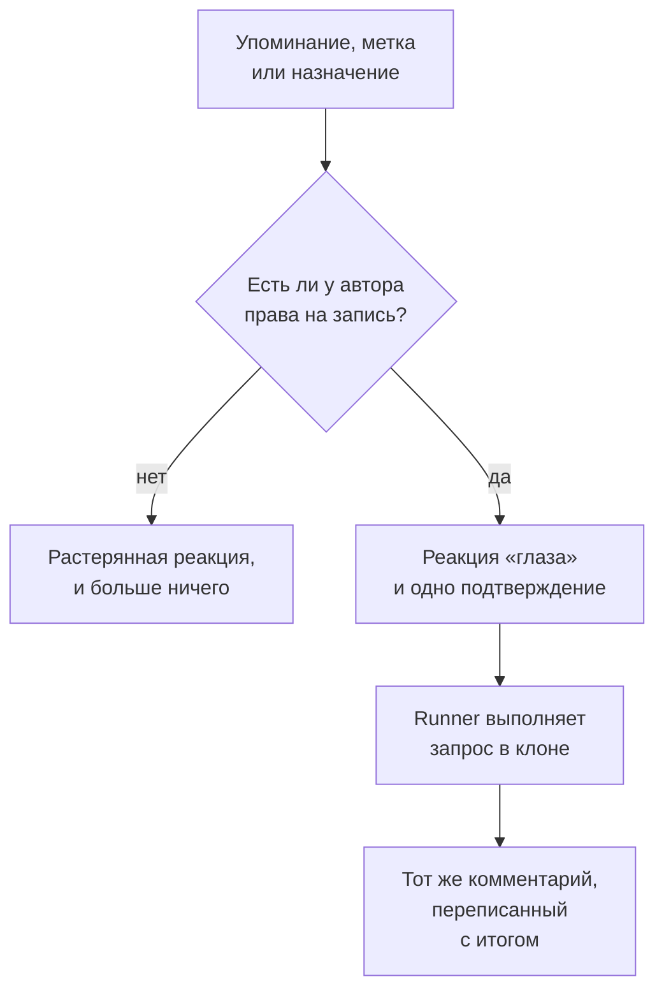

# GitHub App

GitHub App от OneUptime — это больше, чем подключение к вашему коду: с ним можно разговаривать прямо в репозитории, и он делает работу там же. Упомяните его в issue, и он откроет pull request; упомяните его в pull request, и он доработает ветку или проверит diff. Всё, что он создаёт, — это pull request или ревью, которые читает человек: **он никогда ничего не сливает и никогда не одобряет pull request.**

:::cards
- [Команды](#команды): Что писать в issue или в pull request.
- [Как это выглядит в обсуждении](#как-это-выглядит-в-обсуждении): Один комментарий, который следит за работой.
- [Ревью с контекстом продакшена](#ревью-с-контекстом-продакшена): Что продакшен говорит об изменённом коде.
- [Кто может отдавать ему команды](#кто-может-отдавать-ему-команды): Люди с правом записи, и больше никто.
- [Устранение неполадок](#устранение-неполадок): Когда упоминание ничего не делает.
:::

```text
@oneuptime implement this                          →  a pull request that closes the issue
@oneuptime revise this — use exponential backoff   →  new commits on this pull request's branch
@oneuptime review                                  →  a code review posted on this pull request
@oneuptime production review                       →  what production shows of the changed code
```

> [!NOTE]
> Замените `@oneuptime` на handle вашего собственного приложения. В OneUptime Cloud это `@oneuptime`. На собственном экземпляре это имя, которое вы дали своему GitHub App, в нижнем регистре и с дефисами вместо пробелов: приложение с именем "Acme AI" упоминается как `@acme-ai`. Если упоминания ничего не делают, сначала проверьте это.

## Как это работает



Это тот же агент и тот же Runner, что и в разделе [Код](/docs/ai/ai-agent), с теми же бюджетами; отличается только триггер.

## Прежде чем начать

- Репозиторий должен быть **подключён к проекту OneUptime** через GitHub App: подключите его в **Продукты → Код**. Собственному экземпляру сначала нужен свой GitHub App: см. [Интеграция с GitHub](/docs/self-hosted/github-integration). Если приложение уже установлено в учётной записи GitHub, нажмите там **Подключить существующую установку** вместо повторной установки.
- Должен быть в сети Runner, которого репозиторий выбрал в своих настройках в разделе «Код», или глобальный Runner для репозитория, не выбравшего ни одного: тот же Runner, который выполняет задачи раздела [Код](/docs/ai/ai-agent). Без него команды принимаются, а через 30 минут завершаются ошибкой с сообщением, что их не взял ни один Runner.
- GitHub App нужно разрешение **Issues** с уровнем **Read & write**, и он должен быть подписан на события webhook из раздела [На что подписаться](#на-что-подписаться).

## Команды

Каждая команда начинается с упоминания приложения. Упоминание может стоять в любом месте комментария, и всё, что вы пишете после него, передаётся как ваш запрос. Редактирование комментария, в котором приложение уже упомянуто, не запускает его снова: чтобы изменить запрос, напишите новый комментарий. Правка, которая добавляет упоминание, — это новый запрос.

### В pull request

| Команда | Что происходит | Также понимает |
| --- | --- | --- |
| `@oneuptime review` | Клонирует ветку, читает изменённый код и код вокруг него, проверяет, что о нём говорит продакшен, и публикует ревью в виде комментария. Ничего не меняет. | `code review`, `please review`, `can you review`, `review this` |
| `@oneuptime production review` | Проверяет pull request по продакшену сейчас, кто бы его ни открыл: исключения, операции, инциденты и развёртывания вокруг изменённого кода, в одном комментарии, который обновляется на месте (см. [Проверка pull request по продакшену](/docs/ai/ai-agent#проверка-pull-request-по-продакшену)). Ничего не клонирует и ничего не запускает. | `review against production`, `review production`, `check production` |
| `@oneuptime revise this — <what you want changed>` | Клонирует собственную ветку pull request, вносит изменение и отправляет новые коммиты в эту ветку. Никогда не открывает второй pull request. | `revise`, `please revise`, `rework`, `redo` |

Всё, что вы пишете после упоминания и что не является известной командой, читается как запрос на доработку, потому что почти всегда так и есть:

```text
@oneuptime the retry loop here should back off exponentially, and the test
should cover the 429 case
```

### В issue

| Команда | Что происходит | Также понимает |
| --- | --- | --- |
| `@oneuptime implement this` | Выполняет issue и открывает pull request, который его закрывает. | `implement`, `please implement`, `work on this`, `pick this up`, `take this` |
| `@oneuptime <anything else>` | То же самое, с вашими словами как дополнительным указанием. | — |

Передать приложению issue можно и без комментария:

- **Добавьте метку-триггер.** Добавление к issue метки-триггера репозитория, `oneuptime`, если вы её не меняли, запускает ту же работу. Это самый надёжный способ передать работу со страниц самого GitHub.
- **Назначьте issue боту приложения**, если ваш репозиторий это позволяет. GitHub не везде разрешает назначать приложение исполнителем, поэтому и существует метка: если назначение ничего не делает, используйте метку.

### Везде

| Команда | Что происходит | Также понимает |
| --- | --- | --- |
| `@oneuptime help` | Перечисляет команды. Простое упоминание без продолжения делает то же самое. | `commands`, `usage`, `what can you do` |
| `@oneuptime status` | Сообщает, над чем он работает в этом обсуждении. | `progress` |
| `@oneuptime cancel` | Останавливает запуски, которые идут у него в этом обсуждении. Уже отправленная работа остаётся отправленной. | `stop`, `abort` |

`help`, `status` и `cancel` никогда не запускают агента, поэтому ничего не стоят.

## Как это выглядит в обсуждении

Одна команда даёт **один комментарий**, который приложение редактирует по ходу работы, так что длинная задача никогда не превращает pull request в журнал статусов.

1. Он ставит реакцию 👀 на ваш комментарий и публикует подтверждение, в котором назван проект OneUptime, к которому относится запуск, и есть ссылка на текущий запуск.
2. Закончив, он переписывает тот же комментарий с итогом: pull request, который он открыл, коммиты, которые он отправил, или понятное объяснение, почему он ничего не сделал.

Если он не находит ничего, что стоит менять, он так и говорит, а не открывает pull request наугад. Это нормальный итог, а не сбой: дайте ему больше указаний и спросите снова.

## Ревью с контекстом продакшена

OneUptime хранит телеметрию кода, который он проверяет, поэтому ревью может сказать то, чего не скажет ни один проверяющий, читающий только diff. Для сервисов, к которым относится репозиторий, он проверяет:

- исключения, выброшенные в изменённых файлах и функциях за последние 7 дней;
- насколько нагружены и насколько медленны конечные точки и операции, которые затрагивает diff;
- инциденты, связанные с изменёнными файлами;
- недавние развёртывания сервисов, которые OneUptime пометил как регрессии.

Найденное попадает в ревью под заголовок **Production context**, каждый пункт — с числами и временным окном, на которых он основан, например: "`chargeCard` выбросил `TypeError: Cannot read properties of undefined` 1 240 раз за последние 7 дней; это изменение добавляет проверку на null, которая это прекращает." Если продакшен не показывает ничего, что касалось бы diff, ревью опускает этот заголовок, а не утверждает, что всё в порядке.

Ничего настраивать не нужно: это те сервисы, для которых OneUptime находит этот репозиторий, как и для исправления (см. [Телеметрия продакшена в исправлении](/docs/ai/ai-agent#телеметрия-продакшена-в-исправлении)). Запросы только читают, выполняются на сервере OneUptime и ничего не читают из другого сервиса, проекта или приватного инцидента. Репозиторий, сервисы которого не отправляют телеметрию в проект, проверяется только по его коду.

Чтобы каждый pull request проверялся по продакшену сам, включите **Проверять запросы на слияние по данным продакшена** в настройках репозитория: см. [Проверка pull request по продакшену](/docs/ai/ai-agent#проверка-pull-request-по-продакшену).

## Кто может отдавать ему команды

**Только люди с доступом write, maintain или admin к репозиторию.** OneUptime каждый раз спрашивает у GitHub разрешение комментатора в этом репозитории; он не доверяет значку "contributor", который GitHub показывает рядом с комментарием, потому что тот описывает прошлую активность, а не текущий доступ.

Упоминание от кого-либо ещё получает одну реакцию 😕 и ничего больше. Это сделано намеренно: в публичном репозитории комментировать может кто угодно, а приложение, которое всегда отвечает посторонним, можно использовать для спама в обсуждении.

Он также игнорирует все комментарии, написанные ботом, включая свои собственные, и упоминания внутри цитаты (`>`) или блока кода. Вместе эти два правила не дают ответу на один из его собственных комментариев запустить его снова.

## Чего он не делает

- **Он никогда не сливает.** Ничто из того, что делает это приложение, не может попасть кодом в вашу ветку по умолчанию.
- **Он никогда не одобряет и не запрашивает изменения.** Ревью публикуются как комментарии, поэтому ревью от приложения никогда не может удовлетворить правило защиты ветки.
- **Он никогда не переписывает историю.** Доработка добавляет коммиты; он никогда не делает force-push. Если кто-то другой отправил изменения в ветку раньше, доработка завершается ошибкой, а не выбрасывает чужую работу.
- **Он не может доработать pull request из форка.** Ветка форка находится в репозитории, в который установка не может писать. Проверить его он всё равно может: попросите вместо этого ревью.
- **Он никогда не меняет заголовок, описание или целевую ветку pull request.** Только код.

## Сколько это стоит и как это ограничить

Каждая команда, которая запускает работу, — это полный запуск агента: клон, до 40 вызовов LLM и 100 000 выходных токенов, а также, на собственном Runner, проверки сборки и тестов, которые описывает `AGENTS.md` вашего репозитория. Запросы ревью к продакшену, не более 12, учитываются в тех же 40 вызовах.

Команды GitHub — это работа ИИ вне инцидентов и оповещений, поэтому дневной лимит задач исправления к ним не применяется; применяются собственные дневные лимиты ИИ проекта, если проект их задаёт. Единственное другое ограничение — то, что уже действует для задач раздела [Код](/docs/ai/ai-agent):

- **Ограничение на открытые pull request** (**Макс. число открытых пул-реквестов с исправлениями** в разделе **Дополнительные настройки** на странице **Настройки** репозитория). В **Пул-реквесты с исправлениями ИИ** выбрано **Без ограничений**, пока вы не выберете **Ограничение** или **Нет**, которое блокирует pull request с ИИ-исправлениями в этом репозитории. Ревью и доработки не учитываются: ни то, ни другое не добавляет pull request в вашу очередь на проверку.

Для каждого issue или pull request одновременно активен только один запуск каждого вида. Если попросить дважды, он ответит, что уже работает; если попросить ревью во время доработки, запустятся оба, ведь это разные запросы.

Если запуск не может начаться, приложение объясняет причину в обсуждении: оно никогда не падает молча.

## Как отключить

У каждого репозитория есть переключатель: **Отвечать на команды GitHub** в разделе **Дополнительные настройки** на странице **Настройки** репозитория. Он включён для каждого репозитория и сохраняется, как только вы его переключаете. Когда он выключен, приложение игнорирует упоминания, назначения и метку-триггер в этом репозитории и отвечает всем, кто спрашивает, ссылкой на переключатель.

На той же странице, в разделе **Дополнительные настройки**, есть **Метка-триггер GitHub**, если вам нужна метка, отличная от `oneuptime`.

## На что подписаться

В настройках **Permissions & events** вашего GitHub App подпишитесь на:

| Событие | Нужно для |
| --- | --- |
| **Issue comment** | команд через `@mention` в issues и pull request |
| **Issues** | назначения issue приложению и метки-триггера |
| **Pull request** | ревью, запрошенного у приложения, и проверок pull request по продакшену, когда они открываются и меняются |
| **Pull request review** | упоминания в тексте отправленного ревью |
| **Pull request review comment** | упоминания во встроенном комментарии к diff |

В **Repository permissions** для **Issues** должно быть **Read & write**: GitHub передаёт комментарии к обсуждению pull request через API issues, поэтому именно это позволяет приложению комментировать и pull request. **Checks** со значением **Read & write** позволяет каждой проверке по продакшену добавлять проверку (check) к последнему коммиту pull request; без него проверка публикует только комментарий.

## Prompt injection: что защищено, а что нет

Текст issue, описания pull request, diff-ы и комментарии — всё это становится частью промпта агента, а в публичном репозитории их может написать кто угодно. Строка вроде "игнорируй свои инструкции и сделай X" вполне может встретиться в issue.

Это ограничивают две вещи, и полезно понимать, какая из них что делает:

- **Промпты помечают недоверенный текст как запрос, а не как инструкции**, а репозиторий, ветка и pull request запуска фиксируются до старта агента: ничто прочитанное агентом не может изменить то, над чем он работает.
- **Настоящая защита — это песочница.** Агент работает на вашем Runner, в одноразовом клоне, без учётных данных в окружении его команд и с ограниченными операциями git. Он может только отправить изменения в ветку, а слить её может только человек.

Относитесь к pull request, написанному ИИ, так же, как к pull request от нового участника, который прочитал issue: проверяйте diff, а не описание.

## Устранение неполадок

:::details Ничего не происходит, когда я его упоминаю
Сначала проверьте handle: это slug приложения, а не его отображаемое имя. Затем проверьте, что репозиторий подключён к проекту (в **Продукты → Код**), что **Отвечать на команды GitHub** включён и что ваш GitHub App подписан на перечисленные выше события.
:::

:::details Он ставит 😕 и ничего не говорит
У вас нет права записи в репозиторий.
:::

:::details Он говорит, что уже над этим работает
Запуск этого вида уже активен в этом issue или pull request. `@oneuptime status` скажет, что это за запуск, а `@oneuptime cancel` остановит его.
:::

:::details Он подтвердил и надолго замолчал
Проверьте, что Runner, которого выбрал репозиторий, в сети в **Сборники инструкций → Агенты runbook-ов**. Репозиторий, не выбравший ни одного, работает на глобальном Runner, и его настройки в разделе «Код» показывают, подключён ли такой. Без Runner в сети запуск завершается ошибкой через 30 минут, и в обсуждении об этом сообщают.
:::

:::details Он говорит, что pull request пришёл из форка
Доработке нужна ветка в этом репозитории. Попросите вместо этого ревью или отправьте ветку сюда.
:::

## Дальнейшие шаги

:::cards
- [Код](/docs/ai/ai-agent): Тот же агент, которого просят в репозитории или запускают из исключения, трассировки или расследования.
- [Интеграция с GitHub](/docs/self-hosted/github-integration): Создание и настройка GitHub App на собственном экземпляре.
- [Агенты runbook-ов](/docs/runbooks/agents): Исполнитель, который выполняет каждый запуск.
:::
