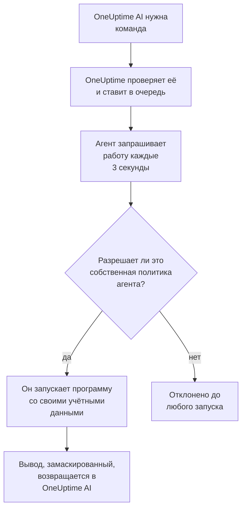

# ИИ-агенты инфраструктуры

Расследуя инцидент или оповещение, OneUptime AI может смотреть не только на вашу телеметрию. Небольшой агент, установленный рядом с одним из ваших ресурсов (хостом Docker или Podman, кластером Docker Swarm, кластером Proxmox, VMware vCenter, кластером Ceph, сервером баз данных или хостом Linux), выполняет команды только для чтения, которые запрашивает OneUptime AI, например `docker logs --tail 200 web`, `pvesh get /cluster/status`, `ceph health detail`, `db long-queries --min-seconds 30` или `journalctl -u nginx -n 200 --no-pager`, и отправляет вывод обратно, так что анализ первопричины цитирует то, что говорит сам ресурс. Если вы это разрешите, тот же агент применяет и исправления (перезапускает контейнер, запускает ВМ, возвращает OSD в состояние in), каждое из которых политика команд относит к определённому уровню и которое, если вы не выберете иное, сначала одобряет человек. Спросить ИИ, открытый на странице ресурса, по вашей просьбе выполняет те же команды только для чтения (см. [Спросить ИИ](/docs/ai/ask-ai)).

Эти агенты называются **ИИ-агентами ресурсов**. На странице каждого ресурса в панели есть раздел **ИИ** с тремя страницами:

- **Аналитика** — что OneUptime AI выяснил о ресурсе за последние 30 дней: проблемы, которые возвращаются снова и снова, и почему, с тем, что нашёл ИИ, и шагом, который он предлагает, части ресурса, стоящие за большинством из них, исправления, которые не помогли или ждут подтверждения, что ИИ исправил сам, и риски, замеченные до того, как кого-либо оповестили, а в сноске — что сам ИИ там сделал. Она работает так же, как у кластера; см. [Что ИИ узнал о кластере](/docs/ai/ai-sre#что-ии-узнал-о-кластере).
- **Журналы** — всё, что OneUptime AI сделал на ресурсе, сначала новое: каждое расследование с его инцидентом или оповещением и сводкой, каждое исправление, которое он предложил или выполнил, и каждая команда, которую он отправил через агента. (Раньше эта страница называлась «Аналитика».)
- **ИИ-агент** — подключён ли агент, что ИИ может делать на ресурсе (расследовать и как выполняются исправления), всё, что требует внимания, с шагом, который это исправляет, а в меню **⋯** рядом со статусом агента — **Проверить подключение** и **Сбросить агент**.

**Обзор** ресурса заканчивается карточкой **ИИ-агент**, которая подытоживает страницу ИИ-агента: подключён ли агент, включено ли расследование, как выполняются исправления (**Выключено**, **Запрашивать подтверждение**, **Автоматически** или **Без подтверждения**) и что требует внимания, со ссылкой на страницу ИИ-агента, где всё это меняется.

:::cards
- [Поддерживаемые ресурсы](#поддерживаемые-ресурсы): Восемь видов ресурсов, один образ.
- [Установка ИИ-агента](#установка-ии-агента): Рядом с уже работающим у вас коллектором или на хосте Linux.
- [Как работают исправления](#как-работают-исправления): Что может выполняться само, что ждёт человека и что не выполняется никогда.
- [Модель безопасности](#модель-безопасности): Три проверки каждой команды и никаких учётных данных от OneUptime.
:::

## Как это работает

Агент никогда не ждёт подключения от OneUptime: он сам обращается к OneUptime, запрашивает работу и выполняет только то, что разрешает его собственная копия политики команд, с учётными данными, которые у него уже есть.



## Как это связано с ИИ-агентом Kubernetes

У кластеров Kubernetes есть свой агент — ИИ-агент Kubernetes, который устанавливается Helm-чартом агента Kubernetes; см. [Доступ к кластеру — пусть OneUptime AI выполняет kubectl](/docs/ai/ai-sre#доступ-к-кластеру-пусть-oneuptime-ai-выполняет-kubectl). Ничто на этой странице его не меняет. ИИ-агенты ресурсов устроены так же:

- **Те же уровни и режимы.** Каждая команда — это **Read**, **SafeWrite**, **RiskyWrite** или **Denied**, а исправления — **Выключено**, **Запрашивать подтверждение**, **Автоматически** или **Без подтверждения**, с тем же смыслом, что и на кластере.
- **Те же три проверки.** Одну и ту же политику команд применяют ИИ-инструменты OneUptime, затем ещё раз сам OneUptime, когда ставит команду в очередь, и ещё раз агент, прежде чем что-либо выполнить.
- **То же правило для учётных данных.** Агент использует только то, что дают ему его собственное окружение и подключённые тома. OneUptime никогда не отправляет ему учётные данные.
- **Те же значения по умолчанию.** ИИ-расследования включены по умолчанию: ресурс начинает работу с включённым расследованием и выключенными исправлениями, как и кластер, поэтому OneUptime AI расследует с помощью своего агента сразу после его подключения и ничего не меняет, пока кто-нибудь не разрешит исправления (см. [Подключение к OneUptime](#подключение-к-oneuptime)).

Что отличается:

- **Один образ для всех ресурсов.** `oneuptime/resource-ai-agent` обслуживает все восемь видов ресурсов, а `ONEUPTIME_AI_AGENT_RESOURCE_TYPE` указывает, какой из них обслуживает агент. Он работает рядом с коллектором ресурса как ещё один контейнер, а не из Helm-чарта.
- **Доступ на запись — это переменная окружения.** Только `ONEUPTIME_AI_ALLOW_WRITES=true` на агенте вообще позволяет ему применять исправления, а `ONEUPTIME_AI_WRITE_TARGETS` ограничивает, какие контейнеры, сервисы, ВМ, OSD, сеансы или юниты им можно затрагивать. На кластере это делают RBAC чарта и `aiAgent.remediation.namespaces`.

Как и ИИ-агент Kubernetes, ИИ-агент ресурса не является Runner. Он никогда не появляется в разделе Сборники инструкций → Агенты runbook-ов и никогда не используется как хост Bash или SSH для runbook-ов.

## Поддерживаемые ресурсы

| Ресурс | `ONEUPTIME_AI_AGENT_RESOURCE_TYPE` | Агент | Регистрируется как (переменная коллектора) | Выполняет | Обращается к ресурсу через |
| -------------------- | ---------------------------------- | --------------------- | ----------------------------------------------------------------------------------------------- | -------------------------------------------------------------------------------------------------------------------------------------------------- | -------------------------------------------------------------------------- |
| Хост Docker | `docker` | ИИ-агент Docker | `DOCKER_HOST_NAME` | `docker` | сокет Docker, `/var/run/docker.sock` |
| Хост Podman | `podman` | ИИ-агент Podman | `PODMAN_HOST_NAME` | `docker` через совместимый с Docker API Podman | сокет Podman, `/run/podman/podman.sock` |
| Кластер Docker Swarm | `docker-swarm` (или `swarm`) | ИИ-агент Docker Swarm | `DOCKER_SWARM_CLUSTER_NAME` | `docker` | сокет Docker узла-менеджера |
| Кластер Proxmox | `proxmox` | ИИ-агент Proxmox | `PROXMOX_CLUSTER_NAME` | команды `pvesh`, отправляемые в API Proxmox VE (бинарного файла `pvesh` в агенте нет) | `https://PVE_HOST:8006/api2/json` с API-токеном Proxmox |
| VMware vCenter | `vmware` (или `vcenter`) | ИИ-агент VMware | `VMWARE_VCENTER_NAME` | `govc` | API vCenter с пользователем vSphere |
| Кластер Ceph | `ceph` | ИИ-агент Ceph | `CEPH_CLUSTER_NAME` | `ceph` | мониторы, с `ceph.conf` и связкой ключей собственного клиента агента |
| Сервер баз данных | `database` (или `db`) | ИИ-агент баз данных | `DATABASE_SERVER_ID` или `DATABASE_SYSTEM` + `DATABASE_SERVER_ADDRESS` + `DATABASE_SERVER_PORT` | `db` — одна операция из фиксированного каталога диагностики, никогда не SQL | собственный драйвер базы данных с учётной записью базы данных |
| Хост | `host` | ИИ-агент хоста | `HOST_NAME` (пусто: собственное имя хоста) | `systemctl`, `journalctl`, `df`, `free`, `uptime`, `ps`, `ss`, `ip`, `dmesg`, `lsblk`, `cat`, `top`, `uname`, `hostnamectl`, `timedatectl`, `kill` | `nsenter` в пространства имён хоста из привилегированного контейнера |

Серверы баз данных: у ИИ-агента баз данных есть диагностика для PostgreSQL, MySQL (а также MariaDB и Percona Server), Redis (а также Valkey, KeyDB и Dragonfly) и MongoDB. Для любой другой СУБД он ничего не выполняет и сообщает об этом на странице ИИ-агента базы данных.

**Проверить подключение** в меню **⋯** рядом со статусом агента на странице ИИ-агента выполняет через агента следующие команды только для чтения и показывает их вывод в карточке агента:

| Ресурс | Что выполняет «Проверить подключение» |
| -------------------- | ---------------------------------------------------- |
| Хост Docker | `docker version`, `docker info` |
| Хост Podman | `docker version`, `docker info` |
| Кластер Docker Swarm | `docker version`, `docker node ls` |
| Кластер Proxmox | `pvesh get /version`, `pvesh get /cluster/status` |
| VMware vCenter | `govc about` |
| Кластер Ceph | `ceph health`, `ceph versions` |
| Сервер баз данных | `db ping`, `db version` |
| Хост | `uptime`, `systemctl list-units --failed --no-pager` |

На рабочем узле Docker Swarm команда `docker node ls` завершается ошибкой: ИИ-агент Docker Swarm должен работать на узле-менеджере. Агент, запущенный на рабочем узле, не регистрируется для кластера, пока его узел не станет менеджером, а установщик Docker Swarm не устанавливает его на узел, который не является менеджером.

## Установка ИИ-агента

Все ИИ-агенты ресурсов — это один и тот же образ, `oneuptime/resource-ai-agent:release`. Ему ничего не нужно в панели: как только он запускается, он регистрируется в OneUptime и в течение минуты появляется на странице ИИ-агента ресурса.

### Рядом с коллектором

Для Docker, Podman, Docker Swarm, Proxmox, VMware, Ceph и серверов баз данных агент работает рядом с коллектором, который вы уже используете для этого ресурса, и разделяет его `.env`: у него уже есть `ONEUPTIME_URL`, ключ приёма данных и имя ресурса. `docker-compose.yml` каждого коллектора поставляет агента как ещё один сервис, а его `install.sh` запускает его.

| Ресурс | Коллектор | Сервис ИИ-агента (и контейнер) | Где он настраивается |
| -------------------- | ----------------------------------------------------------- | --------------------------------- | ------------------------------------------------------------------------------------- |
| Хост Docker | [Агент Docker](/docs/telemetry/docker-host#ии-агент) | `oneuptime-docker-ai-agent` | `agents/DockerAgent/docker-compose.yml`; `install.sh` запускает его вторым контейнером |
| Хост Podman | [Агент Podman](/docs/telemetry/podman-host#ии-агент) | `oneuptime-podman-ai-agent` | `agents/PodmanAgent/docker-compose.yml`; `install.sh` запускает его вторым контейнером |
| Кластер Docker Swarm | [Агент Docker Swarm](/docs/telemetry/docker-swarm#ии-агент) | `oneuptime-docker-swarm-ai-agent` | `agents/DockerSwarmAgent/docker-compose.yml`, на узле-менеджере |
| Кластер Proxmox | [Агент Proxmox](/docs/telemetry/proxmox#ии-агент) | `oneuptime-proxmox-ai-agent` | `agents/ProxmoxAgent/docker-compose.yml` |
| VMware vCenter | [Агент VMware](/docs/telemetry/vmware#ии-агент) | `oneuptime-vmware-ai-agent` | `agents/VMwareAgent/docker-compose.yml` |
| Кластер Ceph | [Агент Ceph](/docs/telemetry/ceph#ии-агент) | `oneuptime-ceph-ai-agent` | `agents/CephAgent/docker-compose.yml`, с собственным клиентом Ceph агента в `./ceph` |
| Сервер баз данных | [Агент баз данных](/docs/telemetry/databases#ии-агент) | `oneuptime-database-ai-agent` | `agents/DatabaseAgent/docker-compose.yml` |

Коллектор, установленный до появления ИИ-агента, пока его не запускает. Запустите его `install.sh` ещё раз: теперь он запускает и ИИ-агента (установщики Proxmox, VMware, Ceph, баз данных и Docker Swarm скачивают текущий `docker-compose.yml`, в котором есть сервис ИИ-агента). Если вы управляете файлами сами, добавьте сервис из `docker-compose.yml` коллектора в свой и выполните `docker compose up -d`. Страница ИИ-агента ресурса показывает точный сервис для этого ресурса с уже подставленным именем.

Без установщиков ИИ-агент Docker — это одна команда `docker run`:

```bash
docker run -d \
  --name oneuptime-docker-ai-agent \
  --user 0:0 \
  --restart unless-stopped \
  --read-only --tmpfs /tmp \
  -v /var/run/docker.sock:/var/run/docker.sock:ro \
  -e ONEUPTIME_URL="https://oneuptime.com" \
  -e ONEUPTIME_SERVICE_TOKEN="YOUR_TELEMETRY_INGESTION_TOKEN" \
  -e ONEUPTIME_AI_AGENT_RESOURCE_TYPE=docker \
  -e DOCKER_HOST_NAME="my-docker-host" \
  oneuptime/resource-ai-agent:release
```

`DOCKER_HOST_NAME` должно совпадать с именем, которое сообщает агент Docker. Установщики Docker и Podman принимают `--no-ai-agent` (или `ONEUPTIME_INSTALL_AI_AGENT=false`), чтобы не устанавливать ИИ-агента, и установщик Docker Swarm тоже. Чтобы позже запускать коллектор без него, удалите сервис ИИ-агента из `docker-compose.yml` или удалите его контейнер командой `docker rm -f`.

### ИИ-агент хоста

У хоста Linux, который отправляет данные через [OpenTelemetry-коллектор на хосте](/docs/telemetry/host-otel-collector), нет контейнера OneUptime, рядом с которым можно было бы встать, поэтому у ИИ-агента хоста есть собственный установщик (`agents/HostAIAgent`):

```bash
curl -fsSL https://raw.githubusercontent.com/OneUptime/oneuptime/master/agents/HostAIAgent/install.sh -o install.sh
sudo bash install.sh
```

Он запрашивает URL вашего OneUptime, ключ приёма телеметрии проекта и имя хоста, записывает `/opt/oneuptime-host-ai-agent/.env` и `docker-compose.yml` и запускает контейнер `oneuptime-host-ai-agent`. Добавьте `--systemd`, чтобы вместо этого запускать его под юнитом systemd `oneuptime-host-ai-agent`. Ему нужен Docker (системный движок, а не rootless Docker) с плагином Compose; rootful Podman может запускать тот же контейнер.

ИИ-агент хоста запускает **собственные программы хоста**: каждая команда выполняется как `nsenter --target 1 --mount --uts --ipc --net --pid -- PROGRAM ARGS`, что входит в пространства имён процесса init хоста. Для этого нужны `pid: host`, `privileged: true` и root; см. [Сокет Docker и ИИ-агент хоста — это root на хосте](#сокет-docker-и-ии-агент-хоста-это-root-на-хосте). Оставьте `HOST_NAME` пустым, чтобы использовать имя хоста машины, которое коллектор сообщает как `host.name`, если вы его не меняли; иначе укажите имя, показанное в разделе **Хосты**.

### Подключение к OneUptime

Агент регистрируется с **той же идентичностью, которую сообщает коллектор** (`DOCKER_HOST_NAME`, `PROXMOX_CLUSTER_NAME`, `CEPH_CLUSTER_NAME`, …; `ONEUPTIME_AI_AGENT_RESOURCE_NAME` её переопределяет), поэтому он обслуживает ровно тот ресурс, который создала телеметрия коллектора. Если в OneUptime ещё нет ресурса с таким именем, регистрация создаёт его, поэтому имя, отличающееся от имени коллектора, даёт вам второй, пустой ресурс вместо ошибки. База данных регистрируется по `DATABASE_SERVER_ID`, если он задан, иначе по своей СУБД, адресу и порту; `DATABASE_SERVER_ID`, который не является базой данных этого проекта, отклоняется.

Если коллектор всё ещё использует имя по умолчанию (`docker-host`, `podman-host`, `docker-swarm`, `proxmox-cluster`, `vmware-vcenter`, `ceph`), каждый ресурс, установленный с этим значением, отправляет данные в один и тот же ресурс в OneUptime, и команды для него могут попасть на любой из них. Агент предупреждает об этом в своём журнале; дайте каждому ресурсу уникальное имя и на коллекторе, и на агенте.

Он аутентифицируется с помощью ключа приёма телеметрии проекта (первого заданного из `ONEUPTIME_API_KEY`, `ONEUPTIME_TELEMETRY_INGESTION_KEY` и `ONEUPTIME_SERVICE_TOKEN`, которые коллекторы уже задают) и получает собственный ключ. Все его вызовы — это HTTPS-запросы `POST` к `<ONEUPTIME_URL>/resource-ai-agent-ingest/…`: он регистрируется один раз при запуске, отправляет heartbeat каждые 30 секунд (он считается подключённым в течение 5 минут после последнего), запрашивает работу каждые 3 секунды и отключается при остановке. Второй агент с той же идентичностью отклоняется, пока первый подключён: контейнер, который корректно останавливается, отключается, поэтому его замена принимается сразу, а после сбоя или kill замена занимает его место, как только старый агент ничего не отправит в течение 40 секунд после первого отказа. Если замену всё ещё отклоняют через 10 минут, ту же идентичность использует другой работающий агент: агент записывает ошибку об этом и запрашивает работу только раз в 5 минут, пока вы не дадите каждому ресурсу собственное имя или не остановите другого агента. В проекте может быть не более 250 ИИ-агентов ресурсов, и в час регистрируются не более 30 новых. Когда достигнуто 250, агенты, от которых не было вестей 7 дней, удаляются, чтобы освободить место для нового (ресурс сохраняет свои настройки ИИ, а такой агент, вернувшись, просто регистрируется заново).

**Расследование** включено для каждого ресурса с самого начала, поэтому OneUptime AI расследует с помощью агента сразу после его подключения. Помимо этого, то, что ИИ может делать на ресурсе, — это собственная настройка агента (см. [Что может делать ИИ, задаёт агент](#что-может-делать-ии-задаёт-агент)). Агент, который не указывает ни одну из двух настроек, использует свои значения по умолчанию: он включает **расследование** для своего ресурса и, если разрешает запись (`ONEUPTIME_AI_ALLOW_WRITES=true`), устанавливает **Исправления** в **Запрашивать подтверждение**, а иначе в **Выключено**. Эти значения применяются только к ресурсу, чьи настройки ИИ никто не выбирал на странице ИИ-агента: настройки, которые кто-то там сохранил, остаются как есть, пока их не укажет конфигурация агента, поэтому ресурс, у которого кто-то выключил переключатель **Расследовать**, остаётся с выключенным. Агент старше этих настроек не сообщает ни одной из них, и их, как и раньше, задаёт страница ИИ-агента.

**Сбросить агент** в том же меню **⋯** на странице ИИ-агента заставляет OneUptime забыть ключ агента после вашего подтверждения; тот, кто его держал, теряет доступ, а настоящий агент регистрируется заново в течение нескольких минут. Агенту нужен сервер OneUptime той же версии, что и его образ, или новее.

### Что может делать ИИ, задаёт агент

Расследование и исправления задаются там, где работает агент (в `.env`, который он разделяет с коллектором, или в окружении его контейнера), и OneUptime следует им:

| Переменная | По умолчанию | Что делает |
| ---------------------------- | ------- | ----------------------------------------------------------------------------------------------------------------------------------------------------------------------------------------------------------------------------------------------------- |
| `ONEUPTIME_AI_INVESTIGATION` | пусто | `true` позволяет ИИ во время расследования выполнять приведённые ниже команды только для чтения; `false` ограничивает его данными, которые уже есть в OneUptime. Пусто: включено. |
| `ONEUPTIME_AI_FIXES` | пусто | Как ИИ может применять исправление: `off`, `ask-for-approval`, `automatic` или `bypass-approval` (см. [Режимы исправлений](#режимы-исправлений)). Любому режиму, кроме `off`, нужна ещё и `ONEUPTIME_AI_ALLOW_WRITES=true`, а `off` оставляет агента только для чтения даже с ней. Пусто: `ask-for-approval`, если агент разрешает запись, иначе `off`. |

Например, чтобы ИИ применял исправления, а человек одобрял каждое из них:

```bash
ONEUPTIME_AI_INVESTIGATION=true
ONEUPTIME_AI_FIXES=ask-for-approval
ONEUPTIME_AI_ALLOW_WRITES=true
```

Затем перезапустите агента (`docker compose up -d` или повторно запустите `install.sh` коллектора с заданными значениями для хоста Docker или Podman). Агент сообщает обе настройки при регистрации и с каждым heartbeat, и OneUptime сразу применяет их к ресурсу. После этого страница ИИ-агента ресурса показывает их только для чтения: **Изменить** показывает эти строки для выбранного варианта вместо сохранения, а OneUptime отклоняет изменение, сделанное где-либо ещё (через API, Terraform, главным администратором), пока их задаёт агент. Список разрешённых команд остаётся на странице. Значение, которое агент не может прочитать, оставляет эту настройку выключенной, и агент записывает в журнал, какую именно.

## Что может выполнять расследование

Расследование всегда выполняет только команды уровня **Read**: они смотрят на ресурс и ничего не меняют. OneUptime AI видит ресурсы, связанные с инцидентом или оповещением (через их мониторы и телеметрию, не более 10 на сигнал), у которых ИИ-агент подключён, а переключатель **Расследовать** включён, и выполняет столько команд, сколько нужно расследованию (до 200 на расследование, защита от вышедшего из-под контроля цикла), и каждая цитируется как любое другое доказательство. Каждая команда — это одна программа с её аргументами, никогда не через оболочку, поэтому конвейеры, перенаправления, `;`, `&&`, `$(…)` и `sudo` отклоняются с сообщением об этом. По умолчанию команде даётся 30 секунд, а максимум 2 минуты, и её вывод на агенте ограничен 1024 КБ. Ничего из этого вывода не обрезается перед OneUptime AI: длинный вывод показывается постранично (первые 40 000 символов, затем остальное по запросу). Если агент не забирает команду, OneUptime AI до конца расследования перестаёт отправлять этому ресурсу команды.

Что может читать каждый вид ресурсов, указано ниже. Это тот же список, который получает сам ИИ; всё, чего в нём нет, отклоняется.

### Хосты Docker и Podman

- Контейнеры: `docker ps -a` (также `-q`, `-n`, `-l`, `-s`, `--no-trunc`, `--filter`, `--format json`), `docker container inspect web`, `docker inspect --type container web`, `docker top web`, `docker port web`, `docker diff web`. Значения переменных окружения в выводе inspect возвращаются замаскированными.
- Журналы и активность: `docker logs --tail 200 web` или `docker logs --since 30m web`; обязателен `--tail` не более 2000 или `--since` (без `--tail` значение `--since` должно быть длительностью не более 24h), а `-f` не разрешён никогда; `docker stats --no-stream`; `docker events --since 30m --until 0s` (обе границы обязательны, `--until` в виде длительности, чтобы окно всегда закрывалось в прошлом).
- Движок: `docker info`, `docker version`, `docker system df` (`-v` только в виде таблицы: `-v --format json` выводит командную строку каждого шага сборки), `docker images`, `docker image inspect nginx:1.27`, `docker network ls`, `docker network inspect bridge`, `docker volume ls`, `docker volume inspect data`.
- Только `--format json` (или `table` для списков), никогда шаблон Go и ни один из глобальных флагов docker (`-H`, `--context`, `--config`, …): они направили бы CLI на другой движок.

Хост Podman выполняет тот же CLI `docker` и ту же политику через совместимый с Docker API Podman.

### Кластеры Docker Swarm

- Узлы: `docker node ls`, `docker node ps node-1`, `docker node inspect node-1 --pretty`.
- Сервисы: `docker service ls`, `docker service ps web --no-trunc`, `docker service inspect web --pretty` (значения переменных окружения возвращаются замаскированными), `docker service logs --tail 200 web` (обязателен `--tail` не более 2000 или `--since`, который сам по себе должен быть длительностью не более 24h; никогда `-f`).
- Стеки: `docker stack ls`, `docker stack ps shop`, `docker stack services shop`.
- Собственный движок менеджера: `docker ps -a`, `docker container inspect web`, `docker logs --tail 200 web`, `docker stats --no-stream`, `docker info`, `docker version`, `docker network ls` и остальные команды чтения хоста Docker.

### Кластеры Proxmox

В агенте нет `pvesh`. Команда записывается в грамматике `pvesh` (`get` или `ls` и путь API, параметры в виде `--name value`), и агент превращает её ровно в один запрос `GET` к API Proxmox VE со своим токеном. `--output-format json|json-pretty|text` выбирает формат вывода; строки запроса не принимаются, а запись должна указывать свой узел (никогда `localhost`).

- Кластер: `pvesh get /version`, `pvesh get /cluster/status`, `pvesh get /cluster/resources --type vm`, `pvesh get /cluster/ha/status/current`, `pvesh get /cluster/log --max 50`, `pvesh get /cluster/tasks`, `pvesh get /nodes`, а также списки репликации, резервных копий, пулов и хранилищ.
- Узел: `pvesh get /nodes/pve1/status`, `pvesh get /nodes/pve1/services`, `pvesh get /nodes/pve1/storage`, `pvesh get /nodes/pve1/disks/list`, `pvesh get /nodes/pve1/rrddata --timeframe hour`, а также его сеть, репликация, обновления APT и состояние Ceph.
- Задачи и журналы: `pvesh get /nodes/pve1/tasks --errors 1 --limit 20`, состояние и журнал задачи, `pvesh get /nodes/pve1/syslog --limit 200`, `pvesh get /nodes/pve1/journal --lastentries 200`.
- Гостевые системы (`qemu` для ВМ, `lxc` для контейнеров): `pvesh get /nodes/pve1/qemu`, `pvesh get /nodes/pve1/lxc`, `pvesh get /nodes/pve1/qemu/101/status/current`, `pvesh get /nodes/pve1/qemu/101/config` (секреты, например пароли cloud-init, возвращаются замаскированными), ожидающие изменения, снимки, `pvesh get /nodes/pve1/qemu/101/rrddata --timeframe hour` и сведения гостевого агента QEMU, например `pvesh get /nodes/pve1/qemu/101/agent/get-fsinfo`.
- Никогда: ничего в `/access` (пользователи, API-токены, ACL), консоли (`vncproxy`, `termproxy`, `spiceproxy`), монитор QEMU, вызовы exec и работы с файлами гостевого агента.

### VMware vCenter

Сначала идёт команда, затем её флаги, затем имена или пути в инвентаре (govc игнорирует флаги, записанные после аргумента); `-dc DATACENTER` выбирает центр обработки данных.

- `govc about`, `govc datacenter.info`, `govc ls /DC/vm`, `govc find . -type m -runtime.powerState poweredOff` — версия и инвентарь vCenter (`find` фильтрует только по именам, типам, состоянию и свойствам времени выполнения; `ls -json` отклоняется, потому что загружает все свойства каждого перечисленного объекта).
- `govc vm.info web-01`, `govc host.info esx-01`, `govc datastore.info datastore1`, `govc pool.info /DC/host/cluster1/Resources` — состояние питания, хост, гостевая ОС, IP-адрес, VMware Tools, ёмкость. `vm.info` выводит только текст: `-json` и `-e` отклоняются, потому что они выводят `extraConfig` ВМ, где хранятся данные cloud-init и пароли.
- `govc events -n 50 /DC/vm/web-01`, `govc tasks -n 50` — недавние события и задачи (не более 500, никогда `-f`).
- `govc metric.sample -n 12 /DC/vm/web-01 cpu.usage.average`, `govc metric.ls /DC/vm/web-01`, `govc object.collect -s /DC/vm/web-01 runtime.powerState` (только свойства времени выполнения и состояния), `govc host.service.ls -host esx-01`, `govc host.date.info -host esx-01`, `govc tags.ls`.
- Никогда: флаги подключения, учётных данных, TLS и отладки (`-u`, `-k`, `-cert`, `-debug`, `-dump`, …), гостевые операции (`guest.*`), доступ к файлам хранилищ данных, `esxcli`, `env` и любые команды не из списка.

### Кластеры Ceph

- Кластер: `ceph status` (или `ceph -s`), `ceph health detail`, `ceph df detail`, `ceph versions`, `ceph progress`, `ceph quorum_status`, `ceph log last 100`.
- OSD: `ceph osd tree`, `ceph osd df`, `ceph osd perf`, `ceph osd stat`, `ceph osd dump`, `ceph osd blocked-by`, `ceph osd find 3`, `ceph osd metadata 3`, `ceph osd ok-to-stop 3`, `ceph osd safe-to-destroy 3`.
- Пулы и группы размещения: `ceph osd pool ls detail`, `ceph osd pool stats`, `ceph osd pool get rbd size`, `ceph pg stat`, `ceph pg dump_stuck`, `ceph pg 1.2f query`, `ceph pg ls-by-osd 3`.
- Демоны, сбои и cephadm: `ceph mon stat`, `ceph mgr services`, `ceph mgr module ls`, `ceph fs status`, `ceph mds stat`, `ceph balancer status`, `ceph crash ls`, `ceph crash stat`, `ceph orch ps`, `ceph orch ls`, `ceph orch host ls`, `ceph orch device ls`.
- Добавьте `--format json` (или `-f json`, `json-pretty`, `plain`) для структурированного вывода. Никакие другие параметры не принимаются (никогда `-c`, `--keyring`, `--id`, `--admin-daemon`, `-i`, `-o` или `-w`), а `auth`, `config-key`, `config`, `tell` и `daemon` никогда не выполняются.

### Серверы баз данных

`db` — это не программа: это имя одной операции из фиксированного каталога диагностики, которую агент выполняет через собственный драйвер базы данных в сеансе только для чтения, с ограничением времени на каждый оператор. OneUptime AI никогда не пишет SQL, команды Redis или код оболочки MongoDB. Флаги бывают только длинными (`--limit 20` или `--limit=20`).

- `db ping`, `db version` — отвечает ли сервер, его версия и время работы.
- `db sessions --limit 20` (также `--state active`, `--user`, `--database`; `db current-ops` — то же самое) — сеансы и то, что выполняет каждый из них.
- `db long-queries --min-seconds 30`, `db blocking`, `db locks` — медленные операторы, а также кто ждёт блокировку и кто её удерживает.
- `db replication`, `db connections`, `db database-sizes`, `db table-sizes --limit 20`, `db top-statements --limit 10` — задержка репликации, подключения относительно лимита, куда уходят место и время.
- `db settings work_mem` (или все настройки) — никогда настройки с учётными данными, такие как `requirepass`.
- Отчёты СУБД: `db slowlog`, `db info memory`, `db innodb-status`, `db memory`, `db keyspace`.

Текст запросов в выводе нормализуется (каждый строковый и числовой литерал заменяется на `?`), поэтому данные ваших клиентов в операторе никогда не попадают в OneUptime.

### Хосты

- Сервисы: `systemctl status nginx --no-pager -n 50`, `systemctl is-active nginx`, `systemctl list-units --failed --no-pager`, `systemctl list-timers --all`, `systemctl show nginx -p ActiveState,SubState,Result,NRestarts` (`-p` обязателен, и разрешены только свойства состояния юнита — никогда `Environment` и никогда файл юнита).
- Журналы: `journalctl -u nginx -n 200 --no-pager`; каждому чтению нужен `-n` (не более 2000) или `--since`, никогда `-f`; также `-p err`, `-k`, `-b`, `--until`, `-g`, `-t`, `-o short-iso|json`; `journalctl --list-boots`, `journalctl --disk-usage`.
- Ресурсы: `uptime`, `free -m`, `df -h`, `df -i`, `lsblk -f`, `uname -a`, `hostnamectl`, `timedatectl`, `dmesg -T --level=err,warn`.
- Процессы: `ps aux --sort=-%cpu`, `top -b -n 1 -o %MEM`. Пароли в командных строках возвращаются замаскированными.
- Сеть: `ss -tulpn`, `ss -s`, `ip -br addr`, `ip route`, `ip route get 1.1.1.1`.
- Счётчики ядра: `cat /proc/loadavg`, `cat /proc/meminfo`, `cat /proc/pressure/memory`, `cat /etc/os-release`; `cat` читает только короткий список файлов `/proc` и `/etc/os-release`, больше ничего.
- Одна программа на команду, указанная без пути: никогда оболочка, `sudo` или любая другая программа.

## Как работают исправления

Исправления выключены, пока вы их не включите, и для этого нужны две настройки на агенте: `ONEUPTIME_AI_FIXES` со значением режима, отличного от `off` (см. [Что может делать ИИ, задаёт агент](#что-может-делать-ии-задаёт-агент)), и `ONEUPTIME_AI_ALLOW_WRITES=true` (см. [Доступ на запись на агенте](#доступ-на-запись-на-агенте)). Одна из них без другой ничего не меняет. Агент старше `ONEUPTIME_AI_FIXES` вместо этого берёт **Исправления** со страницы ИИ-агента ресурса. Исправлениям также нужно, чтобы ИИ был включён для проекта (**Включить ИИ** в разделе Настройки проекта → ИИ → AI Features), а он включён, если только кто-нибудь его не выключил.

### Режимы исправлений

У исправлений те же четыре режима, что и на кластере Kubernetes; `ONEUPTIME_AI_FIXES` записывает их как `off`, `ask-for-approval`, `automatic` и `bypass-approval`:

- **Выключено** — ИИ только расследует.
- **Запрашивать подтверждение** — после анализа первопричины OneUptime AI ставит диагноз с помощью команд чтения и составляет минимальный план, устраняющий причину, например `docker restart web`. План появляется в инциденте или оповещении с обоснованием, ожидаемым эффектом и откатом; человек одобряет его одним щелчком, и OneUptime выполняет ровно эти команды.
- **Автоматически** — безопасные изменения (**SafeWrite**) выполняются сами; более рискованное изменение (**RiskyWrite**) предлагается на подтверждение, если только список разрешённых команд ресурса не называет его точную форму.
- **Без подтверждения** — каждое изменение, которое разрешает политика, включая более рискованные, выполняется само. То, что всегда требует человека, по-прежнему его ждёт.

После выполнения исправления OneUptime следит за мониторами инцидента или оповещения. Если они не восстанавливаются, выполняется откат плана, и OneUptime AI составляет ещё один план, учитывая неудачную попытку, — не более двух раундов на инцидент или оповещение. В режиме **Автоматически** этот второй раунд запрашивает подтверждение; в режиме **Без подтверждения** он тоже выполняется сам. Для исправлений без присмотра действует предохранитель — не более трёх на ресурс в час: сверх этого, а также пока другой раунд OneUptime AI без присмотра ещё меняет или проверяет тот же ресурс, раунд предлагает свой план на подтверждение вместо выполнения.

Инцидент или оповещение получает одну полосу ИИ-исправлений. Если он связан с кластером Kubernetes, у которого включены исправления, выполняется раунд кластера и ни одного раунда ресурса. Иначе раунд получает первый связанный ресурс с включёнными исправлениями и готовым агентом в таком порядке: хост Docker, хост Podman, кластер Docker Swarm, кластер Proxmox, VMware vCenter, кластер Ceph, сервер баз данных, хост. Раунд меняет только этот ресурс.

### Безопасные, более рискованные и запрещённые

| Уровень | Что он означает | Выполняется |
| -------------- | ------------------------------------------------------------------------------------------------------------------------------------- | ------------------------------------------------------------------------------------------------------------ |
| **Read** | Смотрит на ресурс и ничего не меняет | В расследованиях и раундах исправлений, всегда |
| **SafeWrite** | Обратимое изменение ровно одного именованного объекта: перезапуск одного контейнера, запуск одной ВМ, возврат одного OSD в состояние in, перезапуск одного юнита | Само в режимах **Автоматически** и **Без подтверждения**; после подтверждения в режиме **Запрашивать подтверждение** |
| **RiskyWrite** | Изменение, которое может что-то положить или изменить то, что работает: остановка, kill, выключение, масштабирование до нуля, новый образ, несколько объектов сразу | Само в режиме **Без подтверждения** или в режиме **Автоматически**, если его называет список разрешённых команд; иначе после подтверждения |
| **Denied** | Всё остальное, прежде всего всё, что запускает код, удаляет данные, читает учётные данные или неизвестно политике | Никогда, даже если человек это одобрит |

Некоторые более рискованные изменения **всегда требуют человека** в любом режиме, включая «Без подтверждения», и никакая запись в списке разрешённых команд этого не меняет; в таблицах ниже они отмечены соответствующим образом.

### Исправления на хостах Docker и Podman

| | Команды |
| ------------------- | ----------------------------------------------------------------------------------------------------------------------------------------------------------------------------------------------------------------------------------------------------------------------------------------------------- |
| **Безопасные** | `docker restart web` (`-t 30` допустимо), `docker start web`, `docker unpause web` — один контейнер |
| **Более рискованные** | `docker stop web`, `docker kill -s TERM web` (TERM, INT, HUP, QUIT, USR1, USR2 или KILL), `docker pause web`, `docker update --memory 1g web` (также `--memory-swap`, `--memory-reservation`, `--cpus`, `--cpu-shares`, `--restart`, `--pids-limit`) и `docker restart web api` (несколько контейнеров) |
| **Всегда человек** | — |
| **Никогда** | `docker exec web sh`, `docker run nginx`, `docker rm web`, `docker system prune`, `docker cp web:/etc/passwd .`, `docker compose up -d`, create, build, pull, push, login, commit, save, load, изменения сетей и томов, команды swarm и любой другой флаг `update` |

### Исправления на кластерах Docker Swarm

| | Команды |
| ------------------- | --------------------------------------------------------------------------------------------------------------------------------------------------------------------------------------------------------------------------------------------------------------------------------------------------------------------------------------- |
| **Безопасные** | `docker service update --force web` (поэтапный перезапуск), `docker service rollback web`, `docker service scale web=3` (до 1 и более) — один сервис |
| **Более рискованные** | `docker service scale web=0`, `docker service update --image nginx:1.27 web`, `docker service update --replicas 5 web`, `docker service update --limit-memory 1g web` (также лимиты CPU, резервирования и политика обновления), `docker node update --availability active node-1` |
| **Всегда человек** | `docker node update --availability drain node-1`, `docker node update --availability pause node-1` |
| **Никогда** | `docker service rm web`, `docker stack deploy -c stack.yml shop`, `docker secret ls`, `docker node rm node-1`, `docker service update --env-add A=b web` (окружение, монтирования, секреты, сети, порты, пользователь), конфигурации, повышение узлов и их метки, а также `docker restart web` — изменение одного контейнера на менеджере не является исправлением Swarm |

Непосредственно перед выполнением изменения ИИ-агенты Docker, Podman и Docker Swarm находят его цель в движке и отклоняют изменение, если из-за цели оно становится больше, чем говорит его уровень: остановка или kill контейнера, запущенного с `--rm` (docker удалил бы его вместе с анонимными томами), запуск остановленного одноразового контейнера, созданного `docker compose run` (его задание выполнилось бы снова), и любое обновление, масштабирование или откат сервиса заданий Swarm (`replicated-job` или `global-job`: каждое из них снова запускает задание). Такое изменение остаётся за человеком, кто бы его ни одобрил.

### Исправления на кластерах Proxmox

Исправление — это `create` и путь API, то есть один запрос `POST` к API Proxmox VE. `{type}` — это `qemu` для ВМ и `lxc` для контейнера. Агент следит за задачей, которую запускает исправление, пока она не завершится, поэтому гостевая система, которая не запускается, отображается как неудачное исправление с журналом задачи.

| | Команды |
| ------------------- | -------------------------------------------------------------------------------------------------------------------------------------------------------------------------------------------------------------------------------------------------------------------------------------------------------------------------------------------------------------------------------------------------------------------------------------------------------------------------------------------------------------------------- |
| **Безопасные** | `pvesh create /nodes/pve1/qemu/101/status/start`, `pvesh create /nodes/pve1/lxc/102/status/start`, `pvesh create /nodes/pve1/qemu/101/status/resume`, `pvesh create /nodes/pve1/qemu/101/status/reboot` — одна гостевая система |
| **Более рискованные** | `pvesh create /nodes/pve1/qemu/101/status/shutdown`, `pvesh create /nodes/pve1/qemu/101/status/stop`, `pvesh create /nodes/pve1/qemu/101/status/suspend`, `pvesh create /nodes/pve1/qemu/101/status/reset` и `pvesh create /nodes/pve1/services/pveproxy/restart` (запуск, перезапуск или перезагрузка конфигурации pveproxy, pvedaemon, pvestatd, pve-ha-lrm, pve-ha-crm, spiceproxy, pvescheduler, pve-firewall, chrony, cron или postfix) |
| **Всегда человек** | `pvesh create /nodes/pve1/qemu/101/migrate --target pve2`, `pvesh create /nodes/pve1/services/corosync/restart` (а также запуск, перезапуск или перезагрузка конфигурации `pve-cluster`) |
| **Никогда** | `pvesh set /nodes/pve1/qemu/101/config --memory 4096` (любое изменение конфигурации), `pvesh delete /nodes/pve1/qemu/101`, `pvesh create /nodes/pve1/services/pveproxy/stop` (остановка сервиса узла), `pvesh create /nodes/pve1/status --command reboot` (перезагрузка или выключение узла), `pvesh create /nodes/pve1/stopall`, `pvesh create /nodes/pve1/qemu/101/snapshot --snapname before`, `pvesh get /access/users`, `pvesh create /nodes/pve1/qemu/101/vncproxy`, `pvesh create /nodes/pve1/qemu/101/agent/exec --command ls` |

### Исправления в VMware vCenter

Каждая ВМ указывается точно (лучше всего полным путём в инвентаре, поскольку govc применяет голое имя ко всем ВМ с таким именем в любой папке), а каждый хост ESXi — только по имени, поскольку путь может обозначать целый кластер. Никаких подстановочных знаков и ссылок на управляемые объекты (`vm-42`), а флаги идут перед именами.

| | Команды |
| ------------------- | -------------------------------------------------------------------------------------------------------------------------------------------------------------------------------------------------------------------------------------------------------------------------------------------------------------------------------------------------------------- |
| **Безопасные** | `govc vm.power -on /DC/vm/web-01`, `govc vm.power -r /DC/vm/web-01` (корректная перезагрузка гостевой ОС через VMware Tools) — одна ВМ, указанная путём в инвентаре |
| **Более рискованные** | `govc vm.power -s web-01` (выключение гостевой ОС), `govc vm.power -off web-01`, `govc vm.power -reset web-01`, `govc vm.power -suspend web-01` (`-force` только с `-off` или `-reset`), `govc vm.power -on web-01 web-02` (несколько ВМ), `govc vm.power -on web-01` (голое имя: все ВМ с именем web-01), `govc host.maintenance.exit esx-01` |
| **Всегда человек** | `govc vm.migrate -host esx-02 web-01`, `govc host.maintenance.enter esx-01` |
| **Никогда** | `govc vm.destroy web-01` (а также create, clone, change, register), `govc snapshot.create -vm web-01 before`, `govc guest.run -vm web-01 ls`, `govc vm.info -e web-01`, `govc env`, `govc host.esxcli -host esx-01 system version get`, устройства и диски, доступ к файлам хранилищ данных, добавление, удаление, перезагрузка и выключение хостов, разрешения, роли, сеансы и лицензии |

### Исправления на кластерах Ceph

Каждое исправление указывает один OSD (`3` или `osd.3`), PG (`1.2f`), демон (так, как его перечисляет `ceph orch ps`), сервис или отчёт о сбое.

| | Команды |
| ------------------- | -------------------------------------------------------------------------------------------------------------------------------------------------------------------------------------------------------------------------------------------------------------------------------------------------------------------------------------------- |
| **Безопасные** | `ceph osd in 3`, `ceph osd unset noout` (также norebalance, nobackfill, norecover, noscrub, nodeep-scrub, pause), `ceph orch daemon restart osd.3`, `ceph pg scrub 1.2f`, `ceph pg deep-scrub 1.2f` и архивирование одного отчёта о сбое |
| **Более рискованные** | `ceph osd out 3`, `ceph osd down 3`, `ceph osd set noout`, `ceph osd reweight 3 0.8`, `ceph pg repair 1.2f`, `ceph mgr fail`, `ceph orch daemon stop osd.3`, `ceph orch restart rgw.default`, `ceph crash archive-all`, `ceph balancer on` |
| **Всегда человек** | `ceph osd set pause` (останавливает весь клиентский ввод-вывод), `ceph osd pool set rbd size 3` (и `min_size`) |
| **Никогда** | `ceph osd purge 3` (а также destroy, rm, lost, изменения карты CRUSH), `ceph osd pool delete rbd` (а также создание, переименование или любые другие настройки пула), `ceph auth ls`, `ceph config-key ls`, `ceph tell osd.3 injectargs --debug-osd 20`, `ceph --id admin status`, `config`, `daemon`, изменения fs и mon, `mgr module enable`, `orch apply`, `crash rm` |

### Исправления на серверах баз данных

`12345` ниже — это идентификатор сеанса в том виде, в каком его выводит `db sessions`: pid в PostgreSQL, id в processlist MySQL, id клиента Redis или opid в MongoDB. Агент сначала находит сеанс и никогда не трогает собственное подключение, поток сервера или репликации, а также несуществующий сеанс.

| | Команды |
| ------------------- | ----------------------------------------------------------------------------------------------------------------------------------------------------------------------------------------------------- |
| **Безопасные** | `db cancel-query 12345` — отменяет оператор, который выполняет один сеанс; сеанс остаётся подключённым (PostgreSQL, MySQL/MariaDB, MongoDB) |
| **Более рискованные** | `db terminate-session 12345` — отключает один сеанс и откатывает его открытую транзакцию (PostgreSQL, MySQL/MariaDB, Redis) |
| **Всегда человек** | — |
| **Никогда** | `db query "SELECT 1"`, `db sql DROP TABLE users` — никакого SQL, никаких изменений настроек (`ALTER SYSTEM`, `SET GLOBAL`, `CONFIG SET`), никакого `FLUSHALL`, никакого `SHUTDOWN`, никаких изменений схемы, данных, пользователей или репликации |

### Исправления на хостах

Юниты указываются полным именем: `systemctl restart nginx` перезапускает `nginx.service`.

| | Команды |
| ------------------- | -------------------------------------------------------------------------------------------------------------------------------------------------------------------------------------------------------------------------------------------------------------------------------------------------------------------------------------------------------------------- |
| **Безопасные** | `systemctl restart nginx`, `systemctl start nginx`, `systemctl reload nginx`, `systemctl reset-failed nginx` (также `try-restart` и `reload-or-restart`) — один юнит типа service, socket, timer или path |
| **Более рискованные** | `systemctl stop nginx`, `systemctl restart nginx php-fpm` (несколько юнитов), `journalctl --vacuum-size=500M` (также `--vacuum-time`, `--vacuum-files`) и `systemctl reset-failed` без юнита |
| **Всегда человек** | `systemctl restart sshd` и любое другое изменение защищённого юнита (ssh, `systemd-*`, udev, dbus, polkit, NetworkManager, networking, getty и autovt, docker, containerd, podman, kubelet, межсетевой экран, `user@` и юниты обновления пакетов, такие как `apt-daily-upgrade` и `unattended-upgrades`), `systemctl restart docker`, `systemctl restart local-fs.target` (любой юнит `.target`, `.mount`, `.automount` или `.swap`), `kill -TERM 4242` (отправка сигнала процессу) |
| **Никогда** | `systemctl enable nginx` (а также disable, mask, edit), `systemctl daemon-reload`, `systemctl reboot` (а также poweroff, halt, suspend, rescue и их юниты, такие как `reboot.target` и `runlevel6.target`), `systemctl start debug-shell` (оболочка root без пароля), `systemctl cat nginx`, `systemctl show nginx -p Environment`, `journalctl -f -u nginx`, `ip link set eth0 down`, `kill -9 1`, `cat /etc/shadow`, `bash -c uptime`, `sudo systemctl restart nginx`, `dmesg --clear`, `ss -K` |

### Список разрешённых команд

В режиме **Автоматически** **Список разрешённых команд** ресурса на странице ИИ-агента позволяет названным вами более рискованным командам выполняться без подтверждения. Он сопоставляется с командой слово за словом, а не как текст:

- `*` заменяет ровно **одно целое слово** (имя, id, значение) — никогда часть слова и никогда лишние слова или флаги. `docker update --memory * web` разрешает любой лимит памяти для `web`; `docker stop web-*` ничему не соответствует, потому что `*` никогда не заменяет часть слова.
- Каждое слово команды должно быть в записи, включая флаги, а в записи должно быть не менее двух слов после программы. `*` не может заменять глагол: `docker *` и `docker * web` отклоняются при сохранении.
- Запись, которая никогда не может заранее одобрить изменение, отклоняется: команда только для чтения (чтению подтверждение не нужно никогда), команда, которую политика запрещает, или команда для другого вида ресурсов. В списке не более 50 записей длиной не более 500 символов.
- Запись с `*` на месте цели (`docker stop *` заранее одобряет остановку **любого** контейнера) перед сохранением просит вас подтвердить.
- Путь Proxmox — это одно слово, поэтому в нём не может быть `*`: пишите по одной записи на гостевую систему, например `pvesh create /nodes/pve1/qemu/100/status/shutdown`.
- Ничто в списке не отменяет изменение, которое всегда требует человека, или команду, которую политика запрещает.

По одной допустимой записи для каждого ресурса: `docker stop web` (Docker и Podman), `docker service update --image nginx:1.27 web` (Docker Swarm), `pvesh create /nodes/pve1/qemu/100/status/shutdown` (Proxmox), `govc vm.power -off web-01` (VMware), `ceph osd out 3` (Ceph), `db terminate-session 12345` (базы данных), `systemctl stop nginx` (хосты).

### Кто может его менять

Пока расследование и исправления задаёт агент, они меняются там, где он работает, кем бы вы ни были, а дальнейшее относится только к списку разрешённых команд. Для агента старше этих настроек, который оставляет их странице ИИ-агента: включение исправлений (любой переход из **Выключено**, в том числе в **Запрашивать подтверждение**) и их ослабление (переход в **Автоматически** или **Без подтверждения** либо добавление записи в список) требует Project Owner, Project Admin или разрешения **Edit AI Rule** — тех же людей, которые могут создать правило ИИ, исправляющее без запроса. **Сбросить агент** требует тех же людей. Ужесточение (**Выключено**, менее автономный режим, удаление записей из списка) и переключатель **Расследовать** доступны всем, кто может редактировать ресурс, как и **Проверить подключение** и одобрение исправления, которое OneUptime AI предлагает для этого ресурса. Всё это требует права редактировать именно этот ресурс: разрешение, ограниченное некоторыми метками или ресурсами, которыми владеете вы или ваши команды, распространяется только на эти ресурсы, а блокирующая запись с метками убирает ресурсы с этими метками.

## Доступ на запись на агенте

Что бы ни говорила страница ИИ-агента, сам агент отклоняет любое изменение, если он не был запущен с доступом на запись. Это решает его окружение:

| Переменная | По умолчанию | Что делает |
| -------------------------------- | ------- | -------------------------------------------------------------------------------------------------------------------------------------------------------------------------------------------------------------------------------------------------- |
| `ONEUPTIME_AI_ALLOW_WRITES` | `false` | Только `true` вообще позволяет агенту выполнять изменения. Любое другое значение (не задано, `false`, опечатка, `yes`) оставляет его только для чтения, и агент записывает предупреждение для значения, которое не равно ни `true`, ни `false`. |
| `ONEUPTIME_AI_WRITE_TARGETS` | пусто | Разделённые запятыми glob-шаблоны целей, которые может затрагивать изменение; `*` соответствует любой последовательности символов, а сопоставление учитывает регистр. Пусто означает любую цель, кроме защищённых. Когда переменная задана, изменение, не называющее свои цели, отклоняется. |
| `ONEUPTIME_AI_PROTECTED_TARGETS` | пусто | Разделённые запятыми glob-шаблоны целей, которые OneUptime AI никогда не должен менять, в дополнение к тем, которые агент защищает сам. Сравнение без учёта регистра. |

Задайте их в `.env`, который агент разделяет с коллектором (или в окружении его контейнера), и перезапустите его командой `docker compose up -d`. Список длиннее 64 записей или с записью длиннее 256 символов оставляет агента только для чтения, пока его не исправят.

Агент сообщает эти настройки OneUptime с каждым heartbeat, поэтому OneUptime уже отклоняет исправление, выходящее за их пределы, когда OneUptime AI его предлагает, и ещё раз, когда кто-то его одобряет, — оно никогда не доходит до агента как неудачное исправление. Агент тоже отклоняет его, прежде чем что-либо выполнить.

### Цели записи по ресурсам

| Ресурс | Цели изменения в том виде, в каком их видит `ONEUPTIME_AI_WRITE_TARGETS` | Пример |
| ----------------------- | ---------------------------------------------------------------------------------------------------------------------------------------------------------------------------------------------------- | ----------------------- |
| Хосты Docker и Podman | имена или id контейнеров в том виде, как их пишет команда | `web-*,api-*` |
| Кластеры Docker Swarm | имена сервисов (`web`, а не `web=3`) и имена узлов | `web_*,api_*` |
| Кластеры Proxmox | VMID гостевой системы (`101`); сервис узла в виде `<node>/<service>` (`pve1/pveproxy`) | `100,101,pve1/pveproxy` |
| VMware vCenter | имена ВМ и хостов или пути в инвентаре — ровно так, как их пишет команда; если вы используете пути, перечислите обе формы | `web-*,/DC/vm/web/*` |
| Кластеры Ceph | `osd.3` (неважно, написала команда `3` или `osd.3`), имя пула, id PG, имя демона, имя сервиса, `mgr.NAME`, `crash/ID` и `cluster` для изменений на уровне всего кластера, таких как `ceph osd set noout` | `osd.*,cluster` |
| Серверы баз данных | `session:<id>` | `session:*` |
| Хосты | полные имена юнитов (`nginx.service`), `pid:<pid>` для процесса, `journal` для очистки журнала | `nginx.service,app-*` |

### Что агент защищает сам

OneUptime AI никогда не меняет самого агента или то, в чём он работает, что бы ни говорил `ONEUPTIME_AI_WRITE_TARGETS`:

- **Docker, Podman и Docker Swarm:** собственный контейнер агента (по имени и id) и его сервис Swarm, а также контейнеры агентов Docker, Podman и Docker Swarm от OneUptime — коллекторы, опросчик инвентаря Swarm и их ИИ-агенты. Пока агент не нашёл свой контейнер, он отклоняет любое изменение.
- **VMware vCenter:** ВМ, названная по хосту из `VCENTER_ENDPOINT` (и её короткое имя), — обычно сам виртуальный модуль vCenter, по какому бы пути в инвентаре команда её ни называла. Агент знает этот модуль только под этим именем: если `VCENTER_ENDPOINT` — это IP-адрес (тогда агент предупреждает при запуске) или у ВМ модуля другое имя, добавьте эту ВМ в `ONEUPTIME_AI_PROTECTED_TARGETS`.
- **Серверы баз данных:** собственный сеанс агента.
- **Хосты:** каждый юнит OneUptime (`oneuptime-*`, включая юнит самого ИИ-агента хоста), коллектор OpenTelemetry (`otelcol-contrib.service`, `otelcol.service`), движок Docker, в котором он работает (`docker.service`, `docker.socket`, `containerd.service`), а также собственный процесс агента и процессы над ним.
- **Proxmox:** агент не может определить, в какой гостевой системе он работает. Если он работает в ВМ или контейнере того же кластера, добавьте этот VMID в `ONEUPTIME_AI_PROTECTED_TARGETS`; то же самое сделайте с ВМ агента в VMware.

## Учётные данные и минимальные привилегии

Агент использует только учётные данные из собственного окружения и подключённых томов — в основном данные коллектора из того же `.env`. Задание, которое несёт учётные данные, отклоняется: OneUptime их никогда не отправляет. Что бы ни разрешала политика команд, сам ресурс позволяет агенту только то, что разрешено этим учётным данным, поэтому учётные данные — это жёсткий предел. Дайте расследованиям идентичность только для чтения, а исправлениям — отдельную, ровно с теми правами, которые им нужны.

| Ресурс | Что использует агент | Для расследований | Для исправлений |
| ---------------------------- | --------------------------------------------------------------------------------------------------------------------------------------------------------------------------------------------------------------------------------------- | --------------------------------------------------------------------- | ---------------------------------------------------------------------------------------------------------------------------------------------------------------------------------------------------------------------------- |
| Docker, Podman, Docker Swarm | Сокет движка, подключённый в контейнер (`DOCKER_HOST` переопределяет, где он находится) | Сокета только для чтения не существует: оставьте `ONEUPTIME_AI_ALLOW_WRITES` незаданной | `ONEUPTIME_AI_WRITE_TARGETS` с контейнерами или сервисами, которые ИИ может менять |
| Кластер Proxmox | `PVE_API_TOKEN_ID` / `PVE_API_TOKEN_SECRET` (токен коллектора) или `ONEUPTIME_AI_PVE_API_TOKEN_ID` / `ONEUPTIME_AI_PVE_API_TOKEN_SECRET`, если они заданы; `PVE_HOST`, `PVE_PORT`, `PVE_VERIFY_SSL`, `PVE_CA_FILE` | Токен `PVEAuditor` коллектора | Собственный токен агента с `VM.PowerMgmt` (например, роль `PVEVMUser`) на `/vms`, а лучше на пуле или отдельных VMID; `Sys.Modify` на узле — только если ИИ может перезапускать сервисы узла |
| VMware vCenter | `VCENTER_USERNAME` / `VCENTER_PASSWORD` (пользователь коллектора) или `ONEUPTIME_AI_VCENTER_USERNAME` / `ONEUPTIME_AI_VCENTER_PASSWORD`, если они заданы; `VCENTER_ENDPOINT`, `VCENTER_INSECURE_SKIP_VERIFY`, `VCENTER_CA_FILE`, `GOVC_DATACENTER` | Пользователь коллектора с ролью **Read-Only** | Собственный пользователь агента с `VirtualMachine.Interact.PowerOn`, `PowerOff`, `Reset` и `Suspend`, выданными только на папки, которые ИИ может исправлять; `Host.Config.Maintenance` и привилегии миграции — только если вам нужны такие исправления |
| Кластер Ceph | Связка ключей собственного клиента, `client.oneuptime-ai`, и минимальный `ceph.conf`, подключённые в `/etc/ceph` (`CEPH_CLIENT_ID`, `CEPH_CONF`, `CEPH_KEYRING`) | `mon 'allow r' mgr 'allow r' osd 'allow r'` — никогда связка ключей администратора | Права на чтение плюс записи `allow command` ровно для нужных исправлений (их перечисляет README агента Ceph) |
| Сервер баз данных | `DATABASE_USERNAME` / `DATABASE_PASSWORD` (учётная запись коллектора) или `ONEUPTIME_AI_DATABASE_USERNAME` / `ONEUPTIME_AI_DATABASE_PASSWORD`, если они заданы; `DATABASE_ENDPOINT` и настройки TLS | Учётная запись мониторинга коллектора (`pg_monitor` в PostgreSQL) | Собственная учётная запись агента, которой разрешено отправлять сигналы другим сеансам: `pg_signal_backend` (PostgreSQL), `CONNECTION_ADMIN` (MySQL 8), `+client\|kill` (ACL Redis), действие `killop` (MongoDB) |
| Хост | Ничего: он работает привилегированно от root в пространствах имён хоста | Оставьте `ONEUPTIME_AI_ALLOW_WRITES` незаданной | `ONEUPTIME_AI_WRITE_TARGETS` с юнитами, которые ИИ может менять |

В README коллекторов есть точные команды: команды `pveum` для токена исправлений Proxmox ([ProxmoxAgent](https://github.com/OneUptime/oneuptime/tree/master/agents/ProxmoxAgent)), роль vSphere для исправлений ([VMwareAgent](https://github.com/OneUptime/oneuptime/tree/master/agents/VMwareAgent)), права Ceph на чтение и исправления ([CephAgent](https://github.com/OneUptime/oneuptime/tree/master/agents/CephAgent)) и права баз данных для каждой СУБД ([DatabaseAgent](https://github.com/OneUptime/oneuptime/tree/master/agents/DatabaseAgent)).

## Модель безопасности

### Три точки контроля

Каждая команда — это список аргументов, а не строка оболочки, и одна и та же политика команд (одна копия в OneUptime, побайтово идентичная копия в агенте) определяет её уровень в трёх точках:

1. **Инструменты OneUptime AI.** Инструмент расследования отклоняет всё, кроме Read; инструменты исправления отклоняют команды Denied, применяют режим, список разрешённых команд и сообщённый агентом доступ на запись и отправляют изменение, которому нужен человек, на подтверждение.
2. **Когда OneUptime ставит её в очередь.** Каждая команда проверяется снова: команда Denied отклоняется, расследование может ставить в очередь только Read, ресурс должен принадлежать этому проекту, а его агент — быть подключён, переключатель расследования или исправлений должен быть включён, задание не может нести учётные данные, а изменение должно укладываться в сообщённый агентом доступ на запись. Проект может ставить в очередь не более 240 команд расследования и 30 команд исправления в час.
3. **На агенте, до любого запуска.** Агент отклоняет задание, которое не является ИИ-командой для его собственного ресурса (идентичности, с которой он зарегистрировался, и его id в OneUptime), программу, которую его ресурс не выполняет, команду, которую его собственная политика запрещает или относит к более высокому уровню, чем прислал OneUptime, всё, кроме Read, в расследовании, а также изменение, пока `ONEUPTIME_AI_ALLOW_WRITES` не равно `true` или если оно выходит за его цели записи.

### Как выполняется команда

- Одна программа в виде списка аргументов, никогда не через оболочку: конвейеры, перенаправления, `;`, `&&` и `$(…)` отклоняются до любого запуска, как и `sudo`.
- Окружение, собранное для этой одной команды: ничего из собственного окружения агента (ни его ключ приёма данных, ни его настройки прокси) не попадает в программу, а `docker`, `govc` и `ceph` получают для этой одной команды личный пустой домашний каталог в `/tmp`. CLI `docker` получает пустой личный `DOCKER_CONFIG`, поэтому никакой контекст или помощник учётных данных не может изменить, куда он указывает; `govc` получает учётные данные в своём окружении, никогда в командной строке; `ceph` получает собственные `--conf`, `--keyring` и `--id` агента, и команда не может выбрать другие.
- Ограничение времени (не более 2 минут), после которого программа принудительно завершается; вывод ограничен 50 КБ.
- Секреты в выводе (значения переменных окружения в `docker inspect`, пароли cloud-init Proxmox, ключи, токены и пароли в журналах и командных строках) маскируются на агенте до того, как вывод его покинет, и ещё раз в OneUptime перед сохранением или показом модели.
- Контейнеры работают с корневой файловой системой только для чтения. ИИ-агенты Proxmox, VMware, Ceph и баз данных работают под UID 1000 без каких-либо capabilities.

### Сокет Docker и ИИ-агент хоста — это root на хосте

Чётко понимайте, что находится в руках у двух из этих агентов:

- **Сокет Docker и Podman — это root на хосте.** Любой, кто может к нему обращаться, может запустить привилегированный контейнер, который подключает файловую систему хоста. Подключение его только для чтения (`:ro`) этого не меняет: процесс всё равно может подключиться к сокету на томе только для чтения, и каждый вызов API проходит. На менеджере Docker Swarm сокет управляет всем роем. ИИ-агенты Docker, Podman и Docker Swarm работают от root, потому что сокет принадлежит root.
- **ИИ-агент хоста — это root на хосте.** Он работает привилегированно, от root, в пространстве имён PID хоста и для каждой команды входит в пространства имён хоста.

Ни для одного из них нет более детальных учётных данных, поэтому для этих четырёх агентов пределом служат политика команд, `ONEUPTIME_AI_ALLOW_WRITES` и `ONEUPTIME_AI_WRITE_TARGETS`, а не учётная запись. Политика никогда не выполняет `exec`, `run`, `rm`, `prune`, оболочку или программу вне своего списка, а агент никогда не меняет себя или свой коллектор. Если это больше доверия, чем вы готовы ему оказать, оставьте `ONEUPTIME_AI_ALLOW_WRITES` незаданной (расследования продолжат работать) или не запускайте агента на этом хосте.

### Что OneUptime никогда не отправляет

OneUptime отправляет агенту команду (программу, её аргументы и уровень) и больше ничего. Он никогда не отправляет пароль, токен, ключ или настройку подключения; задание, которое что-то из этого несёт, отклоняется при постановке в очередь, когда агент его забирает, и самим агентом. Собственный ключ агента выдаётся при регистрации, и хранится только его хеш. API OneUptime показывает агента только тем, кто может читать его ресурс.

## Устранение неполадок

### Журналы и статус

Начните с журнала агента, затем посмотрите его статус. Каждый агент отвечает на порту `3877` (ИИ-агент Kubernetes использует 3876, поэтому оба могут работать на одной машине), только на `127.0.0.1` своей сети (`ONEUPTIME_AI_AGENT_HEALTH_HOST=0.0.0.0` открывает его на всех интерфейсах, чтобы опубликовать порт), с `/status/live`, `/status/ready` (ни один из них не ждёт OneUptime) и `/status` — зарегистрировался ли он, какой ресурс обслуживает, его последний heartbeat и последняя ошибка, может ли он достучаться до ресурса и если нет, то почему, и не слишком ли стар для него ваш OneUptime:

```bash
docker logs --tail 100 oneuptime-docker-ai-agent
docker exec oneuptime-docker-ai-agent wget -qO- http://127.0.0.1:3877/status
```

Используйте имя контейнера вашего ресурса: `oneuptime-docker-ai-agent`, `oneuptime-podman-ai-agent` (с `podman` вместо `docker`), `oneuptime-docker-swarm-ai-agent`, `oneuptime-proxmox-ai-agent`, `oneuptime-vmware-ai-agent`, `oneuptime-ceph-ai-agent`, `oneuptime-host-ai-agent`. У сервиса агента баз данных нет фиксированного имени контейнера, поэтому используйте `docker compose logs --tail=100 oneuptime-database-ai-agent` и `docker compose exec oneuptime-database-ai-agent wget -qO- http://127.0.0.1:3877/status` в `/opt/oneuptime-database-agent`. ИИ-агент хоста использует сеть хоста, поэтому `curl -s http://127.0.0.1:3877/status` работает прямо на хосте.

Отсутствующая настройка не роняет агента: он продолжает работать и остаётся исправным, сообщает, чего не хватает, в своём журнале и в `/status` и больше ничего не делает, поэтому контейнер никогда не перезапускается по кругу.

### Частые ошибки

| Что вы видите | Что делать |
| ------------------------------------------------------------------------------------- | --------------------------------------------------------------------------------------------------------------------------------------------------------------------------- |
| `ONEUPTIME_AI_AGENT_RESOURCE_TYPE is not set` (или другая обязательная настройка) | Задайте её в `.env`, который агент разделяет с коллектором, затем выполните `docker compose up -d`. |
| `This OneUptime server does not have the resource AI agent API` | Обновите OneUptime или запустите версию образа агента, соответствующую вашему серверу. Агент проверяет снова каждые 5 минут. |
| `OneUptime refused the agent's API key` | Используйте ключ приёма телеметрии проекта, не закреплённый за сервисом. |
| `OneUptime refused the registration: …` | Прочитайте остаток строки: неизвестный тип ресурса, пустая или слишком длинная идентичность, `DATABASE_SERVER_ID` другого проекта или лимит агентов проекта. |
| `Waiting for this …'s previous AI agent to go offline` | Старый контейнер не отключился (сбой или kill), поэтому новый занимает его место, как только старый ничего не отправит в течение 40 секунд. Если дольше — эту идентичность использует другой агент. |
| Предупреждение о том, что имя совпадает с именем коллектора по умолчанию | Дайте ресурсу уникальное имя на коллекторе и на агенте. |
| `The agent cannot reach this … right now` | Проверьте подключение сокета, адрес, учётные данные или связку ключей, которые называет сообщение. Страница ИИ-агента показывает ту же причину. |
| `Refused by the …: … this agent is read-only` | Задайте `ONEUPTIME_AI_ALLOW_WRITES=true` и для `ONEUPTIME_AI_FIXES` режим, отличный от `off`, затем перезапустите агента. |
| `ONEUPTIME_AI_FIXES="…" is not one of …, so AI fixes stay off` | Используйте `off`, `ask-for-approval`, `automatic` или `bypass-approval` (и `true` или `false` для `ONEUPTIME_AI_INVESTIGATION`); до тех пор эта настройка остаётся выключенной. |
| `ONEUPTIME_AI_FIXES=…, but … is not "true": the agent stays read-only` | Задайте также `ONEUPTIME_AI_ALLOW_WRITES=true` или `ONEUPTIME_AI_FIXES=off`. |
| Сохранение отклонено, потому что то, что может делать OneUptime AI, задаёт агент | Расследование и исправления задаёт агент: меняйте их там, где он работает. **Изменить** на странице ИИ-агента показывает строки для каждого варианта. |
| Исправление отклонено как `outside the targets` или потому, что агент защищает цель (`protects`) | Измените `ONEUPTIME_AI_WRITE_TARGETS` или `ONEUPTIME_AI_PROTECTED_TARGETS` либо оставьте это изменение человеку. |
| `OneUptime sent … as …, but this agent's policy reads it as …` | Агент и OneUptime работают на разных версиях: запустите версию образа агента, соответствующую вашему серверу. |
| `pipes and redirects are not supported; run one command` | Ожидаемо: команды никогда не выполняются через оболочку. Отказ подсказывает OneUptime AI выполнять по одной команде за раз. |
| `Killed (timeout …)` | Ресурс не ответил вовремя; если вывода нет совсем, агент не может до него достучаться — проверьте сеть между ними. |
| Ошибка Proxmox, vCenter, Ceph или базы данных о том, что не хватает привилегии, роли или права | Учётные данные — это жёсткий предел: выдайте то, что называет сообщение (см. [Учётные данные и минимальные привилегии](#учётные-данные-и-минимальные-привилегии)), или оставьте это изменение человеку. |

В README агентов [Proxmox](https://github.com/OneUptime/oneuptime/tree/master/agents/ProxmoxAgent), [VMware](https://github.com/OneUptime/oneuptime/tree/master/agents/VMwareAgent), [Ceph](https://github.com/OneUptime/oneuptime/tree/master/agents/CephAgent) и [баз данных](https://github.com/OneUptime/oneuptime/tree/master/agents/DatabaseAgent), а также в README [ИИ-агента хоста](https://github.com/OneUptime/oneuptime/tree/master/agents/HostAIAgent) есть таблица устранения неполадок для их собственных ошибок подключения.

## Что не охвачено

Кластеры Kubernetes используют ИИ-агент Kubernetes. У бессерверных функций и других облачных ресурсов, парков IoT-устройств и сетевых устройств ИИ-агента нет: чтобы действовать с ними, нужны облачные учётные данные или учётные данные устройств, которые OneUptime AI использует только через Runner, запущенный вами.

## Дальнейшие шаги

:::cards
- [AI SRE](/docs/ai/ai-sre): Что OneUptime AI делает с инцидентом и как принимаются решения об исправлениях.
- [Агент Docker](/docs/telemetry/docker-host): Установите коллектор, рядом с которым работает ИИ-агент Docker.
- [OpenTelemetry-коллектор на хосте](/docs/telemetry/host-otel-collector): Подключите хост Linux, затем добавьте ИИ-агент хоста.
:::
