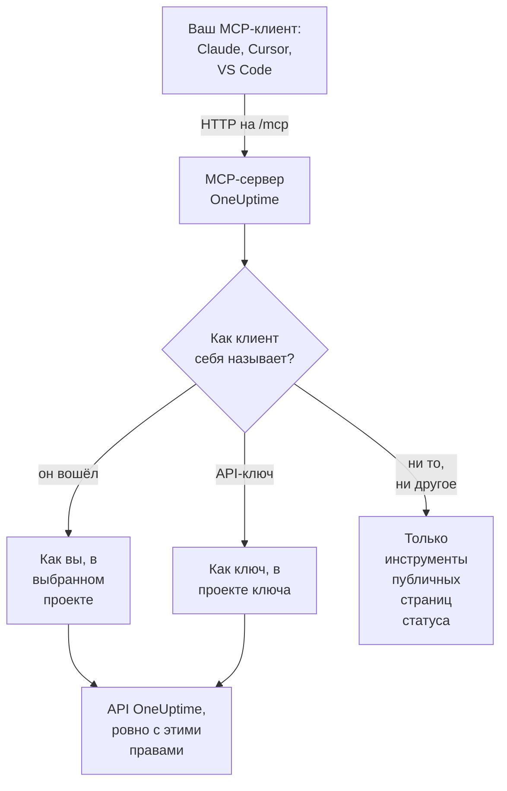

# Сервер MCP

MCP-сервер OneUptime позволяет ИИ-ассистенту работать с вашим проектом OneUptime напрямую. Подключите Claude, Cursor, VS Code с GitHub Copilot или любой другой клиент Model Context Protocol (MCP) и попросите его разобраться с инцидентом, запросить логи и трассировки, подтвердить оповещение или настроить монитор: он вызывает инструменты OneUptime с вашими правами или с правами API-ключа.

:::cards
- [Подключение клиента](#подключение-клиента): Передайте клиенту адрес сервера и войдите.
- [Вход через OneUptime](#вход-через-oneuptime): Что может подключённый клиент и как его отключить.
- [Получение API-ключа](#получение-api-ключа): Для агента, который работает без присмотра.
- [Устранение неполадок](#устранение-неполадок): Проблемы со входом, правами и подключением.
:::

Эта страница об ИИ-ассистентах, которые подключаются к OneUptime. Чтобы, наоборот, OneUptime AI использовал инструменты других MCP-серверов, например AWS или GitHub, см. [Внешние MCP-серверы](/docs/ai/external-mcp-servers).

## Как это работает

MCP-сервер входит в каждый экземпляр OneUptime, находится по пути `/mcp` на том же адресе, что и панель управления, и использует транспорт streamable HTTP. Ничего устанавливать не нужно.

- **OneUptime Cloud**: `https://oneuptime.com/mcp`
- **Собственный хостинг**: `https://your-oneuptime-domain.com/mcp`



Сервер не хранит состояние: он не выдаёт идентификаторы сессий, и каждый запрос самостоятелен, поэтому он работает за балансировщиками нагрузки и с несколькими репликами.

## Что охватывают инструменты

- **Мониторы**: создание и настройка мониторов, проверка их статуса и просмотр истории.
- **Реагирование на инциденты**: создание, подтверждение и разрешение инцидентов, добавление внутренних или публичных заметок и сопровождение до разрешения.
- **Оповещения**: подтверждение и разрешение оповещений, добавление заметок и управление состояниями и уровнями важности оповещений.
- **Команды и дежурства**: управление командами и политиками дежурств.
- **Страницы статуса**: управление страницами статуса и публикация объявлений.
- **Плановые работы**: создание и управление событиями обслуживания.
- **Телеметрия**: запросы к логам, метрикам, трассировкам, исключениям, логам мониторов, событиям безопасности и не только, только чтение.

Есть инструменты создания, получения, перечисления, обновления, удаления и подсчёта для 30 видов записей, инструменты перечисления и подсчёта для 9 видов телеметрии и инструменты, созданные для реагирования на инциденты. Инструменты только для чтения помечены `readOnlyHint`, каждый инструмент, который что-то меняет, — `destructiveHint`, а `openWorldHint` есть только у инструментов публичных страниц статуса, поэтому клиент может сам выполнять вызовы только для чтения и спрашивать вас перед любым изменением. Неудачный вызов инструмента возвращается как результат инструмента (`isError: true`) с `statusCode`, подробностями и подсказкой, а не как ошибка протокола MCP, поэтому агент может прочитать сбой и исправиться.

## Прежде чем начать

- Экземпляр OneUptime: OneUptime Cloud или собственный.
- MCP-клиент, например Claude Code, Claude, VS Code с GitHub Copilot или Cursor.
- Учётная запись OneUptime для входа или API-ключ OneUptime для агента, который работает без присмотра. Инструментам публичных страниц статуса не нужно ни то, ни другое.
- В OneUptime Cloud — тариф Growth или выше: подключение MCP-клиента доступно на тех же тарифах, что и API-ключи.

## Подключение клиента

Передайте клиенту адрес сервера и больше ничего. Когда ему впервые понадобятся ваши данные, он откроет OneUptime в вашем браузере, чтобы вы вошли (см. [Вход через OneUptime](#вход-через-oneuptime)). На собственном экземпляре используйте `https://your-oneuptime-domain.com/mcp` вместо `https://oneuptime.com/mcp`.

:::tabs
@tab Claude Code
```bash
claude mcp add --transport http oneuptime https://oneuptime.com/mcp
```
Затем выполните `/mcp` в Claude Code и выберите **oneuptime**, чтобы войти.
@tab Claude
В Claude откройте **Customize → Connectors**, выберите **Add custom connector** и введите `https://oneuptime.com/mcp`. Claude попросит вас войти в OneUptime, когда ему впервые понадобятся ваши данные.
@tab VS Code
Добавьте это в конфигурацию MCP (где она находится, см. в разделе [VS Code с GitHub Copilot](#vs-code-с-github-copilot)). VS Code откроет OneUptime для входа, когда вы запустите сервер:
```json
{
  "servers": {
    "oneuptime": {
      "type": "http",
      "url": "https://oneuptime.com/mcp"
    }
  }
}
```
@tab Cursor
```json
{
  "mcpServers": {
    "oneuptime": {
      "url": "https://oneuptime.com/mcp"
    }
  }
}
```
:::

Любой другой клиент, поддерживающий авторизацию MCP, работает так же: дайте ему адрес, и всё остальное он найдёт сам. Протокол описан в разделе [Вход (OAuth 2.1)](#вход-oauth-21).

В панели управления тоже есть эти шаги, с уже подставленным адресом вашего экземпляра: **Настройки проекта → ИИ → MCP-сервер**. А в любом ресурсе (мониторе, инциденте, странице статуса и так далее) раскройте **Для разработчиков** в его боковом меню и выберите **ИИ-ассистенты**: эта страница также предлагает промпты, в которых названы ресурс и его ID, чтобы ассистент сразу его нашёл. Для ресурса, для которого у MCP-сервера ещё нет инструментов, например рабочего процесса, страница показывает, как ассистент, умеющий выполнять команды, может работать с ним через REST API.

## Вход через OneUptime

Проще всего подключиться, передав MCP-клиенту адрес сервера и больше ничего. Когда клиенту впервые понадобятся ваши данные, он откроет страницу OneUptime в вашем браузере:

:::steps
1. Войдите в OneUptime, если вы ещё не вошли.
2. Выберите проект, в котором должен работать клиент.
3. Выберите **Чтение и запись** или **Только чтение**.
4. Нажмите **Разрешить**.
:::

После этого клиент действует в этом проекте от вашего имени. Не нужно создавать, копировать или менять API-ключ, и ничего секретного не хранится в файле конфигурации.

Что может подключённый клиент:

- **У него ваши права, и никогда больше.** Что ваши команды разрешают вам в проекте, то может и клиент. Если ваша роль меняется или вы покидаете проект, это действует со следующего запроса клиента. Уход из проекта также отключает клиента: его авторизация удаляется, и если вы вернётесь в проект, клиента нужно будет подключить снова.
- **Только чтение значит только чтение.** Клиент, авторизованный только для чтения, может использовать инструменты `get_`, `list_` и `count_`. Инструменты, которые создают, обновляют, удаляют, подтверждают или разрешают, отклоняются MCP-сервером и стоящим за ним API OneUptime. Вы никогда не можете дать клиенту больше доступа, чем он запросил.
- **Он работает с одним проектом.** Чтобы использовать второй проект, подключите клиента снова и выберите этот проект.
- **Он работает только через MCP-сервер.** Токен доступа клиента принимается конечной точкой MCP и больше нигде. Его нельзя использовать для прямого вызова REST API OneUptime.
- **Администраторы экземпляра не получают особого обращения.** Клиент, подключённый главным администратором, получает то, что команды этого человека дают ему в проекте, а не доступ ко всему экземпляру.

### Управление подключёнными клиентами

Каждый клиент, подключённый через вход, указан в **Настройки проекта → ИИ → MCP-сервер**, в разделе **Подключённые MCP-клиенты**, с тем, кто его подключил, что ему разрешено и когда он использовался последний раз. Вы видите клиентов, которых подключили сами; владельцы и администраторы проекта видят всех.

Нажмите **Disconnect**, чтобы отключить клиента. Он сразу перестаёт работать.

Клиент остаётся подключённым, пока его используют. Клиент, который не использовался 30 дней, должен войти снова.

### Кто может подключать клиентов

По умолчанию любой участник проекта может подключить MCP-клиента. Чтобы запретить это участникам команды, откройте страницу **Права доступа** команды, раскройте **Дополнительные настройки** внизу и добавьте разрешение **Authorize MCP Client** в **Заблокировать разрешения**. Клиенты, которых эти участники уже подключили, сразу перестают работать.

Если проект требует единого входа, войдите в проект через SSO в браузере, прежде чем авторизовать клиента. Подключение клиента действует столько же, сколько этот вход через SSO; когда он истекает или SSO-провайдер, через которого вы вошли, отключают или удаляют, подключите клиента снова.

В OneUptime Cloud подключение MCP-клиента доступно на тех же тарифах, что и API-ключи (Growth и выше).

В Enterprise Edition каждое изменение, которое делает подключённый клиент, записывается в журнал аудита от имени подключившего его человека, с названием клиента. Изменения, сделанные с API-ключом, показывают имя ключа.

## Получение API-ключа

Используйте API-ключ для агента, который работает без присмотра, например для запланированного задания или CI-конвейера, где некому войти.

:::steps
### Создайте ключ

Перейдите в **Настройки проекта → Расширенный → Ключи API** и нажмите **Создать: API-ключ**. Дайте ему имя, например "MCP Server".

### Выберите, что ему разрешено

В разделе **Доступ** выберите **Viewer** для агента, который только читает, или **Project Admin** для агента, который ещё и создаёт, обновляет и удаляет (см. [Права API-ключей](#права-api-ключей)).

### Скопируйте ключ

Нажмите **Создать: API-ключ**: откроется страница ключа. Скопируйте ключ оттуда.
:::

API-ключи принадлежат одному проекту: MCP-сервер берёт проект из ключа, поэтому инструментам создания никогда не нужен аргумент `projectId`.

> [!WARNING]
> Никогда не давайте ИИ-агенту мастер-ключ. Мастер-ключ API OneUptime тоже принимается в этом заголовке и даёт администраторский доступ ко всему экземпляру. Всегда используйте API-ключ проекта с минимумом того, что нужно агенту: ключа только для чтения достаточно для всех инструментов `get_`, `list_` и `count_`.

## Подключение с API-ключом

Отправляйте ключ в заголовке `x-api-key`. Запрос с API-ключом никогда не просят войти. На собственном экземпляре используйте свой домен вместо `oneuptime.com`.

:::tabs
@tab Claude Code
```bash
claude mcp add --transport http oneuptime https://oneuptime.com/mcp --header "x-api-key: your-api-key-here"
```
@tab Claude Desktop
Добавьте это в `claude_desktop_config.json`, в `~/Library/Application Support/Claude/` на macOS, `%APPDATA%\Claude\` в Windows или `~/.config/Claude/` в Linux:
```json
{
  "mcpServers": {
    "oneuptime": {
      "transport": "streamable-http",
      "url": "https://oneuptime.com/mcp",
      "headers": {
        "x-api-key": "your-api-key-here"
      }
    }
  }
}
```
@tab VS Code
Входная переменная с `"password": true` запрашивает ключ при запуске сервера, а не хранит его открытым текстом:
```json
{
  "servers": {
    "oneuptime": {
      "type": "http",
      "url": "https://oneuptime.com/mcp",
      "headers": {
        "x-api-key": "${input:oneuptime-api-key}"
      }
    }
  },
  "inputs": [
    {
      "type": "promptString",
      "id": "oneuptime-api-key",
      "description": "OneUptime API Key",
      "password": true
    }
  ]
}
```
@tab Cursor
```json
{
  "mcpServers": {
    "oneuptime": {
      "url": "https://oneuptime.com/mcp",
      "headers": {
        "x-api-key": "your-api-key-here"
      }
    }
  }
}
```
:::

## VS Code с GitHub Copilot

VS Code 1.99 и новее поддерживает MCP-серверы в GitHub Copilot Chat без дополнений.

:::steps
### Проверьте, что вам нужно

VS Code 1.99 или новее, с установленным расширением GitHub Copilot, выполненным входом и включённым GitHub Copilot Chat.

### Откройте конфигурацию MCP

Нажмите `Ctrl+Shift+P` (`Cmd+Shift+P` на macOS), введите "MCP: Open User Configuration" и нажмите Enter. Откроется или будет создан файл `mcp.json`. Только для одного рабочего пространства создайте вместо этого `.vscode/mcp.json` в нём.

### Добавьте OneUptime

Вставьте конфигурацию VS Code выше: ту, что без ключа, для входа, или ту, что с API-ключом.

### Запустите сервер

Нажмите `Ctrl+Shift+P` (`Cmd+Shift+P` на macOS), введите "MCP: List Servers" и выберите **oneuptime**, чтобы запустить его. В первый раз VS Code попросит вас доверять серверу, а затем войти или ввести API-ключ.

### Спросите Copilot

Откройте GitHub Copilot Chat в режиме агента и спросите, например: "Какие мониторы у меня есть в OneUptime?", "Покажи последние инциденты" или "Создай новый монитор для https://example.com".
:::

## Аутентификация

MCP-сервер работает тремя способами.

### Публичные инструменты (без аутентификации)

Без API-ключа и без входа клиент может использовать публичные инструменты:

- **`oneuptime_help`**: справка и рекомендации по MCP-инструментам OneUptime
- **`oneuptime_list_resources`**: ресурсы и то, что можно делать с каждым из них
- **`get_public_status_page_overview`**: обзор публичной страницы статуса
- **`get_public_status_page_incidents`**: инциденты публичной страницы статуса
- **`get_public_status_page_scheduled_maintenance`**: её события плановых работ
- **`get_public_status_page_announcements`**: её объявления

Инструменты публичных страниц статуса принимают ID страницы статуса (UUID) или её доменное имя. Чтобы использовать только их, подключитесь с адресом и без учётных данных:

```json
{
  "mcpServers": {
    "oneuptime": {
      "transport": "streamable-http",
      "url": "https://oneuptime.com/mcp"
    }
  }
}
```

Владельцы страницы статуса могут отключить для неё доступ по MCP: на странице статуса откройте **MCP** в разделе **ИИ** её бокового меню и выключите **Включить MCP-сервер**. Переключатель сохраняется сразу при переключении. Доступ по MCP включён по умолчанию. Пока он выключен, четыре инструмента `get_public_status_page_*` возвращают ошибку для этой страницы статуса; сайт страницы статуса, её RSS-лента и её публичный JSON API не затрагиваются, а инструменты страниц статуса, требующие входа (`get_status_page`, `list_status_pages` и так далее), продолжают работать для собственного проекта страницы.

### Вход (OAuth 2.1)

Любому другому инструменту нужно знать, кто его вызывает. Клиент, который не отправляет учётных данных и вызывает один из них, получает `401 Unauthorized` с заголовком `WWW-Authenticate`, указывающим на метаданные защищённого ресурса сервера. Это сигнал, по которому MCP-клиент выполняет ваш вход; `initialize`, `tools/list` и публичные инструменты никогда его не требуют.

Сервер реализует [спецификацию авторизации MCP](https://modelcontextprotocol.io/specification/latest/basic/authorization):

- **Поток**: authorization code OAuth 2.1 с PKCE (только `S256`). Токены доступа отправляются как `Authorization: Bearer`.
- **Обнаружение**: метаданные защищённого ресурса (RFC 9728) и метаданные сервера авторизации (RFC 8414). Издатель и ресурс — оба `https://<host>/mcp`.
- **Идентификация клиента**: Client ID Metadata Document (ID клиента — это URL `https`, который сервер загружает) или динамическая регистрация клиентов (RFC 7591). Ни одного клиента не должен регистрировать администратор.
- **Области**: `mcp:read` для инструментов `get_`, `list_` и `count_`; `mcp:write` добавляет все инструменты, которые что-то меняют, и включает `mcp:read`. Токен только для чтения, вызывающий инструмент записи, получает `403` с `error="insufficient_scope"`.
- **Срок жизни токенов**: токен доступа действует час. Токен обновления действует 30 дней и заменяется при каждом использовании; использование уже заменённого токена обновления завершает подключение.
- **Индикаторы ресурса** (RFC 8707): токен выдаётся для `https://<host>/mcp` и больше нигде не принимается.
- **Отзыв** (RFC 7009): отзыв любого из двух токенов завершает подключение.

### API-ключ

Агент, который работает без присмотра, отправляет API-ключ OneUptime в одном из этих заголовков:

- `x-api-key`: ваш API-ключ OneUptime
- `Authorization`: bearer-токен с вашим API-ключом (например, `Bearer your-api-key-here`)

Схема `Bearer` не чувствительна к регистру. Запрос с API-ключом никогда не просят войти.

В OneUptime Cloud API-ключи работают, только пока проект на тарифе **Growth** или выше. Ниже каждый инструмент, которому нужен ключ, отвечает `402` с сообщением, называющим тариф, и агенту говорят не повторять попытку. Ничего не удаляется: ключ снова работает как есть, как только проект вернётся на Growth, и ничего не нужно переподключать. Клиент, подключённый через вход, действует как человек и продолжает работать ([API-ключи и SCIM ниже своего тарифа](/docs/api-reference/api-reference#api-ключи-и-scim-ниже-их-плана)).

## Доступные конечные точки

| Конечная точка | Метод | Описание |
| --- | --- | --- |
| `/mcp` | POST | Запросы JSON-RPC для вызовов инструментов и других операций |
| `/mcp` | GET | Без SSE-заголовка `Accept`: короткое JSON-описание сервера. С ним: `405`, потому что сервер без состояния не предлагает отдельного SSE-потока (клиенты, следующие спецификации, продолжают без него) |
| `/mcp` | DELETE | Ничего не делает: сервер не хранит состояние, поэтому завершать нечего |
| `/mcp/health` | GET | Проверка работоспособности |
| `/mcp/tools` | GET | Список инструментов в виде простого REST |

MCP-клиенты, которые входят, также используют конечные точки OAuth ниже. Клиент находит их сам; они перечислены для тех, кто пишет клиента или настраивает прокси.

| Конечная точка | Метод | Описание |
| --- | --- | --- |
| `/mcp/.well-known/oauth-protected-resource` | GET | Метаданные защищённого ресурса (RFC 9728). Также по адресу `/.well-known/oauth-protected-resource/mcp` |
| `/.well-known/oauth-authorization-server/mcp` | GET | Метаданные сервера авторизации (RFC 8414). Также по адресу `/mcp/.well-known/oauth-authorization-server` |
| `/mcp/oauth/authorize` | GET | Конечная точка авторизации: куда клиент отправляет ваш браузер для входа |
| `/mcp/oauth/token` | POST | Конечная точка токенов: обменивает код авторизации или токен обновления |
| `/mcp/oauth/register` | POST | Динамическая регистрация клиентов (RFC 7591) |
| `/mcp/oauth/revoke` | POST | Отзыв токенов (RFC 7009) |

Чтобы проверить, что сервер работает, и получить список его инструментов:

```bash
curl https://oneuptime.com/mcp/health
curl https://oneuptime.com/mcp/tools
```

## Инструменты для реагирования на инциденты

Помимо инструментов для каждого вида записей, у сервера есть инструменты, созданные для реагирования на инциденты и оповещения:

- **`acknowledge_incident`** / **`resolve_incident`**: перевести инцидент в состояние проекта Acknowledged или Resolved, как это делает кнопка в панели управления
- **`acknowledge_alert`** / **`resolve_alert`**: то же самое для оповещений
- **`add_incident_note`**: добавить к инциденту заметку с `visibility: "internal"` (только для команды, по умолчанию) или `visibility: "public"` (публикуется на странице статуса). Поддерживается Markdown
- **`add_alert_note`**: добавить к оповещению внутреннюю заметку

Типичный цикл: `list_incidents` → `acknowledge_incident` → расследование с `list_logs` → `add_incident_note` (публичная) → `resolve_incident`.

Инструмент **`oneuptime_whoami`** возвращает проект, которому принадлежат ваши учётные данные (его ID и имя). Для клиента, который вошёл, он также сообщает, под чьим именем выполнен вход и можно ли вносить изменения. Это хороший первый вызов, чтобы агент сориентировался, а поскольку инструменты создания берут `projectId` из учётных данных, агенту никогда не нужно передавать ID проекта.

## Запросы к телеметрии

Логи, метрики, трассировки (span-ы), исключения, логи мониторов и другие виды телеметрии доступны как инструменты `list_` и `count_` только для чтения (`list_logs`, `list_metrics`, `list_spans`, `list_exception_instances`, `list_monitor_logs` и их двойники `count_`). Телеметрия поступает через OpenTelemetry, поэтому инструментов создания нет.

Всегда запрашивайте телеметрию с временным диапазоном. Поле запроса принимает значение или объект оператора:

```json
{
  "query": {
    "time": { "_type": "GreaterThan", "value": "2026-07-04T00:00:00.000Z" }
  },
  "sort": { "time": "DESC" },
  "limit": 50
}
```

Операторы: `EqualTo`, `NotEqual`, `IsNull`, `NotNull`, `EqualToOrNull`, `GreaterThan`, `LessThan`, `GreaterThanOrEqual`, `LessThanOrEqual`, `InBetween`, `Search` и `Includes`. Значения сортировки: `"ASC"` или `"DESC"`.

## Выбор полей и пагинация

Инструменты `get_` и `list_` принимают необязательный массив `select` с именами полей. По умолчанию возвращаются все читаемые поля, кроме тяжёлых (столбцы JSON, очень длинного текста и HTML), которые нужно запрашивать в `select`.

Инструменты перечисления листают с помощью `limit` (по умолчанию 10, не больше 100) и `skip`, и каждый ответ перечисления точно сообщает, что он вернул:

```json
{
  "returnedCount": 10,
  "totalCount": 42,
  "skip": 0,
  "limit": 10,
  "hasMore": true,
  "data": ["..."]
}
```

## Примеры использования

### Повседневные вопросы

```text
"What's the current status of all my monitors?"
"Show me incidents from the last 24 hours"
"List the teams in this project"
"Show me our on-call policies"
```

### Мониторы и инциденты

```text
"Create a new website monitor for https://example.com that checks every 5 minutes"
"Set up an API monitor for https://api.example.com/health with a 30-second timeout"
"Disable the monitor for staging.example.com while we're doing maintenance"
"Create a high-priority incident for the database outage affecting user authentication"
"Add a note to incident #123 saying 'Database connection restored, monitoring for stability'"
"Mark incident #456 as resolved"
```

### Страницы статуса

```text
"Update our status page to show 'Investigating Payment Issues' for the payment service"
"Create a status page announcement about scheduled maintenance this weekend"
```

### Запросы к публичным страницам статуса (API-ключ не нужен)

Они работают без учётных данных, только с инструментами публичных страниц статуса:

```text
"What's the current status of status.example.com?"
"Show me recent incidents from the OneUptime status page"
"Are there any scheduled maintenance events on status.acme.com?"
"Get the latest announcements from my public status page with ID abc123-..."
```

### Несколько шагов сразу

```text
"Create a scheduled maintenance window for Saturday 2-4 AM, disable all monitors for api.example.com during that time, and update the status page"
"Show me all monitors that have been down in the last hour, create incidents for any that don't already have one"
```

## Права API-ключей

| Что делает агент | Выбрать в **Доступ** |
| --- | --- |
| Только читает | **Viewer** или добавьте права на чтение на странице ключа |
| Ещё и создаёт, обновляет и удаляет | **Project Admin** или добавьте роль Project Admin на странице ключа |

Давайте каждому ключу минимум того, что ему нужно, регулярно меняйте ключи, держите отдельный ключ для каждого окружения и следите в OneUptime за тем, что делает каждый ключ.

## Настройка при собственном хостинге

Вход работает на собственном экземпляре сразу. Его меняют две настройки:

| Переменная окружения | Значение Helm | Что делает |
| --- | --- | --- |
| `DISABLE_MCP_OAUTH` | `mcpOAuth.disabled` | Задайте `true`, чтобы выключить вход. Конечные точки OAuth перестают обслуживаться, и MCP-сервер принимает только API-ключи. Ничего не удаляется; подключённые клиенты снова работают, когда вход включают обратно. |
| `DISABLE_MCP_OAUTH_CLIENT_ID_METADATA_DOCUMENTS` | `mcpOAuth.disableClientIdMetadataDocuments` | Задайте `true` на экземпляре, у которого нет доступа в интернет. Клиент может назвать себя URL, который загружает OneUptime; с этой настройкой клиенты вместо этого регистрируются прямо на вашем экземпляре, и исходящие запросы не нужны. |

Если перед OneUptime стоит ваш собственный обратный прокси, перенаправляйте `/.well-known/oauth-protected-resource` и `/.well-known/oauth-authorization-server` (и всё, что под ними) в OneUptime вместе с `/mcp`. Встроенный ingress уже это делает.

Сервер строит каждый URL OAuth из настроек `HOST` и `HTTP_PROTOCOL`, поэтому они должны совпадать с адресом, по которому люди заходят на ваш экземпляр.

## Устранение неполадок

### Проблемы со входом

- **Клиент никогда не просит меня войти**: возможно, клиент не поддерживает авторизацию MCP или настроен с заголовком API-ключа, который имеет приоритет. Уберите заголовок, чтобы входить вместо этого.
- **Мой проект неактивен на странице авторизации**: страница объясняет причину рядом с названием проекта: тариф проекта не включает подключение MCP-клиентов, проект требует SSO, а этот браузер не входил в него через SSO, или вашей команде запрещено подключать клиентов.
- **Инструмент отклоняется как "read-only"**: клиент был авторизован только для чтения. Подключите его снова и выберите **Чтение и запись**.
- **Клиент перестал работать**: его отключили, он не использовался 30 дней, вас удалили из проекта, или вход через SSO в проекте истёк или его провайдера отключили. Подключите его снова.
- **Собственный хостинг — клиент говорит, что не может найти сервер авторизации**: проверьте, что `HOST` и `HTTP_PROTOCOL` совпадают с вашим публичным адресом и что ваш прокси перенаправляет пути `/.well-known/oauth-*`.

### Ошибки прав

API-ключу, или вашей собственной учётной записи для клиента, который вошёл, нужны правильные права: на чтение, чтобы перечислять записи, на запись, чтобы создавать и обновлять их, и на удаление, чтобы удалять их.

### Проблемы с подключением

Проверьте, что адрес OneUptime правильный и доступен, что API-ключ действителен и что конечная точка проверки работоспособности отвечает (см. [Доступные конечные точки](#доступные-конечные-точки)).

### Недействительный API-ключ

- Проверьте API-ключ в настройках OneUptime, без лишних пробелов или символов
- Проверьте, что срок действия ключа не истёк
- В OneUptime Cloud ответ `402` о том, что API-ключам нужен тариф Growth, означает, что проект ниже него: повысьте тариф проекта в **Настройки проекта → Биллинг и счета → Биллинг**, и тот же ключ снова заработает

### Ошибки сессий

MCP-сервер не хранит состояние: он не выдаёт и не отслеживает идентификаторы сессий, поэтому каждый запрос работает с любой репликой. Клиент, который отправляет заголовок `mcp-session-id` от более старой версии сервера, может его не указывать; он игнорируется. Обновите старую конфигурацию клиента, которая ожидает, что сервер вернёт идентификатор сессии.

## Доступные ресурсы

| Область | Записи с инструментами создания, получения, перечисления, обновления, удаления и подсчёта |
| --- | --- |
| Мониторинг | Monitor, Monitor Status, Monitor Status Event |
| Инциденты | Incident, Incident State, Incident Severity, Incident State Timeline, Incident Public Note, Incident Internal Note, Incident Alert, Postmortem Status |
| Оповещения | Alert, Alert State, Alert Severity, Alert State Timeline, Alert Internal Note |
| Страницы статуса | Status Page, Status Page Announcement |
| Плановые работы | Scheduled Maintenance Event, Scheduled Maintenance State, Scheduled Maintenance State Timeline |
| Команды и дежурства | Team, On-Call Policy |
| Метки | Label |
| Безопасность | Security Case, Security Case Note, Security Case Priority, Security Case Status, Security Detection, Security Playbook |

| Область | Телеметрия только с инструментами перечисления и подсчёта |
| --- | --- |
| Наблюдаемость | Log, Metric, Span, Exception Instance, Monitor Log |
| Безопасность | Security Event, Threat Intel Indicator |
| Изменения и затраты | Change Event, Kubernetes Cost Allocation |

Инструменты названы в snake case: `create_incident`, `get_incident`, `list_incidents`, `update_incident`, `delete_incident` и `count_incidents`, или `list_logs` и `count_spans` для телеметрии.

## Дальнейшие шаги

:::cards
- [Спросить ИИ](/docs/ai/ask-ai): Спросите о своём проекте прямо в OneUptime.
- [Справочник API OneUptime](/docs/api-reference/api-reference): REST API, стоящий за каждым инструментом.
- [Права доступа](/docs/permissions/index): Что может роль, команда или API-ключ.
:::
