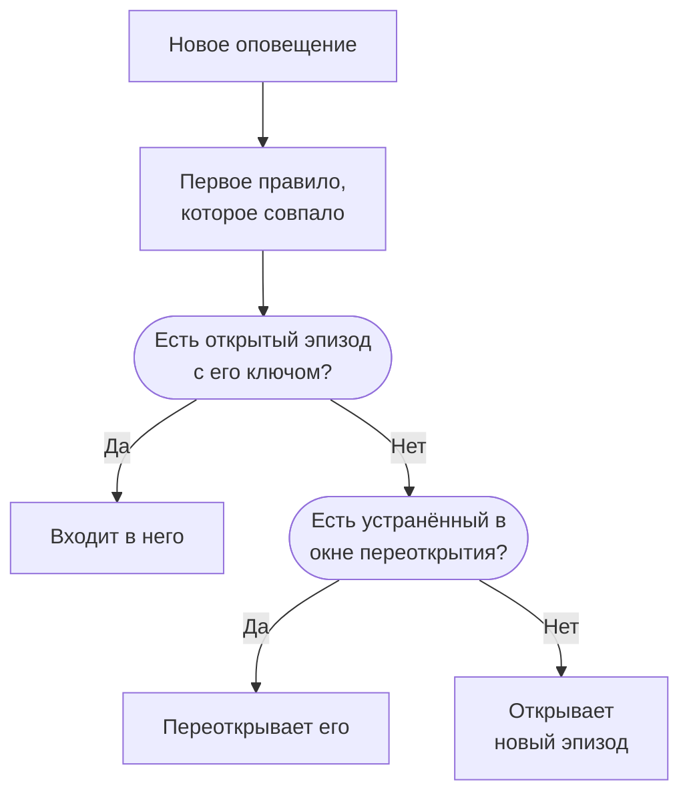

# Эпизоды оповещений и правила группировки

Когда падает база данных, двадцать мониторов могут за несколько минут создать двадцать оповещений. Эпизод объединяет их в одну запись, которую ваша команда подтверждает и устраняет вместе, а правило группировки решает, какие оповещения в неё входят. На этой странице показано, как работает группировка, как настроить правило и как ведёт себя эпизод после открытия.

:::cards
- [Как работает группировка](#как-работает-группировка): Правила, ключи группировки и временные окна.
- [Создание правила группировки](#создание-правила-группировки): Из шаблона одним щелчком или своё.
- [Как ведёт себя эпизод](#как-ведёт-себя-эпизод): Его серьёзность, состояния и момент устранения.
- [Кого вызывает эпизод](#кого-вызывает-эпизод): Политики дежурства правила и собственные политики оповещений.
:::

## Как работает группировка

Группировка выполняется один раз для каждого нового оповещения, сразу после того как отработали его политики дежурства. Оповещение сверяется с вашими включёнными правилами группировки сверху вниз по списку, и первое совпавшее правило определяет его эпизод. Оповещение, с которым не совпало ни одно правило, остаётся само по себе.



- **Условия правила** определяют, к каким оповещениям оно применяется. Правило без условий применяется к каждому новому оповещению.
- **Ключ группировки** определяет, какие оповещения делят эпизод: с одним и тем же монитором, одной и той же серьёзностью, одним и тем же заголовком или любым сочетанием, по которому группирует правило. Правило, которое ни по чему не группирует, помещает каждое совпавшее оповещение в один эпизод.
- **Временное окно** определяет, как долго эпизод продолжает принимать оповещения. Когда оно включено, оповещение входит, только если приходит в пределах окна после последнего оповещения эпизода. Когда выключено, совпадающие оповещения продолжают входить, пока эпизод не будет устранён.

Группировка происходит при создании оповещения. Правило, добавленное сегодня, группирует оповещения, созданные после него; уже существующие оно заново не группирует.

> [!NOTE]
> Оповещение, созданное уже подтверждённым, может войти в открытый эпизод, но никогда не открывает его, а оповещение, созданное устранённым, вообще не группируется. См. [Созданное уже подтверждённым или устранённым](/docs/alerts/index#созданное-уже-подтверждённым-или-устранённым).

## Создание правила группировки

Перейдите в **Оповещения → Правила → Правила группировки**. Раздел **Правила** бокового меню сначала свёрнут, поэтому сначала раскройте его.

### Начните с шаблона

Проект без правил группировки видит вместо пустого списка четыре готовых правила; когда правила уже есть, их открывает **Создать из шаблона** на карточке. **Добавить правило** сохраняет правило одним щелчком — включённым, в конце списка и применяемым к каждому новому оповещению. Потом редактируйте его как любое другое правило.

| Шаблон                                           | Группирует                                                                | Временное окно |
| ------------------------------------------------ | ------------------------------------------------------------------------- | -------------- |
| **Группировать оповещения одного монитора**      | Один эпизод на монитор                                                    | 30 минут       |
| **Группировать одновременные оповещения**        | Один общий эпизод независимо от монитора                                  | 10 минут       |
| **Группировать оповещения по серьёзности**       | Один эпизод на уровень серьёзности                                        | 30 минут       |
| **Группировать повторы одного оповещения**       | Один эпизод на заголовок оповещения без учёта чисел и регистра            | 1 час          |

### Создайте своё

:::steps
#### Ответьте, как группировать

Нажмите **Создать своё правило** под шаблонами или **Создать правило группировки оповещений** на карточке, если правила уже есть. На шаге **Группировка** поле **Группировать оповещения по** задаёт один вопрос: **Монитор**, **Всё вместе**, **Серьёзность**, **Заголовок** или **Другое**. **Имя** следует за вашим ответом, пока вы не введёте своё.

#### Задайте временное окно

**Группировать только оповещения, поступающие близко по времени** включено, с окном в 30 минут. Измените минуты или выключите его, чтобы держать один эпизод открытым до устранения.

#### Сочетайте поля для варианта «Другое»

**Другое** добавляет шаг **Группировать по** с пятью переключателями: **Группировать по монитору**, **Группировать по серьёзности оповещений**, **Группировать по заголовку оповещения**, **Группировать по меткам оповещений** и **Группировать по меткам мониторов**. Метки группируют по их точному набору.

#### Сузьте выбор

На шаге **Какие оповещения** вариант **Все оповещения**, с которого начинается новое правило, группирует каждое новое оповещение. Чтобы сузить правило, выберите **Только оповещения, соответствующие условиям** и добавьте условия по мониторам, уровням серьёзности, меткам, заголовкам и описаниям. Затем нажмите **Создать правило группировки оповещений**.
:::

Всё остальное, что умеет правило, свёрнуто в **Дополнительные поля** в конце шага **Группировка**, в трёх группах. В свёрнутом виде заголовок называет содержимое и показывает значение каждой настройки, используемой правилом, так что при редактировании правила его действие никогда не скрыто.

| Группа                         | Настройки                                                                                                  |
| ------------------------------ | ---------------------------------------------------------------------------------------------------------- |
| **Дежурство и владение**       | **Политики дежурства**, запускаемые, когда правило открывает эпизод, и **Владельцы эпизода**.              |
| **Жизненный цикл эпизода**     | **Повторно открывать недавно устранённые эпизоды**, **Подождать перед устранением эпизода** и **Устранять затихшие эпизоды** — каждое переключатель со своими минутами. |
| **Подробности**                | **Описание** правила, **Шаблон заголовка эпизода**, **Шаблон описания эпизода** и **Метки эпизода**.       |

Правила проверяются сверху вниз по списку, и побеждает первое совпадение: перетащите правило, чтобы изменить его место. Ставьте конкретные правила выше общих. Столбец **Группировка** в списке одной фразой говорит, что делает каждое правило, например «Один эпизод на монитор».

## Заголовки эпизодов

Без шаблона эпизод получает имя монитора своего первого оповещения или первые 50 символов заголовка оповещения, если у него нет монитора. С **Шаблон заголовка эпизода** или **Шаблон описания эпизода** подставляются эти переменные. Введите `{{` в любом из полей, чтобы выбрать одну.

| Переменная             | Подставляется                                                                                   |
| ---------------------- | ----------------------------------------------------------------------------------------------- |
| `{{alertTitle}}`       | Заголовок первого оповещения.                                                                   |
| `{{alertDescription}}` | Описание первого оповещения.                                                                    |
| `{{alertSeverity}}`    | Серьёзность первого оповещения.                                                                 |
| `{{monitorName}}`      | Имя монитора первого оповещения.                                                                |
| `{{alertCount}}`       | Сколько оповещений в эпизоде; перезаписывается, когда оповещения входят или выходят.            |

Переменная, для которой у первого оповещения нет значения, или переменная не из этого списка опускается. Когда первое оповещение приватно, `{{alertTitle}}` и `{{alertDescription}}` превращаются в «Private alert», потому что эпизод не приватен.

## Как ведёт себя эпизод

Эпизод проходит по вашим состояниям оповещений — тому же списку, что и оповещения, — и имеет собственных владельцев, заметки, корневую причину и заметки об исправлении.

- **Его серьёзность растёт вместе с оповещениями.** Он начинается с серьёзности первого оповещения и принимает серьёзность любого более серьёзного оповещения, которое в него входит; «более серьёзное» значит стоящее выше в **Оповещения → Настройки → Серьёзность оповещения**.
- **Его состояние перемещает его оповещения.** Подтвердите или устраните эпизод либо переведите его в собственное состояние — и каждое оповещение в нём перейдёт следом, кроме оповещения, которое уже находится в этом состоянии или после него.
- **Он устраняется сам**, когда устранены все оповещения в нём. **Подождать перед устранением эпизода** сначала держит его открытым столько минут на случай, если оповещение вернётся.
- **Он может переоткрыться.** Если включено **Повторно открывать недавно устранённые эпизоды**, совпадающее оповещение, пришедшее в течение этих минут после устранения эпизода, переоткрывает его вместо открытия другого. Это единственный переход вверх по списку состояний, и он не переоткрывает оповещения эпизода.

> [!WARNING]
> **Устранять затихшие эпизоды** устраняет эпизод, если в течение заданных минут в него не вошло ни одного нового оповещения, и устраняет также каждое ещё открытое в нём оповещение. Используйте это для шума, который точно не требует реакции.

## Кого вызывает эпизод

Собственные политики дежурства оповещения запускаются при его создании, до группировки, независимо от того, войдёт ли оно в эпизод. Эпизод добавляет свои:

```mermaid title="Оповещение, открывшее эпизод, вызывает дважды; вошедшее в эпизод — один раз"
flowchart TB
    alert["Новое оповещение"] --> own["Собственные политики<br/>оповещения"]
    own --> grouped{"Группировка"}
    grouped -->|"Открывает эпизод"| ep["Политики эпизода<br/>тоже работают"]
    grouped -->|"Входит в эпизод"| none["Больше ничего<br/>не запускается"]
```

- **Новый эпизод** запускает **Политики дежурства** правила, а также политики любого совпавшего правила на вкладке **Episode Rules** в **Оповещения → Правила → Правила дежурства**.
- **Оповещение, входящее в открытый эпизод**, запускает только свои политики. Политики эпизода повторно не запускаются.
- **Ответ на вызов эпизода** подтверждает эпизод, а вместе с ним и каждое оповещение в нём.

> [!TIP]
> Чтобы вызывать один раз на проблему, а не на каждое оповещение, задайте политики дежурства в правилах группировки и уберите их из оповещений: из критериев монитора, формы создания и ваших правил дежурства для оповещений.

Владельцы эпизода тоже узнают об этом: **Эпизод оповещения создан**, **Состояние эпизода оповещения изменено** и **Оповещение добавлено в эпизод оповещения** по умолчанию включены по электронной почте в **Настройки пользователя → Настройки уведомлений** на вкладке **Оповещения**. **Владельцы эпизода** из правила становятся владельцами каждого открытого им эпизода и уведомляются, как любой другой владелец.

## Создание эпизода вручную

:::steps
### Откройте форму

Перейдите в **Оповещения → Все эпизоды** и нажмите **Создать эпизод**. Откроется форма **Создать новый эпизод оповещения**.

### Опишите эпизод

На шаге **Сведения об эпизоде** заполните **Заголовок** и при желании **Серьёзность оповещения** и **Описание**. **Начальное состояние** и **Метки** находятся в **Дополнительные поля**.

### Выберите, кого вызвать и кто владелец

На шаге **Дежурство и владельцы** выберите **Политика дежурства**, которая запустится при создании эпизода, и его **Владельцы**. Затем нажмите **Создать эпизод**.

Каждая команда, в которой вы состоите, добавляется одним щелчком под **Владельцы**, а сводка перечисляет правила владельца, которые добавят ещё владельцев.

### Добавьте оповещения

Откройте страницу **Оповещения участников** эпизода, нажмите **Добавить оповещения** и отметьте относящиеся к нему оповещения — сразу столько, сколько нужно. Чтобы начать с оповещений, выберите их в списке **Оповещения** и выберите **Добавить в новый эпизод** в разделе **Массовые действия** (см. [Эпизоды](/docs/incidents/episodes)).
:::

У созданного вручную эпизода нет правила группировки, поэтому в списке его **Правило группировки** показано как **Вручную**, и никакие настройки жизненного цикла к нему не применяются. Он всё равно устраняется сам, когда устранены все оповещения в нём.

## Что показывает каждая страница эпизода

| Раздел бокового меню  | Страницы                                                                    |
| --------------------- | --------------------------------------------------------------------------- |
| **Обзор** | **Обзор**, **Хронология состояний** |
| **Расследование** | **Описание**, **Корневая причина**, **Заметки об исправлении** |
| **Команда** | **Владельцы** |
| **Оповещения** | **Оповещения участников** |
| **Заметки** | **Приватные заметки** |
| **Для разработчиков** | **Terraform**, **API**, **ИИ-ассистенты** |
| **Расширенный** | **Журналы аудита**, **Удалить эпизод** |

**Для разработчиков** и **Расширенный** сначала свёрнуты. На странице **Обзор** в заголовке указаны **Владельцы** эпизода, сначала команды, а первая плитка, **Создано**, показывает, когда эпизод был создан, — **Автоматически**, если его открыло правило группировки. Карточка **Что произошло** открывает страницу — описание эпизода и раздел **Корневая причина**, — затем **Alerts in this episode** и **Лента эпизода** рядом с карточкой **Сведения об эпизоде**: его номер, состояние, серьёзность, число оповещений, правило группировки и политики дежурства. В заголовке есть **Подтвердить** и **Устранить**, а в меню **⋯** — **Перевести эпизод в**.

**Оповещения → Активные эпизоды** показывает ещё не устранённые эпизоды, а значок рядом считает их.

## Устранение неполадок

:::details Новое оповещение не вошло в ожидаемый эпизод
Проверьте по порядку: правило включено; ни одно правило выше не совпало с оповещением раньше; оповещение соответствует условиям правила; у него тот же ключ группировки, что и у оповещений эпизода, например тот же монитор; и при включённом временном окне оно пришло в пределах окна после последнего оповещения эпизода. Оповещение, созданное уже подтверждённым, никогда не открывает эпизод, а созданное устранённым никогда не группируется.
:::

:::details Нас вызвали дважды из-за одной проблемы
Сработала собственная политика дежурства оповещения, и политика нового эпизода тоже сработала. Оставьте политики в правиле группировки и уберите их из критериев, формы или правил дежурства оповещения.
:::

:::details Эпизод устранился сам
Все оповещения в нём были устранены, поэтому эпизод устранился, когда закончилось ожидание. Когда включено **Устранять затихшие эпизоды**, оно также устраняет эпизод, в который столько времени не поступало новых оповещений.
:::

## Дальнейшие шаги

:::cards
- [Правила и настройки оповещений](/docs/alerts/settings): Другие правила, действующие на новые оповещения и эпизоды.
- [Состояния и уровни серьёзности оповещений](/docs/alerts/states-and-severities): Состояния, через которые проходит эпизод.
- [Правила эскалации](/docs/on-call/escalation-rules): Как политики, запущенные эпизодом, вызывают людей.
- [Настройки и автоматизация инцидентов](/docs/incidents/settings): Правила группировки для инцидентов.
:::
