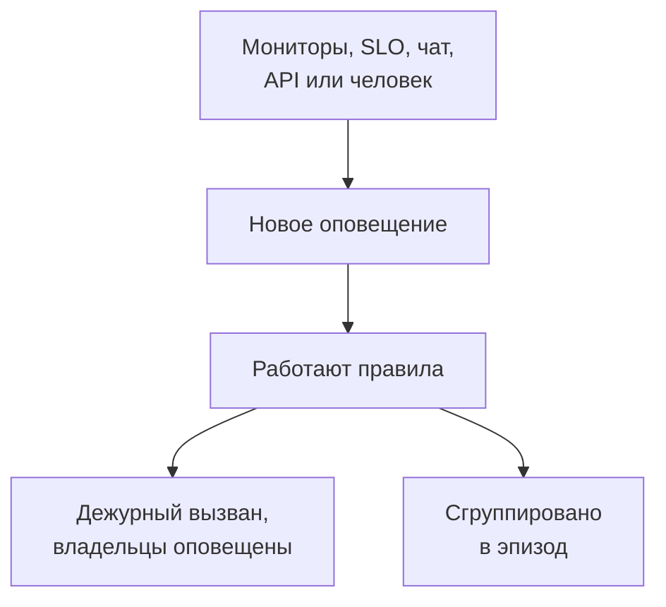

# Обзор оповещений

Оповещение сообщает вашей команде о проблеме, которую стоит изучить до того, как её заметят пользователи: диск заполняется, сертификат вот-вот истечёт, доля ошибок понемногу растёт. Оно может вызвать дежурного и уведомить своих владельцев, но никогда не появляется на странице статуса и никогда не уведомляет ваших подписчиков. На этой странице объясняется, откуда берутся оповещения, где они находятся в панели управления и как ваша команда с ними работает.

:::cards
- [Оповещения и инциденты](#оповещения-и-инциденты): Чем должна быть проблема и как они связаны.
- [Откуда берутся оповещения](#откуда-берутся-оповещения): Мониторы, SLO, чат, API или вручную.
- [Создание оповещения вручную](#создание-оповещения-вручную): Два шага в панели управления.
- [Реакция на оповещение](#реакция-на-оповещение): Подтвердите его, устраните или объявите инцидент.
:::

## Как это работает

Большинство оповещений создаёт монитор, критерии которого совпали. Некоторые приходят от SLO, расходующего бюджет ошибок, от правила безопасности, от вызова из Slack или Microsoft Teams или от человека. Каким бы путём оно ни пришло, оповещение — это всегда одна и та же запись, и к нему применяются одни и те же правила.

- **Правила формируют его.** Правила конфиденциальности, владельца, меток и дежурства срабатывают в момент создания оповещения, а правила runbook-ов запускают подходящие процедуры. См. [Правила и настройки оповещений](/docs/alerts/settings).
- **Политики дежурства вызывают людей.** Политики, указанные в оповещении, и политики, добавленные его правилами дежурства, вызывают своих людей, пока кто-нибудь не подтвердит оповещение.
- **Эпизоды объединяют шум.** Правило группировки собирает связанные оповещения в один эпизод, так что двадцать оповещений от одного сбоя становятся одной задачей. См. [Эпизоды оповещений и правила группировки](/docs/alerts/episodes).

## Оповещения и инциденты

Оба фиксируют проблему, и оба могут вызвать дежурного. Разница в том, кого проблема затрагивает.

|                              | Оповещение                                             | Инцидент                                          |
| ---------------------------- | ------------------------------------------------------ | ------------------------------------------------- |
| **Что это**                  | Проблема, которую команде стоит изучить до того, как пострадают пользователи | Проблема, затрагивающая ваших пользователей, например сбой |
| **На страницах статуса**     | Никогда                                                | Может появиться и уведомляет подписчиков          |
| **Заметки**                  | Приватные заметки, только для вашей команды            | Публичные заметки для клиентов и приватные заметки |
| **Начальные состояния**      | **Identified**, **Подтверждён**, **Устранён**          | **Identified**, **Подтверждён**, **Устранён**     |
| **Начальные уровни серьёзности** | **High**, **Low**                                  | Critical Incident, Major Incident, Minor Incident |
| **Номера в новом проекте**   | `ALT-42` и `AE-42` для эпизодов                        | `INC-42` и `IE-42` для эпизодов                   |

Создавайте оповещение, когда команде стоит посмотреть до того, как кто-то снаружи что-то заметит, и объявляйте инцидент, когда пострадали пользователи. Если оповещение оказалось частью сбоя, объявите из него инцидент или свяжите его с инцидентом, который его объясняет: см. [Связанные оповещения](/docs/incidents/linked-alerts).

## Откуда берутся оповещения

- **Критерии монитора.** В разделе **Действия** критерия включите **Когда фильтры совпадают, создать оповещение.** и заполните оповещение, которое он создаёт: **Заголовок оповещения** и **Серьёзность**, затем, каждый в свёрнутом виде, **Описание**, **Владение и метки**, **Дежурство** и **Дополнительные поля**, где находятся **Автоустранение оповещения**, **Приватное оповещение** и **Заметки об исправлении**. Критерий держит одновременно одно открытое оповещение, по одному на серию у монитора, который группирует по полю, а **Автоустранение оповещения** устраняет его, когда критерий перестаёт совпадать. См. [Создание монитора](/docs/monitor/create-monitor) и [Шаблоны инцидентов и оповещений](/docs/monitor/incident-alert-templating).
- **Вручную.** Нажмите **Создать оповещение** в списке оповещений или на вкладке **Оповещения** монитора, хоста или другого ресурса — тогда этот ресурс будет выбран за вас. См. [Создание оповещения вручную](#создание-оповещения-вручную).
- **Скорость расхода бюджета SLO.** Правило скорости расхода может создать оповещение, когда SLO слишком быстро тратит бюджет ошибок. См. [Оповещения и инциденты по скорости расхода бюджета](/docs/slo/burn-rate-alerts).
- **Сетевые площадки и события безопасности.** Сетевая площадка, настроенная оповещать о неисправности, открывает оповещение, когда её сводка перестаёт быть рабочей, а ваши правила обнаружения событий безопасности тоже открывают оповещения. См. [Сетевые площадки (сводка состояния и доступность)](/docs/monitor/network-sites) и [События безопасности (SIEM)](/docs/telemetry/security-events).
- **Вызов.** `/oneuptime page` в Slack или Microsoft Teams открывает оповещение с вашим сообщением в качестве заголовка и вызывает названных вами людей. Блоки вызова в рабочем процессе делают то же самое с заголовком и сообщением, которые вы им передаёте. См. [Вызов людей из Slack](/docs/workspace-connections/slack#вызов-людей-из-slack) и [Paging](/docs/workflows/components#paging).
- **API, Terraform и рабочие процессы.** Оповещения — обычный ресурс: `/api/alert`, ресурс Terraform `oneuptime_alert` и шаг **Create One Alert** рабочего процесса.

## Где оповещения находятся в панели управления

Откройте **Оповещения** из меню **Продукты** в верхней панели. Список оповещений находится по адресу `/dashboard/{projectId}/alerts`, а в его боковом меню собрано всё, что касается оповещений:

| Раздел                    | Что вы там делаете                                                                                                        |
| ------------------------- | ------------------------------------------------------------------------------------------------------------------------- |
| **Оповещения**            | **Все оповещения** и **Активные оповещения**, красный значок которых считает ещё не устранённые оповещения.                 |
| **Эпизоды** | **Все эпизоды** и **Активные эпизоды**: связанные оповещения, объединённые в одну проблему для работы. |
| **ИИ**                    | **Аналитика**, **Журналы** и **Настройки**: чему OneUptime AI научился на ваших оповещениях, всё, что он сделал, и что ему разрешено. |
| **Рабочее пространство**  | **Slack** и **Microsoft Teams** — в зависимости от того, что подключено к проекту, — или **Подключить Slack или Teams**, если не подключено ничего. |
| **Правила**               | **Правила группировки**, **Правила дежурства**, **Правила владельца**, **Правила runbook-ов**, **Правила конфиденциальности**, **Правила меток**, **Reminder Rules**. |
| **Настройки**             | **Состояние оповещения**, **Серьёзность оповещения**, **Шаблоны заметок**, **Пользовательские поля**, **Измерения**, **Участие в эпизодах**, **Нумерация**. |

**Оповещения** и **Эпизоды** открыты; **ИИ**, **Рабочее пространство**, **Правила**, **Настройки** и **Для разработчиков** сначала свёрнуты, и раздел открывается сам, когда вы находитесь на одной из его страниц. Настройка оповещений находится здесь, а не в **Настройки проекта**.

В списке показаны **Номер оповещения**, **Заголовок**, **Состояние**, **Серьёзность**, **Затронутые ресурсы** (первым — монитор оповещения), **Создано**, **Длительность**, **Метки** и **Владельцы**. Выберите оповещения, чтобы действовать сразу над несколькими: **Подтвердить**, **Устранить**, **Изменить состояние**, **Изменить серьёзность**, **Назначить мне**, **Add Owner**, **Remove Owner**, **Add Labels**, **Remove Labels**, **Связать с инцидентом**, **Объявить инцидент** или удалить их.

Меню **⋯** в конце строки каждого оповещения делает то же самое для одного этого оповещения: **Подтвердить** и **Устранить**, пока оповещение может сделать этот шаг, **Изменить состояние**, **Изменить серьёзность**, **Назначить мне**, пока вы не стали его владельцем, и **Add Owner**, чтобы передать его другому.

## Создание оповещения вручную

:::steps
### Откройте форму

Перейдите в **Оповещения → Все оповещения** и нажмите **Создать оповещение**. Форма **Создать новое оповещение** откроется на первом шаге, **Детали оповещения**.

### Опишите оповещение

Заполните **Заголовок** и выберите **Серьёзность оповещения** — оба поля обязательны. Добавьте **Описание**, если это поможет. В свёрнутом разделе **Дополнительные поля** можно выбрать **Начальное состояние**, добавить **Метки** или включить **Приватное оповещение**. Там же ждёт и **Владельцы**: вы и так становитесь владельцем создаваемого оповещения, а каждая команда, в которой вы состоите, добавляется одним щелчком под полем выбора.

### Выберите, что оно затрагивает и кого вызвать

Нажмите **Далее**, чтобы перейти к шагу **Ресурсы и дежурство**. Выберите **Монитор**, к которому оно относится, и любые **Другие затронутые ресурсы**, например хосты, кластеры Kubernetes или сервисы. В поле **Политика дежурства** выберите политики, которые запустятся при создании оповещения.

### Создайте его

Нажмите **Далее**, чтобы проверить сводку, затем **Создать оповещение**. Откроется страница оповещения, и правила начнут работать. В сводке строка **Владельцы** перечисляет каждое правило владельца, которое кого-то добавит, и кого: см. [Кто будет владельцем](/docs/incidents/declaring-incidents#кто-будет-владельцем).
:::

Если оставить **Начальное состояние** пустым, оповещение начнётся там же, где и любое новое: в вашем состоянии создания, в новом проекте это **Identified**. Выбор более позднего состояния фиксирует оповещение, которым уже кто-то занимается или которое уже закончилось; см. [Созданное уже подтверждённым или устранённым](#созданное-уже-подтверждённым-или-устранённым).

## Что происходит при создании оповещения

В момент создания оповещения OneUptime выполняет следующие шаги в таком порядке:

1. **Оно получает номер и состояние.** Номер оповещения берётся из счётчика проекта и показывается с вашим префиксом (`ALT-42`). Оповещение начинается в вашем состоянии создания, если форма, API или рабочий процесс не выбрали другое.
2. **Первыми работают правила конфиденциальности**, чтобы всё последующее знало, приватно ли оповещение.
3. **Лента и ваши чат-инструменты узнают о нём.** В **Оповещение Лента** записывается запись **Оповещение создано**, а каналы, указанные в ваших правилах Slack и Microsoft Teams, получают сообщение; правило может создать канал для оповещения.
4. **Добавляются владельцы и метки**: указанные в критериях монитора или в запросе, затем — из совпавших правил владельца и меток.
5. **Правила дежурства добавляют свои политики**, затем правила runbook-ов запускают подходящие runbook-и.
6. **Запускаются политики дежурства.** Каждая политика оповещения вызывает своих людей параллельно; сбой одной не останавливает остальные.
7. **Правила группировки помещают его в эпизод**, если какое-то из них совпало. См. [Эпизоды оповещений и правила группировки](/docs/alerts/episodes).
8. **Планируются напоминания**, если совпало правило напоминаний, а **OneUptime AI** расследует оповещение, когда в **Оповещения → ИИ → Настройки** включено **Расследовать новые оповещения**, и исправляет его, когда включено **Автоматически исправлять новые оповещения**. См. [AI SRE](/docs/ai/ai-sre).

Фоновая задача в течение минуты сообщает владельцам оповещения, а триггер рабочего процесса **On Create Alert** запускает каждый построенный на нём рабочий процесс.

### Созданное уже подтверждённым или устранённым

Оповещение, которое начинается в более позднем состоянии, фиксирует проблему, которой уже кто-то занимается, поэтому оно не считается новой экстренной ситуацией:

- **В вашем подтверждённом состоянии или после него** не запускается ни одна политика дежурства. Оповещение сохраняет свои политики, а его лента одной строкой сообщает, почему никого не вызвали. Оно может войти в открытый эпизод, но никогда не открывает его, потому что это вызвало бы людей через политики эпизода.
- **В вашем устранённом состоянии или после него** оповещение закончено: оно не группируется в эпизод, на него не действуют ни runbook-и, ни автоматическое исправление, OneUptime AI его не расследует, и для него не создаётся канал Slack или Microsoft Teams.

Его правила, владельцы, лента и первое состояние в обоих случаях всё равно применяются. Инциденты подчиняются тому же правилу: см. [Объявлен уже подтверждённым или устранённым](/docs/incidents/declaring-incidents#объявлен-уже-подтверждённым-или-устранённым).

## Реакция на оповещение

Откройте оповещение. В его заголовке показаны состояние, серьёзность, длительность, владельцы, а также монитор и эпизод, к которым оно относится, и кнопки для вашего следующего шага:

- **Подтвердить** сообщает, что кто-то занимается оповещением. Это не даёт политикам дежурства оповещения вызвать следующий уровень.
- **Устранить** закрывает его. Оповещение уходит из **Активные оповещения**, а его напоминания прекращаются.
- **Изменить состояние на** в меню **⋯** рядом переводит его в ваше собственное состояние, например «Расследуется».
- **Объявить инцидент** открывает новый инцидент, заполненный по оповещению, когда выясняется, что проблема затрагивает пользователей. См. [Связанные оповещения](/docs/incidents/linked-alerts).

Переход в другое состояние требует подтверждения, с необязательной приватной заметкой в свёрнутом разделе **Добавить приватную заметку**. Что делает каждое состояние, описано на странице [Состояния и уровни серьёзности оповещений](/docs/alerts/states-and-severities).

Во время работы записывайте выводы в **Приватные заметки**, заполните страницы **Корневая причина** и **Исправление** и добавьте **Владельцы**. Меню **Действия** в **Оповещение Лента** также запускает runbook через **Execute Runbook** или вызывает больше людей через **Выполнить политику дежурства**.

## Что показывает каждая страница оповещения

| Раздел бокового меню  | Страницы                                                                                                   |
| --------------------- | ---------------------------------------------------------------------------------------------------------- |
| **Обзор** | **Обзор** и **Хронология состояний** |
| **Расследование** | **Описание**, **Корневая причина**, **Исправление**, **Сборники инструкций**, **Связанные инциденты** |
| **Команда** | **Выполнения дежурств** и **Владельцы**: кого вызвали по оповещению и кто им владеет |
| **Уведомления**           | **Журналы уведомлений** и **Журналы ИИ**: каждое сообщение, отправленное об оповещении, и всё, что ИИ для него сделал |
| **Заметки** | **Приватные заметки**                                                                                     |
| **Для разработчиков** | **Terraform**, **API** и **ИИ-ассистенты**: управление оповещением из кода                                 |
| **Расширенный** | **Пользовательские поля**, **Настройки**, **Журналы аудита**, **Удалить оповещение** |

**Обзор**, **Расследование**, **Команда** и **Заметки** открыты; остальные разделы свёрнуты, пока вы на них не нажмёте.

- **Обзор** — в заголовке указаны **Владельцы** оповещения, сначала команды, рядом с его монитором и эпизодом. Плитка **Создано** показывает, когда и чем оно было создано, ещё две — сколько времени заняли подтверждение и устранение; длительность указана в заголовке первой. Карточка **Что произошло** открывает страницу — описание оповещения и раздел **Корневая причина**, — затем карточка **AI Investigation**, внизу у неё **Ask OneUptime AI**, а **Оповещение Лента** фиксирует всё, что происходило с оповещением. Рядом находятся карточка **Затронутые ресурсы**, карточка **Детали оповещения** и измерения оповещения.
- **Хронология состояний** — каждое состояние, в котором было оповещение, когда и как долго. См. [Хронология состояний](/docs/alerts/states-and-severities#хронология-состояний).
- **Связанные инциденты** — инциденты, частью которых является это оповещение, с **Связать инцидент** и **Объявить инцидент**.
- **Настройки** — **Кто может видеть это оповещение** с переключателем **Приватное оповещение** и **Напоминания** с **Отправлять напоминания**. Каждый переключатель сохраняется в момент переключения.

## Приватные оповещения

Приватное оповещение видят только его владельцы, то есть пользователи-владельцы и участники команд-владельцев, а также администраторы и владельцы вашего проекта. Больше никто в проекте не может его открыть.

Сделайте оповещение приватным с помощью **Приватное оповещение** в разделе **Дополнительные поля** формы создания или в критериях монитора, с помощью **Оповещения → Правила → Правила конфиденциальности** или позже на его странице **Настройки**, которая спрашивает **Сделать это оповещение приватным?**, прежде чем скрыть оповещение. Если вы не входите в их число, вы тоже теряете доступ.

Эпизод, открытый приватным оповещением, не приватен, поэтому он никогда не показывает заголовок или описание оповещения: там, где они попали бы в его заголовок или описание, написано «Private alert».

## Кто узнаёт об оповещении

- **Дежурные.** Политики дежурства оповещения вызывают своих людей, каждого так, как он настроил в **Настройки пользователя → Правила дежурства** на вкладке **Оповещения**. Ответ на вызов подтверждает оповещение, и вызовы прекращаются.
- **Его владельцы.** По электронной почте, если они не выбрали другие каналы в **Настройки пользователя → Настройки уведомлений** на вкладке **Оповещения**: **Оповещение создано**, **Состояние оповещения изменено** и **Alert reminder** включены по умолчанию, а **Заметка к оповещению опубликована** и **Добавлен как владелец оповещения** выключены, пока кто-нибудь их не включит. Оповещение без владельцев вместо этого уведомляет владельцев проекта.
- **Ваши чат-инструменты.** **Оповещения → Рабочее пространство** содержит правила Slack и Microsoft Teams, которые публикуют оповещения и эпизоды в каналы. См. [Slack](/docs/workspace-connections/slack) и [Microsoft Teams](/docs/workspace-connections/microsoft-teams).

## Устранение неполадок

:::details Для нового оповещения никого не вызвали
Откройте страницу **Выполнения дежурств** оповещения. Если она пуста, у оповещения не было политики дежурства: её не выбрали ни в форме, ни в критериях монитора, и ни одно правило дежурства не совпало. Если оповещение было создано уже подтверждённым или устранённым, его лента сообщает, что никого не вызвали, и почему.
:::

:::details Монитор продолжает падать, но новое оповещение не появляется
Критерий держит одновременно одно открытое оповещение. Пока это оповещение не устранено, монитор не добавляет ничего нового для того же критерия. Устраните его или включите **Автоустранение оповещения**, чтобы монитор устранял его, когда критерий перестаёт совпадать.
:::

:::details Коллега может открыть оповещение, которое я не нахожу
Скорее всего, оповещение приватное. Попросите администратора проекта добавить вас владельцем или выключить **Приватное оповещение** на странице **Настройки** оповещения.
:::

## Дальнейшие шаги

:::cards
- [Состояния и уровни серьёзности оповещений](/docs/alerts/states-and-severities): Что делают подтверждение и устранение и как добавить собственные состояния.
- [Эпизоды оповещений и правила группировки](/docs/alerts/episodes): Превратите поток оповещений в одну задачу.
- [Правила и настройки оповещений](/docs/alerts/settings): Автоматически вызывайте, назначайте владельцев, ставьте метки и напоминайте.
- [Связанные оповещения](/docs/incidents/linked-alerts): Свяжите оповещения с инцидентом, который их объясняет.
:::
