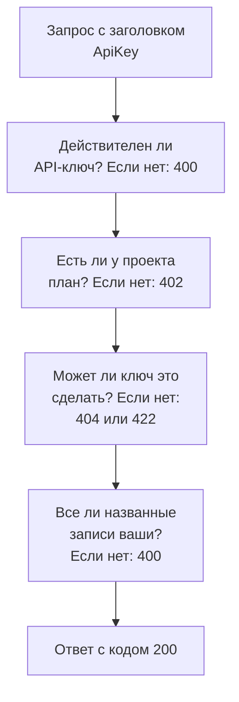

# Справочник API OneUptime

Всё, что можно сделать в панели управления OneUptime, можно сделать и через её REST API: автоматизировать повторяющуюся работу, подключить OneUptime к другим инструментам или создать собственные интеграции. Эта страница показывает, как сделать первый запрос, и правила, которым следует каждый запрос. Каждый эндпоинт и каждое поле перечислены в [полном справочнике API](/reference).

:::cards
- [Первый запрос](#первый-запрос): API-ключ, один заголовок и команда curl.
- [Запросы и ответы](#запросы-и-ответы): Шесть запросов, которые есть у каждого ресурса, и что означает каждый код состояния.
- [Планы и API](#планы-и-api): Что продаёт план и что продолжает работать ниже него.
- [Как ссылаться на записи и записывать их](#как-ссылаться-на-записи-и-записывать-их): ID, ссылки, переключатели и поля, которые заполняет OneUptime.
- [Состояния и эпизоды](#состояния-и-эпизоды): Состояние, в котором запись начинается и через которые проходит.
- [Что может затронуть запрос](#что-может-затронуть-запрос): Чтение, изменение и удаление, по одному проекту за раз.
:::

## Как отвечают на запрос

API построен на принципах REST: стандартные методы HTTP и коды состояния, JSON на входе и JSON на выходе. Каждый запрос несёт API-ключ и проходит несколько проверок. Первая проверка, которую он не прошёл, отвечает кодом состояния и `{ "message": "..." }`, поэтому сообщение говорит, что его остановило.



## Первый запрос

Все запросы к API проходят проверку подлинности с помощью API-ключа. Ключ принадлежит одному проекту и делает то, что позволяют его разрешения.

:::steps
### Создайте API-ключ

Откройте **Настройки проекта → Расширенный → Ключи API** и нажмите **Создать: API-ключ**. Задайте ему **Имя**, а в разделе **Доступ** выберите, что он может делать: **Администратор проекта**, **Участник проекта**, **Зритель** или **Выбрать разрешения позже**, чтобы добавить отдельные разрешения на странице ключа. Ключ истекает через год, если вы не выберете другую дату в разделе **Расширенный**.

### Скопируйте ключ

Откроется страница ключа. Скопируйте **API-ключ** из карточки **Сведения о ключе API** и не храните его в коде:

```bash
export ONEUPTIME_API_KEY="your-api-key"
```

### Отправьте запрос

Получите первые десять мониторов. Ключ читает свой собственный проект, поэтому запрос не называет проект:

```bash
curl -X POST 'https://oneuptime.com/api/monitor/get-list?skip=0&limit=10' \
  -H "ApiKey: $ONEUPTIME_API_KEY" \
  -H 'Content-Type: application/json' \
  -d '{ "select": { "name": true } }'
```

Ответ имеет вид `{ "data": [...], "count": ... }`: мониторы и сколько их всего. В самостоятельно размещённой установке используйте собственный адрес OneUptime вместо `https://oneuptime.com`.
:::

### Примеры для каждого ресурса

У каждого ресурса в панели управления OneUptime есть раздел **Для разработчиков** в боковом меню, свёрнутый, пока вы его не откроете. Его страница **API** содержит готовые к запуску команды `curl` для этого ресурса, направленные на ваш OneUptime и заполненные данными вашего проекта: читайте, изменяйте и удаляйте ресурс с его собственной страницы или перечисляйте, считайте и создавайте со страницы списка (например, **Мониторы**). Команды читают ваш API-ключ из переменной окружения `ONEUPTIME_API_KEY`.

Примеры написаны для конкретного ресурса. Например, в списке **Инциденты** запрос списка показывает свой ответ с вашим первым инцидентом, фильтры находят инциденты, которые не устранены, одного уровня серьёзности, по одному монитору или за последние семь дней, с вашими собственными состояниями, уровнями серьёзности и мониторами, а запрос создания объявляет инцидент с одним из ваших уровней серьёзности, с пояснением, для чего нужно каждое поле. Собственная страница инцидента читает его с настоящим ответом, переводит его на другой из ваших уровней серьёзности и содержит частые задачи: подтвердить и устранить его (с собственными состояниями вашего проекта) и добавить внутренние или публичные заметки. Каждая страница API заканчивается эндпоинтами ресурса.

## Запросы и ответы

У каждого ресурса одни и те же запросы, по адресу `https://oneuptime.com/api` и пути ресурса, например `/monitor` или `/incident`:

| Запрос | Метод и путь | Что содержит тело |
| --- | --- | --- |
| Список | `POST /api/<resource>/get-list` | `query`, `select` и `sort` |
| Подсчёт | `POST /api/<resource>/count` | `query` |
| Чтение одной записи | `POST /api/<resource>/<id>/get-item` | `select` |
| Создание | `POST /api/<resource>` | `{ "data": { ... } }` |
| Изменение одной записи | `PUT /api/<resource>/<id>` | `{ "data": { ... } }`, поля, которые нужно изменить |
| Удаление одной записи | `DELETE /api/<resource>/<id>` | Ничего |

`POST /api/<resource>/<id>/update-item` и `POST /api/<resource>/<id>/delete-item` тоже изменяют и удаляют одну запись — для клиентов, которые отправляют только `POST`.

### Фильтрация, сортировка и постраничный вывод

Список или подсчёт принимает `query`. Поле со значением совпадает с этим значением; объект с `_type` сравнивает:

| `_type` | Совпадает с |
| --- | --- |
| `Search` | Текстом, который содержит `value` |
| `NotEqual` | Всем, кроме `value` |
| `GreaterThan`, `LessThan` | Более поздними датами или бо́льшими числами либо более ранними и меньшими |
| `InBetween` | Датами или числами между `startValue` и `endValue` |
| `Includes` | Любым из значений в `value` |
| `IsNull`, `NotNull` | Отсутствием значения или любым значением |

Поле записи, которую называет ресурс, фильтруется под его связью: `"user": { "name": { "_type": "Search", "value": "ada" } }` находит участников команды, у пользователя которых в имени есть «ada». Чтобы фильтровать по полю, нужно право его читать, через связь так же, как на самом ресурсе: фильтр по полю, которое вам нельзя читать, отклоняется с `422`, где это поле названо.

Ресурс с владельцами — монитор, инцидент, политика дежурств и любой другой с владельцами-пользователями и владельцами-командами — фильтруется и по тому, кто им владеет, под `owners`: `"owners": { "_type": "OwnedBy", "userIds": ["..."], "teamIds": ["..."] }` находит записи, которыми владеет хотя бы один из этих пользователей и команд. `match` равен `AnyOf`, если его не задать: `NoneOf` находит записи, которыми не владеет никто из них, включая записи без владельцев, а `AnyOwner` и `NoOwner` находят записи, у которых есть хоть один владелец или нет ни одного, никого не называя. Участники команды не владеют тем, чем владеет команда. Один фильтр называет не больше 1 000 пользователей и команд вместе, ресурс без владельцев отклоняет его с `400`, а фильтр по владельцам без права их читать отклоняется с `422`.

`select` называет поля, которые нужно вернуть, а `_id` возвращается всегда. `sort` упорядочивает их, `ASC` или `DESC`; без сортировки первыми идут самые новые. Список возвращает 10 записей, если не задать `limit`, до 10 000, а `skip` сначала пропускает столько записей: увеличивайте `skip` на `limit`, пока не получите `count` записей. Добавьте `?output-type=csv` к запросу списка, чтобы получить CSV вместо JSON.

Например, мониторы, в названии которых есть «checkout», созданные с начала 2026 года, сначала самые новые:

```bash
curl -X POST 'https://oneuptime.com/api/monitor/get-list' \
  -H "ApiKey: $ONEUPTIME_API_KEY" \
  -H 'Content-Type: application/json' \
  -d '{
    "query": {
      "name": { "_type": "Search", "value": "checkout" },
      "createdAt": { "_type": "GreaterThan", "value": "2026-01-01T00:00:00.000Z" }
    },
    "select": { "name": true, "createdAt": true },
    "sort": { "createdAt": "DESC" },
    "limit": 100
  }'
```

Даты и идентификаторы, кроме `_id`, возвращаются в обёртке, как `{ "_type": "DateTime", "value": "..." }` и `{ "_type": "ObjectID", "value": "..." }`: читайте их из `value`.

Каждый идентификатор, по которому запрос фильтрует или который он записывает, — `_id`, поле вроде `monitorId` и каждая запись, которую перечисляет связь, например `"labels": [{ "_id": "..." }]`, — это UUID, отправленный текстом или в той обёртке, в которой он возвращается. Всё остальное, например текст, который не является UUID, или объект вместо идентификатора, отклоняется с `400`, которая называет поле и говорит, было ли оно в `query` или в `data`, и ничего не читается и не записывается:

```text
Invalid ID for "currentIncidentStateId" in the query: "resolved". An ID is a UUID, such as "550e8400-e29b-41d4-a716-446655440000".
```

### Коды состояния

| Код | Что он означает | Подробнее |
| --- | --- | --- |
| `200` | Запрос выполнен. Список или подсчёт отвечает записями, которые вам разрешено читать, и ничем, если их нет. | [Чтение одной записи по её ID](#чтение-одной-записи-по-её-id) |
| `400` | Запрос неверен: API-ключ недействителен, значение не допускается, поле нельзя записать, названная в нём запись не ваша или он изменяет сразу несколько проектов. Сообщение говорит, что не так. | [Записи, которые называет запрос](#записи-которые-называет-запрос) |
| `402` | План проекта не включает то, что использует запрос. Сообщение называет план. | [Функции, которых нет в вашем плане](#функции-которых-нет-в-вашем-плане) |
| `404` | Записи не существует, она в другом проекте или вам не разрешено её читать: ответ одинаков во всех случаях. | [Изменение или удаление записи, которую вам не разрешено читать](#изменение-или-удаление-записи-которую-вам-не-разрешено-читать) |
| `422` | Вам это не разрешено: у API-ключа нет разрешения для этого вида записей, вы можете читать запись, но не изменять её, или метки разрешения её исключают. Сообщение объясняет почему. | [Изменение или удаление записи, которую вам не разрешено читать](#изменение-или-удаление-записи-которую-вам-не-разрешено-читать) |
| `500` | На сервере что-то пошло не так. Если владельца новой записи не удаётся записать, запись снова удаляется, чтобы создание можно было повторить. | [Записи, которые называет запрос](#записи-которые-называет-запрос) |

## Планы и API

### Функции, которых нет в вашем плане

В OneUptime Cloud некоторые ресурсы продаются в плане: поставщики единого входа и подключения SCIM — в **Scale**; API-ключи, расписания дежурств, правила уведомлений и сводки для Slack и Microsoft Teams — в **Growth**, среди прочего. Чтобы создать, изменить или включить такой ресурс, нужен этот план. Ниже него запрос отклоняется с `402 Payment Required`, а сообщение называет план.

Некоторые настройки ресурса продаются в плане так же. Например: страница состояния, которая является приватной, скрывает один из своих списков или содержит собственный HTML, CSS или JavaScript, отчёты по электронной почте, подписчиков через SMS, Slack, Microsoft Teams или вебхук либо список разрешённых IP-адресов; панель мониторинга, которой поделились публично, или её список разрешённых IP-адресов; список разрешённых IP-адресов формы; журналы аудита проекта. Руководство по каждой из них и панель управления рядом с настройкой называют нужный ей план. Такая настройка требует свой план всякий раз, когда её записывают, — и когда ресурс создаётся с ней, и когда её меняют позже, — поэтому создание, которое включает такую настройку ниже плана, тоже отклоняется с `402`. Настройка, оставленная по умолчанию или возвращённая к значению по умолчанию, работает на любом плане: создание, которое не трогает эти настройки, проходит, как и конфигурация Terraform, которая их не задаёт.

То, что у проекта уже есть, остаётся управляемым при любом плане, например после окончания пробного периода или понижения плана:

- вы можете удалить эти записи;
- вы можете выключить такую запись у ресурса с полем `isEnabled`, отправив `"isEnabled": false` и больше ничего;
- вы можете перечислять и читать то, что проекту нужно найти после понижения плана, — чтобы выключить это или увидеть, что остановилось: поставщики единого входа, подключения SCIM, API-ключи и их разрешения, расписания дежурств, правила уведомлений и сводки для Slack и Microsoft Teams.

Обычные разрешения по-прежнему решают, кто что может делать, точно так же, как на плане. Чтение других ресурсов, которые продаёт план, например шаблонов, пользовательских полей, групп мониторов, журналов дежурств и отправок форм, по-прежнему требует плана: читать их — значит пользоваться функцией. Разрешения API-ключа ниже **Growth** не удаляются по одному, потому что удаление блокирующего разрешения дало бы ключу больше доступа; вместо этого удалите ключ.

### API-ключи и SCIM ниже их плана

В OneUptime Cloud API-ключи проекта работают, только пока проект находится на **Growth** или выше, а его подключения SCIM — собственные подключения проекта и его страниц состояния — работают полностью, только пока он на **Scale** или выше. Когда проект опускается ниже этого плана:

- Каждый запрос, сделанный с одним из API-ключей проекта, отклоняется с `402 Payment Required`, что бы он ни запрашивал: REST API и всё, что вызывает его с API-ключом, — Terraform, CLI `oneuptime`, клиенты MCP, подключённые с API-ключом, рабочие процессы, которые отправляют ключ в заголовке запроса, и ваши собственные скрипты. Сообщение называет план: `API keys need the Growth plan. This project's plan does not include them, so its API keys stopped working. The keys are kept: upgrade the project to Growth in Project Settings > Billing and Invoices > Billing and they work again.`
- Его подключения SCIM только удаляют людей. Деактивация и удаление людей и их удаление из групп по-прежнему работают, поэтому каждый, кто уходит, по-прежнему теряет доступ; каждый запрос SCIM, который добавил бы или изменил людей или группы, отклоняется с `402` в формате ошибок SCIM, чтобы ваш поставщик удостоверений показал причину ([SCIM ниже плана Scale](/docs/identity/scim#ниже-плана-scale)).

Ничего не удаляется и не выключается. Ключи и подключения сохраняются и снова работают полностью, как есть, как только проект вернётся на план: не нужно создавать новые ключи и заново что-то настраивать в поставщике удостоверений. Смена плана вступает в силу в течение минуты.

Ниже **Growth** страница **Настройки проекта** > **Расширенный** > **Ключи API** перечисляет ключи, которые у проекта остались, и сообщает, что они остановлены, поэтому любой из них можно удалить (отозвать) на любом плане. Для создания или изменения ключей нужен **Growth**. **Настройки проекта** > **Биллинг и счета** > **Биллинг** показывает, сколько API-ключей останавливает более низкий план и сколько подключений SCIM он ограничивает, для каждого плана, который можно выбрать, и что остановил план проекта; владельцы проекта получают письмо, когда смена плана их останавливает. Владельцы проектов, которые уже были ниже этих планов, когда это началось, получают одно письмо о том, что остановилось и как это снова включить.

Затрагиваются только API-ключи и подключения SCIM проекта. Люди не затрагиваются: вход в панель управления и клиенты MCP, подключённые через вход, работают как прежде. Ключи приёма телеметрии, ключи зондов и ключи агентов не являются API-ключами и продолжают работать. У самостоятельно размещённых установок нет планов, поэтому для них ничего не меняется.

## Как ссылаться на записи и записывать их

### Как найти ID ресурса

Запросы, которые читают, изменяют или удаляют один ресурс, называют его по ID — UUID. На собственной странице ресурса его карточка сведений заканчивается небольшой строкой **ID**, которая показывает начало ID: нажмите на ID или на кнопку копирования рядом с ним, чтобы скопировать весь ID. Списки, которые это поддерживают, содержат **Показать ID** в меню строки **⋯**, а ID также является последней частью адреса страницы. ID вашего проекта — первое, что есть в карточке **Детали проекта** на странице **Настройки проекта → Проект**.

### Записи, которые называет запрос

Многие ресурсы называют другие записи: монитор — свои метки и зонды, подписчик страницы состояния — свою страницу состояния, сетевое устройство — свою площадку, участник инцидента — инцидент и роль. Каждое правило ниже действует одинаково для API, Terraform и рабочих процессов:

| Когда запрос | Он должен | Иначе |
| --- | --- | --- |
| называет запись по её ID | называть запись вашего проекта | `400` |
| создаёт запись, которая читается через другую, например заметку | создавать её под записью, которую вам разрешено читать | `400` или `422`, если нет разрешения читать такой вид записей |
| перемещает запись под другую | перемещать её под запись, которую вам разрешено читать | `400` |
| перечисляет записи или называет одну в собственном поле | называть записи, до которых доходит ваше разрешение на чтение | `400` |
| называет настройку, которая хранит учётные данные | исходить от того, кому разрешено читать такой вид настроек | `400` |
| создаёт запись или меняет её метки при разрешении, ограниченном метками | давать записи одну из этих меток | `422` |
| называет одну запись двумя способами | называть одну и ту же запись оба раза | `400` |

#### Каждый ID должен принадлежать вашему проекту

Каждый ID, который вы отправляете для записи, названной ресурсом, должен быть записью вашего проекта — средства выбора в панели управления ничего другого не предлагают, — и к запросам из Terraform и рабочих процессов применяется то же правило. ID записи другого проекта и несуществующий ID отклоняются одинаково, с `400`, которая называет поле и ID:

```text
This network device references records that are not in this project: Network Site "…". Please pick values from this project and try again.
```

Люди проверяются по членству: тот, кто не является участником проекта, отклоняется так же. Глобальный зонд, который может использовать любой проект, считается зондом вашего проекта. Изменение ресурса проверяет только те ID, которые оно добавляет, поэтому ресурс, который называет что-то, что с тех пор исчезло, по-прежнему можно сохранить.

#### Записи, которые читаются через другую

Запись, которая читается через другую, — заметки и хронология состояний инцидента или оповещения, объявления, домены и группы страницы состояния — тоже должна называть запись, которую вам разрешено читать, по правилу, которому следует её чтение: инцидент вне меток или владельцев, до которых доходит ваше разрешение на чтение инцидентов, с меткой, которую убирает блокировка чтения инцидентов, или помеченный как приватный, когда вас нет среди его владельцев напрямую или через команду (владельцы и администраторы проекта видят каждый приватный инцидент, оповещение и эпизод), отклоняется с той же `400`, и ничего не записывается. Каждая страница состояния, которую называет объявление, должна быть такой, которую вам разрешено читать, а ключ, чьё разрешение на чтение страниц состояния доходит только до некоторых из них, должен назвать хотя бы одну. Разрешению на создание такой записи нужно разрешение на чтение записи, под которой она создаётся; без него создание отклоняется с `422`, которая называет разрешения, которые бы его пропустили:

```text
You do not have permissions to create Incident Internal Note. It is read through its Incident, and you need one of these permissions to read Incidents: …
```

Изменение, которое перемещает такую запись, следует тому же правилу: каждая запись, которую оно добавляет как родительскую, — другая страница состояния для объявления, другой сервис для записи, которая читается через свой сервис, — должна быть такой, которую вам разрешено читать, иначе изменение отклоняется с той же `400`, и ничего не записывается. Родительские записи, которые у записи уже есть, повторно не проверяются, а изменению, после которого запись не остаётся ни под одной, нужно разрешение на чтение такого вида записей, которое доходит до всех, как и созданию, которое не называет ни одной.

#### Владельцы

Владельцы ресурса — записи владельцев-пользователей и владельцев-команд монитора, политики дежурств, панели мониторинга и любого другого ресурса с владельцами — читаются через ресурс, которым они владеют, так же: чтобы перечислять, читать, добавлять и удалять их, нужно разрешение на чтение этого ресурса с учётом его меток и владельцев, а на запись владельца ресурса, который вам не разрешено читать, дают такой ответ, будто её не существует. Добавление и удаление тоже подчиняются области разрешения, которое это позволяет: разрешение с областью `Owned` достигает только владельцев ресурсов, которыми владеете вы или одна из ваших команд, а добавление владельца к любому другому ресурсу отклоняется с `422`, который об этом сообщает.

#### Записи, которые перечисляет или называет запись

Записи, которые перечисляет создание или изменение, — мониторы и политики дежурств инцидента, сервисы оповещения, страницы состояния события планового обслуживания, runbook правила — держатся вашего разрешения на чтение такого вида записей, если оно у вас есть, и в любом случае блокировки с метками на их чтение: запись вне них отклоняется с той же `400`. Изменение проверяет только записи, которые оно добавляет в список, поэтому записи, которые уже есть в списке, остаются.

Единственная запись, которую создание или изменение называет в собственном поле, — монитор оповещения, монитор, который показывает ресурс страницы состояния, сервис бюджета затрат, инцидент, к которому привязан запуск runbook, — следует тому же правилу под любым из своих имён: запись вне вашего разрешения на чтение такого вида записей или с меткой, которую убирает блокировка их чтения, отклоняется с той же `400`. Изменение проверяет её, только если называет другую запись, а не ту, что уже есть в поле. Глобальные зонды и ИИ-агенты OneUptime, которые может использовать любой проект, остаются открытыми для любого проекта. Записи, которые за вас заполняет шаблон, проверяются так же, как только заполнены, до того как что-либо сохраняется: мониторы, страницы состояния и политики дежурств, которые шаблон инцидента добавляет к объявленному по нему инциденту, должны быть такими, которые вам разрешено читать, как если бы вы выбрали их сами.

#### Настройки, которые хранят учётные данные

Настройку, которая хранит учётные данные, — SMTP-сервер, поставщик звонков и SMS, учётные данные SNMP, подключение видеозвонков, API-ключ, внешний MCP-сервер — может назвать только тот, кому разрешено читать такой вид настроек: `smtpConfig` и `callSmsConfig` страницы состояния, `projectCallSMSConfig` политики входящих звонков, `snmpCredentialProfile` сетевого устройства или площадки, видеозвонок `videoCallConnection` инцидента или оповещения, `apiKey` разрешения API-ключа и `externalMcpServers` правила ИИ. Если назвать такую настройку без разрешения на чтение такого вида настроек — или с разрешением, которое убирает блокировка без меток, — запрос отклоняется с той же `400` под любым из её имён; изменение, которое сохраняет настройку, уже названную записью, не проверяется. Поиск номеров и список собственных номеров политики входящих звонков требуют того же чтения конфигурации звонков и SMS, которую они называют.

#### Метки и владельцы при создании

Разрешение на создание, ограниченное метками, создаёт только записи с одной из его меток — а для записи без собственных меток записи под той, у которой такая метка есть, — если только другое разрешение на создание такого вида записей не охватывает весь проект, а блокировка с метками на разрешении на создание отклоняет запись с одной из своих меток. Создание вне них отклоняется с `422`, которая называет метки:

```text
Your access lets you create Status Pages only with one of these labels: Production. Add one of them and try again.
```

Разрешение на создание с областью **Owned** создаёт монитор, страницу состояния или другую запись с собственными владельцами только для человека, который становится одним из её владельцев, а заметку или другую запись, которая берёт владельцев от записи, к которой относится, — только под записью, которой владеете вы или одна из ваших команд.

Создатель становится владельцем сразу после сохранения записи, до того как с ней что-либо произойдёт. Если строку владельца не удаётся записать, запись снова удаляется, а создание отклоняется с `500`, чтобы не осталось записи, до которой её создатель не смог бы добраться.

#### Изменение меток

Изменение меток записи — её собственных меток или, для записи без собственных меток, записей, которые она называет, — так же держится вашего разрешения на изменение такого вида записей: при разрешении, ограниченном метками, у записи остаётся хотя бы одна из них, если только другое разрешение на её изменение не охватывает весь проект, а блокировка с метками на разрешении на изменение не даёт присвоить записи одну из своих меток. Такое изменение отклоняется с `422`, которая называет метки:

```text
Your access lets you change Monitors only with one of these labels: Production. Keep one of them and try again.
```

#### Запись, названная двумя способами

Запись можно назвать двумя способами: полем ID (`monitorId`) или связью (`"monitor": { "_id": "…" }`), которую отправляют формы панели управления. Отправляйте один из них. Если запрос отправляет оба, они должны называть одну и ту же запись: запрос, в котором они расходятся — два разных ID или ID и пустое значение, — отклоняется с `400`, которая называет оба поля:

```text
Conflicting Monitor references were provided. monitorId and monitor are names for the same field and must hold the same value: send only one of them, or the same id in each.
```

Оба имени проверяются одинаково. Правила о названной записи действуют, под каким бы именем вы её ни отправили: родительская группа группы страницы состояния должна быть на той же странице состояния, страница состояния принимает не больше трёх ссылок в шапке, а имя группы должно быть уникальным на её странице состояния.

### Переключатели

Поле, которое включено или выключено, — `isEnabled`, `isVisibleOnStatusPage`, `isArchived` и любое другое поле `true` или `false` — принимает `true` или `false`. Текст и числа, которые база данных читает как одно из них, принимаются как это значение, одинаково для API, Terraform и рабочих процессов: `"true"`, `"yes"`, `"on"`, `"1"` и `1` — это `true`, а `"false"`, `"no"`, `"off"`, `"0"` и `0` — это `false`, в любом регистре. Всё, что OneUptime делает с записью, тоже считает её этим значением: событие планового обслуживания, отправленное с `"isVisibleOnStatusPage": "true"`, показывает свои изображения на странице состояния, а `"isEnabled": "false"` выключает ресурс ниже его плана так же, как `false`. Любое другое значение, например `"maybe"`, `""` или `2`, отклоняется с `400`, которая называет поле:

```text
isVisibleOnStatusPage must be true or false.
```

Обновление, которое записывает значения записи такими, какие они уже есть, ничего не меняет: оно не запускает рабочие процессы записи **On Update**, не отправляет обновления в реальном времени и не добавляет строку в журнал аудита. `false`, записанное поверх `false`, считается тем же значением, как и `"false"`, записанное поверх `false`, число, записанное своим текстом, время, записанное как тот же момент в другом формате, и метки, записанные как те же метки в любом порядке. Если обновление меняет одни значения и записывает другие обратно без изменений, его строка в журнале аудита перечисляет только изменённые значения, и **Fields to watch** рабочего процесса слышит только их.

### Где был куплен проект

Реселлер проекта, план реселлера и лицензия реселлера (`resellerId`, `resellerPlanId`, `resellerLicenseId` и связи `reseller` и `resellerPlan`) задаются только OneUptime: когда проект создаётся с промокодом реселлера и когда реселлер меняет план. Создание или изменение проекта, которое отправляет одно из них, отклоняется с `400`, которая называет поле, кто бы его ни отправил:

```text
User is not allowed to create on resellerId column of Project. No permission allows it: the column is set by the server, not by a request.
```

### Кто создал запись

OneUptime записывает, кто создал запись — и кто её заархивировал, устранил, подтвердил или запустил, — по самому запросу: вошедший человек или никто, если запрос пришёл с API-ключом или из рабочего процесса. Эти поля (`createdByUserId` и другие поля, оканчивающиеся на `ByUserId`, с их связями, например `createdByUser`) доступны только для чтения, как и время, когда запись была заархивирована или устранена (`archivedAt`, `markedAsResolvedAt`, `markedAsArchivedAt`): включение `isArchived` или `isResolved` записывает, кто это сделал и когда, а выключение очищает оба значения. Отправка переключателя в том положении, в котором он уже стоит, сохраняет, кто его переключил и когда.

Справочник API помечает эти поля как доступные только для чтения. Значение, которое запрос отправляет для одного из них вместе с другими изменениями, игнорируется, поэтому остальное изменение проходит; обновление, которое не отправляет ничего другого, отклоняется с сообщением, которое называет эти поля. Записи, которые OneUptime сам создаёт от чьего-то имени, — заметка, опубликованная из Slack или Microsoft Teams, учётная запись, созданная по приглашению, — называют этого человека.

## Состояния и эпизоды

### Состояние, в котором начинается новая запись

Инцидент, оповещение, эпизод инцидента и эпизод оповещения можно создать в любом из состояний вашего проекта, как это делает поле **Начальное состояние** их форм создания: отправьте `currentIncidentStateId` (инциденты и эпизоды инцидентов) или `currentAlertStateId` (оповещения и эпизоды оповещений) либо связь. Запись начинается в этом состоянии, и её хронология состояний начинается с него. Если его не указать, запись начинается в состоянии создания вашего проекта, помеченном `isCreatedState`, — или, для инцидента, объявленного по шаблону с начальным состоянием, в состоянии шаблона. Состояние другого проекта отклоняется, как любая другая запись. `current_incident_state_id` и `current_alert_state_id` в Terraform работают так же. Запись, созданная в вашем состоянии подтверждения или позже, никого не вызывает, а созданная устранённой к тому же не группируется, не исправляется автоматически, не расследуется ИИ и не получает канал в Slack или Microsoft Teams — см. [Объявлен уже подтверждённым или устранённым](/docs/incidents/declaring-incidents#объявлен-уже-подтверждённым-или-устранённым).

### Изменение состояния записи

Состояние записи меняется строкой её хронологии состояний — `POST /api/incident-state-timeline`, `/api/alert-state-timeline`, `/api/incident-episode-state-timeline`, `/api/alert-episode-state-timeline` или `/api/scheduled-maintenance-state-timeline` — либо обновлением, которое записывает её текущее состояние (`currentIncidentStateId`, `currentAlertStateId`, `currentScheduledMaintenanceStateId` или связь), что записывает ту же строку. В любом случае переходом управляет одно правило, для эпизода так же, как для инцидента, оповещения или события планового обслуживания: состояние, которое стоит в порядке вашего проекта раньше текущего состояния записи, отклоняется до того, как что-либо сохраняется, как и состояние, в котором запись уже находится:

```text
Episode cannot transition to Acknowledged state from Resolved state because Acknowledged is before Resolved in the order of incident states.
```

Состояние, заданное по ошибке, исправляют, удалив его строку из хронологии состояний записи. См. [Порядок — это настоящее ограничение](/docs/incidents/states-and-severities#порядок-это-настоящее-ограничение-а-не-настройка-отображения).

### Эпизод, в котором находится инцидент или оповещение

`incidentEpisodeId` инцидента и `alertEpisodeId` оповещения — и их связи `incidentEpisode` и `alertEpisode` — называют последний эпизод, в который запись была добавлена и в котором всё ещё состоит, или ничего. Они доступны только для чтения: OneUptime задаёт их по участникам эпизода. Чтобы добавить инцидент в эпизод, создайте Incident Episode Member (`POST /api/incident-episode-member` с `incidentEpisodeId` и `incidentId`); чтобы убрать его, удалите этого участника, и тогда инцидент называет последний эпизод, в котором ещё состоит, или никакой. Оповещения работают так же через Alert Episode Members (`/api/alert-episode-member` с `alertEpisodeId` и `alertId`). Правила группировки добавляют инциденты и оповещения в эпизоды так же. Создание или обновление инцидента или оповещения, которое отправляет его эпизод, отклоняется, кто бы его ни отправил, — API, Terraform, инструменты MCP или рабочий процесс. В Terraform `incident_episode_id` и `alert_episode_id` можно читать, но нельзя задавать; членством управляют ресурсы `oneuptime_incident_episode_member` и `oneuptime_alert_episode_member`.

## Что может затронуть запрос

### Изменение или удаление записи, которую вам не разрешено читать

Изменение или удаление затрагивает только записи, которые разрешено читать API-ключу или вошедшему человеку. Запись вне его меток или владельцев, за блокировкой чтения или читаемую через другую запись, которую ему не разрешено читать (заметка инцидента, объявление страницы состояния), тоже нельзя изменить или удалить. Разрешение на изменение или удаление вида записей работает вместе с разрешением на их чтение, а разрешение на изменение заметок инцидента — вместе с разрешением на чтение инцидентов.

Запрос, который изменяет или удаляет одну запись по её ID — `PUT /api/<resource>/<id>` или `POST /api/<resource>/<id>/update-item`, `DELETE /api/<resource>/<id>` или `POST /api/<resource>/<id>/delete-item` — и ничего не затрагивает, отвечает:

- `404`, если записи не существует, она в другом проекте или вам не разрешено её читать, — ответ одинаков во всех случаях:

```text
Incident not found.
```

- `422`, если вам разрешено читать запись, но не изменять или удалять её, с указанием причины:

```text
You do not have permission to update this incident.
```

Раньше удаление, которое ничего не затронуло, отвечало `200`. Обновления и удаления по запросу, например шаги обновления и удаления в рабочем процессе, отвечают, сколько записей они изменили, и `0`, если ничего не затронули. Terraform воспринимает `404` при `terraform destroy` как ресурс, которого уже нет.

Телеметрия следует тому же правилу. Удаление журналов, трассировок, метрик, исключений, профилей или записей сеансов затрагивает строки ресурсов — сервисов, хостов, кластеров и подобных, — телеметрию которых вам разрешено и читать, и удалять, и выполняется по одному проекту за раз: запрос сразу по всем вашим проектам отклоняется. Удаление одной строки по её ID, которое ничего не затрагивает, отвечает `404` или `422`, как описано выше.

### Изменения выполняются по одному проекту за раз

Обновление или удаление записей проекта выполняется в проекте, который называет запрос: в заголовке `tenantid` или, для API-ключа, в собственном проекте ключа. Обновление или удаление от вошедшего пользователя, которое не называет проект или обращается сразу ко всем его проектам с заголовком `is-multi-tenant-query`, отклоняется с `400`:

```text
Changes to incidents are made in one project at a time. Please pass the project ID in the 'tenantid' header.
```

Раньше такой запрос завершался ошибкой `500`. Чтение по-прежнему может обращаться ко всем вашим проектам сразу.

### Чтение одной записи по её ID

Чтение одной записи по её ID — `POST /api/<resource>/<id>/get-item` — отвечает `404`, если записи не существует, она в другом проекте или вам не разрешено её читать, и ответ одинаков во всех случаях:

```text
Incident not found.
```

Раньше оно отвечало `200` с пустым телом. Список (`get-list`) и подсчёт по-прежнему отвечают `200` с записями, которые вам разрешено читать, и ничем, если их нет. Провайдер Terraform воспринимает `404` при обновлении состояния как ресурс, которого больше нет, и удаляет его из state, поэтому следующий план создаёт его заново: дайте API-ключу, который он использует, разрешения и метки, позволяющие читать каждый ресурс, которым он управляет. Инструменты MCP отвечают на `404` ошибкой, которая указывает на соответствующий инструмент списка, а CLI завершается с кодом `3`.

## Полный справочник эндпоинтов

Каждый ресурс, эндпоинт и поле перечислены в [справочнике API OneUptime](/reference). Он доступен на нескольких языках: ваш язык выбирается по браузеру, и его можно сменить в любой момент переключателем в верхней части страницы.

## Устранение неполадок

:::details Каждый запрос отвечает 400 Invalid API Key
Заголовок `ApiKey` пуст, не является ключом или называет ключ, срок действия которого истёк или который был сброшен. Скопируйте ключ заново с его страницы в **Настройки проекта → Расширенный → Ключи API**, где также указана его дата **Истекает**.
:::

:::details Каждый запрос отвечает 402 Payment Required
В OneUptime Cloud API-ключи работают, только пока проект находится на плане **Growth** или выше. Ключи сохраняются и снова работают как есть, когда проект вернётся на план: см. [API-ключи и SCIM ниже их плана](#api-ключи-и-scim-ниже-их-плана).
:::

:::details Каждый запрос отвечает 422 You do not have permissions
У API-ключа нет разрешения для этого вида записей. Ключ, созданный с вариантом **Выбрать разрешения позже**, ничего не может, пока не получит разрешение: откройте его в **Настройки проекта → Расширенный → Ключи API** и нажмите **Добавить роль** или **Добавить разрешение**. Сообщение называет разрешения, с которыми запрос прошёл бы.
:::

:::details Запись, которую я вижу в панели управления, отвечает 404
API-ключ читает только то, до чего доходят его разрешения и их метки, и ключ может видеть меньше, чем ваша собственная учётная запись. Дайте ключу разрешение, которое доходит до записи: см. [Чтение одной записи по её ID](#чтение-одной-записи-по-её-id).
:::

:::details Обновление отвечает 400 Invalid request body
Обновление отправляет изменяемые поля внутри `data`, например `{ "data": { "name": "New name" } }`. Тело без него отклоняется, а не отвечает `200`, ничего не изменив:

```text
Invalid request body. The update payload should be an object of the form { "data": { ...fields to update... } }.
```
:::

:::details Операция записи отвечает 400 и называет поле и ID
ID называет запись другого проекта, несуществующую запись или запись, до которой не доходят ваши разрешения. См. [Записи, которые называет запрос](#записи-которые-называет-запрос).
:::

## Дальнейшие шаги

:::cards
- [Пользователи, команды и разрешения](/docs/permissions/index): До чего доходят разрешения и метки API-ключа.
- [Провайдер Terraform](/docs/terraform/index): Управляйте ресурсами OneUptime как кодом через тот же API.
- [CLI OneUptime](/docs/cli/index): Вызывайте API из терминала и своих скриптов.
- [Сервер MCP](/docs/ai/mcp-server): Позвольте ИИ-ассистентам работать с вашим проектом.
:::
