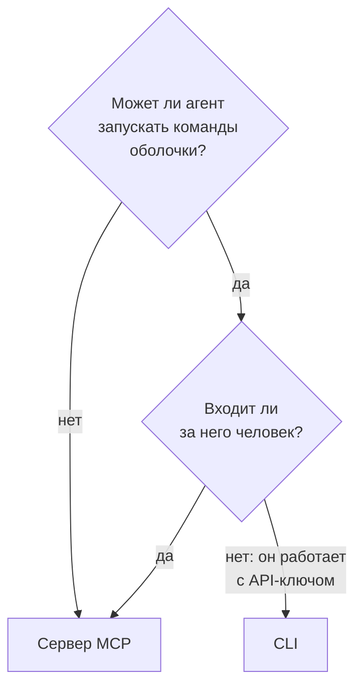

# CLI для ИИ-агентов

ИИ-агент, который может запускать команды оболочки, например агент для программирования в вашем редакторе или задание в вашем конвейере, может работать с OneUptime через CLI вместо [сервера MCP](/docs/ai/mcp-server). Эта страница говорит, когда подходит каждый из них, и как агент устанавливает CLI, ориентируется в ней и читает её ответы.

:::cards
- [CLI или сервер MCP](#cli-или-сервер-mcp): Что использовать агенту.
- [Настройка для агента](#настройка-для-агента): Установите её и дайте ей ключ в окружении.
- [Как агент ориентируется](#как-агент-ориентируется): Ресурсы, их поля и справка.
- [Чтение ответов](#чтение-ответов): JSON от каждой команды, включая ошибки.
:::

## CLI или сервер MCP

Оба обращаются к API OneUptime и делают то, что позволяют их учётные данные. Они различаются тем, что нужно агенту, чтобы к ним обратиться:



| | CLI | Сервер MCP |
| --- | --- | --- |
| Агенту нужны | Оболочка и Node.js 22 или новее | Клиент MCP, например Claude или Cursor |
| Вход выполняется | С API-ключом проекта в `ONEUPTIME_API_KEY` | С вашей учётной записью OneUptime или с API-ключом |
| Доступно | Каждый ресурс API, 450 и больше | Записи и телеметрия, для которых у него есть инструменты, и инструменты реагирования на инциденты |
| Подходит для | Скриптов, которые агент пишет, чтобы люди их сохранили, проверок в конвейере и работы со многими записями | Разговора: разобраться в инциденте, настроить монитор |

Используйте CLI, когда агент и так запускает команды, как агент для программирования, или когда то, что он создаёт, должно работать без него: скрипт в репозитории, шаг конвейера. Используйте сервер MCP, когда человек общается с агентом в чат-клиенте, чтобы агент работал с правами этого человека, а клиент спрашивал перед изменением.

## Настройка для агента

Каждый OneUptime отдаёт скрипт установки CLI своего выпуска: команды ниже скачивают его с `https://oneuptime.com`, поэтому в самостоятельно размещённом OneUptime замените этот адрес своим URL. Сначала скрипт сохраняется как `install.sh`, чтобы вы могли прочитать его перед запуском:

```bash
curl -fsSL https://oneuptime.com/install/cli -o install.sh
ONEUPTIME_URL=https://oneuptime.com bash install.sh
```

Дайте агенту API-ключ проекта только с тем доступом, который нужен для его работы, в окружении, а не в командной строке, и пусть он сначала проверит ключ:

```bash
export ONEUPTIME_API_KEY="your-api-key"
export ONEUPTIME_URL=https://oneuptime.com
oneuptime whoami --check -o json
```

Создайте ключ в **Настройки проекта → Расширенный → Ключи API**: см. [Создание API-ключа](/docs/api-reference/api-reference#создайте-api-ключ). Ключ, который может только читать, позволяет агенту смотреть, и ничего больше.

## Как агент ориентируется

CLI сообщает, что умеет, без API-ключа и без запроса:

| Команда | Что отвечает |
| --- | --- |
| `oneuptime resources -o json` | Каждый ресурс: его команда, его названия, его путь в API, его операции и его действия |
| `oneuptime incident fields -o json` | Поля ресурса: для чего каждое, его тип, нужно ли оно для создания и его флаг |
| `oneuptime incident create --help` | Аргументы и флаги команды |

Поле с ID говорит, ID какого ресурса оно принимает, поэтому агент сначала выводит этот ресурс: `incidentSeverityId` берёт ID из `oneuptime incident-severity list`. Поле, которое называет человека, принимает и его адрес электронной почты, например через `--user-email`.

## Чтение ответов

Пусть агент добавляет `-o json` или `--json` к каждой команде. Тогда каждая команда отвечает в JSON, включая те, чей ответ — предложение, а ошибка — это один объект JSON в стандартном потоке ошибок:

```bash
oneuptime incident acknowledge 6f1c2a40-3b1e-4c55-9a0b-3e2f8d7c1a11 -o json
```

```json
{
  "_id": "6f1c2a40-3b1e-4c55-9a0b-3e2f8d7c1a11",
  "action": "acknowledge",
  "changed": true,
  "state": {
    "_id": "0b7d5e2c-8f4a-4d1b-9c3e-5a6f7b8c9d0e",
    "name": "Acknowledged"
  }
}
```

Код выхода говорит, что произошло: `0`, когда всё получилось, `2`, когда API-ключа нет или он отклонён, и `3`, когда записи нет. В JSON ошибки тот же код стоит в `exitCode`, а в `hint` — что делать дальше. См. [Форматы вывода](/docs/cli/output-formats#json) и [Коды выхода](/docs/cli/scripting#коды-выхода).

## Дальнейшие шаги

:::cards
- [Операции с ресурсами](/docs/cli/resource-operations): Каждая операция с её флагами и фильтрами.
- [Справочник команд](/docs/cli/command-reference): Каждая команда, параметр и значение по умолчанию.
- [Сервер MCP](/docs/ai/mcp-server): Вместо этого подключите чат-клиент к OneUptime.
:::
